# GLM-4提示工程技术入门

> 来源：[https://kq4b3vgg5b.feishu.cn/docx/UPSed55q4oYzQ8xx2jCcticZnUg](https://kq4b3vgg5b.feishu.cn/docx/UPSed55q4oYzQ8xx2jCcticZnUg)

```python
import os
from zhipuai import ZhipuAI
from IPython.display import display, Code, Markdown

api_key = os.getenv("ZHIPU_API_KEY")
```

```python
client = ZhipuAI(api_key=api_key) 
response = client.chat.completions.create(
    model="glm-4",  # 填写需要调用的模型名称
    messages=[
        {"role": "user", "content": "你好"}
    ],
)
print(response.choices[0].message)
```

```
content='你好👋！我是人工智能助手智谱清言，可以叫我小智🤖，很高兴见到你，欢迎问我任何问题。' role='assistant' tool_calls=None
```

## 大模型的涌现能力

GPT3模型是第一批拥有“涌现能力”的大语言模型，即哪怕模型未经特定任务的训练，但在适当的提示下，仍然能够解决某些特定领域的问题。例如大语言模型可以解答数学问题、辅助进行编程、甚至是进行问答等，其实都属于模型的涌现能力。而为何类似数学能力是模型的“涌现能力”，其实原因也并不复杂——作为概率模型，大语言模型甚至不知道数字代表的真实含义，模型只是在学习了无数的语料之后，发现了一些数学结论之间的潜在概率关系，才最终涌现出了数学运算或者复杂推理的能力。

## 大模型应用的关键技术——提示工程（Prompt engineering）

不过需要注意的是，大模型的这种“涌现能力”其实并不稳定，在不修改模型本身参数（微调）的情况下，模型涌现能力极度依赖对模型的提示过程，即对同样一个模型，不同的提示方法将获得质量完全不同的结果。而一个完整的用户和大语言模型的交互流程，也被称为大语言模型的提示工程（Prompt engineering），根据此前的描述我们不难理解，提示工程是激发模型涌现能力（激发模型潜力）的非常关键的技术。同时，由于我们对大语言模型“涌现能力”的应用要求是远远多于简单的使用大模型进行文本创建的（毕竟哪怕是对话任务都属于大模型涌现能力的范畴），因此提示工程这一专门用于激发大语言模型涌现能力的技术就变得尤其重要。

## 提示词与提问技巧

正如Ch 0.课程介绍部分所言，提示工程其实是极容易上手、但同时上限很高的一项技术。对于新人大模型工程师来说，只需要掌握一些提示词模板、就能很好的提升模型效果，而提示工程技术最终的目的是更好的激发大模型的涌现能力，本质上其实是“和大模型对话的艺术”，归根结蒂还是在长期的经验积累过程中积累和总结得到的技巧，这些技巧因模型的不同而不同、因任务不同而不同，很多时候甚至需要考验大模型工程师自身的“语感”。而若能合理提示，那么大模型能够发挥的作用是难以想象的，在编程与Agent开发领域，OpenAI创始人Sam甚至扬言，自然语言将会是最重要的“编程语言”：

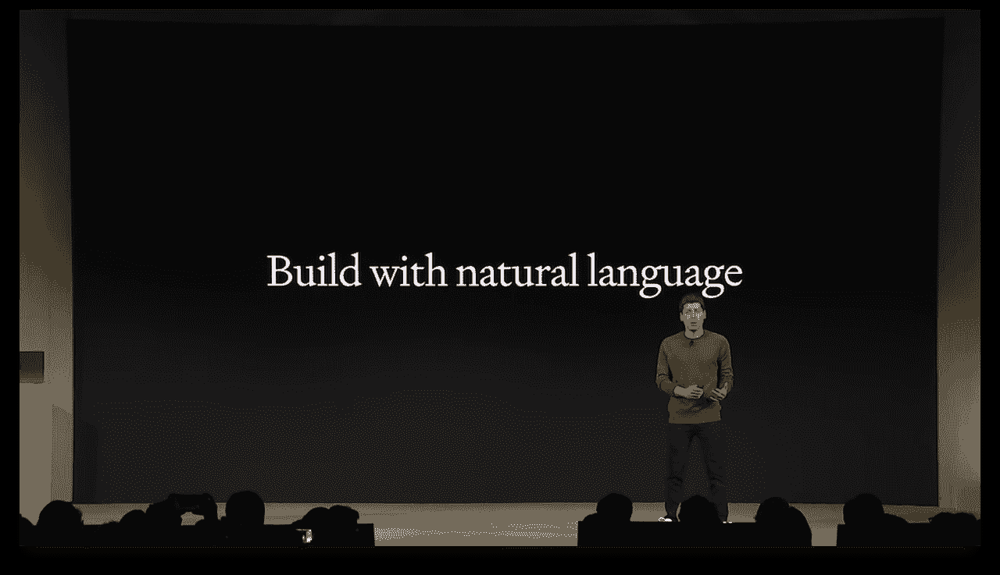

## 无处不在的提示工程

值得注意的是，时至今日，大多数模型进行性能评测时，都不是简单的围绕问题进行回答，而是在某项提示工程技术加持下测试模型回答准确率。如近期发布的Gemini模型，标榜的性能评测结果是是使用了COT（思考链）提示工程技术下模型问答的准确率。当然，与Gemini对应的进行比较的则是GPT-4模型，但该评测结果饱受诟病的是对比模型采用了另一种提示工程方法——Few-shot，在相同数据集下使用不同提示工程方法并将结果在同一水平上进行比较，确实很难确保评判的公平性。更为关键的是，相比COT，5-shot（Few-shots）提示方法要“弱”很多。

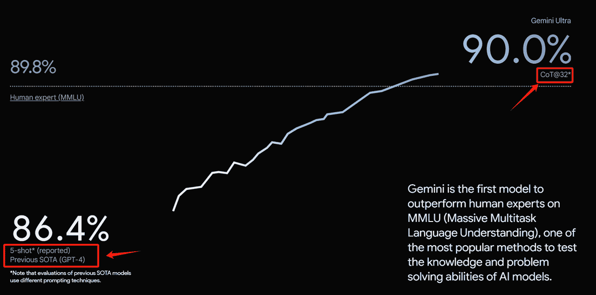

相比之下，智谱AI在发布GLM-4的评测榜单则更加可信一些：

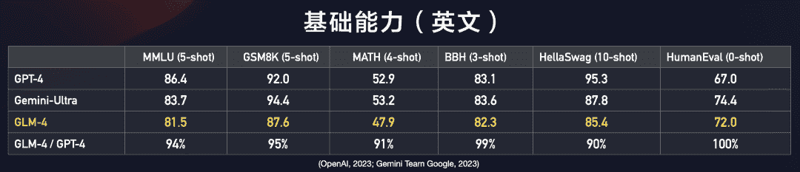

在进行模型比较时，都采用了相同的提示方法在相同的数据集上进行比较。当然，无论是Gemini模型，还是GLM-4模型发布，都不约而同的采用了MMLU数据集，该数据集目前已然称为大模型性能评测最热门数据集之一。

## 大模型世界认知数据集：MMLU

MMLU（Massive Multitask Language Understanding）是一个大规模的语言理解数据集，旨在评估和推动自然语言理解（NLU）模型在多种任务和领域上的性能。MMLU由Meta AI（前Facebook AI）创建，并在多项研究中使用，以测试模型在广泛的语言理解任务上的能力。MMLU涵盖了57种不同类型的任务，包括但不限于常识推理、科学理解、历史事实、文学分析等。正因如此，MMLU数据集也被称为世界认知数据集，这种多样性使得MMLU成为了测试模型在广泛领域内理解能力的重要工具。

而[本节介绍的提示工](https://arxiv.org/pdf/2009.03300.pdf)程，也将主要依据MMLU上的表现，来判断某项提示工程方法是否有效。需要注意的是，MMLU数据集总共包含14000多个问题，但该数据集本身并未开源，只面向科研机构开放申请使用权限。课程里将主要使用MMLU论文种所展示的若干问题。MMLU论文地址

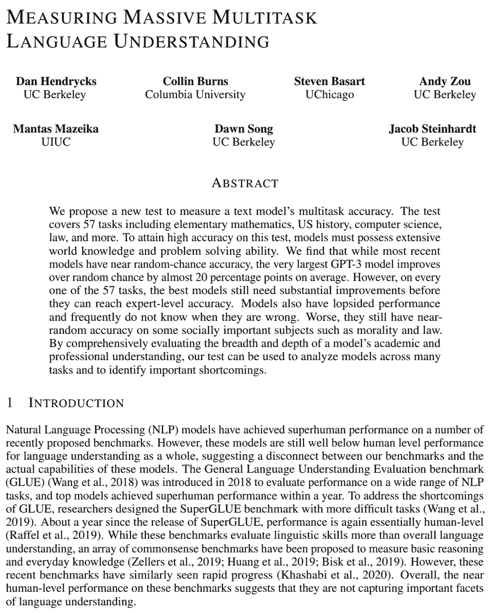

## 一、大模型提示工程方法介绍

### 第一代推理能力测试问题回顾

接下来就正式进入到大模型提示工程方法介绍部分，这里我们先通过一组简单问题的问答过程，来介绍目前大模型提示工程技术的基本方法，然后再将其应用于MMLU数据集中，测试这些方法在复杂问题问答中的实际效果。

以下四个问题是提示工程技术相关论文中的基础测试题，在GPT-3.5模型时代往往被用于进行模型推理能力测试。

```python
Q1 = '罗杰有五个网球，他又买了两盒网球，每盒有3个网球，请问他现在总共有多少个网球？'
A1 = '现在罗杰总共有11个网球。'
```

```python
Q2 = '食堂总共有23个苹果，如果他们用掉20个苹果，然后又买了6个苹果，请问现在食堂总共有多少个苹果？'
A2 = '现在食堂总共有9个苹果。'
```

```python
Q3 = '杂耍者可以杂耍16个球。其中一半的球是高尔夫球，其中一半的高尔夫球是蓝色的。请问总共有多少个蓝色高尔夫球？'
A3 = '现在总共有4个蓝色高尔夫球。'
```

```python
Q4 = '艾米需要4分钟才能爬到滑梯顶部，她花了1分钟才滑下来，水滑梯将在15分钟后关闭，请问在关闭之前她能滑多少次？'
A4 = '关闭之前艾米能滑3次。'
```

### 1.基础模型问答性能测试

#### GLM-3-turbo性能测试

```python
response = client.chat.completions.create(
    model="glm-3-turbo",  # 填写需要调用的模型名称
    messages=[
        {"role": "user", "content": Q1}
    ],
)
display(Markdown(response.choices[0].message.content))
```

罗杰原本有5个网球，他又买了两盒网球，每盒有3个网球。那么他新买网球的总数是2盒 × 3个/盒 = 6个网球。

所以，他现在总共有5个 + 6个 = 11个网球。

```python
response = client.chat.completions.create(
    model="glm-3-turbo",  # 填写需要调用的模型名称
    messages=[
        {"role": "user", "content": Q2}
    ],
)
display(Markdown(response.choices[0].message.content))
```

食堂原来有23个苹果，用掉了20个，那么就剩下23 - 20 = 3个苹果。

然后又买了6个苹果，那么现在就有3 + 6 = 9个苹果。

所以，现在食堂总共有9个苹果。

```python
response = client.chat.completions.create(
    model="glm-3-turbo",  # 填写需要调用的模型名称
    messages=[
        {"role": "user", "content": Q3}
    ],
)
display(Markdown(response.choices[0].message.content))
```

杂耍者可以杂耍16个球，其中一半的球是高尔夫球，那么就有 16 / 2 = 8 个高尔夫球。

再根据题意，其中一半的高尔夫球是蓝色的，那么就有 8 / 2 = 4 个蓝色高尔夫球。

所以，总共有4个蓝色高尔夫球。

```python
response = client.chat.completions.create(
    model="glm-3-turbo",  # 填写需要调用的模型名称
    messages=[
        {"role": "user", "content": Q4}
    ],
)
display(Markdown(response.choices[0].message.content))
```

艾米每次爬到滑梯顶部和滑下的总时间是4分钟（爬上去）+ 1分钟（滑下来）= 5分钟。水滑梯关闭前有15分钟，所以在这15分钟内，艾米可以爬上滑梯并滑下的次数是15分钟除以每次的总时间5分钟，即：

15分钟 ÷ 5分钟/次 = 3次。

但是，我们需要记得，艾米在第一次爬上滑梯时就已经用了4分钟，所以她实际上只有15分钟 - 4分钟 = 11分钟的时间来反复滑下。用这11分钟除以每次的总时间5分钟，我们得到：

11分钟 ÷ 5分钟/次 = 2次余1分钟。

这意味着艾米在关闭之前可以滑2次，因为即使她还有1分钟，但她已经没有足够的时间再爬到顶部的4分钟了。所以最终答案是，艾米能在水滑梯关闭之前滑2次。

#### GPT-3.5性能测试

```python
import openai
openai.api_key = os.getenv("OPENAI_API_KEY")
```

```python
response = openai.ChatCompletion.create(
  model="gpt-3.5-turbo",
  messages=[
    {"role": "user", "content": Q1},
  ]
)
```

```python
response.choices[0].message['content']
```

```
'罗杰原本有5个网球，又买了两盒网球，每盒有3个网球，所以一共买了2 * 3 = 6个网球。\n现在总共有5 + 6 = 11个网球。 \n所以，他现在总共有11个网球。'
```

```python
response = openai.ChatCompletion.create(
  model="gpt-3.5-turbo",
  messages=[
    {"role": "user", "content": Q2},
  ]
)
```

```python
response.choices[0].message['content']
```

```
'食堂现在总共有23 - 20 + 6 = 9个苹果。'
```

```python
response = openai.ChatCompletion.create(
  model="gpt-3.5-turbo",
  messages=[
    {"role": "user", "content": Q3},
  ]
)
```

```python
response.choices[0].message['content']
```

```
'根据题意，杂耍者可以杂耍16个球，其中一半是高尔夫球，即8个球是高尔夫球。又已知一半的高尔夫球是蓝色的，即有一半的8个高尔夫球是蓝色的。\n\n所以，总共有8个蓝色高尔夫球。'
```

```python
response = openai.ChatCompletion.create(
  model="gpt-3.5-turbo",
  messages=[
    {"role": "user", "content": Q4},
  ]
)
```

```python
response.choices[0].message['content']
```

```
'在滑梯关闭之前，她能滑的次数取决于她滑下来所需要的时间和滑梯关闭的时间之间的差距。

滑下来所需要的时间是1分钟。
滑梯关闭的时间是15分钟，即900秒。

在滑梯关闭之前，她能滑的次数等于（滑梯关闭时间 - 滑下来所需时间）/ 爬到滑梯顶部所需时间。

次数 = (900秒 - 60秒) / 4分钟 = 840秒 / 4分钟 = 210次。

所以，在关闭之前，她能滑210次。'
```

#### GLM-4推理能力测试

```python
response = client.chat.completions.create(
    model="glm-4",  # 填写需要调用的模型名称
    messages=[
        {"role": "user", "content": Q1}
    ],
)
display(Markdown(response.choices[0].message.content))
```

罗杰原来有5个网球，他又买了两盒，每盒有3个网球。

所以，他买的网球总数是：

2盒 × 3个/盒 = 6个

那么，他现在总共有的网球数是：

原来的网球数 + 新买的网球数

5个 + 6个 = 11个

所以，罗杰现在总共有11个网球。

```python
response = client.chat.completions.create(
    model="glm-4",  # 填写需要调用的模型名称
    messages=[
        {"role": "user", "content": Q2}
    ],
)
display(Markdown(response.choices[0].message.content))
```

原来食堂有23个苹果，用掉了20个，那么剩下：

23 - 20 = 3 个苹果。

之后食堂又买了6个苹果，那么现在的总数是：

3 + 6 = 9 个苹果。

所以现在食堂总共有9个苹果。

```python
response = client.chat.completions.create(
    model="glm-4",  # 填写需要调用的模型名称
    messages=[
        {"role": "user", "content": Q3}
    ],
)
display(Markdown(response.choices[0].message.content))
```

如果杂耍者可以杂耍16个球，那么高尔夫球的总数是16个球的一半，即：

16 / 2 = 8个高尔夫球

其中一半的高尔夫球是蓝色的，所以蓝色高尔夫球的数量是8个高尔夫球的一半：

8 / 2 = 4个蓝色高尔夫球

所以，总共有4个蓝色高尔夫球。

```python
response = client.chat.completions.create(
    model="glm-4",  # 填写需要调用的模型名称
    messages=[
        {"role": "user", "content": Q4}
    ],
)
display(Markdown(response.choices[0].message.content))
```

艾米爬到滑梯顶部需要4分钟，滑下来需要1分钟，所以她每次完整地玩滑梯需要5分钟。

如果水滑梯在15分钟后关闭，我们可以用总时间除以每次玩滑梯的时间来计算她能玩多少次：

15分钟 ÷ 5分钟/次 = 3次

所以，在滑梯关闭之前，艾米能滑3次。

#### GPT-4模型性能测试


# 提示工程方法实践

```
response = openai.ChatCompletion.create(
  model="gpt-4-0613",
  messages=[
    {"role": "user", "content": Q1},
  ]
)
```

```
response.choices[0].message['content']
```

```
'他现在总共有5+2*3=11个网球。'
```

```
response = openai.ChatCompletion.create(
  model="gpt-4-0613",
  messages=[
    {"role": "user", "content": Q2},
  ]
)
```

```
response.choices[0].message['content']
```

```
'食堂现在总共有9个苹果。'
```

```
response = openai.ChatCompletion.create(
  model="gpt-4-0613",
  messages=[
    {"role": "user", "content": Q3},
  ]
)
```

```
response.choices[0].message['content']
```

```
'总共有8个高尔夫球，其中一半是蓝色的，所以有4个蓝色的高尔夫球。'
```

```
response = openai.ChatCompletion.create(
  model="gpt-4-0613",
  messages=[
    {"role": "user", "content": Q4},
  ]
)
```

```
response.choices[0].message['content']
```

```
'Amy每次上下滑梯总共需要4分钟上+1分钟下=5分钟。因此，在15分钟内他可以滑下 15/5 = 3 次。'
```

在基础问答数据集上，`GLM-3-turbo`和`GPT-3.5`表现相当，而`GLM-4`和`GPT-4`则是都能回答正确。

> 需要注意的是，根据智谱AI官方说明，`GLM-3-turbo`是`ChatGLM3`的升级版。在原版`ChatGLM3-6b`模型上，平均只能回答正确前两道题。

为了更好的展示提示工程效果，这里我们先在`GLM-3-turbo`模型上介绍提示工程方法，然后在实战阶段，再将其迁移至`GLM-4`模型上，并围绕更加复杂的`MMLU`问题进行性能测试。需要注意的是提示工程方法本身并不局限于某个模型，而是一种跨模型通用的提升模型性能的方法。

## 2. Zero-shot与Few-shot提示法

### 借助多轮user-assistant消息进行Few-shot

首先，最为简单的提示工程的方法就是[通过输入一些类似问题和问题答案](https://arxiv.org/pdf/2005.14165.pdf)，让模型参考学习，并在同一个`prompt`的末尾提出新的问题，依次提升模型的推理能力。这种方法也被称为`One-shot`或者`Few-shot`提示方法。`One-shot`和`Few-shot`最早由OpenAI研究团队在论文《Language Models are Few-Shot Learners》中率先提出，这篇论文也是提示工程方法开山鼻祖，不仅介绍了提示工程的两大核心方法，同时也详细介绍这么做背后的具体原因。

如果想在Chat模型中进行`Few-shot`，最好的办法就是在`messages`中设置多轮`user-assistant`消息，这里我们还是以Ch.2中的推理问题为例，尝试在Chat模型中进行推理并进行`Few-shot`，这里我们尝试以第一个问题的问题和答案作为提示示例，引导模型解答第二个问题，则可以按照如下方式设置`messages`：

```
response = client.chat.completions.create(
    model="glm-3-turbo",  
    messages=[
        {"role": "user", "content": Q1},
        {"role": "assistant", "content": A1},
        {"role": "user", "content": Q2}
      ]
)
display(Markdown(response.choices[0].message.content))
```

食堂原来有23个苹果，用掉了20个，那么剩下的苹果就是：

`23 - 20 = 3`个苹果

然后食堂又买了6个苹果，所以现在总共有：

`3 + 6 = 9`个苹果

现在食堂总共有9个苹果。

在这个示例中，我们能够看出其实`assistant`消息也是可以自定义的，用于给模型提供回答的范本。并且由此可见`messages`参数具体呈现形式可以非常多样，不仅可以按照`system-user`的形式规定回答风格，而且还可以按照`user-assistant-user-assistant...`形式来进行`Few-shot`。这其实也是得益于`messages`高度灵活的参数构成形式——即由多条注明消息源的消息构成。`messages`中具体每条消息的内容以及消息序列构成形式上，有非常大的调整的空间。

```
response = client.chat.completions.create(
    model="glm-3-turbo",  
      messages=[
        {"role": "user", "content": Q1},
        {"role": "assistant", "content": A1},
        {"role": "user", "content": Q2}, 
        {"role": "assistant", "content": A2},   
        {"role": "user", "content": Q3}, 
      ]
)
display(Markdown(response.choices[0].message.content))
```

杂耍者有16个球，其中一半是高尔夫球，所以有 `16 / 2 = 8` 个高尔夫球。

这8个高尔夫球中，一半是蓝色的，所以有 `8 / 2 = 4` 个蓝色高尔夫球。

因此，总共有4个蓝色高尔夫球。

```
response = client.chat.completions.create(
    model="glm-3-turbo",  
    messages=[
        {"role": "user", "content": Q1},
        {"role": "assistant", "content": A1},
        {"role": "user", "content": Q2}, 
        {"role": "assistant", "content": A2},   
        {"role": "user", "content": Q3}, 
        {"role": "assistant", "content": A3},   
        {"role": "user", "content": Q4},
  ]
)
display(Markdown(response.choices[0].message.content))
```

艾米每次爬上滑梯并滑下来需要 `4 + 1 = 5` 分钟。

水滑梯将在15分钟后关闭。

如果我们将15分钟分成5分钟的时间段，那么艾米在这段时间内可以爬上并滑下滑梯的次数是15除以5，即：

`15分钟 ÷ 5分钟/次 = 3`次

所以，在关闭之前，艾米能滑3次。

## 3. 思考链COT提示法

### 借助system role输入提示模板实现COT

那有什么办法能够通过更好的提示来提高模型的推理能力呢？最简单的一类办法就是借助思维链（也被称为思考链，`Chain of Thought`，`CoT`）提示法来解决这个问题。在这些方法中，最为简单的思维链的实现方法是在提示词尾部追加一句`Let's think step by step`，即可大幅提高模型推理能力。这种方法最早由东京大学和谷歌在论文《Large Language Models are Zero-Shot Reasoners》中提出。由于只需要修改提示词而无需手动编写推导的成功示例（无需编写思维链样本），因此这种方法也被称为`Zero-shot-CoT`。

根据原论文描述，作者在测试`Zero_shot_CoT`方法时曾尝试过多组不同的提示词尾缀，并在一个机器人指令数据集上进行测试，最终发现`Let's think step by step`效果最好，其他指令及各指令准确率排名如下：

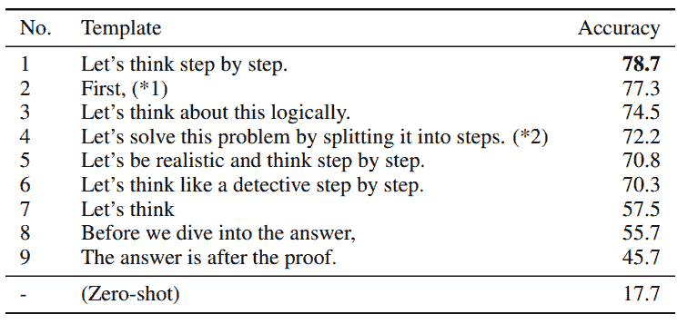

类似的，就该指令`Let's think step by step`的中文翻译而言，“请一步步进行推理并得出结论”要远远好于“请让我们一步步进行思考”等类似的提示词语句。这一客观情况也给大模型使用者非常深刻的启发，那就是大模型的“思考过程”是黑箱模型，哪怕表意近似的提示词对模型来说实际的影响力可能会有非常大的区别，围绕提示词的开发需要进行大量的尝试，这个过程也非常类似于掘金的过程。而对于实际使用者而言，则需要平日多注重提示词的积累和尝试。

其次，论文中首次提出了利用大模型进行两阶段推理的设想，即第一个阶段先进行问题的拆分并分段解答问题（`Reasoning Extraction`），然后第二阶段再进行答案的汇总（`Answer Extraction`）。这一设想尽管没有在论文中进行大量验证，但却给之后的一种名为`LEAST-TO-MOST`（`LtM`）的提示方法给予了启发，该方法将在后文中进行介绍。

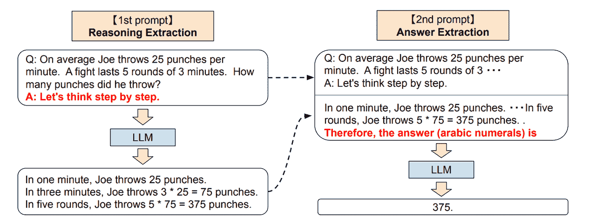

既然`system`消息能够作为背景设定的基本消息并对后续的问答消息造成影响，那么很容易想到的`system`消息的一个应用场景就是借助`system role`输入提示模板，为了更好的提高模型推理能力，我们可以在每个`prompt`中加入一句“请一步步推理并得出结论”进而实现`Zero-shot-CoT`。而在Chat模型中，这种`prompt`模板信息是非常适合通过`system role`进行输入的，例如围绕第四个推理问题，我们可以通过输入一条内容为“请一步步推理并得出结论”的系统信息，来引导模型完成`Zero-shot-CoT`：

```
prompt_temp_cot = '请一步步思考并解决问题'
```

```
response = client.chat.completions.create(
    model="glm-3-turbo",  
  messages=[
    {"role": "system", "content": prompt_temp_cot},
    {"role": "user", "content": Q1}
  ]
)
display(Markdown(response.choices[0].message.content))
```

首先，我们要知道罗杰最开始有多少个网球。根据题目，罗杰最开始有5个网球。

然后，我们要计算两盒网球总共有多少个。每盒有3个网球，所以两盒就是3个乘以2，等于6个网球。

最后，我们将罗杰最开始有的网球数量和后来买的网球数量相加。也就是 `5 + 6 = 11` 个网球。

所以，罗杰现在总共有11个网球。

能够看出，模型确实开始进行了CoT推导。接下来我们测试第四个推理问题、也是最复杂的一个推理问题：

```
response = client.chat.completions.create(
    model="glm-3-turbo",  
  messages=[
    {"role": "system", "content": prompt_temp_cot},
    {"role": "user", "content": Q4}
  ]
)
display(Markdown(response.choices[0].message.content))
```

要解决这个问题，我们需要一步步地计算艾米在滑梯关闭前能滑多少次。

首先，我们知道艾米爬到滑梯顶部需要4分钟，滑下来需要1分钟。这意味着每次完整的上下滑梯需要5分钟（`4 + 1 = 5`分钟）。

然后，我们知道滑梯在15分钟后关闭。为了找出艾米在这段时间内能滑多少次，我们需要用滑梯关闭前的时间除以每次上下滑梯所需的时间。

所以，我们进行如下计算：

`15 ÷ 5 = 3`

这意味着艾米在滑梯关闭前可以滑3次。

所以，最终答案是艾米在关闭之前能滑3次。

能够看出发现在`Zero-shot-CoT`的情况下，`gpt-3.5`模型能够推导得出第四个问题的正确答案。

## 4. Few-shot-CoT提示方法

### Few-shot-CoT实现过程

哪怕[CoT方法](https://arxiv.org/pdf/2201.11903.pdf)，既然可以`Zero-shot-CoT`，自然也可以`Few-shot-CoT`。需要注意的是，`Zero-shot-CoT`是零样本提示的情况下通过修改提示词后缀激发模型的思维链，而`Few-shot-CoT`则是通过通过编写思维链样本作为提示词，让模型学会思维链的推导方式，从而更好的完成推导任务。该方法最早由谷歌大脑团队在论文《Chain-of-Thought Prompting Elicits Reasoning in Large Language Models》中首次提出，也是在这篇论文中思维链的概念被首次提出，因此该论文可以说是思维链的开山鼻祖之作。

> 这里需要注意，从诞生时间上来说，`Few-shot-CoT`诞生时间要早于`Zero-shot-CoT`，课程中是按照先易后难的顺序编排的内容，所以先介绍`Zero-shot-CoT`、后介绍`Few-shot-CoT`。

其实相比于`Few-shot`，`Few-shot-CoT`的不同之处只是在于需要在提示样本中不仅给出问题的答案、还同时需要给出问题推导的过程（即思维链），从而让模型学到思维链的推导过程，并将其应用到新的问题中。例如，围绕上述四个推理问题，第一个问题是比较好解决的，我们可以手动写一个思维链作为`Few-shot`的示例：

```
'Q：“罗杰有五个网球，他又买了两盒网球，每盒有3个网球，请问他现在总共有多少个网球？” \
A：“罗杰一开始有五个网球，又购买了两盒网球，每盒3个，共购买了6个网球，因此现在总共由5+6=11个网球。因此答案是11。” '
```

```
'Q：“罗杰有五个网球，他又买了两盒网球，每盒有3个网球，请问他现在总共有多少个网球？” A：“罗杰一开始有五个网球，又购买了两盒网球，每盒3个，共购买了6个网球，因此现在总共由5+6=11个网球。因此答案是11。” '
```

当然类似这种思维链，也可以借助此前的`Zero-shot-CoT`来完成创建。

在获得了一个思维链示例后，我们即可以此作为样本进行`Few-shot-CoT`来解决最后一个推理问题，具体执行过程如下


```
prompt_Few_shot_CoT3 = &#x27;Q“罗杰有五个网球，他又买了两盒网球，每盒有3个网球，请问他现在总共有多少个网球？” \
                        A：“罗杰一开始有五个网球，又购买了两盒网球，每盒3个，共购买了6个网球，因此现在总共由5+6=11个网球。因此答案是11。” \
                        Q：“食堂总共有23个苹果，如果他们用掉20个苹果，然后又买了6个苹果，请问现在食堂总共有多少个苹果？” \
                        A：“食堂最初有23个苹果，用掉20个，然后又买了6个，总共有23-20+6=9个苹果，答案是9。” \
                        Q：“杂耍者可以杂耍16个球。其中一半的球是高尔夫球，其中一半的高尔夫球是蓝色的。请问总共有多少个蓝色高尔夫球？” \
                        A：“总共有16个球，其中一半是高尔夫球，也就是8个，其中一半是蓝色的，也就是4个，答案是4个。” \
                       &#x27;
prompt_Few_shot_CoT3
```

```
&#x27;Q“罗杰有五个网球，他又买了两盒网球，每盒有3个网球，请问他现在总共有多少个网球？”                         A：“罗杰一开始有五个网球，又购买了两盒网球，每盒3个，共购买了6个网球，因此现在总共由5+6=11个网球。因此答案是11。”                         Q：“食堂总共有23个苹果，如果他们用掉20个苹果，然后又买了6个苹果，请问现在食堂总共有多少个苹果？”                         A：“食堂最初有23个苹果，用掉20个，然后又买了6个，总共有23-20+6=9个苹果，答案是9。”                         Q：“杂耍者可以杂耍16个球。其中一半的球是高尔夫球，其中一半的高尔夫球是蓝色的。请问总共有多少个蓝色高尔夫球？”                         A：“总共有16个球，其中一半是高尔夫球，也就是8个，其中一半是蓝色的，也就是4个，答案是4个。”                        &#x27;
```

```
response = client.chat.completions.create(
    model=&quot;glm-3-turbo&quot;,  
  messages=[
    {&quot;role&quot;: &quot;system&quot;, &quot;content&quot;: prompt_Few_shot_CoT3},
    {&quot;role&quot;: &quot;user&quot;, &quot;content&quot;: &#x27;Q:&#x27;+Q4}
  ]
)
display(Markdown(response.choices[0].message.content))
```

A:艾米爬到滑梯顶部需要4分钟，滑下来只需要1分钟。因此，每次完整的上下滑梯需要5分钟（4分钟爬上去 + 1分钟滑下来）。滑梯关闭前有15分钟，所以艾米可以在关闭前爬上并滑下3次（15分钟 ÷ 5分钟/次 = 3次）。因此，在关闭之前她能滑3次。

能够发现，在输入了前三个问题的思维链作为提示词样本，第四个问题已经可以顺利回答了。

## 一、《Chain-of-Thought Prompting Elicits Reasoning in Large Language Models》重点结论解读

由于《Chain-of-Thought Prompting Elicits Reasoning in Large Language Models》是思维链的开山之作，因此论文中提出了大量的关于思维链的应用场景——除了可以用于解决上述推理问题外，思维链还可以被广泛应用于复杂语义理解、符号映射、连贯文本生成等领域。论文中给出了一系列结论，用于论证思维链在这些领域应用的有效性。

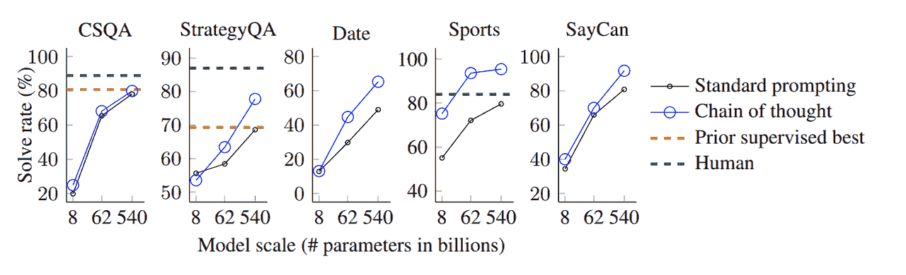

此外，论文中还重点强调了模型体量和思维链效果之间的关系，简而言之就是，模型越大、Few-shot-CoT应用效果越好。论文同样以GSM8K数据集为例进行了说明，能够看出模型效果LaMDA（137B）< GPT-3（175B） < PaLM（540B）。和Zero-shot-CoT类似，模型越大、CoT对模型潜在能力激发效果越好。

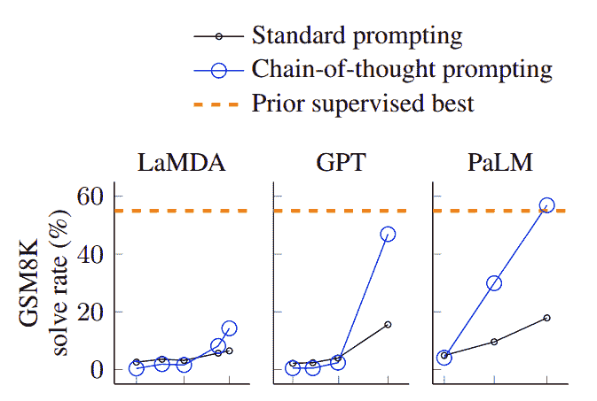

> 这里PaLM具体得分为57分，而Prior supervised best（单独训练的最佳有监督学习模型）得分为55分。

### 二、GLM-4在MMLU数据集上的提示效果测试

#### 1. MMLU数据集问题介绍

接下来我们在MMLU数据集中选取14个具有代表性的问题进行提问，并测试GLM-4在不同提示方法下的表现。这14个问题覆盖机器学习、数学、计算机、物理、化学、天文学、经济学、法律、医学等专业领域，选取的这组问题均为单选题，题目如下：

```
# 机器学习问题
MQ1 = &#x27;一个六面骰子掷了15次，结果如下：1号面出现0次；2号面出现1次；\
3号面出现2次；4号面出现3次；5号面出现4次；6号面出现5次。\
基于这些结果，使用加一平滑（Add-1 Smoothing）时，3号面出现的概率是多少？\
(A) 2/15 (B) 1/7 (C) 3/16 (D) 1/5&#x27;
MA1 = &#x27;B&#x27;
```

```
# 法律问题
MQ2 = &#x27;当百科全书推销员走近隐士的房子所在的场地时，他看到一个标牌，上面写着：“推销员禁止入内。侵入者将被起诉。继续前行后果自负。”\
尽管卖家没有被邀请进入，但他无视了标志，沿着车道朝房子开去。 \
当他绕过一个弯道时，埋在车道上的强大炸药爆炸，销售员受伤，他能否向隐士索要赔偿其受伤的损失？\
(A) 如果隐士安装爆炸装置时仅意图威慑而非伤害入侵者，那么卖家可以索赔。\
(B) 如果隐士对车道下的爆炸装置负有责任，那么卖家可以索赔。\
(C) 卖家不可以索赔，因为他无视了警告告示，告示警告他不要继续前进。\
(D) 如果隐士合理地担心有入侵者会伤害他或他的家人，那么卖家不可以索赔。&#x27;
MA8 = &#x27;B&#x27;
```

```
# 物理问题
MQ3 = &#x27;当您将球从静止状态掉落时，它会以 9.8 m/s² 的速度向下加速。 如果你把它向下扔，假设没有空气阻力，它离开你的手后立即的加速度是\
(A) 9.8 m/s²\
(B) 超过 9.8 m/s²\
(C) 小于 9.8 m/s²\
(D) 除非给出投掷速度，否则不能说&#x27;
MA3 = &#x27;A&#x27;
```

```
# 医学问题
MQ4 = &#x27;一名33岁男性因甲状腺癌接受根治性甲状腺切除术。手术过程中，中度出血需要结扎颈部左侧的多条血管。\
术后，血清研究显示钙浓度为7.5mg/dL，白蛋白浓度为4g/dL，甲状旁腺激素浓度为200pg/mL。据此推断下列哪一项受到损害\
该患者的这些发现是由血管引起的吗？\
(A) 肋颈干的分支\
(B) 颈外动脉的分支\
(C) 甲颈干的分支\
(D) 颈内静脉的支流&#x27;
MA4 = &#x27;C&#x27;
```

```
# 经济学问题
MQ5 = &#x27;政府之所以不鼓励并对垄断进行管制的原因之一是\
(A) 生产者剩余丧失，而消费者剩余增加。\
(B) 垄断定价确保了生产效率，但却牺牲了社会的配置效率。\
(C) 垄断企业不参与重大的研发活动。\
(D) 随着价格上升和产出水平下降，消费者剩余减少。&#x27;
MA5 = &#x27;D&#x27;
```

```
# 生物学问题
MQ6 = &#x27;舌骨的胚胎学起源是什么？\
(A) 第一咽弓\
(B) 第一、第二咽弓\
(C) 第二咽弓\
(D) 第二、第三咽弓&#x27;
MA6 = &#x27;D&#x27;
```

```
# 天文学问题
MQ7 = &#x27;为什么小行星带的位置没有形成行星？\
(A) 这里曾经形成过一个行星，但它被一次灾难性的碰撞打碎了。\
(B) 在太阳星云的这部分没有足够的物质来形成一个行星。\
(C) 这里有太多的岩石物质，无法形成类地行星，但又缺乏足够的气体物质来形成类木行星。\
(D) 与木星的共振阻止了物质聚集成行星。&#x27;
MA7 = &#x27;D&#x27;
```

```
# 医学问题
MQ8 = &#x27;在把工作交给一位资深同事之前，你应该尝试为患者置管多少次？\
(A) 4次 (B) 3次 (C) 2次 (D) 1次&#x27;
MA8 = &#x27;B&#x27;
```

```
# 生物学问题
MQ9 = &#x27;在一个给定的群体中，每400人中就有1个人因为一个完全隐性的基因b而患上癌症。\
假设该群体处于哈代-温伯格平衡状态，以下哪个是预期携带b基因但不会发展成癌症的个体比例？\
(A) 1/400 (B) 19/400 (C) 20/400 (D) 38/400&#x27;
MA9 = &#x27;D&#x27;
```

```
# 化学问题
MQ10 = &#x27;以下关于镧系元素的说法哪一项是不正确的？\
(A) 镧系元素最常见的氧化态是+3。\
(B) 镧系元素的配合物通常具有高配位数（&gt;6）。\
(C) 所有镧系元素都能与水溶性酸反应释放出氢气。\
(D) 从镧到镥，镧系元素的原子半径随周期增加而增大。&#x27;
MA10 = &#x27;D&#x27;
```

```
# 计算机问题
MQ11 = &#x27;考虑一种计算机设计，其中多个处理器，每个处理器都有一个私有缓存内存，通过单个总线共享全局内存。\
这个总线是关键的系统资源。每个处理器每500纳秒可以执行一个指令，只要内存引用可以通过其本地缓存满足。\
当发生缓存未命中时，处理器将额外延迟2000纳秒。在这个额外延迟的一半时间内，总线被专用于服务缓存未命中。\
在另一半时间内，处理器不能继续执行，但总线可以自由服务其他处理器的请求。平均而言，每条指令需要2次内存引用。\
平均而言，每次引用有1%的几率发生缓存未命中。忽略由于其他处理器的竞争导致的延迟，单个处理器会消耗总线容量的多少比例？\
(A) 1/50 (B) 1/27 (C) 1/25 (D) 2/27&#x27;
MA11 = &#x27;B&#x27;
```

```
# 历史学问题
MQ12 = &#x27;《至高无上法案》（Act of Supremacy）于1534年由英国议会通过，正式确认了英格兰国王作为英格兰教会（Church of England）的至高无上的首脑。\
这一法案不仅赋予了国王在宗教事务上的绝对权力，也标志着英格兰与罗马天主教会正式断绝关系，并导致了英格兰宗教改革的开始。《至高无上法案》主张：\
(A) 给予英国国王一个新的权威地位\
(B) 将英格兰教会首脑的位置仅赋予亨利八世，排除他的继承人\
(C) 在英格兰确立加尔文主义作为唯一真正的神学\
(D) 结束困扰英格兰教会的各种形式的腐败&#x27;
MA12 = &#x27;D&#x27;
```

```
# 数学问题
MQ13 = &#x27;乔负责一次舞会的灯光。红灯每两秒闪烁一次，黄灯每三秒闪烁一次，蓝灯每五秒闪烁一次。\
如果我们包括舞会的开始和结束，那么在一个七分钟的舞会期间，所有的灯光会同时亮起多少次？\
（假设在舞会开始时所有三盏灯同时闪烁。）\
(A) 3\
(B) 15\
(C) 6\
(D) 5&#x27;
MA13 = &#x27;B&#x27;
```

```
# 历史学问题
MQ14 = &#x27;谢斯叛乱（Shays\&#x27;s Rebellion）发生在1786-1787年，是一系列反对马萨诸塞州政府的高税收和司法判决的抗议活动，这些政策导致了农民财产被没收。\
这场叛乱凸显了美国联邦政府在《邦联条例》下的弱点，激发了对更强大中央政府的需求，最终导致了美国宪法的起草和颁布。\
反联邦主义者是美国宪法起草和批准过程中的一群人，他们担心强大的中央政府会侵犯个人自由和各州的权力。\
因此，他们最为谴责的是对谢斯叛乱的联邦回应，因为这场叛乱和随后的联邦政府强硬回应正是他们担心中央政府过度权力的一个例证。\
以下哪一项“不幸”是革命后时期的反联邦主义者最为谴责的？\
(A) 对贝肯叛乱的有组织回应。\
(B) 对谢斯叛乱的联邦回应。\
(C) 对威士忌叛乱的联邦回应。\
(D) 对庞蒂亚克叛乱的联邦回应。&#x27;
MA14 = &#x27;C&#x27;
```

同时为了测试GLM-4模型实际性能，我们也将同时对比测试GPT-4模型在不同提示方法下的表现。

#### 1. 模型基本问答流程

+   Zero-shot下问答流程

```
# GLM-4问答流程
response = client.chat.completions.create(
    model=&quot;glm-4&quot;, 
    messages=[
        {&quot;role&quot;: &quot;user&quot;, &quot;content&quot;: MQ1}
    ],
)
display(Markdown(response.choices[0].message.content))
```

在使用加一平滑（也称为拉普拉斯平滑）时，我们会在每个面出现次数的基础上给每个面加1，这样做的目的是为了避免概率计算中出现0概率的情况，同时给予未在样本中出现的面一定的概率。

给定的六面骰子掷了15次的结果如下：

+   1号面出现0次

+   2号面出现1次

+   3号面出现2次

+   4号面出现3次

+   5号面出现4次

+   6号面出现5次

根据加一平滑的规则，每个面的出现次数都要加1。

进行平滑后，每个面的出现次数变为：

+   1号面：0 + 1 = 1

+   2号面：1 + 1 = 2

+   3号面：2 + 1 = 3

+   4号面：3 + 1 = 4

+   5号面：4 + 1 = 5

+   6号面：5 + 1 = 6

现在，所有面的出现次数总和为：1 + 2 + 3 + 4 + 5 + 6 = 21。

3号面出现的概率可以通过其平滑后的出现次数除以总次数来计算：

概率(3号面) = 出现次数(3号面) / 总次数

概率(3号面) = 3 / 21

简化这个分数，我们得到：

概率(3号面) = 1 / 7

所以，3号面出现的概率是1/7。

答案是 (B) 1/7。

```
# GPT-4问答流程
response = openai.ChatCompletion.create(
  model=&quot;gpt-4-0125-preview&quot;,
  messages=[
    {&quot;role&quot;: &quot;user&quot;, &quot;content&quot;: MQ1}
  ]
)
display(Markdown(response.choices[0].message[&#x27;content&#x27;]))
```

加一平滑（Add-1 Smoothing）也称为拉普拉斯平滑，是用于处理某些事件未观测到的情形，防止计算概率时出现0的情况，同时也用于平滑概率分布。在这种方法中，我们给每个计数加一，并相应调整分母以保持概率和为1。

对于一个六面骰子，每个面出现的次数原本如下：

+   1号面出现0次

+   2号面出现1次

+   3号面出现2次

+   4号面出现3次

+   5号面出现4次

+   6号面出现5次

总共掷骰子15次。

在应用加一平滑之后，我们将给每个面出现的次数加1，变为：

+   1号面出现1次

+   2号面出现2次

+   3号面出现3次

+   4号面出现4次

+   5号面出现5次

+   6号面出现6次

因此，新总和为 1 + 2 + 3 + 4 + 5 + 6 = 21。

针对3号面，加一平滑之后出现的次数变为3次。

所以，3号面出现的概率是 3/21 = 1/7。

正确答案是：(B) 1/7。

+   COT提示下问答流程

```
prompt_temp_cot = &#x27;请围绕该选择题，一步步思考并做出合理选择。&#x27;
```

```
response = client.chat.completions.create(
    model=&quot;glm-4&quot;,  
  messages=[
    {&quot;role&quot;: &quot;system&quot;, &quot;content&quot;: prompt_temp_cot},
    {&quot;role&quot;: &quot;user&quot;, &quot;content&quot;: MQ1}
  ]
)
display(Markdown(response.choices[0].message.content))
```

加一平滑（也称为拉普拉斯平滑）是一种处理分类问题中稀有事件的技术，用于避免概率为零的问题。在这种情况下，我们给每个类别增加一个计数，然后再计算概率。

首先，我们来看看没有平滑时3号面出现的概率是多少：

[ P(3) = \frac{出现次数_{3}}{总次数} = \frac{2}{15} ]

但是，因为1号面出现了0次，如果没有平滑，其概率将为0，这在很多情况下是不合理的。因此，我们使用加一平滑。

加一平滑的公式为：

[ P_{\text{平滑}}(i) = \frac{出现次数_{i} + 1}{总次数 + 类别数} ]

这里，总次数是15次，类别数是6（因为骰子有6个面）。

对于3号面，平滑后的概率是：

[ P_{\text{平滑}}(3) = \frac{出现次数_{3} + 1}{总次数 + 类别数} = \frac{2 + 1}{15 + 6} = \frac{3}{21} = \frac{1}{7} ]

所以，使用加一平滑后，3号面出现的概率是 ( \frac{1}{7} )，答案是 (B)。


# 模型调用与概率计算

## OpenAI API 调用示例

```
response = openai.ChatCompletion.create(
  model=&quot;gpt-4-0125-preview&quot;,
  messages=[
    {&quot;role&quot;: &quot;system&quot;, &quot;content&quot;: prompt_temp_cot},
    {&quot;role&quot;: &quot;user&quot;, &quot;content&quot;: MQ1}
  ]
)
display(Markdown(response.choices[0].message[&#x27;content&#x27;]))
```

## 加一平滑（Add-1 Smoothing）原理

为了确定3号面出现的概率，首先我们需要理解加一平滑（Add-1 Smoothing）的概念。加一平滑是一种处理零概率问题的技术，用于避免给没有见过的事件分配零概率。在这种情况下，我们对每个事件的计数加1，以便做出概率估计。

事实上，给定的数据是这样的：

+ 1号面出现0次；
+ 2号面出现1次；
+ 3号面出现2次；
+ 4号面出现3次；
+ 5号面出现4次；
+ 6号面出现5次。

加一平滑后的计数是：

+ 1号面出现次数变为0 + 1 = 1次；
+ 2号面出现次数变为1 + 1 = 2次；
+ 3号面出现次数变为2 + 1 = 3次；
+ 4号面出现次数变为3 + 1 = 4次；
+ 5号面出现次数变为4 + 1 = 5次；
+ 6号面出现次数变为5 + 1 = 6次。

加一平滑后，实际上掷骰子的次数也会变化。在15次掷骰的基础上，由于每一面骰子都加了1次，所以总次数变为15 + 6（因为骰子有6面）= 21次。

现在，我们可以计算3号面出现的概率，加一平滑后3号面出现3次，总共21次。所以3号面出现的概率是：

[P(3号面) = \frac{3次}{21次} = \frac{1}{7}]

因此，答案是 (B) 1/7。

## GLM-4 Zero-shot 下模型回答效果

结论：总共回答正确6道题，准确率为7/14=50%

### MQ1

```
response = client.chat.completions.create(
    model=&quot;glm-4&quot;, 
    messages=[
        {&quot;role&quot;: &quot;user&quot;, &quot;content&quot;: MQ1}
    ],
)
display(Markdown(response.choices[0].message.content))
```

在使用加一平滑（也称为拉普拉斯平滑）时，我们会在每个面出现的次数上加1，以避免概率计算中出现0概率的情况。这样做的目的是为了给未在样本中出现的事件赋予一个非零的概率。

根据题目，骰子各面出现的次数如下：

+ 1号面：0次
+ 2号面：1次
+ 3号面：2次
+ 4号面：3次
+ 5号面：4次
+ 6号面：5次

进行加一平滑后，每个面出现的次数变为：

+ 1号面：0 + 1 = 1次
+ 2号面：1 + 1 = 2次
+ 3号面：2 + 1 = 3次
+ 4号面：3 + 1 = 4次
+ 5号面：4 + 1 = 5次
+ 6号面：5 + 1 = 6次

现在，我们计算3号面出现的概率。概率是3号面出现的次数除以所有面出现的总次数。

加一平滑后，总共的投掷次数为：

0 + 1 + 2 + 3 + 4 + 5 + 6（加一平滑的总和）= 21次

3号面出现的概率是：

3号面出现次数 / 总次数 = 3 / 21

简化这个分数，得到：

3 / 21 = 1 / 7

因此，3号面出现的概率是1/7，答案是 (B) 1/7。

### MQ2

```
response = client.chat.completions.create(
    model=&quot;glm-4&quot;, 
    messages=[
        {&quot;role&quot;: &quot;user&quot;, &quot;content&quot;: MQ2}
    ],
)
display(Markdown(response.choices[0].message.content))
```

这个问题涉及法律和道德问题，特别是在侵权法领域。根据提供的选项和情境描述，以下是各个选项的分析：

(A) 如果隐士安装爆炸装置时仅意图威慑而非伤害入侵者，那么卖家可以索赔。

+ 这个选项暗示即使隐士没有意图伤害人，但由于实际发生了伤害，卖家可能仍有权索赔。但是，这个情况在法律上可能不成立，因为隐士的行为（设置爆炸装置）可能导致伤害。

(B) 如果隐士对车道下的爆炸装置负有责任，那么卖家可以索赔。

+ 这个选项指出，如果隐士对设置爆炸装置的行为负有责任，卖家可能有权索赔。在法律上，如果某人设置了可能导致伤害的陷阱，即使有警告，他们可能仍然要对因此受到的伤害负责。

(C) 卖家不可以索赔，因为他无视了警告告示，告示警告他不要继续前进。

+ 这个选项可能是正确的。在法律上，如果存在明显的警告，并且个人忽视了警告而遭受伤害，那么该个人可能无法索赔。这称为“自担风险”原则。

(D) 如果隐士合理地担心有入侵者会伤害他或他的家人，那么卖家不可以索赔。

+ 这个选项涉及到隐士的自卫权利和合理预防措施。如果法院认为隐士是出于自卫并采取了合理的预防措施，卖家可能无法索赔。

综合以上分析，选项 (C) 最有可能正确。卖家无视了明确的警告，并且自愿承担了前进的风险。在大多数法律体系中，这种情况下卖家可能无法向隐士索赔。然而，具体情况还取决于当地法律的具体规定，以及法院如何解释“自担风险”原则和隐士行为的合理性。

### MQ3

```
response = client.chat.completions.create(
    model=&quot;glm-4&quot;, 
    messages=[
        {&quot;role&quot;: &quot;user&quot;, &quot;content&quot;: MQ3}
    ],
)
display(Markdown(response.choices[0].message.content))
```

答案是 (A) 9.8 m/s²。

当物体在地球表面附近自由下落时，不论它是从静止开始下落，还是被扔下去，只要没有其他外力作用（例如空气阻力），物体都将以相同的加速度下落，这个加速度被称为重力加速度，其值大约为9.8 m/s²（这个值可能会因为地球表面的位置略有不同）。这适用于所有情况，包括被扔下的情况。

即使你向下扔一个球，球在你松手的那一刻仍然会受到重力的作用，导致它的加速度是9.8 m/s²。注意，如果球在被扔出的时候已经有了一个初速度，那么它下落时的速度将是其初速度与重力加速度的叠加结果。但加速度本身，也就是重力对物体速度改变的率，仍然是9.8 m/s²。因此，不需要知道投掷速度就可以确定加速度是9.8 m/s²。

### MQ4

```
response = client.chat.completions.create(
    model=&quot;glm-4&quot;, 
    messages=[
        {&quot;role&quot;: &quot;user&quot;, &quot;content&quot;: MQ4}
    ],
)
display(Markdown(response.choices[0].message.content))
```

根据病例描述，患者在甲状腺切除术中出现了中度出血，需要结扎颈部左侧的多条血管。术后血清研究显示钙浓度低，白蛋白浓度在正常范围，而甲状旁腺激素浓度高。这些发现可能表明患者术后出现了甲状旁腺功能低下，这通常是由于手术中甲状旁腺的血供受损所致。

甲状旁腺位于甲状腺背面，其血液供应通常来源于以下几条血管：

+ 甲颈干（C）：是甲状旁腺的主要血液供应来源，它分支于锁骨下动脉，负责供应颈部和甲状腺的血液。
+ 颈外动脉（B）：虽然它也有分支供应颈部组织，但通常不是甲状旁腺的主要血液供应。
+ 肋颈干（A）：主要供应肩部和颈部的一些肌肉，与甲状旁腺的血供关系不大。
+ 颈内静脉（D）：是颈部的主要静脉，不直接供应甲状旁腺。

因此，如果由于手术中结扎了某些血管而造成甲状旁腺的血供受损，最有可能的是：

甲颈干的分支（C）受到损害。

这是最可能导致患者出现低钙浓度和高甲状旁腺激素浓度的原因，因为甲状旁腺激素是由甲状旁腺分泌的，其分泌通常是为了应对血钙水平的下降。术后低钙血症常见于甲状旁腺损伤或其血液供应受损的情况。

### MQ5

```
response = client.chat.completions.create(
    model=&quot;glm-4&quot;, 
    messages=[
        {&quot;role&quot;: &quot;user&quot;, &quot;content&quot;: MQ5}
    ],
)
display(Markdown(response.choices[0].message.content))
```

选项(D) "随着价格上升和产出水平下降，消费者剩余减少" 是政府不鼓励并对垄断进行管制的主要原因之一。

垄断市场中，由于垄断企业控制了市场上的大部分供应，它可以设置较高的价格而不会担心失去所有顾客。这种市场力量导致消费者需要支付更高的价格，从而减少了消费者的剩余（即消费者愿意支付的最高价格和实际支付价格之间的差额）。同时，垄断企业可能会限制产出以维持高价格，这进一步减少了消费者的福利。

以下是其他选项为何不是最佳答案的解释：

(A) "生产者剩余丧失，而消费者剩余增加"：在垄断市场中，垄断企业通常能够获得较高的生产者剩余，因为它可以通过设置高于竞争市场水平的价格来增加利润。

(B) "垄断定价确保了生产效率，但却牺牲了社会的配置效率"：实际上，垄断往往导致生产效率和社会配置效率的损失。由于缺乏竞争，垄断企业可能没有激励去提高生产效率，并且垄断定价通常会导致资源分配的社会效率低下。

(C) "垄断企业不参与重大的研发活动"：这个说法并不完全准确。一些垄断企业实际上可能会投资于研发以保持其市场地位，尽管它们的动机可能更多是为了维持垄断而不是创新。

因此，(D) 是最符合为何政府要管制垄断的原因。政府通过反垄断政策和价格管制等措施，旨在保护消费者利益，防止垄断企业利用市场力量损害社会福利。

### MQ6

```
response = client.chat.completions.create(
    model=&quot;glm-4&quot;, 
    messages=[
        {&quot;role&quot;: &quot;user&quot;, &quot;content&quot;: MQ6}
    ],
)
display(Markdown(response.choices[0].message.content))
```

舌骨的胚胎学起源是（B）第一、第二咽弓。

在胚胎发育过程中，舌骨是由第一和第二咽弓的某些部分演变形成的。咽弓是胚胎时期咽喉区域的结构，它们在胚胎发育的不同阶段起着关键作用，最终形成多种不同的解剖结构。在这个情况下，舌骨的形成涉及到这两个咽弓的相互作用和发育。

### MQ7

```
response = client.chat.completions.create(
    model=&quot;glm-4&quot;, 
    messages=[
        {&quot;role&quot;: &quot;user&quot;, &quot;content&quot;: MQ7}
    ],
)
display(Markdown(response.choices[0].message.content))
```

小行星带位于火星与木星轨道之间，为什么这一区域没有形成一个大的行星，目前最广为接受的解释是：

(D) 与木星的共振阻止了物质聚集成行星。

木星是太阳系中最大的行星，它的质量巨大，因此在形成过程中对周围的物质产生了强烈的引力作用。在太阳系早期，当星云中的物质正在聚集形成行星时，木星的巨大引力对轨道上的物质产生了扰动。特别是，木星的引力与这些物质形成了共振，这种共振增加了物质之间的相对速度，导致它们相互碰撞而不是聚集在一起形成更大的天体。

这种共振效应破坏了小行星带区域物质的稳定性，使得它们无法凝聚成一个大的行星。此外，由于木星的引力作用，该区域的物质被推到特定的轨道模式，阻止了它们合并成更大的天体。

选项(A)提出了一种假设，即小行星带可能是由一次灾难性碰撞后的碎片形成的，但这并不是为什么这个区域没有形成行星的解释，而是对小行星带现有状态的一个假设。

选项(B)提到没有足够的物质形成行星，但实际上小行星带拥有大量的物质，问题是这些物质未能聚集形成行星。

选项(C)提出这里有太多的岩石物质，但这也包括了为什么这些岩石物质未能形成行星的原因。而且，它没有解释为什么这个区域不能形成类木行星。

因此，从目前的天文学理解来看，选项(D)是最准确的解释。

### MQ8

```
response = client.chat.completions.create(
    model=&quot;glm-4&quot;, 
    messages=[
        {&quot;role&quot;: &quot;user&quot;, &quot;content&quot;: MQ8}
    ],
)
display(Markdown(response.choices[0].message.content))
```

这个问题可能是在特定的医疗或护理环境中提出的，关于在尝试置管（例如中心静脉置管、导尿管置管等）失败后何时应该寻求更有经验的同事的帮助。然而，这个问题没有提供具体的临床背景，不同的情况可能有不同的标准。

通常，对于尝试置管的次数，并没有一个固定的规则。这取决于多种因素，包括置管类型、患者状况、难度级别以及操作者的技能和经验。然而，为了确保患者安全和护理质量，以下是一种可能的考虑方式：

+ (A) 4次：多次尝试可能会增加患者的风险和不适，如果不是在紧急情况下，一般不会尝试这么多次。
+ (B) 3次：在一些情况下，如果前两次尝试未能成功，可能会允许进行第三次尝试。
+ (C) 2次：这是一个比较常见的标准。如果首次尝试失败，进行第二次尝试，但如果再次失败，就应该寻求资深同事的帮助。
+ (D) 1次：如果首次尝试失败后就立即寻求帮助，可以更快地确保患者的安全并提高成功率。

根据上述考虑，选项(C) 2次可能是最合理的答案，但这需要根据具体情况和所在医疗机构的政策来决定。

请注意，正确做法是在实际操作前咨询资深同事或上级，遵循所在医疗机构的操作指南和政策，确保患者安全。如果你是医疗或护理专业的学生或从业者，应该在临床实践中遵循这些原则。

### MQ9

```
response = client.chat.completions.create(
    model=&quot;glm-4&quot;, 
    messages=[
        {&quot;role&quot;: &quot;user&quot;, &quot;content&quot;: MQ9}
    ],
)
display(Markdown(response.choices[0].message.content))
```

根据哈代-温伯格定律，我们可以通过已知的患病率来估计`b`基因的频率。由题意知，每400人中有1个人因为隐性基因`b`而患病，这意味着患病的基因型频率为1/400。

设`b`为隐性基因的频率，则`bb`（患病个体的基因型）的频率为 `b^2`。因为1个人是400人中的1/400，我们可以得出：

[ b^2 = \frac{1}{400} ]

解得：

[ b = \frac{1}{20} ]

因为`b`是隐性基因的频率，所以不患病但携带一个`b`基因的个体（即`Bb`基因型）的频率是2倍的`b`（因为`Bb`有两种形成方式，从父亲那里获得`b`和从母亲那里获得`B`，或者从父亲那里获得`B`和从母亲那里获得`b`）乘以（1-`b`），即：

[ 2b(1-b) = 2 \times \frac{1}{20} \times \left(1 - \frac{1}{20}\right) ]

[ 2b(1-b) = 2 \times \frac{1}{20} \times \frac{19}{20} ]

[ 2b(1-b) = \frac{38}{400} ]

所以，预期携带`b`基因但不会发展成癌症的个体比例是38/400。

答案是 (D) 38/400。

### MQ10

```
response = client.chat.completions.create(
    model=&quot;glm-4&quot;, 
    messages=[
        {&quot;role&quot;: &quot;user&quot;, &quot;content&quot;: MQ10}
    ],
)
display(Markdown(response.choices[0].message.content))
```

根据提供的参考信息以及化学知识，我们可以分析以下关于镧系元素的说法：

(A) 镧系元素最常见的氧化态是+3。这一说法是正确的，因为镧系元素最外层的电子配置为(n-2)f^1-14(n-1)d^0-1ns^2，它们通常会失去3个电子以达到稳定的电子配置。

(B) 镧系元素的配合物通常具有高配位数（>6）。这也是正确的，由于镧系元素具有较大的原子半径和较强的电荷，它们能够与多个配体形成较高的配位数。

(C) 所有镧系元素都能与水溶性酸反应释放出氢气。这一说法是错误的。镧系元素中的某些元素可以与酸反应生成氢气，但并非所有镧系元素都具有相同的活性。它们的活性随着原子序数的增加而变化。

(D) 从镧到镥，镧系元素的原子半径随周期增加而增大。这一说法是正确的。由于镧系收缩现象，从镧（La）到镥（Lu）的原子半径逐渐增大，这是由于填充的4f轨道电子对核的屏蔽作用逐渐增强导致的。

综上所述，不正确的说法是 (C) 所有镧系元素都能与水溶性酸反应释放出氢气。


```
response = client.chat.completions.create(
    model=&quot;glm-4&quot;, 
    messages=[
        {&quot;role&quot;: &quot;user&quot;, &quot;content&quot;: MQ11}
    ],
)
display(Markdown(response.choices[0].message.content))
```

为了解决这个问题，我们需要计算单个处理器因为缓存未命中而占用总线的平均时间，并将其与处理器执行指令的总时间进行比较。

+   平均每条指令需要2次内存引用。
+   每次内存引用有1%的几率发生缓存未命中。

这意味着平均每条指令有2次机会产生缓存未命中的情况。

接下来，计算因缓存未命中而导致的额外延迟：

+   当缓存未命中发生时，处理器的额外延迟是2000纳秒。
+   其中1000纳秒处理器占用总线，另外1000纳秒处理器虽然不执行，但总线可用。

因此，每次缓存未命中会导致处理器占用总线1000纳秒。

现在，计算平均每个指令周期中处理器占用总线的时间：

+   因缓存未命中，每条指令平均占用总线的概率是2次中的1%或0.01。
+   所以，平均每个指令周期中处理器因为缓存未命中占用总线的时间是`2000纳秒 * 2 * 0.01 = 40纳秒`。

最后，计算处理器消耗的总线容量比例：

+   每条指令执行时间为500纳秒。
+   因此，单个处理器执行指令时（不包括因为缓存未命中而导致的延迟），消耗总线的比例为`40纳秒 / (500纳秒 * 2次内存引用)`。

这简化为：

+   `40纳秒 / 1000纳秒 = 1/25`

因此，单个处理器消耗总线容量的比例是`1/25`。

答案是：(C)`1/25`。

```
response = client.chat.completions.create(
    model=&quot;glm-4&quot;, 
    messages=[
        {&quot;role&quot;: &quot;user&quot;, &quot;content&quot;: MQ12}
    ],
)
display(Markdown(response.choices[0].message.content))
```

在提供的选项中，与《至高无上法案》（Act of Supremacy）最相关的描述是：

(A) 给予英国国王一个新的权威地位

这个法案的确立，确实给予了英国国王在宗教事务上的新权威地位，宣布他为英格兰教会的最高领袖（最初是Supreme Head，后改为Supreme Governor），从而取代了教皇在英格兰的宗教权威。

其他选项的解释如下：

(B) 将英格兰教会首脑的位置仅赋予亨利八世，排除他的继承人

这个选项不正确，因为《至高无上法案》确立的是一个持续的职位，适用于所有未来的英国君主，而不仅仅是亨利八世。

(C) 在英格兰确立加尔文主义作为唯一真正的神学

这个选项也不正确，因为虽然英格兰宗教改革确实引入了一些新教的元素，但它并没有完全采纳加尔文主义，而是形成了圣公会的独特教派。

(D) 结束困扰英格兰教会的各种形式的腐败

这个选项描述的是宗教改革可能带来的一个结果，但它并不是《至高无上法案》的直接内容或目的。

因此，最合适的答案是(A)。

```
response = client.chat.completions.create(
    model=&quot;glm-4&quot;, 
    messages=[
        {&quot;role&quot;: &quot;user&quot;, &quot;content&quot;: MQ13}
    ],
)
display(Markdown(response.choices[0].message.content))
```

要找出所有三种颜色的灯光在七分钟内同时闪烁的次数，我们需要找到红灯、黄灯和蓝灯闪烁的最小公倍数。

红灯每2秒闪烁一次，黄灯每3秒闪烁一次，蓝灯每5秒闪烁一次。

首先，找出这三个数（2，3，5）的最小公倍数。对于这些质数，最小公倍数就是它们的乘积，即 `2 × 3 × 5 = 30`。

这意味着每30秒，所有三种颜色的灯光会同时闪烁。

舞会总共7分钟，换算成秒就是 `7 × 60 = 420` 秒。

接下来，我们计算在这420秒内，三种灯光会同时闪烁多少次。

420秒内，每30秒灯光同时闪烁一次，所以次数是 `420 ÷ 30 = 14`。

但题目中提到舞会开始时所有三盏灯同时闪烁，所以我们需要在14次的基础上加上开始的那一次。

因此，总共的次数是 `14 + 1 = 15`。

所以，正确答案是 (B) 15。

```
response = client.chat.completions.create(
    model=&quot;glm-4&quot;, 
    messages=[
        {&quot;role&quot;: &quot;user&quot;, &quot;content&quot;: MQ14}
    ],
)
display(Markdown(response.choices[0].message.content))
```

在这四个选项中，革命后时期的反联邦主义者最为谴责的应该是：

(B) 对谢斯叛乱的联邦回应。

如前所述，谢斯叛乱之后，联邦政府的强硬回应成为了反联邦主义者担忧的焦点，他们害怕一个权力过大的中央政府会侵犯个人自由和州权。而贝肯叛乱、威士忌叛乱和庞蒂亚克叛乱虽然也是那个时期的动荡事件，但对谢斯叛乱的联邦回应是反联邦主义者批评的具体例子，因此选项 (B) 是最符合问题描述的正确答案。

## 3.GPT-4 Zero-shot下模型回答效果

结论：总共回答正确6道题，准确率为`9/14=64%`

```
9/14
```

```
0.6428571428571429
```

```
response = openai.ChatCompletion.create(
  model=&quot;gpt-4-0613&quot;,
  messages=[
    {&quot;role&quot;: &quot;user&quot;, &quot;content&quot;: MQ1}
  ]
)
display(Markdown(response.choices[0].message[&#x27;content&#x27;]))
```

加一平滑（Add-1 Smoothing）是对数据的一种平滑处理，其使用途径为：对每种可能性的数量加一，然后再除以总的可能性数。这种方法常常用于处理稀疏数据，防止因数据稀疏导致概率计算结果为0。

在这个例子中，我们有15次掷骰子的结果，六面骰子的各面的可能性数为`15+6=21`次（对每种可能性的结果加一）。所以，根据加一平滑的规则：3号面出现的次数为2，所以加一后为3，总的可能性数为21，所以概率为`3/21`，即`1/7`。所以答案是(B)`1/7`。

```
response = openai.ChatCompletion.create(
  model=&quot;gpt-4-0125-preview&quot;,
  messages=[
    {&quot;role&quot;: &quot;user&quot;, &quot;content&quot;: MQ2}
  ]
)
display(Markdown(response.choices[0].message[&#x27;content&#x27;]))
```

(B) 如果隐士对车道下的爆炸装置负有责任，那么卖家可以索赔。

尽管推销员无视了禁止入内的警告标志，并主动选择忽视潜在的法律风险继续前进，这确实减少了他对于自身安全的责任。然而，使用致命或极度危险的手段来阻止入侵者，特别是在这种情况下，即便是入侵者，也可能被视为过于极端，并且在大多数法律体系下，屋主不能以此种方式来保卫物业。如果隐士对埋置的爆炸装置负有责任，那么他使用过度危险的手段来防止人们进入他的房产，这可能会让他在法律上承担责任，即使受伤的人是无视警告的推销员。

在大多数法律体系中，即使是未受邀请的访客，物业主人也有责任确保他们的财产不会对他人构成不合理的危险。虽然可能存在辩护理由，比如自卫或保护财产，但是使用炸药这种极度危险的手段超出了合理和普遍接受的防卫手段。因此，仅意图威慑、忽略警告、合理的担心入侵者可能造成伤害等因素，并不能完全免除物业所有者因其极端防御行为所造成的伤害责任。

```
response = openai.ChatCompletion.create(
  model=&quot;gpt-4-0613&quot;,
  messages=[
    {&quot;role&quot;: &quot;user&quot;, &quot;content&quot;: MQ3}
  ]
)
display(Markdown(response.choices[0].message[&#x27;content&#x27;]))
```

(A) 9.8 m/s²

```
response = openai.ChatCompletion.create(
  model=&quot;gpt-4-turbo-preview&quot;,
  messages=[
    {&quot;role&quot;: &quot;user&quot;, &quot;content&quot;: MQ4}
  ]
)
display(Markdown(response.choices[0].message[&#x27;content&#x27;]))
```

在这个病例中，患者在根治性甲状腺切除术后血清研究显示钙浓度低（7.5 mg/dL，正常范围大约8.5-10.2 mg/dL），以及甲状旁腺激素（PTH）浓度高（200 pg/mL，正常范围大概10-65 pg/mL）。这些异常都指向了甲状旁腺功能不足的情况，常常是由于手术时意外切除或损伤甲状旁腺或其血供导致的。

甲状旁腺通常有四个，分布在甲状腺的背面，其主要的血供来自甲状旁腺上下动脉，它们是甲颈动脉(上甲状动脉)和甲状动脉下极（来自颈动脉干或直接自胸廓动脉）的分支。

考虑到这些信息，最终导致甲状旁腺受损的可能是与这些甲状旁腺的血供有直接关联的结构。肋颈干（A项）、颈外动脉（B项）和颈内静脉的支流（D项）都不是甲状旁腺的主要血供来源。因此，损伤与甲颈干的分支（C项）相关是最可能的原因，因为这可以直接影响到甲状旁腺的血供，进而导致甲状旁腺激素水平升高和血钙降低。

所以，正确答案是(C) 甲颈干的分支。

```
response = openai.ChatCompletion.create(
  model=&quot;gpt-4-0613&quot;,
  messages=[
    {&quot;role&quot;: &quot;user&quot;, &quot;content&quot;: MQ5}
  ]
)
display(Markdown(response.choices[0].message[&#x27;content&#x27;]))
```

答案是(D) 随着价格上升和产出水平下降，消费者剩余减少。

```
response = openai.ChatCompletion.create(
  model=&quot;gpt-4-0613&quot;,
  messages=[
    {&quot;role&quot;: &quot;user&quot;, &quot;content&quot;: MQ6}
  ]
)
display(Markdown(response.choices[0].message[&#x27;content&#x27;]))
```

(C) 第二咽弓

```
response = openai.ChatCompletion.create(
  model=&quot;gpt-4-0613&quot;,
  messages=[
    {&quot;role&quot;: &quot;user&quot;, &quot;content&quot;: MQ7}
  ]
)
display(Markdown(response.choices[0].message[&#x27;content&#x27;]))
```

(D) 与木星的共振阻止了物质聚集成行星。木星的重力扰动使得小行星带上的物质无法有效地自聚集形成行星。

```
response = openai.ChatCompletion.create(
  model=&quot;gpt-4-turbo-preview&quot;,
  messages=[
    {&quot;role&quot;: &quot;user&quot;, &quot;content&quot;: MQ8}
  ]
)
display(Markdown(response.choices[0].message[&#x27;content&#x27;]))
```

标准和最佳实践可能因地区、医院和具体情况而异。但是，一般来说，如果医生或护士在尝试了2到3次后仍然无法成功为患者置管，应该考虑寻求更有经验的同事帮助。这是基于尽可能减少给患者带来不必要的痛苦和创伤，以及防止可能的并发症。因此，选项 (B) 3次 可能是最合适的选择，但请注意，实际情况可能会根据具体情况而有所不同。

```
response = openai.ChatCompletion.create(
  model=&quot;gpt-4-0613&quot;,
  messages=[
    {&quot;role&quot;: &quot;user&quot;, &quot;content&quot;: MQ9}
  ]
)
display(Markdown(response.choices[0].message[&#x27;content&#x27;]))
```

(B) 19/400

解释：

哈代-温伯格平衡告诉我们，如果一个基因是完全隐性的，那么我们可以预期绝大部分携带该基因的人是杂合体，并且不表现疾病。在这种情况下，如果出现疾病的成功率是`1/400`，那么预期的携带该基因的人的比例应该是根号（`1/400`）或者`1/20`。但是，由于这些人中只有一个会表现出疾病，所以不会发展成癌症的人的预期比例是`1/20 - 1/400 = 19/400`。

```
response = openai.ChatCompletion.create(
  model=&quot;gpt-4-0613&quot;,
  messages=[
    {&quot;role&quot;: &quot;user&quot;, &quot;content&quot;: MQ10}
  ]
)
display(Markdown(response.choices[0].message[&#x27;content&#x27;]))
```

(D) 从镧到镥，镧系元素的原子半径随周期增加而增大。

```
response = openai.ChatCompletion.create(
  model=&quot;gpt-4-0613&quot;,
  messages=[
    {&quot;role&quot;: &quot;user&quot;, &quot;content&quot;: MQ11}
  ]
)
display(Markdown(response.choices[0].message[&#x27;content&#x27;]))
```

由题意知，指令执行时间为500纳秒，每条指令需要2次内存引用，每次引用有1%的几率发生缓存未命中。因此，每条指令平均会有`2×1%=0.02`次的缓存未命中，也就是每50条指令有1次的缓存未命中。

当一个缓存未命中发生时，处理器会额外延迟2000纳秒，在这2000纳秒中，有1000纳秒的时间，总线被专用于服务缓存未命中。

因此，每50条指令，处理器会额外消耗1000纳秒的总线时间。而每条指令执行需要500纳秒，所以50条指令总共需要`50×500=25000`纳秒。

所以，一个处理器消耗总线的比例为`1000/25000=1/25`，答案是(C)`1/25`。

```
response = openai.ChatCompletion.create(
  model=&quot;gpt-4-0613&quot;,
  messages=[
    {&quot;role&quot;: &quot;user&quot;, &quot;content&quot;: MQ12}
  ]
)
display(Markdown(response.choices[0].message[&#x27;content&#x27;]))
```

答案是(A)给予英国国王一个新的权威地位。

"B"选项不准确，因为《至高无上法案》不仅仅只是将英格兰教会首脑的位置赋予亨利八世，它的影响还持续到他的继任者们。这部法案实际上是使英格兰王室成为英格兰教会的最高领袖，所以不仅包含亨利八世，还包括他的继任者。

"C"选项也不准确，因为《至高无上法案》并没有确认加尔文主义为英格兰的唯一正确的神学观点，实际上，它并没有明确规定任何特定的教义或神学观点。

"D"选项同样不准确，虽然亨利八世在传统的罗马天主教会结构中看到了许多腐败，并想要纠正，但是《至高无上法案》并没有特别提及结束腐败的目标。这部法案的主要目的是为了断绝与罗马天主教会的联系，并确认英国君王对国内教务的至高无上的权威。

```
response = openai.ChatCompletion.create(
  model=&quot;gpt-4-turbo-preview&quot;,
  messages=[
    {&quot;role&quot;: &quot;user&quot;, &quot;content&quot;: MQ13}
  ]
)
display(Markdown(response.choices[0].message[&#x27;content&#x27;]))
```

为了找到三盏灯同时亮起的次数，我们需要找到红灯、黄灯和蓝灯闪烁间隔时间的最小公倍数。红灯每2秒闪烁一次，黄灯每3秒闪烁一次，蓝灯每5秒闪烁一次。

首先，我们找到2、3和5的最小公倍数（LCM）。

+   2和3的最小公倍数是6。

+   6和5的最小公倍数是30。


因此，三盏灯将每30秒同时亮起一次。

舞会持续7分钟，即420秒。要找出在这段时间内三盏灯同时亮起的次数，我们将总秒数除以30秒：

`420秒 ÷ 30秒/次 = 14次`

然而，由于包括了舞会开始时三盏灯首次同时亮起的情况，我们需要将次数加1。

因此，总次数 = `14 + 1 = 15`次。

所以，答案是(B) 15次。

```
response = openai.ChatCompletion.create(
  model=&quot;gpt-4-0613&quot;,
  messages=[
    {&quot;role&quot;: &quot;user&quot;, &quot;content&quot;: MQ14}
  ]
)
display(Markdown(response.choices[0].message[&#x27;content&#x27;]))
```

```

```

#### 4. GLM-4 COT下模型回答效果

**结论：总共回答正确8道题，准确率为`8/14=57%`。在COT提示**下，第六、九题回答选择和此前不同，其中第九题回答正确，第六题修改选项后仍然错误。

```
8/14
```

```
0.5714285714285714
```

```
prompt_temp_cot = &#x27;请围绕该选择题，一步步思考并做出合理选择。&#x27;
```

```
response = client.chat.completions.create(
    model=&quot;glm-4&quot;,  
  messages=[
    {&quot;role&quot;: &quot;system&quot;, &quot;content&quot;: prompt_temp_cot},
    {&quot;role&quot;: &quot;user&quot;, &quot;content&quot;: MQ1}
  ]
)
display(Markdown(response.choices[0].message.content))
```

加一平滑（有时也称为拉普拉斯平滑）是一种用于处理稀疏数据集中的概率估计问题的技术，特别是在估计类别概率时。其基本思想是为每个类别添加一个正数（通常是1），从而避免出现概率为零的情况。

在这个问题中，我们有一个六面骰子，掷了15次。加一平滑后，我们可以计算3号面出现的概率如下：

1. 首先，我们需要为每个面添加1次，因为掷骰子的总次数是15次。

1. 接下来，我们计算3号面在平滑后的出现次数。由于实际出现了2次，我们在其上加上1，得到3次。

1. 然后，我们计算平滑后的总次数。因为原本总次数是15，现在每个面都加1，所以总次数变成了15 + 6 = 21次。

1. 最后，我们用平滑后的3号面出现次数除以平滑后的总次数来得到3号面出现的概率。

1. `P(3号面) = (3号面平滑后的出现次数) / (平滑后的总次数)`

`3 / 21`

`1 / 7`

所以，使用加一平滑后，3号面出现的概率是`1/7`。

因此，正确答案是 (B) `1/7`。

```
response = client.chat.completions.create(
    model=&quot;glm-4&quot;,  
  messages=[
    {&quot;role&quot;: &quot;system&quot;, &quot;content&quot;: prompt_temp_cot},
    {&quot;role&quot;: &quot;user&quot;, &quot;content&quot;: MQ2}
  ]
)
display(Markdown(response.choices[0].message.content))
```

这个问题是一个法律情境题，涉及到侵权责任和警告义务。让我们一步步分析各个选项：

(A) 如果隐士安装爆炸装置时仅意图威慑而非伤害入侵者。

+   这个选项提出了隐士的主观意图。但是，在法律上，后果通常比意图更重要。即使隐士的意图是威慑，但如果造成了伤害，意图可能不会完全免责。

(B) 如果隐士对车道下的爆炸装置负有责任。

+   这个选项暗示了责任的问题。如果隐士确实对爆炸装置有责任，并且装置造成了伤害，那么在法律上，他可能需要承担责任。

(C) 卖家不可以索赔，因为他无视了警告告示，告示警告他不要继续前进。

+   这个选项提出了卖家的行为问题。如果卖家明确地无视了警告，那么他可能被认为是有意冒险（assumption of risk）。在很多法律体系中，有意冒险的行为可能导致无法索赔。

(D) 如果隐士合理地担心有入侵者会伤害他或他的家人。

+   这个选项提出了隐士的合理担忧。如果隐士的行为是出于自卫，并且在法律上被认为是合理的，那么他可能对卖家的受伤不承担法律责任。

综合考虑以上选项：

+   选项 (C) 强调了卖家的行为，他明确忽视了警告，这可能构成有意冒险。

+   选项 (D) 提到了隐士的自卫权，如果合理，可能使他免责。

+   选项 (A) 和 (B) 考虑了隐士的意图和责任，但在这种情况下，卖家无视警告的行为可能是决定性因素。

因此，最合理的答案是：

**选项 (C) 卖家不可以索赔，因为他**无视了警告告示，告示警告他不要继续前进。

在大多数法律体系中，如果卖家收到了明确的警告并且选择忽视它，那么他可能无法对由此产生的伤害索赔。这种情况通常涉及有意冒险的法律原则，即个人自愿承担已知的风险。

```
response = client.chat.completions.create(
    model=&quot;glm-4&quot;,  
  messages=[
    {&quot;role&quot;: &quot;system&quot;, &quot;content&quot;: prompt_temp_cot},
    {&quot;role&quot;: &quot;user&quot;, &quot;content&quot;: MQ3}
  ]
)
display(Markdown(response.choices[0].message.content))
```

好的，让我们一步步分析这个物理问题。

首先，我们需要了解在地球表面附近的任何物体都受到重力加速度的作用，这个加速度的大小大约是 (`9.8 , \text{m/s}^2`)，方向向下。

现在，针对这个选择题：

(A) `9.8 m/s²`：这个选项假设无论球是如何被投掷的，它的加速度都是 (`9.8 , \text{m/s}^2`)。

(B) 超过 `9.8 m/s²`：这个选项暗示球的加速度比 (`9.8 , \text{m/s}^2`) 还要大。

(C) 小于 `9.8 m/s²`：这个选项暗示球的加速度比 (`9.8 , \text{m/s}^2`) 还要小。

(D) 除非给出投掷速度，否则不能说：这个选项表明没有足够的信息来决定加速度。

我们知道，无论球是掉落的还是被投掷的，只要它在地球表面附近，重力对它的作用加速度都是 (`9.8 , \text{m/s}^2`)。

但是，如果球是被投掷的，那么在它离开手的那一刻，除了重力加速度之外，它还可能获得一个初速度。这个初速度会影响球在空中的运动，但不会改变重力加速度。

因此，一步步的思考过程是这样的：

1.  重力加速度是常数，与球如何开始下落无关。

1.  如果球是静止释放的，它的加速度是 (`9.8 , \text{m/s}^2`)。

1.  如果球是被投掷的，它仍然受到同样的重力加速度，即 (`9.8 , \text{m/s}^2`)。

基于这些考虑，合理的答案是：

(A) `9.8 m/s²`

这是因为重力加速度是独立于球的初始状态的。无论球是如何开始下落的，重力都是以 (`9.8 , \text{m/s}^2`) 的加速度作用于球。其他选项考虑的情况在物理学上不正确，至少在忽略空气阻力的情况下是这样的。

```
response = client.chat.completions.create(
    model=&quot;glm-4&quot;,  
  messages=[
    {&quot;role&quot;: &quot;system&quot;, &quot;content&quot;: prompt_temp_cot},
    {&quot;role&quot;: &quot;user&quot;, &quot;content&quot;: MQ4}
  ]
)
display(Markdown(response.choices[0].message.content))
```

要回答这个问题，首先我们需要了解每一项选择与患者症状之间的潜在联系。

A. 肋颈干的分支

+   肋颈干主要供应颈部深部和肩部的肌肉。损伤这些分支通常不会直接影响甲状腺或甲状旁腺的功能。

B. 颈外动脉的分支

+   颈外动脉分支供应头皮和面部的血液，损伤这些分支通常与术后的钙代谢异常无关。

C. 甲颈干的分支

+   甲颈干是供应甲状腺和甲状旁腺的主要血管。损伤这些分支可能导致甲状腺或甲状旁腺的血液供应不足，从而影响钙的代谢。

D. 颈内静脉的支流

+   颈内静脉主要负责头部和颈部的静脉血液回流，其损伤通常不会直接导致钙代谢异常。

患者术后的血清钙浓度为`7.5mg/dL`，而正常血清钙浓度一般在`8.4-10.2mg/dL`范围内。低钙血症可能与甲状旁腺功能受损有关，因为甲状旁腺激素（`PTH`）是调节血钙水平的主要激素。

以下是逐步分析：

1.  患者有低钙血症，这意味着可能影响到调节钙代谢的甲状旁腺。

1.  甲状旁腺激素浓度为`200pg/mL`，这个水平如果不考虑其他因素（如肾功能），似乎是正常的，但低钙和正常PTH可能暗示甲状旁腺功能受损或血液供应不足。

1.  考虑到手术过程中颈部左侧的多条血管被结扎，这可能导致左侧甲状旁腺的血液供应受损。

结合以上信息，我们可以推断：

+   选择A和B与甲状腺或甲状旁腺的血液供应无关，因此不太可能是正确答案。

+   选择C（甲颈干的分支）与甲状腺和甲状旁腺的血液供应直接相关，损伤这些分支可能导致低钙血症。

+   选择D与钙代谢异常没有直接关系。

综上所述，最合理的答案是：

C. 甲颈干的分支

因为损伤这些分支可能导致甲状旁腺功能受损，从而引起患者的低钙血症。

```
response = client.chat.completions.create(
    model=&quot;glm-4&quot;,  
  messages=[
    {&quot;role&quot;: &quot;system&quot;, &quot;content&quot;: prompt_temp_cot},
    {&quot;role&quot;: &quot;user&quot;, &quot;content&quot;: MQ5}
  ]
)
display(Markdown(response.choices[0].message.content))
```

让我们一步步分析这个选择题的各个选项：

(A) 生产者剩余丧失，而消费者剩余增加。

这个选项描述的情形并不是典型的垄断市场特征。在垄断市场中，由于垄断企业控制了市场供给，通常会提高价格，这样会导致消费者剩余减少，而垄断企业的生产者剩余增加。因此，这个选项不符合垄断市场的实际情况。

(B) 垄断定价确保了生产效率，但却牺牲了社会的配置效率。

这个选项部分正确。垄断企业在生产方面可能会实现规模经济，从而有较高的生产效率。但是，由于垄断定价通常高于竞争市场下的价格，会导致资源配置效率降低，因为垄断企业生产的商品数量少于社会最优水平，从而牺牲了社会的配置效率。然而，这并不是政府管制垄断的主要原因。

(C) 垄断企业不参与重大的研发活动。

这个选项并不是普遍适用的。有些垄断企业，特别是技术垄断企业，可能会投入大量资金进行研发活动，以维持其市场主导地位。因此，这个选项也不能作为政府管制垄断的合理理由。

(D) 随着价格上升和产出水平下降，消费者剩余减少。

这个选项描述了垄断市场的一个核心特征。垄断企业通过限制产量和提高价格来获取更高的利润，这导致消费者剩余减少。政府通常关注消费者福利，因此，为了保护消费者利益和确保市场的有效运作，政府可能会对垄断进行管制。

综上所述，根据各个选项的分析：

+   选项 (A) 不符合垄断市场的实际情况。

+   选项 (B) 描述了垄断的部分效应，但不是主要原因。

+   选项 (C) 不是普遍适用的。

+   选项 (D) 正确地反映了垄断市场的核心问题，即消费者剩余的减少。

因此，合理的选择是 (D) 随着价格上升和产出水平下降，消费者剩余减少。这是政府不鼓励并对垄断进行管制的一个重要原因。

```
response = client.chat.completions.create(
    model=&quot;glm-4&quot;,  
  messages=[
    {&quot;role&quot;: &quot;system&quot;, &quot;content&quot;: prompt_temp_cot},
    {&quot;role&quot;: &quot;user&quot;, &quot;content&quot;: MQ6}
  ]
)
display(Markdown(response.choices[0].message.content))
```

要回答这个问题，我们需要了解胚胎发育过程中咽弓的作用以及舌骨是如何形成的。

1.  **咽弓的概述**：

+   在胚胎发育早期，咽部会形成一系列的咽弓，这些咽弓对未来的头颈部结构发育至关重要。

+   主要有第一到第四咽弓，它们参与形成多种结构，包括面部、颈部和喉咙的某些部分。

1.  **舌骨的发育**：

+   舌骨是位于喉咙前面的一块U形骨头，它对于舌头的运动和发音有重要作用。

+   舌骨的形成与咽弓的发育密切相关。

现在，我们来分析每个选项：

(A) 第一咽弓：

+   第一咽弓通常参与形成下颌骨和耳朵的一部分，与舌骨的形成无关。

(B) 第一、第二咽弓：

+   这个选项结合了第一和第二咽弓，但根据我们之前的了解，舌骨并不由第一咽弓形成。

(C) 第二咽弓：

+   第二咽弓是舌骨的主要胚胎来源，它对舌骨的形成至关重要。

(D) 第二、第三咽弓：

+   虽然第三咽弓在某些情况下对咽部结构的形成有作用，但它并不参与舌骨的形成。

综合以上分析，我们可以得出结论：

**正确答案是 (C) 第二咽弓**。因为舌骨主要是由第二咽弓发育而来的。

```
response = client.chat.completions.create(
    model=&quot;glm-4&quot;,  
  messages=[
    {&quot;role&quot;: &quot;system&quot;, &quot;content&quot;: prompt_temp_cot},
    {&quot;role&quot;: &quot;user&quot;, &quot;content&quot;: MQ7}
  ]
)
display(Markdown(response.choices[0].message.content))
```

让我们一步步分析每个选项：

(A) 这里曾经形成过一个行星，但它被一次灾难性的碰撞打碎了。

这个选项提出了一种可能性，即小行星带可能是由一个破碎的行星形成的。然而，这个解释的问题在于，要形成一个行星，需要非常多的物质，而且这样的碰撞会产生巨大的能量和热量，这些可能会将物质推向不同的轨道或者蒸发掉。此外，小行星带的总质量相对较小，不足以支持曾经存在过一个大型行星的说法。

(B) 在太阳星云的这部分没有足够的物质来形成一个行星。

这个选项认为小行星带位置的物质不足，因此无法形成行星。这是一个合理的解释，因为行星的形成需要足够的物质聚集在一起，通过重力作用不断吸引更多的物质。

(C) 这里有太多的岩石物质，无法形成类地行星，但又缺乏足够的气体物质来形成类木行星。

这个选项指出小行星带的物质组成不适合形成类地或类木行星。确实，类木行星需要大量的气体和尘埃来形成，而类地行星则主要是由岩石物质构成。然而，这并不完全解释为什么这些物质没有聚集成行星。

(D) 与木星的共振阻止了物质聚集成行星。

这个选项提供了一个关于小行星带为什么没有形成行星的流行解释。木星是一个巨大的行星，它的重力对小行星带产生了显著影响。木星和其他行星（尤其是土星）的引力拖曳可能导致在小行星带区域内的物质处于共振状态，使得物质无法稳定聚集形成行星。

综合考虑以上选项，最合理的解释是：

(D) 与木星的共振阻止了物质聚集成行星。

这个解释得到了天文学界较广泛的接受，因为它能够解释小行星带的存在以及其特征。木星的巨大质量产生了强烈的引力扰动，使得小行星带内的物质无法形成一个大的行星，而是维持在小行星和更小天体的形式。

```
response = client.chat.completions.create(
    model=&quot;glm-4&quot;,  
  messages=[
    {&quot;role&quot;: &quot;system&quot;, &quot;content&quot;: prompt_temp_cot},
    {&quot;role&quot;: &quot;user&quot;, &quot;content&quot;: MQ8}
  ]
)
display(Markdown(response.choices[0].message.content))
```

这个问题似乎是关于医疗操作实践中的一项决策问题。在没有具体情境的情况下，我们可以根据一般的临床操作原则来进行推理。以下是围绕该选择题一步步的思考过程：

1.  **安全性考虑**：首先，我们需要确保患者的安全是第一位的。无论是置管还是其他医疗操作，都应当尽量减少对患者的不必要伤害。

1.  **个人技能水平**：如果你是进行置管操作的新手，可能需要一定的尝试次数来掌握技巧。但这一点需要在确保患者安全的前提下进行。

1.  **思考选项(A) 4次**：

+   如果尝试4次，可能会增加患者的疼痛和不适，同时也可能增加并发症的风险。

+   在某些情况下，如果前几次尝试已经表明技术难度过高或者有明显的患者不适，继续尝试可能不合适。


# 技术与生物学分析文档

## 尝试次数思考

### 思考选项(B) 3次

尝试3次可能是一个合理的折中方案。这可以给予操作者一定的尝试机会，同时也考虑到了患者的感受和安全性。

如果在3次尝试后仍未成功，可能意味着需要暂停操作，考虑其他方案或者寻求更有经验的同事的帮助。

### 思考选项(C) 2次

2次尝试可能对于那些已经有初步操作经验但尚未完全熟练的医务人员来说是合理的。

如果2次尝试均失败，那么考虑到患者的安全性，应该及时寻求帮助。

### 思考选项(D) 1次

如果只尝试1次就放弃，可能对于某些可以成功的情况来说是不够的，这可能会导致不必要的转诊或者增加其他医务人员的工作负担。

但如果1次尝试失败后，患者出现了任何不适或并发症的迹象，那么停止操作并寻求帮助是正确的。

## 合理选择

综合考虑上述因素，如果我是这位即将进行操作的医务人员，在没有具体临床情境下，我会倾向于选择：

(C) 2次

理由是：2次尝试既考虑到了学习和实践的机会，同时又充分尊重了患者的安全和舒适。如果2次尝试未能成功，及时寻求资深同事的帮助是一个合理且负责任的做法。当然，实际操作中还需要根据具体情况和患者状况灵活调整。

```
response = client.chat.completions.create(
    model=&quot;glm-4&quot;,  
  messages=[
    {&quot;role&quot;: &quot;system&quot;, &quot;content&quot;: prompt_temp_cot},
    {&quot;role&quot;: &quot;user&quot;, &quot;content&quot;: MQ9}
  ]
)
display(Markdown(response.choices[0].message.content))
```

为了解决这个问题，我们可以使用哈代-温伯格平衡原理。哈代-温伯格平衡原理是群体遗传学中的一个基本原理，它描述了一个理想群体在没有进化力（如自然选择、基因流、突变或随机遗传漂变）影响下，基因型和等位基因频率如何保持稳定。

按照哈代-温伯格原理，我们可以做出以下假设：

1. 群体是大的，没有随机遗传漂变。
2. 不存在自然选择、基因流或基因突变。
3. 个体间随机交配。

题目中提到，每400人中有1个人携带两个`b`基因（`bb`）并患上癌症，这表明`b`基因的频率为`p`。因为癌症是由隐性基因引起的，那么`bb`表示两个隐性等位基因的纯合子。

我们可以设置以下方程来计算`b`基因的频率：

`p^2 = 1/400`

解这个方程，我们可以找到`b`基因的频率`p`：

`p = √(1/400) = 1/20`

因为`b`基因是隐性的，所以`B`等位基因（正常基因）的频率`q`是：

`q = 1 - p = 1 - 1/20 = 19/20`

现在，我们需要找到既携带`b`基因又携带正常`B`基因的个体比例，即`Bb`基因型的频率。这可以通过以下方式计算：

`2pq = 2 * (1/20) * (19/20) = 38/400`

所以，携带一个`b`基因但没有发展成癌症（即`Bb`基因型）的个体比例是38/400。

综上所述，正确答案是：

(D) 38/400

其他选项的解析如下：

(A) 1/400 - 这表示患癌症的个体比例，而不是携带`b`基因但没有患癌症的个体比例。

(B) 19/400 - 这实际上是`B`等位基因的频率，而不是`Bb`基因型的频率。

(C) 20/400 - 这超过了群体中所有可能的`b`基因携带者的比例，因为患病个体（`bb`）和健康的`b`携带者（`Bb`）的比例总和不可能超过`b`等位基因的频率。

```
response = client.chat.completions.create(
    model=&quot;glm-4&quot;,  
  messages=[
    {&quot;role&quot;: &quot;system&quot;, &quot;content&quot;: prompt_temp_cot},
    {&quot;role&quot;: &quot;user&quot;, &quot;content&quot;: MQ10}
  ]
)
display(Markdown(response.choices[0].message.content))
```

让我们一步步分析每个选项：

(A) 镧系元素最常见的氧化态是+3。

这个说法是正确的。镧系元素在化合物中通常表现为+3的氧化态，这与它们的电子配置有关。

(B) 镧系元素的配合物通常具有高配位数（>6）。

这个说法也是正确的。由于镧系元素的原子半径较大，它们能够与多个配体形成较高级的配位化合物，通常配位数会大于6。

(C) 所有镧系元素都能与水溶性酸反应释放出氢气。

这个说法需要进一步考虑。一般来说，镧系元素与酸反应可以释放氢气，但并不是所有镧系元素都具有相同的活泼性。例如，某些镧系元素如镧和铈比较活泼，而接近镥的元素可能不那么容易与酸反应。

(D) 从镧到镥，镧系元素的原子半径随周期增加而增大。

这个说法是正确的。在周期表中，原子半径随着周期数的增加而增大，这是因为外层电子距离核心电子越来越远，导致原子半径增大。

结合以上分析，我们可以得出结论：

选项 (C) "所有镧系元素都能与水溶性酸反应释放出氢气" 是不正确的。因为不是所有镧系元素都具有相同的活泼性，与酸反应的能力也有所不同。因此，如果必须选择一个不正确的说法，选项 (C) 是最合理的答案。

```
response = client.chat.completions.create(
    model=&quot;glm-4&quot;,  
  messages=[
    {&quot;role&quot;: &quot;system&quot;, &quot;content&quot;: prompt_temp_cot},
    {&quot;role&quot;: &quot;user&quot;, &quot;content&quot;: MQ11}
  ]
)
display(Markdown(response.choices[0].message.content))
```

为了解决这个问题，我们需要计算单个处理器在给定的工作负载下，对总线的占用情况。以下是逐步分析：

1. **每条指令的内存引用次数**：

给定平均每条指令需要2次内存引用。

2. **缓存未命中的概率**：

每次引用有1%的几率发生缓存未命中。

3. **缓存未命中的影响**：

当缓存未命中发生时，处理器将额外延迟2000纳秒。在这2000纳秒中，总线的一半时间（即1000纳秒）被专用于该处理器的内存请求。

4. **计算单个处理器对总线的占用**：

我们首先计算一次内存引用平均消耗的总线时间。由于每次引用有1%的几率发生缓存未命中，那么平均而言，每次内存引用将额外占用总线的时间为：

( 0.01 \times 1000 \text{纳秒} = 10 \text{纳秒} )

5. 因此，对于每次指令执行，由于有2次内存引用，平均总线占用时间为：

( 2 \times 10 \text{纳秒} = 20 \text{纳秒} )

6. **每500纳秒执行一条指令**：

在500纳秒内，处理器执行一条指令并产生20纳秒的总线占用。

7. **计算总线占用比例**：

为了找到单个处理器消耗总线容量的比例，我们需要将这个占用时间除以处理器执行指令的总时间：

( \frac{20 \text{纳秒}}{500 \text{纳秒}} = \frac{1}{25} )

**因此，单个处理器消耗总线容量的比例为 1/25。**

答案是：(C) 1/25。

```
response = client.chat.completions.create(
    model=&quot;glm-4&quot;,  
  messages=[
    {&quot;role&quot;: &quot;system&quot;, &quot;content&quot;: prompt_temp_cot},
    {&quot;role&quot;: &quot;user&quot;, &quot;content&quot;: MQ12}
  ]
)
display(Markdown(response.choices[0].message.content))
```

让我们一步步分析这个选择题：

(A) 给予英国国王一个新的权威地位

这个选项指的是《至高无上法案》确实做到了的事情，即确认了英国国王在英格兰教会中的至高无上的地位。

(B) 将英格兰教会首脑的位置仅赋予亨利八世，排除他的继承人

这个选项不正确，因为《至高无上法案》确立的是国王作为英格兰教会首脑的永久地位，而非仅限于亨利八世。

(C) 在英格兰确立加尔文主义作为唯一真正的神学

这个选项是错误的。《至高无上法案》并没有确立加尔文主义或任何特定的神学立场作为唯一真正的神学。它主要是关于国王对教会的控制。

(D) 结束困扰英格兰教会的各种形式的腐败

这个选项也不准确。《至高无上法案》的通过并没有直接针对教会腐败问题，而是关于国王的权威和宗教权力的重新分配。

根据以上分析，正确答案应该是：

(A) 给予英国国王一个新的权威地位

这个选项最准确地反映了《至高无上法案》的核心内容和目的。

```
response = client.chat.completions.create(
    model=&quot;glm-4&quot;,  
  messages=[
    {&quot;role&quot;: &quot;system&quot;, &quot;content&quot;: prompt_temp_cot},
    {&quot;role&quot;: &quot;user&quot;, &quot;content&quot;: MQ13}
  ]
)
display(Markdown(response.choices[0].message.content))
```

为了解决这个问题，我们需要找到红灯、黄灯和蓝灯同时闪烁的周期。我们可以通过以下步骤来解决这个问题：

步骤1：找到每个灯的闪烁周期。

+ 红灯每2秒闪烁一次。

+ 黄灯每3秒闪烁一次。

+ 蓝灯每5秒闪烁一次。

步骤2：找到这些周期的最小公倍数（LCM），这将是我们寻找的同时闪烁的周期。

+ 2秒、3秒和5秒的最小公倍数是30秒。

步骤3：确定在七分钟内，这些灯将同时闪烁多少次。

+ 由于1分钟等于60秒，7分钟就是7 × 60 = 420秒。

+ 在420秒内，每30秒灯会同时闪烁一次，所以420秒内同时闪烁的次数为 420 / 30 = 14次。

步骤4：考虑舞会开始和结束时的同时闪烁。

+ 在舞会开始时，所有三盏灯同时闪烁，这算作1次额外的闪烁。

+ 因此，总次数为14（计算出的次数）+ 1（开始时的闪烁）= 15次。

最终答案是：(B) 15

这个答案考虑了舞会开始时的同时闪烁，并且在七分钟内按照每个灯的闪烁周期计算了同时闪烁的次数。

```
response = client.chat.completions.create(
    model=&quot;glm-4&quot;,  
  messages=[
    {&quot;role&quot;: &quot;system&quot;, &quot;content&quot;: prompt_temp_cot},
    {&quot;role&quot;: &quot;user&quot;, &quot;content&quot;: MQ14}
  ]
)
display(Markdown(response.choices[0].message.content))
```

我们可以按照以下步骤来思考和选择：

步骤1：了解叛乱的背景和反联邦主义者的立场。

+ 谢斯叛乱是革命后美国国内的一场重要抗议活动。

+ 反联邦主义者反对一个强大的中央政府，担心它会侵犯个人自由和州权。

步骤2：分析各个选项，找出与反联邦主义者立场最相关的“不幸”。

+ (A) 对贝肯叛乱的有组织回应：贝肯叛乱并不是一个广为人知的叛乱，且与反联邦主义者的主要担忧不直接相关。

+ (B) 对谢斯叛乱的联邦回应：这个选项直接涉及到反联邦主义者关心的中央政府权力过度扩张的问题。

+ (C) 对威士忌叛乱的联邦回应：威士忌叛乱发生在1791-1794年，是针对联邦政府对威士忌征税的抗议，虽然也反映了人们对中央政府权力的担忧，但不是反联邦主义者最直接关注的“不幸”。

+ (D) 对庞蒂亚克叛乱的联邦回应：庞蒂亚克战争实际上发生在1763年，早于美国革命，与反联邦主义者的立场不相关。

步骤3：做出选择。

+ 根据以上分析，选项(B)对谢斯叛乱的联邦回应是反联邦主义者最可能谴责的“不幸”，因为它直接涉及到了他们担心的问题——中央政府的权力扩张。

最终答案：(B) 对谢斯叛乱的联邦回应。

## 5. GPT-4 COT下模型回答效果

**结论：总共回答正确10道题，准确率为10/14=71.4%。在COT提示下，第六、八、九题回答选择和此前不同，其中第六、九题回答正确，第八题修改选项后由对改错。**

```
10/14
```

```
0.7142857142857143
```

```
response = openai.ChatCompletion.create(
  model=&quot;gpt-4-turbo-preview&quot;,
  messages=[
    {&quot;role&quot;: &quot;system&quot;, &quot;content&quot;: prompt_temp_cot},
    {&quot;role&quot;: &quot;user&quot;, &quot;content&quot;: MQ1}
  ]
)
display(Markdown(response.choices[0]['content']))
```

加一平滑（Add-1 Smoothing），也称作拉普拉斯平滑，是在自然语言处理和概率计算中，用于处理数据稀疏问题的一种技术。本质上，它通过向每个计数中加入一个正数（通常是1）来避免概率计算中的任何零概率值。在这个问题中，我们要应用这个技术来计算每个骰子面在给定数据下的概率。

首先，我们计算出总共的观察次数，但加入平滑后，会对所有可能的事件（这里是骰子的六个面）各自加1。原始数据中六个面出现的次数分别是：0, 1, 2, 3, 4, 5。加一平滑后，这些数字分别变为：1, 2, 3, 4, 5, 6。

因此，平滑后所有观察次数的总和为：

[1 + 2 + 3 + 4 + 5 + 6 = 21]

对于特定的3号面，加一平滑后它的观察次数是(2 + 1 = 3)。

所以，3号面出现的平滑概率是：

[\frac{3}{21} = \frac{1}{7}]

所以，正确答案是 (B) 1/7。

```
response = openai.ChatCompletion.create(
  model=&quot;gpt-4-turbo-preview&quot;,
  messages=[
    {&quot;role&quot;: &quot;system&quot;, &quot;content&quot;: prompt_temp_cot},
    {&quot;role&quot;: &quot;user&quot;, &quot;content&quot;: MQ2}
  ]
)
display(Markdown(response.choices[0]['content']))
```

(B) 如果隐士对车道下的爆炸装置负有责任，那么卖家可以索赔。

在大多数司法管辖区，即使是未经邀请的入侵者，地产所有者也不能对其施加无差别的、可能造成严重伤害的陷阱。虽然标志警示了不欢迎推销员，但这并不允许使用可能导致重大伤害或死亡的暴力手段来保护财产。如果隐士安装了能够爆炸的装置，意味着他对可能由此装置引发的任何伤害负有责任，不论入境者的身份如何。因此，即使卖家未被邀请并且忽视了警告，他也可能能够对遭受的伤害提出索赔，因为使用致命或潜在致命的力量保护财产是不成比例的，并且通常被认为是非法的。

```
response = openai.ChatCompletion.create(
  model=&quot;gpt-4-0613&quot;,
  messages=[
    {&quot;role&quot;: &quot;system&quot;, &quot;content&quot;: prompt_temp_cot},
    {&quot;role&quot;: &quot;user&quot;, &quot;content&quot;: MQ3}
  ]
)
display(Markdown(response.choices[0].message.content))
```

在没有空气阻力的情况下，无论你如何投掷，物体在自由落体状态下的加速度都会是因地球重力作用产生的9.8m/s²。所以选(A) 9.8 m/s²。

```
response = openai.ChatCompletion.create(
  model=&quot;gpt-4-turbo-preview&quot;,
  messages=[
    {&quot;role&quot;: &quot;system&quot;, &quot;content&quot;: prompt_temp_cot},
    {&quot;role&quot;: &quot;user&quot;, &quot;content&quot;: MQ4}
  ]
)
display(Markdown(response.choices[0].message.content))
```

(C) 甲颈干的分支

在甲状腺手术中，舌咽动脉（是甲颈干的分支）可能被不小心损伤，其为甲状旁腺的主要血供。如果这些血管被切断或结扎，可能会导致甲状旁腺缺血和功能障碍，从而导致手术后的低钙血症。此外，甲状旁腺激素水平的增加可能是由于手术引发的甲状旁腺刺激反应，使其释放更多的甲状旁腺激素，以试图纠正低钙血症。


# 大模型技术实战与多学科题目解析

## 代码调用示例

```
response = openai.ChatCompletion.create(
  model=&quot;gpt-4-0613&quot;,
  messages=[
    {&quot;role&quot;: &quot;system&quot;, &quot;content&quot;: prompt_temp_cot},
    {&quot;role&quot;: &quot;user&quot;, &quot;content&quot;: MQ5}
  ]
)
display(Markdown(response.choices[0].message[&#x27;content&#x27;]))
```

## 垄断市场与消费者剩余分析

首先，我们可以排除选项(A)，因为在垄断市场环境下，生产者剩余增加而消费者剩余减少。

之后，选项(C)也应该被排除，实际上，许多垄断地位的企业都在重大的研发活动中，因为这样他们可以维持其市场独占地位。

那么，我们还剩下选项(B)和选项(D)。两个选项都是垄断市场的特性，但政府对垄断的管理更关注的是其对社会的影响，在这个角度来看，选项(D)“随着价格上升和产出水平下降，消费者剩余减少。”更明显表现了这一点。所以，最佳答案应该是选项(D)。

```
response = openai.ChatCompletion.create(
  model=&quot;gpt-4-turbo-preview&quot;,
  messages=[
    {&quot;role&quot;: &quot;system&quot;, &quot;content&quot;: prompt_temp_cot},
    {&quot;role&quot;: &quot;user&quot;, &quot;content&quot;: MQ6}
  ]
)
display(Markdown(response.choices[0].message[&#x27;content&#x27;]))
```

## 舌骨的胚胎学起源

理解舌骨的胚胎学起源，首先需要知道咽弓在胚胎发育中扮演的角色和每个咽弓的后续发育结构。在人类和其他脊椎动物的早期胚胎发展中，咽弓是一系列在胚胎咽部两侧出现的结构。它们在成年结构的形成中起着重要作用，例如耳朵的某些部分、颈部结构以及面部骨骼和肌肉。

+   第一咽弓主要发展为下颌骨 (mandible) 和两块小骨（锤骨和镫骨）。

+   第二咽弓，也被称为海绵咽弓，发展为上隔骨、舌骨的一部分，以及面颈部的肌肉和结构。

+   第三咽弓以及后续的咽弓也对颈部和部分内耳结构有贡献，但对于舌骨的形成贡献较小。

根据这些信息，我们可以排除选项 A（第一咽弓）和 C（第二咽弓），因为舌骨的胚胎学起源不是单一的咽弓。

那么剩下的选项是 B（第一、第二咽弓）和 D（第二、第三咽弓）。考虑到舌骨的特定部分主要来源于第二咽弓，以及小的贡献可能来自第三咽弓（不是第一咽弓），最准确的选择将是 D（第二、第三咽弓）。

答案是：D) 第二、第三咽弓。

```
response = openai.ChatCompletion.create(
  model=&quot;gpt-4-0613&quot;,
  messages=[
    {&quot;role&quot;: &quot;system&quot;, &quot;content&quot;: prompt_temp_cot},
    {&quot;role&quot;: &quot;user&quot;, &quot;content&quot;: MQ7}
  ]
)
display(Markdown(response.choices[0].message[&#x27;content&#x27;]))
```

## 小行星带形成成因

从天文学的研究结果来看，选项(D)与木星的共振阻止了物质聚集成行星，是正确的回答。小行星带的位置没有形成行星，主要是因为这里的物质受到木星的引力扰动的影响，被阻止了聚集成行星。其它的选项，比如(A)这里曾经形成过一个行星，但它被一次灾难性的碰撞打碎了，或者(B)在太阳星云的这部分没有足够的物质来形成一个行星，或者(C)这里有太多的岩石物质，无法形成类地行星，但又缺乏足够的气体物质来形成类木行星，都不能全面、准确的解释这个问题。

```
response = openai.ChatCompletion.create(
  model=&quot;gpt-4-0613&quot;,
  messages=[
    {&quot;role&quot;: &quot;system&quot;, &quot;content&quot;: prompt_temp_cot},
    {&quot;role&quot;: &quot;user&quot;, &quot;content&quot;: MQ8}
  ]
)
display(Markdown(response.choices[0].message[&#x27;content&#x27;]))
```

## 医疗操作尝试次数建议

在医学实践中，一方面要保证对患者健康的尽可能小的伤害，另一方面也要考虑到医生的技术成熟度。重复尝试可能会增加患者的痛苦和危险。所以，答案通常是尝试1到2次，然后如果需要，请教经验更丰富的同事。其具体次数可能取决于具体情况和协议。在没有上下文的情况下，我们可以选择一个适中的选项，那么(C) 2次可能可视为合理的选择。但这是一个广泛的指导原则，具体应根据个别情况和医院的政策来调整。

```
response = openai.ChatCompletion.create(
  model=&quot;gpt-4-0613&quot;,
  messages=[
    {&quot;role&quot;: &quot;system&quot;, &quot;content&quot;: prompt_temp_cot},
    {&quot;role&quot;: &quot;user&quot;, &quot;content&quot;: MQ9}
  ]
)
display(Markdown(response.choices[0].message[&#x27;content&#x27;]))
```

## 哈代-温伯格平衡遗传计算

在哈代-温伯格平衡条件下，隐性基因的频率是 `p²` 。其中，`p²` 是该群体中隐性基因型个体的比例。已知每400人中有1人因基因`b`患癌，所以`p²=1/400`，所以基因频率 `p = √(1/400)=1/20`。

只携带一个基因`b`，而不发展成癌症的个体是杂合子，即他们的基因型是 `Bb`。在哈代-温伯格平衡中，杂合子的频率是 `2pq` ，其中，`q`是显性基因频率。

根据 `p+q=1` 的原则，我们可以求得 `q=1-p=1-1/20=19/20`。

所以杂合子的比例是 `2pq = 2 * (1/20) * (19/20) = 19/200 = 38/400`。

所以，选择 (D)38/400。

```
response = openai.ChatCompletion.create(
  model=&quot;gpt-4-0613&quot;,
  messages=[
    {&quot;role&quot;: &quot;system&quot;, &quot;content&quot;: prompt_temp_cot},
    {&quot;role&quot;: &quot;user&quot;, &quot;content&quot;: MQ10}
  ]
)
display(Markdown(response.choices[0].message[&#x27;content&#x27;]))
```

## 镧系收缩现象

选项D是不正确的。在镧系元素中，原子半径并不随周期增加而增大，事实上，从镧到镥，镧系元素的原子半径反而会出现缩小，这个现象被称为"镧系收缩"。

```
response = openai.ChatCompletion.create(
  model=&quot;gpt-4-turbo-preview&quot;,
  messages=[
    {&quot;role&quot;: &quot;system&quot;, &quot;content&quot;: prompt_temp_cot},
    {&quot;role&quot;: &quot;user&quot;, &quot;content&quot;: MQ11}
  ]
)
display(Markdown(response.choices[0].message[&#x27;content&#x27;]))
```

## 缓存未命中与总线占用分析

为了解决这个问题，我们首先需要计算发生缓存未命中时一个处理器在一个指令周期内需要总线的时间。由于每条指令平均需要2次内存引用，而每次内存引用有1%的几率发生缓存未命中，因此平均而言，每条指令将产生 `(2 \times 0.01 = 0.02)` 次缓存未命中。

当发生缓存未命中时，处理器将产生额外的2000纳秒延迟，但只有一半的时间（即1000纳秒）需要总线。因此，对于每条指令，由于缓存未命中引起的平均总线占用时间是 `(0.02 \times 1000 = 20)` 纳秒。

接下来，我们考虑一个处理器在执行一个指令时总共需要的时间。正常情况下，每个指令执行需要500纳秒。因此，对于每条指令的执行周期而言，总线被一个处理器占用了20纳秒。

因此，单个处理器消耗的总线容量比例为所需时间与总周期时间的比率，即 `(\frac{20}{500} = \frac{1}{25})`。

所以正确答案是 (C) (1/25)。

```
response = openai.ChatCompletion.create(
  model=&quot;gpt-4-0613&quot;,
  messages=[
    {&quot;role&quot;: &quot;system&quot;, &quot;content&quot;: prompt_temp_cot},
    {&quot;role&quot;: &quot;user&quot;, &quot;content&quot;: MQ12}
  ]
)
display(Markdown(response.choices[0].message[&#x27;content&#x27;]))
```

## 至高无上法案与英国宗教改革

《至高无上法案》确认了英格兰国王为英格兰教会的首脑，并赋予了国王在宗教事务上的绝对权力，标志与罗马天主教会的断绝以及英格兰宗教改革的开始。因此，选项(A) 给予英国国王一个新的权威地位，最符合这一法案的主张。

```
response = openai.ChatCompletion.create(
  model=&quot;gpt-4-0613&quot;,
  messages=[
    {&quot;role&quot;: &quot;system&quot;, &quot;content&quot;: prompt_temp_cot},
    {&quot;role&quot;: &quot;user&quot;, &quot;content&quot;: MQ13}
  ]
)
display(Markdown(response.choices[0].message[&#x27;content&#x27;]))
```

## 灯光闪烁周期计算

首先，转化时间单位，7分钟等于420秒。

然后，计算三个灯泡最小公倍数。红灯是每2秒一次，黄灯是每3秒一次，蓝灯是每5秒一次，所以它们的最小公倍数是30秒。

然后，我们将总时间420秒除以30秒，得到14次。但是这是在舞会开始时计算的。

由于题干中提到，舞会的开始和结束时所有灯都会闪烁，所以实际的次数应该是14+1=15次。

所以，选项(B)15是正确答案。

```
response = openai.ChatCompletion.create(
  model=&quot;gpt-4-0613&quot;,
  messages=[
    {&quot;role&quot;: &quot;system&quot;, &quot;content&quot;: prompt_temp_cot},
    {&quot;role&quot;: &quot;user&quot;, &quot;content&quot;: MQ14}
  ]
)
display(Markdown(response.choices[0].message[&#x27;content&#x27;]))
```

## 谢斯叛乱与反联邦主义者

反联邦主义者最为谴责的是“对谢斯叛乱的联邦回应”，因此选项为(B) 对谢斯叛乱的联邦回应。

## 各模型在 MMLU 采样数据集上的表现

| 模型 | 提示方法 | 准确率 |
| --- | --- | --- |
| GLM-4 | Zero-Shot | 50% |
| GLM-4 | COT | 64% |
| GPT-4 | Zero-Shot | 57% |
| GPT-4 | COT | 71.4% |

---

## 课程推广与 Least-to-Most 提示方法介绍

#### 更多内容详见《2024大模型技术实战》完整版课程

📍扫**码添加助理英****英，**回复“大模型”，了解更多大模型技术详情哦👇


此外，**扫码回复“入群”**，即可加入**大模型技术社群****：海量硬核独家技术****干货内容****+无门槛****技术交流****！**

[ 就在谷歌大脑提出的CoT被实际验证能够大幅提升大语言模型的推理能力](https://arxiv.org/pdf/2205.10625.pdf)不久，来自谷歌大脑的另一个团队在此基础上发表了另一篇重量级论文《LEAST-TO-MOST PROMPTING ENABLES COMPLEX REASONING IN LARGE LANGUAGE MODELS》，并在其中提出了一种名为Least-to-Most（LtM）的提示方法，将大语言模型的推理能力进一步提高。这种名为LtM的提示方法不仅能够将模型在GSM8K上的表现提高至62%，甚至在某些特殊语义解读场景下能够达到3倍于CoT的效果。不得不说，该方法也是截至目前围绕模型推理能力提升的最为有效的提示学习方法。相关方法方法介绍以及实际应用方法，我们会在正式课程中进行讲解。

此外，在正式课程中，我们还将更深度的介绍更为复杂的工业级提示工程方法，并用于解决NLP领域的顶尖难题——指令翻译任务：

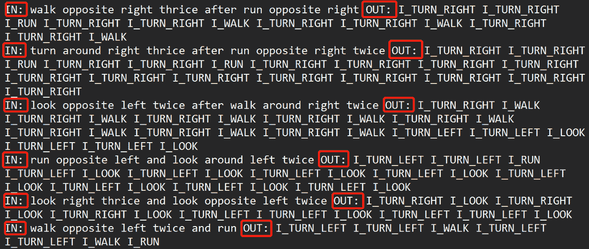

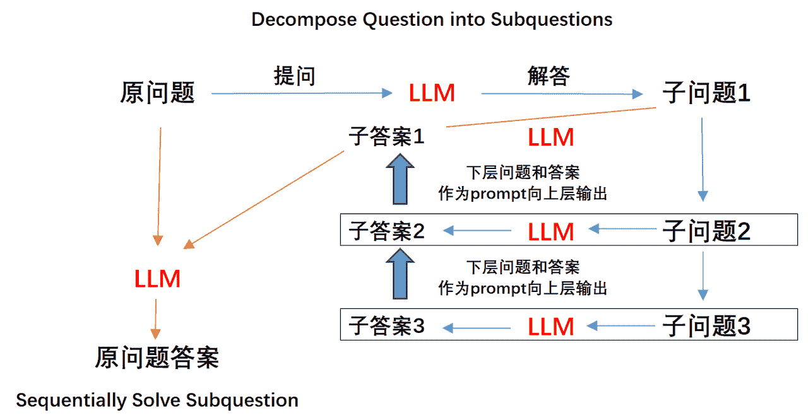

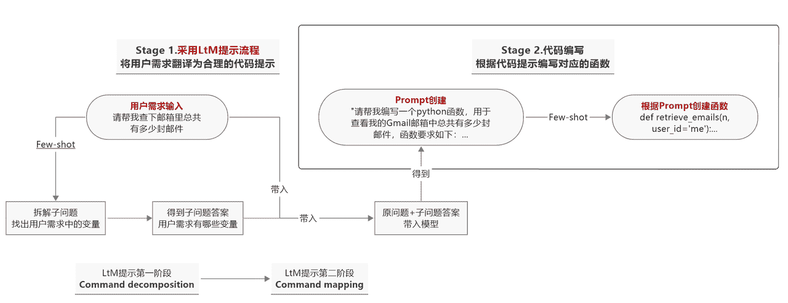

+   体验课内容节选自《2024大模型技术实战》完整版付费课程

**更多大模型技术内容学习，请扫码添加英**英，回复“大模型”，即咨询相关信息哦👇**


此外，**扫码回复“LLM”**，即可领取**公开课课件、代码、数据**等~

---

## 法律侵权案例分析（Q8）

```
Q8 = &#x27;当百科全书推销员走近隐士的房子所在的场地时，他看到一个标牌，上面写着：“推销员禁止入内。侵入者将被起诉。继续前行后果自负。”\
尽管卖家没有被邀请进入，但他无视了标志，沿着车道朝房子开去。 \
当他绕过一个弯道时，埋在车道上的强大炸药爆炸，销售员受伤，他能否向隐士索要赔偿其受伤的损失？\
(A) 如果隐士安装爆炸装置时仅意图威慑而非伤害入侵者，那么卖家可以索赔。\
(B) 如果隐士对车道下的爆炸装置负有责任，那么卖家可以索赔。\
(C) 卖家不可以索赔，因为他无视了警告告示，告示警告他不要继续前进。\
(D) 如果隐士合理地担心有入侵者会伤害他或他的家人，那么卖家不可以索赔。&#x27;
A8 = &#x27;B&#x27;
```

```
response = client.chat.completions.create(
    model=&quot;glm-4&quot;, 
    messages=[
        {&quot;role&quot;: &quot;user&quot;, &quot;content&quot;: Q8}
    ],
)
display(Markdown(response.choices[0].message.content))
```

这个问题涉及法律和道德问题，特别是在侵权法领域。以下是对各个选项的分析：

(A) 如果隐士安装爆炸装置时仅意图威慑而非伤害入侵者，那么卖家可以索赔。

+   这个选项暗示了隐士的主观意图可能会影响赔偿责任。在某些法律体系中，如果隐士能够证明他放置炸药只是为了威慑而非意图伤害他人，这可能减轻他的责任。但这并不意味着卖家一定能索赔，因为实际结果是伤害发生了。

(B) 如果隐士对车道下的爆炸装置负有责任，那么卖家可以索赔。

+   这个选项表明如果隐士对设置爆炸装置的行为负责，那么他可能需要对因此造成的伤害承担责任。在大多数法律体系中，如果某人的行为导致了他人受伤，即便有警告，也可能需要承担一定的责任。

(C) 卖家不可以索赔，因为他无视了警告告示，告示警告他不要继续前进。

+   这个选项提出了一个重要的法律概念，即“自愿承担风险”。如果卖家明确知晓风险并决定继续前进，他可能无法索赔，因为他的行为构成了自愿承担风险。在许多司法管辖区，如果原告故意忽视警告并因此受到伤害，他的损害赔偿请求可能会被拒绝。

(D) 如果隐士合理地担心有入侵者会伤害他或他的家人，那么卖家不可以索赔。

+   这个选项涉及到自卫或保护财产的权利。如果隐士能够证明他有合理的理由担心自己或家人的安全，并且使用爆炸装置是出于自卫，那么他可能不会对卖家的受伤承担责任。

综合考虑，选项 (C) 最有可能正确。在实际情况中，如果卖家故意无视明确警告并继续前进，他可能无法向隐士索要赔偿，因为他的行为构成了自愿承担风险。然而，最终的赔偿责任会根据当地的法律、证据和具体事实情况来确定。在法律实践中，这类案件可能很复杂，并且需要专业法律人士的评估和法庭的裁决。

## 物理自由落体问题（Q9）

```
Q9 = &#x27;当您将球从静止状态掉落时，它会以 9.8 m/s² 的速度向下加速。 如果你把它向下扔，假设没有空气阻力，它离开你的手后立即的加速度是\
(A) 9.8 m/s²\
(B) 超过 9.8 m/s²\
(C) 小于 9.8 m/s²\
(D) 除非给出投掷速度，否则不能说&#x27;
A9 = &#x27;A&#x27;
```


# 物理：重力加速度

```
response = client.chat.completions.create(
    model="glm-4",  # 填写需要调用的模型名称
    messages=[
        {"role": "user", "content": Q9}
    ],
)
display(Markdown(response.choices[0].message.content))
```

答案是 (A) 9.8 m/s²。

不管你是轻轻地把球放下，还是用力把它向下扔，只要在地球表面附近且没有其他外力（如空气阻力）的作用，球离开你的手后都会以 9.8 m/s² 的加速度向下加速。这是因为在地球表面附近的任何物体都受到恒定的重力加速度影响，这个加速度大约是 9.8 m/s²（实际上这个值会因地理位置和高度的不同而略有变化，但通常以 9.8 m/s² 来近似）。

当你把球向下扔时，你的初始推力会增加球的初速度，但一旦球离开你的手，只有重力在作用，此时加速度依然是 9.8 m/s²。因此，不管球离开手的初速度如何，只要考虑重力作用，它的加速度都是 9.8 m/s²。选项 (B) 和 (C) 都不正确，选项 (D) 虽然在物理上要求提供更多信息来完全描述物体的运动，但针对这个问题，只需要考虑重力加速度，因此不需要知道投掷速度。

```
response = openai.ChatCompletion.create(
  model="gpt-4-0125-preview",
  messages=[
    {"role": "user", "content": Q9}
  ]
)
display(Markdown(response.choices[0].message['content']))
```

(A) 9.8 m/s²

无论是自然坠落还是向下投掷，只要忽略空气阻力，物体在地球表面附近的加速度都是地球重力加速度，即(9.8 m/s²)。这一加速度在物理学上被标记为`g`，并且在理想情况下（没有空气阻力）对所有物体都是相同的。

# 医学：Q10 甲状腺切除术后低钙血症

```
Q10 = '一名33岁男性因甲状腺癌接受根治性甲状腺切除术。手术过程中，中度出血需要结扎颈部左侧的多条血管。\
术后，血清研究显示钙浓度为7.5mg/dL，白蛋白浓度为4g/dL，甲状旁腺激素浓度为200pg/mL。据此推断下列哪一项受到损害\
该患者的这些发现是由血管引起的吗？\
(A) 肋颈干的分支\
(B) 颈外动脉的分支\
(C) 甲颈干的分支\
(D) 颈内静脉的支流'
A10 = 'A'
```

```
response = client.chat.completions.create(
    model="glm-4",  # 填写需要调用的模型名称
    messages=[
        {"role": "user", "content": Q10}
    ],
)
display(Markdown(response.choices[0].message.content))
```

根据病例描述，患者在甲状腺切除术后出现中度出血，需要结扎颈部左侧的多条血管，并且术后出现低钙血症（钙浓度为7.5mg/dL，正常值一般在8.5-10.5mg/dL）和甲状旁腺激素浓度升高（200pg/mL），这通常与甲状旁腺功能受损有关。

甲状旁腺位于甲状腺背面，负责调节血钙水平。在甲状腺手术中，由于解剖位置相近，甲状旁腺可能受到损害，尤其是当进行血管结扎时。以下是可能受到损害的血管及其对应的选项：

- (A) 肋颈干的分支 - 这个选项与甲状旁腺的血液供应无关，因此不太可能导致甲状旁腺功能受损。
- (B) 颈外动脉的分支 - 颈外动脉的一些分支供应颈部软组织，但不是甲状旁腺的主要血液供应来源。
- (C) 甲颈干的分支 - 甲状旁腺通常由甲状腺下动脉（来自甲颈干）供血。如果在手术中结扎了这些分支，可能会导致甲状旁腺血液供应受损，引起低钙血症和甲状旁腺激素浓度升高。
- (D) 颈内静脉的支流 - 颈内静脉的损伤通常不会直接影响甲状旁腺的功能。

因此，最可能导致患者这些发现的是选项 (C) 甲颈干的分支受到损害。这种损害可能导致甲状旁腺的血液供应减少，进而引起术后低钙血症和甲状旁腺激素浓度升高。

# 经济学：Q11 垄断与消费者剩余

```
Q11 = '政府之所以不鼓励并对垄断进行管制的原因之一是\
(A) 生产者剩余丧失，而消费者剩余增加。\
(B) 垄断定价确保了生产效率，但却牺牲了社会的配置效率。\
(C) 垄断企业不参与重大的研发活动。\
(D) 随着价格上升和产出水平下降，消费者剩余减少。'
A11 = 'D'
```

```
response = client.chat.completions.create(
    model="glm-4",  # 填写需要调用的模型名称
    messages=[
        {"role": "user", "content": Q11}
    ],
)
display(Markdown(response.choices[0].message.content))
```

答案是：(D) 随着价格上升和产出水平下降，消费者剩余减少。

政府不鼓励垄断并对其进行管制的主要原因之一就是垄断企业控制市场后，往往会提高价格，减少产出，以此来增加自身的利润。这种市场行为减少了消费者剩余，即消费者愿意为商品支付的最高价格与其实际支付价格之间的差额。在垄断情况下，由于缺乏竞争，消费者不得不接受较高的价格，因此他们的福利受损。

选项 (A) 生产者剩余丧失，而消费者剩余增加，通常不是垄断的结果，因为在垄断市场中，生产者由于控制价格而往往能获得更大的剩余。

选项 (B) 垄断定价确实可能导致生产效率（例如，通过规模经济），但通常会牺牲配置效率，因为它导致资源分配不再基于消费者需求，而是基于垄断企业的利润最大化。

选项 (C) 垄断企业不参与重大的研发活动并不是对所有垄断企业的普遍描述，有些垄断企业仍然会进行研发以保持其市场地位。

因此，(D) 选项最准确地反映了垄断行为对消费者剩余的负面影响，这是政府进行反垄断管制的核心原因之一。

```
response = openai.ChatCompletion.create(
  model="gpt-4-0613",
  messages=[
    {"role": "user", "content": Q11}
  ]
)
display(Markdown(response.choices[0].message['content']))
```

(D) 随着价格上升和产出水平下降，消费者剩余减少。

# 医学：Q12 舌骨的胚胎学起源

```
Q12 = '舌骨的胚胎学起源是什么？\
(A) 第一咽弓\
(B) 第一、第二咽弓\
(C) 第二咽弓\
(D) 第二、第三咽弓'
A12 = 'D'
```

```
response = client.chat.completions.create(
    model="glm-4",  # 填写需要调用的模型名称
    messages=[
        {"role": "user", "content": Q12}
    ],
)
display(Markdown(response.choices[0].message.content))
```

舌骨的胚胎学起源是（B）第一、第二咽弓。

在胚胎发育的过程中，舌骨是由第一和第二咽弓的部分结构衍化而来的。咽弓是胚胎时期一系列的弓形结构，它们在胚胎的不同阶段参与到不同的发育过程中。第一咽弓（也称为下颌弓）和第二咽弓（也称为舌骨弓）在胚胎发育期间对形成颅面部和颈部的一些结构至关重要，舌骨就是这两个咽弓相互作用的结果之一。因此，正确答案是第一、第二咽弓。

```
response = client.chat.completions.create(
    model="glm-4",  # 填写需要调用的模型名称
    messages=[
        {"role": "user", "content": Q12+'请一步步思考并得出结论。'}
    ],
)
display(Markdown(response.choices[0].message.content))
```

根据提供的参考信息，我们可以逐步分析并得出结论。

首先，参考信息提到耳郭的发育起始于胚胎期的第3~6周，涉及内胚的第一咽囊、外胚的第一咽弓（下颌弓）和第二咽弓（舌骨弓）。

接下来，我们要确定舌骨的胚胎学起源。从参考信息中可以看出，舌骨与第二咽弓有关。

现在我们来分析选项：

- (A) 第一咽弓：与舌骨没有直接关联。
- (B) 第一、第二咽弓：第一咽弓与舌骨无直接关联，而第二咽弓与舌骨有关，但不完全正确。
- (C) 第二咽弓：根据参考信息，舌骨与第二咽弓有关，因此这个选项是可能的。
- (D) 第二、第三咽弓：参考信息没有提到第三咽弓与舌骨的关联。

综合以上分析，我们可以得出结论：舌骨的胚胎学起源是第二咽弓。

因此，正确答案是 (C) 第二咽弓。

```
response = openai.ChatCompletion.create(
  model="gpt-4-turbo-preview",
  messages=[
    {"role": "user", "content": Q12}
  ]
)
display(Markdown(response.choices[0].message['content']))
```

舌骨的胚胎学起源是 (B) 第一、第二咽弓。

```
response = openai.ChatCompletion.create(
  model="gpt-4-0613",
  messages=[
    {"role": "user", "content": Q12+'请一步步思考并得出结论'}
  ]
)
display(Markdown(response.choices[0].message['content']))
```

第一步思考：在早期胚胎发育中，咽弓是形成许多头颈部结构的主要来源。咽弓由几个同心圆结构组成，其内部含有原神经管、肌肉和骨骼等结构的原始组织。人类有四对咽弓，它们参与形成许多头和颈部的重要结构。

第二步思考：舌骨的位置基本上在喉头之上，舌根之下，与第二、第三咽弓相对应，它的结构并无肌肉，主要由骨和软骨构成。

第三步思考：舌骨是一个U形的骨头，与许多肌肉有紧密关系。在胚胎时期，它来源于第二、第三咽弓骨骼系的变态。第二咽弓主要形成舌骨大部分骨，如舌骨体和大角，第三咽弓则主要参与形成舌骨小角和部分喉软骨。

因此，结论是(D) 舌骨的胚胎学起源是第二、第三咽弓。

# 天文学：Q13 小行星带形成原因

```
Q13 = '为什么小行星带的位置没有形成行星？\
(A) 这里曾经形成过一个行星，但它被一次灾难性的碰撞打碎了。\
(B) 在太阳星云的这部分没有足够的物质来形成一个行星。\
(C) 这里有太多的岩石物质，无法形成类地行星，但又缺乏足够的气体物质来形成类木行星。\
(D) 与木星的共振阻止了物质聚集成行星。'
A13 = 'D'
```

```
response = client.chat.completions.create(
    model="glm-4",  # 填写需要调用的模型名称
    messages=[
        {"role": "user", "content": Q13}
    ],
)
display(Markdown(response.choices[0].message.content))
```

小行星带位于火星与木星轨道之间，关于这个区域为什么没有形成一个大的行星，目前公认的解释是：

(D) 与木星的共振阻止了物质聚集成行星。

木星是太阳系中最大的行星，它的质量非常大，因此它对周围的轨道区域产生了强烈的引力影响。在其形成过程中，木星的巨大引力与这个区域内的物质发生了相互作用，特别是与那些原本可能聚集成行星的物质。这种相互作用产生了所谓的轨道共振，这种共振会增加小行星带内部物体之间的相对速度，导致它们以更高的速度碰撞。这样的高速碰撞使物质无法凝聚成大的天体，而是维持在小行星的大小范围内。

因此，尽管小行星带包含了大量的岩石物质，这些物质本可以形成一颗或几颗行星，但是木星的引力作用阻止了这一过程的发生。这种引力干扰还造成了一些小行星带物体的不稳定性，进而导致一些小行星被抛射出小行星带，成为近地天体或成为其他行星的卫星。

其他选项的解析如下：

- (A) 这里曾经形成过一个行星，但它被一次灾难性的碰撞打碎了。

这个理论曾经被提出过，但目前并没有确凿的证据表明小行星带曾经是一个被摧毁的行星的残骸。

- (B) 在太阳星云的这部分没有足够的物质来形成一个行星。

实际上，小行星带中的物质是非常丰富的，因此物质不足并不是阻止行星形成的原因。

- (C) 这里有太多的岩石物质，无法形成类地行星，但又缺乏足够的气体物质来形成类木行星。

这个选项的前半部分是正确的，确实存在大量的岩石物质，但是这些物质无法凝聚成类地行星的原因，如前所述，是因为木星的轨道共振效应，而不是因为缺乏气体物质。类木行星的形成主要依赖于捕获大量的氢和氦等轻质元素，这与小行星带的物质组成并没有直接关系。

```
response = openai.ChatCompletion.create(
  model="gpt-4-0613",
  messages=[
    {"role": "user", "content": Q13}
  ]
)
display(Markdown(response.choices[0].message['content']))
```

(D) 与木星的共振阻止了物质聚集成行星。

# 医学：Q14 置管尝试次数

## 临床学示例

在把工作交给一位资深同事之前，你应该尝试为患者置管多少次？

(A) 4次 (B) 3次 (C) 2次 (D) 1次

B

```
Q14 = '在把工作交给一位资深同事之前，你应该尝试为患者置管多少次？\
(A) 4次 (B) 3次 (C) 2次 (D) 1次'
A14 = 'B'
```

```
response = client.chat.completions.create(
    model="glm-4",  # 填写需要调用的模型名称
    messages=[
        {"role": "user", "content": Q14}
    ],
)
display(Markdown(response.choices[0].message.content))
```

这个问题可能是在特定的医疗环境下提出的，关于医护人员在尝试置管操作（如中心静脉置管、鼻胃管置管等）时的尝试次数。通常，这样的问题需要根据具体的医疗指导方针和专业共识来回答。

然而，由于不同医疗机构、不同国家和地区的规定可能存在差异，且不同的置管操作难度和风险因素也不尽相同，因此并没有一个普适的答案。

在实际情况中，以下因素可能会影响尝试次数的决定：

1. 置管操作的难度和风险。
2. 患者的具体情况和耐受度。
3. 医护人员的技术水平和经验。
4. 医疗机构的操作规程和指导方针。

针对这个问题，如果是在考试或者模拟情景中，可能存在标准答案。但以常规的医疗操作标准来看，以下是一个可能的参考：

- (B) 3次：这是一个相对常见的尝试次数限制。如果首次尝试不成功，可以再尝试一到两次。如果三次尝试后仍未成功，为了减少患者的不适和潜在风险，通常会建议由更有经验的同事来接手操作，或者考虑其他的治疗方案。

但请注意，实际操作中应严格遵循所在医疗机构的操作规程和上级医生的指导。如果这是一个具体的专业问题，建议咨询相关医疗领域的专家或查阅最新的专业指南。

```
response = openai.ChatCompletion.create(
  model="gpt-4-turbo-preview",
  messages=[
    {"role": "user", "content": Q14}
  ]
)
display(Markdown(response.choices[0].message['content']))
```

在医疗实践中，对于尝试为患者置管的次数并无统一的规定，这取决于多种因素，包括但不限于紧急程度、患者的状况、操作者的熟练程度和可用资源。然而，一般原则是在确保患者安全的前提下，最大程度减少尝试次数以避免增加患者的不适和并发症风险。

在没有具体医学背景的明确指引下，选择最接近实践的原则和建议是，在多次尝试且未能成功后应考虑求助于更有经验的同事。在实践中，比较普遍的做法是在2至3次未成功置管后寻求资深同事的帮助，因此选项 (B) 3次 可能是比较合适的选择。这是基于减少对患者的创伤和提高操作成功率的考虑。然而，实际操作中应根据具体情况灵活处理，并始终将患者的安全和舒适放在首位。

# 大学生物学例子


```
Q15 = &#x27;在一个给定的群体中，每400人中就有1个人因为一个完全隐性的基因b而患上癌症。\
假设该群体处于哈代-温伯格平衡状态，以下哪个是预期携带b基因但不会发展成癌症的个体比例？\
(A) 1/400 (B) 19/400 (C) 20/400 (D) 38/400&#x27;
A15 = &#x27;D&#x27;
```

```
response = client.chat.completions.create(
    model=&quot;glm-4&quot;,  
    messages=[
        {&quot;role&quot;: &quot;user&quot;, &quot;content&quot;: Q15}
    ],
)
display(Markdown(response.choices[0].message.content))
```

根据哈代-温伯格定律，我们可以通过已知的一个隐性基因型的频率来计算该群体中携带该基因但不表现出病症的杂合子的频率。

已知每400人中有1个人（频率为1/400）表现出完全隐性的基因`b`所导致的癌症，这意味着`bb`基因型的频率是1/400。因为`b`是隐性的，我们可以用`b`的平方（频率）来代表`bb`基因型的频率，即`b^2 = 1/400`，从而解出`b`的频率：

`b = √(1/400) = 1/20`

因为基因频率必须在0到1之间，所以`b`的频率是1/20。

在一个处于哈代-温伯格平衡的群体中，对于一个隐性基因，杂合子（`Bb`）的频率是`2pq`，其中`p`是显性等位基因的频率，`q`是隐性等位基因的频率。因为`b`是隐性等位基因，所以在这里`q`就是`b`的频率。

显性等位基因`B`的频率（`p`）是1减去隐性等位基因`b`的频率（`q`），即：

`p = 1 - q = 1 - 1/20 = 19/20`

现在我们可以计算杂合子（`Bb`）的频率：

`2pq = 2 * (19/20) * (1/20) = 38/400`

因此，预期携带`b`基因但不会发展成癌症的个体比例是38/400。

答案是 (D) 38/400。

```
response = openai.ChatCompletion.create(
  model=&quot;gpt-4-turbo-preview&quot;,
  messages=[
    {&quot;role&quot;: &quot;user&quot;, &quot;content&quot;: Q15}
  ]
)
display(Markdown(response.choices[0].message[&#x27;content&#x27;]))
```

哈代-温伯格定律假定在理想情况下，一个大的随机交配种群中基因频率保持不变。在这个问题中，我们知道癌症是由隐性基因`b`引起的。我们标记隐性基因为`b`，其显性对立基因为`B`。因为癌症由`bb`基因型引起，我们可以计算`bb`个体的比例是1/400（因为每400人中有1个人因`bb`患癌症）。

在哈代-温伯格平衡中，我们可以用`p`和`q`表示`B`和`b`的基因频率（其中`p + q = 1`）。`bb`基因型的比例由`q^2`表示，所以我们有`q^2 = 1/400`。因此，`q = √(1/400) = 1/20`。由于`p + q = 1`，我们可以计算出`p = 19/20`。

我们被问到的是携带`b`基因但不会发展成癌症的个体比例，这对应于`Bb`个体的比例。在哈代-温伯格平衡中，`Bb`个体的比例由`2pq`表示。所以我们有：

`2pq = 2 * (19/20) * (1/20) = 38/400`

因此，选项(D) 38/400是预期携带`b`基因但不会发展成癌症的个体比例。

## 大学化学

以下关于镧系元素的说法哪一项是不正确的？

(A) 镧系元素最常见的氧化态是+3。

(B) 镧系元素的配合物通常具有高配位数（>6）。

(C) 所有镧系元素都能与水溶性酸反应释放出氢气。

(D) 从镧到镥，镧系元素的原子半径随周期增加而增大。

```
Q16 = &#x27;以下关于镧系元素的说法哪一项是不正确的？\
(A) 镧系元素最常见的氧化态是+3。\
(B) 镧系元素的配合物通常具有高配位数（&gt;6）。\
(C) 所有镧系元素都能与水溶性酸反应释放出氢气。\
(D) 从镧到镥，镧系元素的原子半径随周期增加而增大。&#x27;
A16 = &#x27;D&#x27;
```

```
response = client.chat.completions.create(
    model=&quot;glm-4&quot;,  
    messages=[
        {&quot;role&quot;: &quot;user&quot;, &quot;content&quot;: Q16}
    ],
)
display(Markdown(response.choices[0].message.content))
```

关于镧系元素的这些说法，我们逐一分析：

(A) 镧系元素最常见的氧化态是+3。这个说法是正确的，镧系元素最外层的电子配置为(n-2)f^1-14(n-1)d^0-1ns^2，它们通常会失去这三个最外层的电子，形成+3的氧化态。

(B) 镧系元素的配合物通常具有高配位数（>6）。这个说法也是正确的，由于镧系元素具有较大的原子半径和较强的电荷，它们可以与多个配体形成稳定的配合物，通常配位数较高。

(C) 所有镧系元素都能与水溶性酸反应释放出氢气。这个说法是不正确的。镧系元素中的某些元素可以与酸反应生成氢气，但并非所有镧系元素都具有与水溶性酸反应生成氢气的能力。这取决于它们的活泼程度和反应条件。

(D) 从镧到镥，镧系元素的原子半径随周期增加而增大。这个说法是正确的。由于电子层的增加，原子半径会随着周期数的增加而增大，这一趋势符合周期表的普遍规律。

综上所述，选项(C)“所有镧系元素都能与水溶性酸反应释放出氢气”是不正确的。

```
response = openai.ChatCompletion.create(
  model=&quot;gpt-4-turbo-preview&quot;,
  messages=[
    {&quot;role&quot;: &quot;user&quot;, &quot;content&quot;: Q16}
  ]
)
display(Markdown(response.choices[0].message[&#x27;content&#x27;]))
```

选项 (D) 是不正确的。镧系元素（镧到镥）随着周期数的增加，其原子半径实际上是逐渐减小的，这个现象被称为镧系收缩（lanthanide contraction）。镧系收缩是由于从镧到镥，核电荷数的增加导致电子之间的相互作用变强，从而使得电子云向核部分收缩，这会造成原子和离子的半径随着原子序数的增加而逐渐减小。因此，随着周期增加，镧系元素的原子半径并不是增大而是减小的。

## 计算机

考虑一种计算机设计，其中多个处理器，每个处理器都有一个私有缓存内存，通过单个总线共享全局内存。这个总线是关键的系统资源。每个处理器每500纳秒可以执行一个指令，只要内存引用可以通过其本地缓存满足。当发生缓存未命中时，处理器将额外延迟2000纳秒。在这个额外延迟的一半时间内，总线被专用于服务缓存未命中。在另一半时间内，处理器不能继续执行，但总线可以自由服务其他处理器的请求。平均而言，每条指令需要2次内存引用。平均而言，每次引用有1%的几率发生缓存未命中。忽略由于其他处理器的竞争导致的延迟，单个处理器会消耗总线容量的多少比例？

(A) 1/50 (B) 1/27 (C) 1/25 (D) 2/27

```
Q17 = &#x27;考虑一种计算机设计，其中多个处理器，每个处理器都有一个私有缓存内存，通过单个总线共享全局内存。\
这个总线是关键的系统资源。每个处理器每500纳秒可以执行一个指令，只要内存引用可以通过其本地缓存满足。\
当发生缓存未命中时，处理器将额外延迟2000纳秒。在这个额外延迟的一半时间内，总线被专用于服务缓存未命中。\
在另一半时间内，处理器不能继续执行，但总线可以自由服务其他处理器的请求。平均而言，每条指令需要2次内存引用。\
平均而言，每次引用有1%的几率发生缓存未命中。忽略由于其他处理器的竞争导致的延迟，单个处理器会消耗总线容量的多少比例？\
(A) 1/50 (B) 1/27 (C) 1/25 (D) 2/27&#x27;
A17 = &#x27;B&#x27;
```

```
response = client.chat.completions.create(
    model=&quot;glm-4&quot;,  
    messages=[
        {&quot;role&quot;: &quot;user&quot;, &quot;content&quot;: Q17}
    ],
)
display(Markdown(response.choices[0].message.content))
```

这个问题要求我们计算由于缓存未命中导致的单个处理器对总线容量的占用比例。

首先，我们来计算每条指令执行时处理器占用总线的时间。

每条指令平均需要2次内存引用，每次引用有1%的几率发生缓存未命中。那么，每条指令平均有 2 * 1% = 0.02 的几率发生至少一次缓存未命中。

当发生缓存未命中时，处理器会有额外的2000纳秒延迟，其中一半时间内（即1000纳秒）总线被该处理器专用。

因此，每条指令平均占用总线的时间是：

0.02（缓存未命中的几率）* 1000纳秒（专用总线的时间）= 20纳秒

每条指令执行需要的时间是500纳秒（不考虑缓存未命中的情况），所以，每条指令平均执行时间（包括可能的缓存未命中延迟）是：

500纳秒 + 20纳秒 = 520纳秒

现在，我们要计算处理器占用总线的比例。处理器每520纳秒占用总线20纳秒，所以占用比例为：

20纳秒 / 520纳秒 ≈ 1/26

但是，请注意，我们在计算中包括了缓存未命中的时间，而题目要求的是“消耗总线容量的比例”。这里的“消耗”应该是指额外消耗，即只有当缓存未命中时才会消耗总线资源。

因此，我们应该将这20纳秒视为额外的总线占用时间，而不是每条指令的总执行时间的一部分。

所以，正确的比例应该是：

20纳秒 / 500纳秒（处理器正常执行指令的时间）= 1/25

因此，单个处理器消耗总线容量的比例是 1/25。

答案是 (C) 1/25。

```
response = openai.ChatCompletion.create(
  model=&quot;gpt-4-turbo-preview&quot;,
  messages=[
    {&quot;role&quot;: &quot;user&quot;, &quot;content&quot;: Q17}
  ]
)
display(Markdown(response.choices[0].message[&#x27;content&#x27;]))
```

为了解决这个问题，我们首先要计算在处理一条指令期间，总线被一个处理器专用的平均时间。

给定的条件是：

+   每条指令平均需要2次内存引用。

+   每次内存引用有1%的几率发生缓存未命中。

+   发生缓存未命中时，处理器延迟2000纳秒，其中一半时间（即1000纳秒）总线被专用于服务这次缓存未命中。

所以，每条指令期间总线被专用的平均时间是：

[2 \times 0.01 \times 1000 = 20 \text{ 纳秒}]

这是因为每条指令平均引起2次引用，其中有1%会导致缓存未命中。每次缓存未命中会使总线被专用1000纳秒。

接下来，我们要看处理一条指令所需的总时间。处理器本身每条指令需要500纳秒，再加上额外的缓存未命中延迟（包括总线专用时间和处理器闲置时间）。每条指令引起的缓存未命中平均造成2000纳秒的延迟，但是这个延迟包含了处理器不能执行指令的时间，我们只关心总线专用时间对整体影响。

考虑每条指令：

+   基础执行时间：500纳秒

+   总线专用时间，已计算为每条指令平均20纳秒

于是，考虑总线专用时间对于单个处理器的总指令执行时间的影响很小。单个指令周期内，总线的专用时间占总时间的比例即为专用时间除以单个指令周期的总时间。

单个指令周期的总时间包括500纳秒的基础执行时间和由于缓存未命中但与总线专用无关的额外时间。每条指令的总线占用时间为20纳秒，不需要进一步考虑每条指令的总执行时间，因为问的是总线被单个处理器专用的比例。

所以，单个处理器专用总线的比例是：

[ \frac{20}{500} = \frac{1}{25} ]

因此，正确答案是 (C) 1/25。

## 欧洲历史

《至高无上法案》（Act of Supremacy）于1534年由英国议会通过，正式确认了英格兰国王作为英格兰教会（Church of England）的至高无上的首脑。这一法案不仅赋予了国王在宗教事务上的绝对权力，也标志着英格兰与罗马天主教会正式断绝关系，并导致了英格兰宗教改革的开始。《至高无上法案》主张：

(A) 给予英国国王一个新的权威地位

(B) 将英格兰教会首脑的位置仅赋予亨利八世，排除他的继承人

(C) 在英格兰确立加尔文主义作为唯一真正的神学

(D) 结束困扰英格兰教会的各种形式的腐败

D

```
Q18 = &#x27;《至高无上法案》（Act of Supremacy）于1534年由英国议会通过，正式确认了英格兰国王作为英格兰教会（Church of England）的至高无上的首脑。\
这一法案不仅赋予了国王在宗教事务上的绝对权力，也标志着英格兰与罗马天主教会正式断绝关系，并导致了英格兰宗教改革的开始。《至高无上法案》主张：\
(A) 给予英国国王一个新的权威地位\
(B) 将英格兰教会首脑的位置仅赋予亨利八世，排除他的继承人\
(C) 在英格兰确立加尔文主义作为唯一真正的神学\
(D) 结束困扰英格兰教会的各种形式的腐败&#x27;
A18 = &#x27;D&#x27;
```

```
response = client.chat.completions.create(
    model=&quot;glm-4&quot;,  
    messages=[
        {&quot;role&quot;: &quot;user&quot;, &quot;content&quot;: Q18}
    ],
)
display(Markdown(response.choices[0].message.content))
```

在提供的选项中，正确的描述是：

(A) 给予英国国王一个新的权威地位

《至高无上法案》的确立给予了英国国王在英格兰教会中的新的权威地位，宣布他为“英格兰教会最高元首”（Supreme Head），后来在伊丽莎白一世时期改为“最高领袖”（Supreme Governor）。这一地位确认了国王在宗教事务上的至高无上的权力，使英格兰教会从罗马天主教会中独立出来。

其他选项的解释如下：

(B) 将英格兰教会首脑的位置仅赋予亨利八世，排除他的继承人

这个选项不正确，因为《至高无上法案》确立的是一个持续的地位，不仅适用于亨利八世，也适用于他的继承人们。

(C) 在英格兰确立加尔文主义作为唯一真正的神学

这个选项不正确，因为英格兰宗教改革并没有确立加尔文主义，而是形成了圣公会的独特神学体系。

(D) 结束困扰英格兰教会的各种形式的腐败

这个选项也不正确，虽然宗教改革确实意在改革教会，包括解决一些被认为的腐败问题，但《至高无上法案》的主要目的并不是结束腐败，而是确立国王在教会中的权威。

```
response = openai.ChatCompletion.create(
  model=&quot;gpt-4-turbo-preview&quot;,
  messages=[
    {&quot;role&quot;: &quot;user&quot;, &quot;content&quot;: Q18}
  ]
)
display(Markdown(response.choices[0].message[&#x27;content&#x27;]))
```

《至高无上法案》（Act of Supremacy）的核心在于给予英国国王一个新的权威地位，正式确认了英格兰国王作为英格兰教会（Church of England）的至高无上的首脑。因此，最准确的说法是(A) 给予英国国王一个新的权威地位。这一法案赋予了国王在宗教事务上的绝对权力，标志着英格兰与罗马天主教会正式断绝关系，并导致了英格兰宗教改革的开始。其他选项要么不完全准确，要么与《至高无上法案》的主要内容和目的不直接相关。

## 高中数学

乔负责一次舞会的灯光。红灯每两秒闪烁一次，黄灯每三秒闪烁一次，蓝灯每五秒闪烁一次。如果我们包括舞会的开始和结束，那么在一个七分钟的舞会期间，所有的灯光会同时亮起多少次？（假设在舞会开始时所有三盏灯同时闪烁。）

(A) 3

(B) 15

(C) 6

(D) 5

```
Q19 = &#x27;乔负责一次舞会的灯光。红灯每两秒闪烁一次，黄灯每三秒闪烁一次，蓝灯每五秒闪烁一次。\
如果我们包括舞会的开始和结束，那么在一个七分钟的舞会期间，所有的灯光会同时亮起多少次？\
（假设在舞会开始时所有三盏灯同时闪烁。）\
(A) 3\
(B) 15\
(C) 6\
(D) 5&#x27;
A19 = &#x27;B&#x27;
```

```
response = client.chat.completions.create(
    model=&quot;glm-4&quot;,  
    messages=[
        {&quot;role&quot;: &quot;user&quot;, &quot;content&quot;: Q19}
    ],
)
display(Markdown(response.choices[0].message.content))
```

要找出在七分钟内所有灯光同时亮起的次数，我们需要找到红灯、黄灯和蓝灯闪烁周期的最小公倍数。

红灯每两秒闪烁一次，黄灯每三秒闪烁一次，蓝灯每五秒闪烁一次。

首先，找到这三个数的最小公倍数（`LCM`）。

2秒和3秒的最小公倍数是6秒，因为6是第一个能被2和3整除的数。

接着，找到6秒和5秒的最小公倍数。

6秒 = 2 × 3秒，而5秒是一个质数。所以，我们需要找到能同时被2、3和5整除的最小的数。

这个数是2 × 3 × 5 = 30秒。这意味着每30秒，所有三盏灯会同时闪烁。


# 灯光同时闪烁次数计算

现在，我们计算七分钟内（即`7 × 60秒 = 420秒`）这样的同时闪烁会发生多少次。

`420秒 ÷ 30秒/次 = 14次`

但根据题目描述，舞会开始时所有三盏灯也同时闪烁，所以我们需要在14次的基础上再加1次。

因此，总次数是`14 + 1 = 15`次。

所以正确答案是 (B) 15。

```python
response = openai.ChatCompletion.create(
  model="gpt-4-turbo-preview",
  messages=[
    {"role": "user", "content": Q19}
  ]
)
display(Markdown(response.choices[0].message['content']))
```

为了找到所有三盏灯同时亮起的次数，我们需要找到红、黄、蓝灯闪烁频率的最小公倍数。

+ 红灯每2秒闪烁一次。
+ 黄灯每3秒闪烁一次。
+ 蓝灯每5秒闪烁一次。

找到2、3、5的最小公倍数：

`最小公倍数 = LCM(2, 3, 5) = 30`（意味着每30秒，所有的灯光会同时亮起一次）。

舞会持续时间是7分钟，换算成秒就是`7 * 60 = 420`秒。

现在，要找出在420秒内，30秒一次的事件发生了多少次，我们只需要将总秒数（420）除以两次事件之间的间隔秒数（30）：

`次数 = 420 / 30 = 14`

但是，这个计算没有包括舞会开始时所有灯光的首次同时闪烁。因此，我们需要把这次也计入总次数：

`总次数 = 14 + 1 = 15`

所以，在7分钟的舞会期间，所有的灯光会同时亮起的次数是15次。答案是(B) 15。

# 谢斯叛乱与反联邦主义者

谢斯叛乱（Shays's Rebellion）发生在1786-1787年，是一系列反对马萨诸塞州政府的高税收和司法判决的抗议活动，这些政策导致了农民财产被没收。这场叛乱凸显了美国联邦政府在《邦联条例》下的弱点，激发了对更强大中央政府的需求，最终导致了美国宪法的起草和颁布。

反联邦主义者是美国宪法起草和批准过程中的一群人，他们担心强大的中央政府会侵犯个人自由和各州的权力。因此，他们最为谴责的是对谢斯叛乱的联邦回应，因为这场叛乱和随后的联邦政府强硬回应正是他们担心中央政府过度权力的一个例证。

以下哪一项“不幸”是革命后时期的反联邦主义者最为谴责的？

+ (A) 对贝肯叛乱的有组织回应。
+ (B) 对谢斯叛乱的联邦回应。
+ (C) 对威士忌叛乱的联邦回应。
+ (D) 对庞蒂亚克叛乱的联邦回应。

C

```python
Q20 = '谢斯叛乱（Shays\'s Rebellion）发生在1786-1787年，是一系列反对马萨诸塞州政府的高税收和司法判决的抗议活动，这些政策导致了农民财产被没收。\
这场叛乱凸显了美国联邦政府在《邦联条例》下的弱点，激发了对更强大中央政府的需求，最终导致了美国宪法的起草和颁布。\
反联邦主义者是美国宪法起草和批准过程中的一群人，他们担心强大的中央政府会侵犯个人自由和各州的权力。\
因此，他们最为谴责的是对谢斯叛乱的联邦回应，因为这场叛乱和随后的联邦政府强硬回应正是他们担心中央政府过度权力的一个例证。\
以下哪一项“不幸”是革命后时期的反联邦主义者最为谴责的？\
(A) 对贝肯叛乱的有组织回应。\
(B) 对谢斯叛乱的联邦回应。\
(C) 对威士忌叛乱的联邦回应。\
(D) 对庞蒂亚克叛乱的联邦回应。'
A20 = 'C'
```

```python
response = client.chat.completions.create(
    model="glm-4",  
    messages=[
        {"role": "user", "content": Q20}
    ],
)
display(Markdown(response.choices[0].message.content))
```

在这四个选项中，反联邦主义者最为谴责的应该是：

+ (B) 对谢斯叛乱的联邦回应。

如你所述，反联邦主义者反对一个强大中央政府的理念，他们认为这样的政府可能会侵犯个人自由和各州的权力。谢斯叛乱后，联邦政府对这场叛乱的应对措施被视为对州权力的侵犯，这正符合反联邦主义者所担心的情况。因此，他们最可能谴责的是对谢斯叛乱的联邦回应。其他选项中的叛乱（贝肯叛乱、威士忌叛乱、庞蒂亚克叛乱）虽然也涉及对联邦政府权力的担忧，但它们并不是直接导致反联邦主义者产生担忧的那次事件。

```python
response = openai.ChatCompletion.create(
  model="gpt-4-turbo-preview",
  messages=[
    {"role": "user", "content": Q20}
  ]
)
display(Markdown(response.choices[0].message['content']))
```

正确答案是(B) 对谢斯叛乱的联邦回应。

解释：谢斯叛乱（Shays's Rebellion）引起了对当时美国政府结构（依据《邦联条例》组织）的重大担忧，展现了其处理危机的无力。这场叛乱发生在1786年至1787年，由于反联邦主义者担心强大中央政府的潜在威胁，他们特别谴责对谢斯叛乱的处理，认为这是中央集权可能导致的问题的一个例子。题干中“对谢斯叛乱的联邦回应”恰为此类反联邦主义者最为谴责的事项。

贝肯叛乱、庞蒂亚克叛乱和威士忌叛乱分别代表了美国历史上其他的重要叛乱或民间抗议事件，但在处理谢斯叛乱上对于后续美国宪法的起草和强化中央政府的影响最为直接。特别是，威士忌叛乱发生在1791年，是在美国宪法颁布并生效（1789年）之后的事情，而反联邦主义者主要集中在宪法起草和批准过程中表达对中央政府权力的担忧。
