# GLM-4 Function calling实现方法

> 来源：[https://kq4b3vgg5b.feishu.cn/docx/HGvudUbIEoRoaAxvtARcMA6unA8](https://kq4b3vgg5b.feishu.cn/docx/HGvudUbIEoRoaAxvtARcMA6unA8)

```
import os
from zhipuai import ZhipuAI
from IPython.display import display, Code, Markdown
import requests
import json

api_key = os.getenv(&quot;ZHIPU_API_KEY&quot;)
```

```
client = ZhipuAI(api_key=api_key) 
response = client.chat.completions.create(
    model=&quot;glm-4&quot;,  # 填写需要调用的模型名称
    messages=[
        {&quot;role&quot;: &quot;user&quot;, &quot;content&quot;: &quot;你好&quot;}
    ],
)
print(response.choices[0].message)
```

```
content=&#x27;你好👋！我是人工智能助手智谱清言，可以叫我小智🤖，很高兴见到你，欢迎问我任何问题。&#x27; role=&#x27;assistant&#x27; tool_calls=None
```

+   Function calling功能诞生背景

尽管大语言模型的知识储量巨大，且具备非常强大的涌现能力，但很多时候我们实际使用大语言模型时仍然会明显的感受到模型能力上的局限，例如模型无法获取最新的信息、模型只能给出文字的建议但无法直接帮我们解决某些问题（如自动回复邮件、自动查询订阅机票等）。毫无疑问，这些问题的存在极大程度限制了大语言模型的实际应用价值的进一步拓展，而在2023年4月，AutoGPT项目的横空出世则为这些解决问题提出了一个极具潜力的方案——那就是进一步赋予大语言模型调用外部工具API的能力，从而大幅拓展大语言模型的能力。例如如果我们能够让GPT模型调用谷歌搜索API（Google Custom Search JSON API），则模型就可以实时获取和用户问题相关的一系列搜索结果，并结合这些结果和原生的知识库来回答用户的问题，从而解决模型无法获取最新信息这一问题；再比如，如果我们能够让GPT模型调用谷歌邮箱API（Gmail API），则可以自动让GPT模型读取邮件，并自动进行回复等等。而根据AutoGPT不大的项目规模来看，让GPT模型调用外部工具API其实并不复杂。

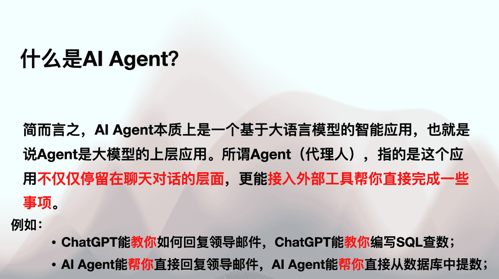

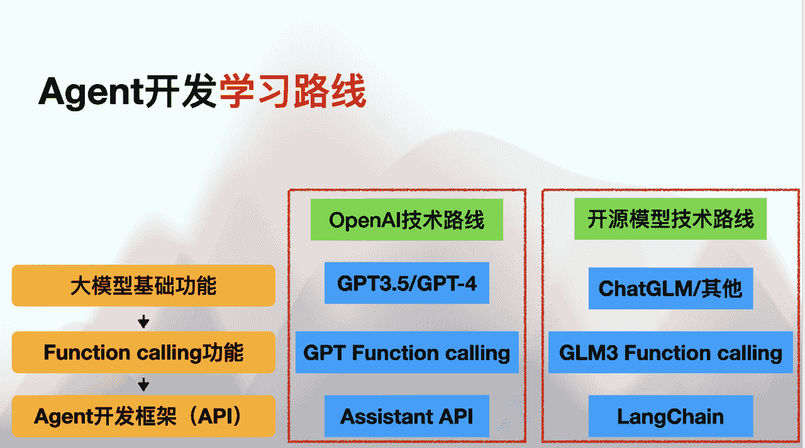

+   Function calling功能简介

在这一基本背景下，经过数月的研发和优化，OpenAI在0613的更新中为目前最先进的Chat类模型增加了Function calling功能，该功能的本质是让大语言模型调用外部函数的能力，即Chat模型可以不再仅仅根据自身的数据库知识进行回答，而是可以额外挂载一个函数库，然后根据用户提问进行函数库检索，根据实际需求调用外部函数并获取函数运行结果，再基于函数运行结果进行回答。其基本过程如下：

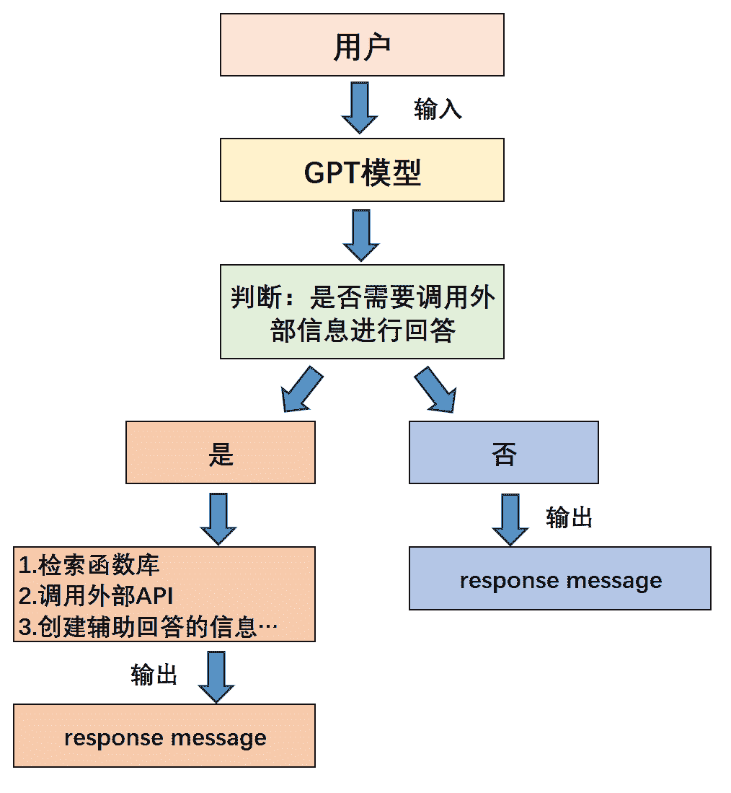

而这个外部挂载的函数库，可以是简单的自定义函数，也可以是一个封装了外部工具API的功能型函数（例如一个可以调用谷歌搜索的函数、或者一个可以获取天气信息的函数）。而在OpenAI的精妙设计下，Function calling功能的实现过程也并不复杂，在编写问答函数时，我们只需要在ChatCompletions.create函数中进行参数设置、并提前定义好外部函数库即可，而在Chat模型执行Function calling时，模型会根据用户提问的语义自动检索并挑选合适的函数进行使用，整个过程并不需要人工手动干预指定使用某个函数，大预言模型能够充分发挥自身的语义理解优势，在函数库中自动挑选合适函数进行运行，并给出问题的答案。

毫无疑问，有了外部函数库的功能加持，Chat模型的处理和解决问题的能力也必将再上一个台阶。同时，相比于此前必须借助LangChain的agent模块才能实现LLM和外部工具API的协同调用，现在Chat模型内部集成的Function calling功能实现过程更简单、开发门流程更加清晰、开发槛更低，而如此种种，也必将促进新一轮的以大语言模型为核心的AI应用的爆发。

+   基于GPT模型多角色对话系统下的Function calling

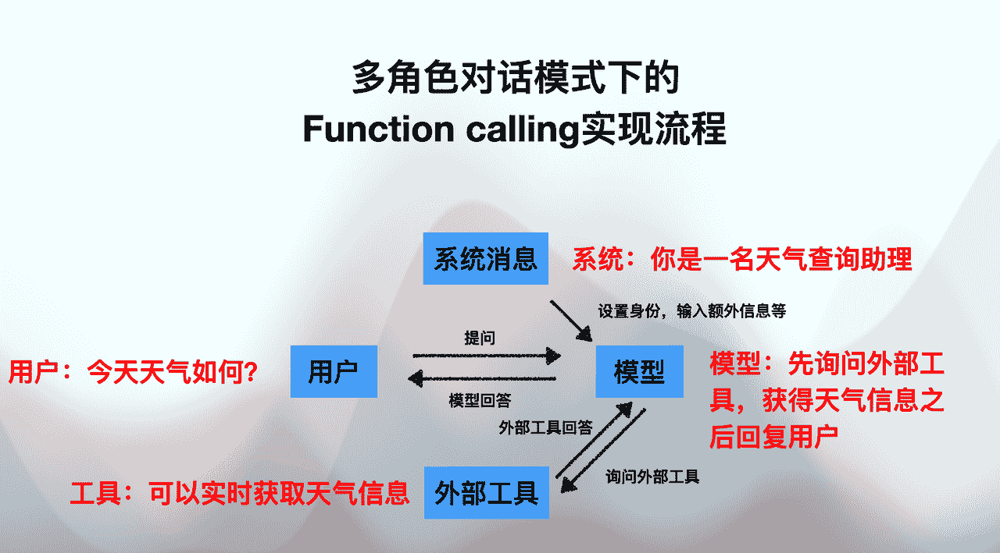

## Stage 1.获取外部工具API

+   外部工具API

首先需要简单说明的是，到底什么是外部工具API。API的全称是应用程序接口，例如目前我们在Python环境中使用的ChatCompletion.create函数，实际上就是OpenAI公司提供的GPT系列模型应用程序的一个接口，通过这个API（create函数或者openai库），我们能够非常顺利的调用GPT模型，并根据输入信息实时输出模型结果。而其他的很多应用程序，也都有相应的API。例如谷歌搜索，也可以通过调用API的形式来实现搜索功能，再比如接下来我们要介绍的OpenWeather API，就是一个可以进行实时天气查询的API。

+   OpenWeather与OpenWeather API

OpenWeather是一家提供全球范围内的气象数据服务的公司，该公司的服务包括实时天气信息、天气预报、历史天气数据以及各种气象相关的报告等，并且OpenWeather开放了一定使用限度内完全免费的API，即我们可以在代码环境中通过调用OpenWeather API来进行实时天气查询、天气预报等功能，这意味着开发者可以将OpenWeather的天气预报功能加入到他们自己的应用或网站中。

> 相比OpenAI，OpenWeather更加Open。

+   极简AI应用开发示例

当然，一个开放的天气查询API，也意味着我们可以将其封装为一个本地的函数，即通过调用OpenWeather API来获取实时天气信息，然后再用Function calling功能调用该函数，如此一来，就相当于给Chat模型增加了实时获取天气信息的能力，而后我们即可通过Chat模型实时查询天气或根据天气情况询问穿衣建议等，从功能上来说，接入实时天气信息的Chat模型其实也就是一个非常简单的天气查询AI助手。这是一个相对简单的将其他工具API接入Chat模型的示例，接下来我们介绍具体实现方法。

### 1.OpenWeather注册及API key获取方法

为了能够调用OpenWeather服务，和OpenAI的API使用过程类似，我们首先需要先注册OpenWeather账号，并获取OpenWeather API Key。这里需要注意的是，对于大多数在线服务的API来说，都需要通过API key来进行身份验证，尽管OpenWeather相对更加Open，有非常多的免费使用的次数，但身份验证仍然是必要的防止API被滥用的有效手段。OpenWeather API key获取流程如下：

+   Step 1.登录OpenWeather官网并点击Sign—>create account完成注册。该网站无需魔法即可直接登录，可以使用国内邮箱或者QQ邮箱均可进行注册，官网地址为：https://openweathermap.org/


+   Step 2.获取API-key：注册完成后，即可在API keys页面查看当前账户的API key：


一般来说完成注册后，就会有一个已经激活的API-key。和OpenAI一样，OpenWeather的API key也创建多个。

+   Step 3.将其设置为环境变量：和OpenAI API key类似，为了方便后续调用，我们也可以直接将OpenWeather API key设置为环境变量，变量名为OPENWEATHER_API_KEY。具体设置环境变量的方法参考Ch.1中OpenAI APkey设置环境变量流程，此处不再赘述。

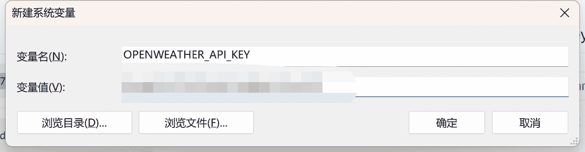

设置完了环境变量之后，接下来即可按照如下方式创建OpenWeather API key变量：

```
open_weather_key = os.getenv(&quot;OPENWEATHER_API_KEY&quot;)
```

需要注意的是，一般来说首次注册用户，首个API key需要等待2-5小时才会被激活，在此期间使用该API key会返回401错误。

### 2.OpenWeather API使用方法

#### 2.1 RESTful风格API使用方法

这里我们需要补充介绍关于RESTful风格API调用方法，包括本节课程需要使用OpenWeather API、以及下一小节涉及的谷歌搜索API和Google Sheets API都是RESTful API。由于我们主要是在python环境中调用这些API，因此重点介绍Python中这类API调用的基本步骤为：

+   Step 1.构建请求：即输入某个特定的端点，也是后续请求发送的目标端点，对于OpenWeather实时查询天气的API来说，这个端点就是https://api.openweathermap.org/data/2.5/weather ；

+   Step 2.设置查询参数：即创建请求相关参数对象，例如如果是调用OpenWeather API进行天气查询，则需要按照官网说明设置以下参数：

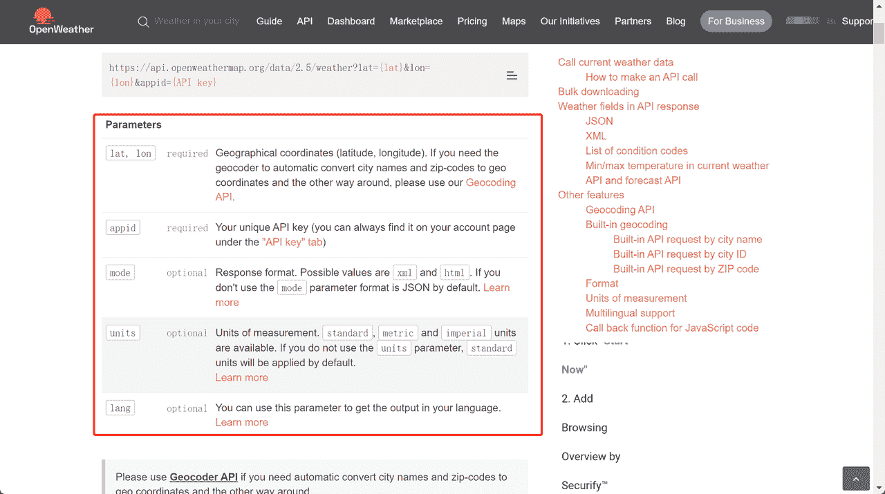

这些参数分别是城市名称或者位置坐标、API key、返回结果的格式、天气相关单位标准以及输出天气信息的语言，在实际调用OpenWeather API时，可以通过灵活调整这些参数的取值，来获得期望的结果；

+   Step 3.发送请求：接下来我们即可借助python中的request库来发生请求，request库是一个专门为发送HTTP请求提供支持的库，借助request库可以非常便捷的进行get或者post请求，并且能够非常便捷的进行返回结果的解析；

+   Step 4.解析请求：等待API服务返回结果之后，即可围绕该结果进行解析，将其转化为当前环境可读的形式。具体返回的结果的格式可以通过mode参数进行设置，默认情况下是JOSN格式。

#### 2.2 利用OpenWeather API获取实时天气信息

接下来我们通过一个简单的示例，来介绍如何通过OpenWeather API获取实时天气信息：

```
import requests

# Step 1.构建请求
url = &quot;https://api.openweathermap.org/data/2.5/weather&quot;

# Step 2.设置查询参数
params = {
    &quot;q&quot;: &quot;Beijing&quot;,               # 查询北京实时天气
    &quot;appid&quot;: open_weather_key,    # 输入API key
    &quot;units&quot;: &quot;metric&quot;,            # 使用摄氏度而不是华氏度
    &quot;lang&quot;:&quot;zh_cn&quot;                # 输出语言为简体中文
}

# Step 3.发送GET请求
response = requests.get(url, params=params)

# Step 4.解析响应
data = response.json()
```

这里需要注意的是，城市名必须输入英文名，否则无法正确识别。接下来查看返回结果。首先我们先查看response结果：

```
response
```

```
&lt;Response [200]&gt;
```

```
type(response)
```

```
requests.models.Response
```

在未解析之前，我们只能查看到基本请求结果状态，这里的200代表成功相应，即本次发送请求获得了对应的响应，且响应内容包含在response中。考虑到默认情况下返回结果是JSON格式，因此后续代码使用了response.json()对其进行解析。解析内容如下：

```
data
```

```
{&#x27;coord&#x27;: {&#x27;lon&#x27;: 116.3972, &#x27;lat&#x27;: 39.9075},
 &#x27;weather&#x27;: [{&#x27;id&#x27;: 800, &#x27;main&#x27;: &#x27;Clear&#x27;, &#x27;description&#x27;: &#x27;晴&#x27;, &#x27;icon&#x27;: &#x27;01n&#x27;}],
 &#x27;base&#x27;: &#x27;stations&#x27;,
 &#x27;main&#x27;: {&#x27;temp&#x27;: -0.06,
  &#x27;feels_like&#x27;: -0.06,
  &#x27;temp_min&#x27;: -0.06,
  &#x27;temp_max&#x27;: -0.06,
  &#x27;pressure&#x27;: 1031,
  &#x27;humidity&#x27;: 94,
  &#x27;sea_level&#x27;: 1031,
  &#x27;grnd_level&#x27;: 1025},
 &#x27;visibility&#x27;: 10000,
 &#x27;wind&#x27;: {&#x27;speed&#x27;: 0.32, &#x27;deg&#x27;: 339, &#x27;gust&#x27;: 0.51},
 &#x27;clouds&#x27;: {&#x27;all&#x27;: 8},
 &#x27;dt&#x27;: 1703671663,
 &#x27;sys&#x27;: {&#x27;type&#x27;: 1,
  &#x27;id&#x27;: 9609,
  &#x27;country&#x27;: &#x27;CN&#x27;,
  &#x27;sunrise&#x27;: 1703633678,
  &#x27;sunset&#x27;: 1703667322},
 &#x27;timezone&#x27;: 28800,
 &#x27;id&#x27;: 1816670,
 &#x27;name&#x27;: &#x27;Beijing&#x27;,
 &#x27;cod&#x27;: 200}
```

> 这里需要注意，若API key未激活，则返回的response将显示401，表示本次请求Unauthorized（未经授权）。此外，若response出现404，则表示URL路径无效，需要根据官网提供的信息重新核对URL路径。

能够看出，返回结果非常丰富，包含了天气条件、温度、湿度、风速、天气描述等信息，这里我们可以简单查看当前天气中的即时温度和天气状况：

```
# 即时温度最高、最低气温
data[&#x27;main&#x27;][&#x27;temp_min&#x27;], data[&#x27;main&#x27;][&#x27;temp_max&#x27;]
```

```
(-0.06, -0.06)
```

```
# 天气状况
data[&#x27;weather&#x27;][0][&#x27;description&#x27;]
```

```
&#x27;晴&#x27;
```

对比手机查看的天气信息不难发现，OpenWeather提供的天气信息非常准确：

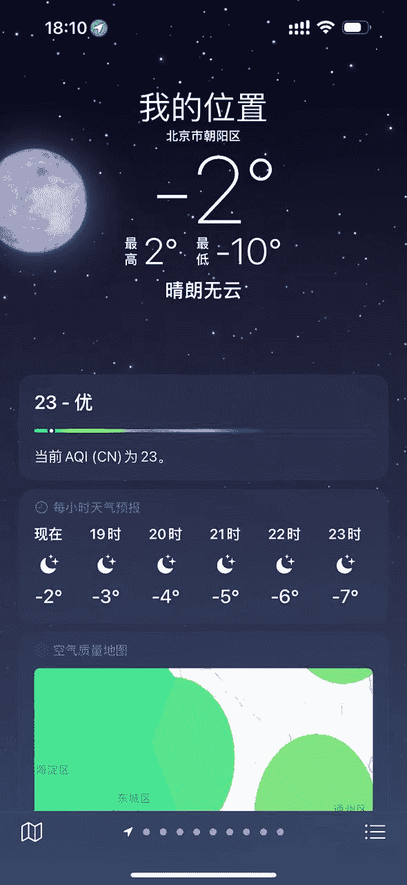

当然，关于data中更多天气信息解读，可以参考官网给出的参数解读Fields in API response部分：https://openweathermap.org/current#current_JSON

### 3.编写实时天气查询的外部函数

+   实时天气信息获取函数编写

接下来，我们尝试编写一个通过OpenWeather API实时获取天气信息的API，并作为Chat可调用的外部函数之一。很明显，为了确保和大语言模型之间的顺畅通信，此时要求函数的输入和输出都是字符串格式。具体函数编写如下：

```
def get_weather(loc):
    &quot;&quot;&quot;
    查询即时天气函数
    :param loc: 必要参数，字符串类型，用于表示查询天气的具体城市名称，\
    注意，中国的城市需要用对应城市的英文名称代替，例如如果需要查询北京市天气，则loc参数需要输入&#x27;Beijing&#x27;；
    :return：OpenWeather API查询即时天气的结果，具体URL请求地址为：https://api.openweathermap.org/data/2.5/weather\
    返回结果对象类型为解析之后的JSON格式对象，并用字符串形式进行表示，其中包含了全部重要的天气信息
    &quot;&quot;&quot;
    # Step 1.构建请求
    url = &quot;https://api.openweathermap.org/data/2.5/weather&quot;

    # Step 2.设置查询参数
    params = {
        &quot;q&quot;: loc,               
        &quot;appid&quot;: open_weather_key,    # 输入API key
        &quot;units&quot;: &quot;metric&quot;,            # 使用摄氏度而不是华氏度
        &quot;lang&quot;:&quot;zh_cn&quot;                # 输出语言为简体中文
    }

    # Step 3.发送GET请求
    response = requests.get(url, params=params)
    
    # Step 4.解析响应
    data = response.json()
    return json.dumps(data)
```

> 再次提示，我们可以通过json.dumps()函数将JSON转化为字符串，反过来我们可以通过json.loads()函数将字符串转化为JSON对象。

简单测试函数能否正常运行：

```
get_weather(&#x27;Hangzhou&#x27;)
```

```
&#x27;{&quot;coord&quot;: {&quot;lon&quot;: 120.1614, &quot;lat&quot;: 30.2937}, &quot;weather&quot;: [{&quot;id&quot;: 800, &quot;main&quot;: &quot;Clear&quot;, &quot;description&quot;: &quot;\\u6674&quot;, &quot;icon&quot;: &quot;01n&quot;}], &quot;base&quot;: &quot;stations&quot;, &quot;main&quot;: {&quot;temp&quot;: 12.16, &quot;feels_like&quot;: 10.84, &quot;temp_min&quot;: 10.95, &quot;temp_max&quot;: 12.16, &quot;pressure&quot;: 1028, &quot;humidity&quot;: 54, &quot;sea_level&quot;: 1028, &quot;grnd_level&quot;: 1026}, &quot;visibility&quot;: 10000, &quot;wind&quot;: {&quot;speed&quot;: 1.4, &quot;deg&quot;: 65, &quot;gust&quot;: 1.63}, &quot;clouds&quot;: {&quot;all&quot;: 6}, &quot;dt&quot;: 1703671909, &quot;sys&quot;: {&quot;type&quot;: 2, &quot;id&quot;: 145356, &quot;country&quot;: &quot;CN&quot;, &quot;sunrise&quot;: 1703631244, &quot;sunset&quot;: 1703667949}, &quot;timezone&quot;: 28800, &quot;id&quot;: 1808926, &quot;name&quot;: &quot;Hangzhou&quot;, &quot;cod&quot;: 200}&#x27;
```

能够发现函数能够正常运行，这里我们也可以简单验证GPT模型能否正常识别函数输出信息：

```
response = openai.ChatCompletion.create(
  model=&quot;gpt-3.5-turbo-0613&quot;,
  messages=[
    {&quot;role&quot;: &quot;system&quot;, &quot;content&quot;: &quot;天气信息来源于OpenWeather API：https://api.openweathermap.org/data/2.5/weather&quot;},
    {&quot;role&quot;: &quot;system&quot;, &quot;content&quot;: &quot;这是今日杭州市的天气：%s&quot; % data},
    {&quot;role&quot;: &quot;user&quot;, &quot;content&quot;: &quot;请问今日杭州天气如何？请用简体中文回答&quot;}
  ]
)
response.choices[0].message[&#x27;content&#x27;]
```

```
&#x27;今日杭州天气晴朗，气温约为-0.06摄氏度，湿度为94%。&#x27;
```

## Stage 2.Function calling流程实现

### 1.functions参数解释与定义过程

在准备好外部函数及函数库之后，接下来非常重要的一步就是需要将外部函数的信息以某种形式传输给Chat模型。此时就需要使用到ChatCompletion.create函数的functions参数，类似于messages参数是用于向模型传输消息，functions参数专门用于向模型传递当前可以调用的外部函数信息。并且，从参数的具体形式来看，functions参数和messages参数也是非常类似的——都是包含多个字典的list。对于messages来说，每个字典都是一条信息，而对于functions参数来说，每个字典都是一个函数。在大语言模型实际进行问答时，会根据functions参数提供的信息对各函数进行检索。

很明显，functions参数对于Chat模型的Function calling功能的实现至关重要。接下来我们详细解释functions中每个用于描述函数的字典编写方法。总的来说，每个字典都有三个参数（三组键值对），各参数（Key）名称及解释如下：

+   name：代表函数函数名称字的符串，必选参数，按照要求函数名称必须是 a-z、A-Z、0-9，或包含下划线和破折号，最大长度为 64。需要注意的是，name必须输入函数名称，而后续模型将根据函数名称在外部函数库中进行函数筛选；

+   description：用于描述函数功能的字符串，虽然是可选参数，但该参数传递的信息实际上是Chat模型对函数功能识别的核心依据。即Chat函数实际上是通过每个函数的description来判断当前函数的实际功能的，若要实现多个备选函数的智能挑选，则需要严谨详细的描述函数功能；（需要注意的是，在某些情况下，我们会通过其他函数标注本次对话特指的函数，此时模型就不会执行这个根据描述信息进行函数挑选的过程，此时是可以不设置description的。）

+   parameters：函数参数，必选参数，要求遵照JSON Schema格式进行输入，JSON Schema是一种特殊的JSON对象，专门用于验证JSON数据格式是否满足要求。

例如，对于get_weather函数，我们需要创建如下字典来对其进行完整描述：

```
get_weather_function = {
    &#x27;name&#x27;: &#x27;get_weather&#x27;,
    &#x27;description&#x27;: &#x27;查询即时天气函数，根据输入的城市名称，查询对应城市的实时天气&#x27;,
    &#x27;parameters&#x27;: {
        &#x27;type&#x27;: &#x27;object&#x27;,
        &#x27;properties&#x27;: {
            &#x27;loc&#x27;: {
                &#x27;description&#x27;: &quot;城市名称，注意，中国的城市需要用对应城市的英文名称代替，例如如果需要查询北京市天气，则loc参数需要输入&#x27;Beijing&#x27;&quot;,
                &#x27;type&#x27;: &#x27;string&#x27;
            }
        },
        &#x27;required&#x27;: [&#x27;loc&#x27;]
    }
}
```

同时还需要封装外部函数库，用于关联外部函数名称和外部函数对象

```
available_functions = {
            &quot;get_weather&quot;: get_weather,
        }
```

对于GLM-4模型的Function calling功能来说，还需要将进行更高层次封装，封装为一个tools对象，同时说明当前Function性质：

```
tools = [
    {
        &quot;type&quot;: &quot;function&quot;,
        &quot;function&quot;:get_weather_function
    }
]
```

### 2.Function calling功能实现

#### 2.1 First response

在进行了一系列基础准备工作之后，接下来我们尝试在Chat模型对话执行Function calling功能。这里我们创建如下messages：

```
client = ZhipuAI(api_key=api_key) 
```

```
messages=[
    {&quot;role&quot;: &quot;user&quot;, &quot;content&quot;: &quot;请帮我查询北京地区今日天气情况&quot;}
]
```

首先我们测试如果只输入这个信息而不输入外部函数库的时候，模型能否知道如何查询天气：

```
response = client.chat.completions.create(
        model=&quot;glm-4&quot;,
        messages=messages 
    )
```

```
response.choices[0].message
```

```
CompletionMessage(content=&#x27;很抱歉，作为人工智能助手，我无法实时查询天气信息。但是，您可以轻松地通过以下几种方式获取北京地区今日的天气情况：\n\n1. 使用手机上的天气应用，比如“天气通”、“墨迹天气”等。\n2. 在搜索引擎中输入“北京今日天气”，会立即显示相关的天气信息。\n3. 通过社交媒体、新闻网站或者广播电台获取最新的天气动态。\n\n希望这些方法能帮到您！如果您有其他问题，也欢迎继续提问。&#x27;, role=&#x27;assistant&#x27;, tool_calls=None)
```

很明显，模型无法进行回答。

接下来我们尝试将函数库相关信息输入给Chat模型，这里需要额外设置两个参数，其一是tools参数，用于申明外部函数库当前情况，其二则是需要设置tool_choice参数，该参数用于控制是否执行Function calling功能，该参数有两种不同的取值，默认取值为auto，表示表示模型将根据用户实际对话情况，有选择性的自动挑选合适函数进行执行，而若想让模型在本次对话中特定执行tools中的某个函数，则可以通过输入如下形式的字典：{"name": "my_function"}进行申明，此时模型不再会自动挑选模型，而是会在tools中挑选"my_function"进行执行。

这里我们尝试让模型自动挑选函数来进行执行，参数设置方法与执行过程如下：

```
client = ZhipuAI(api_key=api_key) 
response = client.chat.completions.create(
    model=&quot;glm-4&quot;,  
    messages=[
        {&quot;role&quot;: &quot;user&quot;, &quot;content&quot;: &quot;请帮我查询北京地区今日天气情况&quot;}
    ],
    tools=tools,
)
```

观察此时response结果：

```
response
```

```
Completion(model=&#x27;glm-4&#x27;, created=1706777785, choices=[CompletionChoice(index=0, finish_reason=&#x27;tool_calls&#x27;, message=CompletionMessage(content=None, role=&#x27;assistant&#x27;, tool_calls=[CompletionMessageToolCall(id=&#x27;call_8352708842347797602&#x27;, function=Function(arguments=&#x27;{&quot;loc&quot;:&quot;Beijing&quot;}&#x27;, name=&#x27;get_weather&#x27;), type=&#x27;function&#x27;)]))], request_id=&#x27;8352708842347797602&#x27;, id=&#x27;8352708842347797602&#x27;, usage=CompletionUsage(prompt_tokens=150, completion_tokens=15, total_tokens=165))
```

```
response_message = response.choices[0].message
response_message
```

```
CompletionMessage(content=None, role=&#x27;assistant&#x27;, tool_calls=[CompletionMessageToolCall(id=&#x27;call_8352708842347797602&#x27;, function=Function(arguments=&#x27;{&quot;loc&quot;:&quot;Beijing&quot;}&#x27;, name=&#x27;get_weather&#x27;), type=&#x27;function&#x27;)])
```

能够发现，此时返回的message中content为空，而增了一个"tool_calls"的list，该list就包含了当前调用外部函数的全部信息：

```
response_message.tool_calls
```

```
[CompletionMessageToolCall(id=&#x27;call_8352708842347797602&#x27;, function=Function(arguments=&#x27;{&quot;loc&quot;:&quot;Beijing&quot;}&#x27;, name=&#x27;get_weather&#x27;), type=&#x27;function&#x27;)]
```

```
response_message.tool_calls[0]
```

```
CompletionMessageToolCall(id=&#x27;call_8352708842347797602&#x27;, function=Function(arguments=&#x27;{&quot;loc&quot;:&quot;Beijing&quot;}&#x27;, name=&#x27;get_weather&#x27;), type=&#x27;function&#x27;)
```

对于当前CompletionMessageToolCall对象，id为外部函数调用发起请求id，function则表示调用外部函数基本信息，而type则代表了当前当前调用外部函数类型，function代表调用自定义的外部函数。除此之外还可以选择retrieval或web_search，分别代表进行在线知识库的知识检索和进行在线搜索。

```
response_message.tool_calls[0].id
```

```
&#x27;call_8352708842347797602&#x27;
```

```
response_message.tool_calls[0].function
```

```
Function(arguments=&#x27;{&quot;loc&quot;:&quot;Beijing&quot;}&#x27;, name=&#x27;get_weather&#x27;)
```

我们可以在此基础上分别提取调用外部函数名称信息和参数信息，分别保存为function_name和function_args对象：

```
# 完成对话需要调用的函数名称
function_name = response_message.tool_calls[0].function.name
function_name
```

```
&#x27;get_weather&#x27;
```

```
# 具体的函数对象
fuction_to_call = available_functions[function_name]
fuction_to_call
```

```
&lt;function __main__.get_weather(loc)&gt;
```

```
response_message.tool_calls[0].function.arguments
```

```
&#x27;{&quot;loc&quot;:&quot;Beijing&quot;}&#x27;
```

```
# 执行该函数所需要的参数
function_args = json.loads(response_message.tool_calls[0].function.arguments)
function_args
```

```
{&#x27;loc&#x27;: &#x27;Beijing&#x27;}
```

需要注意的是，外部函数的计算过程仍然是在本地执行，即Chat模型并不会将代码读取到服务器上再进行在线计算，因此接下来我们需要根据模型返回的函数和函数参数，在本地完成函数计算，然后再将计算过程和结果保存为message并追加到messages后面，并第二次调用Chat模型分析函数的计算结果，并最终根据函数计算结果输出用户问题的答案。

#### 2.2 Second response

这里我们只需要借助**方法，直接将function_args对象传入fuction_to_call中，即可一次性传输全部参数，**方法的功能可以参考如下示例：

```
def function_to_call_test(a, b, c):
    return a + b + c

function_args_test = {&#x27;a&#x27;: 1, &#x27;b&#x27;: 2, &#x27;c&#x27;: 3}

result = function_to_call_test(**function_args_test)

print(result)
```

```
6
```

**方法其实是一种较为特殊、但同时也非常便捷的参数传递方法吗，该方法会将字典中的每个key对应的value传输到同名参数位中。接下来我们将function_args对象传入fuction_to_call中并完成计算：

```
function_response = fuction_to_call(**function_args)
```

```
function_response
```

```
&#x27;{&quot;coord&quot;: {&quot;lon&quot;: 116.3972, &quot;lat&quot;: 39.9075}, &quot;weather&quot;: [{&quot;id&quot;: 804, &quot;main&quot;: &quot;Clouds&quot;, &quot;description&quot;: &quot;\\u9634\\uff0c\\u591a\\u4e91&quot;, &quot;icon&quot;: &quot;04d&quot;}], &quot;base&quot;: &quot;stations&quot;, &quot;main&quot;: {&quot;temp&quot;: -2.06, &quot;feels_like&quot;: -4.73, &quot;temp_min&quot;: -2.06, &quot;temp_max&quot;: -2.06, &quot;pressure&quot;: 1035, &quot;humidity&quot;: 39, &quot;sea_level&quot;: 1035, &quot;grnd_level&quot;: 1029}, &quot;visibility&quot;: 10000, &quot;wind&quot;: {&quot;speed&quot;: 1.91, &quot;deg&quot;: 187, &quot;gust&quot;: 2.45}, &quot;clouds&quot;: {&quot;all&quot;: 97}, &quot;dt&quot;: 1706777586, &quot;sys&quot;: {&quot;type&quot;: 1, &quot;id&quot;: 9609, &quot;country&quot;: &quot;CN&quot;, &quot;sunrise&quot;: 1706743421, &quot;sunset&quot;: 1706779914}, &quot;timezone&quot;: 28800, &quot;id&quot;: 1816670, &quot;name&quot;: &quot;Beijing&quot;, &quot;cod&quot;: 200}&#x27;
```

能够发现，模型已经顺利完成计算。接下来我们在messages对象中追加两条消息，第一条消息是第一次模型返回的结果（即调用模型的assistant message），第二条消息则是外部函数计算结果，该条消息的role为function，且name为函数名称。这也是我们首次接触function message，和user、system、assistant message不同，function message必须要输入关键词name，且function message的内容源于外部函数执行的计算结果，并且需要手动进行输入。具体添加过程如下：

```
messages
```

```
[{&#x27;role&#x27;: &#x27;user&#x27;, &#x27;content&#x27;: &#x27;请帮我查询北京地区今日天气情况&#x27;}]
```

```
response_message.model_dump()
```

```
{&#x27;content&#x27;: None,
 &#x27;role&#x27;: &#x27;assistant&#x27;,
 &#x27;tool_calls&#x27;: [{&#x27;id&#x27;: &#x27;call_8352708842347797602&#x27;,
   &#x27;function&#x27;: {&#x27;arguments&#x27;: &#x27;{&quot;loc&quot;:&quot;Beijing&quot;}&#x27;, &#x27;name&#x27;: &#x27;get_weather&#x27;},
   &#x27;type&#x27;: &#x27;function&#x27;}]}
```

```
# 追加第一次模型返回结果消息
messages.append(response_message.model_dump())  
```

```
messages
```

```
[{&#x27;role&#x27;: &#x27;user&#x27;, &#x27;content&#x27;: &#x27;请帮我查询北京地区今日天气情况&#x27;},
 {&#x27;content&#x27;: None,
  &#x27;role&#x27;: &#x27;assistant&#x27;,
  &#x27;tool_calls&#x27;: [{&#x27;id&#x27;: &#x27;call_8352708842347797602&#x27;,
    &#x27;function&#x27;: {&#x27;arguments&#x27;: &#x27;{&quot;loc&quot;:&quot;Beijing&quot;}&#x27;, &#x27;name&#x27;: &#x27;get_weather&#x27;},
    &#x27;type&#x27;: &#x27;function&#x27;}]}]
```

```
function_response
```

```
&#x27;{&quot;coord&quot;: {&quot;lon&quot;: 116.3972, &quot;lat&quot;: 39.9075}, &quot;weather&quot;: [{&quot;id&quot;: 804, &quot;main&quot;: &quot;Clouds&quot;, &quot;description&quot;: &quot;\\u9634\\uff0c\\u591a\\u4e91&quot;, &quot;icon&quot;: &quot;04d&quot;}], &quot;base&quot;: &quot;stations&quot;, &quot;main&quot;: {&quot;temp&quot;: -2.06, &quot;feels_like&quot;: -4.73, &quot;temp_min&quot;: -2.06, &quot;temp_max&quot;: -2.06, &quot;pressure&quot;: 1035, &quot;humidity&quot;: 39, &quot;sea_level&quot;: 1035, &quot;grnd_level&quot;: 1029}, &quot;visibility&quot;: 10000, &quot;wind&quot;: {&quot;speed&quot;: 1.91, &quot;deg&quot;: 187, &quot;gust&quot;: 2.45}, &quot;clouds&quot;: {&quot;all&quot;: 97}, &quot;dt&quot;: 1706777586, &quot;sys&quot;: {&quot;type&quot;: 1, &quot;id&quot;: 9609, &quot;country&quot;: &quot;CN&quot;, &quot;sunrise&quot;: 1706743421, &quot;sunset&quot;: 1706779914}, &quot;timezone&quot;: 28800, &quot;id&quot;: 1816670, &quot;name&quot;: &quot;Beijing&quot;, &quot;cod&quot;: 200}&#x27;
```

```
# 追加function返回消息
messages.append({
            &quot;role&quot;: &quot;tool&quot;,
            &quot;content&quot;: function_response,
            &quot;tool_call_id&quot;:response_message.tool_calls[0].id
        })
```

```
messages
```

```
[{&#x27;role&#x27;: &#x27;user&#x27;, &#x27;content&#x27;: &#x27;请帮我查询北京地区今日天气情况&#x27;},
 {&#x27;content&#x27;: None,
  &#x27;role&#x27;: &#x27;assistant&#x27;,
  &#x27;tool_calls&#x27;: [{&#x27;id&#x27;: &#x27;call_8352708842347797602&#x27;,
    &#x27;function&#x27;: {&#x27;arguments&#x27;: &#x27;{&quot;loc&quot;:&quot;Beijing&quot;}&#x27;, &#x27;name&#x27;: &#x27;get_weather&#x27;},
    &#x27;type&#x27;: &#x27;function&#x27;}]},
 {&#x27;role&#x27;: &#x27;tool&#x27;,
  &#x27;content&#x27;: &#x27;{&quot;coord&quot;: {&quot;lon&quot;: 116.3972, &quot;lat&quot;: 39.9075}, &quot;weather&quot;: [{&quot;id&quot;: 804, &quot;main&quot;: &quot;Clouds&quot;, &quot;description&quot;: &quot;\\u9634\\uff0c\\u591a\\u4e91&quot;, &quot;icon&quot;: &quot;04d&quot;}], &quot;base&quot;: &quot;stations&quot;, &quot;main&quot;: {&quot;temp&quot;: -2.06, &quot;feels_like&quot;: -4.73, &quot;temp_min&quot;: -2.06, &quot;temp_max&quot;: -2.06, &quot;pressure&quot;: 1035, &quot;humidity&quot;: 39, &quot;sea_level&quot;: 1035, &quot;grnd_level&quot;: 1029}, &quot;visibility&quot;: 10000, &quot;wind&quot;: {&quot;speed&quot;: 1.91, &quot;deg&quot;: 187, &quot;gust&quot;: 2.45}, &quot;clouds&quot;: {&quot;all&quot;: 97}, &quot;dt&quot;: 1706777586, &quot;sys&quot;: {&quot;type&quot;: 1, &quot;id&quot;: 9609, &quot;country&quot;: &quot;CN&quot;, &quot;sunrise&quot;: 1706743421, &quot;sunset&quot;: 1706779914}, &quot;timezone&quot;: 28800, &quot;id&quot;: 1816670, &quot;name&quot;: &quot;Beijing&quot;, &quot;cod&quot;: 200}&#x27;,
  &#x27;tool_call_id&#x27;: &#x27;call_8352708842347797602&#x27;}]
```

接下来，再次调用Chat模型来围绕messages进行回答。需要注意的是，此时我们不再需要向模型重复提问，只需要简单的将我们已经准备好的messages传入Chat模型即可：

```
second_response = client.chat.completions.create(
    model=&quot;glm-4&quot;,
    messages=messages)
```

```
second_response.choices[0].message
```

```
CompletionMessage(content=&#x27;北京地区今日天气情况为多云，气温为-2.06℃，相对湿度为39%。建议您注意保暖，合理安排出行计划。&#x27;, role=&#x27;assistant&#x27;, tool_calls=None)
```

能够发现，模型最终做出了准确回答。

```
second_response.choices[0].message.content
```

```
&#x27;北京地区今日天气情况为多云，气温为-2.06℃，相对湿度为39%。建议您注意保暖，合理安排出行计划。&#x27;
```

```
tools
```

```
[{&#x27;type&#x27;: &#x27;function&#x27;,
  &#x27;function&#x27;: {&#x27;name&#x27;: &#x27;get_weather&#x27;,
   &#x27;description&#x27;: &#x27;查询即时天气函数，根据输入的城市名称，查询对应城市的实时天气&#x27;,
   &#x27;parameters&#x27;: {&#x27;type&#x27;: &#x27;object&#x27;,
    &#x27;properties&#x27;: {&#x27;loc&#x27;: {&#x27;description&#x27;: &quot;城市名称，注意，中国的城市需要用对应城市的英文名称代替，例如如果需要查询北京市天气，则loc参数需要输入&#x27;Beijing&#x27;&quot;,
      &#x27;type&#x27;: &#x27;string&#x27;}},
    &#x27;required&#x27;: [&#x27;loc&#x27;]}}}]
```

```
get_weather
```

```
&lt;function __main__.get_weather(loc)&gt;
```

```
def run_conv(messages, 
             tools=None, 
             functions_list=None,
             model=&quot;glm-4&quot;):
    &quot;&quot;&quot;
    能够自动执行外部函数调用的Chat对话模型
    :param messages: 必要参数，输入到Chat模型的messages参数对象
    :param tools: 可选参数，默认为None，可以设置为包含全部外部函数的列表对象
    :param model: Chat模型，可选参数，默认模型为gpt-3.5-turbo-0613
    :return：Chat模型输出结果
    &quot;&quot;&quot;
    
    user_messages = messages
    
    # 如果没有外部函数库，则执行普通的对话任务
    if tools == None:
        response = client.chat.completions.create(
            model=model,  
            messages=user_messages
        )
        final_response = response.choices[0].message.content
        
    # 若存在外部函数库，则需要灵活选取外部函数并进行回答
    else:
        # 创建外部函数库字典
        available_functions = {func.__name__: func for func in functions_list}

        # 创建包含用户问题的message
        messages = user_messages
        
        # first response
        response = client.chat.completions.create(
            model=model,  
            messages=user_messages,
            tools=tools,
        )
        response_message = response.choices[0].message

        # 获取函数名
        response_message.tool_calls[0].function.name
        # 获取函数对象
        fuction_to_call = available_functions[function_name]
        # 获取函数参数
        function_args = json.loads(response_message.tool_calls[0].function.arguments)
        
        # 将函数参数输入到函数中，获取函数计算结果
        function_response = fuction_to_call(**function_args)

        # messages中拼接first response消息
        user_messages.append(response_message.model_dump())  
        
        # messages中拼接外部函数输出结果
        user_messages.append(
            {
                &quot;role&quot;: &quot;tool&quot;,
                &quot;content&quot;: function_response,
                &quot;tool_call_id&quot;:response_message.tool_calls[0].id
            }
        )
        
        # 第二次调用模型
        second_response = client.chat.completions.create(
            model=model,
            messages=user_messages)
            
        # 获取最终结果
        final_response = second_response.choices[0].message.content
    
    return final_response
```

```
run_conv([{&quot;role&quot;: &quot;user&quot;, &quot;content&quot;: &quot;请问什么是机器学习？&quot;}])
```

```
&#x27;机器学习是一门研究如何通过经验改进计算机的性能的科学。具体来说，机器学习是人工智能的一个分支，它让计算机能够基于数据进行学习，就像人类通过经验学习一样。在这个过程中，计算机通过算法分析数据，从中发现数据之间的关系和模式，然后利用这些模式对新的数据进行预测或决策。\n\n简而言之，机器学习的目的是让计算机从数据中学习，从而使得它能够在没有明确编程的情况下做出决策或预测。它涉及了统计学、算法、优化理论、数据挖掘等多个领域。\n\n机器学习可以分为几种类型：\n\n1. **有监督学习（Supervised Learning）**：在这种学习模式下，计算机通过分析已标记的数据（即每个数据点都有对应的输出标签）来学习。例如，通过分析一系列图片及其对应的标签（如“猫”或“狗”）来训练一个图片分类器。\n\n2. **无监督学习（Unsupervised Learning）**：在无监督学习中，计算机处理的数据没有标签。它的目的是找出数据中的结构或模式。聚类就是无监督学习的一个典型例子，它会将相似的数据点归为一类。\n\n3. **半监督学习（Semi-supervised Learning）**：这种学习方式介于有监督学习和无监督学习之间，部分数据有标签，而部分数据没有。\n\n机器学习还包括几个核心概念：\n\n- **分类（Classification）**：预测数据属于哪个预定义的类别。\n- **回归（Regression）**：预测一个连续值。\n- **聚类（Clustering）**：基于数据点的相似性将其分组。\n- **降维（Dimensionality Reduction）**：减少数据的变量数量，同时尽可能保留数据中的有用信息。\n\n机器学习在许多领域都有广泛的应用，包括语音识别、图像处理、医疗诊断、金融市场分析等。&#x27;
```

```
messages = [{&quot;role&quot;: &quot;user&quot;, &quot;content&quot;: &quot;请问北京今天天气如何？&quot;}]
run_conv(messages=messages, tools=tools, functions_list=[get_weather])
```

```
&#x27;根据查询结果，北京今天的天气情况是：阴，多云。当前气温为-3.06℃，体感温度为-5.89℃。此外，今天北京的气压为1035百帕，相对湿度为39%，能见度为10000米，风速为1.91米/秒。日出时间为1706743421，日落时间为1706779914。&#x27;
```

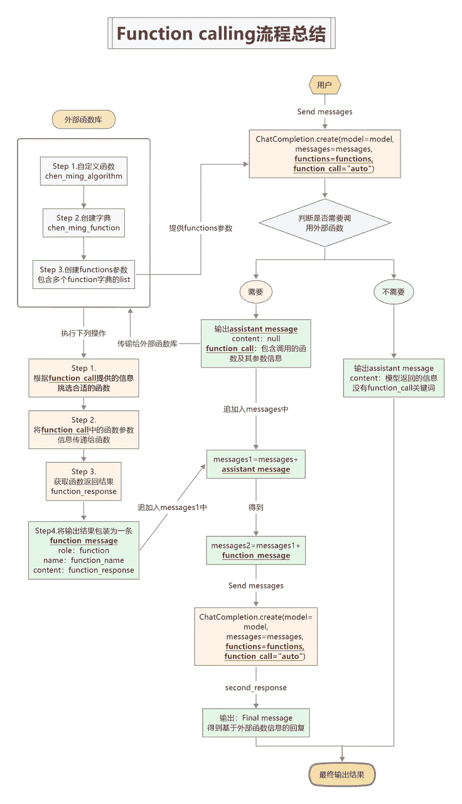

+   借助Zapier进行API功能拓展


+   用于构建Agent的function calling流程

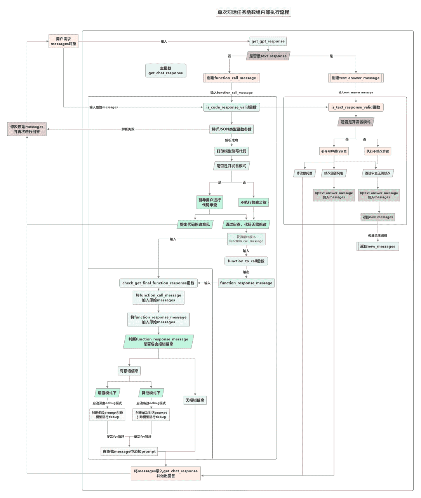

+   Function calling能够实现的各类AI Agent

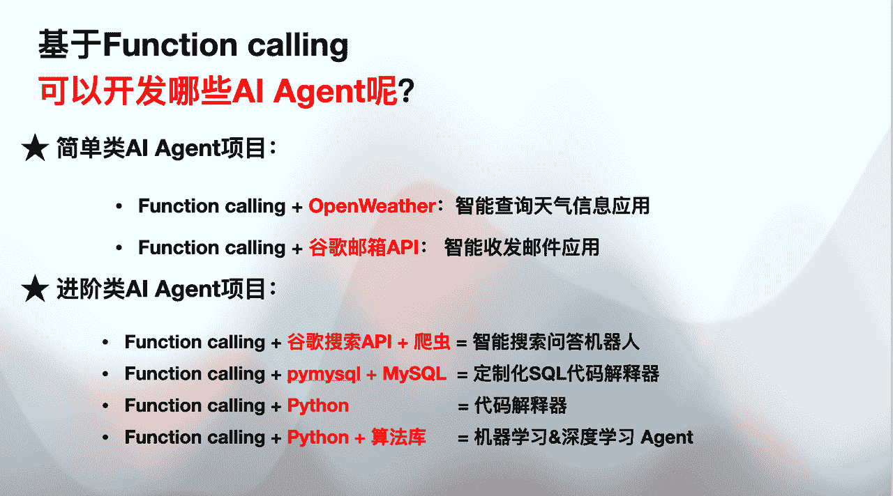

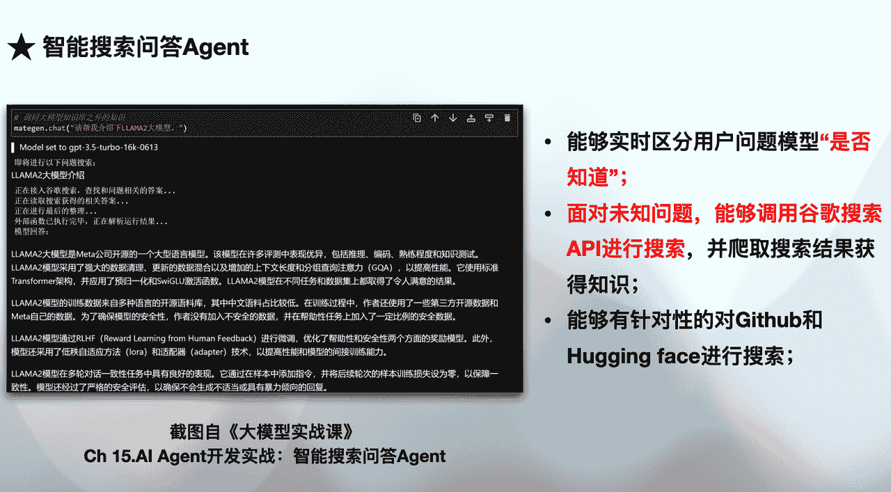

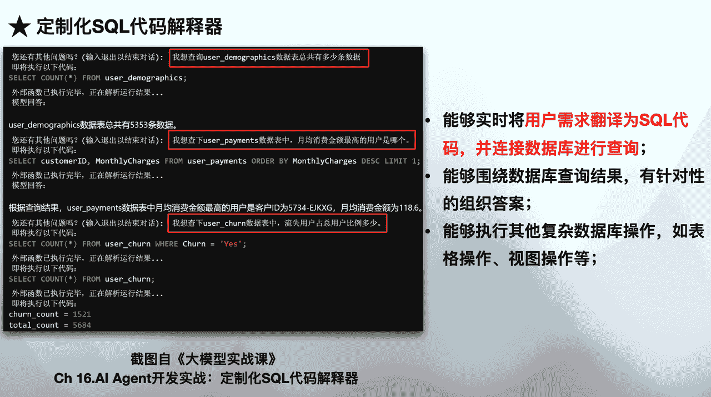

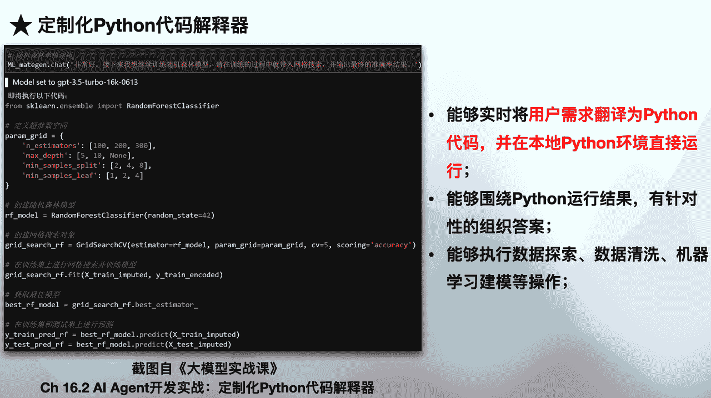

---

+   体验课内容节选自《2024大模型技术实战》完整版付费课程

**更多大模型技术内容学习，请扫码添加英**英，回复“大模型”，即咨询相关信息哦👇


此外，**扫码回复“LLM”**，即可领取**公开课课件、代码、数据**等~

---