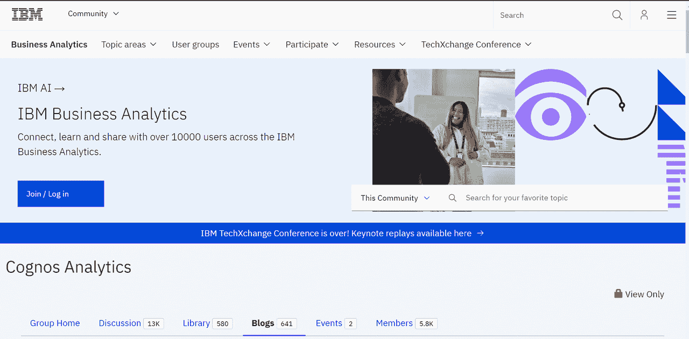
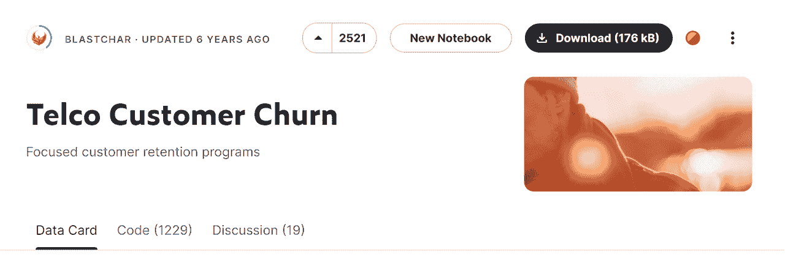
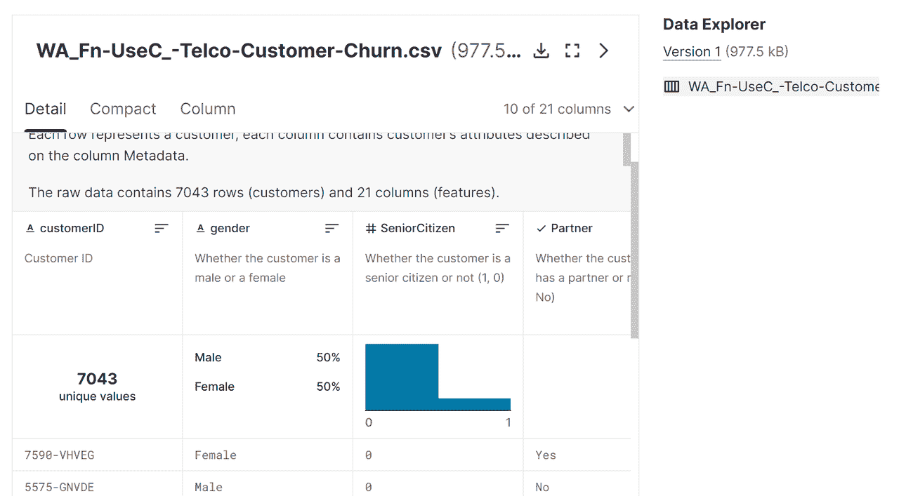

# GLM-4本地Python代码解释器与数据分析Agent开发实战

> 来源：[https://kq4b3vgg5b.feishu.cn/docx/B8FmddcTQolomTxdTv8cdpFKn9b](https://kq4b3vgg5b.feishu.cn/docx/B8FmddcTQolomTxdTv8cdpFKn9b)

```
import os
from zhipuai import ZhipuAI
from IPython.display import display, Code, Markdown
import requests
import json
import tiktoken
import numpy as np
import pandas as pd
import time

api_key = os.getenv("ZHIPU_API_KEY")
```

```
client = ZhipuAI(api_key=api_key) 
response = client.chat.completions.create(
    model="glm-4",  # 填写需要调用的模型名称
    messages=[
        {"role": "user", "content": "你好"}
    ],
)
print(response.choices[0].message)
```

```
content='你好👋！我是人工智能助手智谱清言，可以叫我小智🤖，很高兴见到你，欢迎问我任何问题。' role='assistant' tool_calls=None
```

## 数据集介绍

在此前验证ChatGPT代码解释器和Open interpreter功能时，我们曾简单介绍过Telco数据集，该数据集是Kaggle分享的一个高分数据集（1788 votes），是Kaggle平台上非常经典的围绕偏态数据集建模的数据集。该数据源自IBM商业社区（IBM Business Analytics Community）上分享的数据集，用于社区成员内部学习使用。



根据[IBM商业社区分享团队](https://www.kaggle.com/blastchar/telco-customer-churn)描述，该数据集为某电信公司在加利福尼亚为7000余位用户（个人/家庭）提供电话和互联网服务的相关记录。由于该数据集并不是竞赛数据集，因此数据集的下载方式相对容易，官网也只提供了网页下载一种选项（无法通过命令行直接下载）。我们可以在该数据集的Kaggle主页看到数据集的相关信息以及下载地址。此处我们简单介绍关于Kaggle数据集页面的基本功能，既Kaggle平台的基本使用方法，在后续的课程学习中，若是Kaggle案例，我们也将频繁借助Kaggle主页来获取帮助。当然，熟练使用Kaggle主页获取数据和挖掘信息（而不是借助第三方渠道），也是算法工程师必备技能之一。

## 数据集主页

首先是数据集主页：





此处我们能大致看到数据集基本信息，如总共只有一个数据文件（在其他很多情况下，一个建模目标可能会包含多个数据集），总共21列，7043条数据，以及其他各列的一些基本统计信息等。

当然，在数据集主页上，我们可以直接点击下载按钮进行数据集下载。下载完成后将其放到当前操作主目录下进行读取：

```
dataset = pd.read_csv('telco_data.csv')
```

```
pd.set_option('max_colwidth',200)

dataset.head(5)
```

|  | customerID | gender | SeniorCitizen | Partner | Dependents | tenure | PhoneService | MultipleLines | InternetService | OnlineSecurity | ... | DeviceProtection | TechSupport | StreamingTV | StreamingMovies | Contract | PaperlessBilling | PaymentMethod | MonthlyCharges | TotalCharges | Churn |

| --- | --- | --- | --- | --- | --- | --- | --- | --- | --- | --- | --- | --- | --- | --- | --- | --- | --- | --- | --- | --- | --- |

| 0 | 7590-VHVEG | Female | 0 | Yes | No | 1 | No | No phone service | DSL | No | ... | No | No | No | No | Month-to-month | Yes | Electronic check | 29.85 | 29.85 | No |

| 1 | 5575-GNVDE | Male | 0 | No | No | 34 | Yes | No | DSL | Yes | ... | Yes | No | No | No | One year | No | Mailed check | 56.95 | 1889.5 | No |

| 2 | 3668-QPYBK | Male | 0 | No | No | 2 | Yes | No | DSL | Yes | ... | No | No | No | No | Month-to-month | Yes | Mailed check | 53.85 | 108.15 | Yes |

| 3 | 7795-CFOCW | Male | 0 | No | No | 45 | No | No phone service | DSL | Yes | ... | Yes | Yes | No | No | One year | No | Bank transfer (automatic) | 42.30 | 1840.75 | No |

| 4 | 9237-HQITU | Female | 0 | No | No | 2 | Yes | No | Fiber optic | No | ... | No | No | No | No | Month-to-month | Yes | Electronic check | 70.70 | 151.65 | Yes |

5 rows × 21 columns

```
dataset.info()
```

```
<class 'pandas.core.frame.DataFrame'>
RangeIndex: 7043 entries, 0 to 7042
Data columns (total 21 columns):
 #   Column            Non-Null Count  Dtype  
---  ------            --------------  -----  
 0   customerID        7043 non-null   object 
 1   gender            7043 non-null   object 
 2   SeniorCitizen     7043 non-null   int64  
 3   Partner           7043 non-null   object 
 4   Dependents        7043 non-null   object 
 5   tenure            7043 non-null   int64  
 6   PhoneService      7043 non-null   object 
 7   MultipleLines     7043 non-null   object 
 8   InternetService   7043 non-null   object 
 9   OnlineSecurity    7043 non-null   object 
 10  OnlineBackup      7043 non-null   object 
 11  DeviceProtection  7043 non-null   object 
 12  TechSupport       7043 non-null   object 
 13  StreamingTV       7043 non-null   object 
 14  StreamingMovies   7043 non-null   object 
 15  Contract          7043 non-null   object 
 16  PaperlessBilling  7043 non-null   object 
 17  PaymentMethod     7043 non-null   object 
 18  MonthlyCharges    7043 non-null   float64
 19  TotalCharges      7043 non-null   object 
 20  Churn             7043 non-null   object 
dtypes: float64(1), int64(2), object(18)
memory usage: 1.1+ MB
```

其中数据集各字段解释如下：

| 字段 | 解释 |

| --- | --- |

| customerID | 用户ID |

| gender | 性别 |

| SeniorCitizen | 是否是老年人（1代表是） |

| Partner | 是否有配偶（Yes or No） |

| Dependents | 是否经济独立（Yes or No） |

| tenure | 用户入网时间 |

| PhoneService | 是否开通电话业务（Yes or No） |

| MultipleLines | 是否开通多条电话业务（Yes 、 No or No phoneservice） |

| InternetService | 是否开通互联网服务（No、DSL数字网络或filber potic光线网络） |

| OnlineSecurity | 是否开通网络安全服务（Yes、No or No internetservice） |

| OnlineBackup | 是否开通在线备份服务（Yes、No or No internetservice） |

| DeviceProtection | 是否开通设备保护服务（Yes、No or No internetservice） |

| TechSupport | 是否开通技术支持业务（Yes、No or No internetservice） |

| StreamingTV | 是否开通网络电视（Yes、No or No internetservice） |

| StreamingMovies | 是否开通网络电影（Yes、No or No internetservice） |

| Contract | 合同签订方式（按月、按年或者两年） |

| PaperlessBilling | 是否开通电子账单（Yes or No） |

| PaymentMethod | 付款方式（bank transfer、credit card、electronic check、mailed check） |

| MonthlyCharges | 月度费用 |

| TotalCharges | 总费用 |

| Churn | 是否流失（Yes or No） |

## 2.1 创建telco_db数据库的数据字典

对于大多数企业来说，都会围绕各关键数据集制作数据字典。所谓数据字典，指的是一份记录了每个数据集详细信息的文档，有时候数据字典也可以以表格形式呈现。借助数据字典，数据分析人员能够快速了解数据表中的各项关键信息。例如，围绕当前`telco_db`数据库，我们可以编写数据字典如下：

对于一个合格的数据字典来说，必须包含数据集的基本解释、数据来源说明和数据表中各字段说明等基本情况。而这些也是确保之后大模型能够顺利理解当前数据集的重要信息。

> 需要注意的是，为了方便后续直接导入Python环境，课程里面采用文档形式编写数据字典，除此之外，很多场景下数据字典都是以excel表格形式存储。

我们将数据字典命名为`telco_data_dictionary`，并按照如下形式导入到当前操作环境中：

```
encoding = tiktoken.encoding_for_model("gpt-3.5-turbo")
```

```
# 打开并读取Markdown文件
with open('telco_data_dictionary.md', 'r', encoding='utf-8') as f:
    data_dictionary = f.read()
    
len(encoding.encode(data_dictionary))
```

```
822
```

```
display(Markdown(data_dictionary))
```

## telco_data_dictionary：telco_data数据集说明

本数据字典记录了`telco_data`数据集基本情况，`telco_data`数据集是一个电信用户流失数据集，用于描述电信用户基本情况与目前是否流失状态。

### 数据集本地存储地址

`telco_data`数据集存储在本地文件夹中，存储地址在当前代码目录下，文件名为`telco_data.csv`。

### 数据集字段解释

| Column Name | Description | Value Range | Value Explanation |

| --- | --- | --- | --- |

| customerID | 客户ID，`user_demographics`数据表主键 |  | 由数字和字母组成的 |

| gender | 用户的性别 | Female, Male | Female (女性), Male (男性) |

| SeniorCitizen | 是否为老人 | 0, 1 | 0 (不是), 1 (是) |

| Partner | 用户是否有伴侣 | Yes, No | Yes (有), No (没有) |

| Dependents | 用户经济是否独立，往往用于判断用户是否已经成年 | No, Yes | Yes (有), No (没有) |

| PhoneService | 用户是否有电话服务 | No, Yes | Yes (有), No (没有) |

| MultipleLines | 用户是否开通了多条电话业务 | No phone service, No, Yes | Yes (有多条电话线业务), No (没有多条电话线业务), No phone service (没有电话服务) |

| InternetService | 用户的互联网服务类型 | DSL, Fiber optic, No | DSL (DSL), Fiber optic (光纤), No (没有) |

| OnlineSecurity | 是否开通网络安全服务 | No, Yes, No internet service | Yes（有）、No（无） or No internetservice（没有网路服务） |

| OnlineBackup | 是否开通在线备份服务 | Yes, No, No internet service | Yes（有）、No（无） or No internetservice（没有网路服务） |

| DeviceProtection | 是否开通设备保护服务 | No, Yes, No internet service | Yes（有）、No（无） or No internetservice（没有网路服务） |

| TechSupport | 是否开通技术支持业务 | No, Yes, No internet service | Yes（有）、No（无） or No internetservice（没有网路服务） |

| StreamingTV | 是否开通网络电视 | No, Yes, No internet service | Yes（有）、No（无） or No internetservice（没有网路服务） |

| tenure | 用户入网时间 |  |  |

| Contract | 合同类型 | Month-to-month, One year, Two year | Month-to-month (月付), One year (一年付), Two year (两年付) |

| PaperlessBilling | 是否无纸化账单 | Yes, No | Yes (是), No (否) |

| PaymentMethod | 支付方式 | Electronic check, Mailed check, Bank transfer (automatic), Credit card (automatic) | Electronic check (电子检查), Mailed check (邮寄支票), Bank transfer (automatic) (银行转账), Credit card (automatic) (信用卡) |

| MonthlyCharges | 月费用 |  | 用户平均每月支付费用 |

| TotalCharges | 总费用 |  | 截至目前用户总消费金额 |


# telco_data 数据集介绍

## 数据集概述

| Churn | 用户是否流失 | No, Yes | Yes (是), No (否) |

```python
messages = [
    {"role": "system", "content": data_dictionary}, 
    {"role": "user", "content": "请帮我简单介绍telco_data数据集"}
]
```

```python
client = ZhipuAI(api_key=api_key) 
response = client.chat.completions.create(
    model="glm-4",  
    messages=messages
)
display(Markdown(response.choices[0].message.content))
```

telco_data 数据集是一个关于电信行业用户流失情况的数据集，它包含了描述用户基本情况和其服务使用状况的多项指标，以及一个关键的标签字段，指明用户是否已经流失。这个数据集对于电信公司来说非常有价值，可以帮助它们分析用户流失的原因，从而采取相应措施来改善客户留存率。

以下是 telco_data 数据集的简单介绍：

- **数据集目的**：分析用户特征与用户流失之间的关系，预测并减少用户流失。
- **数据集结构**：
  - **字段（Column Name）**：数据集包含多个字段，每个字段都描述了用户的不同属性，如性别、年龄、服务使用情况等。
  - **描述（Description）**：每个字段都有对应的描述，说明了该字段所代表的内容。
  - 取值范围（Value Range）：指明了每个字段可能的取值。
  - 取值解释（Value Explanation）：对每个字段可能的取值进行了详细解释。
- **关键字段**：
  - `customerID`：唯一标识每个用户的 ID。
  - `Churn`：这是一个关键字段，表明用户是否已经流失（`Yes` 表示流失，`No` 表示未流失）。
- **用户特征**：包括性别、年龄（是否为老人）、家庭状况（伴侣、经济独立）、服务使用情况（电话服务、互联网服务类型、增值服务）等。
- **服务使用相关字段**：包含用户的服务订阅情况，如网络安全服务、在线备份、设备保护、技术支持、网络电视等。
- **合同与财务信息**：包括用户的合同类型、账单方式、月费用和总费用等。
- **存储位置**：数据集以 CSV 格式存储在本地文件夹中，文件名为 `telco_data.csv`。

通过分析 telco_data 数据集，电信公司可以识别可能导致用户流失的风险因素，并据此调整他们的服务、定价策略或客户服务策略，以提高用户满意度和忠诚度。

```python
messages = [
    {"role": "system", "content": data_dictionary}, 
    {"role": "user", "content": "如果我想读取telco_data数据集，应该如何操作呢？"}
]
```

```python
response = client.chat.completions.create(
    model="glm-4",  
    messages=messages
)
display(Markdown(response.choices[0].message.content))
```

telco_data 数据集是一个关于电信公司用户信息的数据库，它专门用于分析和预测用户流失情况。该数据集包含了用户的各种属性信息，这些信息可以帮助分析人员理解用户的留存或流失行为。

以下是 telco_data 数据集的简单介绍：

- **数据集目的**：数据集主要用于分析电信用户的流失情况，即用户停止使用该公司服务的原因。
- **数据存储**：数据以 CSV 格式存储在本地文件夹中，文件名为 `telco_data.csv`。
- **字段说明**：数据集包含多个字段，每个字段代表用户的某一特征或服务使用情况，如下：

  - `customerID`：客户的唯一标识。
  - `gender`：用户的性别。
  - `SeniorCitizen`：用户是否为老年人。
  - `Partner`：用户是否有伴侣。
  - `Dependents`：用户是否有经济依赖。
  - `PhoneService`：用户是否订购了电话服务。
  - `MultipleLines`：用户是否订购了多条电话线。
  - `InternetService`：用户选择的互联网服务类型。
  - `OnlineSecurity`、`OnlineBackup`、`DeviceProtection`、`TechSupport`、`StreamingTV`：用户是否订购了相应的附加服务。
  - `tenure`：用户作为公司客户的时间长度。
  - `Contract`：用户选择的合同类型。
  - `PaperlessBilling`：用户是否选择了无纸化账单。
  - `PaymentMethod`：用户的支付方式。
  - `MonthlyCharges`：用户的月费用。
  - `TotalCharges`：用户累积的总费用。
  - `Churn`：用户是否已经流失。

通过分析这些字段，数据科学家和分析师可以建立模型来预测哪些用户可能流失，并制定相应的策略来改善客户留存率。这个数据集对于电信行业来说非常有价值，因为它可以帮助公司了解客户的需求，改进服务和产品，最终提升企业的竞争力。

## 外部函数 python_inter

```python
def python_inter(py_code, g='globals()'):
    """
    专门用于执行非绘图类python代码，并获取最终查询或处理结果。若是设计绘图操作的Python代码，则需要调用fig_inter函数来执行。
    :param py_code: 字符串形式的Python代码，用于执行对telco_db数据库中各张数据表进行操作
    :param g: g，字符串形式变量，表示环境变量，无需设置，保持默认参数即可
    :return：代码运行的最终结果
    """    
    
    global_vars_before = set(g.keys())
    try:
        exec(py_code, g)            
    except Exception as e:
        return f"代码执行时报错{e}"
    global_vars_after = set(g.keys())
    new_vars = global_vars_after - global_vars_before
    # 若存在新变量
    if new_vars:
        result = {var: g[var] for var in new_vars}
        return str(result)
    # 若不存在新变量，即有可能是代码是表达式，也有可能代码对相同变量重复赋值
    else:
        try:
            # 尝试如果是表达式，则返回表达式运行结果
            return str(eval(py_code, g))
        # 若报错，则先测试是否是对相同变量重复赋值
        except Exception as e:
            try:
                exec(py_code, g)
                return "已经顺利执行代码"
            except Exception as e:
                pass
            # 若不是重复赋值，则报错
            return f"代码执行时报错{e}"
```

```python
# 表达式语句
2+5
```

```
7
```

```python
# 表达式语句运行测试
code_str1 = '2 + 5'
python_inter(py_code = code_str1, g=globals())
```

```
'7'
```

```python
# 赋值语句运行测试
code_str1 = 'a = 1'
python_inter(py_code = code_str1, g=globals())
```

```
'已经顺利执行代码'
```

```python
a
```

```
1
```

```python
# 重复赋值语句运行测试
code_str1 = 'a = 10'
python_inter(py_code = code_str1, g=globals())
```

```
'已经顺利执行代码'
```

```python
a
```

```
10
```

## 编写函数说明

```python
python_inter_function_info = {
    'name': 'python_inter',
    'description': '专门用于python代码，并获取最终查询或处理结果。',
    'parameters': {
        'type': 'object',
        'properties': {
            'py_code': {
                'type': 'string',
                'description': '用于执行在本地环境运行的python代码'
            },
            'g': {
                'type': 'string',
                'description': '环境变量，可选参数，保持默认参数即可'
            }
        },
        'required': ['py_code']
    }
}
```

```python
available_functions = {
    "python_inter": python_inter,
}
```

```python
tools = [
    {
        "type": "function",
        "function": python_inter_function_info
    }
]
```

```python
messages = [
    {"role": "system", "content": data_dictionary}, 
    {"role": "user", "content": "请帮我将telco_data数据集读取到本地Python环境中"}
]
```

```python
response = client.chat.completions.create(
    model="glm-4",  
    messages=messages,
    tools=tools,
)
```

```python
response_message = response.choices[0].message
response_message
```

```
CompletionMessage(content=None, role='assistant', tool_calls=[CompletionMessageToolCall(id='call_8352717810239625769', function=Function(arguments='{"py_code":"import pandas as pd\\n\\ntelco_data = pd.read_csv(\"telco_data.csv\")\\n\\nprint(telco_data.head())"}', name='python_inter', type='function'))])
```

```python
response_message.tool_calls[0]
```

```
CompletionMessageToolCall(id='call_8352717810239625769', function=Function(arguments='{"py_code":"import pandas as pd\\n\\ntelco_data = pd.read_csv(\"telco_data.csv\")\\n\\nprint(telco_data.head())"}', name='python_inter', type='function')
```

```python
response_message.tool_calls[0].id
```

```
'call_8352717810239625769'
```

```python
response_message.tool_calls[0].function
```

```
Function(arguments='{"py_code":"import pandas as pd\\n\\ntelco_data = pd.read_csv(\"telco_data.csv\")\\n\\nprint(telco_data.head())"}', name='python_inter')
```

```python
# 完成对话需要调用的函数名称
function_name = response_message.tool_calls[0].function.name
function_name
```

```
'python_inter'
```

```python
# 具体的函数对象
fuction_to_call = available_functions[function_name]
fuction_to_call
```

```
<function __main__.python_inter(py_code, g='globals()')>
```

```python
response_message.tool_calls[0].function.arguments
```

```
'{"py_code":"import pandas as pd\\n\\ntelco_data = pd.read_csv(\"telco_data.csv\")\\n\\nprint(telco_data.head())"}'
```

```python
# 执行该函数所需要的参数
function_args = json.loads(response_message.tool_calls[0].function.arguments)
function_args
```

```
{'py_code': 'import pandas as pd\n\ntelco_data = pd.read_csv("telco_data.csv")\n\nprint(telco_data.head())'}
```

```python
# 将当前操作空间中的全局变量添加到外部函数中
function_args['g'] = globals() 
# 将函数参数输入到函数中，获取函数计算结果
function_response = fuction_to_call(**function_args)
```


```
   customerID  gender  SeniorCitizen Partner Dependents  tenure PhoneService  \
0  7590-VHVEG  Female              0     Yes         No       1           No   
1  5575-GNVDE    Male              0      No         No      34          Yes   
2  3668-QPYBK    Male              0      No         No       2          Yes   
3  7795-CFOCW    Male              0      No         No      45           No   
4  9237-HQITU  Female              0      No         No       2          Yes   

      MultipleLines InternetService OnlineSecurity  ... DeviceProtection  \
0  No phone service             DSL             No  ...               No   
1                No             DSL            Yes  ...              Yes   
2                No             DSL            Yes  ...               No   
3  No phone service             DSL            Yes  ...              Yes   
4                No     Fiber optic             No  ...               No   

  TechSupport StreamingTV StreamingMovies        Contract PaperlessBilling  \
0          No          No              No  Month-to-month              Yes   
1          No          No              No        One year               No   
2          No          No              No  Month-to-month              Yes   
3         Yes          No              No        One year               No   
4          No          No              No  Month-to-month              Yes   

               PaymentMethod MonthlyCharges  TotalCharges Churn  
0           Electronic check          29.85         29.85    No  
1               Mailed check          56.95        1889.5    No  
2               Mailed check          53.85        108.15   Yes  
3  Bank transfer (automatic)          42.30       1840.75    No  
4           Electronic check          70.70        151.65   Yes  

[5 rows x 21 columns]
```

```
function_response
```

```
&quot;{&#x27;telco_data&#x27;:       customerID  gender  SeniorCitizen Partner Dependents  tenure  \\\n0     7590-VHVEG  Female              0     Yes         No       1   \n1     5575-GNVDE    Male              0      No         No      34   \n2     3668-QPYBK    Male              0      No         No       2   \n3     7795-CFOCW    Male              0     Yes        Yes      45   \n4     9237-HQITU  Female              0      No         No       2   \n...          ...     ...            ...     ...        ...     ...   \n7038  6840-RESVB    Male              0     Yes        Yes      24   \n7039  2234-XADUH    Female              0     Yes        Yes      72   \n7040  4801-JZAZL  Female              0     Yes        Yes      11   \n7041  8361-LTMKD    Male              1     Yes         No       4   \n7042  3186-AJIEK    Male              0      No         No      66   \n\n     PhoneService     MultipleLines InternetService OnlineSecurity  ...  \\\n0              No  No phone service             DSL             No  ...   \n1             Yes                No             DSL            Yes  ...   \n2             Yes                No             DSL            Yes  ...   \n3              No  No phone service             DSL            Yes  ...   \n4             Yes                No     Fiber optic             No  ...   \n...           ...               ...             ...            ...  ...   \n7038          Yes               Yes             DSL            Yes  ...   \n7039          Yes               Yes     Fiber optic             No  ...   \n7040           No  No phone service             DSL            Yes  ...   \n7041          Yes               Yes     Fiber optic             No  ...   \n7042          Yes                No     Fiber optic            Yes  ...   \n\n     DeviceProtection TechSupport StreamingTV StreamingMovies        Contract  \\\n0                  No          No          No              No  Month-to-month   \n1                 Yes          No          No              No        One year   \n2                  No          No          No              No  Month-to-month   \n3                 Yes         Yes          No              No        One year   \n4                  No          No          No              No  Month-to-month   \n...               ...         ...         ...             ...             ...   \n7038              Yes         Yes         Yes             Yes        One year   \n7039              Yes          No         Yes             Yes        One year   \n7040               No          No          No              No  Month-to-month   \n7041              No          No          No              No  Month-to-month   \n7042              Yes         Yes         Yes             Yes        Two year   \n\n     PaperlessBilling              PaymentMethod MonthlyCharges  TotalCharges  \\\n0                 Yes           Electronic check          29.85         29.85   \n1                  No               Mailed check          56.95        1889.5   \n2                 Yes               Mailed check          53.85        108.15   \n3                  No  Bank transfer (automatic)          42.30       1840.75   \n4                 Yes           Electronic check          70.70        151.65   \n...               ...                        ...            ...           ...   \n7038              Yes               Mailed check          84.80        1990.5   \n7039              Yes    Credit card (automatic)         103.20        7362.9   \n7040              Yes           Electronic check          29.60        346.45   \n7041              Yes               Mailed check          74.40         306.6   \n7042              Yes  Bank transfer (automatic)         105.65        6844.5   \n\n     Churn  \n0       No  \n1       No  \n2      Yes  \n3       No  \n4      Yes  \n...    ...  \n7038    No  \n7039    No  \n7040    No  \n7041   Yes  \n7042    No  \n\n[7043 rows x 21 columns]}&quot;
```

```
telco_data
```

|  | `customerID` | `gender` | `SeniorCitizen` | `Partner` | `Dependents` | `tenure` | `PhoneService` | `MultipleLines` | `InternetService` | `OnlineSecurity` | ... | `DeviceProtection` | `TechSupport` | `StreamingTV` | `StreamingMovies` | `Contract` | `PaperlessBilling` | `PaymentMethod` | `MonthlyCharges` | `TotalCharges` | `Churn` |
| --- | --- | --- | --- | --- | --- | --- | --- | --- | --- | --- | --- | --- | --- | --- | --- | --- | --- | --- | --- | --- | --- |

| 0 | 7590-VHVEG | Female | 0 | Yes | No | 1 | No | No phone service | DSL | No | ... | No | No | No | No | Month-to-month | Yes | Electronic check | 29.85 | 29.85 | No |

| 1 | 5575-GNVDE | Male | 0 | No | No | 34 | Yes | No | DSL | Yes | ... | Yes | No | No | No | One year | No | Mailed check | 56.95 | 1889.5 | No |

| 2 | 3668-QPYBK | Male | 0 | No | No | 2 | Yes | No | DSL | Yes | ... | No | No | No | No | Month-to-month | Yes | Mailed check | 53.85 | 108.15 | Yes |

| 3 | 7795-CFOCW | Male | 0 | No | No | 45 | No | No phone service | DSL | Yes | ... | Yes | Yes | No | No | One year | No | Bank transfer (automatic) | 42.30 | 1840.75 | No |

| 4 | 9237-HQITU | Female | 0 | No | No | 2 | Yes | No | Fiber optic | No | ... | No | No | No | No | Month-to-month | Yes | Electronic check | 70.70 | 151.65 | Yes |

| ... | ... | ... | ... | ... | ... | ... | ... | ... | ... | ... | ... | ... | ... | ... | ... | ... | ... | ... | ... | ... | ... |

| 7038 | 6840-RESVB | Male | 0 | Yes | Yes | 24 | Yes | Yes | DSL | Yes | ... | Yes | Yes | Yes | Yes | One year | Yes | Mailed check | 84.80 | 1990.5 | No |

| 7039 | 2234-XADUH | Female | 0 | Yes | Yes | 72 | Yes | Yes | Fiber optic | No | ... | Yes | No | Yes | Yes | One year | Yes | Credit card (automatic) | 103.20 | 7362.9 | No |

| 7040 | 4801-JZAZL | Female | 0 | Yes | Yes | 11 | No | No phone service | DSL | Yes | ... | No | No | No | No | Month-to-month | Yes | Electronic check | 29.60 | 346.45 | No |

| 7041 | 8361-LTMKD | Male | 1 | Yes | No | 4 | Yes | Yes | Fiber optic | No | ... | No | No | No | No | Month-to-month | Yes | Mailed check | 74.40 | 306.6 | Yes |


# `telco_data` 数据处理记录

## 数据集预览

| 7042 | 3186-AJIEK | Male | 0 | No | No | 66 | Yes | No | Fiber optic | Yes | ... | Yes | Yes | Yes | Yes | Two year | Yes | Bank transfer (automatic) | 105.65 | 6844.5 | No |

7043 rows × 21 columns

## 变量 `messages`

```
messages
```

## 系统消息：`telco_data` 数据字典

```
[{&#x27;role&#x27;: &#x27;system&#x27;,
  &#x27;content&#x27;: &#x27;# telco_data_dictionary：telco_data数据集说明\n\n\u200b\t本数据字典记录了telco_data数据集基本情况，telco_data数据集是一个电信用户流失数据集，用于描述电信用户基本情况与目前是否流失状态。\n\n- 数据集本地存储地址\n\n  \u200b\ttelco_data数据集存储在本地文件夹中，存储地址在当前代码目录下，文件名为telco_data.csv。\n\n- 数据集字段解释\n\n| Column Name | Description | Value Range | Value Explanation |\n|-------------|-------------|-------------|-------------------|\n| customerID | 客户ID，user_demographics数据表主键 |              | 由数字和字母组成的 |\n| gender | 用户的性别 | Female, Male | Female (女性), Male (男性) |\n| SeniorCitizen | 是否为老人 | 0, 1 | 0 (不是), 1 (是) |\n| Partner | 用户是否有伴侣 | Yes, No | Yes (有), No (没有) |\n| Dependents | 用户经济是否独立，往往用于判断用户是否已经成年 | No, Yes | Yes (有), No (没有) |\n| PhoneService | 用户是否有电话服务 | No, Yes | Yes (有), No (没有) |\n| MultipleLines | 用户是否开通了多条电话业务 | No phone service, No, Yes | Yes (有多条电话线业务), No (没有多条电话线业务), No phone service (没有电话服务) |\n| InternetService | 用户的互联网服务类型 | DSL, Fiber optic, No | DSL (DSL), Fiber optic (光纤), No (没有) |\n| OnlineSecurity | 是否开通网络安全服务 | No, Yes, No internet service | Yes（有）、No（无） or No internetservice（没有网路服务） |\n| OnlineBackup | 是否开通在线备份服务 | Yes, No, No internet service | Yes（有）、No（无） or No internetservice（没有网路服务） |\n| DeviceProtection | 是否开通设备保护服务 | No, Yes, No internet service | Yes（有）、No（无） or No internetservice（没有网路服务） |\n| TechSupport | 是否开通技术支持业务 | No, Yes, No internet service | Yes（有）、No（无） or No internetservice（没有网路服务） |\n| StreamingTV | 是否开通网络电视 | No, Yes, No internet service | Yes（有）、No（无） or No internetservice（没有网路服务） |\n| tenure | 用户入网时间 |  |  |\n| Contract | 合同类型 | Month-to-month, One year, Two year | Month-to-month (月付), One year (一年付), Two year (两年付) |\n| PaperlessBilling | 是否无纸化账单 | Yes, No | Yes (是), No (否) |\n| PaymentMethod | 支付方式 | Electronic check, Mailed check, Bank transfer (automatic), Credit card (automatic) | Electronic check (电子检查), Mailed check (邮寄支票), Bank transfer (automatic) (银行转账), Credit card (automatic) (信用卡) |\n| MonthlyCharges | 月费用 |  | 用户平均每月支付费用 |\n| TotalCharges | 总费用 |  | 截至目前用户总消费金额 |\n| Churn | 用户是否流失 | No, Yes | Yes (是), No (否) |\n\n\n\n\n\n\n\n&#x27;},
 {&#x27;role&#x27;: &#x27;user&#x27;, &#x27;content&#x27;: &#x27;请帮我将telco_data数据集读取到本地Python环境中&#x27;}]
```

## 响应消息 `response_message.model_dump()`

```
response_message.model_dump()
```

```
{&#x27;content&#x27;: None,
 &#x27;role&#x27;: &#x27;assistant&#x27;,
 &#x27;tool_calls&#x27;: [{&#x27;id&#x27;: &#x27;call_8352717810239625769&#x27;,
   &#x27;function&#x27;: {&#x27;arguments&#x27;: &#x27;{&quot;py_code&quot;:&quot;import pandas as pd\\n\\ntelco_data = pd.read_csv(\\&quot;telco_data.csv\\&quot;)\\n\\nprint(telco_data.head())&quot;}&#x27;,
    &#x27;name&#x27;: &#x27;python_inter&#x27;},
   &#x27;type&#x27;: &#x27;function&#x27;}]}
```

## 追加模型返回结果消息

```
# 追加第一次模型返回结果消息
messages.append(response_message.model_dump())  
```

## 更新后的变量 `messages`

```
messages
```

```
[{&#x27;role&#x27;: &#x27;system&#x27;,
  &#x27;content&#x27;: &#x27;# telco_data_dictionary：telco_data数据集说明\n\n\u200b\t本数据字典记录了telco_data数据集基本情况，telco_data数据集是一个电信用户流失数据集，用于描述电信用户基本情况与目前是否流失状态。\n\n- 数据集本地存储地址\n\n  \u200b\ttelco_data数据集存储在本地文件夹中，存储地址在当前代码目录下，文件名为telco_data.csv。\n\n- 数据集字段解释\n\n| Column Name | Description | Value Range | Value Explanation |\n|-------------|-------------|-------------|-------------------|\n| customerID | 客户ID，user_demographics数据表主键 |              | 由数字和字母组成的 |\n| gender | 用户的性别 | Female, Male | Female (女性), Male (男性) |\n| SeniorCitizen | 是否为老人 | 0, 1 | 0 (不是), 1 (是) |\n| Partner | 用户是否有伴侣 | Yes, No | Yes (有), No (没有) |\n| Dependents | 用户经济是否独立，往往用于判断用户是否已经成年 | No, Yes | Yes (有), No (没有) |\n| PhoneService | 用户是否有电话服务 | No, Yes | Yes (有), No (没有) |\n| MultipleLines | 用户是否开通了多条电话业务 | No phone service, No, Yes | Yes (有多条电话线业务), No (没有多条电话线业务), No phone service (没有电话服务) |\n| InternetService | 用户的互联网服务类型 | DSL, Fiber optic, No | DSL (DSL), Fiber optic (光纤), No (没有) |\n| OnlineSecurity | 是否开通网络安全服务 | No, Yes, No internet service | Yes（有）、No（无） or No internetservice（没有网路服务） |\n| OnlineBackup | 是否开通在线备份服务 | Yes, No, No internet service | Yes（有）、No（无） or No internetservice（没有网路服务） |\n| DeviceProtection | 是否开通设备保护服务 | No, Yes, No internet service | Yes（有）、No（无） or No internetservice（没有网路服务） |\n| TechSupport | 是否开通技术支持业务 | No, Yes, No internet service | Yes（有）、No（无） or No internetservice（没有网路服务） |\n| StreamingTV | 是否开通网络电视 | No, Yes, No internet service | Yes（有）、No（无） or No internetservice（没有网路服务） |\n| tenure | 用户入网时间 |  |  |\n| Contract | 合同类型 | Month-to-month, One year, Two year | Month-to-month (月付), One year (一年付), Two year (两年付) |\n| PaperlessBilling | 是否无纸化账单 | Yes, No | Yes (是), No (否) |\n| PaymentMethod | 支付方式 | Electronic check, Mailed check, Bank transfer (automatic), Credit card (automatic) | Electronic check (电子检查), Mailed check (邮寄支票), Bank transfer (automatic) (银行转账), Credit card (automatic) (信用卡) |\n| MonthlyCharges | 月费用 |  | 用户平均每月支付费用 |\n| TotalCharges | 总费用 |  | 截至目前用户总消费金额 |\n| Churn | 用户是否流失 | No, Yes | Yes (是), No (否) |\n\n\n\n\n\n\n\n&#x27;},
 {&#x27;role&#x27;: &#x27;user&#x27;, &#x27;content&#x27;: &#x27;请帮我将telco_data数据集读取到本地Python环境中&#x27;},
 {&#x27;content&#x27;: None,
  &#x27;role&#x27;: &#x27;assistant&#x27;,
  &#x27;tool_calls&#x27;: [{&#x27;id&#x27;: &#x27;call_8352717810239625769&#x27;,
    &#x27;function&#x27;: {&#x27;arguments&#x27;: &#x27;{&quot;py_code&quot;:&quot;import pandas as pd\\n\\ntelco_data = pd.read_csv(\\&quot;telco_data.csv\\&quot;)\\n\\nprint(telco_data.head())&quot;}&#x27;,
     &#x27;name&#x27;: &#x27;python_inter&#x27;},
    &#x27;type&#x27;: &#x27;function&#x27;}]}]
```

## 变量 `function_response`

```
function_response
```


```
"{'telco_data':       customerID  gender  SeniorCitizen Partner Dependents  tenure  \
0     7590-VHVEG  Female              0     Yes         No       1   
1     5575-GNVDE    Male              0      No         No      34   
2     3668-QPYBK    Male              0      No         No       2   
3     7795-CFOCW    Male              0      No         No      45   
4     9237-HQITU  Female              0      No         No       2   
...          ...     ...            ...     ...        ...     ...   
7038  6840-RESVB    Male              0     Yes        Yes      24   
7039  2234-XADUH  Female              0     Yes        Yes      72   
7040  4801-JZAZL    Female              0     Yes        Yes      11   
7041  8361-LTMKD    Male              1     Yes         No       4   
7042  3186-AJIEK    Male              0      No         No      66   

     PhoneService     MultipleLines InternetService OnlineSecurity  ...  
0              No  No phone service             DSL             No  ...  
1             Yes                No             DSL            Yes  ...  
2             Yes                No             DSL            Yes  ...  
3              No  No phone service             DSL            Yes  ...  
4             Yes                No     Fiber optic             No  ...  
...           ...               ...             ...            ...  ...  
7038          Yes               Yes             DSL            Yes  ...  
7039          Yes               Yes     Fiber optic             No  ...  
7040           No  No phone service             DSL            Yes  ...  
7041          Yes               Yes     Fiber optic             No  ...  
7042          Yes                No     Fiber optic            Yes  ...  

     DeviceProtection TechSupport StreamingTV StreamingMovies        Contract  
0                  No          No          No              No  Month-to-month   
1                 Yes          No          No              No        One year   
2                  No          No          No              No  Month-to-month   
3                 Yes         Yes          No              No        One year   
4                  No          No          No              No  Month-to-month   
...               ...         ...         ...             ...             ...   
7038              Yes         Yes         Yes             Yes        One year   
7039              Yes          No         Yes             Yes        One year   
7040               No          No          No              No  Month-to-month   
7041               No          No          No              No  Month-to-month   
7042              Yes         Yes         Yes             Yes        Two year   

     PaperlessBilling              PaymentMethod MonthlyCharges  TotalCharges  
0                 Yes           Electronic check          29.85         29.85   
1                  No               Mailed check          56.95        1889.5   
2                 Yes               Mailed check          53.85        108.15   
3                  No  Bank transfer (automatic)          42.30       1840.75   
4                 Yes           Electronic check          70.70        151.65   
...               ...                        ...            ...           ...   
7038              Yes               Mailed check          84.80        1990.5   
7039              Yes    Credit card (automatic)         103.20        7362.9   
7040              Yes           Electronic check          29.60        346.45   
7041              Yes               Mailed check          74.40         306.6   
7042              Yes  Bank transfer (automatic)         105.65        6844.5   

     Churn  
0       No  
1       No  
2      Yes  
3       No  
4      Yes  
...    ...  
7038    No  
7039    No  
7040    No  
7041   Yes  
7042    No  

[7043 rows x 21 columns]}
```

## 追加 function 返回消息

```python
messages.append({
    "role": "tool",
    "content": function_response,
    "tool_call_id": response_message.tool_calls[0].id
})
```

```
messages
```


# telco_data_dictionary：telco_data数据集说明

本数据字典记录了`telco_data`数据集基本情况，`telco_data`数据集是一个电信用户流失数据集，用于描述电信用户基本情况与目前是否流失状态。

## 数据集本地存储地址

`telco_data`数据集存储在本地文件夹中，存储地址在当前代码目录下，文件名为`telco_data.csv`。

## 数据集字段解释

| Column Name | Description | Value Range | Value Explanation |
|-------------|-------------|-------------|-------------------|
| `customerID` | 客户ID，`user_demographics`数据表主键 | | 由数字和字母组成的 |
| `gender` | 用户的性别 | Female, Male | Female (女性), Male (男性) |
| `SeniorCitizen` | 是否为老人 | 0, 1 | 0 (不是), 1 (是) |
| `Partner` | 用户是否有伴侣 | Yes, No | Yes (有), No (没有) |
| `Dependents` | 用户经济是否独立，往往用于判断用户是否已经成年 | No, Yes | Yes (有), No (没有) |
| `PhoneService` | 用户是否有电话服务 | No, Yes | Yes (有), No (没有) |
| `MultipleLines` | 用户是否开通了多条电话业务 | No phone service, No, Yes | Yes (有多条电话线业务), No (没有多条电话线业务), No phone service (没有电话服务) |
| `InternetService` | 用户的互联网服务类型 | DSL, Fiber optic, No | DSL (DSL), Fiber optic (光纤), No (没有) |
| `OnlineSecurity` | 是否开通网络安全服务 | No, Yes, No internet service | Yes（有）、No（无） or No internet service（没有网路服务） |
| `OnlineBackup` | 是否开通在线备份服务 | Yes, No, No internet service | Yes（有）、No（无） or No internet service（没有网路服务） |
| `DeviceProtection` | 是否开通设备保护服务 | No, Yes, No internet service | Yes（有）、No（无） or No internet service（没有网路服务） |
| `TechSupport` | 是否开通技术支持业务 | No, Yes, No internet service | Yes（有）、No（无） or No internet service（没有网路服务） |
| `StreamingTV` | 是否开通网络电视 | No, Yes, No internet service | Yes（有）、No（无） or No internet service（没有网路服务） |
| `tenure` | 用户入网时间 | | |
| `Contract` | 合同类型 | Month-to-month, One year, Two year | Month-to-month (月付), One year (一年付), Two year (两年付) |
| `PaperlessBilling` | 是否无纸化账单 | Yes, No | Yes (是), No (否) |
| `PaymentMethod` | 支付方式 | Electronic check, Mailed check, Bank transfer (automatic), Credit card (automatic) | Electronic check (电子检查), Mailed check (邮寄支票), Bank transfer (automatic) (银行转账), Credit card (automatic) (信用卡) |
| `MonthlyCharges` | 月费用 | | 用户平均每月支付费用 |
| `TotalCharges` | 总费用 | | 截至目前用户总消费金额 |
| `Churn` | 用户是否流失 | No, Yes | Yes (是), No (否) |

## 数据集读取请求

请帮我将`telco_data`数据集读取到本地Python环境中

## 代码执行

读取代码如下：

```python
import pandas as pd

telco_data = pd.read_csv("telco_data.csv")

print(telco_data.head())
```

工具返回结果：

```
{'telco_data':       customerID  gender  SeniorCitizen Partner Dependents  tenure  \
0     7590-VHVEG  Female              0     Yes         No       1  
1     5575-GNVDE    Male              0      No         No      34  
2     3668-QPYBK    Male              0      No         No       2  
3     7795-CFOCW    Male              0      No         No      45  
4     9237-HQITU  Female              0      No         No       2  
...          ...     ...            ...     ...        ...     ...  
7038  6840-RESVB    Male              0     Yes        Yes      24  
7039  2234-XADUH    Female              0     Yes        Yes      72  
7040  4801-JZAZL    Female              0     Yes        Yes      11  
7041  8361-LTMKD    Male              1     Yes         No       4  
7042  3186-AJIEK    Male              0      No         No      66  

     PhoneService     MultipleLines InternetService OnlineSecurity  ...  
0              No  No phone service             DSL             No  
1             Yes                No             DSL            Yes  
2             Yes                No             DSL            Yes  
3              No  No phone service             DSL            Yes  
4             Yes                No     Fiber optic             No  
...           ...               ...             ...            ...  
7038          Yes               Yes             DSL            Yes  
7039          Yes               Yes     Fiber optic             No  
7040           No  No phone service             DSL            Yes  
7041          Yes               Yes     Fiber optic            Yes  
7042          Yes                No     Fiber optic            Yes  

     DeviceProtection TechSupport StreamingTV StreamingMovies        Contract  
0                  No          No          No              No  Month-to-month  
1                 Yes          No          No              No        One year  
2                  No          No          No              No  Month-to-month  
3                 Yes         Yes          No              No        One year  
4                  No          No          No              No  Month-to-month  
...               ...         ...         ...             ...             ...  
7038              Yes         Yes         Yes             Yes        One year  
7039              Yes          No         Yes             Yes        One year  
7040               No          No          No              No  Month-to-month  
7041               No          No          No              No  Month-to-month  
7042              Yes         Yes         Yes             Yes        Two year  

     PaperlessBilling              PaymentMethod MonthlyCharges  TotalCharges  
0                 Yes           Electronic check          29.85         29.85  
1                  No               Mailed check          56.95        1889.5  
2                 Yes               Mailed check          53.85        108.15  
3                  No  Bank transfer (automatic)          42.30       1840.75  
4                 Yes           Electronic check          70.70        151.65  
...               ...                        ...            ...           ...  
7038              Yes               Mailed check          84.80        1990.5  
7039              Yes    Credit card (automatic)         103.20        7362.9  
7040              Yes           Electronic check          29.60        346.45  
7041              Yes               Mailed check          74.40         306.6  
7042              Yes  Bank transfer (automatic)         105.65        6844.5  

     Churn  
0       No  
1       No  
2      Yes  
3       No  
4      Yes  
...    ...  
7038    No  
7039    No  
7040    No  
7041   Yes  
7042    No  

[7043 rows x 21 columns]}
```

## 模型调用

```python
second_response = client.chat.completions.create(
    model="glm-4",
    messages=messages)
```

```python
second_response.choices[0].message
```

返回结果：

```
CompletionMessage(content='数据集 `telco_data.csv` 已成功读取到本地Python环境中，并存储在变量 `telco_data` 中。以下是数据集的前几行作为预览：

```
   customerID  gender  SeniorCitizen Partner Dependents  tenure  \
0     7590-VHVEG  Female              0     Yes         No       1   
1     5575-GNVDE    Male              0      No         No      34   
2     3668-QPYBK    Male              0      No         No       2   
3     7795-CFOCW    Male              0      No         No      45   
4     9237-HQITU  Female              0      No         No       2   

     PhoneService     MultipleLines InternetService OnlineSecurity  ...  
...
```

数据集包含21列，其中列名和描述与您提供的数据字典相匹配。如果您需要进一步的数据处理或分析，请告诉我。', role='assistant', tool_calls=None)
```

能够发现，模型最终做出了准确回答。

```python
second_response.choices[0].message.content
```


# 数据集读取与 Function Calling 调用说明

## 数据集预览

数据集 `telco_data.csv` 已成功读取到本地 Python 环境中，并存储在变量 `telco_data` 中。以下是数据集的前几行作为预览：

```
   customerID  gender  SeniorCitizen Partner Dependents  tenure  \
0     7590-VHVEG  Female              0     Yes         No       1  
1     5575-GNVDE    Male              0      No         No      34  
2     3668-QPYBK    Male              0      No         No       2  
3     7795-CFOCW    Male              0      No         No      45  
4     9237-HQITU  Female              0      No         No       2  

     PhoneService     MultipleLines InternetService OnlineSecurity  ...  
...
```

数据集包含 21 列，其中列名和描述与您提供的数据字典相匹配。如果您需要进一步的数据处理或分析，请告诉我。

执行 `telco_data.head()`：

```
telco_data.head()
```

|  | customerID | gender | SeniorCitizen | Partner | Dependents | tenure | PhoneService | MultipleLines | InternetService | OnlineSecurity | ... | DeviceProtection | TechSupport | StreamingTV | StreamingMovies | Contract | PaperlessBilling | PaymentMethod | MonthlyCharges | TotalCharges | Churn |
| --- | --- | --- | --- | --- | --- | --- | --- | --- | --- | --- | --- | --- | --- | --- | --- | --- | --- | --- | --- | --- |
| 0 | 7590-VHVEG | Female | 0 | Yes | No | 1 | No | No phone service | DSL | No | ... | No | No | No | No | Month-to-month | Yes | Electronic check | 29.85 | 29.85 | No |
| 1 | 5575-GNVDE | Male | 0 | No | No | 34 | Yes | No | DSL | Yes | ... | Yes | No | No | No | One year | No | Mailed check | 56.95 | 1889.5 | No |
| 2 | 3668-QPYBK | Male | 0 | No | No | 2 | Yes | No | DSL | Yes | ... | No | No | No | No | Month-to-month | Yes | Mailed check | 53.85 | 108.15 | Yes |
| 3 | 7795-CFOCW | Male | 0 | No | No | 45 | No | No phone service | DSL | Yes | ... | Yes | Yes | No | No | One year | No | Bank transfer (automatic) | 42.30 | 1840.75 | No |
| 4 | 9237-HQITU | Female | 0 | No | No | 2 | Yes | No | Fiber optic | No | ... | No | No | No | No | Month-to-month | Yes | Electronic check | 70.70 | 151.65 | Yes |

5 rows × 21 columns

## 多次 Function Calling 自动调用说明

这里首先需要补充介绍的是，对于 Chat 模型的 Function calling 功能实现来说，面对一次调用外部函数无法完成需求的情况，Chat 模型会自动启动第二次 Function calling 而无需人工设置，也就是说很多时候面对需要多步解决的问题（例如统计四张表的数据量是否一致），我们只需要将上一次的 function response message 输入给模型，模型就会根据当前外部函数是否已经完成需求，来判断是否需要再次调用 function calling。

### 单轮对话函数

`response_message.tool_calls`

```
[CompletionMessageToolCall(id='call_8352717810239625769', function=Function(arguments='{"py_code":"import pandas as pd\ntelco_data = pd.read_csv("telco_data.csv")\n\nprint(telco_data.head())"}', name='python_inter'), type='function')]
```

`json.loads(response_message.tool_calls[0].function.arguments)`

```
{'py_code': 'import pandas as pd\n\ntelco_data = pd.read_csv("telco_data.csv")\n\nprint(telco_data.head())'}
```

### 核心函数

#### `get_glm_response()`

```
def get_glm_response(messages, 
                     tools=None, 
                     model='glm-4'):
    """
    单次GLM模型响应函数，能够正常获取模型响应，并在模型无法正常响应时暂停模型调用，\
    并在休息一分钟后继续调用模型。最多尝试三次。
    :param messages: 必要参数，字典类型，输入到Chat模型的messages参数对象
    :param tools: 可选参数，默认为None，可以设置为包含全部外部函数参数解释Schema格式列表
    :param model: Chat模型，可选参数，默认模型为glm-4
    :return：Chat模型输出结果
    """
    attempts = 0
    max_attempts = 3

    while attempts < max_attempts:
        try:
            response = client.chat.completions.create(
                model=model,
                messages=messages,  # 使用函数参数
                tools=tools,
            )
            return response  # 成功时返回响应
        except Exception as e:  # 捕获所有异常
            print(f"发生错误：{e}")
            attempts += 1
            if attempts < max_attempts:
                print("等待1分钟后重试...")
                time.sleep(60)  # 等待1分钟
            else:
                print("尝试次数过多，停止尝试。")
                return None  # 在所有尝试后返回 None
```

#### `check_code_run()`

```
def check_code_run(messages, 
                   functions_list = None, 
                   tools = None,
                   model = "glm-4", 
                   auto_run = True):
    
    """
    能够自动执行外部函数调用的Chat对话模型，专门用于代码解释器的构建过程，可以通过auto_run参数设置，决定是否自动执行代码
    :param messages: 必要参数，字典类型，输入到Chat模型的messages参数对象
    :param functions_list: 可选参数，默认为None，可以设置为包含全部外部函数的列表对象
    :param tools: 可选参数，默认为None，可以设置为包含全部外部函数参数解释Schema格式列表
    :param model: Chat模型，可选参数，默认模型为glm-4
    :auto_run：在调用外部函数的情况下，是否自动进行Second Response。该参数只在外部函数存在时起作用
    :return：Chat模型输出结果
    """
    
    # 如果没有外部函数库，则执行普通的对话任务
    if tools == None:
        response = get_glm_response(
            messages=messages, 
            tools=tools, 
            model=model
        )   
        response_message = response.choices[0].message
        
    # 若存在外部函数库，则需要灵活选取外部函数并进行回答
    else:
        
        # 创建外部函数库字典
        available_functions = {func.__name__: func for func in functions_list}

        # first response
        response = get_glm_response(
            messages=messages, 
            tools=tools, 
            model=model
        )
        response_message = response.choices[0].message

        # 判断返回结果是否存在function_call，即判断是否需要调用外部函数来回答问题
        # 若存在function_call，则执行Function calling流程
        # 需要调用外部函数，由于考虑到可能存在多次Function calling情况，这里创建While循环
        # While循环停止条件：response_message不包含function_call
        while response_message.tool_calls != None:
            print("正在调用外部函数...")
            # 获取函数名
            function_name = response_message.tool_calls[0].function.name
            # 获取函数对象
            fuction_to_call = available_functions[function_name]
            try:
                # 获取函数参数
                function_args = json.loads(response_message.tool_calls[0].function.arguments)
                # 将当前操作空间中的全局变量添加到外部函数中
                function_args['g']=globals()
                
                def convert_to_markdown(code, language):
                    return f"```{language}\n{code}\n```"

                if function_args.get('py_code'):

                    code = function_args["py_code"]

                    markdown_code = convert_to_markdown(code, 'python')

                    print("即将执行以下代码：")

                else:

                    markdown_code = function_args

                display(Markdown(markdown_code))

                if auto_run == False:

                    res = input('请确认是否运行上述代码（1），或者退出本次运行过程（2）')

                    if res == '2':

                        print("终止运行")

                        return None

                print("正在执行代码，请稍后...")

                # 将函数参数输入到函数中，获取函数计算结果

                function_response = fuction_to_call(**function_args)

                print("外部函数已运行完毕")

                # messages中拼接first response消息

                messages.append(response_message.model_dump())  

                # messages中拼接函数输出结果

                messages.append(

                    {

                        "role": "tool",

                        "content": function_response,

                        "tool_call_id":response_message.tool_calls[0].id

                    }

                ) 

                # 第二次调用模型

                second_response = get_glm_response(

                    messages=messages, 

                    tools=tools, 

                    model = model

                )  

                # 更新response_message

                response_message = second_response.choices[0].message

            except Exception as e:

                print("json格式对象创建失败，正在重新运行")

                messages = check_code_run(messages=messages, 

                                          functions_list = functions_list, 

                                          tools = tools,

                                          model = model, 
```


```python
                                          auto_run = auto_run)

                return messages

    # While条件不满足，或执行完While循环之后，提取返回结果

    final_response = response_message

    display(Markdown(final_response.content))

    messages.append(final_response.model_dump())

    return messages
```

## 函数功能测试

```python
messages = [
    {"role": "user", "content": "你好"},
]

```

```python
response_message = check_code_run(messages=messages)
```

你好👋！我是人工智能助手智谱清言，可以叫我小智🤖，很高兴见到你，欢迎问我任何问题。

```python
messages = [
    {"role": "system", "content": data_dictionary},
    {"role": "user", "content": "请问什么是机器学习？"},
]

```

```python
functions_list = [python_inter]
```

```python
tools = [
    {
        "type": "function",
        "function": python_inter_function_info
    }
]

```

```python
response_message = check_code_run(messages=messages, 
                                  functions_list = functions_list, 
                                  tools = tools)
```

## 机器学习简介

机器学习是人工智能（AI）的一个分支，它赋予了机器从数据中学习并做出决策或预测的能力。而不是依赖于明确的编程指令来执行特定任务。机器学习算法利用统计学方法，让计算机系统通过对数据的分析和处理学习，从而使系统能够对新数据做出预测或决策。

机器学习可以分为几种主要类型：

1. 监督学习（Supervised Learning）: 在这种模式下，算法通过一个已标记的数据集进行学习，也就是说，每个训练样本都有一个对应的标签或答案。监督学习的目标是训练出一个模型，能够对新的、未见过的数据进行准确的预测或分类。

2. 无监督学习（Unsupervised Learning）: 算法在没有标记的数据集上进行训练，目的是发现数据中的模式或结构。无监督学习不需要外界告诉它什么是正确的输出，而是通过探索数据来发现数据之间的关联性。

3. 半监督学习（Semi-supervised Learning）: 这种方法介于监督学习和无监督学习之间，其中一部分数据是标记的，但大部分数据是未标记的。

4. 强化学习（Reinforcement Learning）: 在这种类型中，算法（通常被称为“智能体”）通过与环境进行交互来学习如何完成特定任务。智能体接收到环境反馈，并根据这些反馈调整其行为。

机器学习在各个领域都有广泛的应用，包括但不限于图像和语音识别、自然语言处理、医疗诊断、金融预测、推荐系统等。随着技术的发展和数据的增长，机器学习的作用和影响力日益增大，成为现代社会不可或缺的一部分。

## telco_data 数据集加载示例

```python
messages = [
    {"role": "system", "content": data_dictionary},
    {"role": "user", "content": "请帮我读取telco_data数据集到本地Python环境，并将其命名为data"},
]

```

```python
response_message = check_code_run(messages=messages, 
                                  functions_list = functions_list, 
                                  tools = tools)
```

正在调用外部函数...

即将执行以下代码：

```python
data = pd.read_csv("telco_data.csv")
```

正在执行代码，请稍后...

外部函数已运行完毕

数据集 `telco_data.csv` 已被成功读取到本地Python环境中，并命名为 `data`。您现在可以使用这个变量名 `data` 来访问数据集并进行进一步的数据处理和分析。如果您需要进行数据清洗、探索性数据分析或者模型构建，请告诉我您的具体需求。

```python
data
```

|  | customerID | gender | SeniorCitizen | Partner | Dependents | tenure | PhoneService | MultipleLines | InternetService | OnlineSecurity | ... | DeviceProtection | TechSupport | StreamingTV | StreamingMovies | Contract | PaperlessBilling | PaymentMethod | MonthlyCharges | TotalCharges | Churn |
| --- | --- | --- | --- | --- | --- | --- | --- | --- | --- | --- | --- | --- | --- | --- | --- | --- | --- | --- | --- | --- |
| 0 | 7590-VHVEG | Female | 0 | Yes | No | 1 | No | No phone service | DSL | No | ... | No | No | No | No | Month-to-month | Yes | Electronic check | 29.85 | 29.85 | No |
| 1 | 5575-GNVDE | Male | 0 | No | No | 34 | Yes | No | DSL | Yes | ... | Yes | No | No | No | One year | No | Mailed check | 56.95 | 1889.5 | No |
| 2 | 3668-QPYBK | Male | 0 | No | No | 2 | Yes | No | DSL | Yes | ... | No | No | No | No | Month-to-month | Yes | Mailed check | 53.85 | 108.15 | Yes |
| 3 | 7795-CFOCW | Male | 0 | No | No | 45 | No | No phone service | DSL | Yes | ... | Yes | Yes | No | No | One year | No | Bank transfer (automatic) | 42.30 | 1840.75 | No |
| 4 | 9237-HQITU | Female | 0 | No | No | 2 | Yes | No | Fiber optic | No | ... | No | No | No | No | Month-to-month | Yes | Electronic check | 70.70 | 151.65 | Yes |
| ... | ... | ... | ... | ... | ... | ... | ... | ... | ... | ... | ... | ... | ... | ... | ... | ... | ... | ... | ... | ... |
| 7038 | 6840-RESVB | Male | 0 | Yes | Yes | 24 | Yes | Yes | DSL | Yes | ... | Yes | Yes | Yes | Yes | One year | Yes | Mailed check | 84.80 | 1990.5 | No |
| 7039 | 2234-XADUH | Female | 0 | Yes | Yes | 72 | Yes | Yes | Fiber optic | No | ... | Yes | No | Yes | Yes | One year | Yes | Credit card (automatic) | 103.20 | 7362.9 | No |
| 7040 | 4801-JZAZL | Female | 0 | Yes | Yes | 11 | No | No phone service | DSL | Yes | ... | No | No | No | No | Month-to-month | Yes | Electronic check | 29.60 | 346.45 | No |
| 7041 | 8361-LTMKD | Male | 1 | Yes | No | 4 | Yes | Yes | Fiber optic | No | ... | No | No | No | No | Month-to-month | Yes | Mailed check | 74.40 | 306.6 | Yes |
| 7042 | 3186-AJIEK | Male | 0 | No | No | 66 | Yes | No | Fiber optic | Yes | ... | Yes | Yes | Yes | Yes | Two year | Yes | Bank transfer (automatic) | 105.65 | 6844.5 | No |

7043 rows × 21 columns

```python
messages
```

```json
[{'role': 'system',
  'content': '# telco_data_dictionary：telco_data数据集说明

本数据字典记录了telco_data数据集基本情况，telco_data数据集是一个电信用户流失数据集，用于描述电信用户基本情况与目前是否流失状态。

- 数据集本地存储地址

  telco_data数据集存储在本地文件夹中，存储地址在当前代码目录下，文件名为telco_data.csv。

- 数据集字段解释

| Column Name | Description | Value Range | Value Explanation |
|-------------|-------------|-------------|-------------------|
| customerID | 客户ID，user_demographics数据表主键 |              | 由数字和字母组成的 |
| gender | 用户的性别 | Female, Male | Female (女性), Male (男性) |
| SeniorCitizen | 是否为老人 | 0, 1 | 0 (不是), 1 (是) |
| Partner | 用户是否有伴侣 | Yes, No | Yes (有), No (没有) |
| Dependents | 用户经济是否独立，往往用于判断用户是否已经成年 | No, Yes | Yes (有), No (没有) |
| PhoneService | 用户是否有电话服务 | No, Yes | Yes (有), No (没有) |
| MultipleLines | 用户是否开通了多条电话业务 | No phone service, No, Yes | Yes (有多条电话线业务), No (没有多条电话线业务), No phone service (没有电话服务) |
| InternetService | 用户的互联网服务类型 | DSL, Fiber optic, No | DSL (DSL), Fiber optic (光纤), No (没有) |
| OnlineSecurity | 是否开通网络安全服务 | No, Yes, No internet service | Yes（有）、No（无） or No internetservice（没有网路服务） |
| OnlineBackup | 是否开通在线备份服务 | Yes, No, No internet service | Yes（有）、No（无） or No internetservice（没有网路服务） |
| DeviceProtection | 是否开通设备保护服务 | No, Yes, No internet service | Yes（有）、No（无） or No internetservice（没有网路服务） |
| TechSupport | 是否开通技术支持业务 | No, Yes, No internet service | Yes（有）、No（无） or No internetservice（没有网路服务） |
| StreamingTV | 是否开通网络电视 | No, Yes, No internet service | Yes（有）、No（无） or No internetservice（没有网路服务） |
| tenure | 用户入网时间 |  |  |
| Contract | 合同类型 | Month-to-month, One year, Two year | Month-to-month (月付), One year (一年付), Two year (两年付) |
| PaperlessBilling | 是否无纸化账单 | Yes, No | Yes (是), No (否) |
| PaymentMethod | 支付方式 | Electronic check, Mailed check, Bank transfer (automatic), Credit card (automatic) | Electronic check (电子检查), Mailed check (邮寄支票), Bank transfer (automatic) (银行转账), Credit card (automatic) (信用卡) |
| MonthlyCharges | 月费用 |  | 用户平均每月支付费用 |
| TotalCharges | 总费用 |  | 截至目前用户总消费金额 |
| Churn | 用户是否流失 | No, Yes | Yes (是), No (否) |

'},
 {'role': 'user', 'content': '请帮我读取telco_data数据集到本地Python环境，并将其命名为data'},
 {'content': None,
  'role': 'assistant',
  'tool_calls': [{'id': 'call_8356085305118912194',
    'function': {'arguments': '{"py_code":"data = pd.read_csv(\\"telco_data.csv\\")"}',
     'name': 'python_inter'},
    'type': 'function'}]},
 {'role': 'tool',
  'content': '已经顺利执行代码',
  'tool_call_id': 'call_8356085305118912194'},
 {'content': '数据集 `telco_data.csv` 已被成功读取到本地Python环境中，并命名为 `data`。您现在可以使用这个变量名 `data` 来访问数据集并进行进一步的数据处理和分析。如果您需要进行数据清洗、探索性数据分析或者模型构建，请告诉我您的具体需求。',
  'role': 'assistant',
  'tool_calls': None}]
```

```python
messages.append({"role": "user", "content": "请帮我查询data数据集数据缺失情况"})
```

```python
messages
```

```json
[{'role': 'system',


# telco_data_dictionary：telco_data数据集说明

## 数据集概述

本数据字典记录了 `telco_data` 数据集基本情况，`telco_data` 数据集是一个电信用户流失数据集，用于描述电信用户基本情况与目前是否流失状态。

## 数据集本地存储地址

`telco_data` 数据集存储在本地文件夹中，存储地址在当前代码目录下，文件名为 `telco_data.csv`。

## 数据集字段解释

| Column Name | Description | Value Range | Value Explanation |
|-------------|-------------|-------------|-------------------|
| `customerID` | 客户ID，`user_demographics` 数据表主键 | | 由数字和字母组成的 |
| `gender` | 用户的性别 | `Female`, `Male` | `Female` (女性), `Male` (男性) |
| `SeniorCitizen` | 是否为老人 | `0`, `1` | `0` (不是), `1` (是) |
| `Partner` | 用户是否有伴侣 | `Yes`, `No` | `Yes` (有), `No` (没有) |
| `Dependents` | 用户经济是否独立，往往用于判断用户是否已经成年 | `No`, `Yes` | `Yes` (有), `No` (没有) |
| `PhoneService` | 用户是否有电话服务 | `No`, `Yes` | `Yes` (有), `No` (没有) |
| `MultipleLines` | 用户是否开通了多条电话业务 | `No phone service`, `No`, `Yes` | `Yes` (有多条电话线业务), `No` (没有多条电话线业务), `No phone service` (没有电话服务) |
| `InternetService` | 用户的互联网服务类型 | `DSL`, `Fiber optic`, `No` | `DSL` (DSL), `Fiber optic` (光纤), `No` (没有) |
| `OnlineSecurity` | 是否开通网络安全服务 | `No`, `Yes`, `No internet service` | `Yes`（有）、`No`（无） or `No internet service`（没有网路服务） |
| `OnlineBackup` | 是否开通在线备份服务 | `Yes`, `No`, `No internet service` | `Yes`（有）、`No`（无） or `No internet service`（没有网路服务） |
| `DeviceProtection` | 是否开通设备保护服务 | `No`, `Yes`, `No internet service` | `Yes`（有）、`No`（无） or `No internet service`（没有网路服务） |
| `TechSupport` | 是否开通技术支持业务 | `No`, `Yes`, `No internet service` | `Yes`（有）、`No`（无） or `No internet service`（没有网路服务） |
| `StreamingTV` | 是否开通网络电视 | `No`, `Yes`, `No internet service` | `Yes`（有）、`No`（无） or `No internet service`（没有网路服务） |
| `tenure` | 用户入网时间 | | |
| `Contract` | 合同类型 | `Month-to-month`, `One year`, `Two year` | `Month-to-month` (月付), `One year` (一年付), `Two year` (两年付) |
| `PaperlessBilling` | 是否无纸化账单 | `Yes`, `No` | `Yes` (是), `No` (否) |
| `PaymentMethod` | 支付方式 | `Electronic check`, `Mailed check`, `Bank transfer (automatic)`, `Credit card (automatic)` | `Electronic check` (电子检查), `Mailed check` (邮寄支票), `Bank transfer (automatic)` (银行转账), `Credit card (automatic)` (信用卡) |
| `MonthlyCharges` | 月费用 | | 用户平均每月支付费用 |
| `TotalCharges` | 总费用 | | 截至目前用户总消费金额 |
| `Churn` | 用户是否流失 | `No`, `Yes` | `Yes` (是), `No` (否) |

## 数据集读取与缺失值检查

### 读取数据集

用户请求：请帮我读取 `telco_data` 数据集到本地 Python 环境，并将其命名为 `data`。

执行代码：

```python
data = pd.read_csv("telco_data.csv")
```

执行结果：数据集 `telco_data.csv` 已被成功读取到本地 Python 环境中，并命名为 `data`。您现在可以使用这个变量名 `data` 来访问数据集并进行进一步的数据处理和分析。如果您需要进行数据清洗、探索性数据分析或者模型构建，请告诉我您的具体需求。

### 查询缺失情况

用户请求：请帮我查询 `data` 数据集数据缺失情况。

`response_message = check_code_run(messages=messages, functions_list = functions_list, tools = tools)`

正在调用外部函数...

即将执行以下代码：

```python
print(data.isnull().sum())
```

正在执行代码，请稍后...

输出结果：

```
customerID          0
gender              0
SeniorCitizen       0
Partner             0
Dependents          0
tenure              0
PhoneService        0
MultipleLines       0
InternetService     0
OnlineSecurity      0
OnlineBackup        0
DeviceProtection    0
TechSupport         0
StreamingTV         0
StreamingMovies     0
Contract            0
PaperlessBilling    0
PaymentMethod       0
MonthlyCharges      0
TotalCharges        0
Churn               0
dtype: int64
```

代码运行结果：None

外部函数已运行完毕

经过查询，`data` 数据集中没有缺失的数据。所有记录都是完整的，没有空值或者 NA 值。这意味着每个字段都有数据，没有需要填充或者处理的缺失信息。如果您需要进行其他数据操作或分析，请告诉我您的具体需求。


# 对话与数据处理文档

## 工具调用返回结果

```text
'name': 'python_inter'},
'type': 'function'}]},
{'role': 'tool',
 'content': 'None',
 'tool_call_id': 'call_8356079532682549342'},
{'content': '经过查询，`data` 数据集中没有缺失的数据。所有记录都是完整的，没有空值或者NA值。这意味着每个字段都有数据，没有需要填充或者处理的缺失信息。如果您需要进行其他数据操作或分析，请告诉我您的具体需求。',
 'role': 'assistant',
 'tool_calls': None}
```

`response_message[-1]['content']`

```text
'经过查询，`data` 数据集中没有缺失的数据。所有记录都是完整的，没有空值或者NA值。这意味着每个字段都有数据，没有需要填充或者处理的缺失信息。如果您需要进行其他数据操作或分析，请告诉我您的具体需求。'
```

## 多轮对话函数编写

```python
def chat_with_inter(prompt="你好呀", 
                    model="glm-4", 
                    functions_list=None, 
                    tools=None,
                    system_content='', 
                    auto_run=True, 
                    history_record=False):

    # 多轮对话阈值
    tokens_thr = 120000

    messages = []

    if system_content != '':

        messages = [{"role": "system", "content": system_content}]

    messages.append({"role": "user", "content": prompt})

    tokens_count = len(encoding.encode((prompt + system_content)))

    while True:     

        messages = check_code_run(messages=messages, 
                                  functions_list=functions_list, 
                                  tools=tools,
                                  model=model, 
                                  auto_run=auto_run)

        # 询问用户是否还有其他问题

        user_input = input("您还有其他问题吗？(输入退出以结束对话): ")

        if user_input == "退出":

            del messages

            break

        answer = messages[-1]["content"]

        # 记录新一轮问答

        messages.append({"role": "user", "content": user_input})

        # 计算当前总token数

        tokens_count += len(encoding.encode((answer + user_input)))

        # 删除超出token阈值的对话内容，删除第二条消息

        while tokens_count >= tokens_thr:

            tokens_count -= len(encoding.encode(messages.pop(1)["content"]))

    if history_record:

        return messages
```

```python
chat_with_inter(prompt="请帮我介绍下telco_data数据集", 
                functions_list=functions_list, 
                tools=tools,
                system_content=data_dictionary)
```

发生错误：[Errno 11001] getaddrinfo failed

等待1分钟后重试...

## telco_data 数据集介绍

`telco_data` 数据集是一个关于电信用户流失情况的数据库，它包含了用户的基本信息以及他们是否已经流失的状态。下面是对数据集的详细介绍：

+   **数据集存储位置**：`telco_data` 数据集存储在本地文件夹中，具体路径为当前代码目录下的 `telco_data.csv` 文件。

+   **数据集字段说明**：

+   `customerID`：客户ID，是数据表的主键，用于唯一标识每个用户。

+   `gender`：用户的性别，取值为 Female（女性）或 Male（男性）。

+   `SeniorCitizen`：用户是否为老年人，取值为 0（不是）或 1（是）。

+   `Partner`：用户是否有伴侣，取值为 Yes（有）或 No（没有）。

+   `Dependents`：用户是否经济独立，通常用于判断用户是否已经成年，取值为 Yes（是）或 No（否）。

+   `PhoneService`：用户是否有电话服务，取值为 No（没有）、Yes（有）或 No internet service（没有网路服务）。

+   `MultipleLines`：用户是否开通了多条电话线业务，取值为 No phone service（没有电话服务）、No（没有多条电话线）或 Yes（有多条电话线）。

+   `InternetService`：用户的互联网服务类型，取值为 DSL（数字用户线）、Fiber optic（光纤）或 No（没有互联网服务）。

+   `OnlineSecurity`：用户是否开通了网络安全服务，取值为 No（没有）、Yes（有）或 No internet service（没有网路服务）。

+   `OnlineBackup`：用户是否开通了在线备份服务，取值为 Yes（有）、No（没有）或 No internet service（没有网路服务）。

+   `DeviceProtection`：用户是否开通了设备保护服务，取值为 No（没有）、Yes（有）或 No internet service（没有网路服务）。

+   `TechSupport`：用户是否开通了技术支持服务，取值为 No（没有）、Yes（有）或 No internet service（没有网路服务）。

+   `StreamingTV`：用户是否开通了网络电视服务，取值为 No（没有）、Yes（有）或 No internet service（没有网路服务）。

+   `tenure`：用户的入网时间，即用户已经使用该电信服务的月份数。

+   `Contract`：用户的合同类型，取值为 Month-to-month（按月签订）、One year（一年签订）或 Two year（两年签订）。

+   `PaperlessBilling`：用户是否使用无纸化账单，取值为 Yes（是）或 No（否）。

+   `PaymentMethod`：用户的支付方式，取值为 Electronic check（电子检查）、Mailed check（邮寄支票）、Bank transfer (automatic)（银行转账（自动））或 Credit card (automatic)（信用卡（自动））。

+   `MonthlyCharges`：用户的月费用，即用户每个月需要支付的费用。

+   `TotalCharges`：用户至今的总费用，即用户从入网至今总共支付的费用。

+   `Churn`：用户是否已经流失，取值为 Yes（是）或 No（否）。

这个数据集可以用于分析用户流失的原因，帮助电信公司制定相应的策略来减少用户流失。

您还有其他问题吗？(输入退出以结束对话): 非常好，请帮我将该数据集读取至当前 Python 环境，并保存为 `data` 变量。同时，请帮我读取并展示前 5 条数据

正在调用外部函数...

即将执行以下代码：

```python
import pandas as pd

# 读取数据集
data = pd.read_csv("telco_data.csv")

# 展示前5条数据
data.head(5)
```

正在执行代码，请稍后...

外部函数已运行完毕

数据集 `telco_data` 已被成功读取至当前 Python 环境中，并保存为 `data` 变量。同时，前 5 条数据已经被读取并展示。由于当前环境不支持直接显示数据，我无法提供具体的表格展示。但是，如果您在本地环境中运行这段代码，您将能够看到前 5 条数据的表格形式输出。

您还有其他问题吗？(输入退出以结束对话): 退出

## glm_inter 类定义

```python
class glm_inter():

    def __init__(self, 
                 api_key,
                 model='glm-4', 
                 system_content='',
                 functions_list=None, 
                 tools=None,
                 auto_run=True):

        self.api_key = api_key

        self.model = model

        if system_content == '':

            self.messages = [{'role': 'system', 'content': '你是意为乐于助人的助手。'}]

        else:

            self.messages = [{'role': 'system', 'content': system_content}]

        self.functions_list = functions_list

        self.tools = tools

        self.auto_run = auto_run

    def chat(self, question=None):

        head_str = "▌ Model set to %s" % self.model

        display(Markdown(head_str))

        if question != None:

            self.messages.append({"role": "user", "content": question})

            self.messages = check_code_run(messages=self.messages, 
                                           functions_list=self.functions_list, 
                                           tools=self.tools,
                                           model=self.model, 
                                           auto_run=self.auto_run)

        else:

            self.messages.append({"role": "user", "content": '你好呀。'})

            while True:

                self.messages = check_code_run(messages=self.messages, 
                                               functions_list=self.functions_list, 
                                               tools=self.tools,
                                               model=self.model, 
                                               auto_run=self.auto_run)

                user_input = input("您还有其他问题吗？(输入退出以结束对话): ")

                if user_input == "退出":

                    break

                else:

                    self.messages.append({"role": "user", "content": user_input})
```

```python
GI_test = glm_inter(api_key=os.getenv("ZHIPUAI_API_KEY"), 
                    system_content=data_dictionary, 
                    functions_list=functions_list, 
                    tools=tools)
```

```text
GI_test
```

```text
<__main__.glm_inter at 0x178d7f8deb0>
```

```python
GI_test.chat()
```

▌ Model set to glm-4

你好！有什么我可以帮助你的吗？

您还有其他问题吗？(输入退出以结束对话): 请问什么是机器学习？

## 机器学习介绍

机器学习是一门人工智能（AI）的分支，它使计算机系统能够从数据中学习并做出预测或决策，而无需每一步都进行明确编程。机器学习算法通过分析大量数据，识别数据中的模式和关系，然后利用这些模式来进行预测或执行特定任务。

机器学习可以分为几种主要类型：

1. 监督学习（Supervised Learning）：在这种模式下，算法从标记过的训练数据中学习，即每个数据点都有一个对应的输出标签。监督学习的目标是预测未标记数据的输出标签。

2. 无监督学习（Unsupervised Learning）：在无监督学习中，算法处理的是没有标记的数据，它的任务是发现数据中的结构或模式，如通过聚类相似的数据点。

3. 半监督学习（Semi-supervised Learning）：这种方法结合了监督学习和无监督学习，其中一部分数据是标记的，但大部分数据是未标记的。

4. 强化学习（Reinforcement Learning）：在强化学习中，算法（通常称为智能体）通过与环境交互来学习如何完成特定任务。智能体接收奖励或惩罚，以调整其行为，最终达到最大化累积奖励。

机器学习在许多领域都有应用，包括但不限于图像和语音识别、自然语言处理、推荐系统、金融预测、医疗诊断和自动驾驶汽车。

您还有其他问题吗？(输入退出以结束对话): 非常棒，那和深度学习有什么区别呢？


# 机器学习与深度学习

机器学习和深度学习之间的关系是包含与被包含的关系。深度学习是机器学习的一个子集，它使用了一种特殊类型的算法，称为神经网络，尤其是深层的神经网络。

## 机器学习

- 包括各种算法，如线性回归、决策树、支持向量机（SVM）、随机森林等。
- 可以处理各种数据类型，包括结构化数据、非结构化数据等。
- 算法的复杂性可以从简单到复杂不等。
- 通常在数据量不是非常大，特征工程不是非常复杂的情况下使用。

## 深度学习

- 专注于使用神经网络，尤其是深层的神经网络（层数大于等于3层）。
- 需要大量的数据来训练模型，因为深度学习模型通常有数百万个参数需要调整。
- 能够自动进行特征提取，减少了人工进行特征工程的必要。
- 在处理图像识别、语音识别、自然语言处理等复杂任务时表现出色。

## 总结

- 所有深度学习都是机器学习，但不是所有机器学习都是深度学习。
- 深度学习是机器学习中的一种更为先进的技术，特别适用于处理复杂问题和大规模数据集。

在实际应用中，选择机器学习还是深度学习取决于问题的复杂性、可用数据的数量和质量、计算资源等因素。对于简单或中小规模的问题，传统的机器学习方法可能就足够了。而对于更复杂、数据量大的问题，深度学习通常能够提供更好的性能。

## telco_data 数据集介绍

您还有其他问题吗？（输入退出以结束对话）：明白了。那接下来请帮我介绍下`telco_data`这个数据集。

当然可以。`telco_data` 数据集是一个关于电信用户流失的模拟数据集。以下是对数据集的详细介绍：

- **数据集名称**：`telco_data`
- **数据集用途**：分析电信用户的流失情况，了解用户特征与流失状态之间的关系。
- **数据集来源**：数据集是虚构的，用于教学和练习目的。
- **数据存储格式**：CSV（逗号分隔值）
- **数据集大小**：数据集的具体大小未提及，但通常包含数千或数万条记录。
- **数据集字段**：数据集包含多个字段，每个字段描述了用户的不同属性和状态。以下是一些示例字段及其描述：
  - `customerID`：客户ID，是数据表的主键，用于唯一标识每个用户。
  - `gender`：用户性别，可能值为 Female（女性）或 Male（男性）。
  - `SeniorCitizen`：是否为老年人，0 表示不是，1 表示是。
  - `Partner`：用户是否有伴侣，Yes 表示有，No 表示没有。
  - `Dependents`：用户是否有经济依赖，Yes 表示有，No 表示没有。
  - `PhoneService`：用户是否开通了电话服务，Yes 表示有，No 表示没有。
  - `MultipleLines`：用户是否开通了多条电话线，可能值为 No phone service（没有电话服务）、No（没有多条电话线）、Yes（有多条电话线）。
  - `InternetService`：用户的互联网服务类型，可能值为 DSL（数字用户线）、Fiber optic（光纤）、No（没有互联网服务）。
  - `OnlineSecurity`：用户是否开通了网络安全服务，可能值为 Yes（有）、No（无）、No internet service（没有互联网服务）。
  - `tenure`：用户入网时间，通常以月为单位。
  - `Contract`：用户合同类型，可能值为 Month-to-month（月付）、One year（一年付）、Two year（两年付）。
  - `Churn`：用户是否流失，Yes 表示用户已经流失，No 表示用户尚未流失。

- **数据集用途示例**：数据科学家可以使用这个数据集来构建预测模型，预测哪些用户可能流失，从而帮助电信公司制定策略来保留这些用户。

请注意，这里提供的信息是基于一个假设的数据集描述。实际的数据集可能会有更多的字段和更详细的信息。如果你需要具体的数据分析或模型构建帮助，请提供更多的上下文或具体问题。

您还有其他问题吗？（输入退出以结束对话）：退出

`GI_test.messages`

```
[
    {
        'role': 'system',
        'content': '# telco_data_dictionary：telco_data数据集说明\n\n本数据字典记录了telco_data数据集基本情况，telco_data数据集是一个电信用户流失数据集，用于描述电信用户基本情况与目前是否流失状态。\n\n- 数据集本地存储地址\n\n  telco_data数据集存储在本地文件夹中，存储地址在当前代码目录下，文件名为telco_data.csv。\n\n- 数据集字段解释\n\n| Column Name | Description | Value Range | Value Explanation |\n|-------------|-------------|-------------|-------------------|\n| customerID | 客户ID，user_demographics数据表主键 |              | 由数字和字母组成的 |\n| gender | 用户的性别 | Female, Male | Female (女性), Male (男性) |\n| SeniorCitizen | 是否为老人 | 0, 1 | 0 (不是), 1 (是) |\n| Partner | 用户是否有伴侣 | Yes, No | Yes (有), No (没有) |\n| Dependents | 用户经济是否独立，往往用于判断用户是否已经成年 | No, Yes | Yes (有), No (没有) |\n| PhoneService | 用户是否有电话服务 | No, Yes | Yes (有), No (没有) |\n| MultipleLines | 用户是否开通了多条电话业务 | No phone service, No, Yes | Yes (有多条电话线业务), No (没有多条电话线业务), No phone service (没有电话服务) |\n| InternetService | 用户的互联网服务类型 | DSL, Fiber optic, No | DSL (DSL), Fiber optic (光纤), No (没有) |\n| OnlineSecurity | 是否开通网络安全服务 | No, Yes, No internet service | Yes（有）、No（无） or No internetservice（没有网路服务） |\n| OnlineBackup | 是否开通在线备份服务 | Yes, No, No internet service | Yes（有）、No（无） or No internetservice（没有网路服务） |\n| DeviceProtection | 是否开通设备保护服务 | No, Yes, No internet service | Yes（有）、No（无） or No internetservice（没有网路服务） |\n| TechSupport | 是否开通技术支持业务 | No, Yes, No internet service | Yes（有）、No（无） or No internetservice（没有网路服务） |\n| StreamingTV | 是否开通网络电视 | No, Yes, No internet service | Yes（有）、No（无） or No internetservice（没有网路服务） |\n| tenure | 用户入网时间 |  |  |\n| Contract | 合同类型 | Month-to-month, One year, Two year | Month-to-month (月付), One year (一年付), Two year (两年付) |\n| PaperlessBilling | 是否无纸化账单 | Yes, No | Yes (是), No (否) |\n| PaymentMethod | 支付方式 | Electronic check, Mailed check, Bank transfer (automatic), Credit card (automatic) | Electronic check (电子检查), Mailed check (邮寄支票), Bank transfer (automatic) (银行转账), Credit card (automatic) (信用卡) |\n| MonthlyCharges | 月费用 |  | 用户平均每月支付费用 |\n| TotalCharges | 总费用 |  | 截至目前用户总消费金额 |\n| Churn | 用户是否流失 | No, Yes | Yes (是), No (否) |',
    },
    {
        'role': 'user',
        'content': '你好呀。',
    },
    {
        'content': '你好！有什么我可以帮助你的吗？',
        'role': 'assistant',
        'tool_calls': None,
    },
    {
        'role': 'user',
        'content': '请问什么是机器学习？',
    },
    {
        'content': '机器学习是一门人工智能（AI）的分支，它使计算机系统能够从数据中学习并做出预测或决策，而无需每一步都进行明确编程。机器学习算法通过分析大量数据，识别数据中的模式和关系，然后利用这些模式来进行预测或执行特定任务。\n\n机器学习可以分为几种主要类型：\n\n1. **监督学习（Supervised Learning）**：在这种模式下，算法从标记过的训练数据中学习，即每个数据点都有一个对应的输出标签。监督学习的目标是预测未标记数据的输出标签。\n\n2. **无监督学习（Unsupervised Learning）**：在无监督学习中，算法处理的是没有标记的数据，它的任务是发现数据中的结构或模式，如通过聚类相似的数据点。\n\n3. **半监督学习（Semi-supervised Learning）**：这种方法结合了监督学习和无监督学习，其中一部分数据是标记的，但大部分数据是未标记的。\n\n4. **强化学习（Reinforcement Learning）**：在强化学习中，算法（通常称为智能体）通过与环境交互来学习如何完成特定任务。智能体接收奖励或惩罚，以调整其行为，最终达到最大化累积奖励。\n\n机器学习在许多领域都有应用，包括但不限于图像和语音识别、自然语言处理、推荐系统、金融预测、医疗诊断和自动驾驶汽车。',
        'role': 'assistant',
        'tool_calls': None,
    },
    {
        'role': 'user',
        'content': '非常棒，那和深度学习有什么区别呢？',
    },
    {
        'content': '机器学习和深度学习之间的关系是包含与被包含的关系。深度学习是机器学习的一个子集，它使用了一种特殊类型的算法，称为神经网络，尤其是深层的神经网络。\n\n### 机器学习：\n- 包括各种算法，如线性回归、决策树、支持向量机（SVM）、随机森林等。\n- 可以处理各种数据类型，包括结构化数据、非结构化数据等。\n- 算法的复杂性可以从简单到复杂不等。\n- 通常在数据量不是非常大，特征工程不是非常复杂的情况下使用。\n\n### 深度学习：\n- 专注于使用神经网络，尤其是深层的神经网络（层数大于等于3层）。\n- 需要大量的数据来训练模型，因为深度学习模型通常有数百万个参数需要调整。\n- 能够自动进行特征提取，减少了人工进行特征工程的必要。\n- 在处理图像识别、语音识别、自然语言处理等复杂任务时表现出色。\n\n### 总结：\n- 所有深度学习都是机器学习，但不是所有机器学习都是深度学习。\n- 深度学习是机器学习中的一种更为先进的技术，特别适用于处理复杂问题和大规模数据集。\n\n在实际应用中，选择机器学习还是深度学习取决于问题的复杂性、可用数据的数量和质量、计算资源等因素。对于简单或中小规模的问题，传统的机器学习方法可能就足够了。而对于更复杂、数据量大的问题，深度学习通常能够提供更好的性能。',
        'role': 'assistant',
        'tool_calls': None,
    },
    {
        'role': 'user',
        'content': '明白了。那接下来请帮我介绍下telco_data这个数据集',
    },
    {
        'content': '当然可以。telco_data 数据集是一个关于电信用户流失的模拟数据集。以下是对数据集的详细介绍：\n\n- **数据集名称**：telco_data\n- **数据集用途**：分析电信用户的流失情况，了解用户特征与流失状态之间的关系。\n- **数据集来源**：数据集是虚构的，用于教学和练习目的。\n- **数据存储格式**：CSV（逗号分隔值）\n- **数据集大小**：数据集的具体大小未提及，但通常包含数千或数万条记录。\n- **数据集字段**：数据集包含多个字段，每个字段描述了用户的不同属性和状态。以下是一些示例字段及其描述：\n\n  - `customerID`：客户ID，是数据表的主键，用于唯一标识每个用户。\n  - `gender`：用户性别，可能值为Female（女性）或Male（男性）。\n  - `SeniorCitizen`：是否为老年人，0表示不是，1表示是。\n  - `Partner`：用户是否有伴侣，Yes表示有，No表示没有。\n  - `Dependents`：用户是否有经济依赖，Yes表示有，No表示没有。\n  - `PhoneService`：用户是否开通了电话服务，Yes表示有，No表示没有。\n  - `MultipleLines`：用户是否开通了多条电话线，可能值为No phone service（没有电话服务）、No（没有多条电话线）、Yes（有多条电话线）。\n  - `InternetService`：用户的互联网服务类型，可能值为DSL（数字用户线）、Fiber optic（光纤）、No（没有互联网服务）。\n  - `OnlineSecurity`：用户是否开通了网络安全服务，可能值为Yes（有）、No（无）、No internet service（没有互联网服务）。\n  - `tenure`：用户入网时间，通常以月为单位。\n  - `Contract`：用户合同类型，可能值为Month-to-month（月付）、One year（一年付）、Two year（两年付）。\n  - `Churn`：用户是否流失，Yes表示用户已经流失，No表示用户尚未流失。\n\n- **数据集用途示例**：数据科学家可以使用这个数据集来构建预测模型，预测哪些用户可能流失，从而帮助电信公司制定策略来保留这些用户。\n\n请注意，这里提供的信息是基于一个假设的数据集描述。实际的数据集可能会有更多的字段和更详细的信息。如果你需要具体的数据分析或模型构建帮助，请提供更多的上下文或具体问题。',
        'role': 'assistant',
        'tool_calls': None,
    }
]
```

```
GI_test.chat('请问我的上一个问题是？')
```

▌ Model set to `glm-4`

您的上一个问题是请求我帮助您介绍 `telco_data` 这个数据集。我已经提供了关于 `telco_data` 数据集的详细信息，包括其用途、来源、存储格式、字段解释等。如果您需要更多关于这个数据集的信息或者有其他问题，请随时告诉我。

## 社群宣传

🍻现开设了大模型学习交流群，扫描下👇码，来遇见更多志同道合的小伙伴~


海量硬核独家技术干货内容+无门槛技术交流+不定期开设硬核干货&前沿技术公开课，扫码👆即刻入群！
