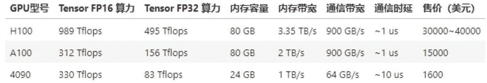
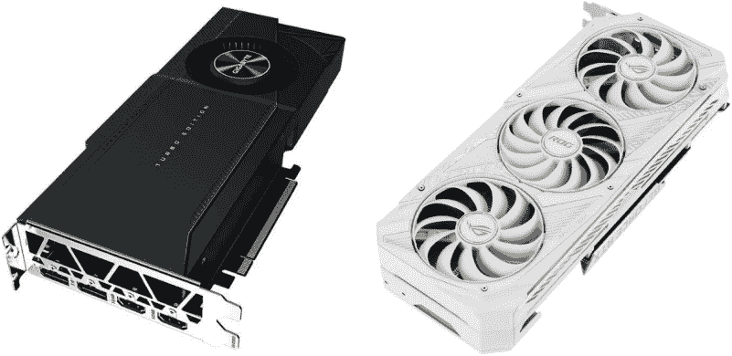
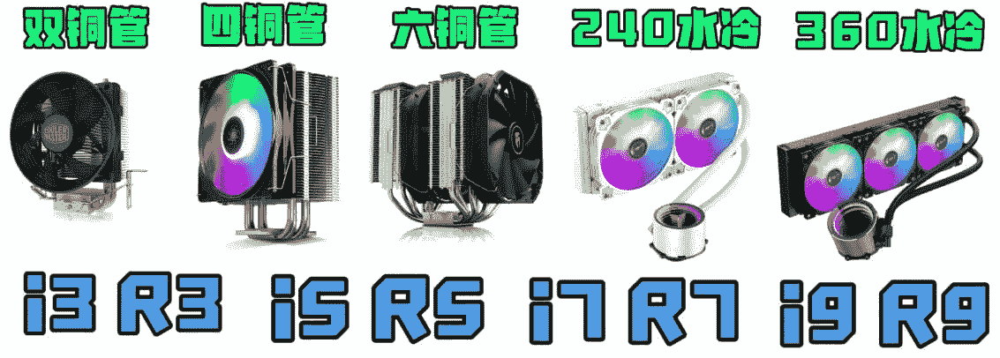
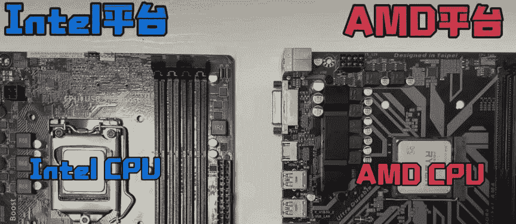
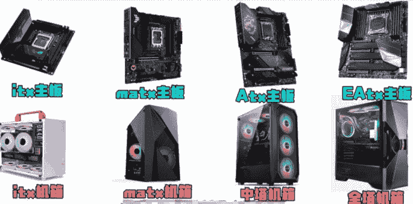

# 本地部署开源大模型如何选择硬件配置

> 来源：[https://kq4b3vgg5b.feishu.cn/docx/OyEbd5mJYoXkoqxGoalcJSDPnjF](https://kq4b3vgg5b.feishu.cn/docx/OyEbd5mJYoXkoqxGoalcJSDPnjF)

## 本地部署大模型

### 软硬件需求

在本地有效地部署开源大模型，需要了解硬件和软件两方面的需求：

• 硬件需求：
  • 如何组建一台或多台高性能的个人计算机或服务器？

• 软件需求：
  • Ubuntu 操作系统优于 Windows 操作系统，如何安装 Ubuntu 或双系统？
  • 编程语言建议以 Python 为主，如何配置编程环境？
  • 如何使用 `DeepSpeed` 等优化工具提升大模型的运行效率？

### 如何配置个人计算机或服务器

对于硬件需求来说，主要考虑以下两种途径：

• 配置个人计算机或服务器，组建一个适合大模型使用需求的计算机系统；
• 租用在线 GPU 服务，通过云计算平台获取大模型所需的计算能力；
• 本节内容重点介绍个人使用和实验室研究分别该如何配置计算系统，在线租用 GPU 的途径和选择，讲在下一小节详细介绍；
• 结尾有“傻瓜式采购建议”，但还是推荐大家先了解硬件知识后再做决定；

## 大模型应用需求分析

无论是个人学习、科研团队做项目研究还是企业应用落地，不同的应用场景和目标任务需要不同的硬件配置方案支撑：

• 本地部署大模型涉及三个方面需求：训练、微调和推理（Inference），其中：
  • 训练：算力最密集，消耗的算力通常是推理过程的至少三个数量级以上；
  • 微调：算力需求低于训练，但高于推理；
  • 推理：算力消耗最低；

算力消耗：训练 > 微调 > 推理

• 绝大多数人的关注点应集中在推理和微调的性能上；
• 大部分开源大模型支持在 Intel CPU 和 Mac 上运行，但较为繁琐且占用内存至少 32G 以上，因此更推荐在 GPU 上运行；
• 综上，对硬件的核心要求就体现在对 GPU 的选择上。相比之下，对 CPU 和内存的要求并不高。

## 为什么 GPU 是核心？

GPU 并不等同于显卡，它是显卡的核心组件。只不过很少有人特意区分：

• 像大模型领域这种生成式人工智能，需要强大的算力来生成文本、图像、视频等内容，训练这样的模型需要的是 GPU + 计算架构，比如 NVIDIA 的 GPU 和针对其自己 GPU 设计的 CUDA 计算架构，90% 以上的 AI 模型训练或推理，都需要 GPU 的支持；
• 比如 ChatGPT，其训练过程中涉及大量的矩阵运算，本身并不难，但是量很大很大，需要的是强力的 GPU 结合 CUDA 计算平台来执行高效的 AI 计算；

## 硬件配置的选择标准

• 建议：根据想要部署的大模型官方配置说明，先选择出最合适的 GPU，在根据 GPU 的级别，进一步搭配计算机的其他组件，如 CPU、内存、存储等。

• 以 ChatGLM-6B 模型为例，官方给出的硬件配置说明如下：

| 量化等级 | 推理时 | 微调时 |
| --- | --- | --- |
| 单精度 | 20G | 22G |
| 半精度 | 13G | 14G |
| INT 8 | 8G | 9G |
| INT 4 | 6G | 7G |

### 如何根据官方配置合理选择 GPU

• 匹配 GPU 的标准是：根据应用需求（推理还是微调），先关注显存大小，必须要满足官方的最低显存要求；

• 主流的显卡显存容量：超算级别显卡 A100、H100、A800、H800 为 80G 显存；其中 A100 也有 40G 显存；消费级显卡 4090 和 3090 显存为 24GB；

## GPU 选择参考

• 如果对应 ChatGLM-6B 模型的硬件配置说明，我们就可以这样选择 GPU：

• 理论上，在进行少量对话时，采用单机单卡：

| 量化等级 | 推理时 | 微调时 | 最低显卡配置 | 显卡显存 |
| --- | --- | --- | --- | --- |
| 单精度 | 20G | 22G | 4090 | 24G |
| 半精度 | 13G | 14G | 3090 | 24G |
| INT 8 | 8G | 9G | 2080Ti | 11G |
| INT 4 | 6G | 7G | 2060s | 8G |

• 理论上，在进行多轮对话时，采用单机多卡：

| 量化等级 | 推理时 | 微调时 | 最低显卡配置 | 显卡显存 |
| --- | --- | --- | --- | --- |
| 单精度 | 30G | 22G | 3090 双卡 | 48G |
| 半精度 | 20G | 14G | 3090 | 24G |
| INT 8 | 12G | 9G | 3080Ti | 12G |
| INT 4 | 10G | 7G | 2080Ti | 11G |

## 计算机硬件组合分类

• 匹配 GPU 的标准是：显存满足需求的前提下，根据不同显卡的性能和成本进行权衡，选择性价比最高的，即：单张高性能卡，还是多张较低版本的卡；

• 硬件组合分类：

1. 纯 CPU：（不推荐）
2. 单机单卡：适用于大多数个人使用和中等计算负载的场景（典型配置）
3. 单机多卡 GPU：适用于高计算负载的场景（典型配置）
4. 多机配置：使用多台计算机进行集群计算，通常超出个人使用范围

## 显卡型号选择

### 消费级显卡和超算显卡

• 当前市场主要有两家 GPU 厂商，分别是 NVIDIA 和 AMD。根据相关统计数据，在独立显卡领域，NVIDIA 的市占率高达 85%，在 AI 算力芯片领域，在未来有可能达到 90% 以上。现在做深度学习、大模型，NVIDIA 的卡就是刚需，基本没有其他选择；

• 同时，NVIDIA 的 CUDA 并行计算平台能更高效的执行通用并行计算，与深度学习框架紧密集成；

• 大模型训练被定位为高性能计算（HPC）领域的一部分，而超级计算（超算）是高性能计算的一个子集，在很多情况下，大模型训练需要超算级别的计算芯片支持；

• 在这个背景下，NVIDIA 先后推出了 V100、A100、H100 多款专门用于 AI 训练的芯片，都是比较热门且熟知的选择；

• 4090、3090 这种消费级显卡，虽被定位为消费级显卡，但在深度学习领域同样表现出色，在某些情况下，也可用于大模型应用，且性价比更高；

### 如何抉择？

• 今年 10 月份，漂亮国再次进行制裁，A800 和 H800 也被限制向中国出售；

• 目前来说，A 系列和 H 系列因为是断供前出现计算芯片，国内还有货，但市场渠道比较乱，需要甄别；

• 4090、3090 这种消费级显卡，虽被定位为消费级显卡，但在深度学习领域同样表现出色，在某些情况下，也可用于大模型应用，且性价比更高；

• 对于个人使用、实验室或者企业应用，A100、A800 和 4090 如何选择呢？

### 单卡：4090 vs A100 系列

• 没有双精度需求，追求性价比，选择 4090；有双精度需求，选 A100，没有 A100，选 A800；
• 如果做大模型训练，GeForce RTX 4090 不行；
• 如果做大模型推理，GeForce RTX 4090 在性价比方面，优于 A100；
• 如果做大模型微调，最好 A100，GeForce RTX 4090 也可以，但需要多卡；
• 对于学习和研究大模型的个人或者实验室来说，4090 是不错的选择；

• 推理：推理通常涉及单一模型，算力是关键；
• 训练：训练过程涉及参数存储和通信计算，4090 的内存带宽、通信带宽和通信延时都较 A100 差距较大。短板理论：最弱的那一项决定了显卡的整体能力；

### 单卡 4090 vs 双卡 3090

• 如果预算差不多，建议选择两张 3090；
• 两张 3090 的总算力与单张 4090 相当，但提供了更多的显存；
• 大模型计算框架都支持流水线并行，张量并行等，这就让小显卡跑大模型的方案，双卡流水线效果会更好；
• 单 4090，CPU 卸载次数比双 3090 要多一倍；
• 企业环境一般都是多卡并行，还可以练习如何写多卡代码；

## GPU 购买避坑指南

• 用于 AI 深度学习或者大模型的显卡，一定要买涡轮版的；
• 涡轮卡尾部供电，散热效果强于风扇卡；
• 涡轮卡尺寸和高度远低于风扇卡，便于多卡安装；

**涡轮卡**

**风扇卡**

## 参考配置

### 实验室整机参考配置

• 目前国内实验室主流的还是 4090 和 3090；
• 10 万+ 的预算配置 4 张 4090 是没什么问题的；
• 20～30 万的预算可以考虑 8 张 4090，或者两张 A100 80G；
• 如果预算不限，A100 8 卡一定是最佳的选择；
• 双卡 GPU 升级路线：3090 -> 4090 -> A100 40G -> A100 80G
• 大模型工业级实验要求：全量微调至少 4 张 A100 80G 显卡；

### 个人硬件配置参考-单卡

• GPU：4090，涡轮版；共 24 G 显存；
• CPU：Intel i7-13700KF；16 核 24 线程
• 存储：64 GB 内存 + 2T SSD 数据盘；
• 电源：微星（MSI）额定 1000 W 金牌全模组电源；
• 散热：微星（MSI）寒霜 K360 一体式水冷散热器；
• 主板：华硕 ROG X570-E；服务级 PCE，支持双卡 PCIE；
• 机箱：微星（MSI）刀锋 100R E-ATX 中塔侧透机箱；

### 个人硬件配置参考-多卡

• GPU：3090 双卡，涡轮版；共 48 G 显存；
• CPU：AMD 5900X；12 核 24 线程；
• 存储：64 GB 内存 + 2T SSD 数据盘；
• 电源：1600 W 单电源；
• 主板：华硕 ROG X570-E；服务级 PCE，支持双卡 PCIE；
• 机箱：ROG 太阳神 601，ATX 全塔式大机箱，便于大功率下散热；

## 根据选出的 GPU 搭配合适的计算机组件

• 选择好 GPU 后，根据 GPU 依次搭配合适的计算机组件；

• 计算机八大件：CPU、散热器、主板、内存、硬盘、显卡、电源、风扇、机箱

• 个人使用的计算机，典型的配置是单 GPU 或双 GPU，一般不超过四个 GPU，否则机箱放不下，且运行时噪声很大，而且容易跳闸。

### CPU 选择标准

• CPU 瓶颈并没有太大，一般 1 个 GPU 对应 2 ～ 4 个 CPU 核数；训练时只要数据生成的产出速度比 GPU 的消耗速度快，CPU 就不会成为瓶颈，拖慢训练速度；

• 与选择的 GPU 性能水平相匹配。避免将一款高端显卡与低端 CPU 或一款高端 CPU 与低端显卡相匹配，这会导致性能瓶颈；

• NVIDIA GeForce RTX 3090 * 2 搭配 Intel Core i7-13700 或 AMD 5900 X；
• NVIDIA GeForce RTX 3080 搭配 Intel Core i9-11900；
• 低于 Intel i5 系列的，就不要考虑了；

### CPU 选择-避坑

• 目前消费级市场，Intel 为 i3、i5、i7、i9，AMD 与之对应的 R3、R5、R7；

• 以 Intel 举例：

• 同代产品 i7 比 i5 强；
• 老一代 i7 和新一代 i5 比较，就未必成比；
• 具体如何理解 CPU 命名规范及每一代性能对比，可查阅课件 + CPU 性能天梯图

### 散热器选型

• CPU 如果温度过高，就会出现自动关机、蓝屏和死机等情况，需要单独的散热器压制，目前 CPU 散热器有两种：水冷和风冷。相对来说，水冷 > 风冷；

• 大模型主要运行在 GPU 上，对 CPU 需求较低，但还是推荐：CPU 还是要和 GPU 的级别匹配；

• 如果 CPU 有超频需求，且购买的 CPU 是超频版本，建议上水冷，否则风冷；

#### 散热器选型-避坑

• 风冷和水冷都是用于 CPU 散热的，与 GPU 无关；

• 显卡通常采用一体化散热设计，买到手的显卡就是 GPU 核心 + 显存 + 散热综合一体的，主要原因还是 GPU 和 CPU 散热策略和工作方式不同：
  • CPU：高频率，少核心，从而导致高发热；
  • GPU：多核心，少频率，强如 4090，也就 3000M 多频率，同等级的 Intel i9 频率几乎是它的两倍；

• 高性能的 CPU 不一定必须水冷；要看是否超频，如需要超频，建议水冷，否则风冷也完全可以压住；

### 主板选型-原则1

• 根据 CPU 和 GPU 级别，低端主板不考虑；

• Intel：Z 系列（高端）、B 系列（中端）、H 系列（低端）；
• AMD：X 系列（高端）、B 系列（终端）、A 系列（低端）；

• 选择的 CPU 型号要搭配对应型号的主板，避免出现：
  • Intel CPU 去搭配 AMD 主板，反之亦然；
  • 低 U 高板组合；如 i5 12100F 搭配 Z790 主板
  • 高 U 低板组合；如 i9 14900K 搭配 H619 主板

### 硬盘选型-原则

• 第一步，看接口类型。主流固态硬盘主要有两种接口：SATA 和 M.2；
  • SATA：体积大，速度慢，最高传输速度为 600MB/s；
  • M.2：硬盘小，采用新的硬盘协议，速度可以达到 4 GB/s；（推荐）

• 第二步，看协议。M.2 接口的固态硬盘分为 SATA 协议和 NVME 协议；
  • SATA 协议：本质上就是采用了 M.2 接口的 SATA 盘，速度慢；
  • NVME 协议：速度快；（推荐）

• 第三步：看 PCIe 等级。等级越高，传输速度越快，当前市面上最新的 PCIe 5.0、PCIe 4.0 和 PCIe 3.0，一般来说选择 PCIe 4.0 即可。

### 内存选型-原则

• 由于数据生成器（`Dataloader`）的存在，数据不需要加载到内存中，因此通常不会成为瓶颈。

• 建议内存容量是 GPU 的显存的一到两倍即可。单卡 GPU，至少 16 G 内存，四卡 GPU，至少 64 GB 内存。目前内存也不贵，32 G 才 500 左右，可以配满。

• 注意检查主板是否支持内存的型号及可插的槽位；

• 注意检查 CPU、主板是否支持选择的内存频率；内存的频率受限于 CPU 和主板的限制；

### 电源选型-原则

• 电源的瓦（W）数要满足整机的功耗；虽然不是越高越好，但如果过低，会出现关机或者黑屏；

• 电源功耗的大户是 CPU 和 GPU，一个简单的计算方法是将 CPU 和 GPU 的 TDP 功耗相加，然后乘以 2。例如：一个 65 W 的 CPU 加上一个 125 W 的 GPU，合适的电源瓦数约为 400 W 或 450 W。

• 双卡最好买 1000 W 以上，四卡最好买 1600 W 的电源；

### 机箱选型-原则

• 核对主板与机箱尺寸的匹配性，确保选择的主板大小和机箱兼容，如 Atx 主板要搭配中塔机箱，多大的脚要穿多大的鞋嘛；

• 确认机箱支持显卡尺寸；建议高出显卡长度至少 30 毫米；

• 检查 CPU 散热器是否能安装下；比较散热器尺寸和机箱的散热限高；如果是水冷，检查水冷冷排的尺寸；

• 检查电源和机箱的尺寸；

# 地表最强算力 NVIDIA H200

- 2023年11月13日，老黄推出全新超算H200，显存从H100的80G，直接拉到了141GB；显存带宽从3.35TB/s，提升到了4.8TB/s，而最大的提升，是内存达到了惊人的1.15TB/s，相当于一秒钟可以传输230部5G大小的高清电影；

- 乍看是王炸，其实仔细分析，可能只是H100的中期改款，单论峰值算力，H100和H200是一模一样的，真正提升的是带宽和显存，大概率是老黄有意为之，之前为了打造大模型，对GPU首要要求是训练，但现在大家卷的是推理速度，H200的推理速度比H100快了一倍，也能看出老黄的战略布局；

### 谁会是下一个英伟达？

- 2022年中国市场人工智能芯片规模高达70亿美元，而这70亿的市场，被NVIDIA垄断了90%；随着高端显卡A100、H100等被禁止向我国出售，老美已经到了丧心病狂的程度，这么着急赶尽杀绝，甚至不惜拉上自己国家的企业做垫背，主要原因，还是我国的半导体自主研发上已经触碰到了他们的痛处；

- 禁令全面升级，中国企业已经没有了任何选择，下一步只能规模化量产国产芯片，实现真正意义上的国产替代；

### 谁会是下一个英伟达？

- 国内目前能做高性能芯片的公司很多，华为、百度、寒武纪、壁任科技等；

- 如果单看并行计算这个领域，两家国产公司值得关注：

- 摩尔线程：仅三年时间就上了老美的“白宫严选名单”，是目前唯一能买到实际产品并且一直更新驱动的公司；

- 壁任科技：去年发布了GPU BR100，性能直逼H100，但现在还没见到的原因，是老美不让台积电生产，所以：这本就不是一个公共的竞争；

### 谁会是下一个英伟达？

- 有句话说的好，天下苦英伟达久矣；

- 看似把我们逼入绝境，但也给了我们绝地求生的机会。尽管中国企业会引来一段痛苦的过渡期，但从长远看，这是一条不得不走的路。面对当下的巨大差距，终于有了关键的攻坚克难的凝聚力；

- 相信度过这段阵痛期，有的人，有的国家，只会后悔的拍大腿，眼睁睁的看着被逆袭、被超越。毕竟每一次我们都是这样过来的；

## 谁会是下一个英伟达？

- 自2022年初，ChatGLM系列模型已支持在晟腾

### 谁会是下一个英伟达？

- 这些公司除了华为，都面临相同的问题：没有针对计算芯片专门优化的计算架构，也就是说，不具备与`CUDA`抗衡的能力；

- 华为的人工智能战略布局，有鲲鹏、晟腾系列计算芯片，`CANN`异构计算架构，`MindSpore`深度学习框架，`ModelArts`一站式开发平台，还有盘古大模型，NVIDIA能做的，华为都能做，NVIDIA不能做的，华为依然能做。让我们给华为一点时间，对华为保持足够的信心。

- 课程还包含更多开源大模型安装部署、微调流程

- 以及本地知识库搭建、大模型竞赛高分方案分享 … 更多内容，详询助教英英👇

🍻现开设了大模型学习交流群，扫描下👇码，来遇见更多志同道合的小伙伴~

海量硬核独家技术干货内容+无门槛技术交流+不定期开设硬核干货&前沿技术公开课，扫码👆即刻入群！
