# 智选GPU算力平台

> 来源：[https://kq4b3vgg5b.feishu.cn/docx/NRWhdDPk4oS05Ixol1zczdfYn8c](https://kq4b3vgg5b.feishu.cn/docx/NRWhdDPk4oS05Ixol1zczdfYn8c)

# 本地部署开源大模型

## Ch.2 智选GPU算力平台：免费与付费租赁指南

上一期内容中我们详细的剖析了如果想本地部署开源大模型，如何去搭配一台合适的个人计算机或者服务器。除此之外，还可以通过租用在线GPU算力，来更灵活的获取计算资源。

GPU云主机租用是一种云计算服务模式，用户可以通过向云服务提供商支付租金，将GPU云主机上的计算资源用于自己的任务中。对于初学者，或仅仅是要做短期项目研究的学生，甚至是探索AI应用落地尝试的企业人员，相较于直接购买高昂的硬件设备和自行搭建计算集群，使用GPU云服务器具有较高的性价比。其一，GPU云服务器具有灵活的配置和租赁方式，可根据实际需求调整计算资源。其次，GPU云服务器提供了高效、稳定、安全的计算环境。总体投入成本是很低的。

市面上提供GPU租赁的平台不少，比如国外的谷歌，vast.ai这种，可以薅资本主义羊毛。因为不花钱，必然多花精力和时间，看各种攻略，想各种办法突破限制。整体看来看来其实不划算，有那精力还是做点更有意义的事情，毕竟人的自由时间才是最大的财富。而国内的服务商，大厂的比如阿里、金山的都比较贵，相反，现在崛起的平价GPU云服务商。各种类型都有，有自己搭建的民房，有用数字币结算的，还有矿机改的，名字不提了。所以如何选择呢？

各个平台，首先要保证机器的稳定性，其中包括GPU的分布情况，合理的分配机制，被无辜占用的风险或者是一些项目运行急停的预警等等，最怕的就是幸幸苦苦跑了半天结果被中断，功亏一篑！当然价格肯定是影响大家选择的一个很重要的因素！细水长流还是比较重要的，就GPU海量计算而言，阿里云是国内首选。阿里云的GPU云服务器是基于GPU应用的计算服务，最适合AI深度学习、视频处理、科学计算、图形可视化等应用场景。阿里云的GPU服务器支持周、月、年购买，支持批量支付，对于短期需求的用户来说相当方便。但是它确实是太贵。总的来说，在各个机型的价格对比都差不多，选择一个使用舒服的平台还是比较重要，如果你有心思去进行各个平台的活动比价，还是可以是有很多的选择。

本文我们就从两方面：白嫖和付费两方面来剖析目前市场上主流的算力平台。但需要说明的是：对于本地化部署开源大模型的小伙伴来说，免费的GPU资源都不足以支撑起大模型的服务，必须要去根据GPU的显存要求去选择更高配置的机器。

但是，我给大家薅到了一个免费、且支持大模型开发的云计算平台，就是阿里云的人工智能PAI，接下来我们就先来看一下。

# 一、免费GPU资源推荐

## 1.1 阿里云人工智能PAI

阿里云人工智能平台 PAI 是面向开发者和企业的AI工程化平台，提供了覆盖数据准备、模型开发、模型训练、模型部署的全流程服务。可以白嫖GPU资源的用户群体是：**阿里云认证用户且为产品的新用户。**有3款支持试用的产品，分别是：

1.  交互式建模 PAI-DSW：深度学习开发环境，集成JupyterLab，支持调试和运行Python代码。支持开源框架的安装，提供了阿里巴巴深度优化的Tensorflow框架；

1.  模型在线服务 PAI-EAS：模型在线服务平台，支持用户将模型一键部署为在线推理服务或AI-Web应用；

1.  机器学习PAI-DLC：深度学习训练平台，提供灵活、稳定、易用和高性能的机器学习训练环境。支持多种算法框架，超大规模分布式深度学习任务运行及自定义算法框架；

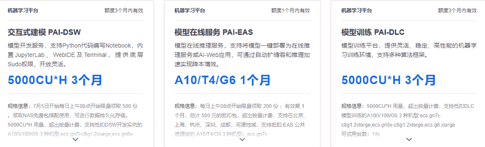

如果需要实践大模型的相关测试，闭眼选交互式建模PAD-DSW。从官方的教程上也可以看出，每个机型都适用于不同的应用场景。

领取试用产品的方式也比较方便，每日上午08点开始限量领取 500 份，从实际情况上看资源并不紧张，为了制作本教程，我是下午领取的产品资源，依然还有存货。阿里还是大气。

详细的试用过程如下：

+   **Step 1. 进入阿里云官网：ht**tps://cn.aliyun.com/

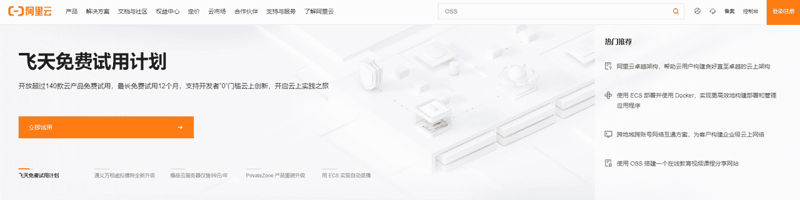

+   **Step 2. 登陆或注册**

点击官网主页的右上角部分，进行登陆或者注册。

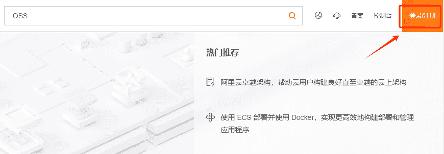

+   Step 3.进入人工智能平台PAI

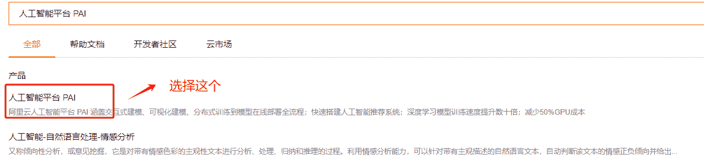

+   **Step 4. 免费试用产品**

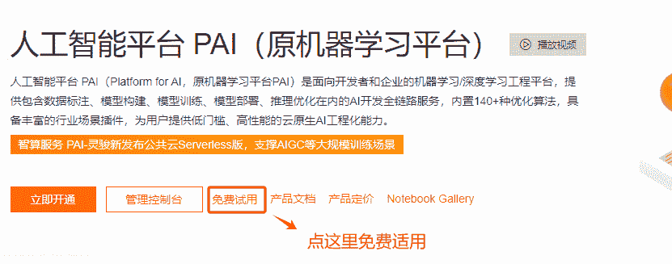

+   **Step 5. 选择使用产品**

这里我们选择**交互式建模 PAI-DSW。**

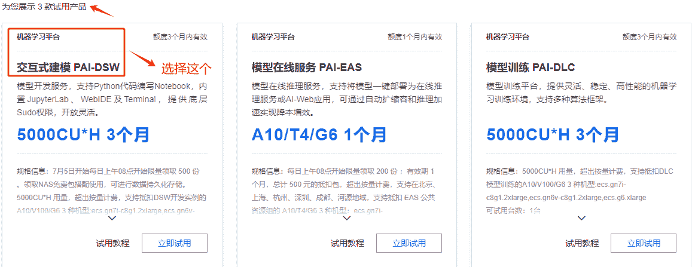

点击试用教程，可以看到PAI-DSW资源支持的示例场景。

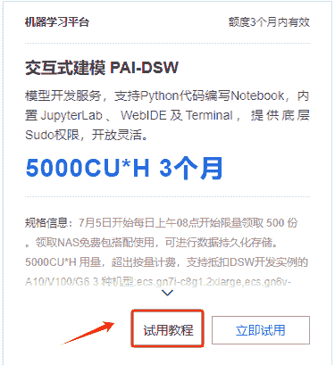

该资源支持Langchain的应用，ChatGLM-6B模型的部署等实力场景，并且官方也给了比较详细的应用教程。

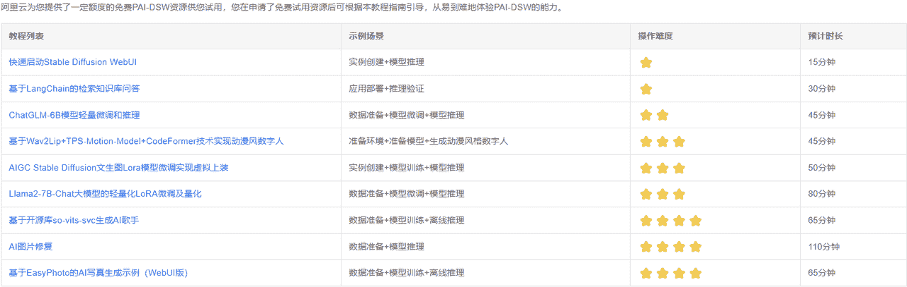

+   Step 6. 选择交互式建模 PAI-DSW，进行试用。

交互式建模 PAI-DSW资源AI 机器学习；使用 Python 代码进行模型开发的场景，但需要注意的是：从说明上看，开始每日上午08点开始限量领取 500 份，所以如果当日显示无法试用，就说明份额已经被领取完了，需要第二天再来拼手速。

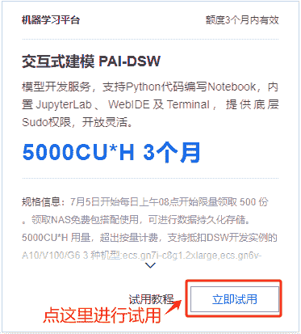

试用赠送了5000计算时，相当于10000元的价值，血赚。能选择的机型为 A10，V100和G6，按小时计费，不同机型每小时的费用也不同，做大模型部署的话，建议选择V100，其次是A10。

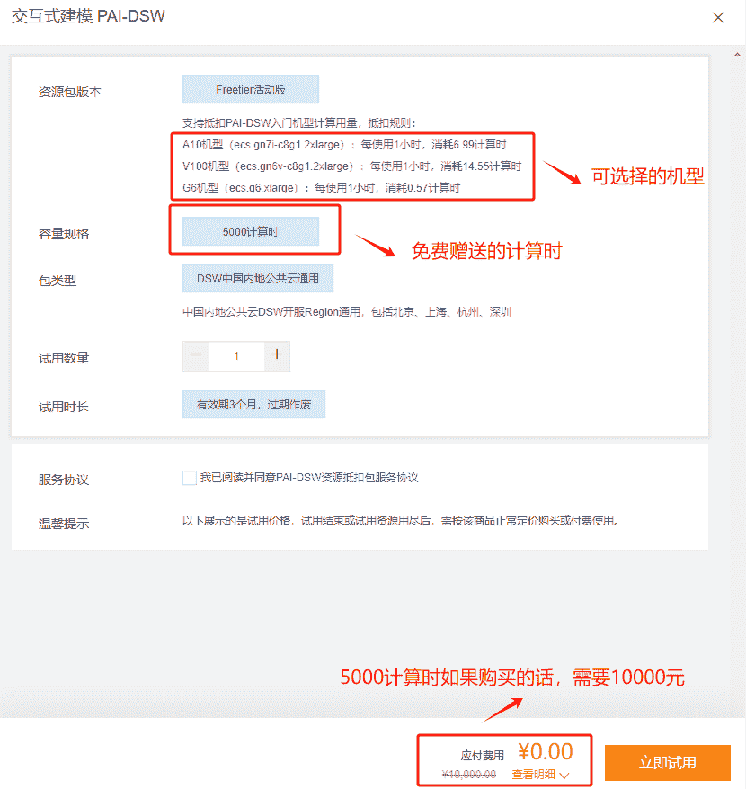

+   **Step 7.成功创建实例**

点击立即试用后，如果今日还有免费份额，即可成功创建实例。

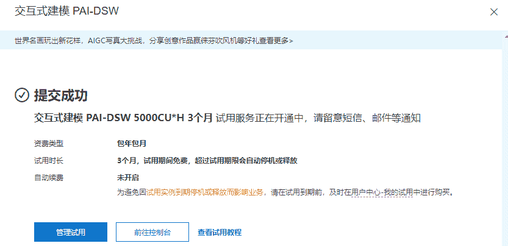

+   **Step 8.进入控制台**

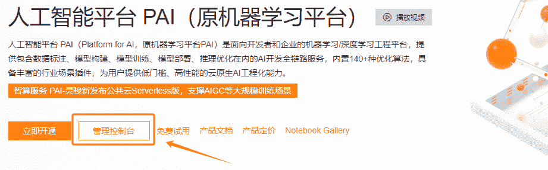

+   Step 9.开通PAI 并创建默认空间

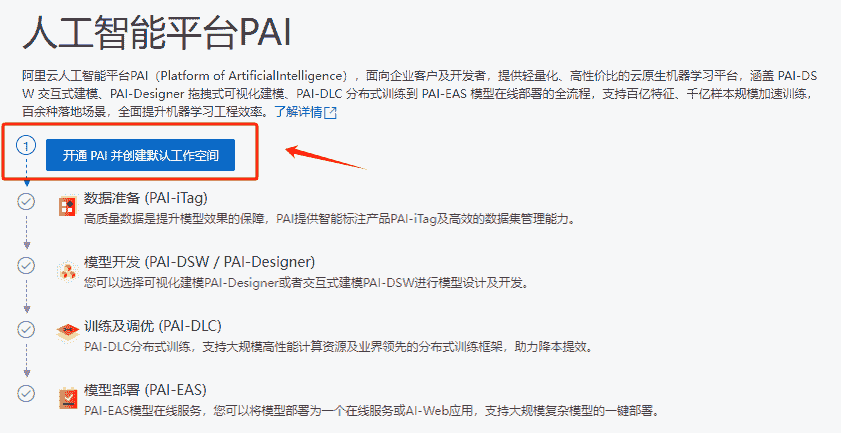

+   Step 10.进行服务角色授权

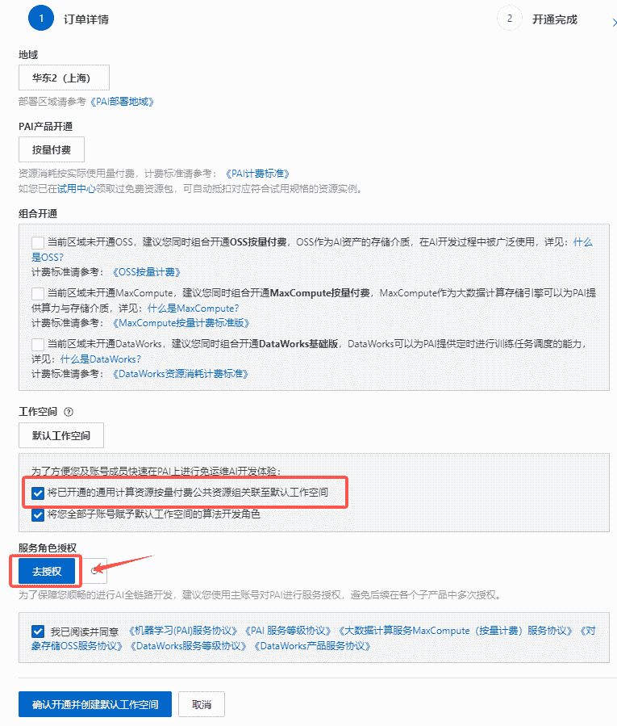

授权页面全部默认选项，点击同意授权即可。

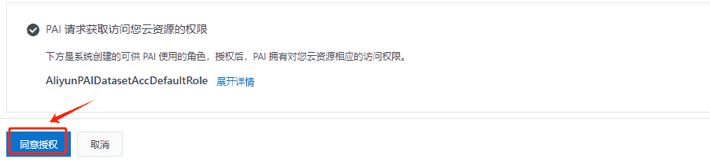

出现此页面时，表明授权成功。

+   Step 11.确认开通并创建默认工作空间

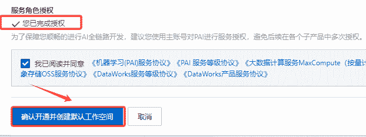

+   Step 12.开通成功后，进入PAI控制台

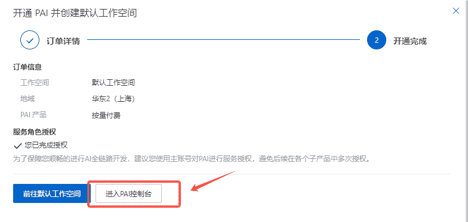

+   Step 13.进入交互式建模（DSW）

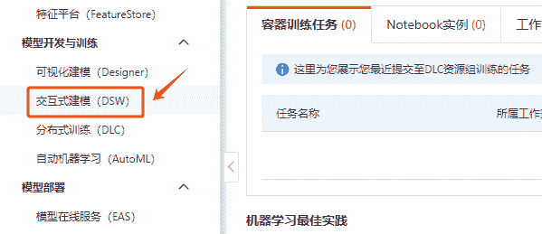

+   Step 14.新建一个工作空间

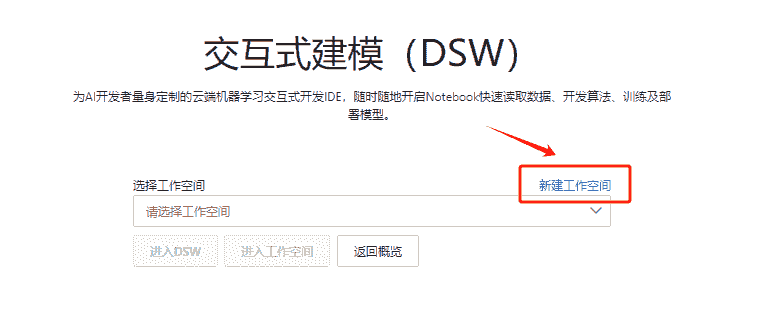

+   Step 14.填名称即可，OOS相关内容可以忽略

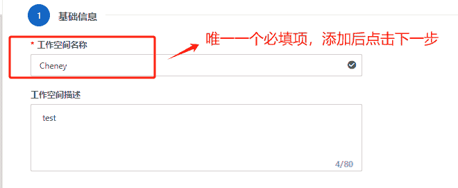

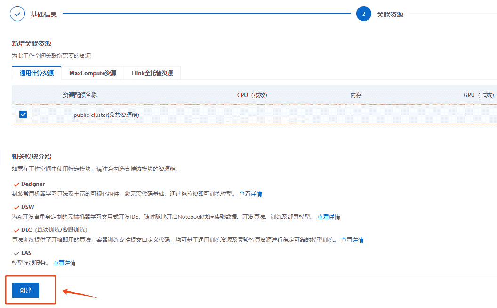

+   Step 15.创建完成后，进入工作空间

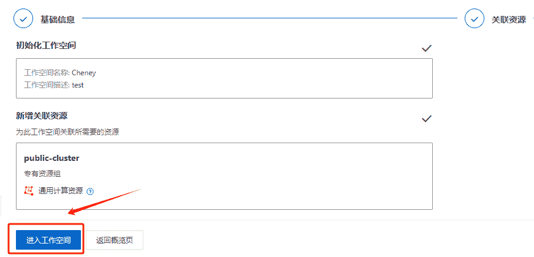

+   **Step 16.创建DSW实例**

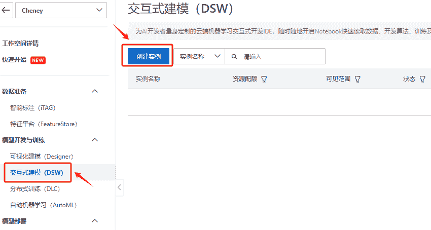

+   **Step 17.自行选择GPU规格，**不同GPU费用不同，我这里选择V100。

这里能够使用赠送的计算点数的只有三款，V100，A10和G6。根据自己的需求选择。注意：这里要选择支持资源包抵扣的。

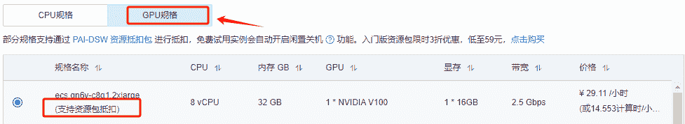

+   **Step 18.确认创建实例**

+   Step 19.等待创建完成，需要1~3分钟

+   Step 20.创建完成后，可以进入运行环境

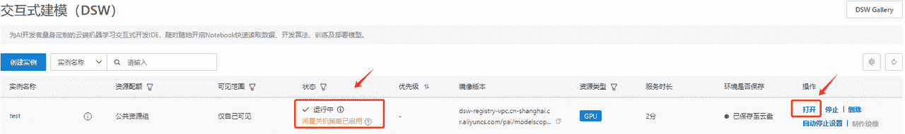

+   Step 21.创建Notebook

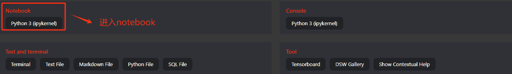

+   **Step 22.验证实例配置**

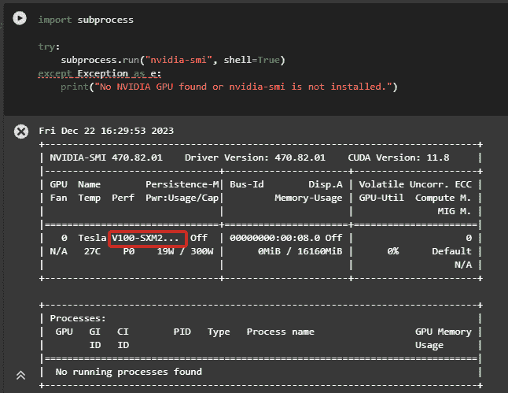

## 1.2 阿里天池实验室

阿里天池实验室阿里云提供的打比赛的平台。 提供了云端的开发环境，其notebook集成机器学习PAI DSW（DataScienceWorkshop）探索者版，是天池实验室的底座，可以提供完备的IDE以及丰富的计算资源。同时对于任意用户来说，有60个小时的GPU免费使用额度，同时也可以通过在天池内参加比赛、公开notebook、上传数据集等方式活跃账号来获得积分，增加额外的免费时长。

其整体的优点是：国内可直接访问，社区活跃度强，数据集丰富，且开发环境的兼容性非常好。对于GPU的使用，分配资源的方式分为两种：

+   GPU独享型：即当前环境下独享GPU资源，但存在的问题就是很多时候会提示没有资源，所以只能碰运气。同时即使获取到了GPU资源，单次使用GPU的时长也不能超过8个小时，会被释放掉；

+   GPU共享型：即当前环境下和其他人共享同一个GPU资源，这种情况下基本就无法使用，因为你会发现，当使用这种模型的时候，CPU和Mem都是直接被拉满的。

另外需要注意的是，GPU并不能自主选择，只能让系统随机分配，比如我就分配到 A10，V100，T4等不同的GPU型号。而且有一个小Bug，就是新环境的notebook上传数据后，下次会丢失，好像到目前都没有解决。

但总的来说，阿里的天池实验室可以说是目前用过的非常好用的免费GPU资源。其具体的试用过程如下：

+   **S**tep 1.登陆阿里天池官方，进行登陆或者注册：https://tianchi.aliyun.com/

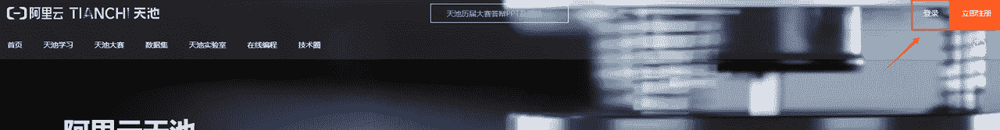

+   Step 2.登陆后，进入天池实验室的NoteBook

+   Step 3.进入后可以看到，有60小时的免费GPU使用

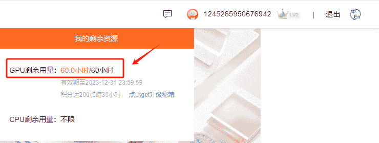

+   **Step 4.需要进行实名认证**

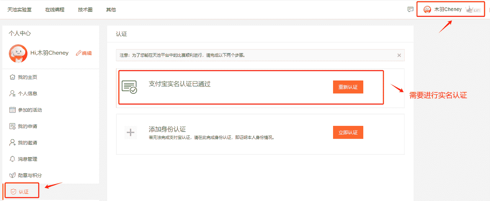

+   **Step 5.进入我的实验室**

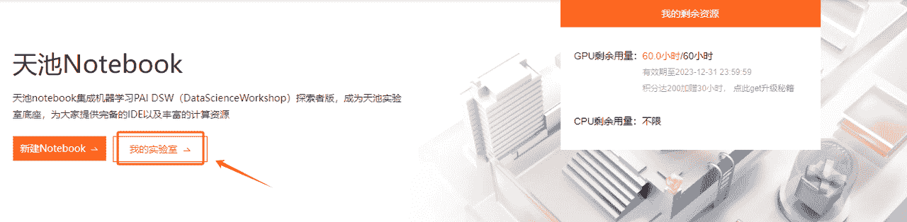

+   **Step 6.创建一个新的NoteBook，如果第一次**使用，系统会默认生成一个，也可以直接使用

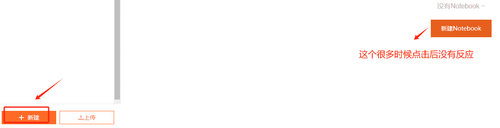

+   **St**ep 7.NoteBook需要点击编辑按钮后，进入编辑环境才能进行操作

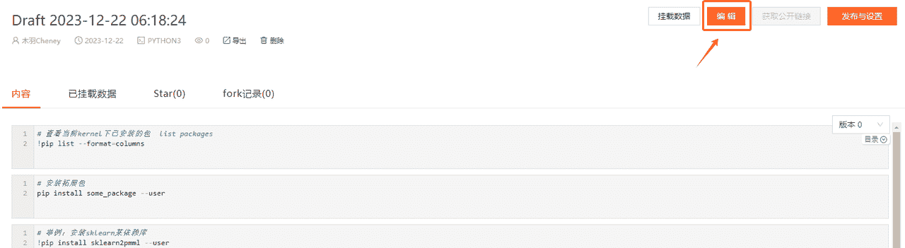

+   Step 8.默认开启的是CPU，如需改为GPU，需要进行切换

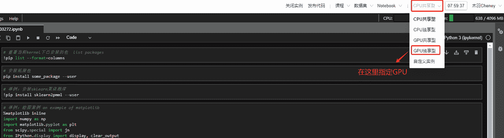

+   Step 9.最好在执行代码前切换环境，否则需要重新运行全部代码

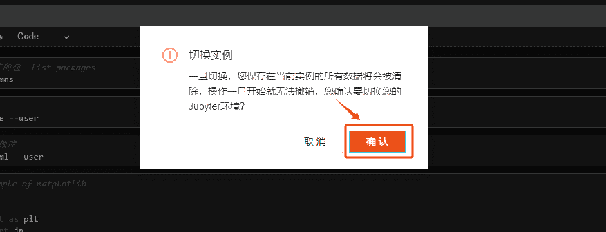

+   **Step 10.测试当前环境是否正常加载GPU，可以看到**，目前加载的是 NVIDIA 的 A10

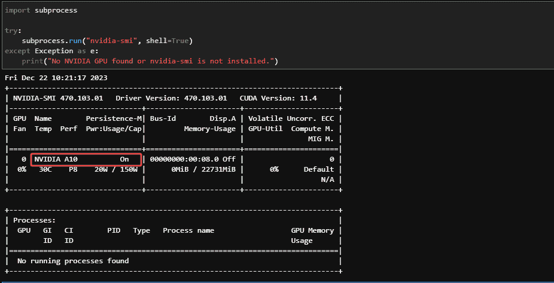

如果60小时的免费GPU时长全部用尽后，也可以通过积极参加天池的活动、比赛等，较高的活跃度会获得不同数量的积分，达到一定的积分后，阿里天池官方会自动增加免费的GPU使用时长。

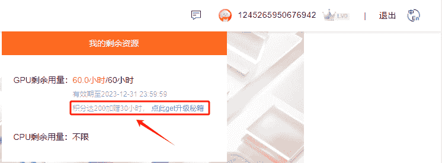

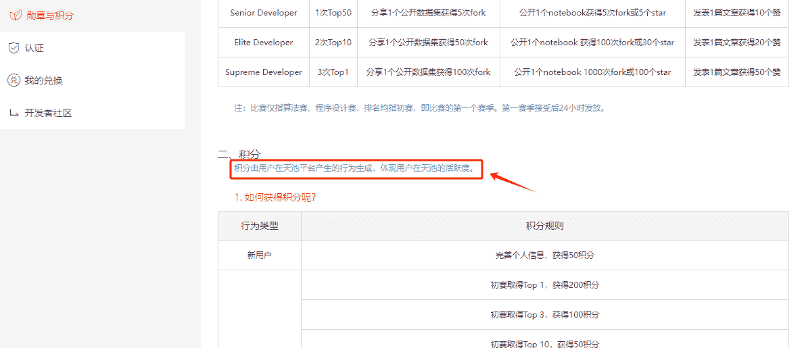

## 1.3 Kaggle

Kaggle是一个进行数据发掘和预测竞赛的在线平台。从企业的角度来讲，可以提供一些数据和实际需要解决的问题；从参赛者的角度来讲，可以组队参与项目，针对其中一个问题提出解决方案，最终由选出的最佳方案获得对应的奖金。Kaggle一直致力于解决业界难题，因此也创造了一种全新的劳动力市场——不再以学历和工作经验作为唯一的人才评判标准，而是着眼于个人技能，为顶尖人才和公司之间搭建了一座桥梁。

作为这样一个大型竞赛平台，其提供了可以免费访问并可以在云端 GPU 进行深度学习训练的资源和环境。每个用户每周有30个小时的GPU额度。其详细使用过程如下：

+   **Step 1.登录Kaggle官网，如果是老**用户，可以直接登录。新用户的话先进行注册

+   **S**tep 2.如果使用Google账号注册，需要挂梯子。如果不想挂梯子或没有梯子，可以选择邮箱注册，QQ邮箱也可以。

+   Step 3.登录成功后，需要验证手机号才可以使用免费GPU。

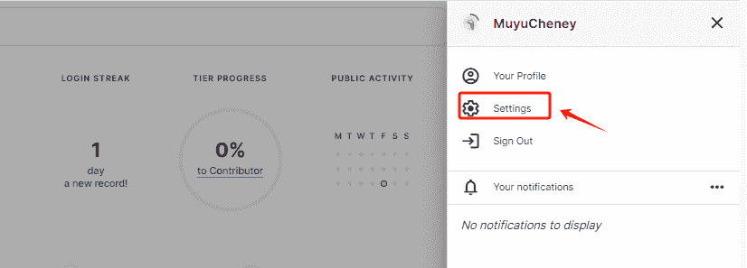

+   Step 4.支持中国手机号验证。

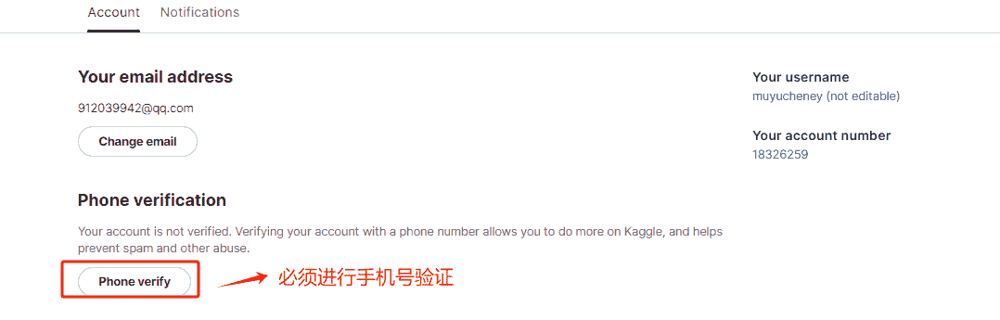

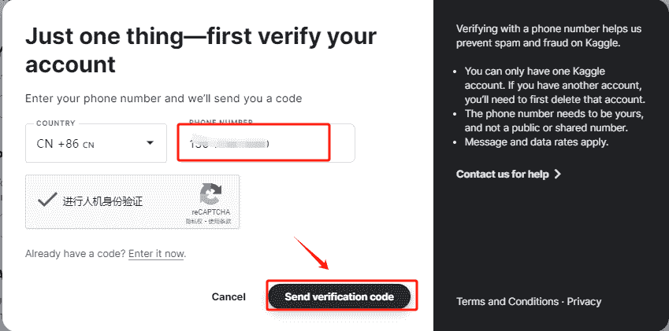

+   Step 5.认证手机号后，新建一个NoteBook。

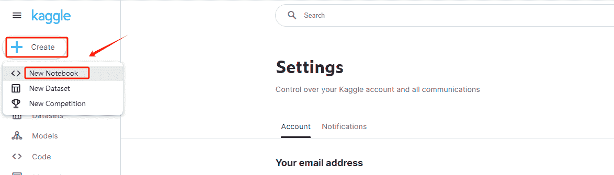

+   **Step 6.打开NoteBook之后再右侧菜单栏里的 Notebo**ok options——ACCELERATOR 里就可以在几种GPU之间进行选择

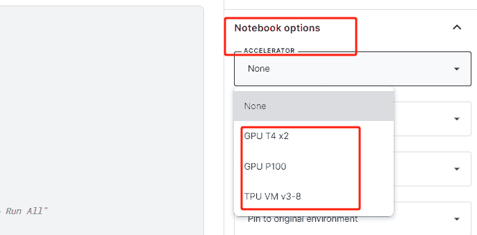

+   Step 7.选择GPU。这里我们选择P100。

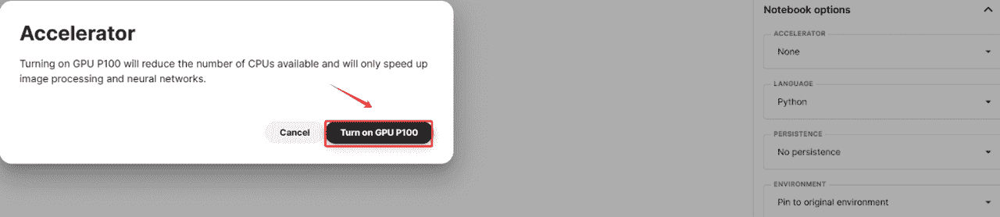

+   **Step 8.环境验证。**

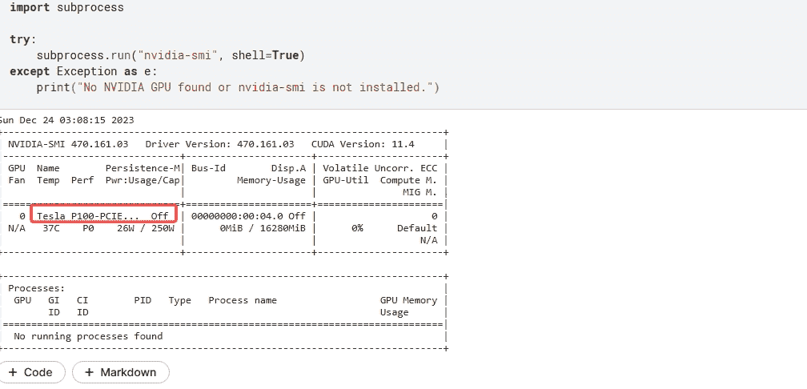

+   **S**tep 8.注意：如果安装不上任何包，把页面右侧Setting栏中的Internet选项开启即可正常安装。

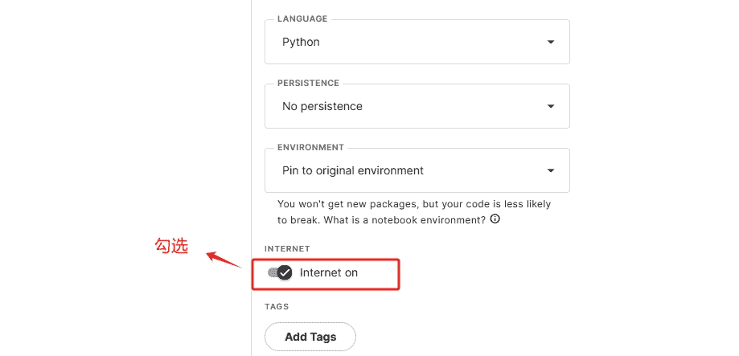

+   Step 9.查看剩余配额情况。

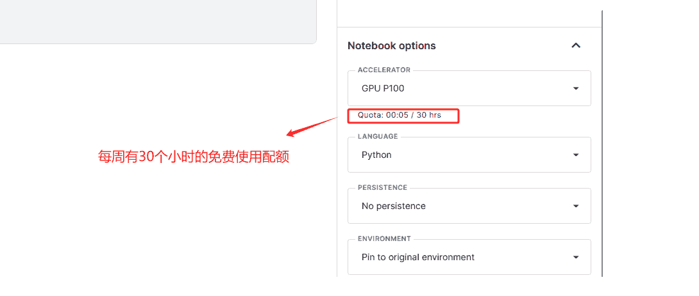

## 1.4 Colab

Colab是由Google研发的，它免费提供CPU、GPU甚至TPU资源。但是，有一点要注意:要使用你得准备好翻墙的梯子。可以说，大名鼎鼎的谷歌的Colab，全世界都在薅羊毛。历史最久，用户最多，可谓部署界的大佬。谷歌Colab是谷歌打造的深度学习平台，为开发者和研究人员提供免费的云端笔记本运行环境。同时搭载了强大的GPU和TPU计算资源，再搭配一应俱全的深度学习框架和工具，开发者可以直接在上面运行代码或者进行模型训练。

Colab的部署类型属于拎包入住，但分配到的资源都是临时的。分为免费版和收费版，免费版并没有公开具体的配置信息。收费版的Colab Pro每月9.99美金。在选择笔记本时，用户无法选择特定的GPU型号，会自动分配K80，P100，T4，V100等显卡，16G左右的内存，70G左右的存储空间，资源是临时的，每次重启项目时，都需要重新加载，

对于免费用户来说，Notebook最长可以持续运行 12 小时，限额后不知道过多久能重新恢复使用。同时，GPU的类型只能选Tesla T4。除非开通Colab Pro，才能选择更多的GPU资源，但不论是免费用户还是付费用户，限制都很多：

+   实例空间的内存和磁盘都是有限制的，如果模型训练的过程中超过了内存或磁盘的限制，那么程序运行就会中断并报错。实例空间内的文件保存不是永久的，当代码执行程序被断开时，实例空间内的所有资源都会被释放，在"/content"目录下上传的文件也会全部消失；

+   有限的连接时间：笔记本连接到代码执行程序的时长是有限制的，这体现在三个方面：如果关闭浏览器，代码执行程序会在短时间内断开而不是在后台继续执行（这个“短时间”大概在几分钟左右，如果只是切换一下wifi之类的操作不会产生任何影响）；如果空闲状态过长（无互动操作或正在执行的代码块），则会立即断开连接；如果连接时长到达上限（免费用户最长连接12小时），也会立刻断开连接；

+   有限的GPU运行时：无论是免费用户还是colab pro用户，每天所能使用的GPU运行时间都是有限的。到达时间上限后，使用GPU的代码执行程序将被立刻断开且用户将被限制在当天继续使用任何形式的GPU。在这种情况下我们只能等待第二天重置；

+   频繁的互动检测：当一段时间没有检测到活动时，Colab就会进行互动检测，如果长时间不点击人机身份验证，代码执行程序就会断开。此外，如果频繁地断开和连接代码执行程序，也会出现人机身份验证；

+   就算是一直在训练，也会时不时断线，不稳定；

其加载过程如下：

+   **S**tep 1.登录Colab官网（注意：需要挂梯子）https://colab.research.google.com/

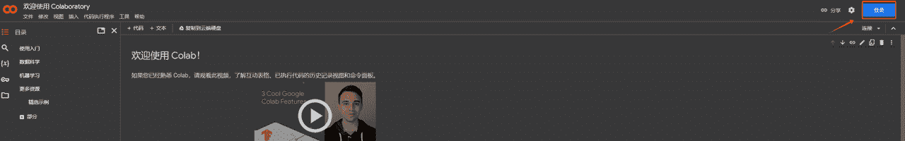

+   Step 2.使用Google账号登录

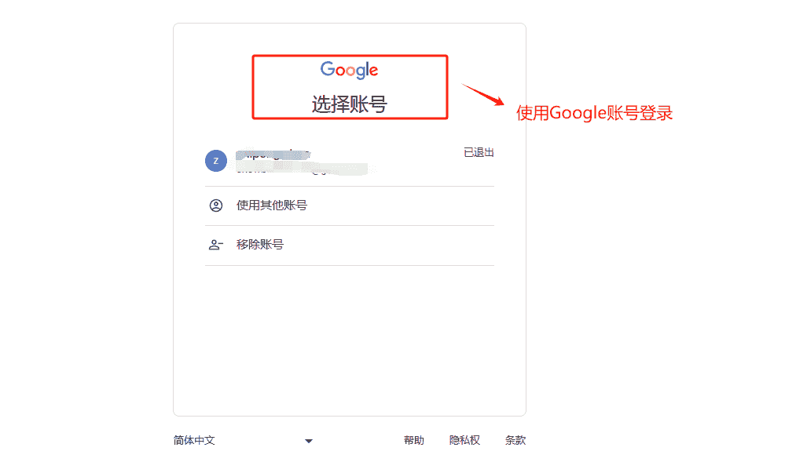

+   Step 3.登陆成功后，新建一个Notebook

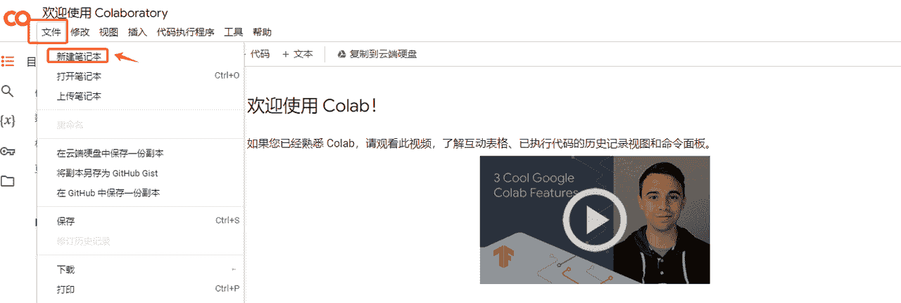

+   **Step 4.连接资源**

+   Step 5.更改运行环境为GPU

+   Step 6.免费用户只能选择T4 GPU

+   Step 7.可以看到，已正常加载GPU T4

但需要注意的是，这个分配的资源是临时的（相当于一台没有硬盘的电脑），所以我们还得进行一些操作。即配合Google drive使用。Drive也是免费的。普通Google账号中Drive会有15G的空间。

+   Step 8. 挂载Google Driver

+   **Step 9.账号授权**

全部默认选项即可。

点击允许后，命令行终端会生成如下命令。

此时Colab就用上了Google Drive了。在左边目录可以看到硬盘里面的文件了，把它当做当前的工作环境就可以：

+   **Step 10.测试安装依赖包**

+   **Step 11.上传文件**

而由于需要挂梯子的原因，大文件有时上传很麻烦,熟悉linux命令的同学应该知道wget命令，可以直接使用wget下载，而这里一个小技巧就是：大文件可以先传到百度云盘，然后在百度云盘里生成下载链接嘛（生成那种不需要验证码的）。百度云盘下载很慢但是上传很快。然后再用wget。传文件，服务器与服务器的速度真的超乎本地和服务器。

## 1.5 其他平台

除了上述推荐的平台，还有两个很多人使用的平台，比如移动九天平台：https://jiutian.10086.cn/edu/#/home ，移动推出的集比赛、数据、训练于一体的平台，貌似不是很活跃，数据集都没多少，但是模型训练的羊毛还是要薅的。通过签到、邀请增加训练时长，按照算例豆来计算，使用过程还可以，但是算力豆消耗的很快。除此之外，百度的AI Studio，是百度提供的一个针对AI学习者的在线一体化开发实训平台，但是V100只能用百度的框架PaddlePaddle，并不是很通用。

# 二、付费GPU资源推荐

相比于免费平台，付费平台就非常乱了。随着老美的制裁，高端显卡的供不应求，国内超高溢价的情况下，个人、机构由购转租，无疑是一个合适的选择。从而也带动起了显卡租赁厂商的快速增长。这也就导致目前的租赁环境非常乱。首先来看国内大厂如阿里，腾讯，其生态好，行业积累长，但是其对应的GPU实例价格很高，一般个人、学生很难承担的起，更多的是面向企业的采购。而平价的云服务上，鱼龙混杂，生态乱、架构乱、GPU质量难以保障，同时还可能搭着免费的旗号明目张胆的割韭菜。那么在选择平台的时候，如何选择呢？

首先需要明确需求，对于大模型来说，先选择显卡，最低配置是3090；其次是价格，这是很多人关心的一个因素，不同的提供商有不同的计费方式和折扣政策，你需要根据你的预算和使用需求来选择合适的价格方案。而关于配置，这是影响gpu云服务器使用体验的一个重要因素，一般平台都支持灵活扩容，不需要太担心。最后需要关注系统环境，很多系统都比较纯净，对一些依赖如Pytorch不兼容，这对开发人员会造成很大的困扰，尤其对小白不太友好。总体来看，需要保证机器的整体稳定性和开发环境的兼容性。

推荐如下，按先后排名。

## 2.1 AutoDL

AutoDL刚开始接触这个平台的时候惊艳到我了，和别的租云服务器的平台相比，价格对于学生党来说不要太友好。如果是学生，认证之后直接升级到炼金师三会员等级，可以享受平台最低价。平时活动还超多，代金券领不完的。

+   **优惠方案**

新用户注册就送炼丹会员，享受9.5折，一个月有效期，这一个月内通过充值提升积分来保持会员，对于学生来说，认证期间一直是会员，非常友好。

+   **显卡种类及费用**

从1080Ti到A100，共计16种类型的GPU资源，对于大模型来说，我们仅考虑3090及以上级别的资源，各阶段的资费如下：

| 显卡型号 | 每小时费用 | 每天费用 | 每月费用 |
| --- | --- | --- | --- |
| RTX 3090 | 1.58 | 36.72 | 805.41 |
| RTX 4090 | 2.48 | 53.20 | 1360.00 |
| A 100 80G | 6.68（最便宜） | / | / |

+   **实际使用情况**

1.  **可选地域限制**：可选择的服务地域包括西北、北京、芜湖、西南、佛山、内蒙多个区，且每个区的资源都很多；

1.  **显卡资源分布**：主流的显卡基本都有资源，相对来说A100 80G短缺；

1.  **存储情况**：提供50GB数据盘，不太够用，如果超出按照0.0066/元/日/GB付费；

1.  **系统环境**：可选择平台预测环境，也可以选择社区环境，且系统的依赖包预选安装了很多，整体环境对用户比较友好；

1.  **开发环境**：只能SSH连接，同时提供云端的运行环境；

具体的使用过程如下：

+   **Step 1.进入官网：https:/**/www.autodl.com/home

+   Step 2.老用户可以直接登陆，新用户需要注册

+   Step 3.登录后，需要认证相关信息，才可以进行GPU的租赁

+   **Step 4.认证完成后，进行充值，Au**toDL对于新用户，目前也没有体验金活动

+   Step 5.充值方式支持微信支付、支付宝和对公汇款

+   **Step 6.在进行实例创建前，如果不知道如何选择GPU**，还可以在官网首页参考下GPU的算力排名

+   Step 7.在算力市场，可以选择GPU资源

我们选择一个2080Ti来尝试一下。（为什么不选规格更高的，因为账户的钱不够）

这里选择周期和地域，不同地域下的可用GPU资源不同。

在选择镜像的时候，这里非常好的一点是可以直接拉去社区镜像。比如我们想部署ChatGLM3，就可以直接在Github上选择一个镜像来安装。

比如我们想部署ChatGLM3，就可以直接在Github上选择一个镜像来安装。

提交订单，开始创建实例。

这里会显示创建过程，一般需要等到 3 min以上。

创建完成后，可以通过远程ssh工具连接 或者 AutoDL提供的云端运行环境。

+   Step 8.这里我们选择在云端的Jupyter lab运行

可以看到，由于我们选择了ChatGLM的镜像环境，在初始化机器的时候已经帮我们创建好了， 这能省去我们非常多的时间。

+   **Step 9.测试GPU资源**

+   Step 10.如果不用，释放掉资源，避免产生额外的费用

+   **Step 11.如何白嫖？**

首先，如果是学生，一定要去做学生认证，可以一直享受9.5折会员价。

其次，AutoDL经常会搞活动，发放优惠卷和代金卷，可以常关注一下。

## 2.2 Gpushare Cloud

Gpushare Cloud，即恒源云，和AutoDL是目前市场是最大的两家。

+   **优惠活动**

新用户注册送50元优惠卷，但是前提是要完成全部的新手任务才会给，其中就包含首冲30元的任务。所以直接白嫖测试，是没有什么机会的。

学生认证，通过消费提升会员等级，学生的充值金额较少，如果要到黄金会员级别，学生账号仅需充值600，而非学生账号充值30000。

+   **显卡种类及费用**

从2060s到A100，共计31种类型的GPU资源，对于大模型来说，我们仅考虑3090及以上级别的资源，各阶段的资费如下：

| 显卡型号 | 每小时费用 | 每天费用 | 每月费用 |
| --- | --- | --- | --- |
| RTX 3090 | 1.29 （最便宜） | 30.03 （最便宜） | 835.92 （最便宜） |
| RTX 4090 | 2.6 | 59.28 （最便宜） | 1591.20 （最便宜） |
| A 100 80G | / | / | / |

+   **实际使用情况**

1.  **可选地域限制**：可选择的服务地域包括华东、华中、东北、西北、华南和西南多个区，且每个区的资源都很多；

1.  **显卡资源分布**：主流的显卡基本都有资源，相对来说A100 80G短缺；

1.  **存储情况**：提供50GB数据盘，不太够用，如果超出按照0.0004/GB付费；

1.  **系统环境**：可选择平台预设环境，同时提供镜像市场，但需要占用个人存储空间；

1.  **开发环境**：支持远程工具连接，同时也提供云端的运行环境

具体的使用过程如下：

+   **Step 1.进入官网：https**://www.gpushare.com/

+   **Step 2.新用户先注册**

+   **S**tep 3.新用户注册后，可以领取50元的代金卷，但比较坑的是，必须做完全部新手任务才能一次性领取，其中就包含首冲30任务

+   Step 4.所以在创建实例之前，需要先进行充值

同样，支持支付宝、微信和对公转账三种方式。

+   Step 5.充值成功后，创建实例

支持的GPU类型非常多，从2060 ~ A800共计31种GPU显卡类型。

这里提供镜像市场，但需要占用个人的存储空间，超出后需要按照0.0004/GB付费。

选择完成后创建实例。

等待创建完成，这里显示资源的创建进度。

+   **Step 5.Gpushare clo**ud提供了远程工具连接和云端的运行环境。

这里我们选择直接使用Jupyter lab运行

使用过程与本地Jupyter lab一致。

+   **Step 6.验证GPU环境**

+   **Step 7.释放资源**

+   **Step 8.如何白嫖？**

首先，如果是学生的话，一定要做学生认证。

其次，还是老套路，邀请人给自己增加现金奖励。

## 2.3 Featurize

Featurize也是一个比较好用的平台，主要内置了很多比赛和公开的数据集，属于比较受高校实验室青睐的，之前一直以价格为优势，但现在从各大平台上比较来看，已然成了最贵的。

+   **优惠方案**

靠充值提升会员等级，最高充值20000元，获取8折优惠，同时充值的时候也会有代金卷。

+   **显卡种类及费用**

从1080Ti到A6000，共计9种类型的GPU资源，对于大模型来说，如果仅考虑3090及以上级别的资源各阶段的资费如下：

| 显卡型号 | 每小时费用 | 每天费用 | 每月费用 |
| --- | --- | --- | --- |
| RTX 3090 | 2.49 | 55 （最贵） | 1500 （最贵） |
| RTX 4090 | 2.78 | 63 （最贵） | 1700 （最贵） |
| A 100 80G | / | / | / |

+   **实际使用情况**

1.  **可选地域限制**：不可选

1.  **显卡资源分布**：支持的显卡基本都能找到资源

1.  **存储情况**：不同机型，配备的内存和硬盘空间都不同，且不可选择

1.  **系统环境**：选择平台预设环境，只有Pytorch和SD环境

1.  **开发环境**：支持VScode、Pycharm等IDE远程连接，并提供详细的教程，同时也提供云端的环境

具体的使用过程如下：

+   Step 1.进入官网：https://featurize.cn/

其显卡以高性价比著称，但就目前的平台比价来看，其价格并不占优势。

+   **Step 2.进入控制台**

+   **Step 3.进行登陆/注册**

+   Step 4.目前只支持微信扫码登录

+   **Step 5.目前该平台没有任何**活动，如果需要创建实例，需要自行充值测试

+   **S**tep 6.主页上直接进行GPU资源的选择，这里我们可以看到，目前支持1080Ti到A6000共计9种GPU资源类型

+   Step 7.创建实例，这里选择3080进行尝试

这里能显示服务器的详细信息。

执行完创建后，可以查看资源创建的进度。一般来说需要3min以上。

|

+   **Step 8.远程连接**

Featurize 提供了本地远程工具连接和云端云端运行环境两种，并且给出了详细的教程。

比如想通过Pycharm连接的话。

使用云端运行环境连接，就更加简便。

+   Step 9.使用本地工具Xshell测试连接

直接复制官方给出的命令至Xshell的终端。

需要修改一下，去掉命令行的-p，否则会报错。

看到此页面，说明远程连接服务器成功，可以在此环境下进行相关的操作。

+   **Step 10.查看GPU资源**

+   **Step 11.释放资源**

+   **Step 12.如何白嫖？**

还是老套路，邀请别人自己得奖励。

## 2.4 AnyGPU

AnyGPU主要服务AI深度学习、高性能计算、渲染测绘、云游戏等领域。

+   **优惠方案**

首次充值返现优惠：首次充值即享受 15% 的返现优惠。充值的金额越多，获得的返现也越多。例如，若充值 575 元，实际只需支付 500 元。

会员专享折扣：成为会员后，享受所有服务 8.8 折优惠。要成为会员，需要联系客服，并支付 88 元的会员费。相当于是一种“免费送”的优惠，因为会员所享受的折扣将覆盖这笔费用。

+   **显卡种类及费用**

从2080Ti到A100，共计12种类型的GPU资源，对于大模型来说，我们仅考虑3090及以上级别的资源，各阶段的资费如下：（目前仅支持按量付费，也就是小时。）

| 显卡型号 | 每小时费用 | 每天费用 | 每月费用 |
| --- | --- | --- | --- |
| RTX 3090 | 1.33 | 32.00 | 800.00 |
| RTX 4090 | 2.27 | 54.40 | 1360.00 |
| A 100 80G | 7.22 | 165.44 | 4180.00 |

+   **实际使用情况**

1.  **可选地域限制**：可选择的服务地域包括福州、广州、北京和上海四个地域。但是北京和上海的资源基本创建不到

1.  **显卡资源分布**：目前较为充足的显卡资源主要集中在 GeForce RTX 2080Ti、3080 和 3090，RTX 4090 和 A 系列显卡基本没有，而且尽管系统上显示资源存在，实际上在创建过程中经常出现报错，导致无法成功创建实例。

1.  **存储和系统环境**：提供 200GB 的数据盘，通常足够使用。但系统环境只能选择平台预设的选项，不支持自定义镜像。并且操作仅能通过 SSH 远程工具完成，不提供云端运行环境。

1.  **系统环境纯净但对新手不友好**：系统环境较为“纯净”，许多必要的依赖包并未预装，这对于初学者来说可能不太友好，需要自行配置和安装所需软件。

具体的使用过程如下：

+   Step 1.进入官网：https://www.anygpu.cn/

+   Step 2. 新用户先进行账户注册

+   **Step 3. 首次注册，关注公众**号可以获得10元体验金，可用于租赁服务器

+   **Step 4. 同时，参加问卷调查，可以额外获得1**0 ~ 50体验金，5~10个工作日到账

+   Step 5. 注册完成后进入控制台

+   Step 6. 这里可以看一下，该平台会员是8.8折优惠

我也咨询了一下客服，是需要充值88元到账户中，会给开通会员。其实也算白送一个月会员。

同时，也有一个首冲福利。充的越多，越划算。

+   **Step 7. 目前该平台支持从2080**Ti到A100共计12种类型的GPU资源

+   Step 8. 在创建实例前，建议完善一下账号信息，毕竟涉及财产安全

绑定手机号。

+   Step 9. 完善账号信息后，创建实例

这里可以切换地域，不同地域下可创建的资源不同。

选择具体的GPU资源，同时还有免费的200GB的数据盘。

只能选择系统提供的镜像。在这里选择操作系统。

只能选择系统提供的镜像。在这里选择操作系统。

+   Step 10. 提交订单后等待创建完成

有个问题是：尽管资源显示充足，但是经常性创建失败，我这里3090一直无法创建，所以最终创建一台3080.

+   Step 11. 该平台目前只能SSH远程连接，并没有提供云端运行环境

点击 SSH 连接，可以查看相关的远程连接信息。

+   Step 12. 使用Xshell远程工具连接服务器

输入用户名和密码。

+   Step 13. 登陆成功后验证GPU资源

nvidia-smi 命令可以监控和管理与 NVIDIA GPU 相关的硬件和软件状态。

这里出现报错，说明需要安装相应的 NVIDIA 驱动程序。在安装新的驱动程序之前，先更新系统软件包列表。在终端中运行以下命令：

NVIDIA GeForce RTX 3080 显卡应该安装一个比较新的 NVIDIA 驱动程序版本，建议 510 或更高版本。

安装驱动后，可以看到已经能够正常加载。

+   Step 14. 如果不使用该资源后，需要进行释放，以免花费额外的费用

## 2.5 阿里云

阿里云GPU服务器租用价格表包括包年包月价格、一个小时收费以及学生GPU服务器租用费用，阿里云GPU计算卡包括NVIDIA V100计算卡、T4计算卡、A10计算卡和A100计算卡，分为多种实例规格，如NVIDIA V100 GPU卡的GPU云服务器gn6v实例、GPU云服务器gn6i采用T4计算卡、GPU云服务器gn7e实例采用A100计算卡、GPU云服务器gn7i实例采用A10计算卡。GPU云服务器规格不同、CPU内存配置不同价格也不同。

整体来说，服务器价格对于学生和个人来说小贵，更多的是面向企业用户。

+   **Step 1.先进入阿里云官网，登陆账户：ht**tps://cn.aliyun.com/

+   Step 2.在产品-计算中，找到GPU云服务器入口

+   **Step 3.阿里云提供了V100、T4、A10、P4、P100 共计**5种显卡配置的GPU云服务器，其中如果涉及训练和科学计算的，一定要选择V100。

+   Step 4.根据个人需求选择配置和操作系统。

通过对比也可以看到，云服务厂商的 GPU 服务器对大多数人来说都是租不起的，阿里云或 AWS 的 GPU 实例价格大家都知道的。很多学生或者自由职业者想自己做做ML和DL的同学都苦于没有廉价的平台来做实验。GPU租赁市场很乱，大家一定要记得去甄别一些，所谓的“免费”！有些打折免费的口号，根本没有机器去选择，最后引导还是会指向用户去选择更贵的机器，所以拥有个性化推荐的平台是非常有优势的，根据个人的项目情况选择最具性价比的机器，避免算力浪费的同时也降低了用户的使用成本，这样的循环才是好的。站在消费者的角度来看，我觉得大家不是为了选择便宜而去选择，从接受一个新平台来说，如果有一种物超所值的感受，那么价格绝对就不是某个平台的核心竞争力，保证流畅/效率/安全，才是对一个开发者而言最重要的。

---

🍻现开设了大**模型学习交流群，**扫描下👇码，来遇见更多志同道合的小伙伴~

海量硬核独家技术**干货内容**+无门槛**技术交流****+不定期开设****硬核干货&前沿技术公开课****，****扫码**👆即刻入群！