# 在Ubuntu 22.04系统下ChatGLM3-6B高效微调实战

> 来源：[https://kq4b3vgg5b.feishu.cn/docx/GZcCdacWOoMJh1xel93ctIiWnIg](https://kq4b3vgg5b.feishu.cn/docx/GZcCdacWOoMJh1xel93ctIiWnIg)

## 在Ubuntu 22.04系统下ChatGLM3-6B高效微调实战

无论是在单机单卡（一台机器上只有一块GPU）还是单机多卡（一台机器上有多块GPU）的硬件配 置上启动ChatGLM3-6B模型，其前置环境配置和项目文件是相同的。如果大家对配置过程还不熟悉，

建议参考我在上一期直播《在Ubuntu 22.04系统下部署运行ChatGLM3-6B模型》中的部署视频和详细 课件。请按照以下步骤进行配置和验证，以确保顺利启动模型：

1. 执行Ubuntu初始化配置：更改国内软件源 -->软件包更新 -- >设置英文目录 -- >安装Chrome浏 览器（非必要，但建议） -- > 配置VPN；

2. 配置大模型运行环境：安装显卡驱动 -- >安装Anaconda环境；

完成初始配置后，大家需要根据自己实际使用的硬件环境，选择相应的部署和运行步骤：

+   **  单机单卡情况**

参考《在Ubuntu 22.04系统下部署运行ChatGLM3-6B模型》课件，重点关注四、ChatGLM3-6B私有 化部署和 五、运行ChatGLM3-6B模型的方式章节。

+   **  单机多卡情况**

先遵循本课件中为单机多卡情况提供的部署指南，执行多卡环境下ChatGLM3-6B模型的启动步 骤。

## 1. 本地化部署ChatGLM3-6B模型

如果跟着上一期公开课及课件实践过单机单卡的操作流程**，我们建议针对本期内容的**单机多卡也设 置创建一个新的虚拟环境。 这样做可以有效避免版本冲突和依赖问题，确保多卡环境具备专门优化的、  独立于单卡环境的配置，简化项目的维护和调试过程。

在实际的生产开发中， 一个独立项目对应一个单独的隔离环境是一个比较标准的做法，也建议大家 以后在做项目开发的时候遵循。具体的部署流程如下：

+     Step 1. 更新Conda

首先，打开命令行终端，检查 Conda 的版本，输入如下命令：

| conda --version |
| --- |

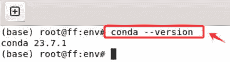

这条命令都会显示当前安装的 Conda 版本号。如果 Conda 已正确安装并正确设置在环境变量中，  会正常输出conda的版本，如果收到类似于“命令未找到”的错误，则说明 Conda 没有被添加到环境变量 中，或者根本没有安装 Conda。在这种情况下，请查看《在Ubuntu 22.04系统下部署运行ChatGLM3-  6B模型》中 2.3 安装Anaconda环境部分的说明。

+     Step 2. 升级Conda到最新版本

在更新过程中，系统会询问是否要继续进行，需要输入 y 来确认。使用 Conda 自身的更新命令执 行更新：

| conda update conda |
| --- |

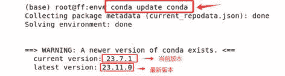

+     Step 3. 检查Conda更新情况

更新完成后，再次检查 Conda 的版本来确认更新是否成功。

| conda --version |
| --- |

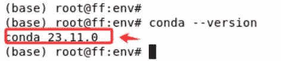

+     Step 4. 使用Conda更新软件包

更新完 Conda 后，需要更新环境中的所有包，以确保所有软件包都是最新的。避免产生未知的依 赖问题，使用以下命令来更新所有安装的包：

| conda update --all |
| --- |

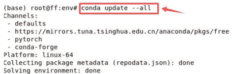

+     Step 5. 使用Conda创建独立的隔离环境

创建一个新环境用于多卡部署启动ChatGLM3-6B，避免与现有环境中的包发生冲突。使用以下命 令创建一个新环境（我这里设置的环境名为 chatglm3_multi ，大家根据需要更改虚拟环境的名

称）：

| conda create --name chatglm3_multi python=3.11 |
| --- |

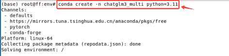

+     Step 6. 进入隔离环境

创建完成后，使用 conda activate 进入该虚拟环境。

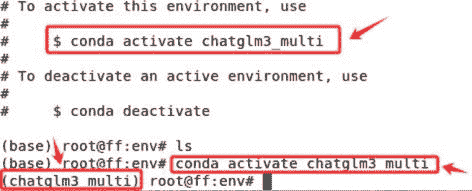

除此之外，大家一定要注意：如果使用远程连接，关闭了当前终端，或者是重启了电脑等情况后， 再次启动ChatGLM3-6B模型服务时，需要先进入这个虚拟环境。进入指定的虚拟环境方法如下：

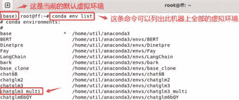

使用 conda activate + 指定虚拟环境名称 的方式，进入该虚拟环境。如果命令行最前面已显示 该虚拟环境，说明进入成功。

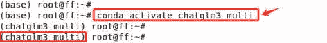

+     Step 7. 在虚拟环境中安装Pytorch

在上一期视频中说过，安装GPU版本的Pytorch需要根据当前安装的显卡驱动最高可支持的CUDA 版本来选择正确的Pytorch版本，所以先通过 nvidia-smi命令查看一下：

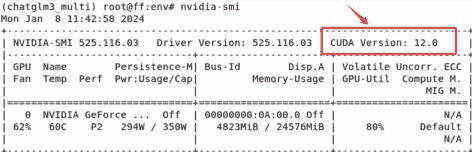

[在我的这台机器上，最高可支持的CUDA版本是12.0，](https://pytorch.org/get-started/previous-versions/)[需要根据此限制，进入Pytorch官网：https://py](https://pytorch.org/get-started/previous-versions/)torch.org/get-started/previous-versions/选择合适的Pytorch版本。注：这里大家要根据自己的实际情况灵活的选择适合自己的Pytorch版本。

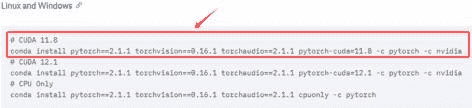

直接复制安装命令，进入终端执行。

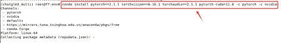

+     Step 8. 检查Pytorch安装是否成功

安装完成后，务必检查是否成功安装了GPU版本的PyTorch。最简单的验证方法如下：

| import torch |
| --- |

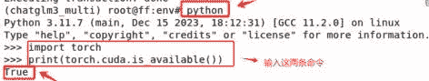

如果输出是 True，则表示GPU版本的PyTorch已经安装成功并且可以使用CUDA，如果输出是

False，则表明没有安装GPU版本的PyTorch，或者CUDA环境没有正确配置，如果出现这种情况，请重 新检查自己的安装过程，并确保此处可以正常加载GPU版本的Pytorch，否则后面的操作会无法执行。

+     Step 9. 下载ChatGLM3-6B模型的项目文件

首先，创建一个文件夹来存储该项目文件。

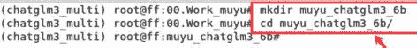

使用git工具在Github拉取ChatGLM3-6B模型的项目文件至本地。如果没有安装git的话，需要先安 装git，命令如下：

| sudo apt install git |
| --- |

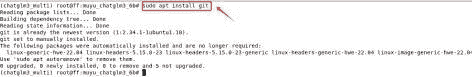

在ChatGLM3-6B的GitHub官网找到远程仓库的url：https://github.com/THUDM/ChatGLM3

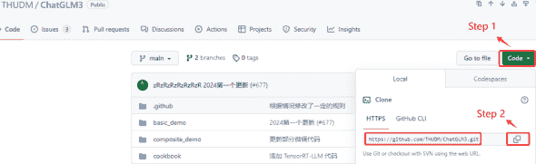

使用安装好的git工具，将云端的ChatGLM3-6B模型的项目文件拉取到本地环境，执行如下命令：

| git clone https://github.com/THUDM/ChatGLM3.git |
| --- |

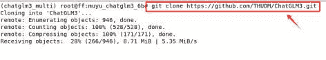

+     Step 10. 验证ChatGLM3-6B模型项目文件的完整性

等待下载完成，进入文件夹后验证项目文件的有效性。如执行过程正常的话，在本地会出现 ChatGLM3文件夹，进入该文件夹，所有的项目文件如下所示：

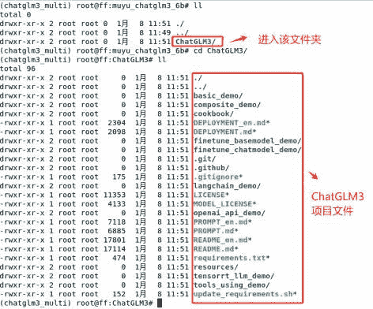

+     Step 11. 安装ChatGLM3-6B模型项目运行环境的依赖

在项目文件中，有一个 requirements.txt 文件，其中包含了该项目所有的依赖项。该文件可以  使用 Python 的 pip 工具来一键执行安装，因此建议先需要升级pip包的版本，避免因pip版本较低导致 产生依赖问题。

| python -m pip install --upgrade pip |
| --- |

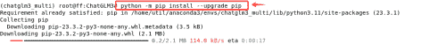

升级完pip工具后，执行如下命令一次性安装启动ChatGLM3-6B模型的所有依赖包：

| pip install -r requirement.txt |
| --- |

+     Step 12. 下载ChatGLM3-6B模型的权重文件

经[过Step 9的操作过程，我们下载到的只是ChatGLM3-](https://github.com/THUDM/ChatGLM3)6B的一些运行文件和项目代码，并不包含   ChatGLM3-6B这个模型的权重，还需要进入到 HuggingFace官网进行下载。下载路径： https://github.com/THUDM/ChatGLM3

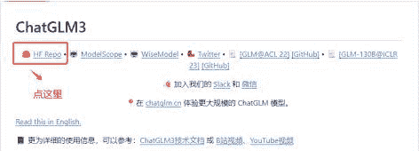

注：需要开科学上网才能进入Hugging Face官网执行下载，如果没有，可以选择进入 ModelScope 魔搭社区，按照教程执行下载。

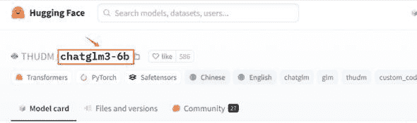

按照如下位置，找到对应的远程仓库的URL。

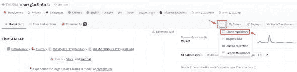

复制此命令，进入到服务器的命令行准备执行。

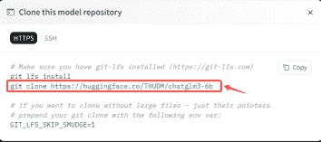

如果没有安装过git-lfs这个工具，需要先进行安装，安装命令如下：

| sudo apt-get install git-lfs |
| --- |

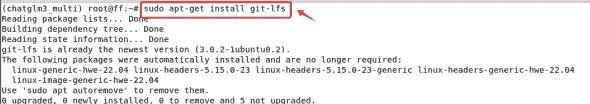

初始化gitlfs，这是使用git拉取模型权重必要的操作，初始化命令如下：

| git lfs install |
| --- |

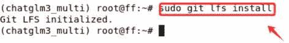

完成git-lfs的初始化后，直接复制 Hugging Face上提供的命令，在终端运行，等待下载完成即可。

| git clone https://huggingface.co/THUDM/chatglm3-6b |
| --- |

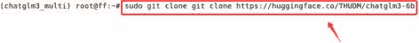

等待下载完成后，在 ChatGLM3 目录下出现一个新的 chatglm3-6b文件夹，里面存放的就是 ChatGLM3-6B模型的权重文件。

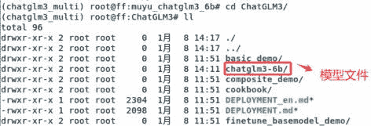

全部文件如下所示：

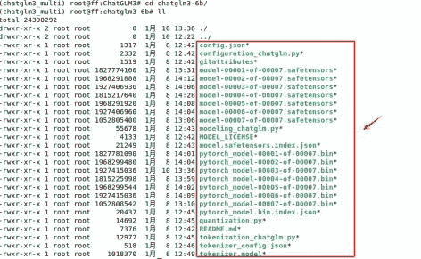

如果直接使用gitlfs下载的速度过慢，建议直接下载权重文件至本地。  一种最简单的方式就是这类  大的文件，直接通过浏览器下载到本地后，然后再移动到chatglm3-6b这个文件夹中。这种方式最简单 粗暴，且效率也很高。

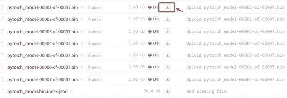

## 2. 单机多卡启动ChatGLM3-6B模型

单机多卡（多个 GPU）环境相较于单机单卡（一个 GPU），可以提供更高的计算能力，但同时也 会存在更复杂的资源管理和更复杂的程序代码。比如我们需要考虑如何使所有的 GPU 的负载均衡，如 果某个 GPU 负载过重，而其他 GPU 空闲，这会导致资源浪费和性能瓶颈，除此之外，还要考虑每个  GPU 的内存不会被过度使用及模型训练过程中GPU 之间的同步和通信。

尽管如此，单机多卡或者多机多卡往往才是工业界实际使用的方式，单机单卡的瓶颈非常有限，所  以这方面的内容还是非常有必要掌握的。而如果初次接触，我们需要做的就是：学会有效的使用简单的  GPU监控工具来帮助配置一些重要的超参数，例如批大小（batchsize），像出现 GPU 内存溢出（即显 存不足）等情况，去考虑减小批大小等等。

### 2.1 如何查看当前机器的GPU数量

方式一： lspci 命令。这是最常用的方法之一，这个命令会显示与图形相关的设备信息，列出所有 PCI 设备，包括 GPU，其执行命令如下：

| lspci | grep VGA |
| --- |

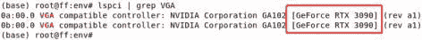

方式二：如果系统中安装的是 NVIDIA GPU 和驱动程序，最熟知且最直观的 nvidia-smi 命令。

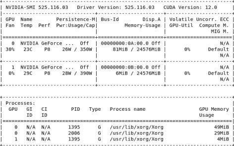

### **2.2 如何理解GPU性能参数**

参数很多，如何理解各个数值的意义及需要关注哪些信息呢？我们首先来看上半部分的输出：

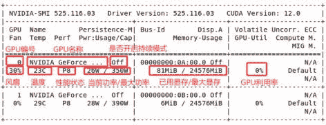

持续模式：耗能大，但是在新的GPU应用启动时，花费的时间更少，这里显示的是off的状态。

性能状态：从P0到P12 ， P0表示最大性能， P12表示状态最小性能。 再来看下半部分的输出：

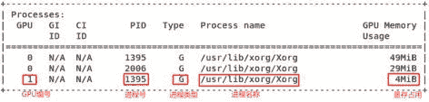

除了直接运行 nvidia-smi 命令之外，还可以加一些参数，来查看一些本机 GPU 使用的实时情况， 这种方式也是在执行训练过程中最简单直观且比较常用的一种监测方式，执行命令如下：

| watch -n 1 nvidia-smi |
| --- |

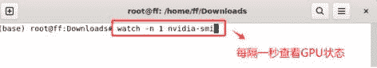

-n 参数可以自己灵活调整，后面添加的数字就是以秒为单位执行一次刷新。

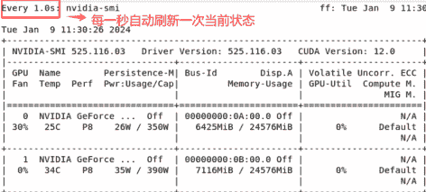

### 2.3 单机多卡启动ChatGLM3-6B模型服务

在 Linux 系统中想要在多GPU环境下启动一个应用服务，并且指定使用某些特定的GPU，主要有两 种方式：

1. CUDA_VISIBLE_DEVICES环境变量

使用 CUDA_VISIBLE_DEVICES环境变量是最常用的方法之一。这个环境变量可以控制哪些GPU对 CUDA程序可见。例如，如果系统有4个GPU（编号为0, 1, 2, 3），而你只想使用编号为1和2的GPU ， 那么可以在命令行中这样设置：

| CUDA_VISIBLE_DEVICES=1,2 python your_script.py |
| --- |

这会让 your_script.py只看到并使用编号为1和2的GPU。

2. **修改程序代码**

这种方式需要直接在代码中设置CUDA设备。例如，在PyTorch中，可以使用

torch.cuda.set_device() 函数来指定使用哪个GPU，除此之外，某些框架或工具提供也可能提供相 关的参数或环境变量来控制GPU的使用，但都需要修改相关的启动代码。

选择哪种方法取决于具体需求和使用的框架或工具。通常，   CUDA_VISIBLE_DEVICES是最简单和最 直接的方式，而且它不需要修改代码，这使得它在不同环境和不同应用程序之间非常灵活。如果有控制  多个服务并且每个服务需要使用不同GPU的需求，那么需要根据具体情况结合使用。

接下来我们依次尝试上述两种方式来启动ChatGLM3-6B模型服务。

+     根据GPU数量自动进行分布式启动

这里我们以命令行的交互方式来进行多卡启动测试。官方提供的脚本名称是：  cli_demo.py。

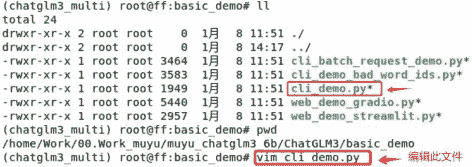

在启动前，仅需要进行一处简单的修改，因为我们已经把ChatGLM3-6B这个模型下载到了本地， 所以需要修改一下模型的加载路径。

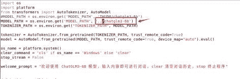

如果仅修改模型权重就执行启动，该过程会自动检测可用的 GPU 并将模型的不同部分映射到这些 GPU 上。状态如下：

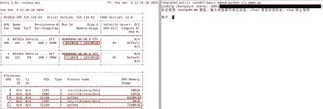

这里输入 Stop 退出启动程序， GPU资源就会立即被释放。

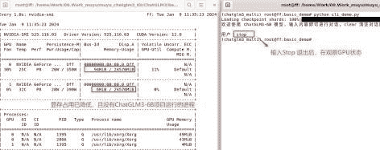

默认启动会自动使用多块GPU的资源的原因，在于 cli_demo.py这个.py文件中的这行代码：

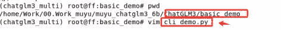

参数 device_map="auto" , 这个参数指示 transformers 库自动检测可用的 GPU 并将模型的不同  部分映射到这些 GPU 上。如果机器上有多个 GPU，模型会尝试在这些 GPU 上进行分布式处理。其通 过分析各个 GPU 的当前负载和能力来完成。负载均衡的目标是最大化所有GPU的利用率，避免任何一 个GPU过载。

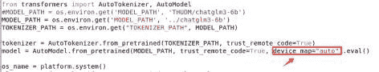

可以通过如下代码，查看当前环境下的GPU情况：

可以把上述代码写在一个.py文件中，执行该文件后会输出当前机器上的GPU资源情况，方便我们 对当前的资源情况有一个比较清晰的认知。

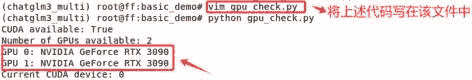

如果想要指定使用某一块GPU，那么需要这样修改代码 cli_demo.py 中的代码：

| import torch |
| --- |

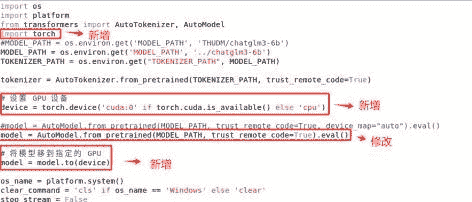

修改后看下启动情况：

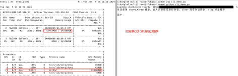

+     在代码程序中指定某几块GPU加载服务

更多数人的情况是：比如当前机器中有4块GPU，我们只想使用前两块GPU做此次任务的加载，该  如何选择呢？这很常见，其问题主要在于：如果某块GPU已经处于满载运行当中，这时我们再使用四块 默认同时运行的话大概率会提示out of memory报错，或者提示显卡不平衡imblance的warning警告。

如果是想在代码中指定多块卡运行该服务，需要在代码中添加这两行代码：

| import os |
| --- |

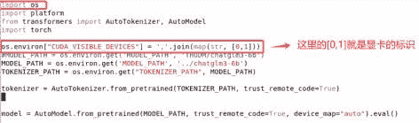

然后保存修改后，执行启动过程就可以了。

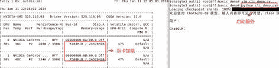

+     直接使用CUDA_VISIBLE_DEVICES环境变量启动

第二种方法就是设置 CUDA 设备环境变量。这个方法非常简单，且不涉及更改Python代码。只需 要在运行 Python 脚本之前，在命令行中设置 CUDA_VISIBLE_DEVICES 环境变量。这个环境变量告诉  PyTorch 使用哪个 GPU。例如，如果想使用第二块 GPU（ GPU 编号从 0 开始，因此第二块 GPU 是    1），就可以这样启动程序：

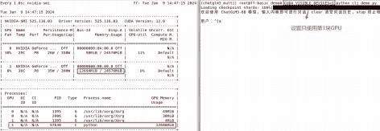

如果想使用两块 GPU启动，那么可以使用逗号（，）来进行分割。

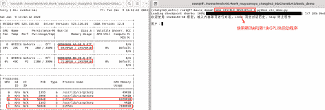

同时，在执行推理的过程中，其功率也会增长。

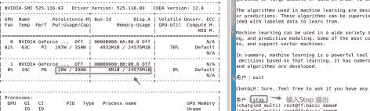

## 3.ChatGLM3-6B 高效微调实践

在大模型掀起新一轮的AI热潮以来，目前的形式就是大语言模型（LLM）百花齐放，工业界用于生 产的算法模型由原来是几万，几十万的参数，到现在上升到上十亿，上百亿的情况。在这种情况下，因 为显卡资源的因素，预训练大模型基本是大公司或者高校才可以做的事情，小公司或个人只能对大模型 进行微调后使用。

以前我们比较熟悉的都是全量微调，这个微调过程是对原始模型的所有参数全部做一个调整。但对 于LLM，在消费级显卡上就做根本没有办法实现。所以目前对于大模型来说，主流的微调技术叫做高效 微调，这种方式是通过微调大模型少量或者额外的一些参数，固定预训练模型（LLM）参数，以此来降 低计算和存储成本，同时，还可以在一定程度上实现与全量参数微调相当的性能。

### **3.1 主流的高效微调方法介绍**

+   **  Freeze**

Freeze是冻结的意思， Freeze方法指的是参数冻结，对原始模型的大部分参数进行冻结，仅训练少 部分的参数，这样就可以大大减少显存的占用，从而完成对大模型的微调。特别是在Bert模型出来的时 候，比较会常用到Freeze的这样一个微调方法，比如Bert有12层，我们把前10层冻结了，只训练后两    层。这是一种比较简单微调方法，由于冻结的参数是大部分，微调的参数是少部分，因此在代码中只需 要设置需要微调的层的参数即可，把不需要参加训练的层数 requires_grad  设置为False，不让其进行 更新，从而达到冻结的这样一个效果。

+   Prefix-Tuning（2021年提出）

Prefix-Tuning指的是在微调模型的过程中只优化加入的一小段可学习的向量(virtual tokens)作为  Prefix，而不需要优化整个模型的参数（训练的时候只更新Prefix部分的参数，而PLM中的其他部分参 数固定）。

Prefix-Tuning论文地址： https://arxiv.org/abs/2101.00190

[Prefix-Tuning代码地址： htt](https://github.com/XiangLi1999/PrefixTuning)[p](https://github.com/XiangLi1999/PrefixTuning)s://github.com/XiangLi1999/PrefixTuning

传统的微调范式Fine-turning会利用预训练模型去对不同的下游任务进行微调，对每个任务都要保  存一份微调后的模型权重。比如下图展示的三个不同任务的Transformer模型，分别用来做翻译、摘要 和将格式转化（table-to-text）。每个任务都有自己的微调模型，这意味着模型的所有权重都在微调过  程中针对特定任务进行了更新。这种方法通常需要大量的数据和计算资源，因为整个模型都在学习任务 特定的知识。

Prefix-tuning 就提出了一种不同的微调策略，对基于Transformers结构的模型，它会将特定的前  缀添加到输入序列的开始部分，相当于任务特定的提示，可以是一组固定的词或是可训练的嵌入向量。

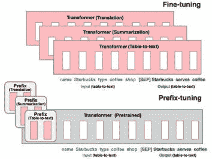

但是这个Prefix 并不是一些明确的单词，比如对于文本摘要任务来说，我们添加this is

summarization （明确指出这是一个摘要的任务），相反，这个prefix加的是一些隐式的Token。这里 就需要了解两个概念：

+   Hard Prompt：也称离散Prompt，是一个实际的文本字符串（自然语言，人工可读），通常由中 文或英文词汇组成；

+    Soft Prompt：也称连续Prompt，通常是在向量空间优化出来的提示，通过梯度搜索之类的方式 进行优化；

在Hoft Promot中，提示语的变化对模型最终的性能特别敏感，加一个词、少一个词或者变动位置 都会造成比较大的变化。成本比较高，并且效果不太好。显然：  Prefix Tuning属于Soft prompt。也就 是我们学习调整的就是这部分的参数，从而达到微调的目的。

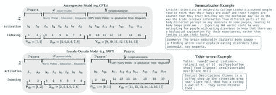

Encoder端增加前缀是为了引导输入部分的编码， Decoder 端增加前缀是为了引导后续token的 生成。

Prefix-tuning 的优势在于它不需要调整模型的全部权重，而是通过在输入中添加前缀来调整模型的 行为，这样可以节省大量的计算资源，同时使得一个单一的模型能够适应多种不同的任务。

+   Prompt Tuning（2021年提出）

Prompt Tuning 方法可以看做是Prefix Tuning的简化版本，它给每个任务都定义了自己的

Prompt，将真实的Tokens转化为可微的virtual token，并加入人工设计的锚字符（与任务高度相关的 Token），拼接到数据上作为输出，但只在输入层加入Prompt tokens。

[Prompt Tuning论文地](https://arxiv.org/pdf/2104.08691.pdf)址： https://arxiv.org/pdf/2104.08691.pdf

如图所示：如果A、 B、C三个任务，模型框架都是一样的，对每一个任务都添加一个自己定义的 Prompt，然后把每个任务混合在一起放在一个Batch中来进行训练。

下面的训练例子说明了两者的区别：

| Prompt Tuning示例： |
| --- |

| Prefix Tuning 示例： |
| --- |

所以Prompt Tuning和Prefix Tuning都涉及在输入数据中加入可学习的向量，但两者的策略和目的 不一样：

+   Prompt Tuning：可学习向量（通常称为prompt tokens）旨在模仿自然语言提示的形式，它们被 设计为引导模型针对特定任务生成特定类型的输出。这些向量通常被看作是任务指导信息的一部    分，倾向于用更少量的向量模仿传统的自然语言提示。

+   Prefix Tuning：可学习前缀Prefix更多地用于提供输入数据的直接上下文信息，这些前缀作为模型 内部表示的一部分，可以影响整个模型的行为。

+   **  P-Tuning v1**

P-Turning V1的核心是使用可微的virtual token替换了原来的discrete tokens，且仅加入到输入 层，并使用prompt encoder（ BiLSTM+MLP）对virtual token进行编码学习。

[P-Tuning v1 论文地址](https://arxiv.org/pdf/2103.10385.pdf): https://arxiv.org/pdf/2103.10385.pdf

[P](https://github.com/THUDM/P-tuning)-tuning v1 github 代码：https://github.com/THUDM/P-tuning

Prompt Tuning会使用静态的、可训练的虚拟标记嵌入。这些嵌入在初始化后保持固定，除非在训  练过程中被更新，相对简单，因为它只涉及调整一组固定的嵌入参数。在处理多种任务时表现良好，但  在处理特别复杂或需要细粒度控制的任务时受限。所以，  P-Turining v1 就在输入的句子中也是加入了    隐式的 virtual token，区别就是：前面的方式是直接对它进行一个学习更新，只不过不会更新大模型中 的参数，只是更新我们加入的 virtual token这样一个参数， P-Turning v1 是对添加的virtual Token，又 使用BiLSTM + MLP 对其进行了一个编码。

虽然这个编码对于PLM来说简单多了，参数也都非常小。但是，也能起到一个比较好的效果。相同 参数规模，如果进行全参数微调， Bert在NLU任务上的效果，超过GPT很多；但是在P-Tuning下， GPT 可以取得超越Bert的效果。

那么Prompt Tuning和P-Tuning等方法存在两个主要的问题：

+    缺乏模型参数规模和任务通用性： Prompt Tuning论文中表明当模型规模超过100亿个参数时，提 示优化可以与全量微调相媲美。但是对于那些较小的模型（从100M到1B），提示优化和全量微调 的表现有很大差异，这大大限制了提示优化的适用性。

+   缺乏任务普遍性：尽管Prompt Tuning和P-tuning在一些 NLU 基准测试中表现出优势，但提示调 优对硬序列标记任务（即序列标注）的有效性尚未得到验证。

+   缺少深度提示优化，在Prompt Tuning和P-tuning中，连续提示只被插入transformer第一层的输 入embedding序列中，在接下来的transformer层中，插入连续提示的位置的embedding是由之  前的transformer层计算出来的，这可能导致两个可能的优化挑战。

由于序列长度的限制，可调参数的数量是有限的，输入embedding对模型预测只有相对间接的影 响。这些问题在P-tuning v2得到了改进。

+   **  P-Tuning v2**

P-Tuning v2主要是基于P-tuning和Prefix-tuning技术，最核心的是引入Deep Prompt Encoding和 Multi-task Learning等策略进行优化的。

P-Tuning v2论文地址: https://arxiv.org/abs/2110.07602

[P-Tuning v2 gith](https://github.com/THUDM/P-tuning-v2)ub代码：https://github.com/THUDM/P-tuning-v2

Deep Prompt Encoding： P-Tuning v2在每一层都加入了Prompts tokens作为输入，而不是仅仅 加在输入层，这带来两个方面的好处：

+   更多可学习的参数（从P-tuning和Prompt Tuning的0.01%增加到0.1%-3%），同时也足够参数高 效。

+   加入到更深层结构中的Prompt能给模型预测带来更直接的影响。

Multi-task learning：基于多任务数据集的Prompt进行预训练，然后再适配到下游任务。对于   pseudo token的continous prompt，随机初始化比较难以优化，因此采用multi-task方法同时训      练多个数据集，共享continuous prompts去进行多任务预训练，可以让prompt有比较好的初始化。

所以P-Tuning v2是一种在不同规模和任务中都可与微调相媲美的提示方法。  P-Tuning v2对从

330M到10B的模型显示出一致的改进，并在序列标注等困难的序列任务上以很大的幅度超过了Prompt Tuning和P-Tuning。

除此之外，还有比较主流的LoRA ，QLoRA，感兴趣的也可以自行了解一下。本篇内容主要涉及 ChatGLM3-6B模型的P-Turning V2 高效微调。

### 3.2 ChatGLM3-6B模型的高效微调实践

本次实验环境配置1：

+     操作系统： Ubuntu 22.04；

+     GPU ：3090双卡，总共48G显存；

+     CPU：AMD 5900X；

+     存储： 64G内存+2T SSD数据盘； 实验环境配置2：

+     操作系统： CentOs 7.3；

+     GPU ：4090双卡，总共48G显存；

+     CPU ：24 vCPU Intel(R) Xeon(R) Platinum 8352V CPU

+     存储： 180GB + 100G数据盘

[ChatGLM官网出了⼀个基于P-Tuningv2的⽅式微调](https://github.com/THUDM/ChatGLM-6B/tree/main/ptuning)[C](https://github.com/THUDM/ChatGLM-6B/tree/main/ptuning)[h](https://github.com/THUDM/ChatGLM-6B/tree/main/ptuning)atGLM-6B的项目，项目地址： https://github.com/THUDM/ChatGLM-6B/tree/main/ptuning，最低只需要 7GB显存即可运行。

在ChatGLM3-6B模型的项目文件中，官方提供了基于ChatGLM3-6B-base模型和ChatGLM3-6B两 个基座模型的微调示例，其中ChatGLM3-6B-base模型仅提供了Lora微调，而ChatGLM3-6B包括全量  微调和P-Tuning V2。相关存储位置如下：

base模型不具备对话能力，仅能够生成单轮回复。如果大家希望使用多轮对话模型，需要对Chat   模型进行微调，所以需要用到 finetune_chatmodel_demo下的参考代码，进入后，相关的项目代码如 下：

无论是全量微调还是P-Tuning v2，都需要设计微调数据， ChatGLM3-6B支持多轮对话和输入输出 格式微调样例。因此如果想要使用自己的数据集进行模型微调，需要首先统一样例格式。同时，

ChatGLM3-6B微调对话和微调工具能力的数据格式也不相同。

这里我们启动微调的脚本存放在 script文件目录下。

+   **  单轮对话微调**

首先来看单轮对话微调，对于输入-输出格式，样例采用如下输入格式：

| [ |
| --- |

[官网提供了一个微调示例：AdvertiseGen数据](https://cloud.tsinghua.edu.cn/f/b3f119a008264b1cabd1/?dl=1)[集，](https://cloud.tsinghua.edu.cn/f/b3f119a008264b1cabd1/?dl=1)[可以进入TsinghuaCloud：h](https://cloud.tsinghua.edu.cn/f/b3f119a008264b1cabd1/?dl=1)ttps://cloud.tsing hua.edu.cn/f/b3f119a008264b1cabd1/?dl=1下载并上传到finetune_chatmodel_demo路径下。一种更便捷的方式就是在服务器终端使用 wget命令来进行下载。同时下载到的AdvertiseGen数据集是一

个.tar.gz的压缩文件，需要解压才可使用：

| wget - O AdvertiseGen https://cloud.tsinghua.edu.cn/f/b3f119a008264b1cabd1/?dl=1 |
| --- |

ADGEN 数据集任务为根据输入（content）生成一段广告词（summary），其数据格式如下：

| {&quot;content&quot;: &quot;类型#上衣*版型#宽松*版型#显瘦*衣样式#外套*衣袖型#插肩袖*衣款式#拼接&quot;, |
| --- |

我们需要修改成单轮对话的数据微调格式。官方也提供了转换脚本，如下：

执行后，数据格式如下：

| {&quot;prompt&quot;: &quot;类型#裤*版型#宽松*风格#性感*图案#线条*裤型#阔腿裤&quot;, |
| --- |

单轮微调官方提供的示例脚本是 finetune_pt.sh 。

准备完成后，需要安装一下执行微调过程必要的依赖包。执行如下命令：

| pip install -r ../requirements.txt -i https://pypi.tuna.tsinghua.edu.cn/simple |
| --- |

这里我们先使用默认的参数，仅修改必要的参数，把微调启动起来。

执行微调过程，并启动GPU显存使用情况的监控。

默认是使用单卡启动，会占用20GB的显存资源。

如果需要加载多块卡，可以进入 finturn_pt.sh 中修改一下配置。

双卡启动会占用30G的显存，占用更多显存的原因，主要会涉及一些模型复制、数据并行、梯度同 步等训练过程中的操作。

| **参数名** | **描述** |
| --- | --- |
| PRE_SEQ_LEN | Prompts序列的长度。 |
| LR | 学习率。高的学习率模型权重在优化过程中更新得更快。 |
| NUM_GPUS | 训练过程中使用的 GPU 数量。 |
| MAX_SOURCE_LEN | 定义输入序列的最大长度。 |
| MAX_TARGET_LEN | 定义输出序列的最大长度。 |
| DEV_BATCH_SIZE | 每个批次的大小，即每个优化步骤使用的示例数量。 |
| GRAD_ACCUMULATION_STEPS | 在进行一次参数更新之前，梯度积累的步数。模型会在 指定 次数前向和后向传播后才更新参数。 |
| MAX_STEP | 训练过程执行的最大步数， |
| SAVE_INTERVAL | 每隔一定数量的步数保存模型的参数 |
| RUN_NAME | 运行的名称（advertise_gen_pt），用于标识和区分不同的 训练运行。 |
| BASE_MODEL_PATH | 预训练模型的路径，保持为 |
| DATASET_PATH | 训练数据集的路径，保持为 |
| OUTPUT_DIR | 保存模型输出以及训练日志的文件夹路径。 |

因为默认参数是1000步，会导致训练过程较慢，这里我出于演示目的，将其调整为50执行微调。

微调完成后，如下：

同时，会在 output/路径下会⽣成对应的模型⽂件：

checkpoint 中存储的是训练过程中保存的模型状态，包括模型参数、优化器状态、当前epoch等

信息。

不同的训练参数，会产生不同数量的 checkpoint ，比如在脚本中，  SAVE_INTERVAL 设置为 1000，这说明每1000个训练步骤保存一次模型。如果 MAX_STEP 设置为3000，就应该有3个

checkpoints被保存，这个也很好计算。

+     微调完成后使用微调模型执行推理

对于输入输出格式的微调，可以使用 inference.py进行基本的推理验证。在 fineturn_chatmodel_demo文件目录中输入如下命令：

| python inference.py --tokenizer &#x27;chatglm3-6b模型路径 &#x27;  -- model &#x27;微调模型的 |
| --- |

这是因为在 P-tuning v2 训练时模型只保存 PrefixEncoder 部分的参数，所以在推理时需要同时加 载原 ChatGLM-6B 模型以及 PrefixEncoder 的权重。

+   **  多轮对话微调**

多轮对话微调示例采用 ChatGLM3 对话格式约定，基本上大多数使用的也都是多轮对话的方式。

同样官方也提供了一个数据集，供用户快速使用，可以直接在github 上进行下载。

复制远程仓库的url链接后，直接在服务器上使用git工具拉取到本地。

同样，使用官方提供的数据格式转化脚本，转化成适合多轮微调格式的数据集。

这次使用 fineturn_pt_multiturn.sh微调脚本，进行和单轮对话微调相同的配置修改即可。

微调过程中会占用24G显存。

其推理验证过程，和上面说明的单轮对话微调模型的一致。

训练过程的参数会很大程度影响当前训练的显存占用，比如我们做如下实验：

显存直接就会爆掉：

对于双卡 4090 共计48显存来说，最大仅支持设置到4,就基本会占满显存。

如果按照这种 -  per_device_train_batch_size=1、-  gradient_accumulation_steps=16 比较 低的参数设置还爆显存的话，只能尝试微调量化模型。

INT4 的模型参数被冻结， 一次训练迭代会以 1 的批处理大小进行 16 次累加的前后向传播，等效为

16 的总批处理大小，实际显存占用也仅有7.9G。

所以， P-Tuning V2 高效微调中，PRE_SEQ_LEN=128, DEV_BATCH_SIZE=1,  GRAD_ACCUMULARION_STEPS=16, MAX_SEQ_LEN=2048 配置下约需要 21GB 显存。

若尝试后发现显存不足，可以考虑:

+      尝试降低 DEV_BATCH_SIZE 并提升 GRAD_ACCUMULARION_STEPS .  尝试添加 --quantization_bit 8 或 --quantization_bit 4。

除此之外，对于模型参数的选择，往往是参数越大效果越好。如果资源充足，当然是推荐 30B 以   上的模型。 不管是 6B, 7B 和 13B 同样的训练数据，同样训练参数，模型参数量大效果则优于低参数的 模型。 根据模型参数预估训练所需的内存开销， 一个简单的方法是： 比如 6B 模型， 60亿规模参数，

根据以下公式计算：

| 模型参数 + 梯度参数 + 优化器参数 = 6B * 1bytes + 6GB + 2*6GB = 24GB |
| --- |

注意：参数多量化低的模型要优于参数低量化高的模型，举例 ：33B-fb4 模型要优于 13b-fb16 模 型.

+   **  全量微调**

对于全量微调，需要使用 finetune_ds_multiturn.sh这个脚本，其配置MAX_SEQ_LEN=2048, DEV_BATCH_SIZE=16, GRAD_ACCUMULARION_STEPS=1恰好用满 4 * 80GB 显存。

我这里也尝试了一下，可以跑通：

但奈何硬件差距太多，直接显存爆掉。

## 4. 大模型并行训练框架-DeepSpeed

像ChatGLM3-6B这种大的模型往往需要配备高价的多GPU、多节点的集群，但是，即便拥有   了这些先进的硬件资源，实际的机器利用率往往只能达到其最大效率的一半左右。这意味着，仅仅拥有 更加强大的硬件资源并不能保证更高的模型训练吞吐量。同样，即使系统具有更高的吞吐量，也并不能 保证所训练出的模型具有更高的精度或更快的收敛速度。更重要的是，当前的开源软件的易用性也常常 被用户诟病。

DeepSpeed是一个开源深度学习优化库，专门设计来提高大型模型训练的效率和扩展性。这个库 采用了一系列先进技术，如模型并行化、梯度累积、动态精度缩放和混合精度训练等，来实现快速训   练。除此之外， DeepSpeed还搭载了一套强大的辅助工具集，涵盖分布式训练管理、内存优化以及模 型压缩等功能，帮助开发者更有效地处理和优化大规模的深度学习任务。值得一提的是， DeepSpeed 是基于PyTorch构建的，因此对于现有的PyTorch项目，开发者可以轻松地实施迁移。此库已在众多大 规模深度学习应用中得到验证，涉及领域包括但不限于语言模型、图像分类和目标检测。

其使用非常简单，其较强的易用性源于把该软件的构造难度交给开发者而不是用户，所以我们用起 来是非常简单的，就是一个configs文件，然后在训练代码中反向传播后执行参数更新的时候加一两行   代码就可以了。对于ChatGLM3-6B模型的微调，默认只是在全量微调的脚本中加入了deepspeed的代  码，因硬件配置相差太大，即使是使用deepspeed也无法运行。但我们可以将其应用到高效微调的P-    Turning v2中，只需要添加一行代码，其他的全部使用默认的即可。

[DeepSpeed已经在Github](https://github.com/microsoft/DeepSpeed)上开源，地址： https://github.com/microsoft/DeepSpeed 这里在 fineturn_pt.sh 中加入这样一行代码：

直接启动后，就会降低约4G的显存使用。因我们的配置和数据量过小，其实不太容易看出这种差 距。训练级别越高，提升的效果会越明显。

deepspeed在训练过程中依赖的相关参数配置，来源于这里：

这个参数的调整，直接影响整体的训练效率。但这部分参数需要对Deepspeed有一定的了解才能更 好的根据训练任务和硬件配置情况灵活调整。我们这里简单的了解一下。

DeepSpeed是最早开始关注大模型训练的一批，其最核心的就是ZeRo ，ZerO-Offload是将模型的 参数、梯度或者优化器的状态可以从GPU内存中转移到GPU中。

其终极形态ZeRo-infinity，不仅可以将这些参数等卸载到CPU上，还可以Offload到nvme的硬盘 上，在速度上，基于zero的这种方式，随着GPU的增加，可以达到超线性的效率增长和。

第二点是训练速度。不管大模型还是小模型的训练，训练的效率一定是框架需要重点关注的，需要 在保证精确性的前提下，保证它快。

ZeR0-1只会对优化器状态做切分。 ZeR0-2会对优化器状态和梯度做切分。 ZeR0-3是对优化器状 态、梯度和模型参数做切分。

+   φ：假设有一个模型，这个模型由φ个参数，也就是由φ个浮点数组成的模型，每个参数如果以fp16的形式存放， 一个参数是32float，也就是4bit，所以这里就是2φ。

+   梯度，同样是2φ的显存占用。

+   优化器状态就是K倍的φ,优化器的状态根据实现的形式是不一样的，这里选择12进行比较。

在Baseline中，这120GB显存是每张卡都要占用的，所以现在最大的H100这种80G的显存都放不

下。

所以在实际计算过程中， GPU1 ~ GPU3 计算显存空间的使用会根据 GPU0 的可使用显存空间来确  定，这就造成了一个问题：在显存使用上， GPU0 = GPU1 = GPU2 = GPU3，对 GPU1~GPU3 来说是一 种巨大的浪费。而且，这种浪费随着模型精度、参数的增加愈发明显。

并行模型：

+    Data Parallelism（ DP）：数据并行，整个模型会复制到所有GPU上，输入数据会被分割成多个    batch到不同的GPU上。也因为每个GPU都在处理不同的数据子集，所以在独立执行前向传播后计 算的损失（loss）也会有所不同，接着每个GPU根据其计算出的损失执行反向传播，计算梯度。当 所以GPU计算完成后，求平均。这个平均梯度代表了整个数据集上的平均梯度。使用这个平均梯    度更新模型的参数。从而确保所有GPU上的模型都保持同步。

+    Tensor MP：对模型做横向切分，也就是层内的切分，每一层的计算被分割成几个较小的部分，每 部分独立在不同的GPU上进行计算。比如最大层是一个MLP层，有非常大的计算，但一张卡放不下，就需要切分成两个小的分别放在两张卡上计算。

+    Pipeline MP：流水线并行，把模型的不同层分在不同的GPU上，比如12层的模型，前6层分在一  个GPU上，后六层分在一个GPU上。像我们常用的Transformer结果，它会分成一个个Block，所 以一般不同的Block会分布不同的层中。

什么是micro_batch_size？

Pipeline会把输入进来的mini_batch 分成设备个 micro_batch。

理想的计算加载方式应该是将模型加载在每个GPU上，减少模型对单个GPU的占用依赖，如下图所 示：

DeepSpeed 就是实现这样的加载，结合Deepspeed框架的优化特性，充分发挥每块GPU的计算和 显存潜能，从而提高整体的训练效率和资源利用率。

在理解了DeepSpeed原理后，我们尝试进行模型加载并观察其内存消耗情况。

对于我们的本地运行环境，如果采用 DeepSpeed 在4块3090上加载ChatGLM2-6B模型，加载情况 如下：

+   原始模型大小 chatglm-6B FP16 -> 单卡显存 Memmodel = 12GB

。 在 nGPU =4 的情况下采用 zero++ 方式计算过程中，模型会先加载到 内存中，占用内存大小Menload = nGPU * Memmodel = 4 * 12  = 48GB

。 内存加载完毕后再分布到各个显存上，遵循 “对内存中 nGPU 个模型进行截取，而不是 一个模型进 行分割”；

+   计算公式如下：

Menload = Memmodel * nGPU

+   加载130B FP16 nGPU =4 时，Menload  = Memmodel * nGPU = 130 * 2 * 4 = 1040GB

可见， DeepSpeed 的 分布截取 会占用大量重复内存，造成资源上的冲击和浪费，  一种优化方法 是加载到虚拟内存中作为缓存，对一个模型进行分割而不是逐个截取。

在微调过程中，参数配置和优化对于模型性能和训练效率至关重要。合理的参数设置不仅可以加速 模型的收敛，还可以提高模型的表现。特别是当我们使用高级的训练框架如DeepSpeed时，更需要对   每个参数有深入的理解和精细的调整。 DeepSpeed训练过程中涉及的主要参数和分类如下：

| **para** | **n** | **GPU** | **times/acc** | **cost** | **micro- bs** | **bs** | **1 0000** | **times** |
| --- | --- | --- | --- | --- | --- | --- | --- | --- |
| 4-4- | 4U | 21554MB | 4 | 50s / step | 64 | 256 | 39 | 32.5min |
| 4-4- | 4U | 21554MB | 3 | 40s / step | 48 | 192 | 52 | 34.6h |
| 4-4-8 | 4U | 21554MB | 2 | 25s / step | 32 | 128 | 78 | 32.5h |
| 2-2- | 4U | 18254MB | 8 | 25s / step | 32 | 128 | 78 | 32.5h |
| 2-2- | 4U | 18254MB | 16 | 50s / step | 64 | 256 | 39 | 32.5h |

micro    bs = TRAIN  BATCH SIZE * GRA ACC  STEPS

bs =micro    bs * nGPU

其中， para列中的4-4-16表示per_device_train_batch_size、 per_device_eval_batch_size、 gradient_accumulation_steps。

注： 10000条数据在当前para下完成一个epoch需要步数； 10000/48/4=52 step/epoch； 10000/32/4=78 step/epoch

## **5. 中文语言模型的评测基准**

[1. LLM 实时排行，来自 UC伯克利： http](https://lmsys.org/blog/2023-06-22-leaderboard/)s://lmsys.org/blog/2023-06-22-leaderboard/

[2. 选择中文模型：中文语言理解测评基准(](https://www.cluebenchmarks.com/index.html)CLUE) ：https://www.cluebenchmarks.com/index.html 和SuperCLUE琅琊榜 ：https://www.superclueai.com/

开源领域 ChatGLM, LLAMA, RWKV 主要就是这3种模型， 中文好一点就是 ChatGLM , 潜力最好的 就是LLAMA ， RNN架构决定RWKV有很好的推理效率（随输入长度内存占比线性自增，而LLAMA则是  指数增加） 和 Length Extrapolation  （关于长度外推性，可以参考苏神的文章 ）。 当然 MPT-7B-

StoryWriter-65k+ 模型也有较长的外推能力。

自ChatGPT为代表的大语言模型（Large Language Model, LLM）出现以后，由于其惊人的类通用 人工智能（AGI）的能力，掀起了新一轮自然语言处理领域的研究和应用的浪潮。尤其是以ChatGLM、 LLaMA等平民玩家都能跑起来的较小规模的LLM开源之后，业界涌现了非常多基于LLM的二次微调或应 用的案例。下面这个项目在收集和梳理中文LLM相关的开源模型、应用、数据集及教程等资料，目前收 录的资源已达100+个！

Awesome Chinese LLM ， 主要是整理开源的中文大语言模型，以规模较小、可私有化部署、训练 成本较低的模型为主，包括底座模型，垂直领域微调及应用，数据集与教程等。

[Awesome Chinese LLM 的GitH](https://github.com/HqWu-HITCS/Awesome-Chinese)[ub地址](https://github.com/HqWu-HITCS/Awesome-Chinese-LLM)：https://github.com/HqWu-HITCS/Awesome-Chinese-LLM

3. C-Eval:构造中文大模型的知识评估基准，其榜单是一个全面的中文基础 模型评估 套件(多层次、多 学科的语文评价基础模型套件)。它由13948个选择题组成 问题跨越52个不同的学科和四个难度级  别，测试集用于模型评估（简单来说就是针对中文模型的综合测试机），目的是C-Eval能够帮助开 发人员跟踪模型开发的进展，以及分析开发中模型的优点和弱点。

[C-Eval的](https://arxiv.org/pdf/2305.08322v1.pdf)GitHub地址：https://github.com/hkust-nlp/ceval， 论文地址：https://arxiv.org/pdf/2305.08322v1.pdf

不同颜色的主体表示四个难度等级：初中、高中、大学和专业。

[比较有代表性，很多新出的模型或者微调过的模型](https://cevalbenchmark.com/static/leaderboard.html)[都会](https://cevalbenchmark.com/static/leaderboard.html)在这样一个基准上进行评估。榜单地址：https://cevalbenchmark.com/static/leaderboard.html

其使用的数据集的地址是： [https://cevalbenchmark.com/sta](https://cevalbenchmark.com/static/leaderboard.html)tic/leaderboard.html ，都是一些选

择题。

---

🍻现开设了大**模型学习交流群，**扫描下👇码，来遇见更多志同道合的小伙伴~

海量硬核独家技术**干货内容**+无门槛**技术交流****+不定期开设****硬核干货&前沿技术公开课****，****扫码**👆即刻入群！