# 在Windows系统下部署运行ChatGLM3-6B模型

> 来源：[https://kq4b3vgg5b.feishu.cn/docx/Qvl2dBU7DoPj2ixtwMfcnASmnJd](https://kq4b3vgg5b.feishu.cn/docx/Qvl2dBU7DoPj2ixtwMfcnASmnJd)

本文涉及到的所有ChatGLM3-6B模型的权重文件及应用程序安装包，已全部上传至百度网盘：https://pan.baidu.com/s/15sRruaOuzpyY-k_O8i3aLA?pwd=q88n

在前几期视频中，我们已经详细介绍了如何在Ubuntu 22.04 下部署运行ChatGLM3-6B模型服务。对于大模型服务来说，Ubuntu通常在资源使用和性能方面更加高效，特别是在服务器和云环境中，更加适合于多卡运行、服务优化等企业级的部署环境。但很多小伙伴还是比较倾向于在Windows系统上进行实践和学习，虽然Windows操作系统在处理大规模计算任务时，性能和资源管理方面与Ubuntu相比略显不足，但更贴合大多数人的使用习惯。

从部署过程来看，在Windows操作系统上部署ChatGLM3-6B模型与Ubuntu操作系统上看并无太明显的差别。在本期课程中，我们将一步步详细介绍如何在Windows 11操作系统上部署大模型服务。通过这些实用的指导，希望帮助大家有效地完成部署流程，确保ChatGLM3-6B模型在Windows 11环境下运行顺畅。

ChatGLM相关的信息获取途径：

- 官方网站：https://www.zhipuai.cn/
- 智谱清言：https://chatglm.cn
- API开放平台：https://bigmodel.cn/
- Github仓库：https://github.com/THUDM

大模型本身运算的复杂性，目前任何开源大模型的运行都有一定的硬件要求。相比之下，ChatGLM系列模型的硬件门槛相对更低，而且支持多种不同的运行模式。根据官方介绍，ChatGLM目前支持GPU运行（需要英伟达显卡）、CPU运行以及Apple M系列芯片运行。其中GPU运行需要至少6GB以上显存（4Bit精度运行模式下），而CPU运行则需要至少32G的内存。由于Apple M系列芯片是统一内存架构，因此最少需要13G内存即可运行。


考虑到CPU运行模式下内存占用过大且运行效率较低，因此这里我们将重点介绍更为通用的GPU模式部署方法。当然，如果不想通过本地部署而直接体验ChatGLM系列模型的对话功能，也推荐大家直接使用智谱AI推出的大模型对话应用——智谱清言。👉 智谱清言


## 1. 查询计算机硬件配置

在正式安装之前，需要先确认当前电脑的硬件环境。正如前文所述，部署和运行ChatGLM3-6B最低需要6GB显存。这里我们可以在Windows操作系统下的设备管理器中查看当前电脑的显卡型号，并根据显卡型号搜索得到显卡显存规格。

如果显存低于6.7GB，无法在GPU上运行ChatGLM3-6B模型。查看方式如下：

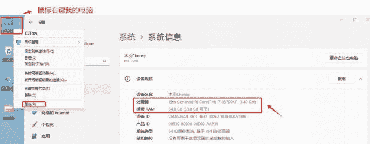

查看显卡等级。

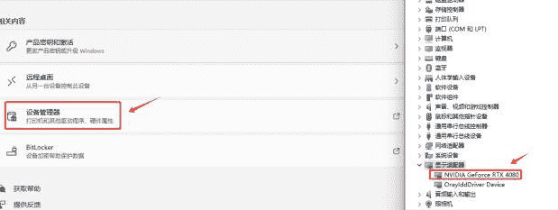

不同的显卡等级有不同的显存大小，可以根据显卡型号去查询显存的大小。同时也有一种更直接的查询方法，如下：

- Step 1. 同时按下Windows键和R键，在运行里面输入`dxdiag`

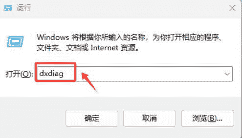

- Step 2. 若弹出一个DirectX诊断工具对话框，提示我们是否希望检查，点击是即可

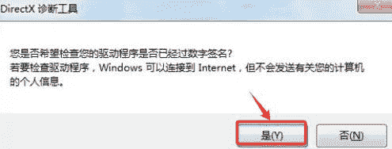

- Step 3. 通过弹出的DirectX诊断工具界面---显示标签中查看显存

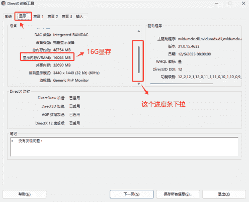

## 2. 安装NVIDIA显卡驱动

一般来说，台式机显卡需要2060（6G显存显卡）及以上显卡，笔记本则需要3060（8G显存显卡）及以上显卡。这里需要注意，同型号的显卡，移动端显卡（笔记本显卡）要比主机显卡（台式机显卡）性能要弱，显存也会更少。

如果你的电脑中出现这两种情况：


说明你的电脑上并没有安装NVIDIA的驱动，需要下载安装。如果有，可以跳过此章节。

- Step 1. 进入NVIDIA驱动官网：https://www.nvidia.cn/Download/index.aspx?lang=cn，根据自己电脑上的显卡型号、系统版本搜索最合适的显卡驱动。


系统会自动匹配最合适的显卡驱动，这里执行下载。

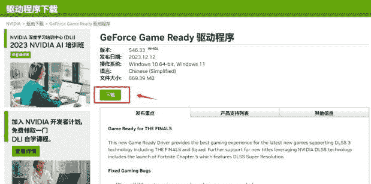

这里就会提示该驱动还会额外安装NVIDIA控制面板，选择“同意并开始下载”。


如果网络情况正常的话，这里会弹出下载的弹窗，选择需要保存下载文件的位置，等待下载完成。

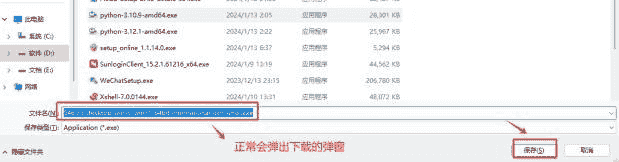

- Step 2. 安装NVIDIA驱动

下载完成后，找到驱动的`.exe`文件，执行傻瓜式安装。

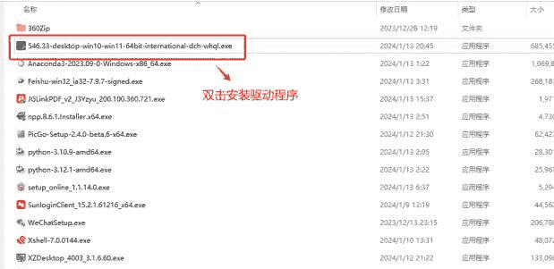

这里建议选择默认的路径，因为有些程序如果不在指定路径可能会发生意外错误，所以为了确保一次性安装成功，不进行更改是一个比较好的选择。

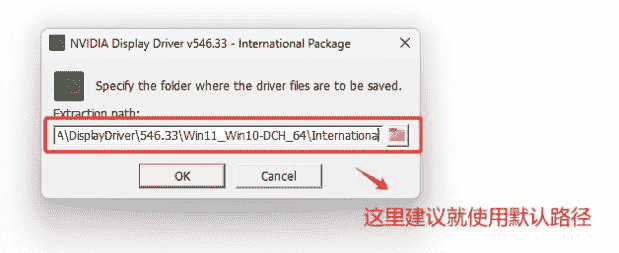

选择安装显卡驱动和GeForce Experience。

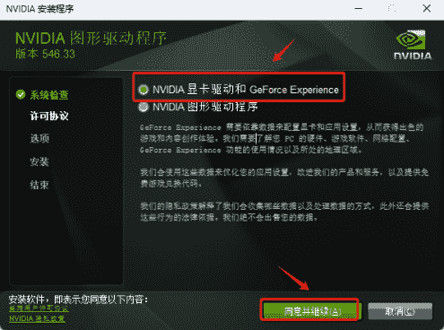

选择精简安装。

这个安装过程会有几次黑屏，属于正常现象。

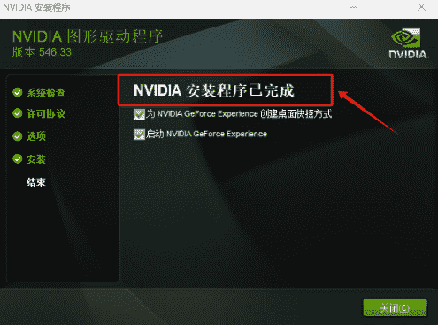

- Step 3. 验证NVIDIA驱动安装是否成功

安装完成后，需要重启电脑，才会生效。验证方法是：重启电脑后，在桌面点击鼠标右键，出现如下图标即可表明安装成功。

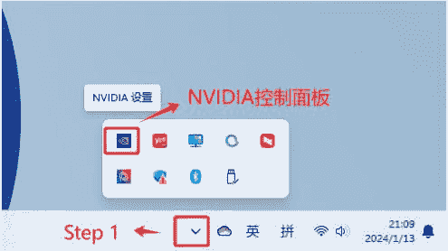

NVIDIA控制面板会显示显卡驱动和显卡的基础参数等，同时支持进行个性化设置。

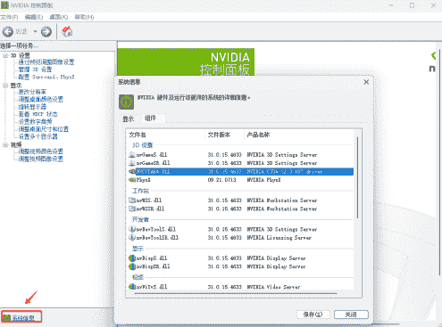

## 3. 本地部署ChatGLM3-6B模型

要部署和运行ChatGLM3-6B，我们需要下载两部分文件。第一部分是ChatGLM3-6B的项目文件，这包含ChatGLM3-6B模型的一些代码逻辑文件，官方提供了包括运行、微调等Demo，可以让我们快速启动ChatGLM3-6B模型服务。第二部分是ChatGLM3-6B模型的权重文件，直白点说就是ChatGLM3-6B这个模型本身。

首先我们来下载第一部分，ChatGLM3-6B模型的项目文件。这一部分代码库和相关文档存储在GitHub这个在线平台上。GitHub是一个代码托管平台，提供版本控制和协作功能。要下载其项目文件，需进入ChatGLM3-6B的GitHub官网：https://github.com/THUDM/ChatGLM3

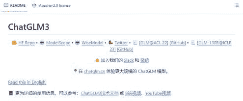

提供了两种下载方式：

- 方式一：克隆（Clone）是使用Git命令行的方式。可以克隆仓库到本地计算机，创建仓库的一个完整副本。好处是可以跟踪远程仓库的所有更改，并且可以提交自己的更改。
- 方式二：不需要使用Git，直接下载压缩包解压即可使用。适合对Git不熟悉的用户。

接下来我们对上述两种方式一一进行介绍。但强烈建议使用Git命令行的方式（方式一）进行项目管理。

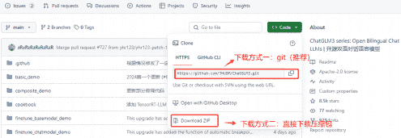

### 3.1 下载项目文件（二选一）

#### 3.1.1 方式一：使用Git工具下载（推荐）

ChatGLM3-6B模型的项目文件托管在GitHub上，而GitHub是基于Git的服务。GitHub作为一个代码托管服务，它托管使用Git来对项目做版本控制。如果要复制（克隆）一个GitHub仓库到本地计算机，需要使用`git clone`命令。这个命令是Git的一部分，而Windows操作系统默认不自带Git。因此，为了使用`git clone`或其他Git功能，需要先从Git的官方网站下载并安装Git。

- Step 1. 进入Git官网：https://git-scm.com/

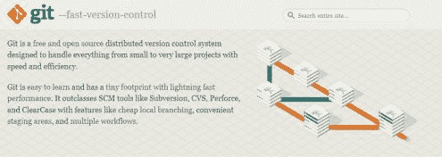

- Step 2. 下载Windows版本的Git安装程序

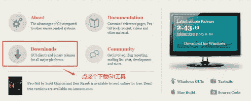

这里选择Windows版本进行下载。

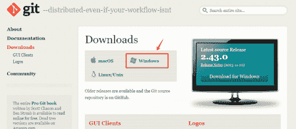

根据自己的Windows系统情况，选择32-bit或者64bit。

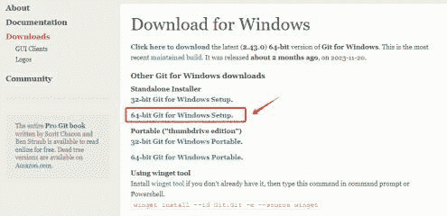

选择Git安装程序的存储路径。

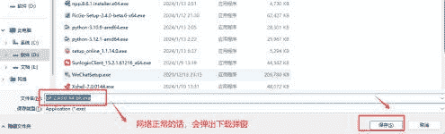

- Step 3. 安装Git

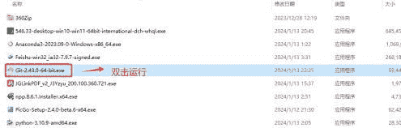

选择Next。

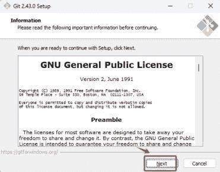

自行选择Git的安装位置。

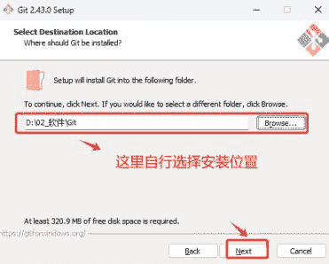

接下来的选项，全部默认，点击Next即可。不影响正常的使用。

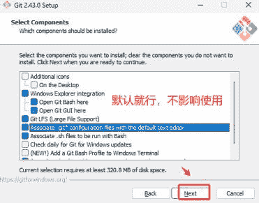

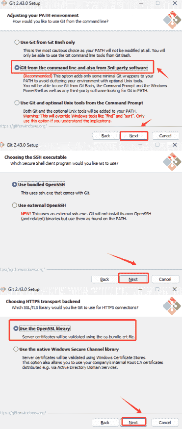

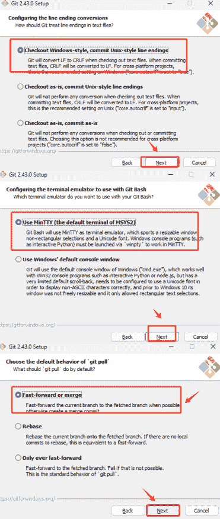

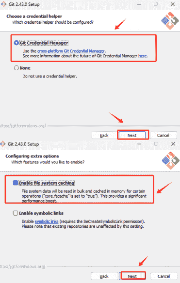

默认选择到这里，执行安装。

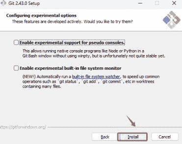

执行到此进度，说明安装已经完成。

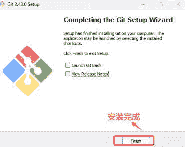

- Step 4. 验证Git安装是否成功

在桌面上鼠标右键，如能看到如下两个快捷方式，说明已经正常安装Git。

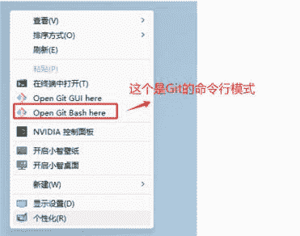

点击Git Bash后，进入命令行终端，可以输入`git --version`查看当前的Git版本。

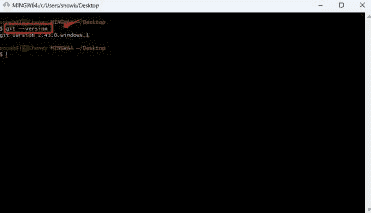

- Step 5. 使用Git安装ChatGLM3-6B模型的项目文件

安装好Git后，就可以使用`git clone`命令从GitHub上复制（克隆）ChatGLM3-6B的仓库到本地。这里我们需要先找到ChatGLM3-6B远程仓库的URL地址，查找方式如下：

ChatGLM3-6B的GitHub地址：https://github.com/THUDM/ChatGLM3

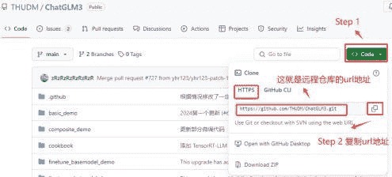

然后回到Git Bash的命令行终端，首先，通过`cd`命令进入到想存放ChatGLM3-6B模型项目文件的路径。我这里想存放的路径是`E:\03_LLM`。

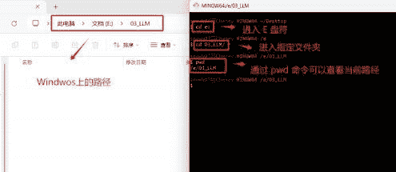

然后执行`git clone`命令，后面加上刚才复制的ChatGLM3-6B远程仓库URL。

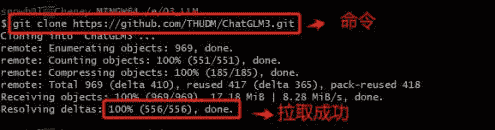

- Step 6. 验证ChatGLM3-6B项目文件是否拉取成功

执行完`git clone`操作后，会在指定的路径中生成`ChatGLM3`这个文件夹。


一些主要的项目文件说明如下。

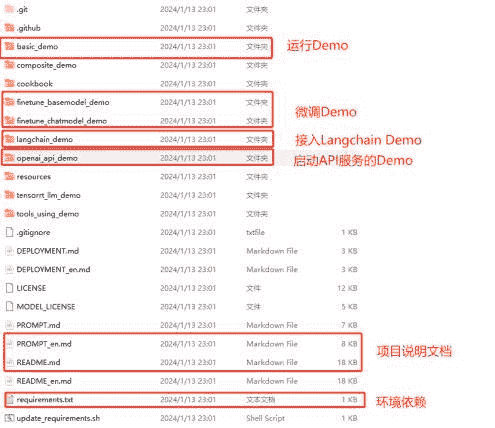

#### 3.1.2 方式二：直接打包下载

如果不想使用Git工具下载的方式，可以使用更加简单的直接打包下载ChatGLM3-6B模型项目文件的方式，具体执行方法如下：

ChatGLM3-6B的GitHub地址：https://github.com/THUDM/ChatGLM3。还是先进入ChatGLM3-6B的GitHub官网，选择直接下载ZIP压缩包。

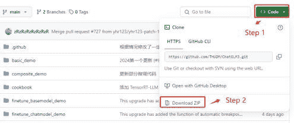

自行选择压缩包的本地存储路径。

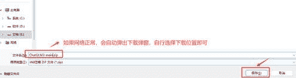

下载完成后，使用解压工具解压压缩包。

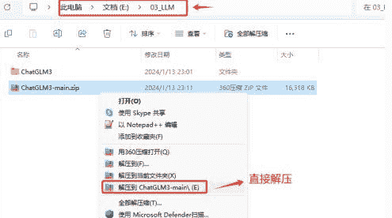

解压完成后，该文件夹中存放的就是ChatGLM3-6B模型的项目文件。

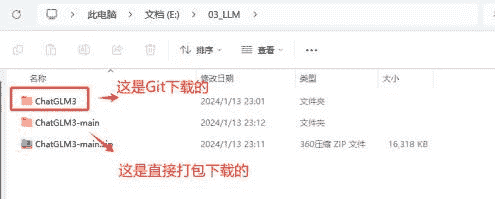

存放的文件和使用Git方式下载的文件是完全一致的。

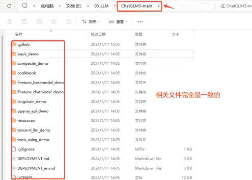

### 3.2 配置项目运行环境（二选一）

大家无论是通过`git clone`下载ChatGLM3-6B的项目文件方式，还是直接下载压缩包的方式，都需要使用安装该项目的依赖包。原因主要是：大多数Python项目依赖于特定的库或模块来正常运行。例如，一个网页爬虫可能依赖于`requests`库来发送网络请求，而数据分析项目可能依赖于`pandas`或`numpy`。这些依赖不会随着项目代码一起被包含在GitHub仓库中。所以我们下载的自然也不会包含这部分的内容。所以需要安装这个依赖环境。

#### 3.2.1 方式一：使用Anaconda创建项目依赖环境（推荐）

Anaconda是一个流行的开源Python发行版，用于科学计算。它包含了数据科学和机器学习领域中常用的一系列工具和库。其安装的方式也非常简单。具体安装过程如下：

- Step 1. 进入Anaconda3的官网：https://www.anaconda.com/


- Step 2. 下载Windows版本的Anaconda3

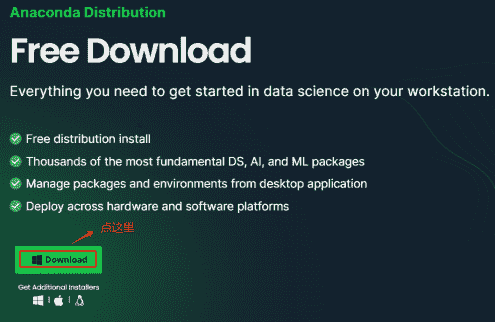

如果网络正常，会自动弹出下载弹窗，自行选择下载路径。

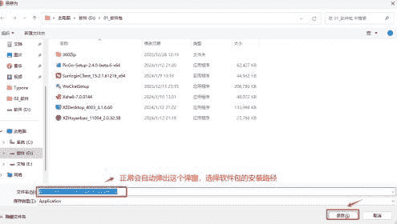

- Step 3. 安装Windows版本的Anaconda3

直接鼠标双击运行安装程序，执行傻瓜式安装。

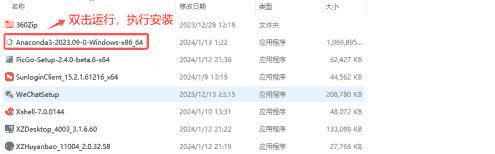

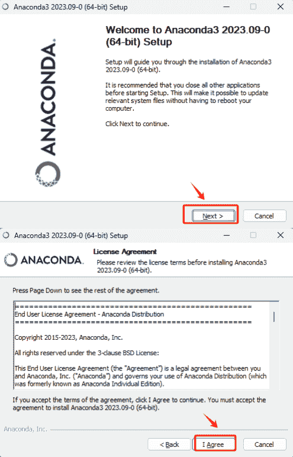

这里根据情况自行选择，选择哪一个都不会影响Windows当前用户的使用。

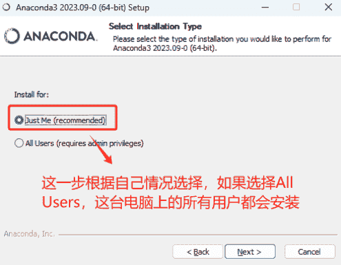

这个强烈不建议修改，如修改后可能会导致环境变量出现问题。

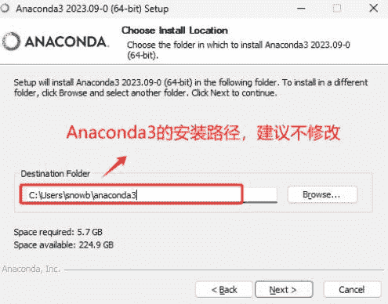

这里强烈建议勾选`Add Anaconda3 to my_path environment variable`，这会自动设置环境变量，否则还需要后续再手动设置。

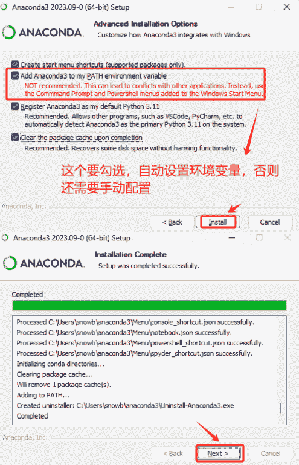

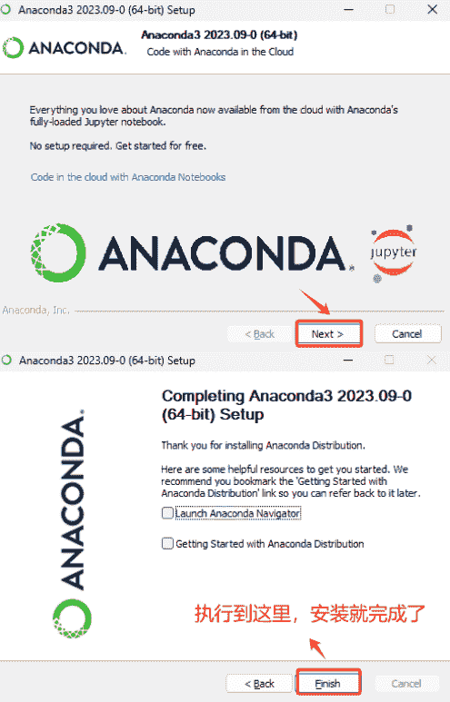

- Step 4. 启动Anaconda3进行验证


根据个人情况，自行选择是否需要升级到最新版本。

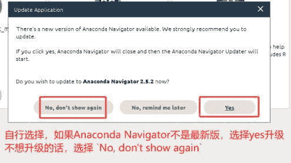

如果选择了升级的话，等待完成即可。

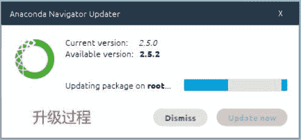

- Step 5. Anaconda3简要说明


Anaconda Navigator 是 `Anaconda` 发行版中的一个图形用户界面（GUI），提供了一个直观的界面，通过这个界面，用户可以管理不同的环境、安装和更新包，以及启动各种数据科学和机器学习工具，例如 `Jupyter Notebook`、`Spyder`、`RStudio` 等。此外，它还提供了对 `Anaconda Cloud` 和其他资源的访问，使得分享工作和发现其他人的工作变得更加容易。`Navigator` 适合那些不习惯使用命令行界面的用户。其中比较关键的应用程序已经做了标注：

1. `Anaconda CMD.exe Prompt`：一个基于 `Windows` 命令行界面的工具，它预配置了 `Anaconda` 发行版的环境变量。使用 `Anaconda Prompt`，可以执行各种与 `Anaconda` 相关的命令，例如创建和管理 `Conda` 环境、安装、更新和卸载包等。这是一个非常强大的工具，特别是对于那些熟悉命令行操作的用户。

2. `Powershell Prompt`：类似于 `Anaconda CMD.exe Prompt`，`Powershell Prompt` 是另一种命令行界面，但它基于 `Windows` 的 `PowerShell`。`PowerShell` 是一种跨平台的任务自动化解决方案，包含命令行壳、脚本语言和配置管理框架。`Anaconda` 的 `Powershell Prompt` 也被配置为可以直接执行与 `Anaconda` 和 `Conda` 相关的操作。

3. `PyCharm`：一个流行的 `Python` 集成开发环境（IDE），由 `JetBrains` 开发。它提供了代码完成、调试、测试、版本控制等多种功能，非常适合 `Python` 项目的开发。

4. `Jupyter Lab`：它是 `Jupyter Notebook` 的下一代界面，提供了一个灵活和强大的工具集，用于交互式数据科学和科学计算。`Jupyter Lab` 不仅包括了 `Jupyter Notebook` 的所有功能，还增加了许多新特性，如更灵活的窗口布局、更好的编辑器、实时预览、终端、文件浏览器等。它支持多种类型的文档和活动，包括文本编辑器、`Jupyter` 笔记本、数据视图等，是一个更为综合的数据科学工作环境。

5. `Jupyter Notebook`：它是一个开源的 `Web` 应用程序，允许创建和共享包含实时代码、方程、可视化和叙述文本的文档。它广泛用于数据清洗和转换、数值模拟、统计建模、数据可视化、机器学习等领域。`Jupyter Notebook` 支持超过 40 种编程语言，包括 `Python`、`R`、`Julia` 和 `Scala`。它是一个非常流行的工具，特别是在数据科学和学术研究中。


## Step 6. 验证 `conda`

在 `Anaconda` 环境中，`conda` 是一个开源的包管理器和环境管理器，用于安装、运行和升级包和环境。验证方式如下：


点击后，会进入如下命令行终端，输入 `conda --version` 查看 `conda` 版本。


该命令生效的原因，是因为我们在安装 `Anaconda3` 的过程中，自动添加了 `conda` 的环境变量。


## Step 7. 升级 `conda` 到最新版本

强烈建议将 `conda` 升级到最新版本，主要原因是最新版本的 `conda` 更有可能与其他最新的软件和库兼容。比如对最新版本的 `Python` 的支持，以及与最新发布的包的兼容性，会在解析和冲突处理方面变得更加精确和高效。升级非常简单，执行如下命令：

```
# 首先更新conda工具
```

在 `Anaconda Navigator` 中进入命令行终端。


在命令行终端先更新 `conda` 工具


在更新各依赖包。


## Step 8. 使用 `conda` 创建虚拟环境

使用 `conda` 安装项目依赖时，最好先创建一个虚拟环境，可以将项目的依赖与系统中的其他 `Python` 项目隔离开来。不同的 `Python` 项目可能需要同一库的不同版本。在虚拟环境中工作可以防止版本冲突。

在 `Conda` 中创建虚拟环境的步骤相对简单。以下是创建虚拟环境的基本步骤：

首先，使用以下命令创建一个新的虚拟环境，其中 `myenv` 是给环境起的名字，`python=3.11` 指定了 `Python` 的版本（大家可以根据需要选择不同的版本），如果你不指定 `Python` 版本，`Conda` 将使用默认的 `Python` 版本创建环境。

```
# 大模型运行环境，要求python 3.10 版本以上
```


创建环境后，需要激活它才能开始使用。在 `Windows` 上，使用：

```
conda activate windwos_chatglm3-6b
```


一旦虚拟环境被激活，就可以开始安装所需的包了。

但需要注意：如果关闭终端，会退出该虚拟环境，此时可以通过这种方式重新进入：


## Step 9. 使用 `pip` 安装 `ChatGLM3-6B` 项目的所有依赖包

一个项目一般都会提供一个 `requirements.txt` 文件，用于列出项目所需的所有 `Python` 包及其确切版本。我们看一下：


其文件内容如下：


`Conda` 是一个强大的包管理器，尤其适合于处理复杂的科学计算包和环境，但它并不总是包含 `Python` 生态系统中的所有包。在某些情况下，特定的 `Python` 包可能只在 `pip` 的 `PyPI` 仓库中可用，而不在 `Conda` 的渠道中。进入虚拟环境后使用 `pip` 安装 `requirements.txt` 中的依赖包是常见的做法。所以我们这里使用如下命令安装所有依赖项，而不是逐个手动安装，大大简化设置依赖包安装过程。

```
# 使用 -i + 清华镜像源 ，加速安装
```


## Step 10. 查看当前 `NVIDIA` 显卡驱动最高支持的 `CUDA` 版本

在安装好 `Python` 的依赖环境后，接下来就需要安装 GPU 版本的 `PyTorch`。`PyTorch` 是通用的深度学习框架，`ChatGLM3-6B` 运行过程需要借助 `PyTorch` 来完成相关计算。需要根据 `CUDA` 版本选择 `Pytorch` 框架，在 `Windows` 操作系统上查看当前的 `CUDA` 版本方式如下：


如果 `nvidia-smi` 命令无法执行，请回到 2.安装显卡驱动步骤仔细检查安装过程。

## Step 11. 根据 `CUDA` 版本要求安装 `PyTorch`

[PyTorch 官网历史版本下载页面](https://pytorch.org/get-started/previous-versions/)

这里根据自己电脑显卡驱动的 `CUDA` 版本要求，在 `PyTorch` 官网中找到适合自己的 `PyTorch` 安装命令。


复制安装命令，进入虚拟环境的终端中执行安装。注意：这个终端并不是查看 `nvidia-smi` 的 `Windows` 终端，而是我们创建虚拟环境的 `conda` 终端。


## Step 12. 验证安装 GPU 版 `PyTorch` 是否成功

待安装完成后，如果想要检查是否成功安装了 GPU 版本的 `PyTorch`，可以通过几个简单的步骤在 `Python` 环境中进行验证：

```
import torch
```


如果输出是 `True`，则表示 GPU 版本的 `PyTorch` 已经安装成功并且可以使用 `CUDA`，如果输出是 `False`，则表明没有安装 GPU 版本的 `PyTorch`，或者 `CUDA` 环境没有正确配置，此时根据教程，重新检查自己的执行过程。

### 3.2.2 方式二：直接使用 `Python` 创建项目依赖环境

如果不想要使用 `Anaconda3` 来管理虚拟环境，可以直接在 `Windows` 系统上安装指定版本的 `Python` 包，然后再使用该版本的 `Python` 来创建虚拟环境。操作过程如下：

#### Step 1. 进入 `Python` 官网下载指定版本的 `Python` 包

[Python 官网](https://www.python.org/)


自行选择 `Python` 版本，运行大模型环境，需要 `Python` 3.10 版本及以上。我这里选择 `Python` 3.10.9 的 `Windows` 64 位安装。


如果网络正常，会自动弹出下载弹窗，自行选择安装程序的存储路径。


#### Step 2. 下载完成后，执行傻瓜式安装


注意：这里勾选 `Add python.exe to PATH`，这会在安装过程中将 `Python` 环境设置好环境变量，否则还需要手动设置。


#### Step 3. 安装完成后，验证是否安装成功

能正确输出安装的 `Python` 版本，说明安装正常。


#### Step 4. 升级 `pip` 到最新版本

`pip` 是 `Python` 的官方包管理工具，用于安装和管理 `Python` 包。它允许用户从 `Python` 包索引（`PyPI`）中安装、升级和删除包。在创建新的虚拟环境前建议升级 `pip`，新版本的 `pip` 会提供更好的安装性能，更准确的依赖项解析。升级命令如下：

```
pip install --upgrade pip
```


#### Step 5. 使用 `pip` 创建虚拟环境

使用 `pip` 安装项目依赖时，最好先创建一个虚拟环境，可以将项目的依赖与系统中的其他 `Python` 项目隔离开来。不同的 `Python` 项目可能需要同一库的不同版本。在虚拟环境中工作可以防止版本冲突。创建虚拟环境的步骤相对简单。以下是创建虚拟环境的基本步骤：

打开命令行或终端，然后输入以下命令。这里假设你想要创建的虚拟环境名为 `myenv`。

```
# 可以指定路径
```


创建环境后，需要激活它才能开始使用。在 `Windows` 上，使用：

```
# 这里要修改成大家实际的路径
```


一旦虚拟环境被激活，就可以开始安装所需的包了。

#### Step 6. 使用 `pip` 安装 `ChatGLM3-6B` 项目的所有依赖包

一个项目一般都会提供一个 `requirements.txt` 文件，用于列出项目所需的所有 `Python` 包及其确切版本。我们看一下：


其文件内容如下：


进入虚拟环境后使用 `pip` 安装 `requirements.txt` 中的依赖包是常见的做法。所以我们这里使用如下命令安装所有依赖项，而不是逐个手动安装，大大简化设置依赖包安装过程。

```
# 使用 -i + 清华镜像源 ，加速安装
```


#### Step 7. 查看当前 `NVIDIA` 显卡驱动最高支持的 `CUDA` 版本

在安装好 `Python` 的依赖环境后，接下来就需要安装 GPU 版本的 `PyTorch`。`PyTorch` 是通用的深度学习框架，`ChatGLM3-6B` 运行过程需要借助 `PyTorch` 来完成相关计算。需要根据 `CUDA` 版本选择 `Pytorch` 框架，在 `Windows` 操作系统上查看当前的 `CUDA` 版本方式如下：


如果 `nvidia-smi` 命令无法执行，请回到 2.安装显卡驱动步骤仔细检查安装过程。

#### Step 8. 根据 `CUDA` 版本要求安装 `PyTorch`

[PyTorch 官网历史版本下载页面](https://pytorch.org/get-started/previous-versions/)

这里根据自己电脑显卡驱动的 `CUDA` 版本要求，在 `PyTorch` 官网中找到适合自己的 `PyTorch` 安装命令。


复制安装命令，进入虚拟环境的终端中执行安装。注意：这个终端并不是查看 `nvidia-smi` 的 `Windows` 终端，而是我们创建虚拟环境的 `conda` 终端。


#### Step 9. 验证安装 GPU 版 `PyTorch` 是否成功

待安装完成后，如果想要检查是否成功安装了 GPU 版本的 `PyTorch`，可以通过几个简单的步骤在 `Python` 环境中进行验证：

```
import torch
```


如果输出是 `True`，则表示 GPU 版本的 `PyTorch` 已经安装成功并且可以使用 `CUDA`，如果输出是 `False`，则表明没有安装 GPU 版本的 `PyTorch`，或者 `CUDA` 环境没有正确配置，此时根据教程，重新检查自己的执行过程。

### 3.3.3 如何管理多个不同版本的 `Python` 环境？

对于 [直接使用 `Python`](https://www.python.org/) 直接创建虚拟环境的这种方式（3.2.2 方式二：直接使用 `Python` 创建项目依赖环境），如果需要切换 `python` 版本，则只能重新下载不同版本的 `Python` 的包，重复执行上述操作。比如我们上述安装的是 `Python` 3.10.9，如果另外一个项目需要使用 `Python` 3.12 版本，则需要重新进入 https://www.python.org/ 官网中下载。


找到 `Python` 程序的安装位置。


所有 `Python` 版本的环境变量都在这里定义。


如果想通过不同的指令，启动不同版本的 `Python`，可以在系统的环境变量中找到指定版本的 `Python` 存放位置。


默认所有版本的 `python` 执行文件都是 `python.exe`，可以进入指定文件夹中看到。


如果想区分不同版本 `Python`，并在终端可以使用，可以通过如下方式添加版本编号。


启动验证。


通过这种方式来灵活的管理一台机器上的多个 `Python` 环境。

## 3.3 下载模型权重文件（三选一）

经过 3.1 下载项目权重文件和 3.2 配置项目运行环境两步操作后，的操作过程，我们下载到的只是 `ChatGLM3-6B` 的一些运行文件和项目代码，并不包含 `ChatGLM3-6B` 这个模型。这里我们需要进入到 `Hugging Face` 下载。最后一步需要把 `ChatGLM3-6B` 这个模型本身下载到本地。这里提供三种下载的方式，大家根据自身的实际情况灵活选择。

+ 方式一：借助 `Git` 工具在 `Hugging Face` 官网拉取到本地。这种方式需要🪜。


接下来依次介绍三种下载方式。

### 3.1 方式一：从 `Hugging Face` 官网下载（需要🪜环境）


### 3.1 方式一：从Hugging Face官网下载

Hugging Face 是一个丰富的模型库，开发者可以上传和共享他们训练好的机器学习模型。这些模型通常是经过大量数据训练的，并且很大，因此需要特殊的存储和托管服务。不同于GitHub，GitHub 仅仅是一个代码托管和版本控制平台，托管的是项目的源代码、文档和其他相关文件。同时对于托管文件的大小有限制，不适合存储大型文件，如训练好的机器学习模型。相反，Hugging Face 专门为此类大型文件设计，提供了更适合大型模型的存储和传输解决方案。

**Step 1.** 进入[Hugging Face官网](https://huggingface.co/THUDM/chatglm3-6b)：`https://huggingface.co/THUDM/chatglm3-6b`


需要执行两个操作，第一步是初始化`git lfs`工具，第二步是下载模型权重文件。


**Step 2.** 初始化`git lfs`工具

`Git Large File Storage`（`Git LFS`）是一种用于处理大文件的工具，在Hugging Face下载大模型时，通常需要安装`Git LFS`，主要的原因是：`Git`本身并不擅长处理大型文件，因为在`Git`中，每次我们提交一个文件，它的完整内容都会被保存在`Git`仓库的历史记录中。但对于非常大的文件，这种方式会导致仓库变得庞大而且低效。而`Git LFS`，就不会直接将它们的内容存储在仓库中。相反，它存储了一个轻量级的“指针”文件，它本身非常小，它包含了关于大型文件的信息（如其在服务器上的位置），但不包含文件的实际内容。

当我们需要访问或下载这个大型文件时，`Git LFS`会根据这个指针去下载真正的文件内容。所以如果不安装`Git LFS`而直接从Hugging Face或其他支持`LFS`的仓库下载大型文件，通常只会下载到一个包含指向实际文件的指针的小文件，而不是文件本身。


**Step 3.** 开始下载`ChatGLM3-6B`的模型权重文件


**Step 4.** 安装完成后，会在本地生成如下目录，这个过程会比较慢，因为文件非常大


**Step 5.** 验证下载文件


### 3.2 方式二：从魔搭社区官网下载（国内镜像）

魔搭社区（`ModelScope`）是一个汇集了各类模态上工业级领先的模型和丰富的数据集的开源平台。它为泛`AI`开发者提供灵活、易用、低成本的一站式模型服务产品。在魔搭社区中，开发者可以发现、学习、定制和分享心仪的模型。社区还发布了各种模型的最新进展、实践、微调、评测等内容，使模型应用变得更加简单。特别适合于需要大量不同类型模型的`AI`开发者，它提供了一个共建模型开源社区的环境，让开发者能够在一个平台上探索体验、推理、训练、部署和应用多种模型。此外，社区上已经承载了来自各个机构贡献的不同系列的模型，并且社区的开发者也在这些模型的基础上，贡献了许多创新应用。

**Step 1.** 进入魔搭社区的官网：`https://modelscope.cn/models/ZhipuAI/chatglm3-6b/summary`


提供了两种下载方式，且提供了明确的代码。建议还是使用`git`的方式下载。


**Step 2.** 初始化`git lfs`工具

`Git Large File Storage`（`Git LFS`）是一种用于处理大文件的工具，在Hugging Face下载大模型时，通常需要安装`Git LFS`，主要的原因是：`Git`本身并不擅长处理大型文件，因为在`Git`中，每次我们提交一个文件，它的完整内容都会被保存在`Git`仓库的历史记录中。但对于非常大的文件，这种方式会导致仓库变得庞大而且低效。而`Git LFS`，就不会直接将它们的内容存储在仓库中。相反，它存储了一个轻量级的“指针”文件，它本身非常小，它包含了关于大型文件的信息（如其在服务器上的位置），但不包含文件的实际内容。当我们需要访问或下载这个大型文件时，`Git LFS`会根据这个指针去下载真正的文件内容。所以如果不安装`Git LFS`而直接从Hugging Face或其他支持`LFS`的仓库下载大型文件，通常只会下载到一个包含指向实际文件的指针的小文件，而不是文件本身。


**Step 3.** 开始下载`ChatGLM3-6B`的模型权重文件


**Step 4.** 安装完成后，会在本地生成如下目录，这个过程会比较慢，因为文件非常大


**Step 5.** 验证下载文件


### 3.3 方式三：三种直接下载模型的方式

如果上述两种方式都无法下载`ChatGLM3-6B`模型的权重文件，可以使用如下三种最简单粗暴的方式，下载全部文件后，新建`chatglm3-6b`文件夹统一存放。

+ **方式一**：从[Hugging Face](https://huggingface.co/THUDM/chatglm3-6b)直接下载（仍然需要🪜）：`https://huggingface.co/THUDM/chatglm3-6b`


手动一个一个下载，直至下载完全部文件。


+ **方式二**：从[modelscope](https://modelscope.cn/models/ZhipuAI/)直接下载（不需要🪜）：`https://modelscope.cn/models/ZhipuAI/chatglm3-6b/summary`


需要点击具体的文件，进去后才会出现下载链接。


点击下载按钮即可下载。


+ **方式三**：从我们提供的百度网盘中下载：`https://pan.baidu.com/s/15sRruaOuzpyY-k_O8i3aLA?pwd=q88n`


# 4. 启动`ChatGLM3-6B`模型服务

`ChatGLM3`还提供了一些简单应用`demo`，供开发者尝试运行。这里我们由简到难依次对其进行介绍。

## 4.1 基于命令行的交互式对话

首先是基于命令行的模型调用与对话方法。该应用旨在为非技术用户提供一个脱离代码环境的对话方式。我们可以通过运行`cli_demo.py`脚本，来启动该应用。脚本位置同样也在`ChatGLM3`安装文件主目录下：


使用文件编辑器，编辑`cli_demo.py`文件，我这里使用的是`Notepad++`。


修改完成后，在终端启动该服务。


可以正常对话，说明服务运行成功。输入`stop`则可退出交互对话。如果初次启动出现如下报错：

`ImportError: cannot import name 'COMMON_SAFE_ASCII_CHARACTERS' from`

该报错说明`Python`无法从`charset_normalizer`包的`constant`模块中导入名为`COMMON_SAFE_ASCII_CHARACTERS`的项。我们需要执行如下操作：

```
pip uninstall charset_normalizer
pip install charset_normalizer
```

卸载后重新安装，即可解决该报错问题。

## 4.2 基于`Gradio`的Web端对话应用

接下来则是两个基于网页端的对话应用`demo`，基于网页端的对话也是目前非常通用的大语言交互方式，`ChatGLM3`官方项目组提供了两种Web端对话`demo`，两个示例应用功能一致，只是采用了不同的Web框架进行开发。首先先介绍基于`Gradio`的Web端对话应用`demo`。

`Gradio`是一个`Python`库，用于快速创建用于演示机器学习模型的Web界面。开发者可以用几行代码为模型创建输入和输出接口，用户可以通过这些接口与模型进行交互。这使得非技术用户可以轻松地测试和使用机器学习模型，比如通过上传图片来测试图像识别模型，或者输入文本来测试自然语言处理模型。`Gradio`非常适合于快速原型设计和模型展示。

基于`Gradio`的Web端对话应用`demo`运行脚本为`web_demo.py`，同样也是位于`ChatGLM3`文件主目录内：


使用文件编辑器，编辑`web_demo_gradio.py`文件，我这里使用的是`Notepad++`。


然后回到终端，执行启动命令。


顺利运行之后，即可在`http://127.0.0.1:8501/`进行对话，当然，也可以通过修改`web_demo.py`文件，来修改端口或设置是否允许公开链接进行访问。

需要注意的是，在运行web demo时最好关闭代理工具，否则可能会出现无法正常响应的问题。

## 4.3 基于`Streamlit`的Web端对话应用

`ChatGLM3`官方项目组提供的第二个Web对话应用`demo`，则是一个基于`Streamlit`的Web应用。

`Streamlit`是另一个用于创建数据科学和机器学习Web应用的`Python`库。它强调简单性和快速的开发流程，让开发者能够通过编写普通的`Python`脚本来创建互动式Web应用。`Streamlit`自动管理UI布局和状态，这样开发者就可以专注于数据和模型的逻辑。`Streamlit`应用通常用于数据分析、可视化、构建探索性数据分析工具等场景。

我们可以通过运行`web_demo_streamlit.py`来启动该对话应用。`web_demo_streamlit.py`也同样位于`ChatGLM3`文件主目录内：


使用文件编辑器，编辑`web_demo_streamlit.py`文件，我这里使用的是`Notepad++`。


然后回到终端，执行启动命令。


顺利运行之后，即可在`http://127.0.0.1:8501/`进行对话。在命令行中输入`CTRL+c`之后即可停止运行。需要注意的是，在运行web demo时最好关闭代理工具，否则可能会出现无法正常响应的问题。

## 4.4 使用`OpenAI`风格`API`调用`ChatGLM3-6B`（重点）

除了上述调用流程外，`ChatGLM3-6B`模型还提供了`OpenAI`风格的`API`调用方法。正如前面所说，在`OpenAI`几乎定义了整个前沿`AI`应用开发标准的当下，提供一个`OpenAI`风格的`API`调用方法，无疑可以让`ChatGLM3`模型无缝接入`OpenAI`开发生态。


所谓的`OpenAI`风格的`API`调用，指的是借助`OpenAI`库中的`ChatCompletion`函数进行`ChatGLM3`模型调用。需要知道的是，该函数原本是`OpenAI`为调用`gpt`系列模型而准备的函数。例如一次`gpt-3.5`的调用过程入下：

`import os`

而现在，我们只需要在`model`参数上输入`chatglm3-6b`，即可调用`ChatGLM3`模型。调用`API`风格的统一，无疑也将大幅提高开发效率。具体的执行过程如下：

**Step 1.** 首先启动`ChatGLM3-6B`的`API`服务

启动`API`服务需要运行`openai_api.py`这个脚本。该脚本位于`ChatGLM3`安装文件内。


使用文件编辑器，编辑`openai_api.py`文件，我这里使用的是`Notepad++`。


然后回到终端，执行启动命令。


顺利运行之后，即可通过代码调用其`API`服务。

**Step 2.** 打开可以执行`Python`代码的编辑器

大家根据个人使用习惯，自行选择`Python IDE`（集成环境）。我这里使用`Jupyter Lab`进行演示。


`Jupyter Lab`启动后，会进入默认的工作目录。


**如需修改`Anaconda`中`JupyterLab`的默认工作目录，请按照如下操作步骤执行：**


在终端输入`jupyter lab --generate-config`。


找到上述命令生成的这个配置文件。


修改工作目录的路径。


这里注意要使用双斜杠（`\\`）。


保存好修改后，再次启动`Jupyter Lab`即可加载新的工作路径。


**Step 3.** 新建一个`NoteBook`


**Step 3.** 安装`openai`库

要执行`OpenAI`风格的`API`调用，则首先需要安装`openai`库。`openai`库是一个公开的库，安装过程并不需要使用魔法，国内网络也可进行安装，这里直接使用`pip`方法进行安装即可：具体执行流程如下：

`OpenAI`目前已将`openai`库更新至`1.x`，但目前`Chatglm3-6B`仍需要使用旧版本`0.28`。所以需要确保当前环境的`openai`版本。


安装完成后，重启一下`kernel`使其生效。


验证一下`openai`的包版本。


**Step 4.** 调用`ChatGLM3-6B`模型

输入如下代码：

`import openai`


**Step 5.** 关闭`API`调用服务

若要终止`openai_api.py`脚本，则需要回到`Anaconda prompt`中，按住`CTRL+c`，则可以终止进程。需要注意的是，当脚本停止运行之后，就无法在`Jupyter Lab`中调用`OpenAI`风格的`API`了。

至此，本期内容已经详尽地介绍了在`Windows`操作系统上启动和部署`ChatGLM3-6B`模型的所有技术细节。现在，大家可以进一步体验`ChatGLM3-6B`模型的强大功能，并探索其在大模型应用领域的众多热门应用开发，带来更丰富的创新可能性和实践经验。


🍻现开设了大**模型学习交流群，**扫描下👇码，来遇见更多志同道合的小伙伴~


海量硬核独家技术**干货内容**+无门槛**技术交流**+不定期开设**硬核干货&前沿技术公开课**，**扫码**👆即刻入群！
