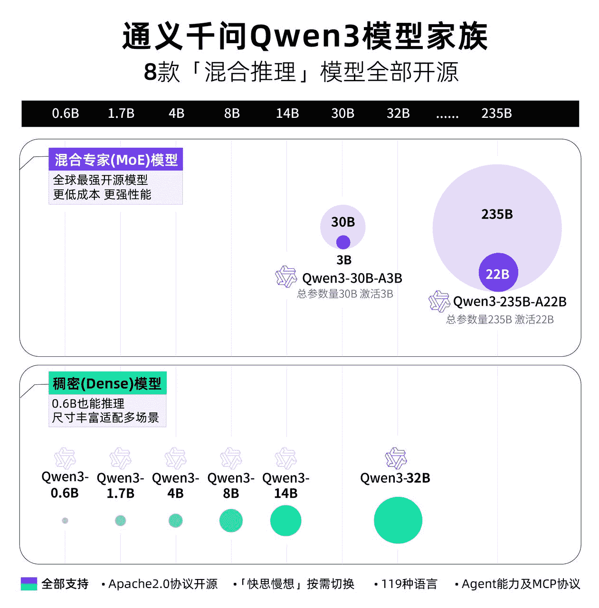
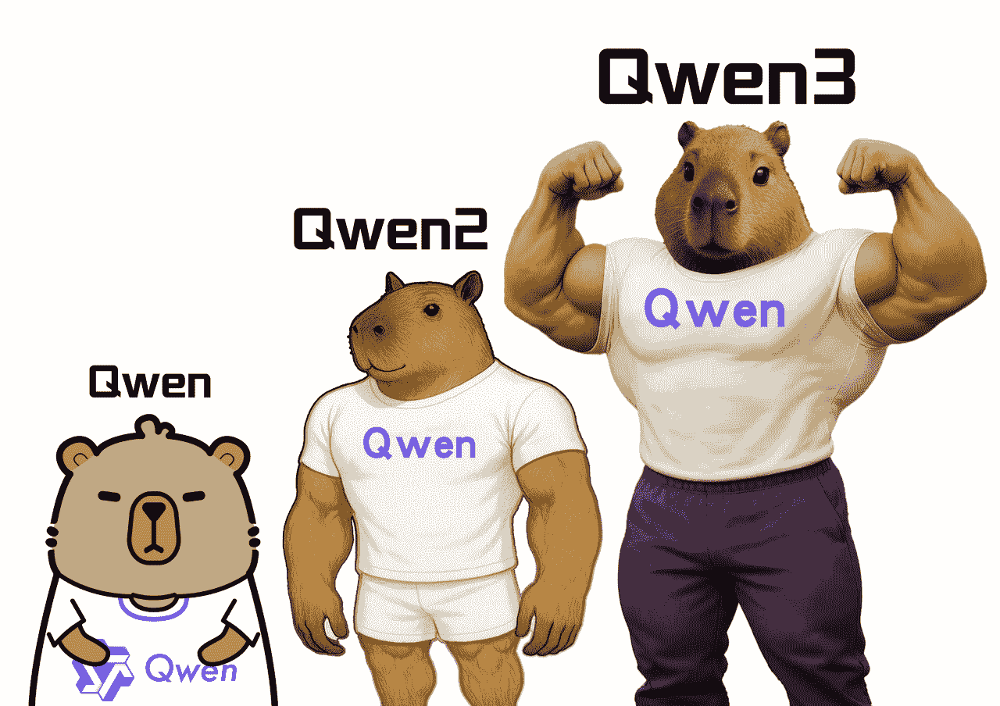
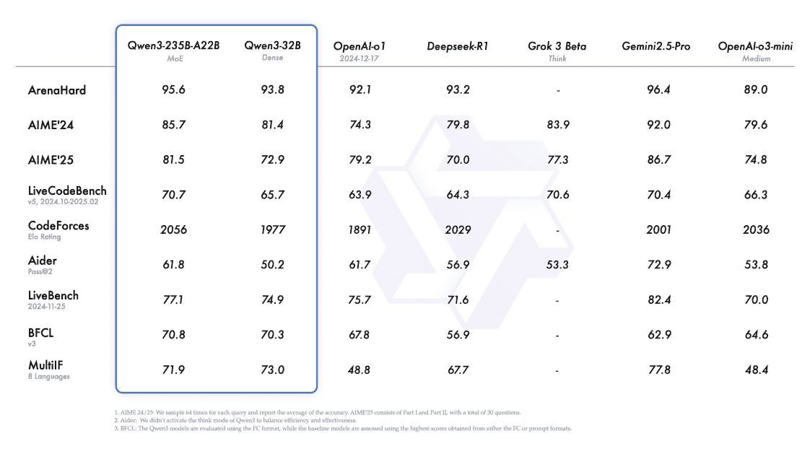
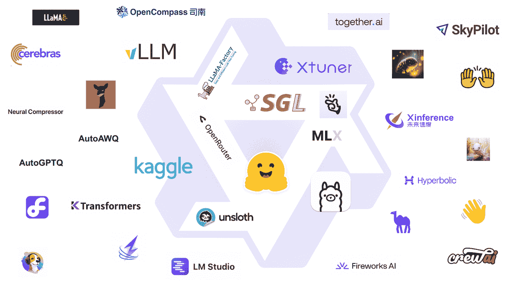

# Qwen3（README）

> 来源：[https://kq4b3vgg5b.feishu.cn/docx/KOCfdNWCCotdEkx6li5cOqJ6nbg](https://kq4b3vgg5b.feishu.cn/docx/KOCfdNWCCotdEkx6li5cOqJ6nbg)

# 模型介绍

4**月29日凌晨，阿里巴巴**开源新一代通义千问模型Qwen3 (简称千问3），性能全面超越R1、OpenAI-o1等领先模型，并登顶全球最强开源模型。

千问3是**国内首个“混合推理模型”**，对简单需求可低算力“秒回”答案，对复杂问题可像科学家一样“深度思考”，智能水平大幅提升的同时也更省算力，旗舰版千问3模型仅需4张H20就能实现本地部署，同等性能部署成本大幅度降低。

此次阿里通义共开源8款不同尺寸的千问3模型，均采用宽松型Apache2.0协议开源。千问3支持119种语言，提供多种Agent功能并兼容MCP协议，所有人都可免费在魔搭社区下载模型和商用，也可在通义APP上直接体验千问3；此外，还可通过阿里云百炼调用API服务，阿里AI旗舰应用夸克也即将接入千问3。

> **Qwen3模型家族**：

> 本次开源的千问3系列共包含8个不同尺寸的模型：

+   6款Dense模型：0.6B、1.7B、4B、8B、14B、32B

+   2款MoE模型：Qwen3-30B-A3B和旗舰版 Qwen3-235B-A22B，参数仅为同等性能模型的三分之一

> 旗舰版 Qwen3-235B-A22B：总参数量 235B，激活参数仅 22B。

> **Qwen3-30B-A3B：**总参数量 30B，激活参数仅 3B，整体性能堪比Qwen2.5-32B，实现10倍以上性能杠杆提升，适用于消费级别显卡部署

> **Qwen3-0.6B：**小尺寸适合在手机等端侧部署

## Qwen3性能表现

每款千问3模型均斩获**同尺寸开源模型SOTA**（最佳性能），可适配不同行业、场景和应用需求。

**Qwen3-235B-A22B创**下所有国产模型及全球开源模型的性能新高， 在奥数水平的AIME25测评中，千问3斩获81.5分，刷新开源纪录；在考察代码能力的LiveCodeBench评测中，千问3突破70分大关，表现甚至超过Grok3；在评估模型人类偏好对齐的ArenaHard测评中，千问3以95.6分超越OpenAI-o1及DeepSeek-R1。

## 工具调用与Agent支持

千问3为即将到来的智能体Agent和大模型应用爆发提供了多样选择。在专门评估模型Agent能力的BFCL评测中，千问3刷新开源模型纪录

同时，[千问3原生支持MCP协议，并具备](https://github.com/QwenLM/Qwen-Agent)强大的工具调用（function calling）能力，结合封装了工具调用模板和工具调用解析器的Qwen-Agent 框架，将大大降低编码复杂性，Qwen3 的工具调用能力，支持实现高效的手机及电脑Agent操作等任务。（https://github.com/QwenLM/Qwen-Agent）

# 快速阅览

我们团队在文档不同的位置进行了详细的介绍，您可以点击进入并查看具体的技术文档。

### ☑️** **实际评测

⭐️  Qwen3系列模型配置硬件参考自查表（课件）

⭐️  [Qwen-3深度解析！仅需1/3硬件成本，](https://kq4b3vgg5b.feishu.cn/wiki/B5QVwYf7ti5ePKke3zwcqbnJnxh?from=from_copylink)性能超越DeepSeek-R1！（课件）

+   [Qwen-3深度解析！硬件配置、原](https://www.bilibili.com/video/BV1fGGyzKEJf)生MCP功能介绍、模型选择详解！（视频）

⭐️ Qwen3 Coder模型API调用指南

⭐️ Qwen3 Coder编程【提示词模板】

+   [Q](https://www.bilibili.com/video/BV1rY8wzYEuf)wen3 Code使用指南与性能评测！Qwen3 Coder模型性能解读，Qwen3 Code编程智能体上手实测！（视频）

### **☑️ **部署调用

⭐️[Q](https://kq4b3vgg5b.feishu.cn/wiki/T5NZwZyZViK61DkYUSdcznYlnfc?from=from_copylink)wen-3部署与调用详解丨模型详解、transformer原生库调用流程、Qwen3-14B模型接入Ollama（课件）

⭐️[Q](https://kq4b3vgg5b.feishu.cn/wiki/JK2Aw80cPikVLLkcY1Kcn9t5nTg?from=from_copylink)wen-3部署与调用详解丨Qwen3模型接入vLLM、OpenWeb-UI，借助llama.cpp运行Qwen3模型（课件）

+   [Qwen3硬件配置、模型选择与本地部署完全指南，全](https://www.bilibili.com/video/BV1qVG9z4ELJ)面支持MCP，思考模式自由切换！（视频）

### **☑️ **进阶之路

**1、自由控制思考模式**

⭐️自由控制Qwen3模型的思考模式（课件）

+   [彻](https://www.bilibili.com/video/BV1KdGazEEZf)底控制Qwen3思考过程！Ollama、vLLM、SGLang、LMStudio、Ktransformers开启&关闭思考流程详解！（视频）

2、Qwen3接入MCP【实战】

⭐️Qwen3接入MCP技术实战（上）（课件）

⭐️Qwen3接入MCP技术实战（下）（课件）

+   [Q](https://www.bilibili.com/video/BV1qtG8zfEvM)wen3接入MCP，Qwen3原生MCP能力解析Qwen-Agent接入海量MCP高效搭建智能体！（视频）

**3、Qwen3高效微调【实战】**

⭐️Qwen3混合推理模型「对话+推理」双形态高效微调实战（上）（课件）

⭐️Qwen3高效微调实战丨从数据集创建到微调结果评估全流程（下）（课件）

⭐️【专题讲解】微调数据集构造原理详解（课件）

+   [【](https://www.bilibili.com/video/BV1XXVHzYEK2)原理】如何构造微调数据集丨对话数据、指令数据、Function call数据、思考链数据构造方法详解（视频）