# Qwen3 Coder模型API调用指南

> 来源：[https://kq4b3vgg5b.feishu.cn/docx/UwAcdk0MZoEhpmxsYxCcJe1on9l](https://kq4b3vgg5b.feishu.cn/docx/UwAcdk0MZoEhpmxsYxCcJe1on9l)

### 注册百炼平台账号

在**人工智能**技术飞速发展的今天，越来越多的企业和开发者希望能够以更低的门槛、更高的效率参与到大模型的训练与应用之中。阿里推出的百炼平台，正是在这一背景下应运而生的一项重要技术基础设施。作为一个专为大模型开发打造的一站式平台，百炼旨在打通从模型训练、评估、微调、部署到应用的全流程，为用户提供“即插即用”的智能开发能力。

百炼平台的最大亮点在于其**高集成度与高可配置性**。无论是企业级用户希望定制垂直领域模型，还是个人开发者尝试快速微调开源模型，百炼都能提供所需的工具链与算力支持。在技术架构上，百炼深度融合了阿里云的弹性计算资源，并配套了丰富的预训练模型库、数据处理工具、评估指标体系与在线推理服务，从而大幅简化了AI研发的工程复杂度。

值得一提的是，百炼还引入了**交互式的任务流程编排系统**，使得复杂的模型训练与调优过程可以通过可视化的方式高效管理。用户可以灵活选择模型基座、训练策略与评测方法，在统一的工作流中完成整个生命周期的管理。这种高度模块化的设计不仅提升了研发效率，也为模型质量和可控性提供了保障。

总的来说，阿里百炼平台正逐步成为国内领先的大模型工程平台之一，为推动大模型技术的落地应用提供了坚实支撑。无论你是从事科研探索，还是聚焦产业实践，百炼都可能是你进入“模型智能时代”的关键入口。

+   官网地址：https://bailian.console.aliyun.com/#/home

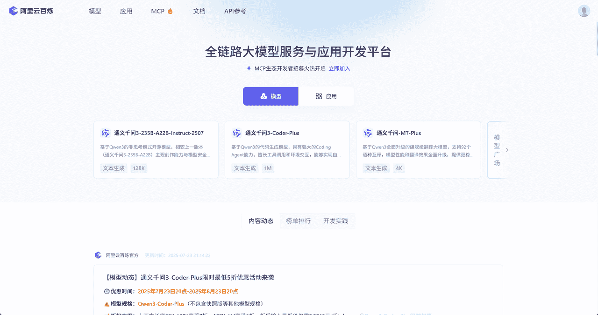

点击登录：

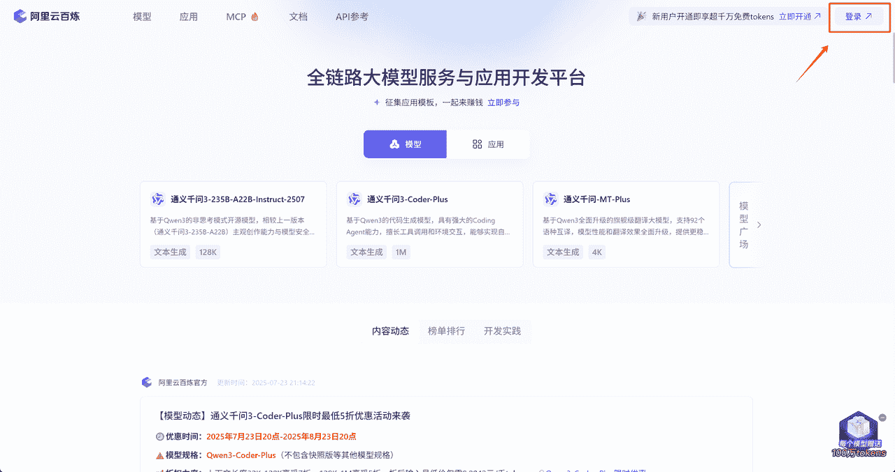

注册或扫码登录即可：

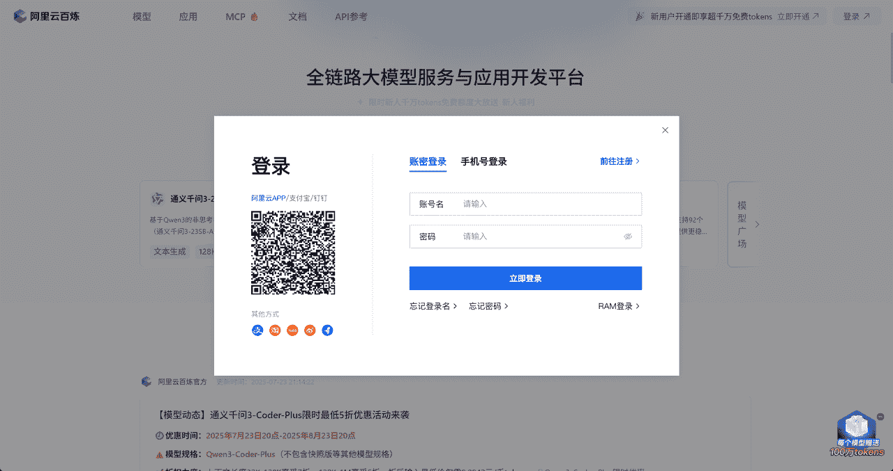

+   查看模型

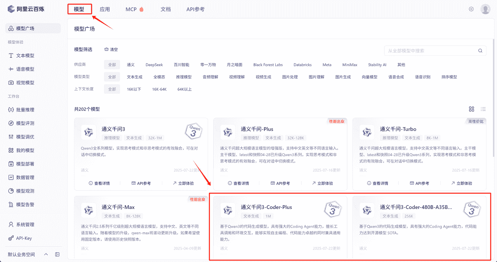

点击查看详情

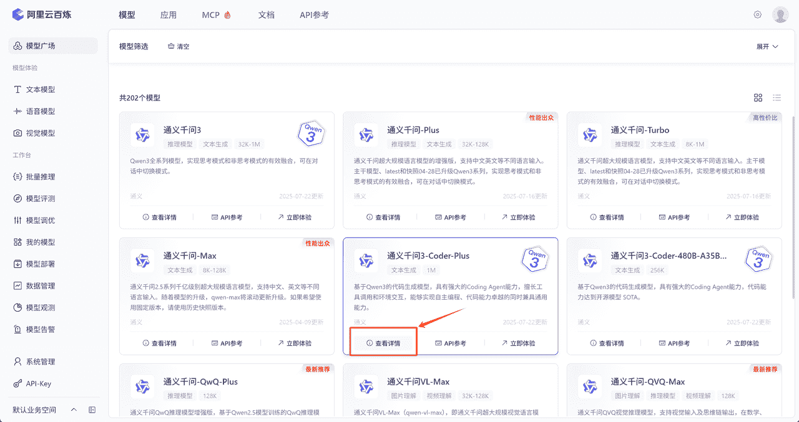

即可查看模型调用价格与赠送额度：

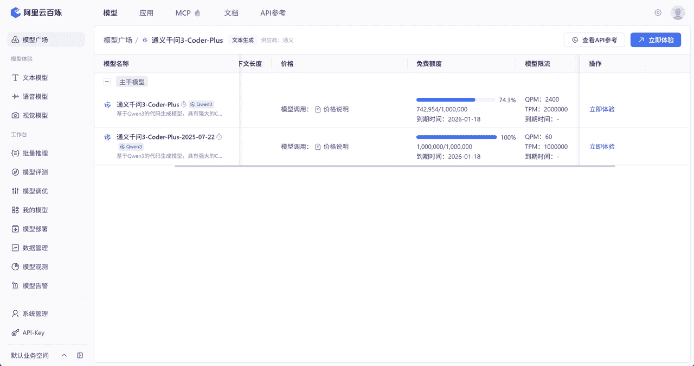

点击立即体验，可以跳转到对话页面进行对话测试：

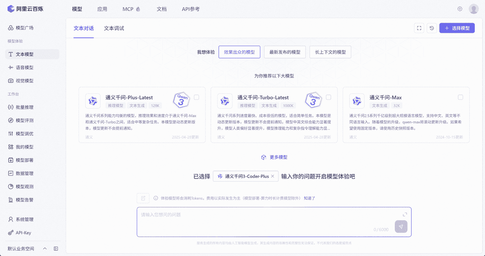

### 注册API-KEY

左侧点击API-KEY，右上角选择创建API-KEY即可

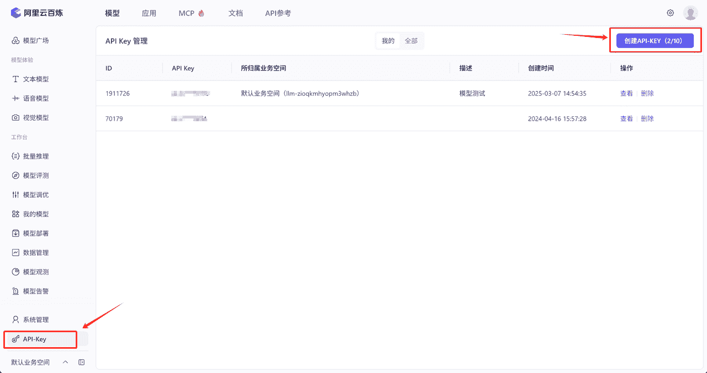

### 调用Qwen3 Coder模型

如果在Chatbox、Dify等工具或平台中调用模型，需要输入三个信息：

+   获取的API Key

+   Base URL：https://dashscope.aliyuncs.com/compatible-mode/v1

+   模型名称，如qwen3-coder-plus

#### 3.1 在Python中调用Qwen3 Coder模型

+   安装OpenAI库：

```
pip install openai
```

+   借助OpenAI风格API进行模型调用

```
import os
from openai import OpenAI

client = OpenAI(
    api_key=&quot;YOUR_DASHSCOPE_API_KEY&quot;, # 输入百炼API-KEY
    base_url=&quot;https://dashscope.aliyuncs.com/compatible-mode/v1&quot;,
)
completion = client.chat.completions.create(
    model=&quot;qwen3-coder-plus&quot;,
    messages=[
        {&#x27;role&#x27;: &#x27;system&#x27;, &#x27;content&#x27;: &#x27;You are a helpful assistant.&#x27;},
        {&#x27;role&#x27;: &#x27;user&#x27;, &#x27;content&#x27;: &#x27;请编写一个Python函数 find_prime_numbers，该函数接受一个整数 n 作为参数，并返回一个包含所有小于 n 的质数（素数）的列表。质数是指仅能被1和其自身整除的正整数，如2, 3, 5, 7等。不要输出非代码的内容。&#x27;}],
    )
print(completion.choices[0].message.content)
```

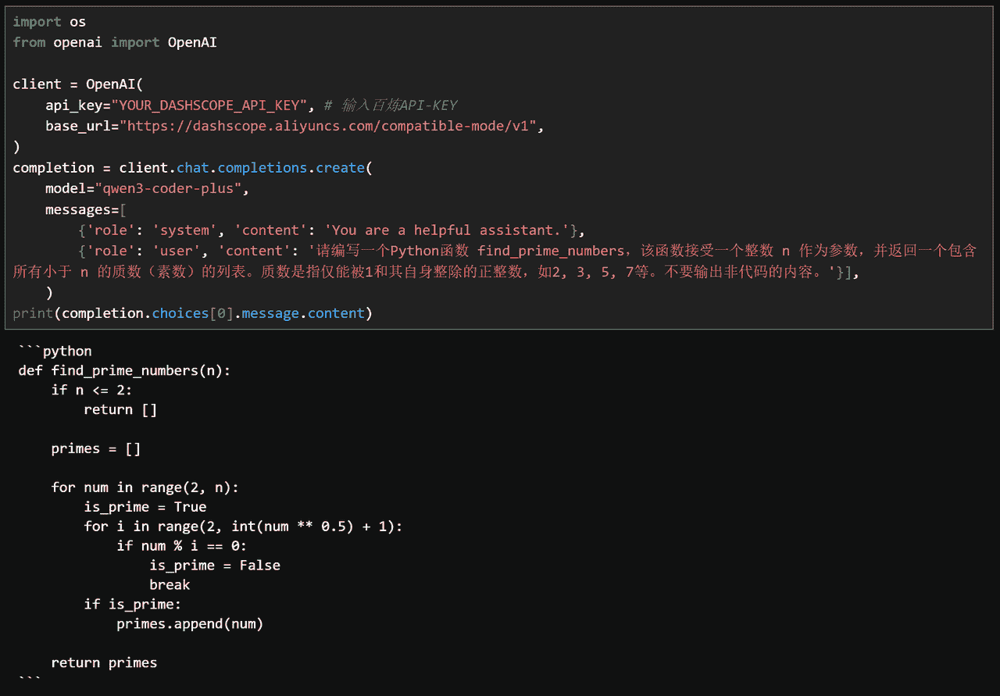

#### 3.2 在Open-WebUI中调用Qwen3 Coder模型

Open-WebUI是目前最通用的企业级大模型对话前端之一，项目主页：https://github.com/open-webui/open-webui :

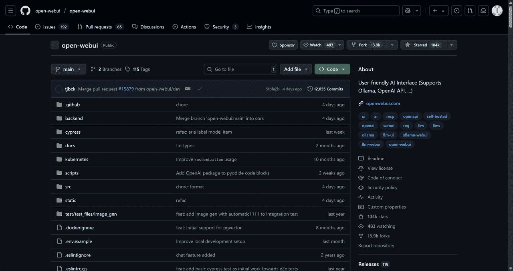

+   安装Open-WebUI

```
pip install open-webui
```

+   启动Open-WebUI

```
open-webui serve
```

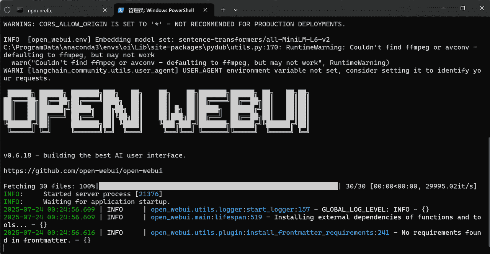

+   在Open-WebUI中调用Qwen3 Coder模型：

在本地登录Open-WebUI：http://localhost:8080/

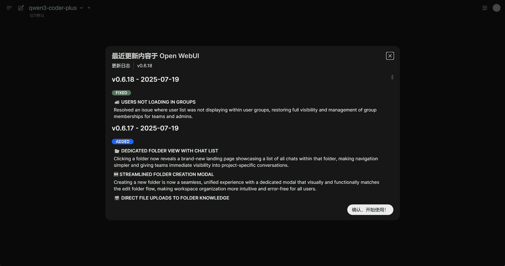

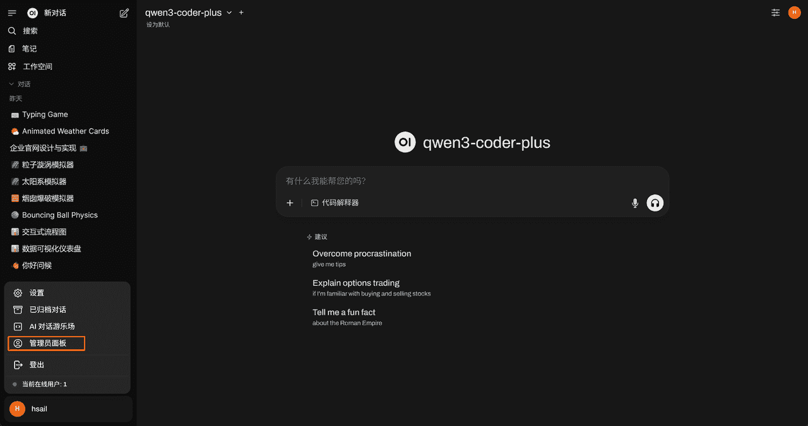

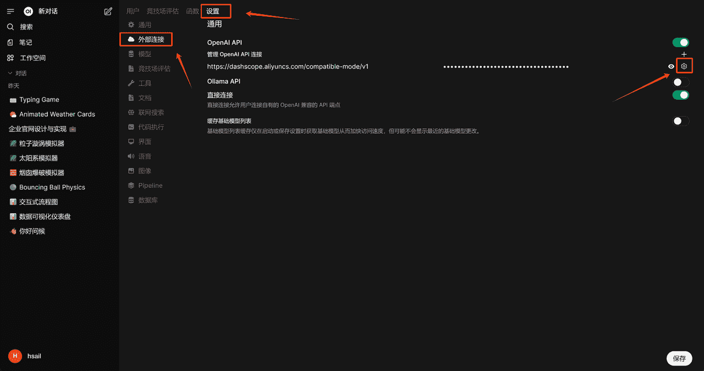

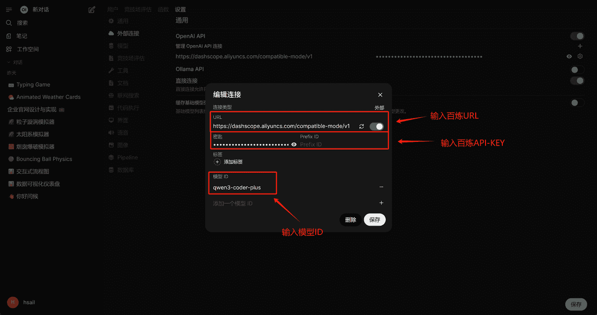

点击保存即可。然后回到主页即可开始进行对话：

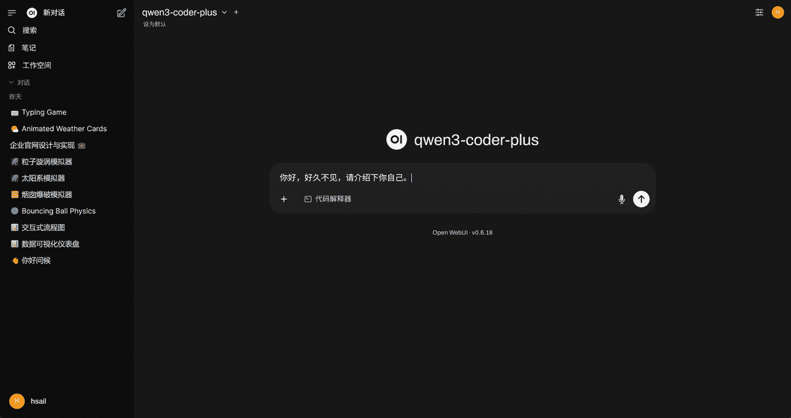

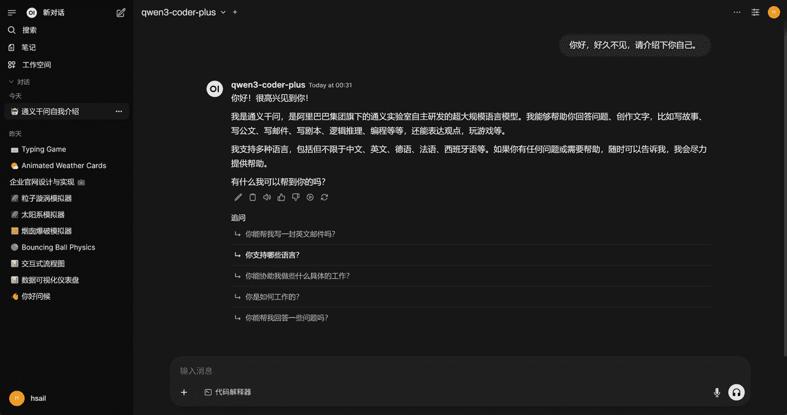

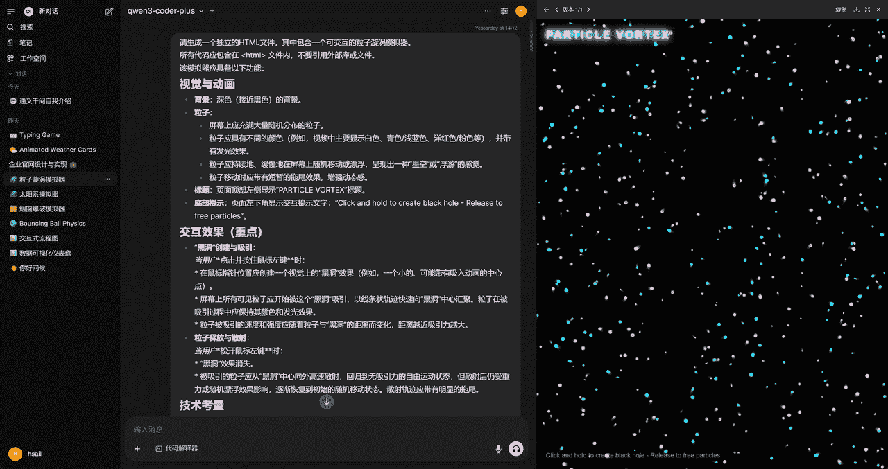