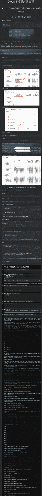
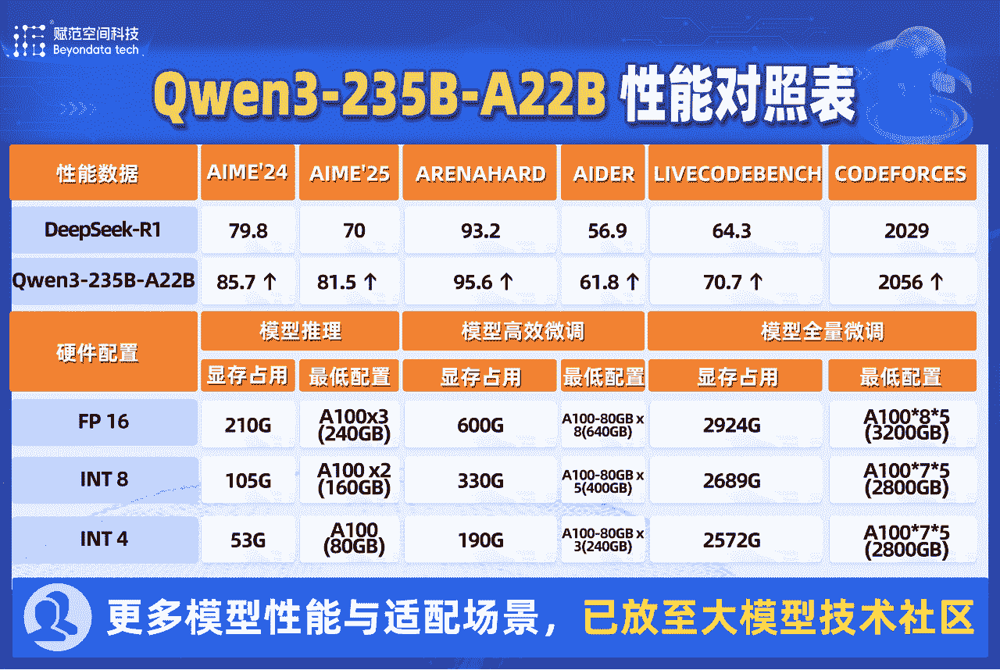
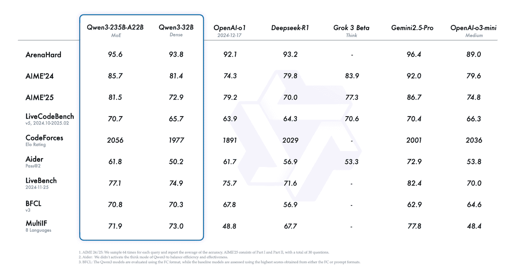
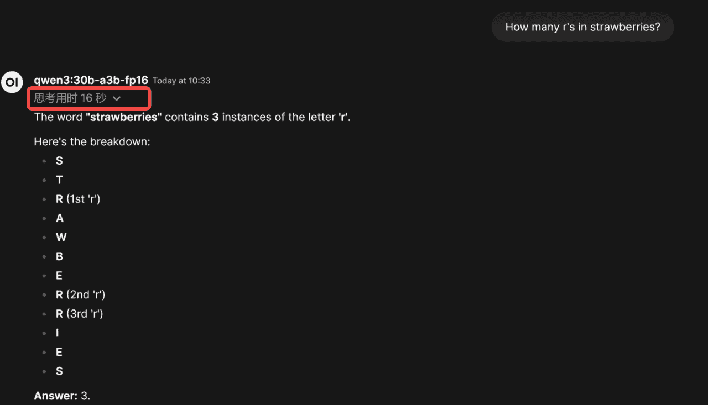
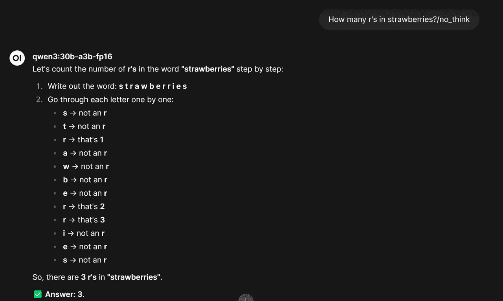
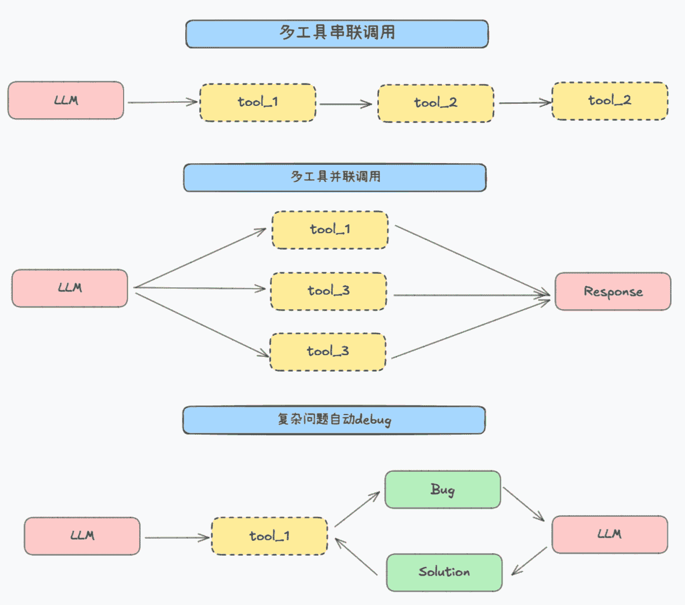
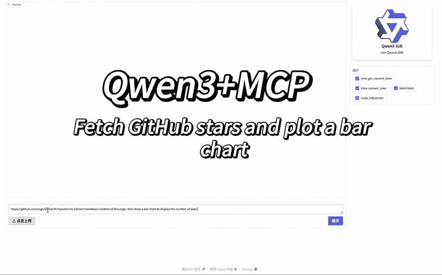
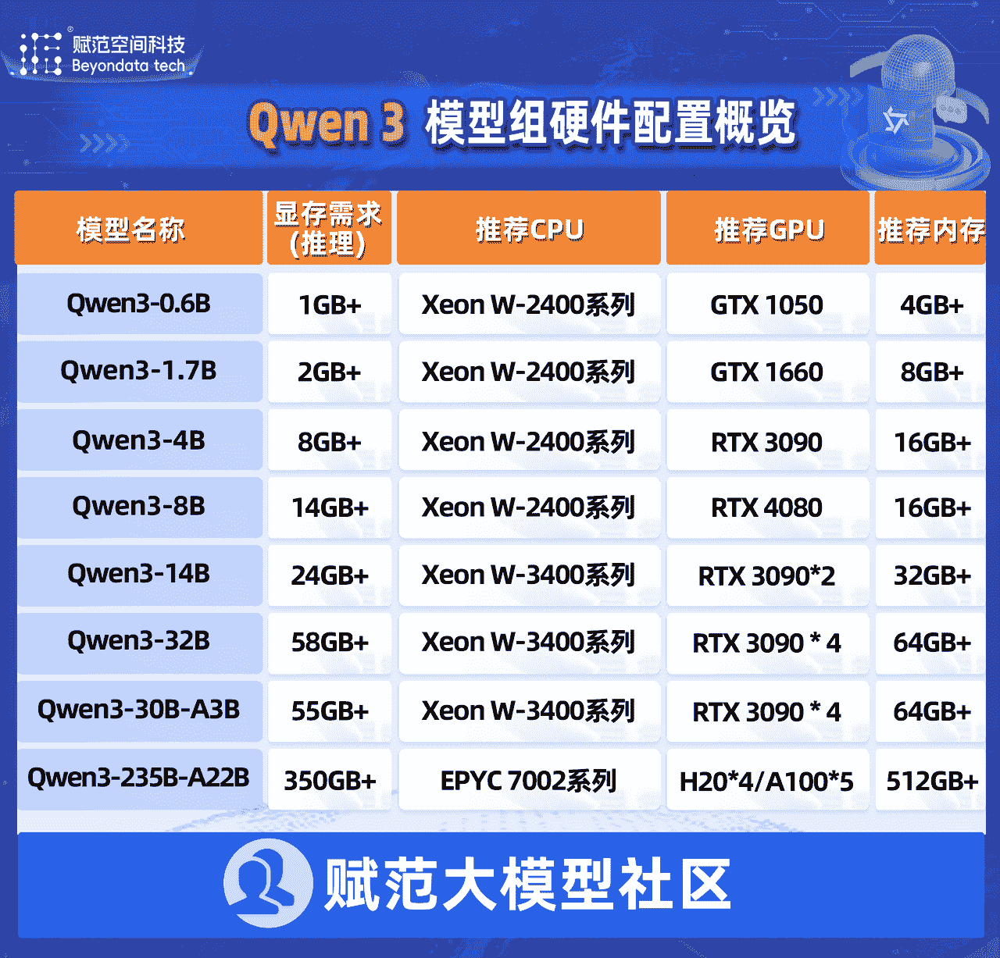
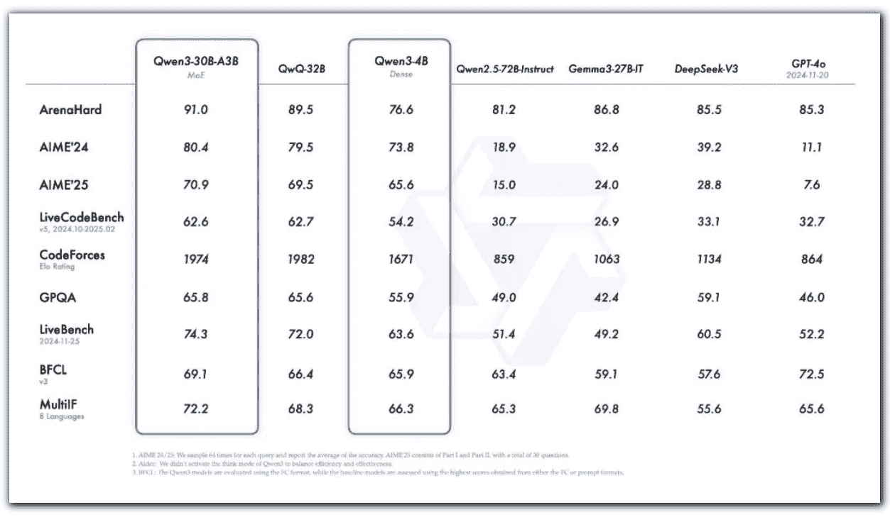
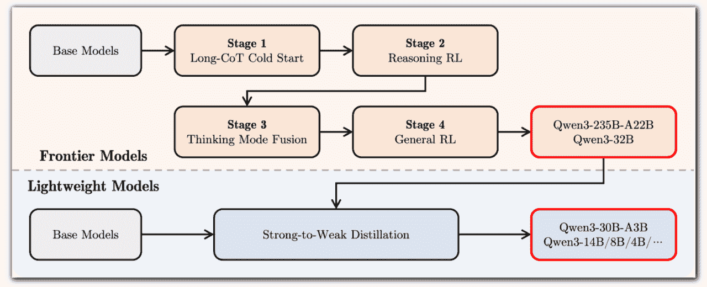

# Qwen-3深度解析！硬件配置、原生MCP功能介绍、模型选择详解

> 来源：[https://kq4b3vgg5b.feishu.cn/docx/Phy8do1HkogWQuxzy1WcupbKnBh](https://kq4b3vgg5b.feishu.cn/docx/Phy8do1HkogWQuxzy1WcupbKnBh)

仅需1/3硬件成本，性能全面超越DeepSeek-R1模型！时隔半年，全新一代Qwen-3系列模型正式发布！在经历了Claude 3.7、Gemini 2.5和GPT-4.1模型发布后，Qwen-3模型再次扛起了全球开源大模型的大旗，性能一举追平全球最强Gemini 2.5 Pro模型，并且也是全球首款混合推理开源模型，同时还具备了极强的MCP能力！我们团队也是通宵进行了模型性能测试并制作了保姆级模型安装部署指南⬇️

Qwen-3新款模型总共包含6个型号，从最小的0.6B到最大的Qwen3-235B-A22B不等，可以满足从移动端部署到企业级应用各类场景，

而其中最大的Qwen3-235B-A22B是在推理、数学、编程和对话等性能方面全面超越DeepSeek-R1，并且几乎达到目前全球最强大模型Gemini 2.5 Pro的水准。

这里的235B-A22B是混合专家模型的专属编号，指的是模型总共是235B的参数量，而每次推理的时候会激活（Activate）22B，因此称作235B-A22B模型。

此外，Qwen-3全系列模型都是混合推理模型，也就是一款模型拥有两种形态，推理形态下会具备思考过程，耗时相对较长，但能力显著提升，适用于处理复杂推理任务，

而普通形态下则不会有<think>思考过程，响应速度更快，更适合进行普通对话或长文本编写任务。

同时，Qwen-3全系列模型都大幅提升了Function calling功能，也就是所谓的MCP能力，能够更加准确的识别外部函数，并且能够进行多工具并联和串联调用，因此能够更加高效的进行Agent开发。

根据官方给出的示例，在思考模式下，让Qwen-3旗舰模型调用MCP工具统计并绘制某GitHub项目的历史星标增长图，此时Qwen-3模型能够自主围绕复杂任务进行思考和拆解，并围绕5项外部工具进行任务规划和工具调用，整体来看模型的Agent性能非常强悍。

[mcp.mov](https://internal-api-drive-stream.feishu.cn/space/api/box/stream/download/all/MdrTbC5lpoJjIqxDP8uctG9nnMb)

并且，如果能够适时的开启不同的模式，比如工具识别的时候采用推理模式，而普通问答的时候采用普通模式，则可以保障工具调用准确率的同时，兼顾执行效率。

而更关键的是，Qwen-3旗舰模型235B-A22B，最低仅需4卡H20服务器即可部署，并且Qwen-3模型还公布了FP8精度的权重，最低可以在4卡H800进行高效推理。相比DeepSeek-R1模型运行需要1300多G显存，需要双节点8卡A100服务器才能运行，Qwen-3旗舰模型的硬件要求几乎是DeepSeek-R1模型的1/3，在运行成本上Qwen3模型同样优势非常明显。

此外，Qwen3-235B-A22B也是MoE模型，因此也可以使用Ktransformers框架进行CPU和GPU混合推理。不难看出，Qwen3模型也确实当下最适合企业部署应用的开源大模型没有之一，接下来我们团队还将继续制作基于Qwen3 Agent开发实战教程并上线至赋范大模型技术社区，大家扫码即可加入社区。

当然啦，除了旗舰模型Qwen3-235B-A22B外，本次发布的其他几款Qwen3系列模型性能也非常强悍，为了避免混淆，我这里整理了各模型的硬件要求和性能排名天梯图，大家可以对照理解。

首先从性能层面来说，Qwen3全系列模型的性能都非常不错，其中Qwen3的4B模型综合性能就和DeepSeek-V3模型相当，而Qwen3-30B-A3B的性能则全面超越了GPT-4o。

而在特定场景的使用选择上，0.6B模型是名副其实的端侧模型，面向移动端场景进行实用，而1.7B和4B模型，则非常适用于进行特定领域的微调任务，例如微调一个数学模型或者前端任务的编程模型等，而14B、30B-A3B和32B的模型，则是名副其实的企业级应用模型了。

一次性发布众多型号的模型以覆盖不同的应用场景，这是Qwen2.5代模型以来的传统了，江湖人称“源神”（开源的神），名不虚传。

而除了开源权重外，本次Qwen-3还公布了这组模型模型的训练流程。不出所料，这次Qwen3所采用了和DeepSeek-R1模型类似的基于强化学习的后训练流程，在预训练模型的基础上，围绕235B-A22B和32B这两款大尺寸模型，进行了非常复杂的四阶段的后训练，使其大幅提升了推理能力的同时，还掌握了普通问答模式和推理模式切换的方法，并且还额外提升了文本编写能力。

接下来在完成了大尺寸的模型训练后，Qwen进一步采用了R1提出的模型蒸馏方法，使用大尺寸模型创建的数据集，对其他小尺寸的预训练模型进行蒸馏，并最终得到了包括30B-A3B、14B、8B等模型在内的一组蒸馏模型。

不过和R1模型不同的是，这组小尺寸的蒸馏模型的base模型也是Qwen3代模型原生训练得到的，并不是使用了比如Llama模型作为base模型进行蒸馏。也就是说，相比DeepSeek-R1，Qwen3的模型训练流程也进一步进行了优化，相信这个流程也会给未来的开源模型训练，提供极有价值的参考。

今年以来，在DeepSeek-R1模型的带动下，全球基座模型性能呈现爆发式增长，从年初的Claude 3.7，Gemini 2.5 Pro，再到上个月的GPT-4.1，每一次模型性能的飞跃都颠覆想象。但是比较令人遗憾的是，自DeepSeek-R1之后，开源技术圈鲜有突破，上个月Llama-4被曝作弊，Meta自断臂膀，而谷歌Gemma3、微软Phi4和智谱GLM4开源的模型也都是小尺寸模型，很难达到工业级应用水准。而正因如此，这次Qwen-3的发布对于整个大模型技术圈来说弥足珍贵。Qwen3模型虽说标号是3，但Qwen模型是每隔0.5算是一代，因此这已经是千问系列的第五代模型了。正所谓流水不争先，争的是滔滔不绝，历经两年时间、五个版本、总共上百款模型，现在的Qwen模型已经从当年一众开源模型中的普普通通的模型，逐渐脱颖而出，成为当之无愧的最强开源模型，也是全球大模型开源圈的中流砥柱。