# Qwen3接入MCP技术实战（下）

> 来源：[https://kq4b3vgg5b.feishu.cn/docx/IIMhdNUmMoJWZyx0mZJcUJVwnQc](https://kq4b3vgg5b.feishu.cn/docx/IIMhdNUmMoJWZyx0mZJcUJVwnQc)

## 课程说明：

+   体验课内容节选自《2025大模型Agent智能体开发实战》(5月班)完整版付费课程

体验课时间有限，若想深度学习大模型技术，欢迎大家报名由我主讲的《2025大模型Agent智能体开发实战》(5月班)

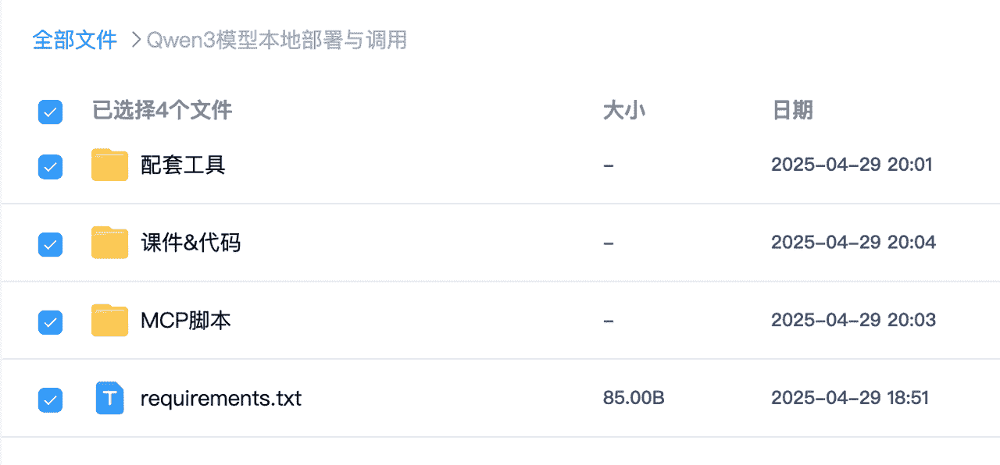


此外，公开课全套学习资料，已上传至网盘

（链接: https://pan.baidu.com/s/11nFqw4w2kIvypKqzBW9N🐧 提取码: 6k24 ）

需要更系统深入学习大模型可扫码⬆️添加助教咨询喔～

---

# Qwen3接入MCP智能体开发实战

# Part 2.Qwen3+Qwen-Agent接入MCP进行智能体开发

## 三、Qwen3+Qwen-Agent接入MCP流程

Qwen-Agent 是阿里通义团队推出的开源智能体（Agent）开发框架，基于 Qwen 大语言模型（LLM）构建，旨在帮助开发者快速构建具备指令遵循、工具调用、规划与记忆等能力的 AI 应用。它提供了从底层原子组件到高级智能体抽象的完整开发工具链，适用于多种复杂任务场景。

+   官网地址：https://github.com/QwenLM/Qwen-Agent

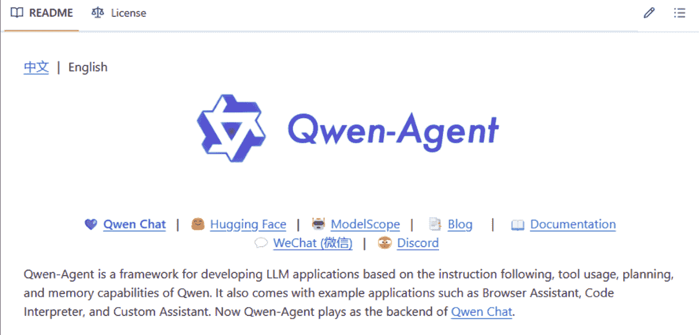

### 1. Qwen-Agent 核心功能与技术特点

总的来说，Qwen-Agent本质上并不是一个Multi_Agent开发框架，而更像是为Qwen系列模型量身定制的增强器。借助Qwen-Agent，Qwen系列模型能够更好的开启Function calling功能（包括多步Function calling和自动debug等）、能够更好的进行模型记忆管理、能够更加便捷的连接MCP工具、能够进行长文档检索等，此外Qwen-Agent还提供了便捷的前端交互页面。如果是Qwen用户的深度使用者，推荐使用Qwen-Agent对模型性能进行增强，同时若是希望借助Qwen3快速接入MCP工具，则Qwen-Agent也会是一个非常便捷的工具。

Qwen-Agent核心特性如下：

+   更强的工具调用（Function Calling）能力:框架支持智能体自动调用外部工具或函数，包括内置的代码解释器、浏览器助手等，也支持开发者自定义工具，扩展智能体的能力。

+   便捷的MCP工具接入流程：最新版的Qwen-Agent已经集成了MCP工具接入流程，我们仅需写入MCP配置，即可在Qwen-Agent中调用MCP工具：

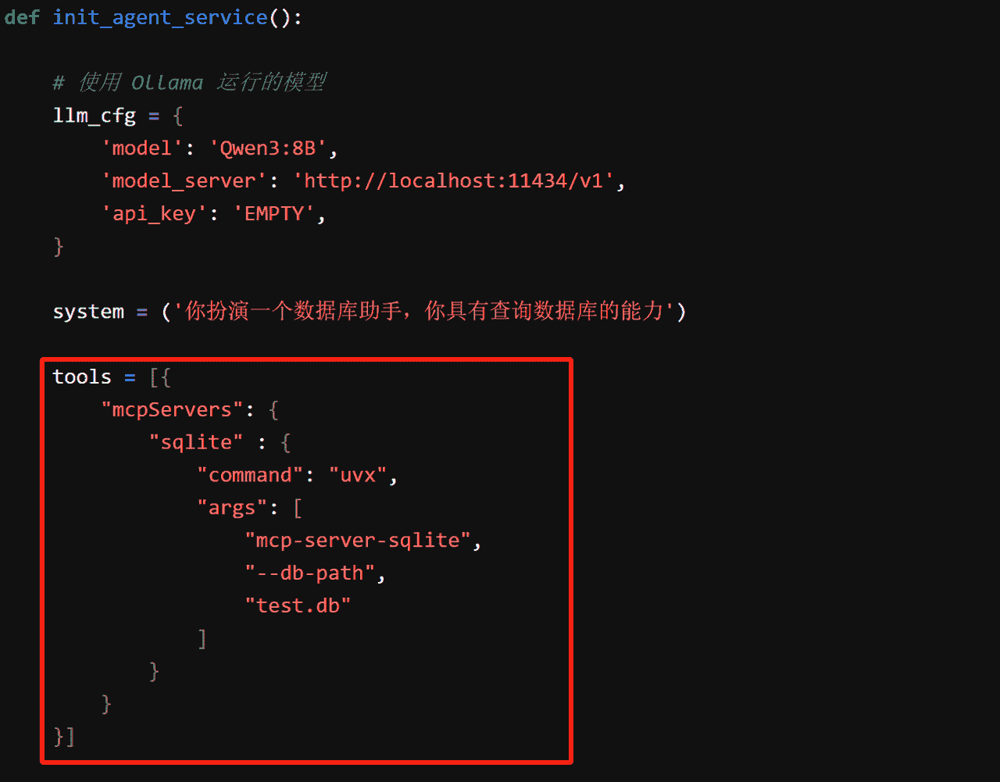

而这也是本次Qwen3模型更新时，官方在更新公告中重点展示的内容。

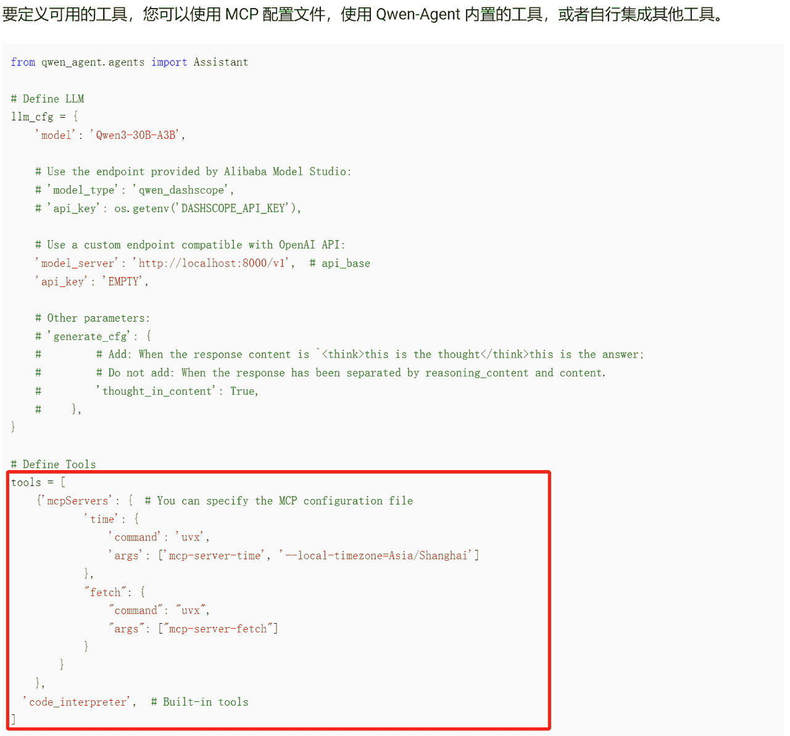

+   规划与记忆能力： 智能体具备任务规划能力，能够根据用户需求自动制定执行步骤。同时，具备上下文记忆功能，能在对话中保持状态，提供连贯的交互体验。

+   长文本处理与 RA： Qwen-Agent 集成了检索增强生成（RAG）机制，支持处理从 8K 到 100 万 tokens 的长文档，通过文档分块和相关性检索，提升上下互与展示

+   UI前端交互与展示

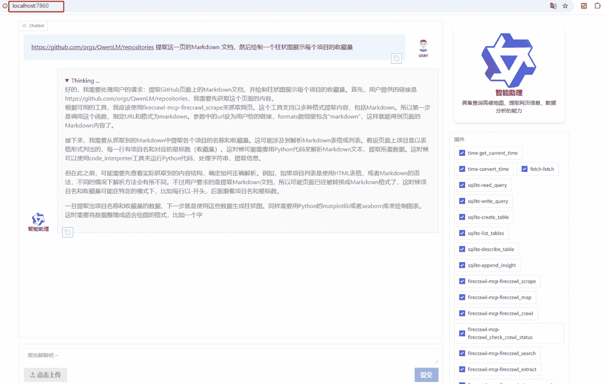

### 2. Qwen-Agent下载与创建多轮对话机器人

+   从 PyPI 安装稳定版本

在此命令中，可使用双括号指定如下的可选依赖，其中：

+   [gui] 用于提供基于 Gradio 的 GUI 支持；

+   [rag] 用于支持 RAG；

+   [code_interpreter] 用于提供代码解释器相关支持；

+   [mcp] 用于支持 MCP。

```
! pip install -U &quot;qwen-agent[rag,code_interpreter,gui,mcp]&quot;
```

```
Collecting qwen-agent[code_interpreter,gui,mcp,rag]
  Using cached qwen_agent-0.0.20-py3-none-any.whl.metadata (13 kB)
Collecting dashscope&gt;=1.11.0 (from qwen-agent[code_interpreter,gui,mcp,rag])
  Using cached dashscope-1.23.2-py3-none-any.whl.metadata (6.8 kB)
Requirement already satisfied: eval-type-backport in c:\python312\lib\site-packages (from qwen-agent[code_interpreter,gui,mcp,rag]) (0.2.2)
Requirement already satisfied: json5 in c:\python312\lib\site-packages (from qwen-agent[code_interpreter,gui,mcp,rag]) (0.9.25)
Collecting jsonlines (from qwen-agent[code_interpreter,gui,mcp,rag])
  Using cached jsonlines-4.0.0-py3-none-any.whl.metadata (1.6 kB)
Requirement already satisfied: jsonschema in c:\python312\lib\site-packages (from qwen-agent[code_interpreter,gui,mcp,rag]) (4.23.0)
Requirement already satisfied: openai in c:\python312\lib\site-packages (from qwen-agent[code_interpreter,gui,mcp,rag]) (1.70.0)
Requirement already satisfied: pydantic&gt;=2.3.0 in c:\python312\lib\site-packages (from qwen-agent[code_interpreter,gui,mcp,rag]) (2.10.6)
Requirement already satisfied: requests in c:\python312\lib\site-packages (from qwen-agent[code_interpreter,gui,mcp,rag]) (2.32.3)
Requirement already satisfied: tiktoken in c:\python312\lib\site-packages (from qwen-agent[code_interpreter,gui,mcp,rag]) (0.7.0)
Requirement already satisfied: anyio&gt;=3.7.1 in c:\python312\lib\site-packages (from qwen-agent[code_interpreter,gui,mcp,rag]) (4.9.0)
Requirement already satisfied: fastapi&gt;=0.103.1 in c:\python312\lib\site-packages (from qwen-agent[code_interpreter,gui,mcp,rag]) (0.115.7)
Requirement already satisfied: jupyter&gt;=1.0.0 in c:\python312\lib\site-packages (from qwen-agent[code_interpreter,gui,mcp,rag]) (1.1.1)
Requirement already satisfied: matplotlib in c:\python312\lib\site-packages (from qwen-agent[code_interpreter,gui,mcp,rag]) (3.9.2)
Requirement already satisfied: numpy in c:\python312\lib\site-packages (from qwen-agent[code_interpreter,gui,mcp,rag]) (1.26.4)
Requirement already satisfied: pandas in c:\python312\lib\site-packages (from qwen-agent[code_interpreter,gui,mcp,rag]) (2.2.3)
Requirement already satisfied: pillow in c:\python312\lib\site-packages (from qwen-agent[code_interpreter,gui,mcp,rag]) (11.1.0)
Requirement already satisfied: seaborn in c:\python312\lib\site-packages (from qwen-agent[code_interpreter,gui,mcp,rag]) (0.13.2)
Requirement already satisfied: sympy in c:\python312\lib\site-packages (from qwen-agent[code_interpreter,gui,mcp,rag]) (1.14.0)
Requirement already satisfied: uvicorn&gt;=0.23.2 in c:\python312\lib\site-packages (from qwen-agent[code_interpreter,gui,mcp,rag]) (0.34.0)
Collecting pydantic&gt;=2.3.0 (from qwen-agent[code_interpreter,gui,mcp,rag])
  Using cached pydantic-2.9.2-py3-none-any.whl.metadata (149 kB)
Collecting pydantic-core==2.23.4 (from qwen-agent[code_interpreter,gui,mcp,rag])
  Using cached pydantic_core-2.23.4-cp312-none-win_amd64.whl.metadata (6.7 kB)
Collecting gradio==5.23.1 (from qwen-agent[code_interpreter,gui,mcp,rag])
  Using cached gradio-5.23.1-py3-none-any.whl.metadata (16 kB)
Collecting gradio-client==1.8.0 (from qwen-agent[code_interpreter,gui,mcp,rag])
  Using cached gradio_client-1.8.0-py3-none-any.whl.metadata (7.1 kB)
Collecting modelscope-studio==1.1.7 (from qwen-agent[code_interpreter,gui,mcp,rag])
  Using cached modelscope_studio-1.1.7-py3-none-any.whl.metadata (4.1 kB)
Requirement already satisfied: mcp in c:\python312\lib\site-packages (from qwen-agent[code_interpreter,gui,mcp,rag]) (1.6.0)
Requirement already satisfied: charset-normalizer in c:\python312\lib\site-packages (from qwen-agent[code_interpreter,gui,mcp,rag]) (3.3.2)
Requirement already satisfied: rank-bm25 in c:\python312\lib\site-packages (from qwen-agent[code_interpreter,gui,mcp,rag]) (0.2.2)
Collecting jieba (from qwen-agent[code_interpreter,gui,mcp,rag])
  Using cached jieba-0.42.1-py3-none-any.whl
Requirement already satisfied: snowballstemmer in c:\python312\lib\site-packages (from qwen-agent[code_interpreter,gui,mcp,rag]) (2.2.0)
Requirement already satisfied: beautifulsoup4 in c:\python312\lib\site-packages (from qwen-agent[code_interpreter,gui,mcp,rag]) (4.12.3)
Requirement already satisfied: pdfminer.six in c:\python312\lib\site-packages (from qwen-agent[code_interpreter,gui,mcp,rag]) (20240706)
Collecting pdfplumber (from qwen-agent[code_interpreter,gui,mcp,rag])
  Using cached pdfplumber-0.11.6-py3-none-any.whl.metadata (42 kB)
Collecting python-docx (from qwen-agent[code_interpreter,gui,mcp,rag])
  Using cached python_docx-1.1.2-py3-none-any.whl.metadata (2.0 kB)
Requirement already satisfied: python-pptx in c:\python312\lib\site-packages (from qwen-agent[code_interpreter,gui,mcp,rag]) (1.0.0)
Requirement already satisfied: tabulate in c:\python312\lib\site-packages (from qwen-agent[code_interpreter,gui,mcp,rag]) (0.9.0)
Collecting aiofiles&lt;24.0,&gt;=22.0 (from gradio==5.23.1-&gt;qwen-agent[code_interpreter,gui,mcp,rag])
  Using cached aiofiles-23.2.1-py3-none-any.whl.metadata (9.7 kB)
Collecting ffmpy (from gradio==5.23.1-&gt;qwen-agent[code_interpreter,gui,mcp,rag])
  Using cached ffmpy-0.5.0-py3-none-any.whl.metadata (3.0 kB)
Collecting groovy~=0.1 (from gradio==5.23.1-&gt;qwen-agent[code_interpreter,gui,mcp,rag])
  Using cached groovy-0.1.2-py3-none-any.whl.metadata (6.1 kB)
Requirement already satisfied: httpx&gt;=0.24.1 in c:\python312\lib\site-packages (from gradio==5.23.1-&gt;qwen-agent[code_interpreter,gui,mcp,rag]) (0.27.2)
Requirement already satisfied: huggingface-hub&gt;=0.28.1 in c:\python312\lib\site-packages (from gradio==5.23.1-&gt;qwen-agent[code_interpreter,gui,mcp,rag]) (0.30.2)
Requirement already satisfied: jinja2&lt;4.0 in c:\python312\lib\site-packages (from gradio==5.23.1-&gt;qwen-agent[code_interpreter,gui,mcp,rag]) (3.1.4)
Requirement already satisfied: markupsafe&lt;4.0,&gt;=2.0 in c:\python312\lib\site-packages (from gradio==5.23.1-&gt;qwen-agent[code_interpreter,gui,mcp,rag]) (2.1.5)
Requirement already satisfied: orjson~=3.0 in c:\python312\lib\site-packages (from gradio==5.23.1-&gt;qwen-agent[code_interpreter,gui,mcp,rag]) (3.10.16)
Requirement already satisfied: packaging in c:\python312\lib\site-packages (from gradio==5.23.1-&gt;qwen-agent[code_interpreter,gui,mcp,rag]) (23.2)
Requirement already satisfied: pydub in c:\python312\lib\site-packages (from gradio==5.23.1-&gt;qwen-agent[code_interpreter,gui,mcp,rag]) (0.25.1)
Requirement already satisfied: python-multipart&gt;=0.0.18 in c:\python312\lib\site-packages (from gradio==5.23.1-&gt;qwen-agent[code_interpreter,gui,mcp,rag]) (0.0.20)
Requirement already satisfied: pyyaml&lt;7.0,&gt;=5.0 in c:\python312\lib\site-packages (from gradio==5.23.1-&gt;qwen-agent[code_interpreter,gui,mcp,rag]) (6.0.2)
Collecting ruff&gt;=0.9.3 (from gradio==5.23.1-&gt;qwen-agent[code_interpreter,gui,mcp,rag])
  Using cached ruff-0.11.7-py3-none-win_amd64.whl.metadata (26 kB)
Collecting safehttpx&lt;0.2.0,&gt;=0.1.6 (from gradio==5.23.1-&gt;qwen-agent[code_interpreter,gui,mcp,rag])
  Using cached safehttpx-0.1.6-py3-none-any.whl.metadata (4.2 kB)
Collecting semantic-version~=2.0 (from gradio==5.23.1-&gt;qwen-agent[code_interpreter,gui,mcp,rag])
  Using cached semantic_version-2.10.0-py2.py3-none-any.whl.metadata (9.7 kB)
Requirement already satisfied: starlette&lt;1.0,&gt;=0.40.0 in c:\python312\lib\site-packages (from gradio==5.23.1-&gt;qwen-agent[code_interpreter,gui,mcp,rag]) (0.41.3)
Requirement already satisfied: tomlkit&lt;0.14.0,&gt;=0.12.0 in c:\python312\lib\site-packages (from gradio==5.23.1-&gt;qwen-agent[code_interpreter,gui,mcp,rag]) (0.13.2)
Requirement already satisfied: typer&lt;1.0,&gt;=0.12 in c:\python312\lib\site-packages (from gradio==5.23.1-&gt;qwen-agent[code_interpreter,gui,mcp,rag]) (0.12.5)
Requirement already satisfied: typing-extensions~=4.0 in c:\python312\lib\site-packages (from gradio==5.23.1-&gt;qwen-agent[code_interpreter,gui,mcp,rag]) (4.12.2)
Requirement already satisfied: fsspec in c:\python312\lib\site-packages (from gradio-client==1.8.0-&gt;qwen-agent[code_interpreter,gui,mcp,rag]) (2025.3.0)
Requirement already satisfied: websockets&lt;16.0,&gt;=10.0 in c:\python312\lib\site-packages (from gradio-client==1.8.0-&gt;qwen-agent[code_interpreter,gui,mcp,rag]) (14.2)
Requirement already satisfied: annotated-types&gt;=0.6.0 in c:\python312\lib\site-packages (from pydantic&gt;=2.3.0-&gt;qwen-agent[code_interpreter,gui,mcp,rag]) (0.7.0)
Requirement already satisfied: idna&gt;=2.8 in c:\python312\lib\site-packages (from anyio&gt;=3.7.1-&gt;qwen-agent[code_interpreter,gui,mcp,rag]) (3.7)
Requirement already satisfied: sniffio&gt;=1.1 in c:\python312\lib\site-packages (from anyio&gt;=3.7.1-&gt;qwen-agent[code_interpreter,gui,mcp,rag]) (1.3.1)
Requirement already satisfied: aiohttp in c:\python312\lib\site-packages (from dashscope&gt;=1.11.0-&gt;qwen-agent[code_interpreter,gui,mcp,rag]) (3.11.11)
Requirement already satisfied: websocket-client in c:\python312\lib\site-packages (from dashscope&gt;=1.11.0-&gt;qwen-agent[code_interpreter,gui,mcp,rag]) (1.8.0)
Requirement already satisfied: notebook in c:\python312\lib\site-packages (from jupyter&gt;=1.0.0-&gt;qwen-agent[code_interpreter,gui,mcp,rag]) (7.2.2)
Requirement already satisfied: jupyter-console in c:\python312\lib\site-packages (from jupyter&gt;=1.0.0-&gt;qwen-agent[code_interpreter,gui,mcp,rag]) (6.6.3)
Requirement already satisfied: nbconvert in c:\python312\lib\site-packages (from jupyter&gt;=1.0.0-&gt;qwen-agent[code_interpreter,gui,mcp,rag]) (7.16.4)
Requirement already satisfied: ipykernel in c:\python312\lib\site-packages (from jupyter&gt;=1.0.0-&gt;qwen-agent[code_interpreter,gui,mcp,rag]) (6.29.5)
Requirement already satisfied: ipywidgets in c:\python312\lib\site-packages (from jupyter&gt;=1.0.0-&gt;qwen-agent[code_interpreter,gui,mcp,rag]) (8.1.5)
Requirement already satisfied: jupyterlab in c:\python312\lib\site-packages (from jupyter&gt;=1.0.0-&gt;qwen-agent[code_interpreter,gui,mcp,rag]) (4.2.5)
Requirement already satisfied: python-dateutil&gt;=2.8.2 in c:\python312\lib\site-packages (from pandas-&gt;qwen-agent[code_interpreter,gui,mcp,rag]) (2.9.0.post0)
Requirement already satisfied: pytz&gt;=2020.1 in c:\python312\lib\site-packages (from pandas-&gt;qwen-agent[code_interpreter,gui,mcp,rag]) (2024.2)
Requirement already satisfied: tzdata&gt;=2022.7 in c:\python312\lib\site-packages (from pandas-&gt;qwen-agent[code_interpreter,gui,mcp,rag]) (2024.2)
Requirement already satisfied: click&gt;=7.0 in c:\python312\lib\site-packages (from uvicorn&gt;=0.23.2-&gt;qwen-agent[code_interpreter,gui,mcp,rag]) (8.1.8)
Requirement already satisfied: h11&gt;=0.8 in c:\python312\lib\site-packages (from uvicorn&gt;=0.23.2-&gt;qwen-agent[code_interpreter,gui,mcp,rag]) (0.14.0)
Requirement already satisfied: soupsieve&gt;1.2 in c:\python312\lib\site-packages (from beautifulsoup4-&gt;qwen-agent[code_interpreter,gui,mcp,rag]) (2.6)
Requirement already satisfied: attrs&gt;=19.2.0 in c:\python312\lib\site-packages (from jsonlines-&gt;qwen-agent[code_interpreter,gui,mcp,rag]) (24.2.0)
Requirement already satisfied: jsonschema-specifications&gt;=2023.03.6 in c:\python312\lib\site-packages (from jsonschema-&gt;qwen-agent[code_interpreter,gui,mcp,rag]) (2024.10.1)
Requirement already satisfied: referencing&gt;=0.28.4 in c:\python312\lib\site-packages (from jsonschema-&gt;qwen-agent[code_interpreter,gui,mcp,rag]) (0.35.1)
Requirement already satisfied: rpds-py&gt;=0.7.1 in c:\python312\lib\site-packages (from jsonschema-&gt;qwen-agent[code_interpreter,gui,mcp,rag]) (0.20.1)
Requirement already satisfied: contourpy&gt;=1.0.1 in c:\python312\lib\site-packages (from matplotlib-&gt;qwen-agent[code_interpreter,gui,mcp,rag]) (1.3.1)
Requirement already satisfied: cycler&gt;=0.10 in c:\python312\lib\site-packages (from matplotlib-&gt;qwen-agent[code_interpreter,gui,mcp,rag]) (0.12.1)
Requirement already satisfied: fonttools&gt;=4.22.0 in c:\python312\lib\site-packages (from matplotlib-&gt;qwen-agent[code_interpreter,gui,mcp,rag]) (4.55.0)
Requirement already satisfied: kiwisolver&gt;=1.3.1 in c:\python312\lib\site-packages (from matplotlib-&gt;qwen-agent[code_interpreter,gui,mcp,rag]) (1.4.7)
Requirement already satisfied: pyparsing&gt;=2.3.1 in c:\python312\lib\site-packages (from matplotlib-&gt;qwen-agent[code_interpreter,gui,mcp,rag]) (3.2.0)
Requirement already satisfied: httpx-sse&gt;=0.4 in c:\python312\lib\site-packages (from mcp-&gt;qwen-agent[code_interpreter,gui,mcp,rag]) (0.4.0)
Requirement already satisfied: pydantic-settings&gt;=2.5.2 in c:\python312\lib\site-packages (from mcp-&gt;qwen-agent[code_interpreter,gui,mcp,rag]) (2.7.1)
Requirement already satisfied: sse-starlette&gt;=1.6.1 in c:\python312\lib\site-packages (from mcp-&gt;qwen-agent[code_interpreter,gui,mcp,rag]) (2.2.1)
Requirement already satisfied: distro&lt;2,&gt;=1.7.0 in c:\python312\lib\site-packages (from openai-&gt;qwen-agent[code_interpreter,gui,mcp,rag]) (1.9.0)
Requirement already satisfied: jiter&lt;1,&gt;=0.4.0 in c:\python312\lib\site-packages (from openai-&gt;qwen-agent[code_interpreter,gui,mcp,rag]) (0.8.0)
Requirement already satisfied: tqdm&gt;4 in c:\python312\lib\site-packages (from openai-&gt;qwen-agent[code_interpreter,gui,mcp,rag]) (4.67.1)
Requirement already satisfied: cryptography&gt;=36.0.0 in c:\python312\lib\site-packages (from pdfminer.six-&gt;qwen-agent[code_interpreter,gui,mcp,rag]) (43.0.3)
Collecting pdfminer.six (from qwen-agent[code_interpreter,gui,mcp,rag])
  Using cached pdfminer_six-20250327-py3-none-any.whl.metadata (4.1 kB)
Collecting pypdfium2&gt;=4.18.0 (from pdfplumber-&gt;qwen-agent[code_interpreter,gui,mcp,rag])
  Using cached pypdfium2-4.30.1-py3-none-win_amd64.whl.metadata (48 kB)
Requirement already satisfied: lxml&gt;=3.1.0 in c:\python312\lib\site-packages (from python-docx-&gt;qwen-agent[code_interpreter,gui,mcp,rag]) (5.3.0)
Requirement already satisfied: XlsxWriter&gt;=0.5.7 in c:\python312\lib\site-packages (from python-pptx-&gt;qwen-agent[code_interpreter,gui,mcp,rag]) (3.2.0)
Requirement already satisfied: urllib3&lt;3,&gt;=1.21.1 in c:\python312\lib\site-packages (from requests-&gt;qwen-agent[code_interpreter,gui,mcp,rag]) (2.4.0)
Requirement already satisfied: certifi&gt;=2017.4.17 in c:\python312\lib\site-packages (from requests-&gt;qwen-agent[code_interpreter,gui,mcp,rag]) (2025.4.26)
Requirement already satisfied: mpmath&lt;1.4,&gt;=1.1.0 in c:\python312\lib\site-packages (from sympy-&gt;qwen-agent[code_interpreter,gui,mcp,rag]) (1.3.0)
Requirement already satisfied: regex&gt;=2022.1.18 in c:\python312\lib\site-packages (from tiktoken-&gt;qwen-agent[code_interpreter,gui,mcp,rag]) (2024.11.6)
Requirement already satisfied: colorama in c:\python312\lib\site-packages (from click&gt;=7.0-&gt;uvicorn&gt;=0.23.2-&gt;qwen-agent[code_interpreter,gui,mcp,rag]) (0.4.6)
Requirement already satisfied: cffi&gt;=1.12 in c:\python312\lib\site-packages (from cryptography&gt;=36.0.0-&gt;pdfminer.six-&gt;qwen-agent[code_interpreter,gui,mcp,rag]) (1.17.1)
Requirement already satisfied: httpcore==1.* in c:\python312\lib\site-packages (from httpx&gt;=0.24.1-&gt;gradio==5.23.1-&gt;qwen-agent[code_interpreter,gui,mcp,rag]) (1.0.6)
Requirement already satisfied: filelock in c:\python312\lib\site-packages (from huggingface-hub&gt;=0.28.1-&gt;gradio==5.23.1-&gt;qwen-agent[code_interpreter,gui,mcp,rag]) (3.18.0)
Requirement already satisfied: python-dotenv&gt;=0.21.0 in c:\python312\lib\site-packages (from pydantic-settings&gt;=2.5.2-&gt;mcp-&gt;qwen-agent[code_interpreter,gui,mcp,rag]) (1.0.1)
Requirement already satisfied: six&gt;=1.5 in c:\python312\lib\site-packages (from python-dateutil&gt;=2.8.2-&gt;pandas-&gt;qwen-agent[code_interpreter,gui,mcp,rag]) (1.16.0)
Requirement already satisfied: shellingham&gt;=1.3.0 in c:\python312\lib\site-packages (from typer&lt;1.0,&gt;=0.12-&gt;gradio==5.23.1-&gt;qwen-agent[code_interpreter,gui,mcp,rag]) (1.5.4)
Requirement already satisfied: rich&gt;=10.11.0 in c:\python312\lib\site-packages (from typer&lt;1.0,&gt;=0.12-&gt;gradio==5.23.1-&gt;qwen-agent[code_interpreter,gui,mcp,rag]) (13.9.4)
Requirement already satisfied: aiohappyeyeballs&gt;=2.3.0 in c:\python312\lib\site-packages (from aiohttp-&gt;dashscope&gt;=1.11.0-&gt;qwen-agent[code_interpreter,gui,mcp,rag]) (2.6.1)
Requirement already satisfied: aiosignal&gt;=1.1.2 in c:\python312\lib\site-packages (from aiohttp-&gt;dashscope&gt;=1.11.0-&gt;qwen-agent[code_interpreter,gui,mcp,rag]) (1.3.2)
Requirement already satisfied: frozenlist&gt;=1.1.1 in c:\python312\lib\site-packages (from aiohttp-&gt;dashscope&gt;=1.11.0-&gt;qwen-agent[code_interpreter,gui,mcp,rag]) (1.6.0)
Requirement already satisfied: multidict&lt;7.0,&gt;=4.5 in c:\python312\lib\site-packages (from aiohttp-&gt;dashscope&gt;=1.11.0-&gt;qwen-agent[code_interpreter,gui,mcp,rag]) (6.4.3)
Requirement already satisfied: propcache&gt;=0.2.0 in c:\python312\lib\site-packages (from aiohttp-&gt;dashscope&gt;=1.11.0-&gt;qwen-agent[code_interpreter,gui,mcp,rag]) (0.3.1)
Requirement already satisfied: yarl&lt;2.0,&gt;=1.17.0 in c:\python312\lib\site-packages (from aiohttp-&gt;dashscope&gt;=1.11.0-&gt;qwen-agent[code_interpreter,gui,mcp,rag]) (1.20.0)
Requirement already satisfied: comm&gt;=0.1.1 in c:\python312\lib\site-packages (from ipykernel-&gt;jupyter&gt;=1.0.0-&gt;qwen-agent[code_interpreter,gui,mcp,rag]) (0.2.2)
Requirement already satisfied: debugpy&gt;=1.6.5 in c:\python312\lib\site-packages (from ipykernel-&gt;jupyter&gt;=1.0.0-&gt;qwen-agent[code_interpreter,gui,mcp,rag]) (1.8.7)
Requirement already satisfied: ipython&gt;=7.23.1 in c:\python312\lib\site-packages (from ipykernel-&gt;jupyter&gt;=1.0.0-&gt;qwen-agent[code_interpreter,gui,mcp,rag]) (8.29.0)
Requirement already satisfied: jupyter-client&gt;=6.1.12 in c:\python312\lib\site-packages (from ipykernel-&gt;jupyter&gt;=1.0.0-&gt;qwen-agent[code_interpreter,gui,mcp,rag]) (8.6.3)
Requirement already satisfied: jupyter-core!=5.0.*,&gt;=4.12 in c:\python312\lib\site-packages (from ipykernel-&gt;jupyter&gt;=1.0.0-&gt;qwen-agent[code_interpreter,gui,mcp,rag]) (5.7.2)
Requirement already satisfied: matplotlib-inline&gt;=0.1 in c:\python312\lib\site-packages (from ipykernel-&gt;jupyter&gt;=1.0.0-&gt;qwen-agent[code_interpreter,gui,mcp,rag]) (0.1.7)
Requirement already satisfied: nest-asyncio in c:\python312\lib\site-packages (from ipykernel-&gt;jupyter&gt;=1.0.0-&gt;qwen-agent[code_interpreter,gui,mcp,rag]) (1.6.0)
Requirement already satisfied: psutil in c:\python312\lib\site-packages (from ipykernel-&gt;jupyter&gt;=1.0.0-&gt;qwen-agent[code_interpreter,gui,mcp,rag]) (5.9.8)
Requirement already satisfied: pyzmq&gt;=24 in c:\python312\lib\site-packages (from ipykernel-&gt;jupyter&gt;=1.0.0-&gt;qwen-agent[code_interpreter,gui,mcp,rag]) (26.2.0)
Requirement already satisfied: tornado&gt;=6.1 in c:\python312\lib\site-packages (from ipykernel-&gt;jupyter&gt;=1.0.0-&gt;qwen-agent[code_interpreter,gui,mcp,rag]) (6.4.1)
Requirement already satisfied: traitlets&gt;=5.4.0 in c:\python312\lib\site-packages (from ipykernel-&gt;jupyter&gt;=1.0.0-&gt;qwen-agent[code_interpreter,gui,mcp,rag]) (5.14.3)
Requirement already satisfied: widgetsnbextension~=4.0.12 in c:\python312\lib\site-packages (from ipywidgets-&gt;jupyter&gt;=1.0.0-&gt;qwen-agent[code_interpreter,gui,mcp,rag]) (4.0.13)
Requirement already satisfied: jupyterlab-widgets~=3.0.12 in c:\python312\lib\site-packages (from ipywidgets-&gt;jupyter&gt;=1.0.0-&gt;qwen-agent[code_interpreter,gui,mcp,rag]) (3.0.13)
Requirement already satisfied: prompt-toolkit&gt;=3.0.30 in c:\python312\lib\site-packages (from jupyter-console-&gt;jupyter&gt;=1.0.0-&gt;qwen-agent[code_interpreter,gui,mcp,rag]) (3.0.48)
Requirement already satisfied: pygments in c:\python312\lib\site-packages (from jupyter-console-&gt;jupyter&gt;=1.0.0-&gt;qwen-agent[code_interpreter,gui,mcp,rag]) (2.18.0)
Requirement already satisfied: async-lru&gt;=1.0.0 in c:\python312\lib\site-packages (from jupyterlab-&gt;jupyter&gt;=1.0.0-&gt;qwen-agent[code_interpreter,gui,mcp,rag]) (2.0.4)
Requirement already satisfied: jupyter-lsp&gt;=2.0.0 in c:\python312\lib\site-packages (from jupyterlab-&gt;jupyter&gt;=1.0.0-&gt;qwen-agent[code_interpreter,gui,mcp,rag]) (2.2.5)
Requirement already satisfied: jupyter-server&lt;3,&gt;=2.4.0 in c:\python312\lib\site-packages (from jupyterlab-&gt;jupyter&gt;=1.0.0-&gt;qwen-agent[code_interpreter,gui,mcp,rag]) (2.14.2)
Requirement already satisfied: jupyterlab-server&lt;3,&gt;=2.27.1 in c:\python312\lib\site-packages (from jupyterlab-&gt;jupyter&gt;=1.0.0-&gt;qwen-agent[code_interpreter,gui,mcp,rag]) (2.27.3)
Requirement already satisfied: notebook-shim&gt;=0.2 in c:\python312\lib\site-packages (from jupyterlab-&gt;jupyter&gt;=1.0.0-&gt;qwen-agent[code_interpreter,gui,mcp,rag]) (0.2.4)
Requirement already satisfied: setuptools&gt;=40.1.0 in c:\python312\lib\site-packages (from jupyterlab-&gt;jupyter&gt;=1.0.0-&gt;qwen-agent[code_interpreter,gui,mcp,rag]) (75.3.0)
Requirement already satisfied: bleach!=5.0.0 in c:\python312\lib\site-packages (from nbconvert-&gt;jupyter&gt;=1.0.0-&gt;qwen-agent[code_interpreter,gui,mcp,rag]) (6.2.0)
Requirement already satisfied: defusedxml in c:\python312\lib\site-packages (from nbconvert-&gt;jupyter&gt;=1.0.0-&gt;qwen-agent[code_interpreter,gui,mcp,rag]) (0.7.1)
Requirement already satisfied: jupyterlab-pygments in c:\python312\lib\site-packages (from nbconvert-&gt;jupyter&gt;=1.0.0-&gt;qwen-agent[code_interpreter,gui,mcp,rag]) (0.3.0)
Requirement already satisfied: mistune&lt;4,&gt;=2.0.3 in c:\python312\lib\site-packages (from nbconvert-&gt;jupyter&gt;=1.0.0-&gt;qwen-agent[code_interpreter,gui,mcp,rag]) (3.0.2)
Requirement already satisfied: nbclient&gt;=0.5.0 in c:\python312\lib\site-packages (from nbconvert-&gt;jupyter&gt;=1.0.0-&gt;qwen-agent[code_interpreter,gui,mcp,rag]) (0.10.0)
Requirement already satisfied: nbformat&gt;=5.7 in c:\python312\lib\site-packages (from nbconvert-&gt;jupyter&gt;=1.0.0-&gt;qwen-agent[code_interpreter,gui,mcp,rag]) (5.10.4)
Requirement already satisfied: pandocfilters&gt;=1.4.1 in c:\python312\lib\site-packages (from nbconvert-&gt;jupyter&gt;=1.0.0-&gt;qwen-agent[code_interpreter,gui,mcp,rag]) (1.5.1)
Requirement already satisfied: tinycss2 in c:\python312\lib\site-packages (from nbconvert-&gt;jupyter&gt;=1.0.0-&gt;qwen-agent[code_interpreter,gui,mcp,rag]) (1.4.0)
Requirement already satisfied: webencodings in c:\python312\lib\site-packages (from bleach!=5.0.0-&gt;nbconvert-&gt;jupyter&gt;=1.0.0-&gt;qwen-agent[code_interpreter,gui,mcp,rag]) (0.5.1)
Requirement already satisfied: pycparser in c:\python312\lib\site-packages (from cffi&gt;=1.12-&gt;cryptography&gt;=36.0.0-&gt;pdfminer.six-&gt;qwen-agent[code_interpreter,gui,mcp,rag]) (2.22)
Requirement already satisfied: decorator in c:\python312\lib\site-packages (from ipython&gt;=7.23.1-&gt;ipykernel-&gt;jupyter&gt;=1.0.0-&gt;qwen-agent[code_interpreter,gui,mcp,rag]) (5.1.1)
Requirement already satisfied: jedi&gt;=0.16 in c:\python312\lib\site-packages (from ipython&gt;=7.23.1-&gt;ipykernel-&gt;jupyter&gt;=1.0.0-&gt;qwen-agent[code_interpreter,gui,mcp,rag]) (0.19.1)
Requirement already satisfied: stack-data in c:\python312\lib\site-packages (from ipython&gt;=7.23.1-&gt;ipykernel-&gt;jupyter&gt;=1.0.0-&gt;qwen-agent[code_interpreter,gui,mcp,rag]) (0.6.3)
Requirement already satisfied: platformdirs&gt;=2.5 in c:\python312\lib\site-packages (from jupyter-core!=5.0.*,&gt;=4.12-&gt;ipykernel-&gt;jupyter&gt;=1.0.0-&gt;qwen-agent[code_interpreter,gui,mcp,rag]) (4.3.6)
Requirement already satisfied: pywin32&gt;=300 in c:\python312\lib\site-packages (from jupyter-core!=5.0.*,&gt;=4.12-&gt;ipykernel-&gt;jupyter&gt;=1.0.0-&gt;qwen-agent[code_interpreter,gui,mcp,rag]) (308)
Requirement already satisfied: argon2-cffi&gt;=21.1 in c:\python312\lib\site-packages (from jupyter-server&lt;3,&gt;=2.4.0-&gt;jupyterlab-&gt;jupyter&gt;=1.0.0-&gt;qwen-agent[code_interpreter,gui,mcp,rag]) (23.1.0)
Requirement already satisfied: jupyter-events&gt;=0.9.0 in c:\python312\lib\site-packages (from jupyter-server&lt;3,&gt;=2.4.0-&gt;jupyterlab-&gt;jupyter&gt;=1.0.0-&gt;qwen-agent[code_interpreter,gui,mcp,rag]) (0.10.0)
Requirement already satisfied: jupyter-server-terminals&gt;=0.4.4 in c:\python312\lib\site-packages (from jupyter-server&lt;3,&gt;=2.4.0-&gt;jupyterlab-&gt;jupyter&gt;=1.0.0-&gt;qwen-agent[code_interpreter,gui,mcp,rag]) (0.5.3)
Requirement already satisfied: overrides&gt;=5.0 in c:\python312\lib\site-packages (from jupyter-server&lt;3,&gt;=2.4.0-&gt;jupyterlab-&gt;jupyter&gt;=1.0.0-&gt;qwen-agent[code_interpreter,gui,mcp,rag]) (7.7.0)
Requirement already satisfied: prometheus-client&gt;=0.9 in c:\python312\lib\site-packages (from jupyter-server&lt;3,&gt;=2.4.0-&gt;jupyterlab-&gt;jupyter&gt;=1.0.0-&gt;qwen-agent[code_interpreter,gui,mcp,rag]) (0.21.0)
Requirement already satisfied: pywinpty&gt;=2.0.1 in c:\python312\lib\site-packages (from jupyter-server&lt;3,&gt;=2.4.0-&gt;jupyterlab-&gt;jupyter&gt;=1.0.0-&gt;qwen-agent[code_interpreter,gui,mcp,rag]) (2.0.14)
Requirement already satisfied: send2trash&gt;=1.8.2 in c:\python312\lib\site-packages (from jupyter-server&lt;3,&gt;=2.4.0-&gt;jupyterlab-&gt;jupyter&gt;=1.0.0-&gt;qwen-agent[code_interpreter,gui,mcp,rag]) (1.8.3)
Requirement already satisfied: terminado&gt;=0.8.3 in c:\python312\lib\site-packages (from jupyter-server&lt;3,&gt;=2.4.0-&gt;jupyterlab-&gt;jupyter&gt;=1.0.0-&gt;qwen-agent[code_interpreter,gui,mcp,rag]) (0.18.1)
Requirement already satisfied: babel&gt;=2.10 in c:\python312\lib\site-packages (from jupyterlab-server&lt;3,&gt;=2.27.1-&gt;jupyterlab-&gt;jupyter&gt;=1.0.0-&gt;qwen-agent[code_interpreter,gui,mcp,rag]) (2.15.0)
Requirement already satisfied: fastjsonschema&gt;=2.15 in c:\python312\lib\site-packages (from nbformat&gt;=5.7-&gt;nbconvert-&gt;jupyter&gt;=1.0.0-&gt;qwen-agent[code_interpreter,gui,mcp,rag]) (2.20.0)
Requirement already satisfied: wcwidth in c:\python312\lib\site-packages (from prompt-toolkit&gt;=3.0.30-&gt;jupyter-console-&gt;jupyter&gt;=1.0.0-&gt;qwen-agent[code_interpreter,gui,mcp,rag]) (0.2.13)
Requirement already satisfied: markdown-it-py&gt;=2.2.0 in c:\python312\lib\site-packages (from rich&gt;=10.11.0-&gt;typer&lt;1.0,&gt;=0.12-&gt;gradio==5.23.1-&gt;qwen-agent[code_interpreter,gui,mcp,rag]) (3.0.0)
Requirement already satisfied: argon2-cffi-bindings in c:\python312\lib\site-packages (from argon2-cffi&gt;=21.1-&gt;jupyter-server&lt;3,&gt;=2.4.0-&gt;jupyterlab-&gt;jupyter&gt;=1.0.0-&gt;qwen-agent[code_interpreter,gui,mcp,rag]) (21.2.0)
Requirement already satisfied: parso&lt;0.9.0,&gt;=0.8.3 in c:\python312\lib\site-packages (from jedi&gt;=0.16-&gt;ipython&gt;=7.23.1-&gt;ipykernel-&gt;jupyter&gt;=1.0.0-&gt;qwen-agent[code_interpreter,gui,mcp,rag]) (0.8.4)
Requirement already satisfied: python-json-logger&gt;=2.0.4 in c:\python312\lib\site-packages (from jupyter-events&gt;=0.9.0-&gt;jupyter-server&lt;3,&gt;=2.4.0-&gt;jupyterlab-&gt;jupyter&gt;=1.0.0-&gt;qwen-agent[code_interpreter,gui,mcp,rag]) (2.0.7)
Requirement already satisfied: rfc3339-validator in c:\python312\lib\site-packages (from jupyter-events&gt;=0.9.0-&gt;jupyter-server&lt;3,&gt;=2.4.0-&gt;jupyterlab-&gt;jupyter&gt;=1.0.0-&gt;qwen-agent[code_interpreter,gui,mcp,rag]) (0.1.4)
Requirement already satisfied: rfc3986-validator&gt;=0.1.1 in c:\python312\lib\site-packages (from jupyter-events&gt;=0.9.0-&gt;jupyter-server&lt;3,&gt;=2.4.0-&gt;jupyterlab-&gt;jupyter&gt;=1.0.0-&gt;qwen-agent[code_interpreter,gui,mcp,rag]) (0.1.1)
Requirement already satisfied: mdurl~=0.1 in c:\python312\lib\site-packages (from markdown-it-py&gt;=2.2.0-&gt;rich&gt;=10.11.0-&gt;typer&lt;1.0,&gt;=0.12-&gt;gradio==5.23.1-&gt;qwen-agent[code_interpreter,gui,mcp,rag]) (0.1.2)
Requirement already satisfied: executing&gt;=1.2.0 in c:\python312\lib\site-packages (from stack-data-&gt;ipython&gt;=7.23.1-&gt;ipykernel-&gt;jupyter&gt;=1.0.0-&gt;qwen-agent[code_interpreter,gui,mcp,rag]) (2.1.0)
Requirement already satisfied: asttokens&gt;=2.1.0 in c:\python312\lib\site-packages (from stack-data-&gt;ipython&gt;=7.23.1-&gt;ipykernel-&gt;jupyter&gt;=1.0.0-&gt;qwen-agent[code_interpreter,gui,mcp,rag]) (2.4.1)
Requirement already satisfied: pure-eval in c:\python312\lib\site-packages (from stack-data-&gt;ipython&gt;=7.23.1-&gt;ipykernel-&gt;jupyter&gt;=1.0.0-&gt;qwen-agent[code_interpreter,gui,mcp,rag]) (0.2.3)
Requirement already satisfied: fqdn in c:\python312\lib\site-packages (from jsonschema[format-nongpl]&gt;=4.18.0-&gt;jupyter-events&gt;=0.9.0-&gt;jupyter-server&lt;3,&gt;=2.4.0-&gt;jupyterlab-&gt;jupyter&gt;=1.0.0-&gt;qwen-agent[code_interpreter,gui,mcp,rag]) (1.5.1)
Requirement already satisfied: isoduration in c:\python312\lib\site-packages (from jsonschema[format-nongpl]&gt;=4.18.0-&gt;jupyter-events&gt;=0.9.0-&gt;jupyter-server&lt;3,&gt;=2.4.0-&gt;jupyterlab-&gt;jupyter&gt;=1.0.0-&gt;qwen-agent[code_interpreter,gui,mcp,rag]) (20.11.0)
Requirement already satisfied: jsonpointer&gt;1.13 in c:\python312\lib\site-packages (from jsonschema[format-nongpl]&gt;=4.18.0-&gt;jupyter-events&gt;=0.9.0-&gt;jupyter-server&lt;3,&gt;=2.4.0-&gt;jupyterlab-&gt;jupyter&gt;=1.0.0-&gt;qwen-agent[code_interpreter,gui,mcp,rag]) (3.0.0)
Requirement already satisfied: uri-template in c:\python312\lib\site-packages (from jsonschema[format-nongpl]&gt;=4.18.0-&gt;jupyter-events&gt;=0.9.0-&gt;jupyter-server&lt;3,&gt;=2.4.0-&gt;jupyterlab-&gt;jupyter&gt;=1.0.0-&gt;qwen-agent[code_interpreter,gui,mcp,rag]) (1.3.0)
Requirement already satisfied: webcolors&gt;=24.6.0 in c:\python312\lib\site-packages (from jsonschema[format-nongpl]&gt;=4.18.0-&gt;jupyter-events&gt;=0.9.0-&gt;jupyter-server&lt;3,&gt;=2.4.0-&gt;jupyterlab-&gt;jupyter&gt;=1.0.0-&gt;qwen-agent[code_interpreter,gui,mcp,rag]) (24.8.0)
Requirement already satisfied: arrow&gt;=0.15.0 in c:\python312\lib\site-packages (from isoduration-&gt;jsonschema[format-nongpl]&gt;=4.18.0-&gt;jupyter-events&gt;=0.9.0-&gt;jupyter-server&lt;3,&gt;=2.4.0-&gt;jupyterlab-&gt;jupyter&gt;=1.0.0-&gt;qwen-agent[code_interpreter,gui,mcp,rag]) (1.3.0)
Requirement already satisfied: types-python-dateutil&gt;=2.8.10 in c:\python312\lib\site-packages (from arrow&gt;=0.15.0-&gt;isoduration-&gt;jsonschema[format-nongpl]&gt;=4.18.0-&gt;jupyter-events&gt;=0.9.0-&gt;jupyter-server&lt;3,&gt;=2.4.0-&gt;jupyterlab-&gt;jupyter&gt;=1.0.0-&gt;qwen-agent[code_interpreter,gui,mcp,rag]) (2.9.0.20241003)
Using cached gradio-5.23.1-py3-none-any.whl (51.3 MB)
Using cached gradio_client-1.8.0-py3-none-any.whl (322 kB)
Using cached modelscope_studio-1.1.7-py3-none-any.whl (13.9 MB)
Using cached pydantic-2.9.2-py3-none-any.whl (434 kB)
Using cached pydantic_core-2.23.4-cp312-none-win_amd64.whl (1.9 MB)
Using cached dashscope-1.23.2-py3-none-any.whl (1.3 MB)
Using cached jsonlines-4.0.0-py3-none-any.whl (8.7 kB)
Using cached pdfplumber-0.11.6-py3-none-any.whl (60 kB)
Using cached pdfminer_six-20250327-py3-none-any.whl (5.6 MB)
Using cached python_docx-1.1.2-py3-none-any.whl (244 kB)
Using cached qwen_agent-0.0.20-py3-none-any.whl (7.1 MB)
Using cached aiofiles-23.2.1-py3-none-any.whl (15 kB)
Using cached groovy-0.1.2-py3-none-any.whl (14 kB)
Using cached pypdfium2-4.30.1-py3-none-win_amd64.whl (3.0 MB)
Using cached ruff-0.11.7-py3-none-win_amd64.whl (11.6 MB)
Using cached safehttpx-0.1.6-py3-none-any.whl (8.7 kB)
Using cached semantic_version-2.10.0-py2.py3-none-any.whl (15 kB)
Using cached ffmpy-0.5.0-py3-none-any.whl (6.0 kB)
Installing collected packages: jieba, semantic-version, ruff, python-docx, pypdfium2, pydantic-core, jsonlines, groovy, ffmpy, aiofiles, pydantic, safehttpx, pdfminer.six, gradio-client, dashscope, qwen-agent, pdfplumber, gradio, modelscope-studio
  Attempting uninstall: pydantic-core
    Found existing installation: pydantic_core 2.27.2
    Uninstalling pydantic_core-2.27.2:
      Successfully uninstalled pydantic_core-2.27.2
  Attempting uninstall: aiofiles
    Found existing installation: aiofiles 24.1.0
    Uninstalling aiofiles-24.1.0:
      Successfully uninstalled aiofiles-24.1.0
  Attempting uninstall: pydantic
    Found existing installation: pydantic 2.10.6
    Uninstalling pydantic-2.10.6:
      Successfully uninstalled pydantic-2.10.6
  Attempting uninstall: pdfminer.six
    Found existing installation: pdfminer.six 20240706
    Uninstalling pdfminer.six-20240706:
      Successfully uninstalled pdfminer.six-20240706
Successfully installed aiofiles-23.2.1 dashscope-1.23.2 ffmpy-0.5.0 gradio-5.23.1 gradio-client-1.8.0 groovy-0.1.2 jieba-0.42.1 jsonlines-4.0.0 modelscope-studio-1.1.7 pdfminer.six-20250327 pdfplumber-0.11.6 pydantic-2.9.2 pydantic-core-2.23.4 pypdfium2-4.30.1 python-docx-1.1.2 qwen-agent-0.0.20 ruff-0.11.7 safehttpx-0.1.6 semantic-version-2.10.0


  WARNING: Failed to remove contents in a temporary directory &#x27;C:\Python312\Lib\site-packages\~-dantic_core&#x27;.
  You can safely remove it manually.
ERROR: pip&#x27;s dependency resolver does not currently take into account all the packages that are installed. This behaviour is the source of the following dependency conflicts.
firecrawl-py 1.12.0 requires pydantic&gt;=2.10.3, but you have pydantic 2.9.2 which is incompatible.
graphrag 0.5.0 requires aiofiles&lt;25.0.0,&gt;=24.1.0, but you have aiofiles 23.2.1 which is incompatible.
openai-agents 0.0.8 requires pydantic&lt;3,&gt;=2.10, but you have pydantic 2.9.2 which is incompatible.
open-webui 0.6.5 requires pydantic==2.10.6, but you have pydantic 2.9.2 which is incompatible.
unstructured-client 0.32.3 requires aiofiles&gt;=24.1.0, but you have aiofiles 23.2.1 which is incompatible.
unstructured-client 0.32.3 requires pydantic&gt;=2.10.3, but you have pydantic 2.9.2 which is incompatible.

[notice] A new release of pip is available: 25.0.1 -&gt; 25.1
[notice] To update, run: python.exe -m pip install --upgrade pip
```

#### 2.1 Qwen-Agent构建多轮对话机器人

Qwen-Agent提供了接入Qwen系列模型，及在线API或者通过Ollama、Vllm启动本地模型等任意兼容OpenAI API接口规范的模型。其中通过Assistant组件，可以实现工具调用、Agent编排、MCP接入等等一系列功能。注意: 不同于类似OpenAI Agents SDK，Assisttant 类仅仅是Qwen-Agent构建不同形式代理的一个子类，主要用于实现tool_use和RAG的工作流。

```
from qwen_agent.agents import Assistant
from qwen_agent.utils.output_beautify import typewriter_print
```

+   配置所使用的模型服务：

```
# 步骤 2：配置您所使用的 LLM。
llm_cfg = {
    # 使用 ollama 提供的模型服务：
    &#x27;model&#x27;: &#x27;qwen3:8B&#x27;,
    &#x27;model_server&#x27;: &#x27;http://localhost:11434/v1&#x27;,
    &quot;api_key&quot;:&quot;ollama&quot;,

    # （可选） LLM 的超参数：
    &#x27;generate_cfg&#x27;: {
        &#x27;temperature&#x27;: 0.7,
    }
}
```

+   创建一个智能体对象。

Assistant 类的构造函数接受以下参数，这些参数允许我们灵活地配置智能体的功能、行为和上下文。

Assistant参数介绍

| 参数名 | 类型 | 描述 |
| --- | --- | --- |
| function_list | Optional[List[Union[str, Dict, BaseTool]]] | 定义助手可以调用的功能列表，可以是字符串、字典或 BaseTool 的实例。 |
| llm | Optional[Union[Dict, BaseChatModel]] | 指定要使用的语言模型配置或实例。 |
| system_message | Optional[str] | 系统消息，用于定义助手的行为和角色，默认为 DEFAULT_SYSTEM_MESSAGE。 |
| name | Optional[str] | 助手的名称。 |
| description | Optional[str] | 助手的描述，提供关于助手功能的简要信息。 |
| files | Optional[List[str]] | 可以传递的文件列表，助手可以访问这些文件。 |
| rag_cfg | Optional[Dict] | 用于配置检索增强生成（RAG）功能的字典。 |

```
bot = Assistant(llm=llm_cfg,
                system_message=&quot;你是一位乐于助人的小助理&quot;,
                name=&quot;智能助理&quot;
                )
```

+   构建多轮对话聊天

其中typewriter_print用于格式化和打印消息，是Qwen-Agent内部构造的函数，会处理函数调用和普通对话的不同执行逻辑（Function Calling），同时对于推理类模型，会判断消息中是否包含 reasoning_content，如果存在，则将其添加到 content 列表中，并在前面加上 THOUGHT_S（表示思考的符号或字符串），从而支持推理类模型和对话模型的不同输入输出形式。核心代码如下所示：

```

    TOOL_CALL_S = &#x27;[TOOL_CALL]&#x27;
    TOOL_CALL_E = &#x27;&#x27;
    TOOL_RESULT_S = &#x27;[TOOL_RESPONSE]&#x27;
    TOOL_RESULT_E = &#x27;&#x27;
    THOUGHT_S = &#x27;[THINK]&#x27;

    CODE_INTERPRETER = &#x27;code_interpreter&#x27;


    def typewriter_print(messages: List[dict], text: str) -&gt; str:
        full_text = &#x27;&#x27;
        content = []
        for msg in messages:
            if msg[&#x27;role&#x27;] == ASSISTANT:
                if msg.get(&#x27;reasoning_content&#x27;):
                    assert isinstance(msg[&#x27;reasoning_content&#x27;], str), &#x27;Now only supports text messages&#x27;
                    content.append(f&#x27;{THOUGHT_S}\n{msg[&quot;reasoning_content&quot;]}&#x27;)
                if msg.get(&#x27;content&#x27;):
                    assert isinstance(msg[&#x27;content&#x27;], str), &#x27;Now only supports text messages&#x27;
                    content.append(msg[&#x27;content&#x27;])
                if msg.get(&#x27;function_call&#x27;):
                    if msg[&#x27;function_call&#x27;][&#x27;name&#x27;] == CODE_INTERPRETER:
                        try:
                            _code = json.loads(msg[&#x27;function_call&#x27;][&#x27;arguments&#x27;])[&#x27;code&#x27;]
                            content.append(f&#x27;{TOOL_CALL_S} {msg[&quot;function_call&quot;][&quot;name&quot;]}\n{_code}&#x27;)
                        except Exception:
                            content.append(
                                f&#x27;{TOOL_CALL_S} {msg[&quot;function_call&quot;][&quot;name&quot;]}\n{msg[&quot;function_call&quot;][&quot;arguments&quot;]}&#x27;)

                    else:
                        content.append(f&#x27;{TOOL_CALL_S} {msg[&quot;function_call&quot;][&quot;name&quot;]}\n{msg[&quot;function_call&quot;][&quot;arguments&quot;]}&#x27;)
            elif msg[&#x27;role&#x27;] == FUNCTION:
                content.append(f&#x27;{TOOL_RESULT_S} {msg[&quot;name&quot;]}\n{msg[&quot;content&quot;]}&#x27;)
            else:
                raise TypeError
        if content:
            full_text = &#x27;\n&#x27;.join(content)
            print(full_text[len(text):], end=&#x27;&#x27;, flush=True)

        return full_text
```

```
# 步骤 4：作为聊天机器人运行智能体。
messages = []  # 这里储存聊天历史。
while True:
    # 输入请求 。
    query = input(&#x27;\n用户请求: 输入“退出”中止对话&#x27;)
    if query == &#x27;退出&#x27;:
        break
    else:
        # 将用户请求添加到聊天历史。
        messages.append({&#x27;role&#x27;: &#x27;user&#x27;, &#x27;content&#x27;: query})
        response = []
        response_plain_text = &#x27;&#x27;
        
        print(&#x27;AI 回复:&#x27;)
        for response in bot.run(messages=messages):
            # 流式输出。
            response_plain_text = typewriter_print(response, response_plain_text)
        # 将机器人的回应添加到聊天历史。
        messages.extend(response)
```

```
用户请求:  你好，请问在吗？
AI 回复:
&lt;think&gt;
好的，用户发来消息：&quot;你好，请问在吗？&quot;，我需要以乐于助人的小助理身份回复。首先，要保持亲切友好的态度，用轻松的语气回应。

可以先用&quot;在的！&quot;来确认在线状态，然后用表情符号增添亲切感。接着询问用户有什么需要帮助的，同时保持开放式的提问，让用户有更多选择。可以加入一些表情符号，让回复更生动活泼。

要注意语气温和，避免过于正式。可以适当加入一些感叹词，让回复显得更有活力。同时要保持口语化，避免使用生硬的表达方式。

最后，要让用户感受到被重视和欢迎，可以加入一些鼓励性的话语，比如&quot;随时欢迎你来找我聊天哦！&quot;。整体要保持简洁自然，符合小助理的形象。
&lt;/think&gt;

在的！👋 有什么我可以帮你的吗？😊 随时欢迎你来找我聊天哦！
用户请求:  请你介绍一下你自己吧
AI 回复:
&lt;think&gt;
好的，用户让我介绍一下自己。首先，我需要确保回复既友好又有信息量。作为乐于助人的小助理，应该用轻松活泼的语气，同时展示出我的功能和特点。

可以先用表情符号和亲切的问候开头，比如&quot;👋 你好呀！&quot;。然后简单介绍我的身份，比如&quot;我是你的专属小助理&quot;，这样能让人立刻知道我的角色。

接下来要突出我的功能，比如&quot;能陪你聊天、解答问题、提供生活小技巧&quot;，这样用户能清楚知道我能帮他们什么。同时要强调我的特点，比如&quot;性格随和，喜欢和大家做朋友&quot;，让互动更自然。

还要注意保持口语化，避免使用生硬的表达。比如用&quot;有什么想聊的吗？&quot;而不是&quot;你有什么问题需要帮助吗？&quot;。这样更符合小助理的形象。

最后可以加个表情符号，比如&quot;✨&quot;，让回复更有温度。整体要保持简洁，同时传达出热情和乐于助人的态度。这样用户会觉得亲切，也更愿意和我互动。
&lt;/think&gt;

👋 你好呀！我是你的专属小助理，性格随和，喜欢和大家做朋友～✨  

我的功能可多了：  
- 能陪你聊天、解忧、讲故事  
- 可以帮你解答各种问题（从学习到生活）  
- 还能提供一些有趣的小技巧和冷知识  
- 最重要的是，我超喜欢和大家聊天！💬  

有什么想聊的吗？或者需要我帮你做什么？😊
```

### 3. 借助Qwen-Agent接入MCP工具

Assistant类中的function_list参数可以通过tool_use的方式传入MCP格式的调用示例，就像定义Function Calling的 JsonSchema 一样。其中 MCP 调用格式如下所示：

```
tools = [{
    &quot;mcpServers&quot;: {
        &quot;sqlite&quot; : {
            &quot;command&quot;: &quot;uvx&quot;,
            &quot;args&quot;: [
                &quot;mcp-server-sqlite&quot;,
                &quot;--db-path&quot;,
                &quot;test.db&quot;
            ]
        }
    }
}]
```

这个 MCP 服务器配置的功能是启动一个 SQLite 数据库服务器，允许通过 MCP 协议与该数据库进行交互。具体功能包括：

+   数据库连接: 允许其他服务或客户端连接到 SQLite 数据库。

+   执行 SQL 查询: 通过 MCP 协议发送 SQL 查询到 SQLite 数据库并获取结果。

+   数据管理: 允许对数据库中的数据进行增、删、改、查等操作

其中我们配置了三个参数：

+   "mcp-server-sqlite": 这是指定要启动的 MCP 服务器类型，表示启动一个 SQLite 服务器。

+   "--db-path": 这是一个选项，后面跟着数据库文件的路径。

+   "test.db": 这是 SQLite 数据库的文件名，表示要使用的数据库文件。

准备好了MCP服务器后，接下来传递给Assistant对象。

Jupyter 使用特殊的通信架构，它的内核已经运行在一个事件循环中，负责处理前端和后端通信。这个架构使得某些底层系统操作（如创建带特定标志的子进程）无法实现，尽管通过nest_asyncio.apply() 可以解决嵌套事件循环问题，但是无法修复底层事件循环本身的实现缺陷。而Qwen-Agent底层实现的MCP组件管理并没有完全兼容Jupyter环境下的子兼容，所以创建 MCP 智能体的代码目前无法在Jupyter 环境下运行（除非修改底层源码），因此我们可以创建独立的.py环境直接运行。

这里我们创建了 qwen3_mcp_sqlite.py， 其核心代码如下：

```
    # qwen3_mcp_sqlite.py.py
    from qwen_agent.agents.assistant import Assistant
    from qwen_agent.utils.output_beautify import typewriter_print

    def init_agent_service():
        
        # 使用 Ollama 运行的模型
        llm_cfg = {
            &#x27;model&#x27;: &#x27;Qwen3:8B&#x27;,
            &#x27;model_server&#x27;: &#x27;http://localhost:11434/v1&#x27;,
            &#x27;api_key&#x27;: &#x27;EMPTY&#x27;,
        }

        system = (&#x27;你扮演一个数据库助手，你具有查询数据库的能力&#x27;)

        tools = [{
            &quot;mcpServers&quot;: {
                &quot;sqlite&quot; : {
                    &quot;command&quot;: &quot;uvx&quot;,
                    &quot;args&quot;: [
                        &quot;mcp-server-sqlite&quot;,
                        &quot;--db-path&quot;,
                        &quot;test.db&quot;
                    ]
                }
            }
        }]
        
        bot = Assistant(
            llm=llm_cfg,
            name=&#x27;数据库管理员&#x27;,
            description=&#x27;你是一位数据库管理员，具有对本地数据库的增删改查能力&#x27;,
            system_message=system,
            function_list=tools,
        )

        return bot

    def run_query(query=None):
        # 定义数据库助手
        bot = init_agent_service()

        # 执行对话逻辑
        messages = []
        messages.append({&#x27;role&#x27;: &#x27;user&#x27;, &#x27;content&#x27;: [{&#x27;text&#x27;: query}]})

        # 跟踪前一次的输出，用于增量打印
        previous_text = &quot;&quot;
        
        print(&#x27;数据库管理员: &#x27;, end=&#x27;&#x27;, flush=True)

        for response in bot.run(messages):
            previous_text = typewriter_print(response, previous_text)


    # 命令行接口，便于直接运行
    if __name__ == &#x27;__main__&#x27;:

        query = &#x27;帮我创建一个学生表,表名是students,包含id, name, age, gender, score字段,然后插入一条数据,id为1,name为张三,age为20,gender为男,score为95&#x27;
        
        # 执行查询
        run_query(query)
```

在这段代码中，run 方法在 Agent 类中负责处理输入消息并生成响应，包括接收消息、确定消息类型和语言、处理系统消息以及通过 LLM 生成响应的整个过程，而typewriter_print则用于流式的增量输出。演示视频如下：

```
from IPython.display import Video
```

```
Video(&quot;https://ml2022.oss-cn-hangzhou.aliyuncs.com/%E6%BC%94%E7%A4%BA1_SqliteMCP%E5%8A%9F%E8%83%BD%E6%BC%94%E7%A4%BA.mkv&quot;, width=800, height=400)
```

Your browser does not support the video element.

运行结束后，在脚本执行的同级目录下会生成一个test.db的文件，这就是MCP自动创建的数据库文件。

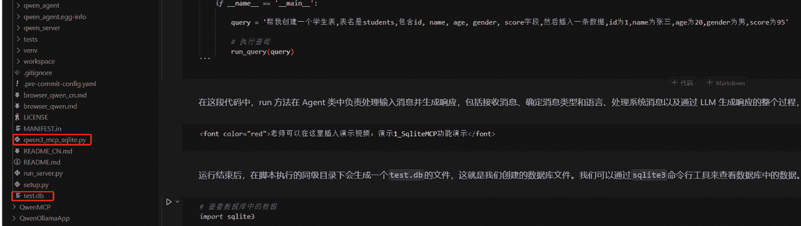

这里我们可以通过sqlite3命令行工具来查看数据库中的数据。

```
# 查看数据库中的数据
import sqlite3

conn = sqlite3.connect(&#x27;E:\\mcpCourse\\Qwen-Agent-main\\test.db&#x27;)
cursor = conn.cursor()

# 先查看数据库中有哪些表
cursor.execute(&quot;SELECT name FROM sqlite_master WHERE type=&#x27;table&#x27;;&quot;)
tables = cursor.fetchall()
print(&quot;数据库中的表:&quot;, tables)

# 如果有表，则查询第一个表的数据
if tables:
    table_name = tables[0][0]
    cursor.execute(f&quot;SELECT * FROM {table_name}&quot;)
    print(f&quot;{table_name} 表中的数据:&quot;, cursor.fetchall())
else:
    print(&quot;数据库中没有表，需要先创建表并插入数据&quot;)

conn.close()
```

```
数据库中的表: [(&#x27;students&#x27;,)]
students 表中的数据: [(1, &#x27;张三&#x27;, 20, &#x27;男&#x27;, 95)]
```

> 脚本已上传至课件网盘：


> 扫码即可领取：


### 4. MCP服务器+Qwen-Agent自带工具联合运行

大模型不擅长数学运算、数据可视化等精确计算任务，因此我们一般会使用代码解释器，使智能体编写和运行 Python 程序，从而逐步解决复杂的数据问题。如果智能体编写的代码未能成功运行，它还会不断调整代码，尝试不同的方法，直到代码能够顺利执行。

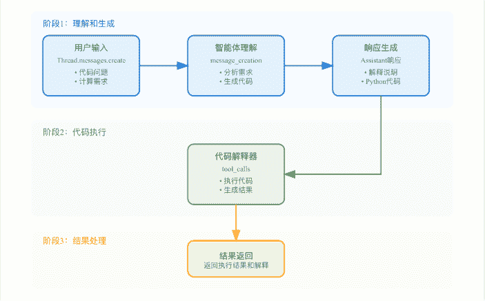

Qwen-Agent内置集成了 code_interpreter 组件，因此需要先执行安装，执行如下命令：

```
    pip install &quot;qwen-agent[code_interpreter]&quot;
```

调用code_interpreter的方法同样是需要在构建Assistant的时候，定义在tools列表中，并通过 Function_list参数传递。

```
    tools = [{
        &quot;mcpServers&quot;: {
            &quot;sqlite&quot; : {
                &quot;command&quot;: &quot;uvx&quot;,
                &quot;args&quot;: [
                    &quot;mcp-server-sqlite&quot;,
                    &quot;--db-path&quot;,
                    &quot;test.db&quot;
                ]
            },
           
        },
        
        
    },
    # pip install &quot;qwen-agent[code_interpreter]&quot;
    &#x27;code_interpreter&#x27;,
    ]
```

这里我们创建了qwen3_mcp_multi.py文件，核心代码如下：

```
    # qwen3_mcp_multi.py
    from qwen_agent.agents.assistant import Assistant
    from qwen_agent.utils.output_beautify import typewriter_print

    def init_agent_service():

        # 使用 Ollama 运行的模型
        llm_cfg = {
            &#x27;model&#x27;: &#x27;Qwen3:8B&#x27;,
            &#x27;model_server&#x27;: &#x27;http://localhost:11434/v1&#x27;,
            &#x27;api_key&#x27;: &#x27;EMPTY&#x27;,
        }

        system = (&#x27;你是一个数据分析师，具有对本地数据库的增删改查能力，同时具有使用python代码的能力&#x27;)

        tools = [{
            &quot;mcpServers&quot;: {
                &quot;sqlite&quot; : {
                    &quot;command&quot;: &quot;uvx&quot;,
                    &quot;args&quot;: [
                        &quot;mcp-server-sqlite&quot;,
                        &quot;--db-path&quot;,
                        &quot;test.db&quot;
                    ]
                },
            
            },
            
            
        },
        # pip install &quot;qwen-agent[code_interpreter]&quot;
        &#x27;code_interpreter&#x27;,
        ]

        bot = Assistant(
            llm=llm_cfg,
            name=&#x27;数据分析师&#x27;,
            description=&#x27;可以对本地数据库进行增删改查，也&#x27;,
            system_message=system,
            function_list=tools,
        )

        return bot

    def run_query(query=None):
        # 定义数据库助手
        bot = init_agent_service()

        # 执行对话逻辑
        messages = []
        messages.append({&#x27;role&#x27;: &#x27;user&#x27;, &#x27;content&#x27;: [{&#x27;text&#x27;: query}]})

        # 跟踪前一次的输出，用于增量打印
        previous_text = &quot;&quot;
        
        print(&#x27;数据库管理员: &#x27;, end=&#x27;&#x27;, flush=True)

        for response in bot.run(messages):
            previous_text = typewriter_print(response, previous_text)


    # 命令行接口，便于直接运行
    if __name__ == &#x27;__main__&#x27;:

        query = &#x27;帮我随机生成20条学生的成绩数据, 插入到students表中,\
                然后绘制一个折线图展示所有成绩变化趋势&#x27;
        
        # 执行查询
        run_query(query)
        
```

```
Video(&quot;https://ml2022.oss-cn-hangzhou.aliyuncs.com/%E6%BC%94%E7%A4%BA2_%E5%A4%9AMCP%E6%89%A7%E8%A1%8C.mp4&quot;, width=800, height=400)
```

Your browser does not support the video element.

> 脚本已上传至课件网盘：

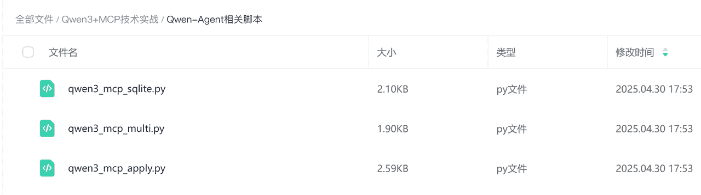

> 扫码即可领取：


### 5. 搭建Multi-MCP Agent进行任务执行

接下来构建Multi-MCP Agent 多轮对话执行，并接入高德MCP服务器完成旅行规划助理。

首先可以在github上找到公开的高德MCP服务器：https://github.com/sugarforever/amap-mcp-server

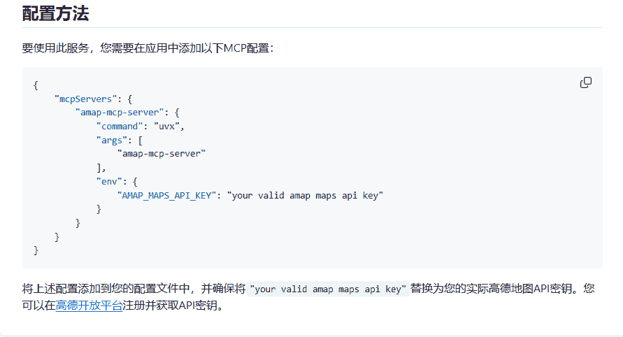

&emsp然后，需要在高德开放中心注册API进行使用：https://lbs.amap.com/

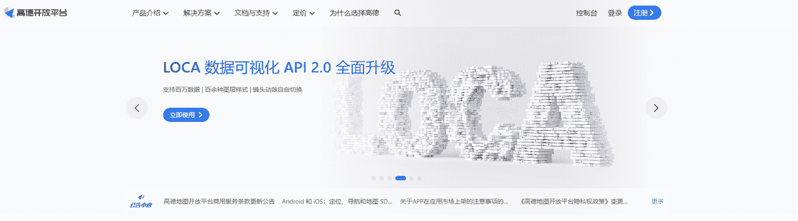

创建应用并生成一个有效的key：

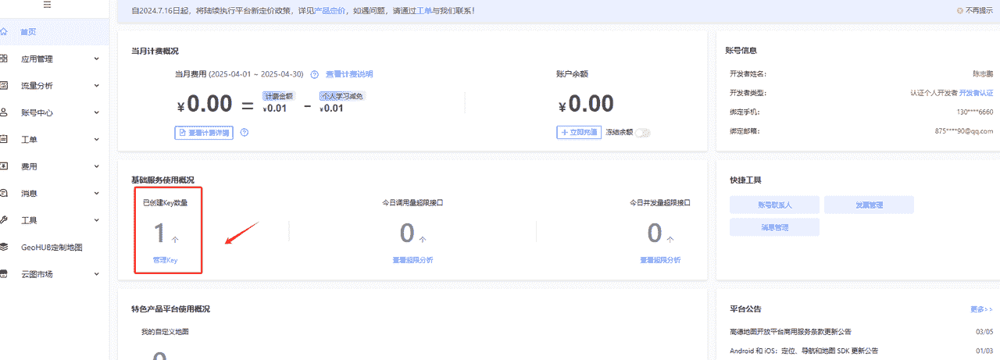

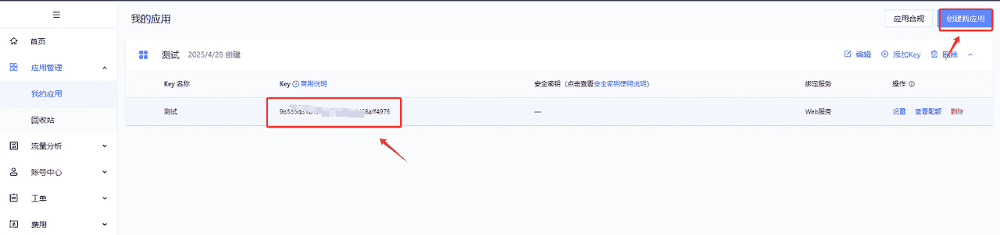

然后在tools列表中添加高德MCP服务器：

```
    tools = [{
        &quot;mcpServers&quot;: {
            &quot;sqlite&quot; : {
                &quot;command&quot;: &quot;uvx&quot;,
                &quot;args&quot;: [
                    &quot;mcp-server-sqlite&quot;,
                    &quot;--db-path&quot;,
                    &quot;test.db&quot;
                ]
            },
            &quot;amap-mcp-server&quot;: {
                &quot;command&quot;: &quot;uvx&quot;,
                &quot;args&quot;: [
                    &quot;amap-mcp-server&quot;
                ],
                &quot;env&quot;: {
                    &quot;AMAP_MAPS_API_KEY&quot;: &quot;9b555d3ff4976&quot;   # 这里替换成注册的高德API
                }
            }
        },
    },
    &#x27;code_interpreter&#x27;,
    ]
```

+   Firecrawl MCP Server

接下来我们需要找一个能抓取网页数据的MCP，这里可以选择Firecrawl MCP Server ：https://github.com/mendableai/firecrawl-mcp-server

[  Firecra](https://github.com/mendableai/firecrawl)wl MCP Server实现与 Firecrawl 集成以实现网页抓取功能。支持的功能如下：

+   抓取、爬取、搜索、提取、深入研究和批量抓取支持

+   使用 JS 渲染进行网页抓取

+   URL 发现和抓取

+   带有内容提取的网页搜索

+   .....

需要注册Firecrawl的API： https://www.firecrawl.dev/signin/password_signin

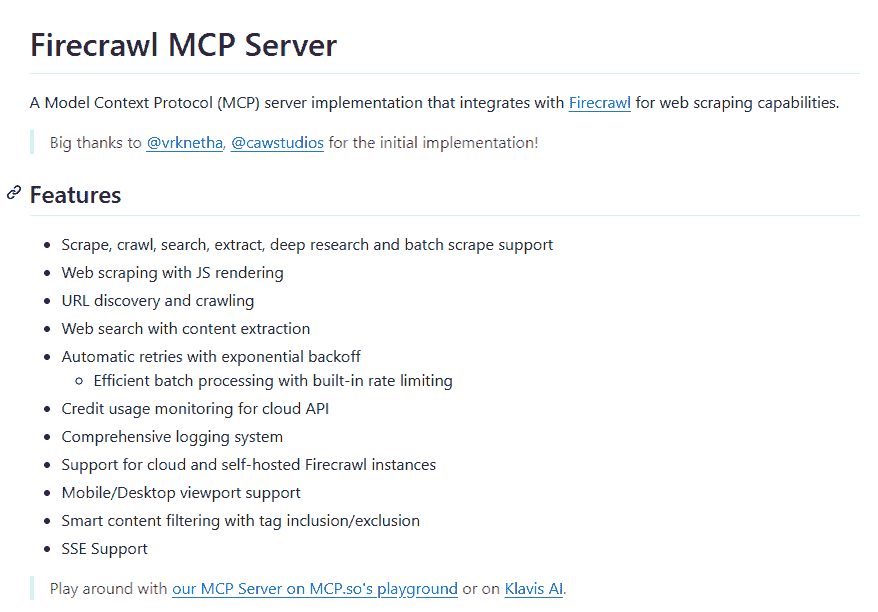

按照如下位置进行API_Keys的创建：

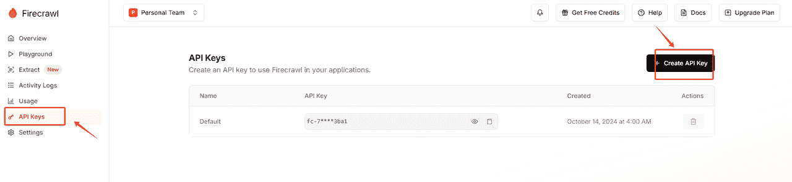

同样，需要添加到Tools列表中，整体配置如下：

```

    tools = [{
        &quot;mcpServers&quot;: {
            &quot;sqlite&quot; : {
                &quot;command&quot;: &quot;uvx&quot;,
                &quot;args&quot;: [
                    &quot;mcp-server-sqlite&quot;,
                    &quot;--db-path&quot;,
                    &quot;test.db&quot;
                ]
            },
            &quot;amap-mcp-server&quot;: {
                &quot;command&quot;: &quot;uvx&quot;,
                &quot;args&quot;: [
                    &quot;amap-mcp-server&quot;
                ],
                &quot;env&quot;: {
                    &quot;AMAP_MAPS_API_KEY&quot;: &quot;9b555d3ff4976&quot;   # 这里替换成注册的高德API
                }
            },
            
            &quot;firecrawl-mcp&quot;: {
                &quot;command&quot;: &quot;npx&quot;,
                &quot;args&quot;: [&quot;-y&quot;, &quot;firecrawl-mcp&quot;],
                &quot;env&quot;: {
                    &quot;FIRECRAWL_API_KEY&quot;: &quot;fc-724e84ead993ba1&quot;   # 这里需要替换成注册的 firecrawl Key
                },
            },
        },
    },
    &#x27;code_interpreter&#x27;,
    ]
```

除此以外，大家也可以使用 mcp-server-fetch：https://github.com/modelcontextprotocol/servers/tree/main/src/fetch ，大家可以根据自己的情况灵活选择。最终我们定义qwen3_mcp_apply.py文件，如下所示：

&gt; &lt;center&gt;&lt;img src=&quot;https://ml2022.oss-cn-hangzhou.aliyuncs.com/img/image-20250430175345970.png&quot; alt=&quot;image-20250430175345970&quot; style=&quot;zoom:50%;&quot; /&gt;
&gt; &lt;center&gt;&lt;img src=&quot;https://ml2022.oss-cn-hangzhou.aliyuncs.com/img/0ddb8b8061004446f889128b5702d48.jpg&quot; alt=&quot;0ddb8b8061004446f889128b5702d48&quot; style=&quot;zoom:50%;&quot; /&gt;


&lt;center&gt;&lt;img src=&quot;https://muyu20241105.oss-cn-beijing.aliyuncs.com/images/202504301300790.png&quot; alt=&quot;202412191720637&quot; style=&quot;zoom:60%;&quot; /&gt;


&lt;center&gt;&lt;img src=&quot;https://muyu20241105.oss-cn-beijing.aliyuncs.com/images/202504301303817.png&quot; alt=&quot;202412191720637&quot; style=&quot;zoom:60%;&quot; /&gt;

```

    def init_agent_service():
        # 使用 Ollama 运行的模型
        llm_cfg = {
            &#x27;model&#x27;: &#x27;Qwen3:8B&#x27;,
            &#x27;model_server&#x27;: &#x27;http://localhost:11434/v1&#x27;,
            &#x27;api_key&#x27;: &#x27;EMPTY&#x27;,
        }

        tools = [{
            &quot;mcpServers&quot;: {
                &#x27;time&#x27;: {
                    &#x27;command&#x27;: &#x27;uvx&#x27;,
                    &#x27;args&#x27;: [&#x27;mcp-server-time&#x27;, &#x27;--local-timezone=Asia/Shanghai&#x27;]
                },
                # &quot;fetch&quot;: {
                #     &quot;command&quot;: &quot;uvx&quot;,
                #     &quot;args&quot;: [&quot;mcp-server-fetch&quot;]
                # },
                
                &quot;sqlite&quot; : {
                    &quot;command&quot;: &quot;uvx&quot;,
                    &quot;args&quot;: [
                        &quot;mcp-server-sqlite&quot;,
                        &quot;--db-path&quot;,
                        &quot;test.db&quot;
                    ]
                },

                &quot;firecrawl-mcp&quot;: {
                    &quot;command&quot;: &quot;npx&quot;,
                    &quot;args&quot;: [&quot;-y&quot;, &quot;firecrawl-mcp&quot;],
                    &quot;env&quot;: {
                        &quot;FIRECRAWL_API_KEY&quot;: &quot;fc-724e84ee49fad993ba1&quot;
                    },
                },

                &quot;amap-mcp-server&quot;: {
                    &quot;command&quot;: &quot;uvx&quot;,
                    &quot;args&quot;: [
                        &quot;amap-mcp-server&quot;
                    ],
                    &quot;env&quot;: {
                        &quot;AMAP_MAPS_API_KEY&quot;: &quot;9b555d31b15968aff4976&quot;
                    }
                }
            },
            
        },
        # pip install &quot;qwen-agent[code_interpreter]&quot;
        &#x27;code_interpreter&#x27;,
        ]

        system = &quot;&quot;&quot;
        你是一个规划师和数据分析师 \
            你可以调用高德地图规划旅行路线，同时可以提取网页信息进行数据分析
        &quot;&quot;&quot;

        bot = Assistant(
            llm=llm_cfg,
            name=&#x27;智能助理&#x27;,
            description=&#x27;具备查询高德地图、提取网页信息、数据分析的能力&#x27;,
            system_message=system,
            function_list=tools,
        )

        return bot

    def run_query(query=None):
        # 定义数据库助手
        bot = init_agent_service()

        from qwen_agent.gui import WebUI

        chatbot_config = {
            &#x27;prompt.suggestions&#x27;: [
                &#x27;请你帮我写一个关于人工智能的论文&#x27;,
                &quot;https://github.com/orgs/QwenLM/repositories 提取这一页的Markdown 文档，然后绘制一个柱状图展示每个项目的收藏量&quot;,
                &#x27;帮我查询从故宫去颐和园的路线&#x27;,
            ]
        }
        WebUI(
            bot,
            chatbot_config=chatbot_config,
        ).run()
        
&gt; 脚本已上传至课件网盘：
&gt; 扫码即可领取：
&amp;emsp;&amp;emsp;这里我们要应用到`Qwen-Agent`内置的`WebUI`,其实现了一个基于Gradio构建的前端页面，通过执行 qwen3_mcp_apply, 启动后即可在 localhost:8000 访问：
&amp;emsp;&amp;emsp;此时通过浏览器访问：http://localhost:7860/ 即可进行使用。
- 官网查询GitHub项目历史星标项目复现

```python
Video(&quot;https://ml2022.oss-cn-hangzhou.aliyuncs.com/Qwen-Agent%20%E5%A4%8D%E7%8E%B0%E6%BC%94%E7%A4%BA2.mp4&quot;, width=800, height=400)
```

Your browser does not support the video element.

```
Video(&quot;https://ml2022.oss-cn-hangzhou.aliyuncs.com/Qwen-Agent%20%E5%A4%8D%E7%8E%B0%E6%BC%94%E7%A4%BA1.mp4&quot;, width=800, height=400)
```

Your browser does not support the video element.