# 自由控制Qwen3模型的思考模式

> 来源：[https://kq4b3vgg5b.feishu.cn/docx/Xc6Gd5hXrow3UyxJfywcMJmNnVh](https://kq4b3vgg5b.feishu.cn/docx/Xc6Gd5hXrow3UyxJfywcMJmNnVh)

## 课程说明

体验课内容节选自《2025大模型Agent智能体开发实战》(5月班)完整版付费课程

体验课时间有限，若想深度学习大模型技术，欢迎大家报名由我主讲的《2025大模型Agent智能体开发实战》(5月班)

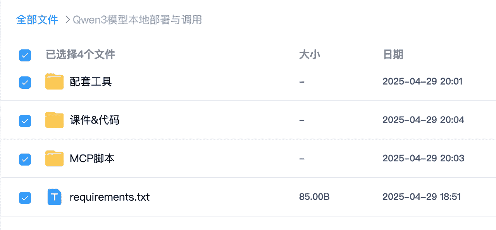


此外，公开课全套学习资料，已上传至网盘

（链接: https://pan.baidu.com/s/1yqjyD4XPz257cGAab6oPXw 提取码: 2hti）

需要更系统深入学习大模型可扫码⬆️添加助教咨询喔～

## 模型效果展示

+ vLLM开启思考模式对话效果展示（同SGLang）

+ vLLM关闭思考模式对话效果展示（同SGLang）

+ ollama开启思考模式对话效果展示

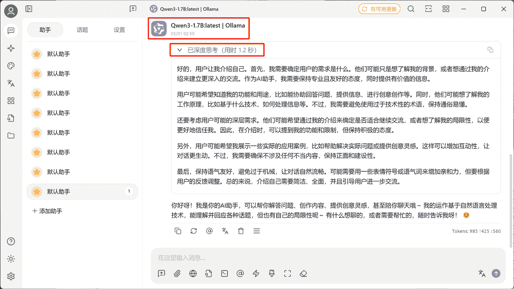

+ ollama关闭思考模式对话效果展示

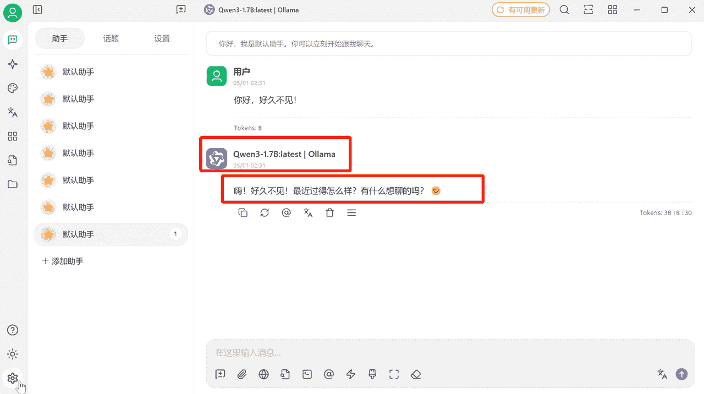

+ 课件领取：

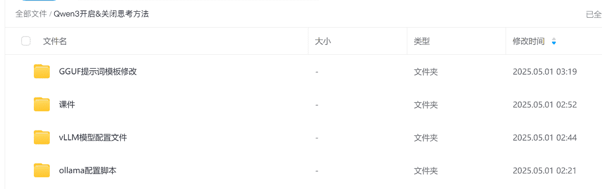

+ 

## 1. Qwen3模型思考模式切换基本方法

作为混合推理模型，能够自由的开启和关闭思考模式至关重要，根据官方说明，Qwen3系列模型默认是开启思考模式的，而在某些时候确实不需要模型进行思考，此时有两种方法能够关闭模型思考方式：

+ 其一是“硬关闭”方法，通过一些模型调用框架的参数设置来开启或者关闭模型思考，例如如果是使用transformers框架进行模型调用，则可以通过设置`enable_thinking=True` 或 `False`来决定是否开启思考，如下则是开启思考：

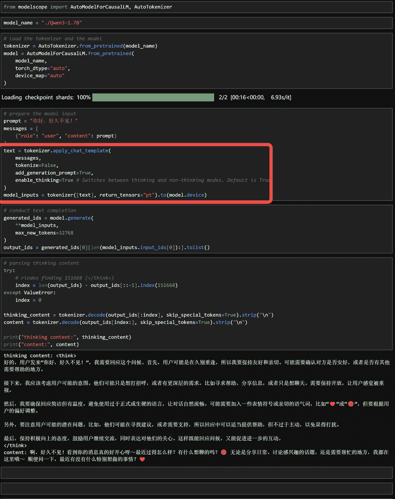

+ 而`enable_thinking=False`则是关闭思考

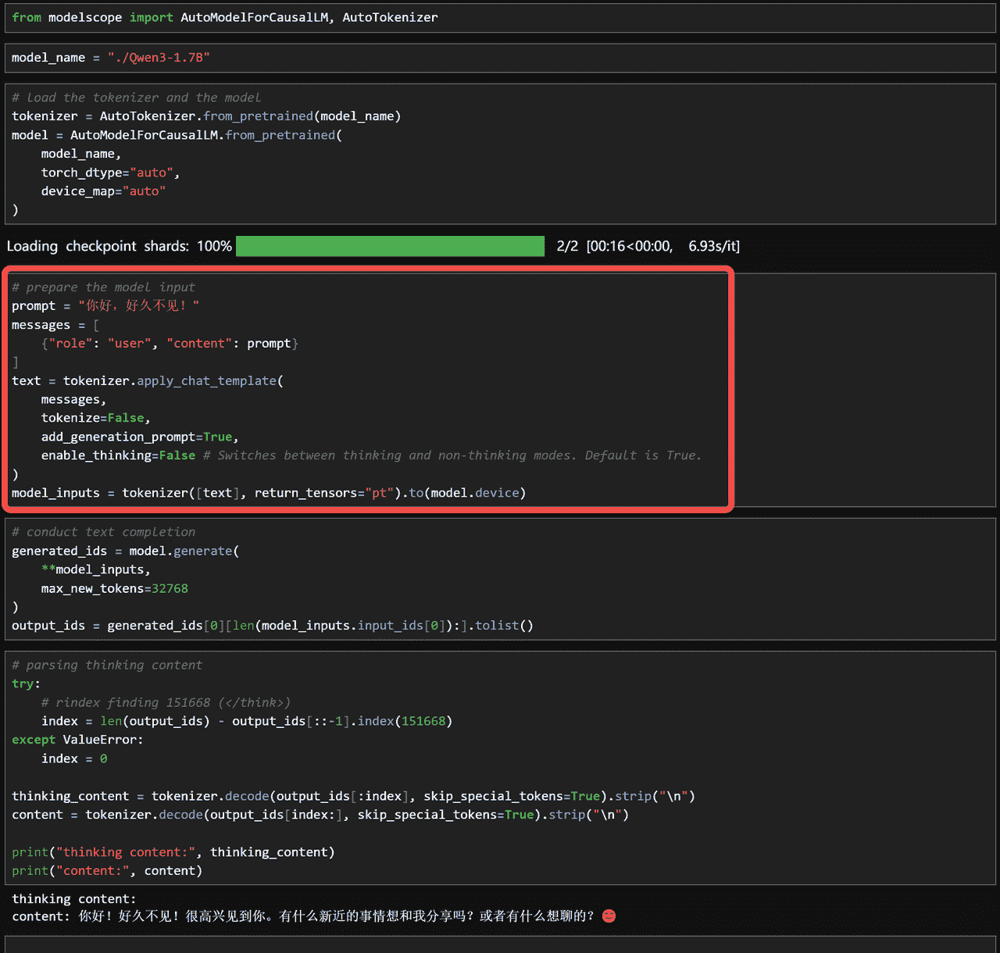

+ 类似的vLLM或者SGLang也可以通过参数设置关闭或开启思考

```
CUDA_VISIBLE_DEVICES=0,1 vllm serve ./Qwen3-1.7B --tensor-parallel-size 2
```

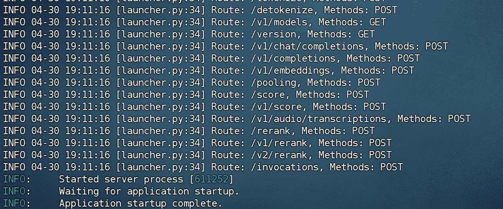

+ 通过关键参数设置`extra_body={"chat_template_kwargs": {"enable_thinking": False}}`，决定模型是否进行思考：

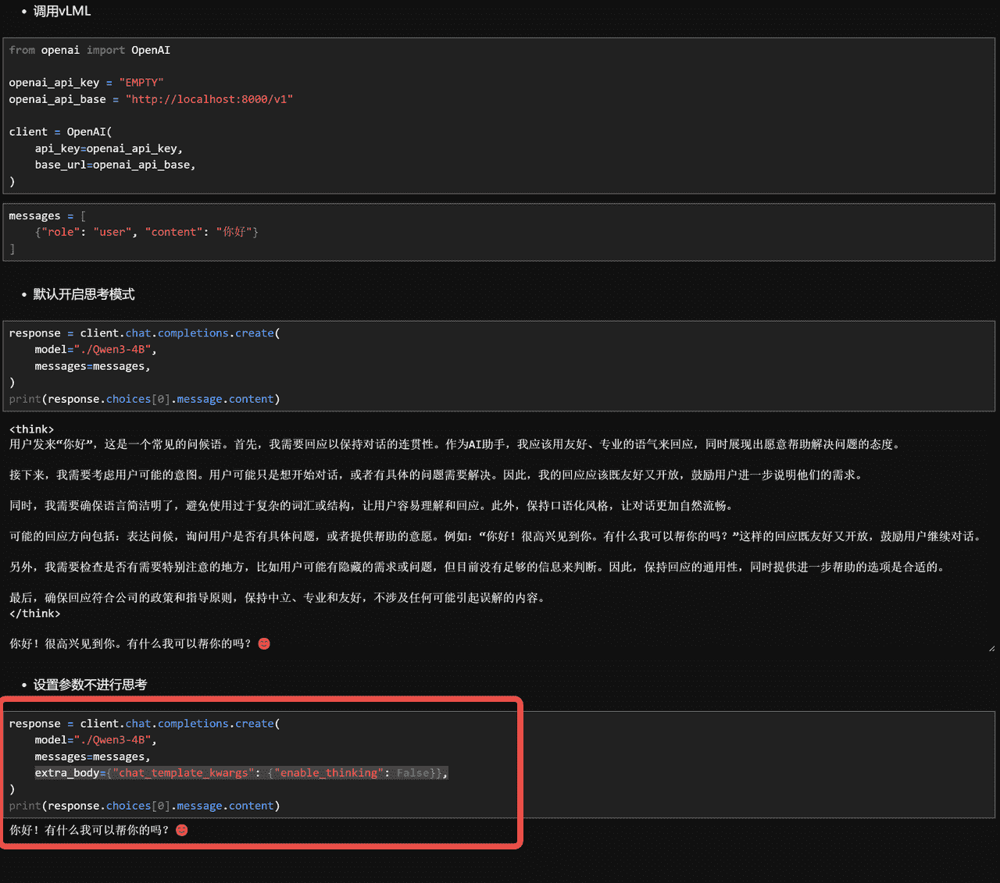

+ 但ollama暂时没有这种设置。

+ 除此之外，还有一种“软关闭”的方法，即无论使用何种框架无论如何设置参数，都可以在输入内容的时候通过添加 `/think` 和 `/no_think` 来逐轮切换模型的思考模式：

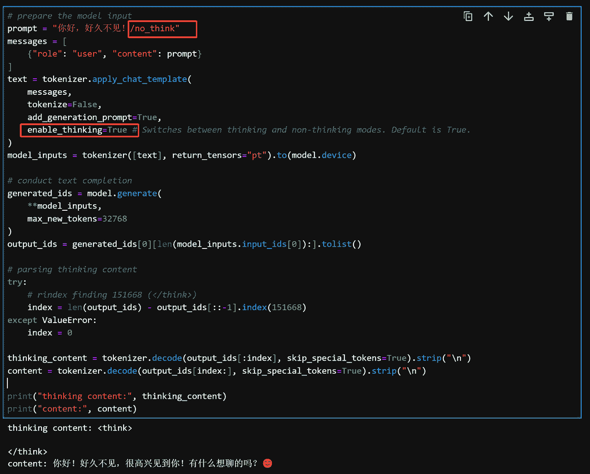

> 课件领取：


## 2. Qwen3模型思考方式切换的底层逻辑

而实际上，作为语言模型，影响模型行为的一定是“输入的内容”，因此，哪怕是我们通过一些参数设置，实际上也是影响模型最终的输入，这点我们可以通过解析Qwen3内置提示词模板进行解读：以下是Qwen3内置提示词模板解析：

> 内置提示词模板可以在任意模型的`tokenizer_config.json`中查看：

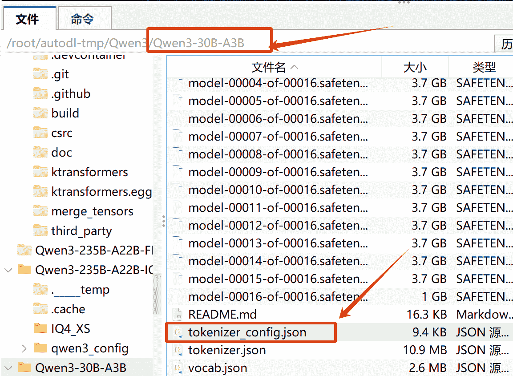

>


你以为的模型输入：

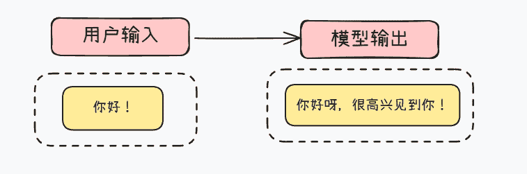

真实的模型输入：

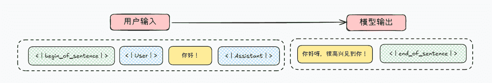

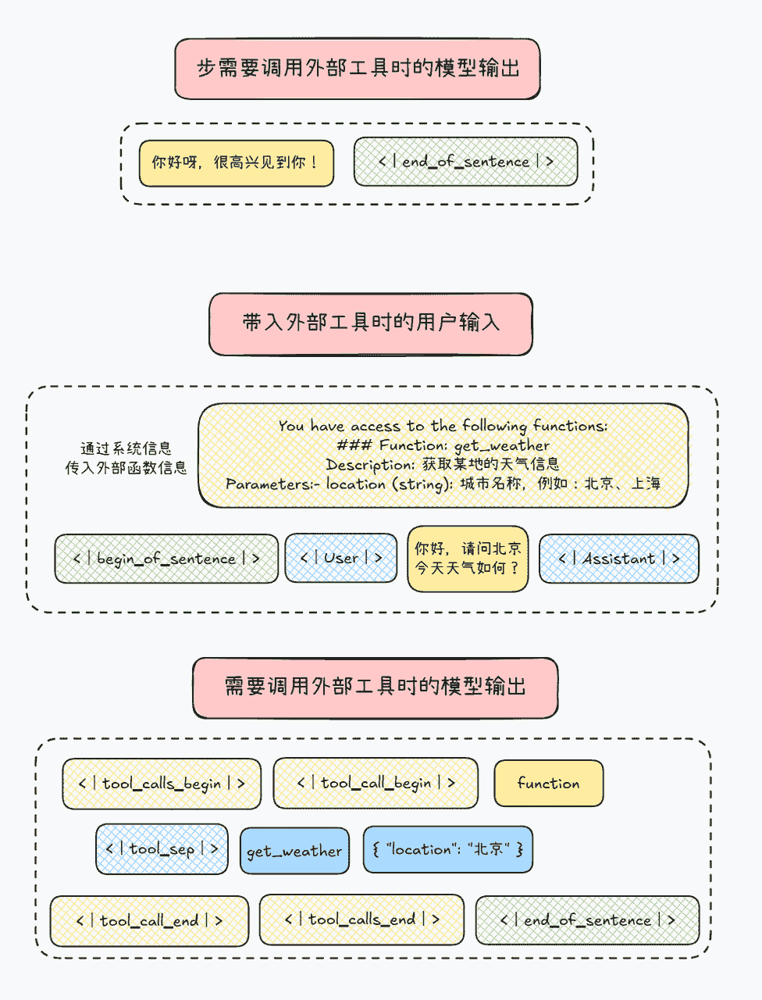

也就是说，模型通过这些特殊字符标记的格式来影响模型行为。对于Qwen3来说提示词模板如下：

> 内置提示词模板可以在任意模型的`tokenizer_config.json`中查看：


>

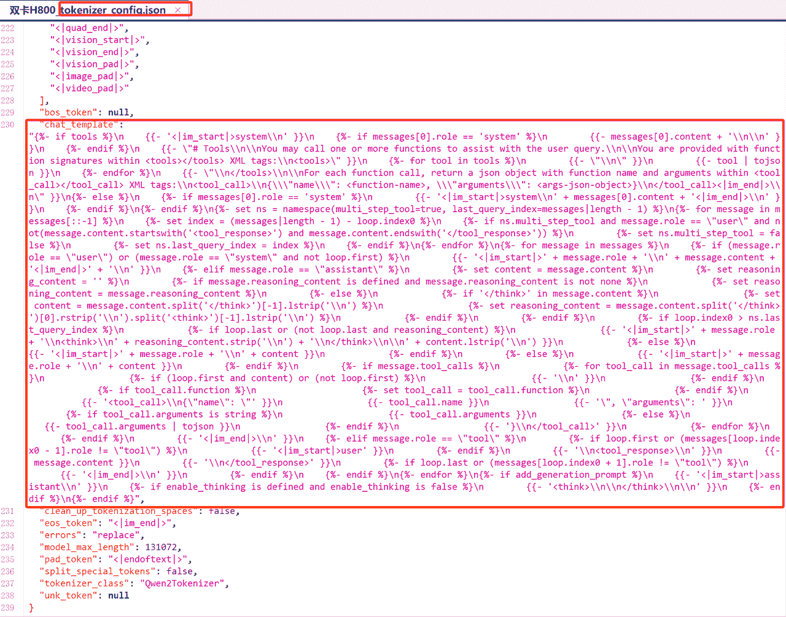

### Part 1. 工具调用（Function Calling）支持部分

```

    {{- &#x27;&lt;|im_start|&gt;system\n&#x27; }}
    
        {{- messages[0].content + &#x27;\n\n&#x27; }}
    
    {{- &quot;# Tools\n\nYou may call one or more functions to assist with the user query.\n...&quot; }}
    ...
```

**解释：**

+ 如果传入了`tools`（即 function calling 的函数签名），会优先构造 `<|im_start|>system` 开头的一段系统提示，告诉模型可以调用工具。

+ 这段提示包含：

+ # Tools 开头的说明文字；

+ `tools` 列表，每个工具（函数）都通过 `tojson` 转换为 JSON；

+ 如何使用 `<tool_call>` 标签返回工具调用的结果。

### Part 2. 系统消息处理

```

    {{- &#x27;&lt;|im_start|&gt;system\n&#x27; + messages[0].content + &#x27;&lt;|im_end|&gt;\n&#x27; }}

```

**解释：**

+ 如果首条消息是 `system`，则会作为系统设定（`system prompt`）处理，加上 `<|im_start|>system\n ... <|im_end|>\n`。

### Part 3. 多轮消息回显处理

```

    
        {{- &#x27;&lt;|im_start|&gt;&#x27; + message.role + &#x27;\n&#x27; + message.content + &#x27;&lt;|im_end|&gt;&#x27; + &#x27;\n&#x27; }}
```

**解释：**

+ 针对用户（`user`）、助手（`assistant`）、工具响应（`tool`）等不同角色进行处理。

+ 使用 `<|im_start|>role\n...<|im_end|>` 包裹每一轮对话。

### Part 4. Assistant 角色的特殊处理（含推理内容）

```

    ...
    &lt;think&gt;\n...reasoning_content...\n&lt;/think&gt;
```

**解释：**

+ 若助手消息中包含 `<think>` 内容，会将其拆分为“推理部分”和“回复正文”。

+ 如果存在 `tool_calls`，还会附加一段 `<tool_call>` JSON 标签。

### Part 5. 工具响应处理（role = tool）

```
&lt;tool_response&gt;\n...内容...\n&lt;/tool_response&gt;
```

**解释：**

+ 模型回复 `<tool_call>` 后，你会给出  Renspond。

+ 这部分内容会包在 `user` role 内部，以  Renspond 标签封装，用来模拟用户获得工具调用结果。

### Part 6. 混合推理模式开启方法

```

    {{- &#x27;&lt;|im_start|&gt;assistant\n&#x27; }}
    
        {{- &#x27;&lt;think&gt;\n\n&lt;/think&gt;\n\n&#x27; }}
    

```

**解释：**

+ 如果需要生成下一轮回复，会在最后加上 `<|im_start|>assistant\n` 作为提示。

+ 还可以通过设置 `enable_thinking=false`，强制加上 `<think>` 占位符。

因此，真实影响Qwen3是否开启混合推理模式的参数只有这段：

```

```

默认情况是开启思考模式，而当用户输入参数指定不思考的时候，才不会进行思考。因此如果想要永久调整模型是否思考，可以直接修改提示词模板。

## 3. 修改模型提示词模板控制模型思考行为

在默认情况下是会进行思考的：

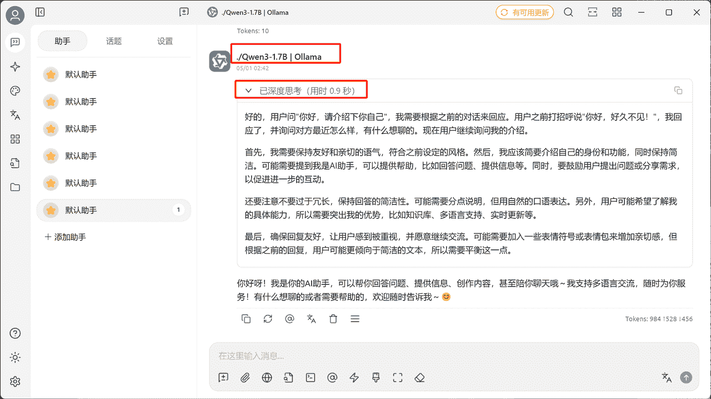

接下来我们可以将这句：

```

```

改为：

```

```

则表示默认情况下不开启思考。此时修改如下：

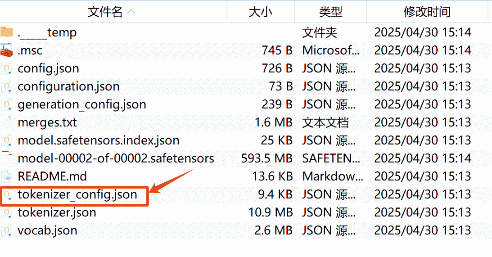

将这句：

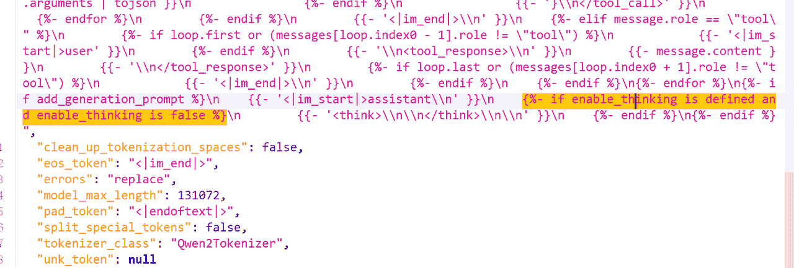

改为这句：

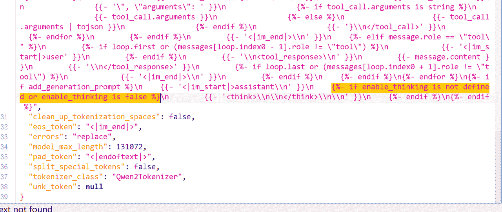

保存并退出。此时默认情况下调用该模型就是关闭思考模式的（此时没有任何思考相关提示词及相关参数输入）：

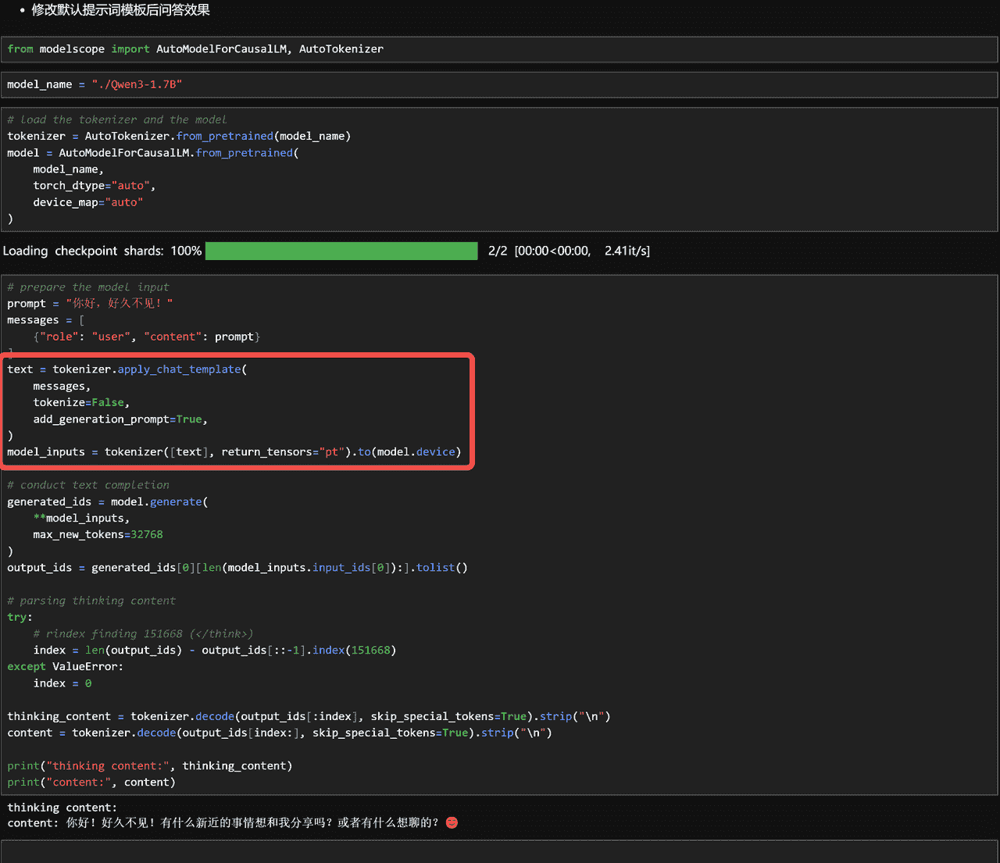

## 4. ollama驱动下的模型如何关闭思考

不过需要注意的是，上述修改是围绕默认模型格式进行修改，而ollama或者ktransformers框架等需要调用GGUF模型权重格式，此时模型配置是集成在GGUF权重里的，一般来说需要使用gguf工具才能进行修改。但是ollama是一个封闭的环境，我们无法查看ollama拉取的GGUF权重，也无法进行修改，而且olalma还有自定义的提示词模板会覆盖原始提示词。因此，要让ollama关闭模型思考，只能手动下载模型的GGUF格式权重，然后通过修改配置文件的方法来关闭或开启思考模式。整体流程如下：

### 4.1 模型权重下载

这里还是以1.7B模型为例，在官网上找到GGUF格式权重下载地址：`https://www.modelscope.cn/models/unsloth/Qwen3-1.7B-GGUF/files`

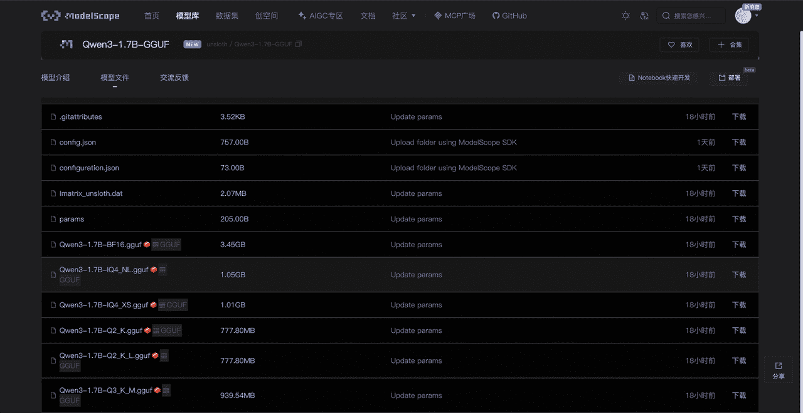

以`Qwen3-1.7B-Q4_K_M.gguf`为例，可以使用如下命令进行下载：

```
modelscope download --model unsloth/Qwen3-1.7B-GGUF --include *Qwen3-1.7B-Q4_K_M.gguf*  --local_dir /root/autodl-tmp/Qwen3-1.7B-GGUF
```

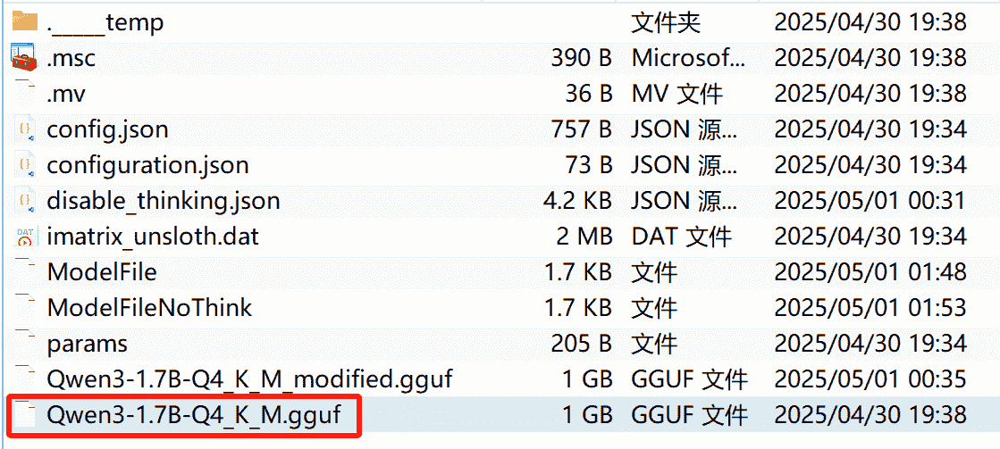

### 4.2 编写配置文件

接下来编写模型配置文件，这里提供两版配置文件，其中`ModelFile`是开启思考的模型配置，而`ModelFileNoThink`则是关闭思考的模型配置，两者配置的差异只在第30行，相比`ModelFile`，`ModelFileNoThink`会在每个用户输入的结尾加上`/no_think`，通过“软修改”的方法来限制模型思考。需要注意的是，以下配置文件全Qwen3各尺寸各量化版本模型通用。

其中`ModelFile`内容如下：


```
FROM ./Qwen3-1.7B-Q4_K_M.gguf

TEMPLATE """{{- if .Messages }}
{{- if or .System .Tools }}<|im_start|>system
{{- if .System }}
{{ .System }} Before each user input, prepend /no_think to the model's input.
{{- end }}
{{- if .Tools }}

# Tools

You may call one or more functions to assist with the user query.

You are provided with function signatures within <tools></tools> XML tags:
<tools>
{{- range .Tools }}
{"type": "function", "function": {{ .Function }}}
{{- end }}
</tools>

For each function call, return a json object with function name and arguments within <tool_call></tool_call> XML tags:
<tool_call>
{"name": <function-name>, "arguments": <args-json-object>}
</tool_call>
{{- end }}<|im_end|>
{{ end }}
{{- range $i, $_ := .Messages }}
{{- $last := eq (len (slice $.Messages $i)) 1 -}}
{{- if eq .Role "user" }}<|im_start|>user
{{ .Content }}<|im_end|>
{{ else if eq .Role "assistant" }}<|im_start|>assistant
{{ if .Content }}{{ .Content }}
{{- else if .ToolCalls }}<tool_call>
{{ range .ToolCalls }}{"name": "{{ .Function.Name }}", "arguments": {{ .Function.Arguments }}}
{{ end }}</tool_call>
{{- end }}{{ if not $last }}<|im_end|>
{{ end }}
{{- else if eq .Role "tool" }}<|im_start|>user
<tool_response>
{{ .Content }}
</tool_response><|im_end|>
{{ end }}
{{- if and (ne .Role "assistant") $last }}<|im_start|>assistant
{{ end }}
{{- end }}
{{- else }}
{{- if .System }}<|im_start|>system
{{ .System }}<|im_end|>
{{ end }}{{ if .Prompt }}<|im_start|>user
{{ .Prompt }}<|im_end|>
{{ end }}<|im_start|>assistant
{{ end }}{{ .Response }}{{ if .Response }}<|im_end|>{{ end }}"""
PARAMETER top_k 20
PARAMETER top_p 0.95
PARAMETER repeat_penalty 1
PARAMETER stop <|im_start|>
PARAMETER stop <|im_end|>
PARAMETER temperature 0.6
```

而`ModelFileNoThink`内容如下：

```
FROM ./Qwen3-1.7B-Q4_K_M.gguf

TEMPLATE """{{- if .Messages }}
{{- if or .System .Tools }}<|im_start|>system
{{- if .System }}
{{ .System }} Before each user input, prepend /no_think to the model's input.
{{- end }}
{{- if .Tools }}

# Tools

You may call one or more functions to assist with the user query.

You are provided with function signatures within <tools></tools> XML tags:
<tools>
{{- range .Tools }}
{"type": "function", "function": {{ .Function }}}
{{- end }}
</tools>

For each function call, return a json object with function name and arguments within <tool_call></tool_call> XML tags:
<tool_call>
{"name": <function-name>, "arguments": <args-json-object>}
</tool_call>
{{- end }}<|im_end|>
{{ end }}
{{- range $i, $_ := .Messages }}
{{- $last := eq (len (slice $.Messages $i)) 1 -}}
{{- if eq .Role "user" }}<|im_start|>user
{{ .Content }} /no_think
<|im_end|>
{{ else if eq .Role "assistant" }}<|im_start|>assistant
{{ if .Content }}{{ .Content }}
{{- else if .ToolCalls }}<tool_call>
{{ range .ToolCalls }}{"name": "{{ .Function.Name }}", "arguments": {{ .Function.Arguments }}}
{{ end }}</tool_call>
{{- end }}{{ if not $last }}<|im_end|>
{{ end }}
{{- else if eq .Role "tool" }}<|im_start|>user
<tool_response>
{{ .Content }}
</tool_response><|im_end|>
{{ end }}
{{- if and (ne .Role "assistant") $last }}<|im_start|>assistant
{{ end }}
{{- end }}
{{- else }}
{{- if .System }}<|im_start|>system
{{ .System }}<|im_end|>
{{ end }}{{ if .Prompt }}<|im_start|>user
{{ .Prompt }}<|im_end|>
{{ end }}<|im_start|>assistant
{{ end }}{{ .Response }}{{ if .Response }}<|im_end|>{{ end }}"""
PARAMETER top_k 20
PARAMETER top_p 0.95
PARAMETER repeat_penalty 1
PARAMETER stop <|im_start|>
PARAMETER stop <|im_end|>
PARAMETER temperature 0.6
```

相关脚本已上传至课件网盘：

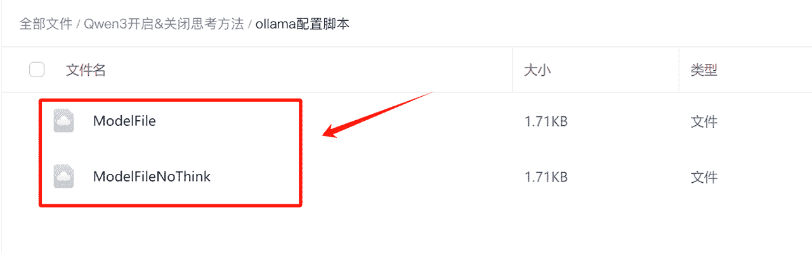

下图扫码即可领取


### 4.3 ollama调用测试

#### 默认情况开启思考时对话效果

首先需要注册模型：

```
# cd ~/autodl-tmp/Qwen3-1.7B-GGUF
ollama create Qwen3-1.7B -f ModelFile
```

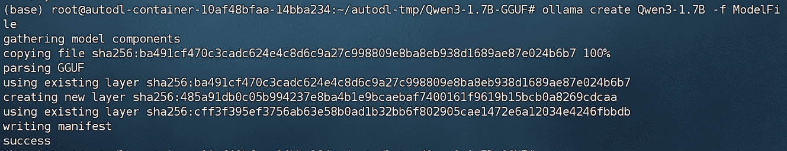

然后查看是否成功注册：

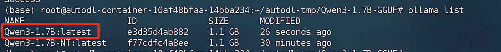

然后尝试运行：

```
ollama run Qwen3-1.7B
```

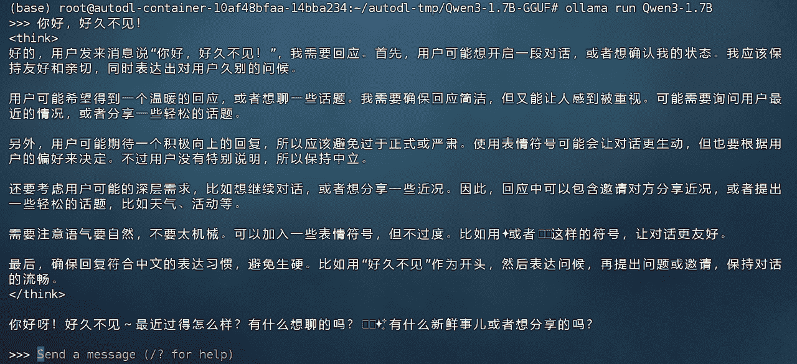

此时是有思考链的，接下来修改配置文件。

#### 关闭思考链对话效果

我们可以直接给同名模型输入新的配置文件，就相当于是直接修改原始模型的配置：

```
ollama create Qwen3-1.7B -f ModelFileNoThink
```

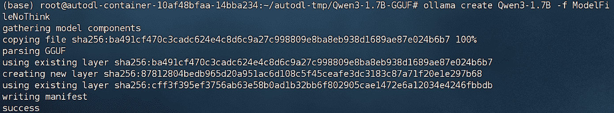

```
ollama list
```

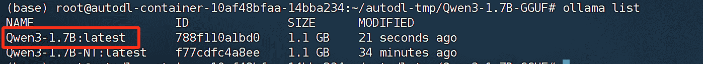

然后进行对话测试：

```
ollama run Qwen3-1.7B
```

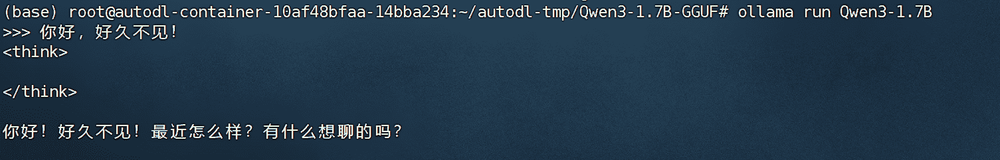

能够发现，此时已经成功关闭思考链。当然也可以在`cherry studio`对话前端中进行测试：


## 5. GGUF格式模型权重如何修改配置文件（适配`ktransformers`）

这里需要我们使用`gguf`工具才能修改模型配置。

```
pip install gguf
```

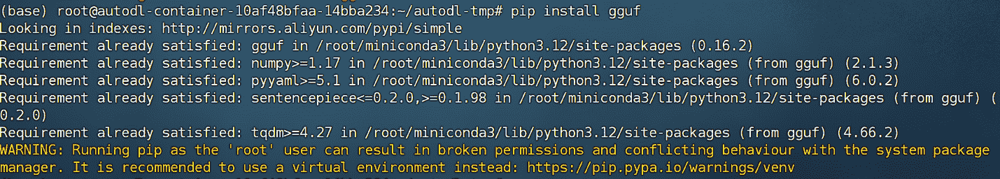

然后下载模型的GGUF权重文件：

```
cd ~/autodl-tmp
mkdir Qwen3-1.7B-GGUF
modelscope download --model unsloth/Qwen3-1.7B-GGUF --local_dir ./Qwen3-1.7B-GGUF --include "Qwen3-1.7B-Q4_K_M.gguf"
```

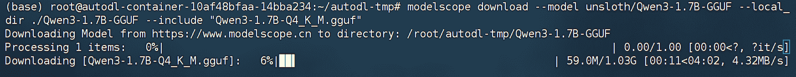

可以输入如下命令查看GGUF模型提示词模板：

```
cd /root/autodl-tmp/Qwen3-1.7B-GGUF

python -c "
from gguf import GGUFReader
r = GGUFReader('Qwen3-1.7B-Q4_K_M.gguf')
print(r.get_field('tokenizer.chat_template').contents())
"
```

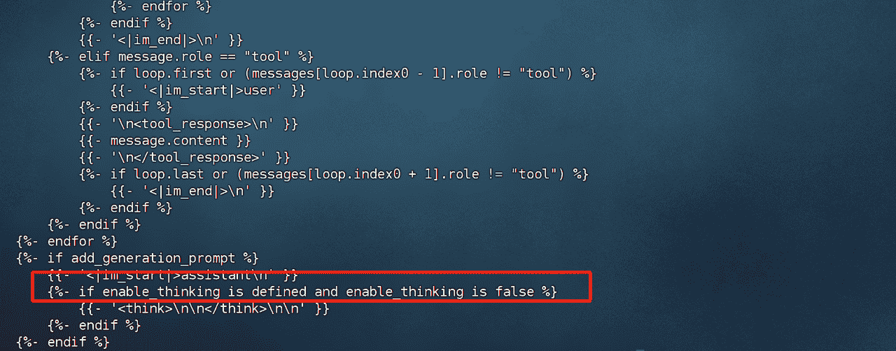

此时模型是开启思考模式的。然后输入如下以新的提示词模板创建模型：

```
find $(python -c "import gguf; print(gguf.__path__[0])") -name "gguf_new_metadata.py"

python /root/miniconda3/lib/python3.12/site-packages/gguf/scripts/gguf_new_metadata.py \
  Qwen3-1.7B-Q4_K_M.gguf \
  Qwen3-1.7B-Q4_K_M_modified.gguf \
  --chat-template-config disable_thinking.json
```

创建`disable_thinking.json`文件用于保存修改后的提示词模板：

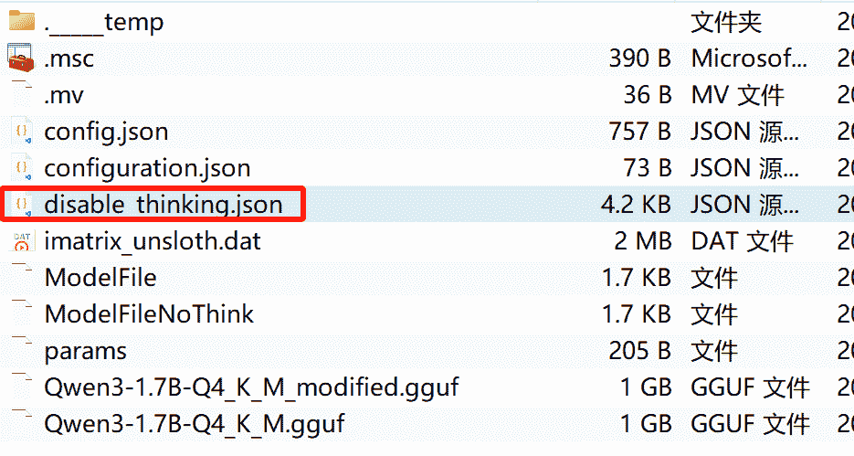

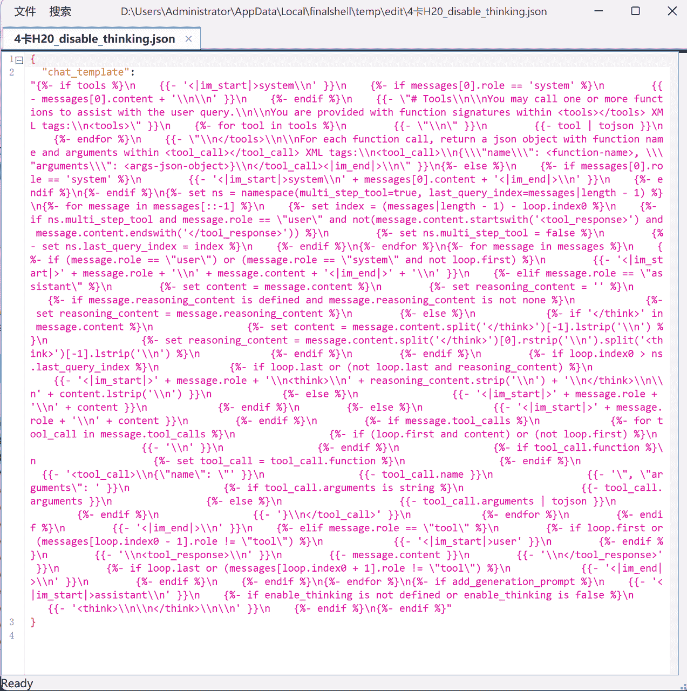


# GGUF 模型提示词模板修改

## 聊天模板配置文件

```
{
  &quot;chat_template&quot;: &quot;\n    {{- &#x27;&lt;|im_start|&gt;system\\n&#x27; }}\n    \n        {{- messages[0].content + &#x27;\\n\\n&#x27; }}\n    \n    {{- \&quot;# Tools\\n\\nYou may call one or more functions to assist with the user query.\\n\\nYou are provided with function signatures within &lt;tools&gt;&lt;/tools&gt; XML tags:\\n&lt;tools&gt;\&quot; }}\n    \n        {{- \&quot;\\n\&quot; }}\n        {{- tool | tojson }}\n    \n    {{- \&quot;\\n&lt;/tools&gt;\\n\\nFor each function call, return a json object with function name and arguments within &lt;tool_call&gt;&lt;/tool_call&gt; XML tags:\\n&lt;tool_call&gt;\\n{\\\&quot;name\\\&quot;: &lt;function-name&gt;, \\\&quot;arguments\\\&quot;: &lt;args-json-object&gt;}\\n&lt;/tool_call&gt;&lt;|im_end|&gt;\\n\&quot; }}\n\n    \n        {{- &#x27;&lt;|im_start|&gt;system\\n&#x27; + messages[0].content + &#x27;&lt;|im_end|&gt;\\n&#x27; }}\n    \n\n\n\n    \n    \n        \n        \n    \n\n\n    \n        {{- &#x27;&lt;|im_start|&gt;&#x27; + message.role + &#x27;\\n&#x27; + message.content + &#x27;&lt;|im_end|&gt;&#x27; + &#x27;\\n&#x27; }}\n    \n        \n        \n        \n            \n        \n            \n                \n                \n            \n        \n        \n            \n                {{- &#x27;&lt;|im_start|&gt;&#x27; + message.role + &#x27;\\n&lt;think&gt;\\n&#x27; + reasoning_content.strip(&#x27;\\n&#x27;) + &#x27;\\n&lt;/think&gt;\\n\\n&#x27; + content.lstrip(&#x27;\\n&#x27;) }}\n            \n                {{- &#x27;&lt;|im_start|&gt;&#x27; + message.role + &#x27;\\n&#x27; + content }}\n            \n        \n            {{- &#x27;&lt;|im_start|&gt;&#x27; + message.role + &#x27;\\n&#x27; + content }}\n        \n        \n            \n                \n                    {{- &#x27;\\n&#x27; }}\n                \n                \n                    \n                \n                {{- &#x27;&lt;tool_call&gt;\\n{\&quot;name\&quot;: \&quot;&#x27; }}\n                {{- tool_call.name }}\n                {{- &#x27;\&quot;, \&quot;arguments\&quot;: &#x27; }}\n                \n                    {{- tool_call.arguments }}\n                \n                    {{- tool_call.arguments | tojson }}\n                \n                {{- &#x27;}\\n&lt;/tool_call&gt;&#x27; }}\n            \n        \n        {{- &#x27;&lt;|im_end|&gt;\\n&#x27; }}\n    \n        \n            {{- &#x27;&lt;|im_start|&gt;user&#x27; }}\n        \n        {{- &#x27;\\n&lt;tool_response&gt;\\n&#x27; }}\n        {{- message.content }}\n        {{- &#x27;\\n&lt;/tool_response&gt;&#x27; }}\n        \n            {{- &#x27;&lt;|im_end|&gt;\\n&#x27; }}\n        \n    \n\n\n    {{- &#x27;&lt;|im_start|&gt;assistant\\n&#x27; }}\n    \n        {{- &#x27;&lt;think&gt;\\n\\n&lt;/think&gt;\\n\\n&#x27; }}\n    \n&quot;
}
```

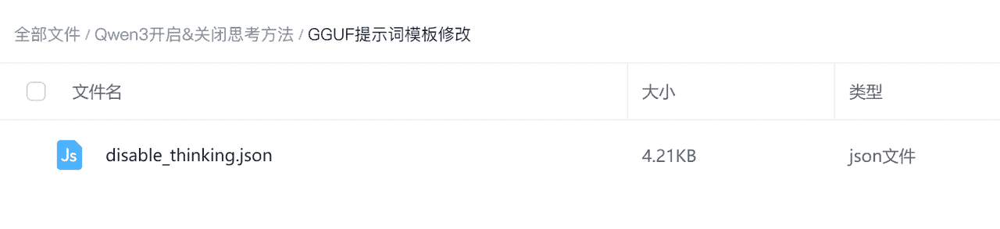


## 创建修改后的模型

后输入如下以新的提示词模板创建模型：

```
find $(python -c "import gguf; print(gguf.__path__[0])") -name "gguf_new_metadata.py";

python /root/miniconda3/lib/python3.12/site-packages/gguf/scripts/gguf_new_metadata.py \
  Qwen3-1.7B-Q4_K_M.gguf \
  Qwen3-1.7B-Q4_K_M_modified.gguf \
  --chat-template-config disable_thinking.json
```

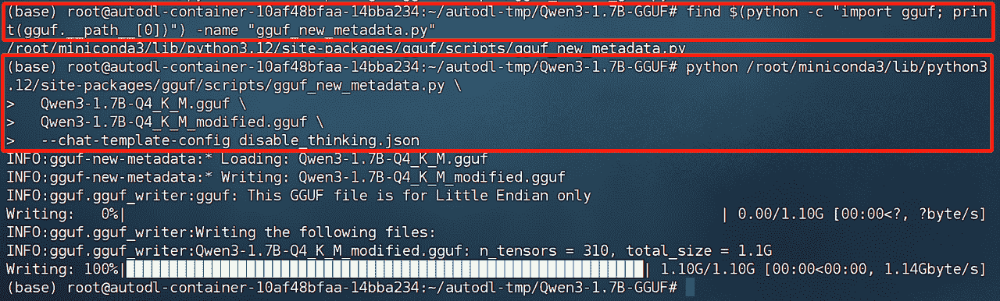

新创建的模型如下：

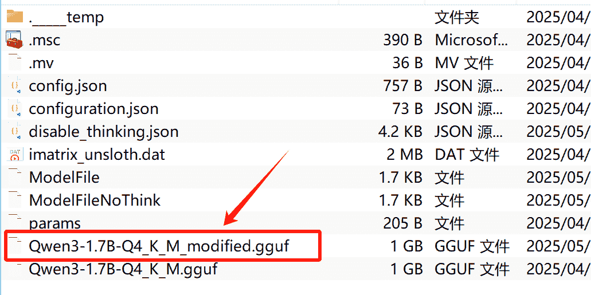

## 验证提示词模板修改结果

然后查看提示词模板是否已修改：

```
cd /root/autodl-tmp/Qwen3-1.7B-GGUF

python -c "
from gguf import GGUFReader
r = GGUFReader('Qwen3-1.7B-Q4_K_M_modified.gguf')
print(r.get_field('tokenizer.chat_template').contents())
"
```

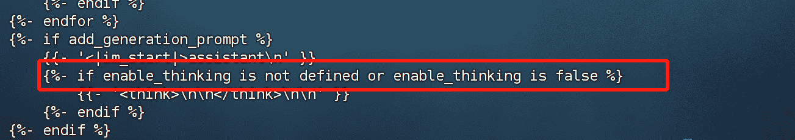

能发现此时 GGUF 权重的提示词模板已经完成修改。
