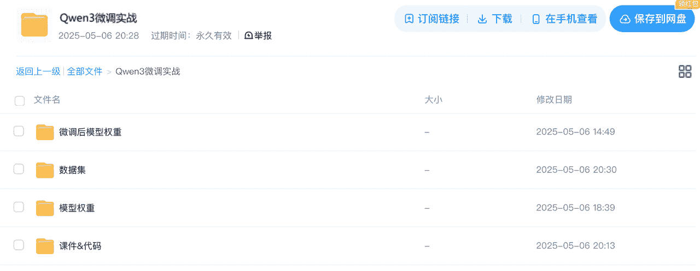
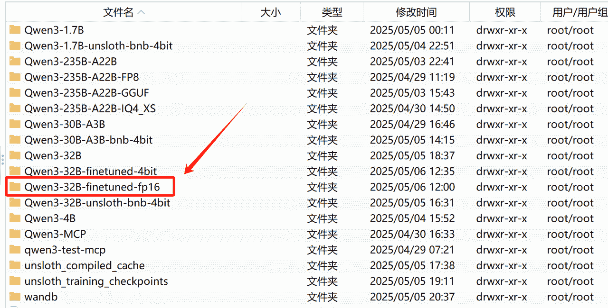
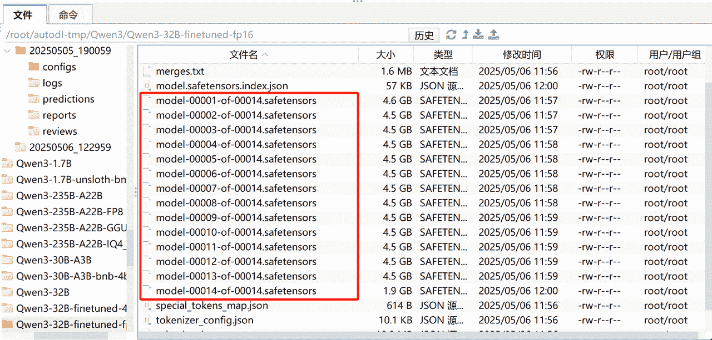

# Qwen3高效微调（下）

> 来源：[https://kq4b3vgg5b.feishu.cn/docx/IlkeddM2loVGfqxw7lEcQiCsnbf](https://kq4b3vgg5b.feishu.cn/docx/IlkeddM2loVGfqxw7lEcQiCsnbf)

## 课程说明

体验课内容节选自《2025大模型Agent智能体开发实战》(5月班)完整版付费课程

体验课时间有限，若想深度学习大模型技术，欢迎大家报名由我主讲的《2025大模型Agent智能体开发实战》(5月班)




此外，公开课全套学习资料，已上传至网盘

（链接: https://pan.baidu.com/s/1RPjCf3oatnN8paq8H2ioUg 提取码: 5g8z）

需要更系统深入学习大模型可扫码⬆️添加助教咨询喔～

---

## Qwen3高效微调实战（下）

### 纯代码版

#### 导入模型

```
from unsloth import FastLanguageModel
import torch
```

```
max_seq_length = 2048
dtype = None
load_in_4bit = True
```

```
model, tokenizer = FastLanguageModel.from_pretrained(
    model_name = "./Qwen3-32B-unsloth-bnb-4bit",
    max_seq_length = max_seq_length,
    dtype = dtype,
    load_in_4bit = load_in_4bit,
)
```

```
==((====))==  Unsloth 2025.4.7: Fast Qwen3 patching. Transformers: 4.51.3.
   \\   /|    NVIDIA H800 PCIe. Num GPUs = 1. Max memory: 79.205 GB. Platform: Linux.
O^O/ \_/ \    Torch: 2.7.0+cu126. CUDA: 9.0. CUDA Toolkit: 12.6. Triton: 3.3.0
\        /    Bfloat16 = TRUE. FA [Xformers = 0.0.30. FA2 = False]
 "-____-"     Free license: http://github.com/unslothai/unsloth
Unsloth: Fast downloading is enabled - ignore downloading bars which are red colored!


Loading checkpoint shards: 100%|█████████| 9/9 [00:14<00:00,  1.63s/it]
```

```
model
```


```
Qwen3ForCausalLM(
  (model): Qwen3Model(
    (embed_tokens): Embedding(151936, 5120, padding_idx=151654)
    (layers): ModuleList(
      (0-5): 6 x Qwen3DecoderLayer(
        (self_attn): Qwen3Attention(
          (q_proj): Linear4bit(in_features=5120, out_features=8192, bias=False)
          (k_proj): Linear4bit(in_features=5120, out_features=1024, bias=False)
          (v_proj): Linear4bit(in_features=5120, out_features=1024, bias=False)
          (o_proj): Linear4bit(in_features=8192, out_features=5120, bias=False)
          (q_norm): Qwen3RMSNorm((128,), eps=1e-06)
          (k_norm): Qwen3RMSNorm((128,), eps=1e-06)
          (rotary_emb): LlamaRotaryEmbedding()
        )
        (mlp): Qwen3MLP(
          (gate_proj): Linear4bit(in_features=5120, out_features=25600, bias=False)
          (up_proj): Linear4bit(in_features=5120, out_features=25600, bias=False)
          (down_proj): Linear4bit(in_features=25600, out_features=5120, bias=False)
          (act_fn): SiLU()
        )
        (input_layernorm): Qwen3RMSNorm((5120,), eps=1e-06)
        (post_attention_layernorm): Qwen3RMSNorm((5120,), eps=1e-06)
      )
      (6): Qwen3DecoderLayer(
        (self_attn): Qwen3Attention(
          (q_proj): Linear(in_features=5120, out_features=8192, bias=False)
          (k_proj): Linear(in_features=5120, out_features=1024, bias=False)
          (v_proj): Linear(in_features=5120, out_features=1024, bias=False)
          (o_proj): Linear(in_features=8192, out_features=5120, bias=False)
          (q_norm): Qwen3RMSNorm((128,), eps=1e-06)
          (k_norm): Qwen3RMSNorm((128,), eps=1e-06)
          (rotary_emb): LlamaRotaryEmbedding()
        )
        (mlp): Qwen3MLP(
          (gate_proj): Linear(in_features=5120, out_features=25600, bias=False)
          (up_proj): Linear(in_features=5120, out_features=25600, bias=False)
          (down_proj): Linear(in_features=25600, out_features=5120, bias=False)
          (act_fn): SiLU()
        )
        (input_layernorm): Qwen3RMSNorm((5120,), eps=1e-06)
        (post_attention_layernorm): Qwen3RMSNorm((5120,), eps=1e-06)
      )
      (7): Qwen3DecoderLayer(
        (self_attn): Qwen3Attention(
          (q_proj): Linear4bit(in_features=5120, out_features=8192, bias=False)
          (k_proj): Linear4bit(in_features=5120, out_features=1024, bias=False)
          (v_proj): Linear4bit(in_features=5120, out_features=1024, bias=False)
          (o_proj): Linear4bit(in_features=8192, out_features=5120, bias=False)
          (q_norm): Qwen3RMSNorm((128,), eps=1e-06)
          (k_norm): Qwen3RMSNorm((128,), eps=1e-06)
          (rotary_emb): LlamaRotaryEmbedding()
        )
        (mlp): Qwen3MLP(
          (gate_proj): Linear4bit(in_features=5120, out_features=25600, bias=False)
          (up_proj): Linear4bit(in_features=5120, out_features=25600, bias=False)
          (down_proj): Linear(in_features=25600, out_features=5120, bias=False)
          (act_fn): SiLU()
        )
        (input_layernorm): Qwen3RMSNorm((5120,), eps=1e-06)
        (post_attention_layernorm): Qwen3RMSNorm((5120,), eps=1e-06)
      )
      (8-22): 15 x Qwen3DecoderLayer(
        (self_attn): Qwen3Attention(
          (q_proj): Linear4bit(in_features=5120, out_features=8192, bias=False)
          (k_proj): Linear4bit(in_features=5120, out_features=1024, bias=False)
          (v_proj): Linear4bit(in_features=5120, out_features=1024, bias=False)
          (o_proj): Linear4bit(in_features=8192, out_features=5120, bias=False)
          (q_norm): Qwen3RMSNorm((128,), eps=1e-06)
          (k_norm): Qwen3RMSNorm((128,), eps=1e-06)
          (rotary_emb): LlamaRotaryEmbedding()
        )
        (mlp): Qwen3MLP(
          (gate_proj): Linear4bit(in_features=5120, out_features=25600, bias=False)
          (up_proj): Linear4bit(in_features=5120, out_features=25600, bias=False)
          (down_proj): Linear4bit(in_features=25600, out_features=5120, bias=False)
          (act_fn): SiLU()
        )
        (input_layernorm): Qwen3RMSNorm((5120,), eps=1e-06)
        (post_attention_layernorm): Qwen3RMSNorm((5120,), eps=1e-06)
      )
      (23-44): 22 x Qwen3DecoderLayer(
        (self_attn): Qwen3Attention(
          (q_proj): Linear4bit(in_features=5120, out_features=8192, bias=False)
          (k_proj): Linear4bit(in_features=5120, out_features=1024, bias=False)
          (v_proj): Linear4bit(in_features=5120, out_features=1024, bias=False)
          (o_proj): Linear4bit(in_features=8192, out_features=5120, bias=False)
          (q_norm): Qwen3RMSNorm((128,), eps=1e-06)
          (k_norm): Qwen3RMSNorm((128,), eps=1e-06)
          (rotary_emb): LlamaRotaryEmbedding()
        )
        (mlp): Qwen3MLP(
          (gate_proj): Linear(in_features=5120, out_features=25600, bias=False)
          (up_proj): Linear(in_features=5120, out_features=25600, bias=False)
          (down_proj): Linear(in_features=25600, out_features=5120, bias=False)
          (act_fn): SiLU()
        )
        (input_layernorm): Qwen3RMSNorm((5120,), eps=1e-06)
        (post_attention_layernorm): Qwen3RMSNorm((5120,), eps=1e-06)
      )
      (45): Qwen3DecoderLayer(
        (self_attn): Qwen3Attention(
          (q_proj): Linear4bit(in_features=5120, out_features=8192, bias=False)
          (k_proj): Linear4bit(in_features=5120, out_features=1024, bias=False)
          (v_proj): Linear4bit(in_features=5120, out_features=1024, bias=False)
          (o_proj): Linear(in_features=8192, out_features=5120, bias=False)
          (q_norm): Qwen3RMSNorm((128,), eps=1e-06)
          (k_norm): Qwen3RMSNorm((128,), eps=1e-06)
          (rotary_emb): LlamaRotaryEmbedding()
        )
        (mlp): Qwen3MLP(
          (gate_proj): Linear(in_features=5120, out_features=25600, bias=False)
          (up_proj): Linear(in_features=5120, out_features=25600, bias=False)
          (down_proj): Linear(in_features=25600, out_features=5120, bias=False)
          (act_fn): SiLU()
        )
        (input_layernorm): Qwen3RMSNorm((5120,), eps=1e-06)
        (post_attention_layernorm): Qwen3RMSNorm((5120,), eps=1e-06)
      )
      (46-54): 9 x Qwen3DecoderLayer(
        (self_attn): Qwen3Attention(
          (q_proj): Linear4bit(in_features=5120, out_features=8192, bias=False)
          (k_proj): Linear4bit(in_features=5120, out_features=1024, bias=False)
          (v_proj): Linear4bit(in_features=5120, out_features=1024, bias=False)
          (o_proj): Linear4bit(in_features=8192, out_features=5120, bias=False)
          (q_norm): Qwen3RMSNorm((128,), eps=1e-06)
          (k_norm): Qwen3RMSNorm((128,), eps=1e-06)
          (rotary_emb): LlamaRotaryEmbedding()
        )
        (mlp): Qwen3MLP(
          (gate_proj): Linear(in_features=5120, out_features=25600, bias=False)
          (up_proj): Linear(in_features=5120, out_features=25600, bias=False)
          (down_proj): Linear(in_features=25600, out_features=5120, bias=False)
          (act_fn): SiLU()
        )
        (input_layernorm): Qwen3RMSNorm((5120,), eps=1e-06)
        (post_attention_layernorm): Qwen3RMSNorm((5120,), eps=1e-06)
      )
      (55-61): 7 x Qwen3DecoderLayer(
        (self_attn): Qwen3Attention(
          (q_proj): Linear4bit(in_features=5120, out_features=8192, bias=False)
          (k_proj): Linear4bit(in_features=5120, out_features=1024, bias=False)
          (v_proj): Linear4bit(in_features=5120, out_features=1024, bias=False)
          (o_proj): Linear4bit(in_features=8192, out_features=5120, bias=False)
          (q_norm): Qwen3RMSNorm((128,), eps=1e-06)
          (k_norm): Qwen3RMSNorm((128,), eps=1e-06)
          (rotary_emb): LlamaRotaryEmbedding()
        )
        (mlp): Qwen3MLP(
          (gate_proj): Linear4bit(in_features=5120, out_features=25600, bias=False)
          (up_proj): Linear4bit(in_features=5120, out_features=25600, bias=False)
          (down_proj): Linear4bit(in_features=25600, out_features=5120, bias=False)
          (act_fn): SiLU()
        )
        (input_layernorm): Qwen3RMSNorm((5120,), eps=1e-06)
        (post_attention_layernorm): Qwen3RMSNorm((5120,), eps=1e-06)
      )
      (62): Qwen3DecoderLayer(
        (self_attn): Qwen3Attention(
          (q_proj): Linear4bit(in_features=5120, out_features=8192, bias=False)
          (k_proj): Linear4bit(in_features=5120, out_features=1024, bias=False)
          (v_proj): Linear4bit(in_features=5120, out_features=1024, bias=False)
          (o_proj): Linear4bit(in_features=8192, out_features=5120, bias=False)
          (q_norm): Qwen3RMSNorm((128,), eps=1e-06)
          (k_norm): Qwen3RMSNorm((128,), eps=1e-06)
          (rotary_emb): LlamaRotaryEmbedding()
        )
        (mlp): Qwen3MLP(
          (gate_proj): Linear(in_features=5120, out_features=25600, bias=False)
          (up_proj): Linear(in_features=5120, out_features=25600, bias=False)
          (down_proj): Linear(in_features=25600, out_features=5120, bias=False)
          (act_fn): SiLU()
        )
        (input_layernorm): Qwen3RMSNorm((5120,), eps=1e-06)
        (post_attention_layernorm): Qwen3RMSNorm((5120,), eps=1e-06)
      )
      (63): Qwen3DecoderLayer(
        (self_attn): Qwen3Attention(
          (q_proj): Linear4bit(in_features=5120, out_features=8192, bias=False)
          (k_proj): Linear4bit(in_features=5120, out_features=1024, bias=False)
          (v_proj): Linear4bit(in_features=5120, out_features=1024, bias=False)
          (o_proj): Linear4bit(in_features=8192, out_features=5120, bias=False)
          (q_norm): Qwen3RMSNorm((128,), eps=1e-06)
          (k_norm): Qwen3RMSNorm((128,), eps=1e-06)
          (rotary_emb): LlamaRotaryEmbedding()
        )
        (mlp): Qwen3MLP(
          (gate_proj): Linear4bit(in_features=5120, out_features=25600, bias=False)
          (up_proj): Linear4bit(in_features=5120, out_features=25600, bias=False)
          (down_proj): Linear4bit(in_features=25600, out_features=5120, bias=False)
          (act_fn): SiLU()
        )
        (input_layernorm): Qwen3RMSNorm((5120,), eps=1e-06)
        (post_attention_layernorm): Qwen3RMSNorm((5120,), eps=1e-06)
      )
    )
    (norm): Qwen3RMSNorm((5120,), eps=1e-06)
    (rotary_emb): LlamaRotaryEmbedding()
  )
  (lm_head): Linear(in_features=5120, out_features=151936, bias=False)
)
```


# Qwen2TokenizerFast 配置与使用示例

## Tokenizer 初始化

```python
tokenizer
```

```python
Qwen2TokenizerFast(name_or_path='./Qwen3-32B-unsloth-bnb-4bit', vocab_size=151643, model_max_length=40960, is_fast=True, padding_side='left', truncation_side='right', special_tokens={'eos_token': '<|im_end|>', 'pad_token': '<|vision_pad|>', 'additional_special_tokens': ['<|im_start|>', '<|im_end|>', '<|object_ref_start|>', '<|object_ref_end|>', '<|box_start|>', '<|box_end|>', '<|quad_start|>', '<|quad_end|>', '<|vision_start|>', '<|vision_end|>', '<|vision_pad|>', '<|image_pad|>', '<|video_pad|>'], clean_up_tokenization_spaces=False, added_tokens_decoder={
        151643: AddedToken('<|endoftext|>', rstrip=False, lstrip=False, single_word=False, normalized=False, special=True),
        151644: AddedToken('<|im_start|>', rstrip=False, lstrip=False, single_word=False, normalized=False, special=True),
        151645: AddedToken('<|im_end|>', rstrip=False, lstrip=False, single_word=False, normalized=False, special=True),
        151646: AddedToken('<|object_ref_start|>', rstrip=False, lstrip=False, single_word=False, normalized=False, special=True),
        151647: AddedToken('<|object_ref_end|>', rstrip=False, lstrip=False, single_word=False, normalized=False, special=True),
        151648: AddedToken('<|box_start|>', rstrip=False, lstrip=False, single_word=False, normalized=False, special=True),
        151649: AddedToken('<|box_end|>', rstrip=False, lstrip=False, single_word=False, normalized=False, special=True),
        151650: AddedToken('<|quad_start|>', rstrip=False, lstrip=False, single_word=False, normalized=False, special=True),
        151651: AddedToken('<|quad_end|>', rstrip=False, lstrip=False, single_word=False, normalized=False, special=True),
        151652: AddedToken('<|vision_start|>', rstrip=False, lstrip=False, single_word=False, normalized=False, special=True),
        151653: AddedToken('<|vision_end|>', rstrip=False, lstrip=False, single_word=False, normalized=False, special=True),
        151654: AddedToken('<|vision_pad|>', rstrip=False, lstrip=False, single_word=False, normalized=False, special=True),
        151655: AddedToken('<|image_pad|>', rstrip=False, lstrip=False, single_word=False, normalized=False, special=True),
        151656: AddedToken('<|video_pad|>', rstrip=False, lstrip=False, single_word=False, normalized=False, special=True),
        151657: AddedToken('<tool_call>', rstrip=False, lstrip=False, single_word=False, normalized=False, special=False),
        151658: AddedToken('</tool_call>', rstrip=False, lstrip=False, single_word=False, normalized=False, special=False),
        151659: AddedToken('<|fim_prefix|>', rstrip=False, lstrip=False, single_word=False, normalized=False, special=False),
        151660: AddedToken('<|fim_middle|>', rstrip=False, lstrip=False, single_word=False, normalized=False, special=False),
        151661: AddedToken('<|fim_suffix|>', rstrip=False, lstrip=False, single_word=False, normalized=False, special=False),
        151662: AddedToken('<|fim_pad|>', rstrip=False, lstrip=False, single_word=False, normalized=False, special=False),
        151663: AddedToken('<|repo_name|>', rstrip=False, lstrip=False, single_word=False, normalized=False, special=False),
        151664: AddedToken('<|file_sep|>', rstrip=False, lstrip=False, single_word=False, normalized=False, special=False),
        151665: AddedToken('<tool_response>', rstrip=False, lstrip=False, single_word=False, normalized=False, special=False),
        151666: AddedToken('</tool_response>', rstrip=False, lstrip=False, single_word=False, normalized=False, special=False),
        151667: AddedToken('<think>', rstrip=False, lstrip=False, single_word=False, normalized=False, special=False),
        151668: AddedToken('</think>', rstrip=False, lstrip=False, single_word=False, normalized=False, special=False),
}
)
```

## 模型性能测试

```python
messages = [
    {"role" : "user", "content" : "Solve (x + 2)^2 = 0."}
]
```

```
ERROR! Session/line number was not unique in database. History logging moved to new session 20
```

### 非思考模式生成

```python
text = tokenizer.apply_chat_template(
    messages,
    tokenize = False,
    add_generation_prompt = True, # Must add for generation
    enable_thinking = False, # Disable thinking
)
```

```python
from transformers import TextStreamer
```

```python
_ = model.generate(
    **tokenizer(text, return_tensors = "pt").to("cuda"),
    max_new_tokens = 256, # Increase for longer outputs!
    temperature = 0.7, top_p = 0.8, top_k = 20, # For non thinking
    streamer = TextStreamer(tokenizer, skip_prompt = True),
)
```

### 数学求解示例

```
We are given the equation:

$$
(x + 2)^2 = 0
$$

### Step 1: Take the square root of both sides

$$
\sqrt{(x + 2)^2} = \sqrt{0}
$$

$$
|x + 2| = 0
$$

Since the absolute value of something equals zero only when that something is zero:

$$
x + 2 = 0
$$

### Step 2: Solve for $x$

$$
x = -2
$$

---

### ✅ Final Answer:

$$
\boxed{x = -2}
$$<|im_end|>
```

### 思考模式生成

```python
messages = [
    {"role" : "user", "content" : "Solve (x + 2)^2 = 0."}
]
text = tokenizer.apply_chat_template(
    messages,
    tokenize = False,
    add_generation_prompt = True, # Must add for generation
    enable_thinking = True, # Disable thinking
)

from transformers import TextStreamer
_ = model.generate(
    **tokenizer(text, return_tensors = "pt").to("cuda"),
    max_new_tokens = 2048, # Increase for longer outputs!
    temperature = 0.6, top_p = 0.95, top_k = 20, # For thinking
    streamer = TextStreamer(tokenizer, skip_prompt = True),
)
```


```
<think>
Okay, so I need to solve the equation (x + 2)^2 = 0. Hmm, let me think about how to approach this. I remember that when you have something squared equals zero, there's usually a repeated root or maybe just one solution? Wait, let me recall. If I have an equation like (x + a)^2 = 0, then expanding it would give x^2 + 2ax + a^2 = 0. But maybe I don't need to expand it here. Since it's already factored, maybe I can take the square root of both sides?

Alright, let me try that. Taking the square root of both sides would give me x + 2 = ±√0. But the square root of zero is just zero, right? So that means x + 2 = ±0. But wait, positive or negative zero? But zero is neither positive nor negative. So does that mean there's only one solution here?

So if I have x + 2 = 0, then solving for x would be x = -2. But since it's squared, does that mean that there are two solutions, both -2? But in reality, since they are the same, it's called a repeated root or a double root? So even though quadratic equations usually have two solutions, in this case, they are both the same value?

Let me verify. Let me expand the original equation. (x + 2)^2 = x^2 + 4x + 4. So the equation is x^2 + 4x + 4 = 0. If I use the quadratic formula here, which is x = [-b ± √(b² - 4ac)] / (2a). Here, a = 1, b = 4, c = 4. Plugging those in, we get x = [-4 ± √(16 - 16)] / 2 = [-4 ± √0]/2 = -4/2 = -2. So yes, the discriminant is zero, which means there is exactly one real solution, a repeated root at x = -2. 

Alternatively, maybe I can factor it again. The equation is already factored as (x + 2)^2 = 0, so setting the factor equal to zero gives x + 2 = 0, so x = -2. Since it's squared, the multiplicity is two, but the solution is still just x = -2. 

Wait, so when they ask to solve the equation, how do I present the answer? Do I write x = -2, or x = -2, -2? Or maybe x = -2 with multiplicity two? But the problem just says "solve," so probably just stating the solution x = -2 is sufficient, but maybe I need to note that it's a repeated root? Hmm. Let me check.

In most algebra classes, solving an equation like this would require stating the solution, and since both roots are the same, you just write x = -2. However, sometimes they might expect you to mention the multiplicity, but unless specified, probably just x = -2. Let me also think if there's another way to approach this.

Another way: take the square root of both sides. So sqrt((x + 2)^2) = sqrt(0). The left side simplifies to |x + 2|, and the right side is 0. So |x + 2| = 0. The absolute value equals zero only when the expression inside is zero, so x + 2 = 0, leading to x = -2. Yep, same result. 

So all methods point to x = -2 being the only solution. Therefore, the answer is x = -2. Let me just confirm once more by plugging it back into the original equation. If x = -2, then (-2 + 2)^2 = (0)^2 = 0, which matches the right-hand side. Perfect, that works. 

I think that's thorough enough. All methods confirm that x = -2 is the solution. So I don't think I made any mistakes here. Sometimes when equations are squared, there can be extraneous solutions, but in this case, since we're dealing with a square equals zero, there's no risk of extraneous solutions because taking the square root or solving via factoring/quadratic formula all lead directly to the same answer. 

So yeah, confident that x = -2 is the correct solution here.

**Final Answer**
The solution is \boxed{-2}.
</think>

To solve the equation $(x + 2)^2 = 0$, let's walk through the process step-by-step to ensure clarity and correctness.

---

### Step 1: Understand the Structure of the Equation

The given equation is a perfect square trinomial already factored:

$$
(x + 2)^2 = 0
$$

This form tells us that the expression inside the parentheses is squared, and the whole expression is equal to zero.

---

### Step 2: Take Square Root of Both Sides

Since the left-hand side is a square, we can apply the square root to both sides:

$$
\sqrt{(x + 2)^2} = \sqrt{0}
$$

This simplifies to:

$$
|x + 2| = 0
$$

Because the square root of a square yields the absolute value of the original expression.

---

### Step 3: Solve the Absolute Value Equation

The absolute value of an expression equals zero **only** when the expression inside is zero:

$$
x + 2 = 0
$$

Solving this:

$$
x = -2
$$

---

### Step 4: Consider Multiplicity

Although the original equation is quadratic and typically has two solutions, in this case, both solutions are the **same** value due to the squaring. This is referred to as a **repeated root** or a **double root**. However, when asked to solve the equation, we only report the distinct solution(s), which in this case is:

$$
x = -2
$$

---

### Step 5: Verification

Plugging $x = -2$ back into the original equation:

$$
(-2 + 2)^2 = (0)^2 = 0
$$

This confirms that the solution is correct.

---

### Final Answer

$$
\boxed{-2}
$$
<|im_end|>

## 显存占用测试

```
gpu_stats = torch.cuda.get_device_properties(0)
start_gpu_memory = round(torch.cuda.max_memory_reserved() / 1024 / 1024 / 1024, 3)
max_memory = round(gpu_stats.total_memory / 1024 / 1024 / 1024, 3)
print(f"GPU = {gpu_stats.name}. Max memory = {max_memory} GB.")
print(f"{start_gpu_memory} GB of memory reserved.")
```

```
GPU = NVIDIA H800 PCIe. Max memory = 79.205 GB.
37.76 GB of memory reserved.
```

## 数据处理流程

Qwen3 具备推理模式和非推理模式。因此，我们应当使用两个数据集：

1. 我们使用 Open Math Reasoning 数据集，该数据集曾被用于赢得 AIMO（AI 数学奥林匹克 - 第二届进步奖）挑战！我们从中抽取了 10% 可验证的推理轨迹，这些轨迹是基于 DeepSeek R1 模型生成的，并且准确率超过 95%。

2. 我们还利用了 Maxime Labonne 的 FineTome-100k 数据集，该数据集风格类似 ShareGPT。但我们需要将其转换为 HuggingFace 通用的多轮对话格式。

```
!pip install --upgrade datasets huggingface_hub
```


# 1. 安装依赖包

```bash
Looking in indexes: http://mirrors.aliyun.com/pypi/simple
Collecting datasets
  Downloading http://mirrors.aliyun.com/pypi/packages/e3/f5/668b3444a2f487b0052b908af631fe39eeb2bdb2359d9bbc2c3b80b71119/datasets-3.5.1-py3-none-any.whl (491 kB)
     ━━━━━━━━━━━━━━━━━━━━━━━━━━━━━━━━━━━━━ 491.4/491.4 kB 4.3 MB/s eta 0:00:00
Requirement already satisfied: huggingface_hub in /root/miniconda3/lib/python3.12/site-packages (0.30.2)
Requirement already satisfied: filelock in /root/miniconda3/lib/python3.12/site-packages (from datasets) (3.18.0)
Requirement already satisfied: numpy>=1.17 in /root/miniconda3/lib/python3.12/site-packages (from datasets) (2.2.5)
Requirement already satisfied: pyarrow>=15.0.0 in /root/miniconda3/lib/python3.12/site-packages (from datasets) (20.0.0)
Requirement already satisfied: dill<0.3.9,>=0.3.0 in /root/miniconda3/lib/python3.12/site-packages (from datasets) (0.3.8)
Collecting pandas (from datasets)
  Downloading http://mirrors.aliyun.com/pypi/packages/38/f8/d8fddee9ed0d0c0f4a2132c1dfcf0e3e53265055da8df952a53e7eaf178c/pandas-2.2.3-cp312-cp312-manylinux_2_17_x86_64.manylinux2014_x86_64.whl (12.7 MB)
     ━━━━━━━━━━━━━━━━━━━━━━━━━━━━━━━━━━━━━ 12.7/12.7 MB 5.4 MB/s eta 0:00:00
Requirement already satisfied: requests>=2.32.2 in /root/miniconda3/lib/python3.12/site-packages (from datasets) (2.32.3)
Requirement already satisfied: tqdm>=4.66.3 in /root/miniconda3/lib/python3.12/site-packages (from datasets) (4.67.1)
Requirement already satisfied: xxhash in /root/miniconda3/lib/python3.12/site-packages (from datasets) (3.5.0)
Collecting multiprocess<0.70.17 (from datasets)
  Downloading http://mirrors.aliyun.com/pypi/packages/0a/7d/a988f258104dcd2ccf1ed40fdc97e26c4ac351eeaf81d76e266c52d84e2f/multiprocess-0.70.16-py312-none-any.whl (146 kB)
     ━━━━━━━━━━━━━━━━━━━━━━━━━━━━━━━━━━━━━ 146.7/146.7 kB 2.9 MB/s eta 0:00:00
Requirement already satisfied: fsspec<=2025.3.0,>=2023.1.0 in /root/miniconda3/lib/python3.12/site-packages (from fsspec[http]<=2025.3.0,>=2023.1.0->datasets) (2025.3.0)
Requirement already satisfied: aiohttp in /root/miniconda3/lib/python3.12/site-packages (from datasets) (3.11.18)
Requirement already satisfied: packaging in /root/miniconda3/lib/python3.12/site-packages (from datasets) (25.0)
Requirement already satisfied: pyyaml>=5.1 in /root/miniconda3/lib/python3.12/site-packages (from datasets) (6.0.2)
Requirement already satisfied: typing-extensions>=3.7.4.3 in /root/miniconda3/lib/python3.12/site-packages (from huggingface_hub) (4.13.2)
Requirement already satisfied: aiohappyeyeballs>=2.3.0 in /root/miniconda3/lib/python3.12/site-packages (from aiohttp->datasets) (2.6.1)
Requirement already satisfied: aiosignal>=1.1.2 in /root/miniconda3/lib/python3.12/site-packages (from aiohttp->datasets) (1.3.2)
Requirement already satisfied: attrs>=17.3.0 in /root/miniconda3/lib/python3.12/site-packages (from aiohttp->datasets) (25.3.0)
Requirement already satisfied: frozenlist>=1.1.1 in /root/miniconda3/lib/python3.12/site-packages (from aiohttp->datasets) (1.6.0)
Requirement already satisfied: multidict<7.0,>=4.5 in /root/miniconda3/lib/python3.12/site-packages (from aiohttp->datasets) (6.4.3)
Requirement already satisfied: propcache>=0.2.0 in /root/miniconda3/lib/python3.12/site-packages (from aiohttp->datasets) (0.3.1)
Requirement already satisfied: yarl<2.0,>=1.17.0 in /root/miniconda3/lib/python3.12/site-packages (from aiohttp->datasets) (1.20.0)
Requirement already satisfied: charset-normalizer<4,>=2 in /root/miniconda3/lib/python3.12/site-packages (from requests>=2.32.2->datasets) (3.4.2)
Requirement already satisfied: idna<4,>=2.5 in /root/miniconda3/lib/python3.12/site-packages (from requests>=2.32.2->datasets) (3.10)
Requirement already satisfied: urllib3<3,>=1.21.1 in /root/miniconda3/lib/python3.12/site-packages (from requests>=2.32.2->datasets) (2.4.0)
Requirement already satisfied: certifi>=2017.4.17 in /root/miniconda3/lib/python3.12/site-packages (from requests>=2.32.2->datasets) (2025.4.26)
Requirement already satisfied: python-dateutil>=2.8.2 in /root/miniconda3/lib/python3.12/site-packages (from pandas->datasets) (2.9.0.post0)
Requirement already satisfied: pytz>=2020.1 in /root/miniconda3/lib/python3.12/site-packages (from pandas->datasets) (2025.2)
Requirement already satisfied: tzdata>=2022.7 in /root/miniconda3/lib/python3.12/site-packages (from pandas->datasets) (2025.2)
Requirement already satisfied: six>=1.5 in /root/miniconda3/lib/python3.12/site-packages (from python-dateutil>=2.8.2->pandas->datasets) (1.17.0)
Installing collected packages: multiprocess, pandas, datasets
Successfully installed datasets-3.5.1 multiprocess-0.70.16 pandas-2.2.3
WARNING: Running pip as the 'root' user can result in broken permissions and conflicting behaviour with the system package manager. It is recommended to use a virtual environment instead: https://pip.pypa.io/warnings/venv
```

# 2. 配置网络代理

```python
os.environ["HTTP_PROXY"] = "http://127.0.0.1:10080"
os.environ["HTTPS_PROXY"] = "http://127.0.0.1:10080"
```

# 3. 加载数据集

```python
from datasets import load_dataset

reasoning_dataset = load_dataset("unsloth/OpenMathReasoning-mini", split="cot")
```

```text
Generating cot split: 100%|██████████| 19252/19252 [00:01<00:00, 18337.63 examples/s]
```

```python
non_reasoning_dataset = load_dataset("mlabonne/FineTome-100k", split="train")
```

```text
Generating train split: 100%|██████████| 100000/100000 [00:01<00:00, 98397.79 examples/s] 
```

# 4. 查看数据集详情

```python
reasoning_dataset
```

```text
Dataset({
    features: ['expected_answer', 'problem_type', 'problem_source', 'generation_model', 'pass_rate_72b_tir', 'problem', 'generated_solution', 'inference_mode'],
    num_rows: 19252
})
```

```python
non_reasoning_dataset
```

```text
Dataset({
    features: ['conversations', 'source', 'score'],
    num_rows: 100000
})
```

# 5. 构建对话数据

```python
def generate_conversation(examples):
    problems  = examples["problem"]
    solutions = examples["generated_solution"]
    conversations = []
    for problem, solution in zip(problems, solutions):
        conversations.append([
            {"role" : "user",      "content" : problem},
            {"role" : "assistant", "content" : solution},
        ])
    return { "conversations": conversations, }
```

# 6. 应用聊天模板

```python
reasoning_conversations = tokenizer.apply_chat_template(
    reasoning_dataset.map(generate_conversation, batched = True)["conversations"],
    tokenize = False,
)
```

```text
Map: 100%|██████████| 19252/19252 [00:01<00:00, 11251.61 examples/s]
```

```python
reasoning_conversations[0]
```


# 方程求解与数据处理文档

## 数学方程求解过程

以下内容为模型求解方程 $\sqrt{x^2+165}-\sqrt{x^2-52}=7$（$x$ 为正数）的完整对话记录，包含思考过程与正式解答：

```
&quot;&lt;|im_start|&gt;user\nGiven $\\sqrt{x^2+165}-\\sqrt{x^2-52}=7$ and $x$ is positive, find all possible values of $x$.&lt;|im_end|&gt;\n&lt;|im_start|&gt;assistant\n&lt;think&gt;\nOkay, let&#x27;s see. I need to solve the equation √(x² + 165) - √(x² - 52) = 7, and find all positive values of x. Hmm, radicals can be tricky, but maybe if I can eliminate the square roots by squaring both sides. Let me try that.\n\nFirst, let me write down the equation again to make sure I have it right:\n\n√(x² + 165) - √(x² - 52) = 7.\n\nOkay, so the idea is to isolate one of the radicals and then square both sides. Let me try moving the second radical to the other side:\n\n√(x² + 165) = 7 + √(x² - 52).\n\nNow, if I square both sides, maybe I can get rid of the square roots. Let&#x27;s do that:\n\n(√(x² + 165))² = (7 + √(x² - 52))².\n\nSimplifying the left side:\n\nx² + 165 = 49 + 14√(x² - 52) + (√(x² - 52))².\n\nThe right side is expanded using the formula (a + b)² = a² + 2ab + b². So the right side becomes 7² + 2*7*√(x² - 52) + (√(x² - 52))², which is 49 + 14√(x² - 52) + (x² - 52).\n\nSo putting it all together:\n\nx² + 165 = 49 + 14√(x² - 52) + x² - 52.\n\nHmm, let&#x27;s simplify the right side. The x² terms will cancel out, right? Let&#x27;s subtract x² from both sides:\n\n165 = 49 + 14√(x² - 52) - 52.\n\nSimplify the constants on the right:\n\n49 - 52 is -3, so:\n\n165 = -3 + 14√(x² - 52).\n\nNow, add 3 to both sides to isolate the radical term:\n\n165 + 3 = 14√(x² - 52).\n\nSo 168 = 14√(x² - 52).\n\nDivide both sides by 14:\n\n168 / 14 = √(x² - 52).\n\n12 = √(x² - 52).\n\nNow, square both sides again to eliminate the square root:\n\n12² = x² - 52.\n\n144 = x² - 52.\n\nAdd 52 to both sides:\n\n144 + 52 = x².\n\n196 = x².\n\nSo x = √196 = 14.\n\nBut wait, since the problem states that x is positive, we only take the positive root. So x = 14.\n\nBut hold on, when dealing with squaring equations, sometimes extraneous solutions can come up. I should check if this solution actually satisfies the original equation.\n\nLet&#x27;s plug x = 14 back into the original equation:\n\n√(14² + 165) - √(14² - 52) = ?\n\nCalculate each term:\n\n14² is 196.\n\nSo first radical: √(196 + 165) = √361 = 19.\n\nSecond radical: √(196 - 52) = √144 = 12.\n\nSo 19 - 12 = 7, which is exactly the right-hand side. So yes, it checks out.\n\nTherefore, the only solution is x = 14. Since the problem says x is positive, we don&#x27;t have to consider negative roots. So I think that&#x27;s the answer.\n&lt;/think&gt;\n\nTo solve the equation \\(\\sqrt{x^2 + 165} - \\sqrt{x^2 - 52} = 7\\) for positive \\(x\\), we proceed as follows:\n\n1. Start with the given equation:\n   \\[\n   \\sqrt{x^2 + 165} - \\sqrt{x^2 - 52} = 7\n   \\]\n\n2. Isolate one of the square roots by moving \\(\\sqrt{x^2 - 52}\\) to the right side:\n   \\[\n   \\sqrt{x^2 + 165} = 7 + \\sqrt{x^2 - 52}\n   \\]\n\n3. Square both sides to eliminate the square root on the left:\n   \\[\n   (\\sqrt{x^2 + 165})^2 = (7 + \\sqrt{x^2 - 52})^2\n   \\]\n   Simplifying both sides, we get:\n   \\[\n   x^2 + 165 = 49 + 14\\sqrt{x^2 - 52} + (x^2 - 52)\n   \\]\n\n4. Combine like terms on the right side:\n   \\[\n   x^2 + 165 = x^2 - 52 + 49 + 14\\sqrt{x^2 - 52}\n   \\]\n   Simplifying further:\n   \\[\n   x^2 + 165 = x^2 - 3 + 14\\sqrt{x^2 - 52}\n   \\]\n\n5. Subtract \\(x^2\\) from both sides:\n   \\[\n   165 = -3 + 14\\sqrt{x^2 - 52}\n   \\]\n\n6. Add 3 to both sides to isolate the term with the square root:\n   \\[\n   168 = 14\\sqrt{x^2 - 52}\n   \\]\n\n7. Divide both sides by 14:\n   \\[\n   12 = \\sqrt{x^2 - 52}\n   \\]\n\n8. Square both sides again to eliminate the square root:\n   \\[\n   12^2 = x^2 - 52\n   \\]\n   Simplifying:\n   \\[\n   144 = x^2 - 52\n   \\]\n\n9. Add 52 to both sides to solve for \\(x^2\\):\n   \\[\n   196 = x^2\n   \\]\n\n10. Take the positive square root (since \\(x\\) is positive):\n    \\[\n    x = \\sqrt{196} = 14\n    \\]\n\n11. Verify the solution by substituting \\(x = 14\\) back into the original equation:\n    \\[\n    \\sqrt{14^2 + 165} - \\sqrt{14^2 - 52} = \\sqrt{196 + 165} - \\sqrt{196 - 52} = \\sqrt{361} - \\sqrt{144} = 19 - 12 = 7\n    \\]\n    The solution checks out.\n\nThus, the only positive solution is:\n\\[\n\\boxed{14}\n\\]&lt;|im_end|&gt;\n&quot;
```

## Python 数据处理代码

使用 `unsloth.chat_templates` 模块中的 `standardize_sharegpt` 函数对数据集进行标准化，再通过 `tokenizer.apply_chat_template` 将对话数据应用聊天模板：

```
from unsloth.chat_templates import standardize_sharegpt
dataset = standardize_sharegpt(non_reasoning_dataset)

non_reasoning_conversations = tokenizer.apply_chat_template(
    dataset[&quot;conversations&quot;],
    tokenize = False,
)
```

## 标准化日志输出

数据集标准化完成后的进度日志如下：

```
Unsloth: Standardizing formats (num_proc=176): 100%|██████████| 100000/100000 [00:01&lt;00:00, 64557.64 examples/s]
```

## 访问处理后的对话数据

访问标准化后对话数据的第一条记录：

```
non_reasoning_conversations[0]
```


# 混合训练数据集构建

## 数据集长度统计

``````
&#x27;&lt;|im_start|&gt;user\nExplain what boolean operators are, what they do, and provide examples of how they can be used in programming. Additionally, describe the concept of operator precedence and provide examples of how it affects the evaluation of boolean expressions. Discuss the difference between short-circuit evaluation and normal evaluation in boolean expressions and demonstrate their usage in code. \n\nFurthermore, add the requirement that the code must be written in a language that does not support short-circuit evaluation natively, forcing the test taker to implement their own logic for short-circuit evaluation.\n\nFinally, delve into the concept of truthiness and falsiness in programming languages, explaining how it affects the evaluation of boolean expressions. Add the constraint that the test taker must write code that handles cases where truthiness and falsiness are implemented differently across different programming languages.&lt;|im_end|&gt;\n&lt;|im_start|&gt;assistant\n&lt;think&gt;\n\n&lt;/think&gt;\n\nBoolean operators are logical operators used in programming to manipulate boolean values. They operate on one or more boolean operands and return a boolean result. The three main boolean operators are &quot;AND&quot; (&amp;&amp;), &quot;OR&quot; (||), and &quot;NOT&quot; (!).\n\nThe &quot;AND&quot; operator returns true if both of its operands are true, and false otherwise. For example:\n\n```python\nx = 5\ny = 10\nresult = (x &gt; 0) and (y &lt; 20)  # This expression evaluates to True\n```\n\nThe &quot;OR&quot; operator returns true if at least one of its operands is true, and false otherwise. For example:\n\n```python\nx = 5\ny = 10\nresult = (x &gt; 0) or (y &lt; 20)  # This expression evaluates to True\n```\n\nThe &quot;NOT&quot; operator negates the boolean value of its operand. It returns true if the operand is false, and false if the operand is true. For example:\n\n```python\nx = 5\nresult = not (x &gt; 10)  # This expression evaluates to True\n```\n\nOperator precedence refers to the order in which operators are evaluated in an expression. It ensures that expressions are evaluated correctly. In most programming languages, logical AND has higher precedence than logical OR. For example:\n\n```python\nresult = True or False and False  # This expression is evaluated as (True or (False and False)), which is True\n```\n\nShort-circuit evaluation is a behavior where the second operand of a logical operator is not evaluated if the result can be determined based on the value of the first operand. In short-circuit evaluation, if the first operand of an &quot;AND&quot; operator is false, the second operand is not evaluated because the result will always be false. Similarly, if the first operand of an &quot;OR&quot; operator is true, the second operand is not evaluated because the result will always be true.\n\nIn programming languages that support short-circuit evaluation natively, you can use it to improve performance or avoid errors. For example:\n\n```python\nif x != 0 and (y / x) &gt; 10:\n    # Perform some operation\n```\n\nIn languages without native short-circuit evaluation, you can implement your own logic to achieve the same behavior. Here\&#x27;s an example in pseudocode:\n\n```\nif x != 0 {\n    if (y / x) &gt; 10 {\n        // Perform some operation\n    }\n}\n```\n\nTruthiness and falsiness refer to how non-boolean values are evaluated in boolean contexts. In many programming languages, non-zero numbers and non-empty strings are considered truthy, while zero, empty strings, and null/None values are considered falsy.\n\nWhen evaluating boolean expressions, truthiness and falsiness come into play. For example:\n\n```python\nx = 5\nresult = x  # The value of x is truthy, so result is also truthy\n```\n\nTo handle cases where truthiness and falsiness are implemented differently across programming languages, you can explicitly check the desired condition. For example:\n\n```python\nx = 5\nresult = bool(x)  # Explicitly converting x to a boolean value\n```\n\nThis ensures that the result is always a boolean value, regardless of the language\&#x27;s truthiness and falsiness rules.&lt;|im_end|&gt;\n&#x27;
``````

```
print(len(reasoning_conversations))

print(len(non_reasoning_conversations))
```

19252

100000

## 配置聊天数据比例

非推理类数据集的长度更长。我们假设希望模型保留一定的推理能力，但又特别希望它作为一个聊天模型来使用。因此，我们需要定义一个仅聊天数据的比例。目标是从两个数据集中构建一个混合训练集。这里我们可以设定一个 25% 推理数据、75% 聊天数据的比例：

也就是说，从推理数据集中抽取 25%（或者说，抽取占比为 100% - 聊天数据占比 的部分），最后将这两个数据集合并起来即可。

```python
chat_percentage = 0.75
```

```python
import pandas as pd

non_reasoning_subset = pd.Series(non_reasoning_conversations)

non_reasoning_subset = non_reasoning_subset.sample(

    int(len(reasoning_conversations) * (1.0 - chat_percentage)),

    random_state = 2407,

)

```

```python
data = pd.concat([

    pd.Series(reasoning_conversations),

    pd.Series(non_reasoning_subset)

])

data.name = &quot;text&quot;

from datasets import Dataset

combined_dataset = Dataset.from_pandas(pd.DataFrame(data))

combined_dataset = combined_dataset.shuffle(seed = 3407)
```

```python
len(combined_dataset)
```

24065

## 数据集示例

### 对话类数据集

```python
combined_dataset[0]
```

```
{'text': "<|im_start|>user\nCalculate the pH during a titration when 9.54 mL of a 0.15 M HCl solution has reacted with 22.88 mL of a 0.14 M NaOH solution?<|im_end|>\n<|im_start|>assistant\n<think>\n\n</think>\n\nStart by calculating the number of moles of hydrochloric acid and the number of moles of sodium hydroxide that took part in the reaction.\n\n9.54 mL of 0.15 M HCl solution contains:\n\n0.15 mol HCl / 1000 mL HCl solution * 9.54 mL HCl solution = 0.001431 mol HCl\n\n22.88 mL of 0.14 M NaOH solution contains:\n\n0.14 mol NaOH / 1000 mL NaOH solution * 22.88 mL NaOH solution = 0.003203 mol NaOH\n\nHydrochloric acid and sodium hydroxide neutralize each other in a 1:1 mole ratio. This means that in order to have a complete neutralization, you need to mix equal numbers of moles of hydrochloric acid and of sodium hydroxide. In this case, you have more moles of sodium hydroxide than of hydrochloric acid, so the acid will act as a limiting reagent, i.e. it will be completely consumed before all the moles of sodium hydroxide will get the chance to react. This means that after the reaction takes place, your solution will contain 0 moles of hydrochloric acid and 0.003203 mol - 0.001431 mol = 0.001772 mol NaOH.\n\nAt this point, you should be able to say that the pH of the resulting solution must be >7 because you're left with a solution that contains a strong base. Sodium hydroxide dissociates completely in aqueous solution to produce sodium cations and hydroxide anions. This means that the resulting solution will contain 0.001772 moles of hydroxide anions.\n\nThe total volume of the resulting solution will be:\n\n9.54 mL + 22.88 mL = 32.42 mL\n\nThe molarity of the hydroxide anions will be:\n\n0.001772 mol / 32.42 mL * 1000 mL/L = 0.05466 mol/L\n\nNow, an aqueous solution at 25°C has:\n\npH + pOH = 14\n\nSince pOH = -log[OH-], you can say that:\n\npH = 14 + log[OH-]\n\nPlug in your value to find:\n\npH = 14 + log(0.05466) = 12.74\n\nThe answer is rounded to two decimal places, the number of sig figs you have for the concentrations of the two solutions.\n####\nThe pH of the resulting solution is 12.74.<|im_end|>\n",

 '__index_level_0__': 49038}
```

### 推理类数据集

```python
combined_dataset[2]
```


# Surface Area of a Plane in the First Octant

## Problem Statement

Determine the surface area of the portion of the plane $2x + 3y + 6z = 9$ that lies in the first octant.

## Reasoning Process

Okay, let's see. I need to find the surface area of the part of the plane $2x + 3y + 6z = 9$ that's in the first octant. The first octant means all $x$, $y$, $z$ are non-negative. So I should figure out the region on the plane where $x \ge 0$, $y \ge 0$, $z \ge 0$, then find the area of that triangular surface.

Planes in 3D can form triangles when intersected with the first octant, depending on where they cut the axes. I should find the intercepts first. To find intercepts, set the other variables to zero.

For the x-intercept, set $y = 0$ and $z = 0$. Then $2x = 9$, so $x = 9/2 = 4.5$.

For the y-intercept, set $x = 0$ and $z = 0$. Then $3y = 9$, so $y = 3$.

For the z-intercept, set $x = 0$ and $y = 0$. Then $6z = 9$, so $z = 1.5$.

So the plane intersects the x-axis at $(4.5, 0, 0)$, y-axis at $(0, 3, 0)$, and z-axis at $(0, 0, 1.5)$. In the first octant, the portion of the plane is a triangle connecting these three points. Therefore, the surface area we need is the area of this triangle.

For a triangle in 3D space, I can use the formula involving vectors: half the magnitude of the cross product of two sides.

First, find the vectors that form the triangle. Take intercept points $A(4.5, 0, 0)$, $B(0, 3, 0)$, and $C(0, 0, 1.5)$. Take vectors $\overrightarrow{AB}$ and $\overrightarrow{AC}$.

$\overrightarrow{AB} = B - A = (-4.5, 3, 0)$

$\overrightarrow{AC} = C - A = (-4.5, 0, 1.5)$

Then the cross product of $\overrightarrow{AB}$ and $\overrightarrow{AC}$ is:

$$
\begin{vmatrix}
\mathbf{i} & \mathbf{j} & \mathbf{k} \\
-4.5 & 3 & 0 \\
-4.5 & 0 & 1.5
\end{vmatrix}
$$

Calculating the determinant:

$$\mathbf{i}(3 \cdot 1.5 - 0 \cdot 0) - \mathbf{j}(-4.5 \cdot 1.5 - 0 \cdot (-4.5)) + \mathbf{k}(-4.5 \cdot 0 - 3 \cdot (-4.5))$$

$$= \mathbf{i}(4.5) - \mathbf{j}(-6.75) + \mathbf{k}(13.5)$$

So the cross product vector is $(4.5, 6.75, 13.5)$.

The magnitude of this vector is $\sqrt{4.5^2 + 6.75^2 + 13.5^2}$.

Compute each term:

- $4.5^2 = 20.25$
- $6.75^2 = 45.5625$ (since $6.75 = 27/4$, $(27/4)^2 = 729/16 = 45.5625$)
- $13.5^2 = 182.25$ (since $13.5 = 27/2$, squared is $729/4 = 182.25$)

Sum: $20.25 + 45.5625 + 182.25 = 248.0625$

The square root of $248.0625$ is $15.75$, because $15.75^2 = (15 + 0.75)^2 = 225 + 22.5 + 0.5625 = 248.0625$.

So the magnitude of the cross product is $15.75$.

The area is half of that: $15.75 / 2 = 7.875$, which is $63/8$.

### Verification Using a Surface Integral

I can also verify this using a surface integral. Parameterize the surface using $x$ and $y$. From $2x + 3y + 6z = 9$, solve for $z$:

$$z = \frac{9 - 2x - 3y}{6}$$

The domain $D$ in the $xy$-plane satisfies $x \ge 0$, $y \ge 0$, and $z \ge 0$, so $9 - 2x - 3y \ge 0$, meaning $2x + 3y \le 9$. The domain is the triangle with vertices $(0, 0)$, $(4.5, 0)$, and $(0, 3)$.

The surface area formula is:

$$\iint_D \sqrt{\left(\frac{\partial z}{\partial x}\right)^2 + \left(\frac{\partial z}{\partial y}\right)^2 + 1} \, dA$$

Compute the partial derivatives:

$$\frac{\partial z}{\partial x} = -\frac{2}{6} = -\frac{1}{3}, \qquad \frac{\partial z}{\partial y} = -\frac{3}{6} = -\frac{1}{2}$$

So:

$$\left(\frac{\partial z}{\partial x}\right)^2 + \left(\frac{\partial z}{\partial y}\right)^2 + 1 = \frac{1}{9} + \frac{1}{4} + 1 = \frac{4}{36} + \frac{9}{36} + 1 = \frac{13}{36} + 1 = \frac{49}{36}$$

Therefore:

$$\sqrt{\frac{49}{36}} = \frac{7}{6}$$

The surface area is the integral over $D$ of $7/6 \, dA$, which equals $7/6$ times the area of $D$.

The area of $D$ is $\frac{1}{2} \times 4.5 \times 3 = 6.75$.

Surface area:

$$\frac{7}{6} \times 6.75 = 7 \times 1.125 = 7.875 = \frac{63}{8}$$

Both methods give the same result, confirming the surface area is $63/8$.

## Formal Solution

### Step 1: Find the Intercepts

Set two variables to zero at a time to find where the plane intersects the axes:

- **x-intercept**: Set $y = 0$, $z = 0$:
  $$2x = 9 \implies x = \frac{9}{2} = 4.5$$

- **y-intercept**: Set $x = 0$, $z = 0$:
  $$3y = 9 \implies y = 3$$

- **z-intercept**: Set $x = 0$, $y = 0$:
  $$6z = 9 \implies z = \frac{9}{6} = 1.5$$

The intercept points are $A(4.5, 0, 0)$, $B(0, 3, 0)$, and $C(0, 0, 1.5)$.

### Step 2: Determine Vectors

From point $A$:

$$\overrightarrow{AB} = B - A = (-4.5, 3, 0)$$

$$\overrightarrow{AC} = C - A = (-4.5, 0, 1.5)$$

### Step 3: Calculate the Cross Product

$$\overrightarrow{AB} \times \overrightarrow{AC} = \begin{vmatrix} \mathbf{i} & \mathbf{j} & \mathbf{k} \\ -4.5 & 3 & 0 \\ -4.5 & 0 & 1.5 \end{vmatrix}$$

$$= \mathbf{i}(3 \cdot 1.5 - 0 \cdot 0) - \mathbf{j}(-4.5 \cdot 1.5 - 0 \cdot (-4.5)) + \mathbf{k}(-4.5 \cdot 0 - 3 \cdot (-4.5))$$

$$= (4.5, 6.75, 13.5)$$

### Step 4: Compute the Magnitude

$$\|\overrightarrow{AB} \times \overrightarrow{AC}\| = \sqrt{4.5^2 + 6.75^2 + 13.5^2} = \sqrt{20.25 + 45.5625 + 182.25} = \sqrt{248.0625} = 15.75$$

### Step 5: Calculate the Triangle Area

$$\text{Area} = \frac{1}{2} \|\overrightarrow{AB} \times \overrightarrow{AC}\| = \frac{1}{2} \times 15.75 = 7.875 = \frac{63}{8}$$

## Final Answer

The surface area of the portion of the plane in the first octant is

$$\boxed{\dfrac{63}{8}}$$


'__index_level_0__': 18456}

## 微调流程

```python
from trl import SFTTrainer, SFTConfig

trainer = SFTTrainer(
    model = model,
    tokenizer = tokenizer,
    train_dataset = combined_dataset,
    eval_dataset = None, # Can set up evaluation!
    args = SFTConfig(
        dataset_text_field = "text",
        per_device_train_batch_size = 2,
        gradient_accumulation_steps = 4, # Use GA to mimic batch size!
        warmup_steps = 5,
        # num_train_epochs = 1, # Set this for 1 full training run.
        max_steps = 30,
        learning_rate = 2e-4, # Reduce to 2e-5 for long training runs
        logging_steps = 1,
        optim = "adamw_8bit",
        weight_decay = 0.01,
        lr_scheduler_type = "linear",
        seed = 3407,
        report_to = "none", # Use this for WandB etc
    ),
)
```

```
Unsloth: Tokenizing ["text"] (num_proc=176): 100%|██████████| 24065/24065 [07:16<00:00, 55.11 examples/s]
```

```python
# @title Show current memory stats

gpu_stats = torch.cuda.get_device_properties(0)

start_gpu_memory = round(torch.cuda.max_memory_reserved() / 1024 / 1024 / 1024, 3)

max_memory = round(gpu_stats.total_memory / 1024 / 1024 / 1024, 3)

print(f"GPU = {gpu_stats.name}. Max memory = {max_memory} GB.")

print(f"{start_gpu_memory} GB of memory reserved.")
```

```
GPU = NVIDIA H800 PCIe. Max memory = 79.205 GB.

37.822 GB of memory reserved.
```

```python
import wandb
```

```python
run = wandb.init(project='Fine-tune-Qwen-32B-4bit on Combined Dataset', )
```

Changes to your `wandb` environment variables will be ignored because your `wandb` session has already started. For more information on how to modify your settings with `wandb.init()` arguments, please refer to the W&B docs.

Finishing previous runs because reinit is set to `default`.

View run `elegant-nerf-herder-1` at: https://wandb.ai/2323365771-ff/Fine-tune-Qwen-32B-4bit%20on%20Combined%20Dataset/runs/jxfse58t

View project at: https://wandb.ai/2323365771-ff/Fine-tune-Qwen-32B-4bit%20on%20Combined%20Dataset

Synced 5 W&B file(s), 0 media file(s), 0 artifact file(s) and 0 other file(s)

Find logs at: `./wandb/run-20250505_202811-jxfse58t/logs`

creating run (0.2s)

Tracking run with `wandb` version 0.19.10

Run data is saved locally in `/root/autodl-tmp/Qwen3/wandb/run-20250505_203759-3jbvw76d`

Syncing run rogue-federation-2 to Weights & Biases (docs)

View project at: https://wandb.ai/2323365771-ff/Fine-tune-Qwen-32B-4bit%20on%20Combined%20Dataset

View run at: https://wandb.ai/2323365771-ff/Fine-tune-Qwen-32B-4bit%20on%20Combined%20Dataset/runs/3jbvw76d

```python
trainer.train?
```

```
Signature:
trainer.train(
    resume_from_checkpoint: Union[str, bool, NoneType] = None,
    trial: Union[ForwardRef('optuna.Trial'), dict[str, Any], NoneType] = None,
    ignore_keys_for_eval: Optional[list[str]] = None,
    **kwargs,
)

Docstring:
Main training entry point.

Args:
    resume_from_checkpoint (`str` or `bool`, *optional*):
        If a `str`, local path to a saved checkpoint as saved by a previous instance of [`Trainer`]. If a
        `bool` and equals `True`, load the last checkpoint in *args.output_dir* as saved by a previous instance
        of [`Trainer`]. If present, training will resume from the model/optimizer/scheduler states loaded here.

    trial (`optuna.Trial` or `Dict[str, Any]`, *optional*):
        The trial run or the hyperparameter dictionary for hyperparameter search.

    ignore_keys_for_eval (`List[str]`, *optional*)
        A list of keys in the output of your model (if it is a dictionary) that should be ignored when
        gathering predictions for evaluation during the training.

    kwargs (`Dict[str, Any]`, *optional*):
        Additional keyword arguments used to hide deprecated arguments

File: ~/miniconda3/envs/unsloth/lib/python3.11/site-packages/transformers/trainer.py
Type: method
```

```python
trainer_stats = trainer.train()
```

```
==((====))==  Unsloth - 2x faster free finetuning | Num GPUs used = 1

   \   /|    Num examples = 24,065 | Num Epochs = 1 | Total steps = 30

O^O/ \_/ \    Batch size per device = 2 | Gradient accumulation steps = 4

\        /    Data Parallel GPUs = 1 | Total batch size (2 x 4 x 1) = 8

 "-____-"     Trainable parameters = 268,435,456/32,000,000,000 (0.84% trained)

Unsloth: Will smartly offload gradients to save VRAM!

<div>
  <progress value='30' max='30' style='width:300px; height:20px; vertical-align: middle;'></progress>
  [30/30 05:00, Epoch 0/1]
</div>

<table border="1" class="dataframe">

Step Training Loss 1 0.553800 2 0.621700 3 0.725200 4 0.613800 5 0.528600 6 0.530100 7 0.532500 8 0.470500 9 0.421900 10 0.507900 11 0.443400 12 0.452300 13 0.533600 14 0.432600 15 0.434500 16 0.484800 17 0.414700 18 0.434300 19 0.369900 20 0.401200 21 0.404800 22 0.465300 23 0.461900 24 0.459500 25 0.463600 26 0.455500 27 0.356600 28 0.395300 29 0.344100 30 0.380000
```

## 微调期间显存占用检测

```python
# @title Show final memory and time stats

used_memory = round(torch.cuda.max_memory_reserved() / 1024 / 1024 / 1024, 3)

used_memory_for_lora = round(used_memory - start_gpu_memory, 3)

used_percentage = round(used_memory / max_memory * 100, 3)

lora_percentage = round(used_memory_for_lora / max_memory * 100, 3)

print(f"{trainer_stats.metrics['train_runtime']} seconds used for training.")

print(
    f"{round(trainer_stats.metrics['train_runtime']/60, 2)} minutes used for training."
)

print(f"Peak reserved memory = {used_memory} GB.")

print(f"Peak reserved memory for training = {used_memory_for_lora} GB.")

print(f"Peak reserved memory % of max memory = {used_percentage} %.")

print(f"Peak reserved memory for training % of max memory = {lora_percentage} %.")
```

```
324.6203 seconds used for training.

5.41 minutes used for training.

Peak reserved memory = 42.445 GB.

Peak reserved memory for training = 4.623 GB.

Peak reserved memory % of max memory = 53.589 %.

Peak reserved memory for training % of max memory = 5.837 %.
```

## 微调后模型性能测试

```python
messages = [
    {"role" : "user", "content" : "Solve (x + 2)^2 = 0."}
]

text = tokenizer.apply_chat_template(
    messages,
    tokenize = False,
    add_generation_prompt = True, # Must add for generation
    enable_thinking = False, # Disable thinking
)

from transformers import TextStreamer

_ = model.generate(
    **tokenizer(text, return_tensors = "pt").to("cuda"),
    max_new_tokens = 256, # Increase for longer outputs!
    temperature = 0.7, top_p = 0.8, top_k = 20, # For non thinking
    streamer = TextStreamer(tokenizer, skip_prompt = True),
)
```

```
To solve the equation \((x + 2)^2 = 0\), follow these steps:

1. Recognize that if a square of an expression equals zero, then the expression itself must be zero.

   \[
   (x + 2)^2 = 0 \implies x + 2 = 0
   \]

2. Solve for \(x\) by isolating it on one side of the equation.

   \[
   x + 2 = 0 \implies x = -2
   \]

Therefore, the solution to the equation \((x + 2)^2 = 0\) is:

\[
x = -2
\]<|im_end|>
```

```python
messages = [
```


# 模型推理与微调保存示例

## 聊天模板与模型生成

```json
[
    { "role" : "user", "content" : "Solve (x + 2)^2 = 0." }
]
```

```python
text = tokenizer.apply_chat_template(
    messages,
    tokenize = False,
    add_generation_prompt = True, # Must add for generation
    enable_thinking = True, # Disable thinking
)

from transformers import TextStreamer

_ = model.generate(
    **tokenizer(text, return_tensors = "pt").to("cuda"),
    max_new_tokens = 20488, # Increase for longer outputs!
    temperature = 0.6, top_p = 0.95, top_k = 20, # For thinking
    streamer = TextStreamer(tokenizer, skip_prompt = True),
)
```

## 模型思考过程

```
<think>
Okay, so I need to solve the equation (x + 2)^2 = 0. Hmm, let's see. I remember that when you have something squared equals zero, the solution is the value that makes the inside zero. Because if you square a number and get zero, the original number must have been zero. So in this case, the inside of the square is (x + 2). So I should set that equal to zero and solve for x.

Wait, let me double-check. If (x + 2)^2 = 0, then taking the square root of both sides would give x + 2 = 0, right? Because the square root of 0 is 0. So then x + 2 = 0, so x = -2. That seems straightforward. But maybe I should consider if there are multiple solutions. But since it's a square, the equation is a quadratic, but in this case, it's a perfect square, so there's only one solution, which is a repeated root. So x = -2 is the only solution. Let me verify by plugging it back in. If x = -2, then (-2 + 2)^2 = 0^2 = 0, which matches the equation. So that works. I don't think I made any mistakes here. Yeah, I think that's the correct answer.
</think>
<|im_end|>
```

## 数学求解步骤

To solve the equation \((x + 2)^2 = 0\), we start by recognizing that a squared term equals zero only when the term inside the square is zero. Here's the step-by-step process:

1. **Set the inside of the square equal to zero**:

   \[
   x + 2 = 0
   \]

2. **Solve for \(x\)**:

   \[
   x = -2
   \]

3. **Verify the solution**:

   Substitute \(x = -2\) back into the original equation:

   \[
   (-2 + 2)^2 = 0^2 = 0
   \]

   The left-hand side equals the right-hand side, confirming the solution is correct.

Since \((x + 2)^2 = 0\) is a perfect square, the solution is a repeated root. Therefore, the only solution is:

\[
\boxed{-2}
\]

## 微调模型保存

将模型保存为 `fp16` 精度格式：

```python
model.save_pretrained_merged(save_directory = "Qwen3-32B-finetuned-fp16", 
                             tokenizer = tokenizer, 
                             save_method = "merged_16bit")
```

输出日志：

```
Unsloth: Merging 4bit and LoRA weights to 16bit...

Unsloth: Will use up to 703.3 out of 1007.51 RAM for saving.

Unsloth: Saving model... This might take 5 minutes ...

 33%|███▎      | 21/64 [00:00<00:01, 36.19it/s]

We will save to Disk and not RAM now.

100%|██████████| 64/64 [01:50<00:00,  1.72s/it]

Unsloth: Saving tokenizer... Done.

Done.
```

保存过程说明：

+ 正在将原始 4bit 权重与微调产生的 LoRA adapter 合并，并转换为 16bit（FP16）精度，用于部署
+ 会尽量使用不超过 703.3 MB（最大上限是你设备的 70～75% 内存）来进行保存操作，避免崩溃或卡死
+ 开始保存模型，会进行合并+格式转换，时间取决于模型大小（比如 Qwen3-32B 预计要几分钟）
+ 如果模型太大而内存不足，Unsloth 会自动启用“磁盘保存模式”，避免占用过多内存
+ `tokenizer` 保存完毕





## 后续调用与测试

接下来即可使用 `vllm` 对其进行调用，并借助 `EvalScope` 进行测试。
