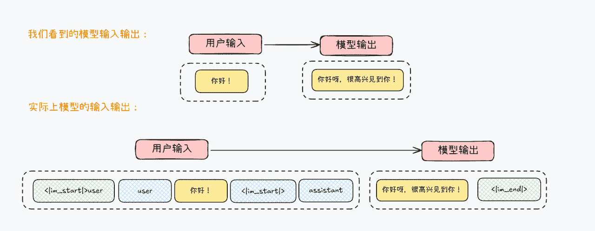
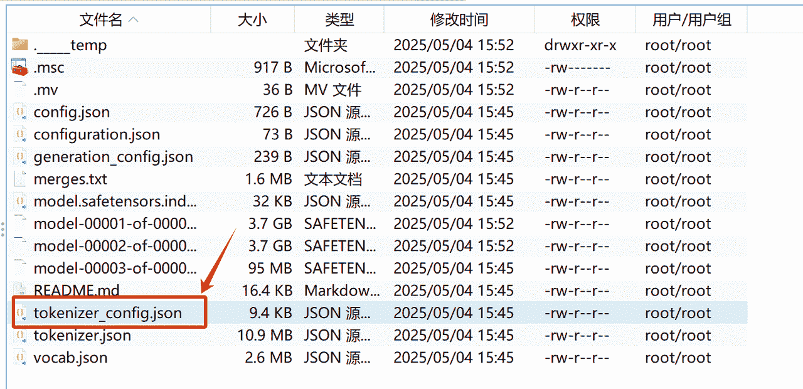
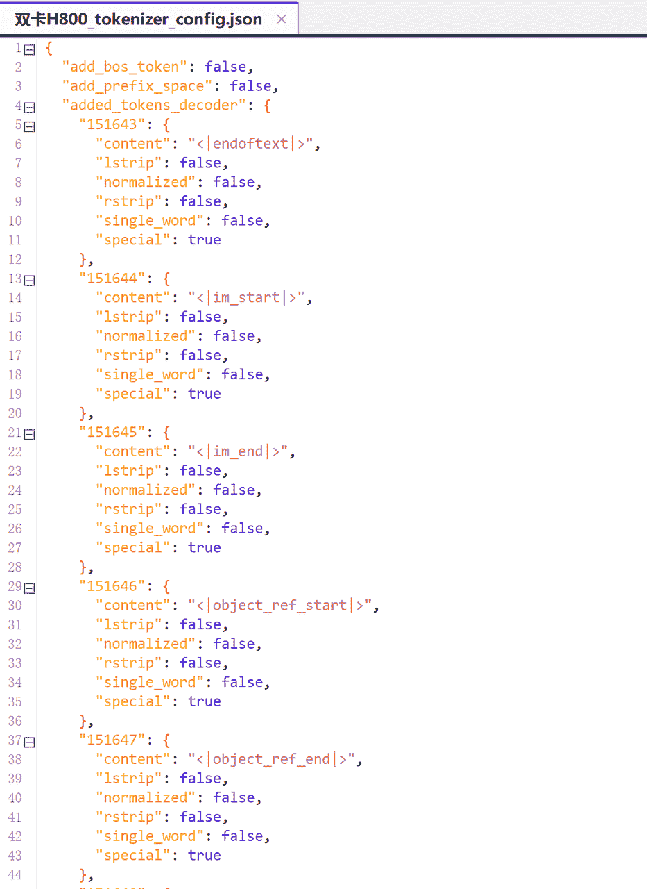
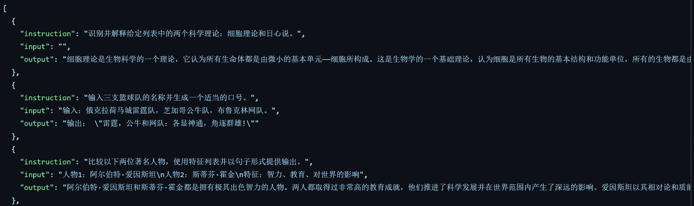
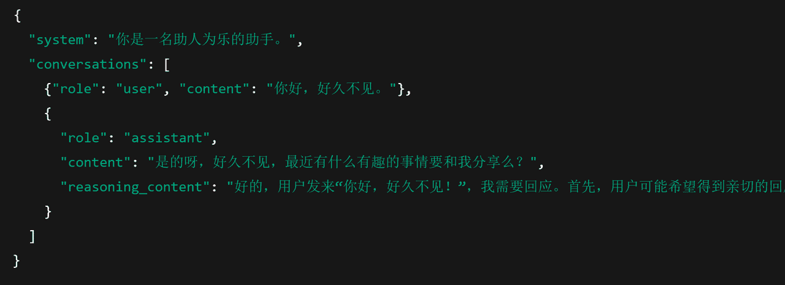
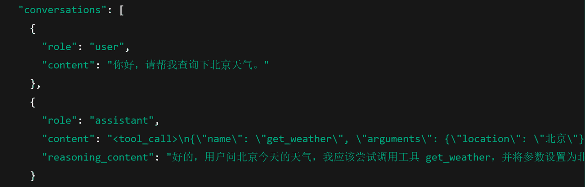
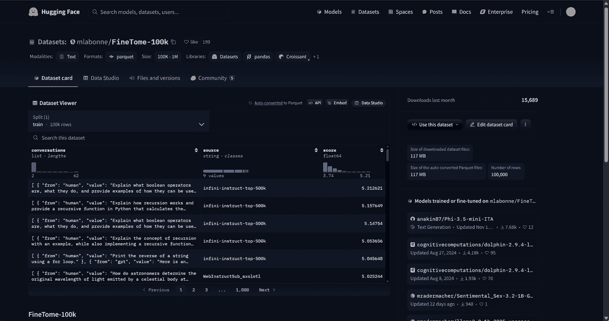
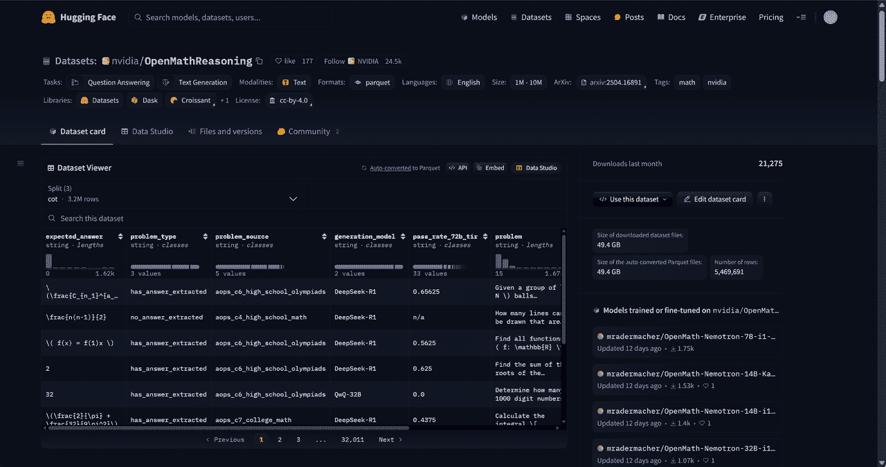

# 【专题讲解】微调数据集构造原理详解

> 来源：[https://kq4b3vgg5b.feishu.cn/docx/XO3DdEB3voPpaqxPJ5ac6qs5ngc](https://kq4b3vgg5b.feishu.cn/docx/XO3DdEB3voPpaqxPJ5ac6qs5ngc)

# 如何准备微调数据集

## 【专项提升】如何准备微调数据集

## Part 1.原理篇

如何创建和选取模型微调数据集，是决定模型微调效果成败的最关键因素，截止目前，已经诞生了各类不同的微调框架和海量的微调数据集，在绝大多数情况下，我们只需要选择不同的微调框架并搭配不同的数据集即可。但伴随着模型能力越来越复杂，包括现阶段很多模型具备了Function calling功能，甚至是具备了推理或者混合推理能力，此时如果希望进行一些复杂功能模型的微调，例如围绕Qwen3模型进行Function calling能力微调、同时还需保留其混合推理能力，此时很多公开数据集或许就无法满足要求了。此外，如果我们希望给模型进行特定领域的知识关注，或者提升模型对于特殊工具组的工具调用准确率，此时就需要手动创建微调数据集了。

而要手动合并或者创建微调数据集，就必须深入了解微调数据集构造背后的原理。本小节内容，就为大家详细介绍创建微调数据集背后的底层原理。

### 1. 模型内置特殊字符及提示词模板

其实最快速了解构造数据集的方法，是从模型底层原理入手。对于当代大模型来说，普遍需要通过一些特殊字符来标记用户的不同类型输入、系统提示词、以及工具调用或者多模态输入等。而在实际对话过程中，模型对于用户的输入输出是这么进行识别的（以Qwen3为例），一次简答的问答，模型的真实输入和输出如下所示：



其中<|im_start|>代表文本开始，而user则代表消息身份，用于构建多轮对话，而<|im_end|>则代表文本结束，即用户输入结束，而<|im_start|>代表新一段文本开始，assistant代表接下来由模型创建消息，而<|im_end|>同样代表模型创建消息的结束。

而模型其实是通过这样一组特殊字符标记来规范自己的行为，判断当前消息类型，以及通过输出特殊标记来确定停止时间。对于绝大多数模型，我们可以在模型的tokenizer_config.json中看到完整的特殊标记符（以及系统提示词模板）：





而在实际微调过程中，我们都知道需要有监督的数据集、也就是需要输入QA对来进行微调。以著名的alpaca_zh中文微调数据集来说，其基本格式如下：



其中的input和output就是输入和输出。例如如下对话：


就可以表示为下列json格式数据集：

```
  {
    &quot;instruction&quot;: &quot;&quot;,
    &quot;input&quot;: &quot;输入：你好。&quot;,
    &quot;output&quot;: &quot;输出：你好，有什么可以帮到你的？&quot;
  },
```

而在真实的微调过程中，如果是针对Qwen3进行微调，微调脚本会将这条数据集（无论什么格式）转化为如下格式：

```
&lt;|im_start|&gt;user\n你好&lt;|im_end|&gt;\n&lt;|im_start|&gt;assistant\n你好，有什么可以帮到你的？&lt;|im_end|&gt;
```

而在实际训练过程中，模型就会根据assistant前的内容，学习assistant后面的输出内容。

### 2. 带有系统提示和Function calling微调数据集格式

在很多场景下，我们还会发现一些带有instruction字段的微调数据集，那instruction字段是如何带入到微调过程中的呢？


答案非常简单，还是依靠特殊字符。例如有一个对话内容如下：

+   系统提示词（instruction）：你是一名助人为乐的助手。

+   **用户输入（input）**：你好，好久不见。

+   **助手回复（output）**：是的呀，好久不见，最近有什么有趣的事情要和我分享么？

此时模型的输入和输出如下：

```
&lt;|im_start|&gt;system
你是一名助人为乐的助手。&lt;|im_end|&gt;
&lt;|im_start|&gt;user
你好，好久不见。&lt;|im_end|&gt;
&lt;|im_start|&gt;assistant
是的呀，好久不见，最近有什么有趣的事情要和我分享么？&lt;|im_end|&gt;
```

即会通过<|im_start|>system...<|im_end|>来标记系统提示词。实际进行微调时，模型会根据assistant为界，学习assistant之前的文本输入情况下应该如何输出。

更进一步的，如果对话过程中带入了Function calling，此时首先模型会读取提前准备好的tool schema（也可能是自动生成的，例如MCP即可自动创建tool schema）：

```
tool_schema = [{
    &quot;name&quot;: &quot;get_weather&quot;,
    &quot;description&quot;: &quot;查询指定城市的天气信息&quot;,
    &quot;parameters&quot;: {
        &quot;type&quot;: &quot;object&quot;,
        &quot;properties&quot;: {
            &quot;location&quot;: {
                &quot;type&quot;: &quot;string&quot;,
                &quot;description&quot;: &quot;要查询天气的城市名称&quot;
            }
        },
        &quot;required&quot;: [&quot;location&quot;]
    }
}]
```

而假设我们的对话内容如下：

+   系统提示词（instruction）：你是一名助人为乐的助手。当用户查询天气的时候，请调用get_weather函数进行天气信息查询。

+   **用户输入（input）**：你好，请帮我查询下北京天气。

+   **助手回复（output）**：{"name": "get_weather", "arguments": {"location": "北京"}}

> 此时回复内容就是一条Function call message

而此时模型真实的输入和输出内容如下：

```
&lt;|im_start|&gt;system
你是一名助人为乐的助手。当用户查询天气的时候，请调用get_weather函数进行天气信息查询。

# Tools

You may call one or more functions to assist with the user query.

You are provided with function signatures within &lt;tools&gt;&lt;/tools&gt; XML tags:
&lt;tools&gt;
{&quot;name&quot;: &quot;get_weather&quot;, &quot;description&quot;: &quot;查询指定城市的天气信息&quot;, &quot;parameters&quot;: {&quot;type&quot;: &quot;object&quot;, &quot;properties&quot;: {&quot;location&quot;: {&quot;type&quot;: &quot;string&quot;, &quot;description&quot;: &quot;要查询天气的城市名称&quot;}}, &quot;required&quot;: [&quot;location&quot;]}}
&lt;/tools&gt;

For each function call, return a json object with function name and arguments within &lt;tool_call&gt;&lt;/tool_call&gt; XML tags:
&lt;tool_call&gt;
{&quot;name&quot;: &lt;function-name&gt;, &quot;arguments&quot;: &lt;args-json-object&gt;}
&lt;/tool_call&gt;
&lt;|im_end|&gt;
&lt;|im_start|&gt;user
你好，请帮我查询下北京天气。&lt;|im_end|&gt;
&lt;|im_start|&gt;assistant
&lt;tool_call&gt;
{&quot;name&quot;: &quot;get_weather&quot;, &quot;arguments&quot;: {&quot;location&quot;: &quot;北京&quot;}}
&lt;/tool_call&gt;&lt;|im_end|&gt;
```

接下来在进行训练时，模型同样根据assistant前的内容，学习assistant后面的输出内容。不过需要注意的是，由于高效微调调整的参数量较少，因此只能优化模型的Function calling能力，并不能从无到有让模型学会Function calling。

### 3. 带有思考过程的微调数据集结构

而如果是带有思考链，则一个简单的问答数据如下：



+   系统提示词（instruction）：你是一名助人为乐的助手。

+   **用户输入（input）**：你好，好久不见。

+   **助手回复（output）**：好的，用户发来“你好，好久不见！”，我需要回应。首先，用户可能希望得到亲切的回应，所以应该用友好的语气。/n是的呀，好久不见，最近有什么有趣的事情要和我分享么？

此时模型真实的内部输入和输出结果如下：

```
&lt;|im_start|&gt;system
你是一名助人为乐的助手。&lt;|im_end|&gt;
&lt;|im_start|&gt;user
你好，好久不见。&lt;|im_end|&gt;
&lt;|im_start|&gt;assistant
&lt;think&gt;
好的，用户发来“你好，好久不见！”，我需要回应。首先，用户可能希望得到亲切的回应，所以应该用友好的语气。
&lt;/think&gt;

是的呀，好久不见，最近有什么有趣的事情要和我分享么？&lt;|im_end|&gt;
```

模型同样根据assistant前的内容，学习assistant后面的输出内容。也就是说，所谓的思考过程，本质上其实是一种文本响应格式，通过模型训练而来。

最后难度升级，假设是带有思考过程、系统提示词的Function calling流程呢？此时一次对话的基本数据结构如下：



内容如下：

+   系统提示词（instruction）：你是一名助人为乐的助手。当用户查询天气的时候，请调用get_weather函数进行天气信息查询。

+   **用户输入（input）**：你好，请帮我查询下北京天气。

+   **助手回复（output）**：好的，用户问北京今天的天气，我应该尝试调用工具get_weather，并将参数设置为北京。/n{"name": "get_weather", "arguments": {"location": "北京"}}

而此时模型的真实输入和输出如下：

```
&lt;|im_start|&gt;system
你是一名助人为乐的助手。当用户查询天气的时候，请调用get_weather函数进行天气信息查询。

# Tools

You may call one or more functions to assist with the user query.

You are provided with function signatures within &lt;tools&gt;&lt;/tools&gt; XML tags:
&lt;tools&gt;
{&quot;name&quot;: &quot;get_weather&quot;, &quot;description&quot;: &quot;查询指定城市的天气信息&quot;, &quot;parameters&quot;: {&quot;type&quot;: &quot;object&quot;, &quot;properties&quot;: {&quot;location&quot;: {&quot;type&quot;: &quot;string&quot;, &quot;description&quot;: &quot;要查询天气的城市名称&quot;}}, &quot;required&quot;: [&quot;location&quot;]}}
&lt;/tools&gt;

For each function call, return a json object with function name and arguments within &lt;tool_call&gt;&lt;/tool_call&gt; XML tags:
&lt;tool_call&gt;
{&quot;name&quot;: &lt;function-name&gt;, &quot;arguments&quot;: &lt;args-json-object&gt;}
&lt;/tool_call&gt;
&lt;|im_end|&gt;
&lt;|im_start|&gt;user
你好，请帮我查询下北京天气。&lt;|im_end|&gt;
&lt;|im_start|&gt;assistant
&lt;think&gt;
好的，用户问北京今天的天气，我应该尝试调用工具 get_weather，并将参数设置为北京。
&lt;/think&gt;

&lt;tool_call&gt;
{&quot;name&quot;: &quot;get_weather&quot;, &quot;arguments&quot;: {&quot;location&quot;: &quot;北京&quot;}}
&lt;/tool_call&gt;&lt;|im_end|&gt;
```

模型同样根据assistant前的内容，学习assistant后面的输出内容。由此可见，模型拥有不同功能的背后，其实源于不同格式的训练数据集的训练。而对于Qwen3这种模型来说，同时拥有Function calling、混合推理等功能，属于功能非常复杂的模型了。在实际微调过程中，稍有不慎就会令其丧失原有能力。

### 4. Qwen3混合推理模型构造微调数据集基本方法

在了解了微调数据集结构背后的基本原理后，接下来的问题是应该如何构造微调数据集呢？一般来说我们可以在huggingface、ModelScope或llama-factory中挑选合适的数据集，并根据实际情况进行组装。例如围绕Qwen3模型的高效微调，为了确保其仍然保留混合推理能力，我们可以考虑在微调数据集中加入如普通对话数据集FineTome（https://huggingface.co/datasets/mlabonne/FineTome-100k），以及带有推理字段的数学类数据集OpenMathReasoning（https://huggingface.co/datasets/nvidia/OpenMathReasoning），并围绕这两个数据集进行拼接，从而在确保能提升模型的数学能力的同时，保留非推理的功能。同时还需要在持续微调训练过程中不断调整COT数学数据集和普通文本问答数据集之间的配比，以确保模型能够在提升数学能力的同时，保留混合推理的性能。





此外，更多关于高效微调数据集选取和创建的相关内容，欢迎报名我主讲的《2025大模型Agent智能体开发实战》(5月班)：https://ix9mq.xetslk.com/s/3u765N。


**其中将会有更加详细完整的微调全流**程实战讲解，详细信息扫码添加助教，回复“大模型”，即可领取课程大纲&查看课程详情⬆️