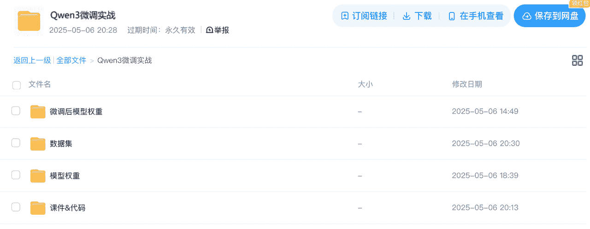
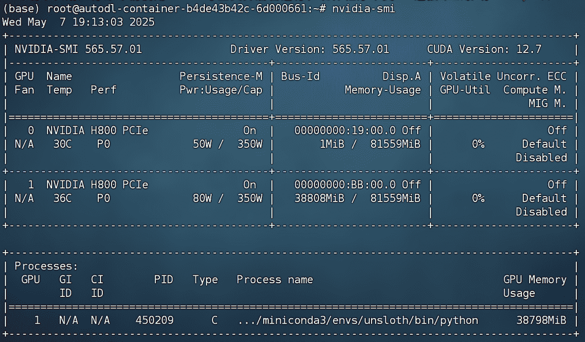

# Qwen3高效微调（下）

> 来源：[https://kq4b3vgg5b.feishu.cn/docx/Kp7vdMG5BoVIv9x8YOGc1wt3nKe](https://kq4b3vgg5b.feishu.cn/docx/Kp7vdMG5BoVIv9x8YOGc1wt3nKe)

## 课程说明：

+   体验课内容节选自《2025大模型Agent智能体开发实战》(5月班)完整版付费课程

体验课时间有限，若想深度学习大模型技术，欢迎大家报名由我主讲的《2025大模型Agent智能体开发实战》(5月班)




此外，公开课全套学习资料，已上传至网盘

（链接: https://pan.baidu.com/s/1RPjCf3oatnN8paq8H2ioUg 提取码: 5g8z  ）

需要更系统深入学习大模型可扫码⬆️添加助教咨询喔～

---

# Qwen3高效微调实战（下）

在进行了充足的准备工作后，接下来正式开始进行微调。

## 四、Unsloth基本使用方法介绍

Unsloth是一个集模型调用和高效微调为一体的框架，在开始进行模型微调前，我们可以先尝试借助Unsloth进行模型调用。需要注意的是，Unsloth的使用难度远比一般的微调框架简单，在Jupyter中即可完成模型微调，且微调结束后还可以直接进行模型调用，并支持在Jupyter中进行模型权重合并与导出，非常便捷。

```
import os
os.environ[&quot;CUDA_VISIBLE_DEVICES&quot;] = &quot;1&quot;
```

> 由于当前实验环境是多卡环境，而动态量化模型只支持单卡运行，因此这里先设置接下来运行的GPU编号。

### 1.模型导入与调用流程

首先进行模型导入：

```
from unsloth import FastLanguageModel
import torch
```

```
🦥 Unsloth: Will patch your computer to enable 2x faster free finetuning.


/root/miniconda3/envs/unsloth/lib/python3.11/site-packages/tqdm/auto.py:21: TqdmWarning: IProgress not found. Please update jupyter and ipywidgets. See https://ipywidgets.readthedocs.io/en/stable/user_install.html
  from .autonotebook import tqdm as notebook_tqdm


🦥 Unsloth Zoo will now patch everything to make training faster!
```

```
max_seq_length = 8192
dtype = None
load_in_4bit = True
```

```
model, tokenizer = FastLanguageModel.from_pretrained(
    model_name = &quot;./Qwen3-32B-unsloth-bnb-4bit&quot;,
    max_seq_length = max_seq_length,
    dtype = dtype,
    load_in_4bit = load_in_4bit,
)
```

```
==((====))==  Unsloth 2025.4.7: Fast Qwen3 patching. Transformers: 4.51.3.
   \\   /|    NVIDIA H800 PCIe. Num GPUs = 1. Max memory: 79.205 GB. Platform: Linux.
O^O/ \_/ \    Torch: 2.7.0+cu126. CUDA: 9.0. CUDA Toolkit: 12.6. Triton: 3.3.0
\        /    Bfloat16 = TRUE. FA [Xformers = 0.0.30. FA2 = False]
 &quot;-____-&quot;     Free license: http://github.com/unslothai/unsloth
Unsloth: Fast downloading is enabled - ignore downloading bars which are red colored!


Loading checkpoint shards: 100%|██████████| 9/9 [00:16&lt;00:00,  1.86s/it]
```

导入完成后即可查看模型基本情况，包括模型结构和分词器信息等：

```
model
```

```
Qwen3ForCausalLM(
  (model): Qwen3Model(
    (embed_tokens): Embedding(151936, 5120, padding_idx=151654)
    (layers): ModuleList(
      (0-5): 6 x Qwen3DecoderLayer(
        (self_attn): Qwen3Attention(
          (q_proj): Linear4bit(in_features=5120, out_features=8192, bias=False)
          (k_proj): Linear4bit(in_features=5120, out_features=1024, bias=False)
          (v_proj): Linear4bit(in_features=5120, out_features=1024, bias=False)
          (o_proj): Linear4bit(in_features=8192, out_features=5120, bias=False)
          (q_norm): Qwen3RMSNorm((128,), eps=1e-06)
          (k_norm): Qwen3RMSNorm((128,), eps=1e-06)
          (rotary_emb): LlamaRotaryEmbedding()
        )
        (mlp): Qwen3MLP(
          (gate_proj): Linear4bit(in_features=5120, out_features=25600, bias=False)
          (up_proj): Linear4bit(in_features=5120, out_features=25600, bias=False)
          (down_proj): Linear4bit(in_features=25600, out_features=5120, bias=False)
          (act_fn): SiLU()
        )
        (input_layernorm): Qwen3RMSNorm((5120,), eps=1e-06)
        (post_attention_layernorm): Qwen3RMSNorm((5120,), eps=1e-06)
      )
      (6): Qwen3DecoderLayer(
        (self_attn): Qwen3Attention(
          (q_proj): Linear(in_features=5120, out_features=8192, bias=False)
          (k_proj): Linear(in_features=5120, out_features=1024, bias=False)
          (v_proj): Linear(in_features=5120, out_features=1024, bias=False)
          (o_proj): Linear(in_features=8192, out_features=5120, bias=False)
          (q_norm): Qwen3RMSNorm((128,), eps=1e-06)
          (k_norm): Qwen3RMSNorm((128,), eps=1e-06)
          (rotary_emb): LlamaRotaryEmbedding()
        )
        (mlp): Qwen3MLP(
          (gate_proj): Linear(in_features=5120, out_features=25600, bias=False)
          (up_proj): Linear(in_features=5120, out_features=25600, bias=False)
          (down_proj): Linear(in_features=25600, out_features=5120, bias=False)
          (act_fn): SiLU()
        )
        (input_layernorm): Qwen3RMSNorm((5120,), eps=1e-06)
        (post_attention_layernorm): Qwen3RMSNorm((5120,), eps=1e-06)
      )
      (7): Qwen3DecoderLayer(
        (self_attn): Qwen3Attention(
          (q_proj): Linear4bit(in_features=5120, out_features=8192, bias=False)
          (k_proj): Linear4bit(in_features=5120, out_features=1024, bias=False)
          (v_proj): Linear4bit(in_features=5120, out_features=1024, bias=False)
          (o_proj): Linear4bit(in_features=8192, out_features=5120, bias=False)
          (q_norm): Qwen3RMSNorm((128,), eps=1e-06)
          (k_norm): Qwen3RMSNorm((128,), eps=1e-06)
          (rotary_emb): LlamaRotaryEmbedding()
        )
        (mlp): Qwen3MLP(
          (gate_proj): Linear4bit(in_features=5120, out_features=25600, bias=False)
          (up_proj): Linear4bit(in_features=5120, out_features=25600, bias=False)
          (down_proj): Linear(in_features=25600, out_features=5120, bias=False)
          (act_fn): SiLU()
        )
        (input_layernorm): Qwen3RMSNorm((5120,), eps=1e-06)
        (post_attention_layernorm): Qwen3RMSNorm((5120,), eps=1e-06)
      )
      (8-22): 15 x Qwen3DecoderLayer(
        (self_attn): Qwen3Attention(
          (q_proj): Linear4bit(in_features=5120, out_features=8192, bias=False)
          (k_proj): Linear4bit(in_features=5120, out_features=1024, bias=False)
          (v_proj): Linear4bit(in_features=5120, out_features=1024, bias=False)
          (o_proj): Linear4bit(in_features=8192, out_features=5120, bias=False)
          (q_norm): Qwen3RMSNorm((128,), eps=1e-06)
          (k_norm): Qwen3RMSNorm((128,), eps=1e-06)
          (rotary_emb): LlamaRotaryEmbedding()
        )
        (mlp): Qwen3MLP(
          (gate_proj): Linear4bit(in_features=5120, out_features=25600, bias=False)
          (up_proj): Linear4bit(in_features=5120, out_features=25600, bias=False)
          (down_proj): Linear4bit(in_features=25600, out_features=5120, bias=False)
          (act_fn): SiLU()
        )
        (input_layernorm): Qwen3RMSNorm((5120,), eps=1e-06)
        (post_attention_layernorm): Qwen3RMSNorm((5120,), eps=1e-06)
      )
      (23-44): 22 x Qwen3DecoderLayer(
        (self_attn): Qwen3Attention(
          (q_proj): Linear4bit(in_features=5120, out_features=8192, bias=False)
          (k_proj): Linear4bit(in_features=5120, out_features=1024, bias=False)
          (v_proj): Linear4bit(in_features=5120, out_features=1024, bias=False)
          (o_proj): Linear4bit(in_features=8192, out_features=5120, bias=False)
          (q_norm): Qwen3RMSNorm((128,), eps=1e-06)
          (k_norm): Qwen3RMSNorm((128,), eps=1e-06)
          (rotary_emb): LlamaRotaryEmbedding()
        )
        (mlp): Qwen3MLP(
          (gate_proj): Linear(in_features=5120, out_features=25600, bias=False)
          (up_proj): Linear(in_features=5120, out_features=25600, bias=False)
          (down_proj): Linear(in_features=25600, out_features=5120, bias=False)
          (act_fn): SiLU()
        )
        (input_layernorm): Qwen3RMSNorm((5120,), eps=1e-06)
        (post_attention_layernorm): Qwen3RMSNorm((5120,), eps=1e-06)
      )
      (45): Qwen3DecoderLayer(
        (self_attn): Qwen3Attention(
          (q_proj): Linear4bit(in_features=5120, out_features=8192, bias=False)
          (k_proj): Linear4bit(in_features=5120, out_features=1024, bias=False)
          (v_proj): Linear4bit(in_features=5120, out_features=1024, bias=False)
          (o_proj): Linear(in_features=8192, out_features=5120, bias=False)
          (q_norm): Qwen3RMSNorm((128,), eps=1e-06)
          (k_norm): Qwen3RMSNorm((128,), eps=1e-06)
          (rotary_emb): LlamaRotaryEmbedding()
        )
        (mlp): Qwen3MLP(
          (gate_proj): Linear(in_features=5120, out_features=25600, bias=False)
          (up_proj): Linear(in_features=5120, out_features=25600, bias=False)
          (down_proj): Linear(in_features=25600, out_features=5120, bias=False)
          (act_fn): SiLU()
        )
        (input_layernorm): Qwen3RMSNorm((5120,), eps=1e-06)
        (post_attention_layernorm): Qwen3RMSNorm((5120,), eps=1e-06)
      )
      (46-54): 9 x Qwen3DecoderLayer(
        (self_attn): Qwen3Attention(
          (q_proj): Linear4bit(in_features=5120, out_features=8192, bias=False)
          (k_proj): Linear4bit(in_features=5120, out_features=1024, bias=False)
          (v_proj): Linear4bit(in_features=5120, out_features=1024, bias=False)
          (o_proj): Linear4bit(in_features=8192, out_features=5120, bias=False)
          (q_norm): Qwen3RMSNorm((128,), eps=1e-06)
          (k_norm): Qwen3RMSNorm((128,), eps=1e-06)
          (rotary_emb): LlamaRotaryEmbedding()
        )
        (mlp): Qwen3MLP(
          (gate_proj): Linear(in_features=5120, out_features=25600, bias=False)
          (up_proj): Linear(in_features=5120, out_features=25600, bias=False)
          (down_proj): Linear(in_features=25600, out_features=5120, bias=False)
          (act_fn): SiLU()
        )
        (input_layernorm): Qwen3RMSNorm((5120,), eps=1e-06)
        (post_attention_layernorm): Qwen3RMSNorm((5120,), eps=1e-06)
      )
      (55-61): 7 x Qwen3DecoderLayer(
        (self_attn): Qwen3Attention(
          (q_proj): Linear4bit(in_features=5120, out_features=8192, bias=False)
          (k_proj): Linear4bit(in_features=5120, out_features=1024, bias=False)
          (v_proj): Linear4bit(in_features=5120, out_features=1024, bias=False)
          (o_proj): Linear4bit(in_features=8192, out_features=5120, bias=False)
          (q_norm): Qwen3RMSNorm((128,), eps=1e-06)
          (k_norm): Qwen3RMSNorm((128,), eps=1e-06)
          (rotary_emb): LlamaRotaryEmbedding()
        )
        (mlp): Qwen3MLP(
          (gate_proj): Linear4bit(in_features=5120, out_features=25600, bias=False)
          (up_proj): Linear4bit(in_features=5120, out_features=25600, bias=False)
          (down_proj): Linear4bit(in_features=25600, out_features=5120, bias=False)
          (act_fn): SiLU()
        )
        (input_layernorm): Qwen3RMSNorm((5120,), eps=1e-06)
        (post_attention_layernorm): Qwen3RMSNorm((5120,), eps=1e-06)
      )
      (62): Qwen3DecoderLayer(
        (self_attn): Qwen3Attention(
          (q_proj): Linear4bit(in_features=5120, out_features=8192, bias=False)
          (k_proj): Linear4bit(in_features=5120, out_features=1024, bias=False)
          (v_proj): Linear4bit(in_features=5120, out_features=1024, bias=False)
          (o_proj): Linear4bit(in_features=8192, out_features=5120, bias=False)
          (q_norm): Qwen3RMSNorm((128,), eps=1e-06)
          (k_norm): Qwen3RMSNorm((128,), eps=1e-06)
          (rotary_emb): LlamaRotaryEmbedding()
        )
        (mlp): Qwen3MLP(
          (gate_proj): Linear(in_features=5120, out_features=25600, bias=False)
          (up_proj): Linear(in_features=5120, out_features=25600, bias=False)
          (down_proj): Linear(in_features=25600, out_features=5120, bias=False)
          (act_fn): SiLU()
        )
        (input_layernorm): Qwen3RMSNorm((5120,), eps=1e-06)
        (post_attention_layernorm): Qwen3RMSNorm((5120,), eps=1e-06)
      )
      (63): Qwen3DecoderLayer(
        (self_attn): Qwen3Attention(
          (q_proj): Linear4bit(in_features=5120, out_features=8192, bias=False)
          (k_proj): Linear4bit(in_features=5120, out_features=1024, bias=False)
          (v_proj): Linear4bit(in_features=5120, out_features=1024, bias=False)
          (o_proj): Linear4bit(in_features=8192, out_features=5120, bias=False)
          (q_norm): Qwen3RMSNorm((128,), eps=1e-06)
          (k_norm): Qwen3RMSNorm((128,), eps=1e-06)
          (rotary_emb): LlamaRotaryEmbedding()
        )
        (mlp): Qwen3MLP(
          (gate_proj): Linear4bit(in_features=5120, out_features=25600, bias=False)
          (up_proj): Linear4bit(in_features=5120, out_features=25600, bias=False)
          (down_proj): Linear4bit(in_features=25600, out_features=5120, bias=False)
          (act_fn): SiLU()
        )
        (input_layernorm): Qwen3RMSNorm((5120,), eps=1e-06)
        (post_attention_layernorm): Qwen3RMSNorm((5120,), eps=1e-06)
      )
    )
    (norm): Qwen3RMSNorm((5120,), eps=1e-06)
    (rotary_emb): LlamaRotaryEmbedding()
  )
  (lm_head): Linear(in_features=5120, out_features=151936, bias=False)
)
```

> 需要注意，此时模型还没有LoRA层。

```
tokenizer
```

```
Qwen2TokenizerFast(name_or_path=&#x27;./Qwen3-32B-unsloth-bnb-4bit&#x27;, vocab_size=151643, model_max_length=40960, is_fast=True, padding_side=&#x27;left&#x27;, truncation_side=&#x27;right&#x27;, special_tokens={&#x27;eos_token&#x27;: &#x27;&lt;|im_end|&gt;&#x27;, &#x27;pad_token&#x27;: &#x27;&lt;|vision_pad|&gt;&#x27;, &#x27;additional_special_tokens&#x27;: [&#x27;&lt;|im_start|&gt;&#x27;, &#x27;&lt;|im_end|&gt;&#x27;, &#x27;&lt;|object_ref_start|&gt;&#x27;, &#x27;&lt;|object_ref_end|&gt;&#x27;, &#x27;&lt;|box_start|&gt;&#x27;, &#x27;&lt;|box_end|&gt;&#x27;, &#x27;&lt;|quad_start|&gt;&#x27;, &#x27;&lt;|quad_end|&gt;&#x27;, &#x27;&lt;|vision_start|&gt;&#x27;, &#x27;&lt;|vision_end|&gt;&#x27;, &#x27;&lt;|vision_pad|&gt;&#x27;, &#x27;&lt;|image_pad|&gt;&#x27;, &#x27;&lt;|video_pad|&gt;&#x27;]}, clean_up_tokenization_spaces=False, added_tokens_decoder={
        151643: AddedToken(&quot;&lt;|endoftext|&gt;&quot;, rstrip=False, lstrip=False, single_word=False, normalized=False, special=True),
        151644: AddedToken(&quot;&lt;|im_start|&gt;&quot;, rstrip=False, lstrip=False, single_word=False, normalized=False, special=True),
        151645: AddedToken(&quot;&lt;|im_end|&gt;&quot;, rstrip=False, lstrip=False, single_word=False, normalized=False, special=True),
        151646: AddedToken(&quot;&lt;|object_ref_start|&gt;&quot;, rstrip=False, lstrip=False, single_word=False, normalized=False, special=True),
        151647: AddedToken(&quot;&lt;|object_ref_end|&gt;&quot;, rstrip=False, lstrip=False, single_word=False, normalized=False, special=True),
        151648: AddedToken(&quot;&lt;|box_start|&gt;&quot;, rstrip=False, lstrip=False, single_word=False, normalized=False, special=True),
        151649: AddedToken(&quot;&lt;|box_end|&gt;&quot;, rstrip=False, lstrip=False, single_word=False, normalized=False, special=True),
        151650: AddedToken(&quot;&lt;|quad_start|&gt;&quot;, rstrip=False, lstrip=False, single_word=False, normalized=False, special=True),
        151651: AddedToken(&quot;&lt;|quad_end|&gt;&quot;, rstrip=False, lstrip=False, single_word=False, normalized=False, special=True),
        151652: AddedToken(&quot;&lt;|vision_start|&gt;&quot;, rstrip=False, lstrip=False, single_word=False, normalized=False, special=True),
        151653: AddedToken(&quot;&lt;|vision_end|&gt;&quot;, rstrip=False, lstrip=False, single_word=False, normalized=False, special=True),
        151654: AddedToken(&quot;&lt;|vision_pad|&gt;&quot;, rstrip=False, lstrip=False, single_word=False, normalized=False, special=True),
        151655: AddedToken(&quot;&lt;|image_pad|&gt;&quot;, rstrip=False, lstrip=False, single_word=False, normalized=False, special=True),
        151656: AddedToken(&quot;&lt;|video_pad|&gt;&quot;, rstrip=False, lstrip=False, single_word=False, normalized=False, special=True),
        151657: AddedToken(&quot;&lt;tool_call&gt;&quot;, rstrip=False, lstrip=False, single_word=False, normalized=False, special=False),
        151658: AddedToken(&quot;&lt;/tool_call&gt;&quot;, rstrip=False, lstrip=False, single_word=False, normalized=False, special=False),
        151659: AddedToken(&quot;&lt;|fim_prefix|&gt;&quot;, rstrip=False, lstrip=False, single_word=False, normalized=False, special=False),
        151660: AddedToken(&quot;&lt;|fim_middle|&gt;&quot;, rstrip=False, lstrip=False, single_word=False, normalized=False, special=False),
        151661: AddedToken(&quot;&lt;|fim_suffix|&gt;&quot;, rstrip=False, lstrip=False, single_word=False, normalized=False, special=False),
        151662: AddedToken(&quot;&lt;|fim_pad|&gt;&quot;, rstrip=False, lstrip=False, single_word=False, normalized=False, special=False),
        151663: AddedToken(&quot;&lt;|repo_name|&gt;&quot;, rstrip=False, lstrip=False, single_word=False, normalized=False, special=False),
        151664: AddedToken(&quot;&lt;|file_sep|&gt;&quot;, rstrip=False, lstrip=False, single_word=False, normalized=False, special=False),
        151665: AddedToken(&quot;&lt;tool_response&gt;&quot;, rstrip=False, lstrip=False, single_word=False, normalized=False, special=False),
        151666: AddedToken(&quot;&lt;/tool_response&gt;&quot;, rstrip=False, lstrip=False, single_word=False, normalized=False, special=False),
        151667: AddedToken(&quot;&lt;think&gt;&quot;, rstrip=False, lstrip=False, single_word=False, normalized=False, special=False),
        151668: AddedToken(&quot;&lt;/think&gt;&quot;, rstrip=False, lstrip=False, single_word=False, normalized=False, special=False),
}
)
```

+   显存占用

此时模型约占用显存38G：



```
gpu_stats = torch.cuda.get_device_properties(0)
start_gpu_memory = round(torch.cuda.max_memory_reserved() / 1024 / 1024 / 1024, 3)
max_memory = round(gpu_stats.total_memory / 1024 / 1024 / 1024, 3)
print(f&quot;GPU = {gpu_stats.name}. Max memory = {max_memory} GB.&quot;)
print(f&quot;{start_gpu_memory} GB of memory reserved.&quot;)
```

```
GPU = NVIDIA H800 PCIe. Max memory = 79.205 GB.
37.238 GB of memory reserved.
```

+   开启对话

然后即可尝试进行对话。借助Unsloth进行模型调用总共需要两个步骤，其一是借助apply_chat_template进行分词同时输入对话相关参数，其二则是借助generate进行文本创建。一次基本对话流程如下所示：

```
messages = [
    {&quot;role&quot; : &quot;user&quot;, &quot;content&quot; : &quot;你好，好久不见！&quot;}
]
```

```
text = tokenizer.apply_chat_template(
    messages,
    tokenize = False,
    add_generation_prompt = True, 
    enable_thinking = False, # 设置不思考
)
```

此时text就是加载了Qwen3内置提示词模板之后的字符串。据此也能看出Qwen3内置提示词模板的特殊字符：

```
text
```

```
&#x27;&lt;|im_start|&gt;user\n你好，好久不见！&lt;|im_end|&gt;\n&lt;|im_start|&gt;assistant\n&lt;think&gt;\n\n&lt;/think&gt;\n\n&#x27;
```

然后进行分词：

```
inputs = tokenizer(text, return_tensors=&quot;pt&quot;).to(&quot;cuda&quot;)
```

并进行推理：

```
outputs = model.generate(
    input_ids=inputs.input_ids,
    attention_mask=inputs.attention_mask,
    max_new_tokens=max_seq_length,
    use_cache=True,
)
```

最终获得模型输出结果：

```
outputs
```

```
tensor([[151644,    872,    198, 108386,   3837, 111920, 101571,   6313, 151645,
            198, 151644,  77091,    198, 151667,    271, 151668,    271, 112488,
           6313, 102068, 111920, 101571, 104060,   6313, 144232,    220,  99725,
         119249,  40814,  99164,  56568, 101036,   6313, 104044, 108178, 104472,
         104256,  11319, 100681, 111920,  70927, 100281,  34187,   3837, 100654,
          99172, 114238, 103929, 101108, 101036,   6313,      7,   6667,  96549,
         145567,   6667,  53839,      8,  12653, 151645]], device=&#x27;cuda:0&#x27;)
```

```
response = tokenizer.batch_decode(outputs)
```

```
response
```

```
[&#x27;&lt;|im_start|&gt;user\n你好，好久不见！&lt;|im_end|&gt;\n&lt;|im_start|&gt;assistant\n&lt;think&gt;\n\n&lt;/think&gt;\n\n嗨！确实好久不见啦！✨ 一直惦记着你呢！最近过得怎么样呀？感觉好久没聊了，特别想听听你的故事呢！(•̀ᴗ•́)و&lt;|im_end|&gt;&#x27;]
```

```
response[0]
```

```
&#x27;&lt;|im_start|&gt;user\n你好，好久不见！&lt;|im_end|&gt;\n&lt;|im_start|&gt;assistant\n&lt;think&gt;\n\n&lt;/think&gt;\n\n嗨！确实好久不见啦！✨ 一直惦记着你呢！最近过得怎么样呀？感觉好久没聊了，特别想听听你的故事呢！(•̀ᴗ•́)و&lt;|im_end|&gt;&#x27;
```

需要注意的是，这其实是一种非常底层的打印模型输入和输出信息的方法，这种字符格式（同时包含模型输入和输出）也是Unsloth在进行高效微调过程中需要用到的数据集基本格式。

此外也可通过如下方式生成带有思考过程的结果：

```
text = tokenizer.apply_chat_template(
    messages,
    tokenize = False,
    add_generation_prompt = True, 
    enable_thinking = True, # 设置思考
)

inputs = tokenizer(text, return_tensors=&quot;pt&quot;).to(&quot;cuda&quot;)

outputs = model.generate(
    input_ids=inputs.input_ids,
    attention_mask=inputs.attention_mask,
    max_new_tokens=max_seq_length,
    use_cache=True,
)

response = tokenizer.batch_decode(outputs)
```

```
response[0]
```

```
&#x27;&lt;|im_start|&gt;user\n你好，好久不见！&lt;|im_end|&gt;\n&lt;|im_start|&gt;assistant\n&lt;think&gt;\n嗯，用户发来“你好，好久不见！”，看起来是很久没联系了，想重新建立联系。首先，我需要回应他的问候，同时表达出开心见到他的情绪。可能用户希望继续对话，所以得保持友好和开放的态度。\n\n用户可能只是想寒暄一下，或者有具体的事情想聊。这时候我应该先确认他的近况，比如问他最近怎么样，或者有没有什么新鲜事。这样可以引导他进一步表达需求。另外，用户可能希望得到情感上的回应，比如被关心或者被理解，所以需要表现出真诚和热情。\n\n还要注意语气要自然，避免过于正式或者生硬。可能需要用一些表情符号或者轻松的措辞，让对话更亲切。比如用“😊”或者“很高兴见到你！”这样的表达。同时，要避免假设用户的具体意图，保持问题开放，让他可以自由选择话题方向。\n\n另外，考虑到用户之前可能没有使用过这个聊天机器人，或者很久没用，可能需要提醒他有哪些功能可用，但当前对话看起来只是普通问候，所以暂时不需要提功能，保持对话流畅。总之，回应要友好、开放，鼓励用户继续交流。\n&lt;/think&gt;\n\n你好呀！😊 真高兴再次收到你的消息！最近过得怎么样？有什么想聊的或者需要帮忙的，我随时都在哦～&lt;|im_end|&gt;&#x27;
```

同时如果存在系统提示词，则实际对话效果如下：

```
messages = [
    {&quot;role&quot; : &quot;system&quot;, &quot;content&quot; : &quot;你是一名助人为乐的助手，名叫小明。&quot;},
    {&quot;role&quot; : &quot;user&quot;, &quot;content&quot; : &quot;你好，好久不见！请问你叫什么名字？&quot;}
]
```

```
text = tokenizer.apply_chat_template(
    messages,
    tokenize = False,
    add_generation_prompt = True, 
    enable_thinking = True, # 设置思考
)

inputs = tokenizer(text, return_tensors=&quot;pt&quot;).to(&quot;cuda&quot;)

outputs = model.generate(
    input_ids=inputs.input_ids,
    attention_mask=inputs.attention_mask,
    max_new_tokens=max_seq_length,
    use_cache=True,
)

response = tokenizer.batch_decode(outputs)
```

```
response[0]
```

```
&#x27;&lt;|im_start|&gt;system\n你是一名助人为乐的助手，名叫小明。&lt;|im_end|&gt;\n&lt;|im_start|&gt;user\n你好，好久不见！请问你叫什么名字？&lt;|im_end|&gt;\n&lt;|im_start|&gt;assistant\n&lt;think&gt;\n好的，用户说：&quot;你好，好久不见！请问你叫什么名字？&quot; 首先，我需要确认用户是否真的见过我，但根据设定，我是一个新助手，所以用户可能记错了名字。我应该先礼貌回应问候，然后介绍自己的名字是小明，并说明自己是新来的，可能用户之前见过其他助手，所以需要澄清。接下来，要表现出助人为乐的态度，主动询问用户需要什么帮助。同时，保持口语化，避免使用复杂句子，让对话自然流畅。还要注意用户可能有其他需求，所以保持开放式的提问，鼓励用户进一步说明问题。需要检查是否有遗漏的信息，比如用户提到的“好久不见”是否有特殊含义，但目前看来只是普通的问候，所以正常回应即可。最后，确保回复简洁友好，符合设定的角色特点。\n&lt;/think&gt;\n\n你好呀！我是小明，很高兴见到你！不过我好像第一次和你聊天呢，可能你之前见过我的搭档？我是新来的助手，有什么我可以帮你的吗？😊&lt;|im_end|&gt;&#x27;
```

能够看到，此时问答数据中就包含了系统消息。同样该格式的数据也可以直接用于Unsloth的指令微调。也就是说，如果我们希望提高模型多轮对话或者指令跟随能力，就可以创建大量类似这种数据集进行微调。在实际微调过程中，模型会主动学习最后一个assistant之后的内容，从而学会指令跟随和多轮对话能力。

最后，我们尝试让模型调用外部函数，即创建一条function call message。

```
import requests, json
def get_weather(loc):
    &quot;&quot;&quot;
    查询即时天气函数
    :param loc: 必要参数，字符串类型，用于表示查询天气的具体城市名称，\
    注意，中国的城市需要用对应城市的英文名称代替，例如如果需要查询北京市天气，则loc参数需要输入&#x27;Beijing&#x27;；
    :return：OpenWeather API查询即时天气的结果，具体URL请求地址为：https://api.openweathermap.org/data/2.5/weather\
    返回结果对象类型为解析之后的JSON格式对象，并用字符串形式进行表示，其中包含了全部重要的天气信息
    &quot;&quot;&quot;
    # Step 1.构建请求
    url = &quot;https://api.openweathermap.org/data/2.5/weather&quot;

    # Step 2.设置查询参数
    params = {
        &quot;q&quot;: loc,               
        &quot;appid&quot;: &quot;YOUR_API_KEY&quot;,    # 输入API key
        &quot;units&quot;: &quot;metric&quot;,            # 使用摄氏度而不是华氏度
        &quot;lang&quot;:&quot;zh_cn&quot;                # 输出语言为简体中文
    }

    # Step 3.发送GET请求
    response = requests.get(url, params=params)
    
    # Step 4.解析响应
    data = response.json()
    return json.dumps(data)
```

```
tools = [
    {
        &quot;type&quot;: &quot;function&quot;,
        &quot;function&quot;:{
            &#x27;name&#x27;: &#x27;get_weather&#x27;,
            &#x27;description&#x27;: &#x27;查询即时天气函数，根据输入的城市名称，查询对应城市的实时天气，一次只能输入一个城市名称&#x27;,
            &#x27;parameters&#x27;: {
                &#x27;type&#x27;: &#x27;object&#x27;,
                &#x27;properties&#x27;: {
                    &#x27;loc&#x27;: {
                        &#x27;description&#x27;: &quot;城市名称，注意，中国的城市需要用对应城市的英文名称代替，例如如果需要查询北京市天气，则loc参数需要输入&#x27;Beijing&#x27;&quot;,
                        &#x27;type&#x27;: &#x27;string&#x27;
                    }
                },
                &#x27;required&#x27;: [&#x27;loc&#x27;]
            }
        }
    }
]
```

```
messages = [
    {&quot;role&quot; : &quot;system&quot;, &quot;content&quot; : &quot;你是一名助人为乐的天气查询助手，当用户询问天气信息时，请调用get_weather函数进行天气查询。&quot;},
    {&quot;role&quot; : &quot;user&quot;, &quot;content&quot; : &quot;你好，请帮我查询下北京今天天气如何？&quot;}
]
```

```
text = tokenizer.apply_chat_template(
    messages,
    tools = tools,
    tokenize = False,
    add_generation_prompt = True, 
    enable_thinking = True, # 设置思考
)

inputs = tokenizer(text, return_tensors=&quot;pt&quot;).to(&quot;cuda&quot;)

outputs = model.generate(
    input_ids=inputs.input_ids,
    attention_mask=inputs.attention_mask,
    max_new_tokens=max_seq_length,
    use_cache=True,
)

response = tokenizer.batch_decode(outputs)
```

```
response[0]
```

```
&#x27;&lt;|im_start|&gt;system\n你是一名助人为乐的天气查询助手，当用户询问天气信息时，请调用get_weather函数进行天气查询。\n\n# Tools\n\nYou may call one or more functions to assist with the user query.\n\nYou are provided with function signatures within &lt;tools&gt;&lt;/tools&gt; XML tags:\n&lt;tools&gt;\n{&quot;type&quot;: &quot;function&quot;, &quot;function&quot;: {&quot;name&quot;: &quot;get_weather&quot;, &quot;description&quot;: &quot;查询即时天气函数，根据输入的城市名称，查询对应城市的实时天气，一次只能输入一个城市名称&quot;, &quot;parameters&quot;: {&quot;type&quot;: &quot;object&quot;, &quot;properties&quot;: {&quot;loc&quot;: {&quot;description&quot;: &quot;城市名称，注意，中国的城市需要用对应城市的英文名称代替，例如如果需要查询北京市天气，则loc参数需要输入\&#x27;Beijing\&#x27;&quot;, &quot;type&quot;: &quot;string&quot;}}, &quot;required&quot;: [&quot;loc&quot;]}}}\n&lt;/tools&gt;\n\nFor each function call, return a json object with function name and arguments within &lt;tool_call&gt;&lt;/tool_call&gt; XML tags:\n&lt;tool_call&gt;\n{&quot;name&quot;: &lt;function-name&gt;, &quot;arguments&quot;: &lt;args-json-object&gt;}\n&lt;/tool_call&gt;&lt;|im_end|&gt;\n&lt;|im_start|&gt;user\n你好，请帮我查询下北京今天天气如何？&lt;|im_end|&gt;\n&lt;|im_start|&gt;assistant\n&lt;think&gt;\n好的，用户让我帮忙查询北京今天的天气。首先，我需要确认用户需要的是北京市的天气情况。根据提供的工具函数，get_weather需要传入城市的英文名称，所以北京应该用&quot;Beijing&quot;作为参数。接下来，我需要调用这个函数，确保参数正确无误。然后，等待函数返回数据后，再把结果用中文翻译给用户，包括天气状况、温度等信息。如果有错误，比如城市名称不正确或者没有数据，也要提醒用户。现在先正确调用函数，再处理返回的结果。\n&lt;/think&gt;\n\n&lt;tool_call&gt;\n{&quot;name&quot;: &quot;get_weather&quot;, &quot;arguments&quot;: {&quot;loc&quot;: &quot;Beijing&quot;}}\n&lt;/tool_call&gt;&lt;|im_end|&gt;&#x27;
```

能够看到，此时模型就会创建一条同时带有指令、思考、外部函数的function call message。

而更进一步的，我们也可以测试模型的多个外部函数并联调用效果：

```
messages = [
    {&quot;role&quot; : &quot;system&quot;, &quot;content&quot; : &quot;你是一名助人为乐的天气查询助手，当用户询问天气信息时，请调用get_weather函数进行天气查询。&quot;},
    {&quot;role&quot; : &quot;user&quot;, &quot;content&quot; : &quot;你好，请帮我查询下北京和杭州今天天气如何？&quot;}
]
```

```
text = tokenizer.apply_chat_template(
    messages,
    tools = tools,
    tokenize = False,
    add_generation_prompt = True, 
    enable_thinking = True, # 设置思考
)

inputs = tokenizer(text, return_tensors=&quot;pt&quot;).to(&quot;cuda&quot;)

outputs = model.generate(
    input_ids=inputs.input_ids,
    attention_mask=inputs.attention_mask,
    max_new_tokens=max_seq_length,
    use_cache=True,
)

response = tokenizer.batch_decode(outputs)
```

```
response[0]
```

```
&#x27;&lt;|im_start|&gt;system\n你是一名助人为乐的天气查询助手，当用户询问天气信息时，请调用get_weather函数进行天气查询。\n\n# Tools\n\nYou may call one or more functions to assist with the user query.\n\nYou are provided with function signatures within &lt;tools&gt;&lt;/tools&gt; XML tags:\n&lt;tools&gt;\n{&quot;type&quot;: &quot;function&quot;, &quot;function&quot;: {&quot;name&quot;: &quot;get_weather&quot;, &quot;description&quot;: &quot;查询即时天气函数，根据输入的城市名称，查询对应城市的实时天气，一次只能输入一个城市名称&quot;, &quot;parameters&quot;: {&quot;type&quot;: &quot;object&quot;, &quot;properties&quot;: {&quot;loc&quot;: {&quot;description&quot;: &quot;城市名称，注意，中国的城市需要用对应城市的英文名称代替，例如如果需要查询北京市天气，则loc参数需要输入\&#x27;Beijing\&#x27;&quot;, &quot;type&quot;: &quot;string&quot;}}, &quot;required&quot;: [&quot;loc&quot;]}}}\n&lt;/tools&gt;\n\nFor each function call, return a json object with function name and arguments within &lt;tool_call&gt;&lt;/tool_call&gt; XML tags:\n&lt;tool_call&gt;\n{&quot;name&quot;: &lt;function-name&gt;, &quot;arguments&quot;: &lt;args-json-object&gt;}\n&lt;/tool_call&gt;&lt;|im_end|&gt;\n&lt;|im_start|&gt;user\n你好，请帮我查询下北京和杭州今天天气如何？&lt;|im_end|&gt;\n&lt;|im_start|&gt;assistant\n&lt;think&gt;\n好的，用户让我查询北京和杭州今天的天气。首先，我需要确认用户提到的城市是否需要转换成英文名称。根据工具说明，中国的城市需要用英文名称，比如北京是Beijing，杭州是Hangzhou。所以，我需要分别调用get_weather函数两次，一次查询北京，另一次查询杭州。然后，将这两个查询结果结合起来，回复用户。确保每次调用函数时，参数loc正确无误。最后，用自然语言组织回答，告知用户两个城市的天气情况。\n&lt;/think&gt;\n\n&lt;tool_call&gt;\n{&quot;name&quot;: &quot;get_weather&quot;, &quot;arguments&quot;: {&quot;loc&quot;: &quot;Beijing&quot;}}\n&lt;/tool_call&gt;\n&lt;tool_call&gt;\n{&quot;name&quot;: &quot;get_weather&quot;, &quot;arguments&quot;: {&quot;loc&quot;: &quot;Hangzhou&quot;}}\n&lt;/tool_call&gt;&lt;|im_end|&gt;&#x27;
```

能发现，此时模型同时发起了两条Function call message。

然后继续测试当模型接收到外部函数返回消息时候，模型返回内容。

```
messages
```

```
[{&#x27;role&#x27;: &#x27;system&#x27;,
  &#x27;content&#x27;: &#x27;你是一名助人为乐的天气查询助手，当用户询问天气信息时，请调用get_weather函数进行天气查询。&#x27;},
 {&#x27;role&#x27;: &#x27;user&#x27;, &#x27;content&#x27;: &#x27;你好，请帮我查询下北京和杭州今天天气如何？&#x27;}]
```

```
messages.append({
    &quot;role&quot;: &quot;assistant&quot;,
    &quot;content&quot;: &quot;&lt;think&gt;\n我将调用 get_weather 函数来查询天气。\n&lt;/think&gt;\n&quot;,
    &quot;tool_calls&quot;: [
        {
            &quot;name&quot;: &quot;get_weather&quot;,
            &quot;arguments&quot;: {
                &quot;location&quot;: &quot;北京&quot;
            }
        },
        {
            &quot;name&quot;: &quot;get_weather&quot;,
            &quot;arguments&quot;: {
                &quot;location&quot;: &quot;杭州&quot;
            }
        }
    ]
})
```

```
messages.append({
    &quot;role&quot;: &quot;tool&quot;,
    &quot;content&quot;: json.dumps({
        &quot;location&quot;: &quot;北京&quot;,
        &quot;weather&quot;: &quot;晴，最高气温26℃&quot;
    })
})
messages.append({
    &quot;role&quot;: &quot;tool&quot;,
    &quot;content&quot;: json.dumps({
        &quot;location&quot;: &quot;杭州&quot;,
        &quot;weather&quot;: &quot;多云转小雨，最高气温23℃&quot;
    })
})
```

```
messages
```

```
[{&#x27;role&#x27;: &#x27;system&#x27;,
  &#x27;content&#x27;: &#x27;你是一名助人为乐的天气查询助手，当用户询问天气信息时，请调用get_weather函数进行天气查询。&#x27;},
 {&#x27;role&#x27;: &#x27;user&#x27;, &#x27;content&#x27;: &#x27;你好，请帮我查询下北京和杭州今天天气如何？&#x27;},
 {&#x27;role&#x27;: &#x27;assistant&#x27;,
  &#x27;content&#x27;: &#x27;&lt;think&gt;\n我将调用 get_weather 函数来查询天气。\n&lt;/think&gt;\n&#x27;,
  &#x27;tool_calls&#x27;: [{&#x27;name&#x27;: &#x27;get_weather&#x27;, &#x27;arguments&#x27;: {&#x27;location&#x27;: &#x27;北京&#x27;}},
   {&#x27;name&#x27;: &#x27;get_weather&#x27;, &#x27;arguments&#x27;: {&#x27;location&#x27;: &#x27;杭州&#x27;}}]},
 {&#x27;role&#x27;: &#x27;tool&#x27;,
  &#x27;content&#x27;: &#x27;{&quot;location&quot;: &quot;\\u5317\\u4eac&quot;, &quot;weather&quot;: &quot;\\u6674\\uff0c\\u6700\\u9ad8\\u6c14\\u6e2926\\u2103&quot;}&#x27;},
 {&#x27;role&#x27;: &#x27;tool&#x27;,
  &#x27;content&#x27;: &#x27;{&quot;location&quot;: &quot;\\u676d\\u5dde&quot;, &quot;weather&quot;: &quot;\\u591a\\u4e91\\u8f6c\\u5c0f\\u96e8\\uff0c\\u6700\\u9ad8\\u6c14\\u6e2923\\u2103&quot;}&#x27;}]
```

```
text = tokenizer.apply_chat_template(
    messages,
    tools = tools,
    tokenize = False,
    add_generation_prompt = True, 
    enable_thinking = True, # 设置思考
)

inputs = tokenizer(text, return_tensors=&quot;pt&quot;).to(&quot;cuda&quot;)

outputs = model.generate(
    input_ids=inputs.input_ids,
    attention_mask=inputs.attention_mask,
    max_new_tokens=max_seq_length,
    use_cache=True,
)

response = tokenizer.batch_decode(outputs)
```

```
response[0]
```

```
&#x27;&lt;|im_start|&gt;system\n你是一名助人为乐的天气查询助手，当用户询问天气信息时，请调用get_weather函数进行天气查询。\n\n# Tools\n\nYou may call one or more functions to assist with the user query.\n\nYou are provided with function signatures within &lt;tools&gt;&lt;/tools&gt; XML tags:\n&lt;tools&gt;\n{&quot;type&quot;: &quot;function&quot;, &quot;function&quot;: {&quot;name&quot;: &quot;get_weather&quot;, &quot;description&quot;: &quot;查询即时天气函数，根据输入的城市名称，查询对应城市的实时天气，一次只能输入一个城市名称&quot;, &quot;parameters&quot;: {&quot;type&quot;: &quot;object&quot;, &quot;properties&quot;: {&quot;loc&quot;: {&quot;description&quot;: &quot;城市名称，注意，中国的城市需要用对应城市的英文名称代替，例如如果需要查询北京市天气，则loc参数需要输入\&#x27;Beijing\&#x27;&quot;, &quot;type&quot;: &quot;string&quot;}}, &quot;required&quot;: [&quot;loc&quot;]}}}\n&lt;/tools&gt;\n\nFor each function call, return a json object with function name and arguments within &lt;tool_call&gt;&lt;/tool_call&gt; XML tags:\n&lt;tool_call&gt;\n{&quot;name&quot;: &lt;function-name&gt;, &quot;arguments&quot;: &lt;args-json-object&gt;}\n&lt;/tool_call&gt;&lt;|im_end|&gt;\n&lt;|im_start|&gt;user\n你好，请帮我查询下北京和杭州今天天气如何？&lt;|im_end|&gt;\n&lt;|im_start|&gt;assistant\n&lt;think&gt;\n我将调用 get_weather 函数来查询天气。\n&lt;/think&gt;\n\n&lt;tool_call&gt;\n{&quot;name&quot;: &quot;get_weather&quot;, &quot;arguments&quot;: {&quot;location&quot;: &quot;北京&quot;}}\n&lt;/tool_call&gt;\n&lt;tool_call&gt;\n{&quot;name&quot;: &quot;get_weather&quot;, &quot;arguments&quot;: {&quot;location&quot;: &quot;杭州&quot;}}\n&lt;/tool_call&gt;&lt;|im_end|&gt;\n&lt;|im_start|&gt;user\n&lt;tool_response&gt;\n{&quot;location&quot;: &quot;\\u5317\\u4eac&quot;, &quot;weather&quot;: &quot;\\u6674\\uff0c\\u6700\\u9ad8\\u6c14\\u6e2926\\u2103&quot;}\n&lt;/tool_response&gt;\n&lt;tool_response&gt;\n{&quot;location&quot;: &quot;\\u676d\\u5dde&quot;, &quot;weather&quot;: &quot;\\u591a\\u4e91\\u8f6c\\u5c0f\\u96e8\\uff0c\\u6700\\u9ad8\\u6c14\\u6e2923\\u2103&quot;}\n&lt;/tool_response&gt;&lt;|im_end|&gt;\n&lt;|im_start|&gt;assistant\n&lt;think&gt;\n好的，用户之前询问了北京和杭州的天气，我需要先处理这两个城市的查询结果。首先，北京的天气是晴，最高气温26°C，而杭州是多云转小雨，最高气温23°C。用户可能想知道两地的天气差异，或者是否有出行建议。接下来要确认用户是否需要更多详细信息，比如风速、湿度等，但根据工具返回的数据，目前只有天气状况和最高温。可能需要询问用户是否需要其他帮助，比如建议穿着或活动安排。同时，注意用户可能没有明确说明的需求，比如是否计划出行，是否需要提醒带伞等。最后，保持回答简洁明了，确保信息准确无误。\n&lt;/think&gt;\n\n北京今天天气晴朗，最高气温26°C；杭州则是多云转小雨，最高气温23°C。建议您根据天气情况调整出行计划，杭州可能需要携带雨具哦！&lt;|im_end|&gt;&#x27;
```

而这就是一条能够进行工具并联微调训练的数据集。

不过需要注意的是，Function calling能力微调其实是非常复杂的事情，除了上述系统提示词+思考链+工具并联调用外，还可能出现比如工具串联调用、工具不存在时返回结果、以及多次调用工具无法成功后返回结果等数据，此外，在真实的Function calling能力训练数据集中，还需要包含至少几十种或者上百种API工具调用，才能让大模型本身识别外部工具的能力得到泛化。相关内容已超出公开课讲解范畴，感兴趣的同学可以考虑报名欢迎报名《2025大模型Agent智能体开发实战》(5月班)：https://ix9mq.xetslk.com/s/3u765N 参与学习。


### 2. Unsloth高层对话API

当然，除了使用上述底层API进行对话外，Unsloth还提供了更加便捷的流式输出模型对话信息的函数，基本对话效果如下：

```
from transformers import TextStreamer
```

```
messages = [
    {&quot;role&quot; : &quot;user&quot;, &quot;content&quot; : &quot;你好，好久不见！&quot;}
]
```

```
text = tokenizer.apply_chat_template(
    messages,
    tokenize = False,
    add_generation_prompt = True, 
    enable_thinking = False, 
)

_ = model.generate(
    **tokenizer(text, return_tensors = &quot;pt&quot;).to(&quot;cuda&quot;),
    max_new_tokens = 256, # Increase for longer outputs!
    temperature = 0.7, top_p = 0.8, top_k = 20, # For non thinking
    streamer = TextStreamer(tokenizer, skip_prompt = True),
)
```

```
你好呀！确实好久不见啦~ 😊 最近过得怎么样呀？有什么开心或烦恼的事情想跟我聊聊吗？我可是个超级认真的倾听者哦！&lt;|im_end|&gt;
```

```
text = tokenizer.apply_chat_template(
    messages,
    tokenize = False,
    add_generation_prompt = True, 
    enable_thinking = True,
)

from transformers import TextStreamer
_ = model.generate(
    **tokenizer(text, return_tensors = &quot;pt&quot;).to(&quot;cuda&quot;),
    max_new_tokens = 2048, # Increase for longer outputs!
    temperature = 0.6, top_p = 0.95, top_k = 20, # For thinking
    streamer = TextStreamer(tokenizer, skip_prompt = True),
)
```

```
&lt;think&gt;
嗯，用户发来“你好，好久不见！”这样的话，我得先分析他的意图。首先，他可能真的很久没联系，想重新建立联系。也有可能只是随便打个招呼，看看我在不在。我需要回应得友好热情，同时保持自然。

接下来，我得考虑他的情绪。他说“好久不见”，可能带有些许思念或者想聊的欲望。所以回应时要表达出高兴见到他的感觉，同时询问近况，促进对话继续。比如可以说“很高兴再次见到你！”然后问最近怎么样，有什么新鲜事。

另外，要注意语气要亲切，避免太正式。可能需要加入一些表情符号或者轻松的用词，让对话更生动。比如用“😊”或者“有什么有趣的事情分享吗？”之类的。但用户之前没有使用表情，所以可能不需要加太多，保持简洁。

还要考虑用户可能的需求。他可能想继续聊天，或者有具体的问题要问。所以回应要开放，给他选择的空间。比如问他是否想聊聊某个话题，或者需要帮助的地方。

最后，确保回应符合之前的对话历史。如果之前有交流过，可以适当提到之前的对话内容，但如果没有，就保持通用。现在的情况是用户突然说好久不见，所以可能没有上下文，所以保持通用回应比较安全。

总结一下，回应应该包括：表达高兴见到他，询问近况，提供帮助或继续对话的机会，语气友好自然。
&lt;/think&gt;

你好呀！😊 很高兴再次见到你！最近过得怎么样？有什么有趣的事情想和我分享吗？或者需要我帮忙的？随时告诉我哦～&lt;|im_end|&gt;
```

在基本掌握Unsloth的模型导入和对话方法后，接下来正式进入到Qwen3大模型高效微调流程中。

## 五、Qwen3高效微调数据集创建

### 1. HuggingFace与ModelScope平台数据集介绍

若要选择公开数据集进行高效微调，则首先可以考虑HuggingFace和ModelScope平台上的数据集。其中HuggingFace上不仅保管了最大规模数量的数据集，而且HuggingFace的dataset工具，也是目前主流微调核心库如trl库默认支持的数据集格式。此外，ModelScope则是国内版的“HuggingFace”，拥有最大规模的中文数据集。

+   HuggingFace数据集主页：https://huggingface.co/?activityType=all&feedType=following&trending=dataset


其中右侧都是目前最流行的数据集，目前排名第一的是英伟达的Nemotron-CrossThink数据集，该数据集用于训练英伟达最新开源的号称最强开源推理模型的Llama-Nemotron，涵盖物理、法律、社会科学、经济学等多个领域的问答对，采用多项选择题和开放式问答格式，旨在提升模型的通用推理能力。而排名第二的OpenMath数据集，则是我们接下来用于微调Qwen3模型的数据集。

+   魔搭社区数据集主页：https://www.modelscope.cn/datasets


其中关于中文满血DeepSeek-R1模型蒸馏数据集，是非常高质量的可以用于训练模型中文推理能力或者模型蒸馏的数据集。


在Part 3中我们已经详细探讨了Qwen3模型在进行数学能力微调时的数据集构造思路，并介绍了用于进行微调的数据集基本情况。接下来我们尝试下载OpenMathReasoning-mini和FineTome-100k数据集，并进行微调数据集的拼装。

### 2. 数据集下载流程

Qwen3 具备推理模式和非推理模式。因此，我们应当使用两个数据集：

1.  我们使用 Open Math Reasoning 数据集，该数据集曾被用于赢得 AIMO（AI 数学奥林匹克 - 第二届进步奖）挑战！我们从中抽取了 10% 可验证的推理轨迹，这些轨迹是基于 DeepSeek R1 模型生成的，并且准确率超过 95%。数据集地址：https://huggingface.co/datasets/unsloth/OpenMathReasoning-mini


1.  我们还利用了 Maxime Labonne 的 FineTome-100k 数据集，该数据集风格类似 ShareGPT。但我们需要将其转换为 HuggingFace 通用的多轮对话格式。数据集地址：https://huggingface.co/datasets/mlabonne/FineTome-100k


在实际微调过程中，大多都会使用huggingface的datasets库进行数据集下载和管理，实际下载流程如下：

```
!pip install --upgrade datasets huggingface_hub
```

```
Looking in indexes: http://mirrors.aliyun.com/pypi/simple
Collecting datasets
  Downloading http://mirrors.aliyun.com/pypi/packages/e3/f5/668b3444a2f487b0052b908af631fe39eeb2bdb2359d9bbc2c3b80b71119/datasets-3.5.1-py3-none-any.whl (491 kB)
     ━━━━━━━━━━━━━━━━━━━━━━━━━━━━━━━━━━━━━━━ 491.4/491.4 kB 4.3 MB/s eta 0:00:00a 0:00:01
[?25hRequirement already satisfied: huggingface_hub in /root/miniconda3/lib/python3.12/site-packages (0.30.2)
Requirement already satisfied: filelock in /root/miniconda3/lib/python3.12/site-packages (from datasets) (3.18.0)
Requirement already satisfied: numpy&gt;=1.17 in /root/miniconda3/lib/python3.12/site-packages (from datasets) (2.2.5)
Requirement already satisfied: pyarrow&gt;=15.0.0 in /root/miniconda3/lib/python3.12/site-packages (from datasets) (20.0.0)
Requirement already satisfied: dill&lt;0.3.9,&gt;=0.3.0 in /root/miniconda3/lib/python3.12/site-packages (from datasets) (0.3.8)
Collecting pandas (from datasets)
  Downloading http://mirrors.aliyun.com/pypi/packages/38/f8/d8fddee9ed0d0c0f4a2132c1dfcf0e3e53265055da8df952a53e7eaf178c/pandas-2.2.3-cp312-cp312-manylinux_2_17_x86_64.manylinux2014_x86_64.whl (12.7 MB)
     ━━━━━━━━━━━━━━━━━━━━━━━━━━━━━━━━━━━━━━━━ 12.7/12.7 MB 5.4 MB/s eta 0:00:0000:0100:01
[?25hRequirement already satisfied: requests&gt;=2.32.2 in /root/miniconda3/lib/python3.12/site-packages (from datasets) (2.32.3)
Requirement already satisfied: tqdm&gt;=4.66.3 in /root/miniconda3/lib/python3.12/site-packages (from datasets) (4.67.1)
Requirement already satisfied: xxhash in /root/miniconda3/lib/python3.12/site-packages (from datasets) (3.5.0)
Collecting multiprocess&lt;0.70.17 (from datasets)
  Downloading http://mirrors.aliyun.com/pypi/packages/0a/7d/a988f258104dcd2ccf1ed40fdc97e26c4ac351eeaf81d76e266c52d84e2f/multiprocess-0.70.16-py312-none-any.whl (146 kB)
     ━━━━━━━━━━━━━━━━━━━━━━━━━━━━━━━━━━━━━━━ 146.7/146.7 kB 2.9 MB/s eta 0:00:00a 0:00:01
[?25hRequirement already satisfied: fsspec&lt;=2025.3.0,&gt;=2023.1.0 in /root/miniconda3/lib/python3.12/site-packages (from fsspec[http]&lt;=2025.3.0,&gt;=2023.1.0-&gt;datasets) (2025.3.0)
Requirement already satisfied: aiohttp in /root/miniconda3/lib/python3.12/site-packages (from datasets) (3.11.18)
Requirement already satisfied: packaging in /root/miniconda3/lib/python3.12/site-packages (from datasets) (25.0)
Requirement already satisfied: pyyaml&gt;=5.1 in /root/miniconda3/lib/python3.12/site-packages (from datasets) (6.0.2)
Requirement already satisfied: typing-extensions&gt;=3.7.4.3 in /root/miniconda3/lib/python3.12/site-packages (from huggingface_hub) (4.13.2)
Requirement already satisfied: aiohappyeyeballs&gt;=2.3.0 in /root/miniconda3/lib/python3.12/site-packages (from aiohttp-&gt;datasets) (2.6.1)
Requirement already satisfied: aiosignal&gt;=1.1.2 in /root/miniconda3/lib/python3.12/site-packages (from aiohttp-&gt;datasets) (1.3.2)
Requirement already satisfied: attrs&gt;=17.3.0 in /root/miniconda3/lib/python3.12/site-packages (from aiohttp-&gt;datasets) (25.3.0)
Requirement already satisfied: frozenlist&gt;=1.1.1 in /root/miniconda3/lib/python3.12/site-packages (from aiohttp-&gt;datasets) (1.6.0)
Requirement already satisfied: multidict&lt;7.0,&gt;=4.5 in /root/miniconda3/lib/python3.12/site-packages (from aiohttp-&gt;datasets) (6.4.3)
Requirement already satisfied: propcache&gt;=0.2.0 in /root/miniconda3/lib/python3.12/site-packages (from aiohttp-&gt;datasets) (0.3.1)
Requirement already satisfied: yarl&lt;2.0,&gt;=1.17.0 in /root/miniconda3/lib/python3.12/site-packages (from aiohttp-&gt;datasets) (1.20.0)
Requirement already satisfied: charset-normalizer&lt;4,&gt;=2 in /root/miniconda3/lib/python3.12/site-packages (from requests&gt;=2.32.2-&gt;datasets) (3.4.2)
Requirement already satisfied: idna&lt;4,&gt;=2.5 in /root/miniconda3/lib/python3.12/site-packages (from requests&gt;=2.32.2-&gt;datasets) (3.10)
Requirement already satisfied: urllib3&lt;3,&gt;=1.21.1 in /root/miniconda3/lib/python3.12/site-packages (from requests&gt;=2.32.2-&gt;datasets) (2.4.0)
Requirement already satisfied: certifi&gt;=2017.4.17 in /root/miniconda3/lib/python3.12/site-packages (from requests&gt;=2.32.2-&gt;datasets) (2025.4.26)
Requirement already satisfied: python-dateutil&gt;=2.8.2 in /root/miniconda3/lib/python3.12/site-packages (from pandas-&gt;datasets) (2.9.0.post0)
Requirement already satisfied: pytz&gt;=2020.1 in /root/miniconda3/lib/python3.12/site-packages (from pandas-&gt;datasets) (2025.2)
Requirement already satisfied: tzdata&gt;=2022.7 in /root/miniconda3/lib/python3.12/site-packages (from pandas-&gt;datasets) (2025.2)
Requirement already satisfied: six&gt;=1.5 in /root/miniconda3/lib/python3.12/site-packages (from python-dateutil&gt;=2.8.2-&gt;pandas-&gt;datasets) (1.17.0)
Installing collected packages: multiprocess, pandas, datasets
Successfully installed datasets-3.5.1 multiprocess-0.70.16 pandas-2.2.3
WARNING: Running pip as the &#x27;root&#x27; user can result in broken permissions and conflicting behaviour with the system package manager. It is recommended to use a virtual environment instead: https://pip.pypa.io/warnings/venv

```

```
# 设置 HTTP 和 HTTPS 代理
os.environ[&quot;HTTP_PROXY&quot;] = &quot;http://127.0.0.1:10080&quot;
os.environ[&quot;HTTPS_PROXY&quot;] = &quot;http://127.0.0.1:10080&quot;
```

> 此外如果是使用AutoDL服务器，也可开启学术加速功能以更加稳定的连接huggingface。

datasets 是 Hugging Face 提供的一个高效数据处理库，专为机器学习和大语言模型（LLM）训练而设计。它支持加载、处理、转换和保存各种格式的数据（如 JSON、CSV、Parquet 等），并能与 transformers 模型无缝集成。通过 datasets，开发者可以快速完成数据清洗、切分、tokenization 等常见任务，大大提升训练效率，特别适合用于指令微调、对话生成、Function Calling 等任务的数据预处理。

```
from datasets import load_dataset
```

然后分别下载并导入这两个库：

```
reasoning_dataset = load_dataset(&quot;unsloth/OpenMathReasoning-mini&quot;, split = &quot;cot&quot;)
```

> 只下载包含cot的数据集

```
non_reasoning_dataset = load_dataset(&quot;mlabonne/FineTome-100k&quot;, split = &quot;train&quot;)
```

> 只下载train部分数据

然后输入数据集名称，即可查看数据集基本信息：

```
reasoning_dataset
```

```
Dataset({
    features: [&#x27;expected_answer&#x27;, &#x27;problem_type&#x27;, &#x27;problem_source&#x27;, &#x27;generation_model&#x27;, &#x27;pass_rate_72b_tir&#x27;, &#x27;problem&#x27;, &#x27;generated_solution&#x27;, &#x27;inference_mode&#x27;],
    num_rows: 19252
})
```

加上索引则可以直接查看对应数据集信息：

```
reasoning_dataset[0]
```

```
{&#x27;expected_answer&#x27;: &#x27;14&#x27;,
 &#x27;problem_type&#x27;: &#x27;has_answer_extracted&#x27;,
 &#x27;problem_source&#x27;: &#x27;aops_c4_high_school_math&#x27;,
 &#x27;generation_model&#x27;: &#x27;DeepSeek-R1&#x27;,
 &#x27;pass_rate_72b_tir&#x27;: &#x27;0.96875&#x27;,
 &#x27;problem&#x27;: &#x27;Given $\\sqrt{x^2+165}-\\sqrt{x^2-52}=7$ and $x$ is positive, find all possible values of $x$.&#x27;,
 &#x27;generated_solution&#x27;: &quot;&lt;think&gt;\nOkay, let&#x27;s see. I need to solve the equation √(x² + 165) - √(x² - 52) = 7, and find all positive values of x. Hmm, radicals can be tricky, but maybe if I can eliminate the square roots by squaring both sides. Let me try that.\n\nFirst, let me write down the equation again to make sure I have it right:\n\n√(x² + 165) - √(x² - 52) = 7.\n\nOkay, so the idea is to isolate one of the radicals and then square both sides. Let me try moving the second radical to the other side:\n\n√(x² + 165) = 7 + √(x² - 52).\n\nNow, if I square both sides, maybe I can get rid of the square roots. Let&#x27;s do that:\n\n(√(x² + 165))² = (7 + √(x² - 52))².\n\nSimplifying the left side:\n\nx² + 165 = 49 + 14√(x² - 52) + (√(x² - 52))².\n\nThe right side is expanded using the formula (a + b)² = a² + 2ab + b². So the right side becomes 7² + 2*7*√(x² - 52) + (√(x² - 52))², which is 49 + 14√(x² - 52) + (x² - 52).\n\nSo putting it all together:\n\nx² + 165 = 49 + 14√(x² - 52) + x² - 52.\n\nHmm, let&#x27;s simplify the right side. The x² terms will cancel out, right? Let&#x27;s subtract x² from both sides:\n\n165 = 49 + 14√(x² - 52) - 52.\n\nSimplify the constants on the right:\n\n49 - 52 is -3, so:\n\n165 = -3 + 14√(x² - 52).\n\nNow, add 3 to both sides to isolate the radical term:\n\n165 + 3 = 14√(x² - 52).\n\nSo 168 = 14√(x² - 52).\n\nDivide both sides by 14:\n\n168 / 14 = √(x² - 52).\n\n12 = √(x² - 52).\n\nNow, square both sides again to eliminate the square root:\n\n12² = x² - 52.\n\n144 = x² - 52.\n\nAdd 52 to both sides:\n\n144 + 52 = x².\n\n196 = x².\n\nSo x = √196 = 14.\n\nBut wait, since the problem states that x is positive, we only take the positive root. So x = 14.\n\nBut hold on, when dealing with squaring equations, sometimes extraneous solutions can come up. I should check if this solution actually satisfies the original equation.\n\nLet&#x27;s plug x = 14 back into the original equation:\n\n√(14² + 165) - √(14² - 52) = ?\n\nCalculate each term:\n\n14² is 196.\n\nSo first radical: √(196 + 165) = √361 = 19.\n\nSecond radical: √(196 - 52) = √144 = 12.\n\nSo 19 - 12 = 7, which is exactly the right-hand side. So yes, it checks out.\n\nTherefore, the only solution is x = 14. Since the problem says x is positive, we don&#x27;t have to consider negative roots. So I think that&#x27;s the answer.\n&lt;/think&gt;To solve the equation \\(\\sqrt{x^2 + 165} - \\sqrt{x^2 - 52} = 7\\) for positive \\(x\\), we proceed as follows:\n\n1. Start with the given equation:\n   \\[\n   \\sqrt{x^2 + 165} - \\sqrt{x^2 - 52} = 7\n   \\]\n\n2. Isolate one of the square roots by moving \\(\\sqrt{x^2 - 52}\\) to the right side:\n   \\[\n   \\sqrt{x^2 + 165} = 7 + \\sqrt{x^2 - 52}\n   \\]\n\n3. Square both sides to eliminate the square root on the left:\n   \\[\n   (\\sqrt{x^2 + 165})^2 = (7 + \\sqrt{x^2 - 52})^2\n   \\]\n   Simplifying both sides, we get:\n   \\[\n   x^2 + 165 = 49 + 14\\sqrt{x^2 - 52} + (x^2 - 52)\n   \\]\n\n4. Combine like terms on the right side:\n   \\[\n   x^2 + 165 = x^2 - 52 + 49 + 14\\sqrt{x^2 - 52}\n   \\]\n   Simplifying further:\n   \\[\n   x^2 + 165 = x^2 - 3 + 14\\sqrt{x^2 - 52}\n   \\]\n\n5. Subtract \\(x^2\\) from both sides:\n   \\[\n   165 = -3 + 14\\sqrt{x^2 - 52}\n   \\]\n\n6. Add 3 to both sides to isolate the term with the square root:\n   \\[\n   168 = 14\\sqrt{x^2 - 52}\n   \\]\n\n7. Divide both sides by 14:\n   \\[\n   12 = \\sqrt{x^2 - 52}\n   \\]\n\n8. Square both sides again to eliminate the square root:\n   \\[\n   12^2 = x^2 - 52\n   \\]\n   Simplifying:\n   \\[\n   144 = x^2 - 52\n   \\]\n\n9. Add 52 to both sides to solve for \\(x^2\\):\n   \\[\n   196 = x^2\n   \\]\n\n10. Take the positive square root (since \\(x\\) is positive):\n    \\[\n    x = \\sqrt{196} = 14\n    \\]\n\n11. Verify the solution by substituting \\(x = 14\\) back into the original equation:\n    \\[\n    \\sqrt{14^2 + 165} - \\sqrt{14^2 - 52} = \\sqrt{196 + 165} - \\sqrt{196 - 52} = \\sqrt{361} - \\sqrt{144} = 19 - 12 = 7\n    \\]\n    The solution checks out.\n\nThus, the only positive solution is:\n\\[\n\\boxed{14}\n\\]&quot;,
 &#x27;inference_mode&#x27;: &#x27;cot&#x27;}
```

能够看出这是一个基于DeepSeek R1回答的数学数据集，其中problem是问题，generated_solution是数学推导过程（即思考过程），而expected_answer则是最终的答案。该数据集总共接近2万条数据：

```
len(reasoning_dataset)
```

```
19252
```

而对话数据集如下：

```
non_reasoning_dataset
```

```
Dataset({
    features: [&#x27;conversations&#x27;, &#x27;source&#x27;, &#x27;score&#x27;],
    num_rows: 100000
})
```

```
non_reasoning_dataset[0]
```

```
{&#x27;conversations&#x27;: [{&#x27;from&#x27;: &#x27;human&#x27;,
   &#x27;value&#x27;: &#x27;Explain what boolean operators are, what they do, and provide examples of how they can be used in programming. Additionally, describe the concept of operator precedence and provide examples of how it affects the evaluation of boolean expressions. Discuss the difference between short-circuit evaluation and normal evaluation in boolean expressions and demonstrate their usage in code. \n\nFurthermore, add the requirement that the code must be written in a language that does not support short-circuit evaluation natively, forcing the test taker to implement their own logic for short-circuit evaluation.\n\nFinally, delve into the concept of truthiness and falsiness in programming languages, explaining how it affects the evaluation of boolean expressions. Add the constraint that the test taker must write code that handles cases where truthiness and falsiness are implemented differently across different programming languages.&#x27;},
  {&#x27;from&#x27;: &#x27;gpt&#x27;,
   &#x27;value&#x27;: &#x27;Boolean operators are logical operators used in programming to manipulate boolean values. They operate on one or more boolean operands and return a boolean result. The three main boolean operators are &quot;AND&quot; (&amp;&amp;), &quot;OR&quot; (||), and &quot;NOT&quot; (!).\n\nThe &quot;AND&quot; operator returns true if both of its operands are true, and false otherwise. For example:\n\n```python\nx = 5\ny = 10\nresult = (x &gt; 0) and (y &lt; 20)  # This expression evaluates to True\n```\n\nThe &quot;OR&quot; operator returns true if at least one of its operands is true, and false otherwise. For example:\n\n```python\nx = 5\ny = 10\nresult = (x &gt; 0) or (y &lt; 20)  # This expression evaluates to True\n```\n\nThe &quot;NOT&quot; operator negates the boolean value of its operand. It returns true if the operand is false, and false if the operand is true. For example:\n\n```python\nx = 5\nresult = not (x &gt; 10)  # This expression evaluates to True\n```\n\nOperator precedence refers to the order in which operators are evaluated in an expression. It ensures that expressions are evaluated correctly. In most programming languages, logical AND has higher precedence than logical OR. For example:\n\n```python\nresult = True or False and False  # This expression is evaluated as (True or (False and False)), which is True\n```\n\nShort-circuit evaluation is a behavior where the second operand of a logical operator is not evaluated if the result can be determined based on the value of the first operand. In short-circuit evaluation, if the first operand of an &quot;AND&quot; operator is false, the second operand is not evaluated because the result will always be false. Similarly, if the first operand of an &quot;OR&quot; operator is true, the second operand is not evaluated because the result will always be true.\n\nIn programming languages that support short-circuit evaluation natively, you can use it to improve performance or avoid errors. For example:\n\n```python\nif x != 0 and (y / x) &gt; 10:\n    # Perform some operation\n```\n\nIn languages without native short-circuit evaluation, you can implement your own logic to achieve the same behavior. Here\&#x27;s an example in pseudocode:\n\n```\nif x != 0 {\n    if (y / x) &gt; 10 {\n        // Perform some operation\n    }\n}\n```\n\nTruthiness and falsiness refer to how non-boolean values are evaluated in boolean contexts. In many programming languages, non-zero numbers and non-empty strings are considered truthy, while zero, empty strings, and null/None values are considered falsy.\n\nWhen evaluating boolean expressions, truthiness and falsiness come into play. For example:\n\n```python\nx = 5\nresult = x  # The value of x is truthy, so result is also truthy\n```\n\nTo handle cases where truthiness and falsiness are implemented differently across programming languages, you can explicitly check the desired condition. For example:\n\n```python\nx = 5\nresult = bool(x)  # Explicitly converting x to a boolean value\n```\n\nThis ensures that the result is always a boolean value, regardless of the language\&#x27;s truthiness and falsiness rules.&#x27;}],
 &#x27;source&#x27;: &#x27;infini-instruct-top-500k&#x27;,
 &#x27;score&#x27;: 5.212620735168457}
```

其中每一条数据都是一个对话，包含一组或者多组ChatGPT的聊天信息，其中from代表是用户消息还是大模型回复消息，而value则是对应的文本。该对话数据集总共包含10万条数据：

```
len(non_reasoning_dataset)
```

```
100000
```

能够看出dataset是一种类似json的数据格式，每条数据都以字段格式进行存储，在实际微调过程中，我们需要先将数据集的目标字段进行提取和拼接，然后加载到Qwen3模型的提示词模板中，并最终带入Unsloth进行微调。

### 2. 微调数据集清洗

接下来尝试对上述两个格式各异的数据集进行数据清洗，主要是围绕数据集进行数据格式的调整，便于后续带入Qwen3提示词模板。对于dataset格式的数据对象来说，可以先创建满足格式调整的函数，然后使用map方法对数据集格式进行调整。这里先创建generate_conversation函数，用于对reasoning_dataset中的每一条数据进行格式调整，即通过新创建一个新的特征conversations，来以对话形式保存历史问答数据：

```
def generate_conversation(examples):
    problems  = examples[&quot;problem&quot;]
    solutions = examples[&quot;generated_solution&quot;]
    conversations = []
    for problem, solution in zip(problems, solutions):
        conversations.append([
            {&quot;role&quot; : &quot;user&quot;,      &quot;content&quot; : problem},
            {&quot;role&quot; : &quot;assistant&quot;, &quot;content&quot; : solution},
        ])
    return { &quot;conversations&quot;: conversations, }
```

```
reasoning_dataset[0]
```

```
{&#x27;expected_answer&#x27;: &#x27;14&#x27;,
 &#x27;problem_type&#x27;: &#x27;has_answer_extracted&#x27;,
 &#x27;problem_source&#x27;: &#x27;aops_c4_high_school_math&#x27;,
 &#x27;generation_model&#x27;: &#x27;DeepSeek-R1&#x27;,
 &#x27;pass_rate_72b_tir&#x27;: &#x27;0.96875&#x27;,
 &#x27;problem&#x27;: &#x27;Given $\\sqrt{x^2+165}-\\sqrt{x^2-52}=7$ and $x$ is positive, find all possible values of $x$.&#x27;,
 &#x27;generated_solution&#x27;: &quot;&lt;think&gt;\nOkay, let&#x27;s see. I need to solve the equation √(x² + 165) - √(x² - 52) = 7, and find all positive values of x. Hmm, radicals can be tricky, but maybe if I can eliminate the square roots by squaring both sides. Let me try that.\n\nFirst, let me write down the equation again to make sure I have it right:\n\n√(x² + 165) - √(x² - 52) = 7.\n\nOkay, so the idea is to isolate one of the radicals and then square both sides. Let me try moving the second radical to the other side:\n\n√(x² + 165) = 7 + √(x² - 52).\n\nNow, if I square both sides, maybe I can get rid of the square roots. Let&#x27;s do that:\n\n(√(x² + 165))² = (7 + √(x² - 52))².\n\nSimplifying the left side:\n\nx² + 165 = 49 + 14√(x² - 52) + (√(x² - 52))².\n\nThe right side is expanded using the formula (a + b)² = a² + 2ab + b². So the right side becomes 7² + 2*7*√(x² - 52) + (√(x² - 52))², which is 49 + 14√(x² - 52) + (x² - 52).\n\nSo putting it all together:\n\nx² + 165 = 49 + 14√(x² - 52) + x² - 52.\n\nHmm, let&#x27;s simplify the right side. The x² terms will cancel out, right? Let&#x27;s subtract x² from both sides:\n\n165 = 49 + 14√(x² - 52) - 52.\n\nSimplify the constants on the right:\n\n49 - 52 is -3, so:\n\n165 = -3 + 14√(x² - 52).\n\nNow, add 3 to both sides to isolate the radical term:\n\n165 + 3 = 14√(x² - 52).\n\nSo 168 = 14√(x² - 52).\n\nDivide both sides by 14:\n\n168 / 14 = √(x² - 52).\n\n12 = √(x² - 52).\n\nNow, square both sides again to eliminate the square root:\n\n12² = x² - 52.\n\n144 = x² - 52.\n\nAdd 52 to both sides:\n\n144 + 52 = x².\n\n196 = x².\n\nSo x = √196 = 14.\n\nBut wait, since the problem states that x is positive, we only take the positive root. So x = 14.\n\nBut hold on, when dealing with squaring equations, sometimes extraneous solutions can come up. I should check if this solution actually satisfies the original equation.\n\nLet&#x27;s plug x = 14 back into the original equation:\n\n√(14² + 165) - √(14² - 52) = ?\n\nCalculate each term:\n\n14² is 196.\n\nSo first radical: √(196 + 165) = √361 = 19.\n\nSecond radical: √(196 - 52) = √144 = 12.\n\nSo 19 - 12 = 7, which is exactly the right-hand side. So yes, it checks out.\n\nTherefore, the only solution is x = 14. Since the problem says x is positive, we don&#x27;t have to consider negative roots. So I think that&#x27;s the answer.\n&lt;/think&gt;To solve the equation \\(\\sqrt{x^2 + 165} - \\sqrt{x^2 - 52} = 7\\) for positive \\(x\\), we proceed as follows:\n\n1. Start with the given equation:\n   \\[\n   \\sqrt{x^2 + 165} - \\sqrt{x^2 - 52} = 7\n   \\]\n\n2. Isolate one of the square roots by moving \\(\\sqrt{x^2 - 52}\\) to the right side:\n   \\[\n   \\sqrt{x^2 + 165} = 7 + \\sqrt{x^2 - 52}\n   \\]\n\n3. Square both sides to eliminate the square root on the left:\n   \\[\n   (\\sqrt{x^2 + 165})^2 = (7 + \\sqrt{x^2 - 52})^2\n   \\]\n   Simplifying both sides, we get:\n   \\[\n   x^2 + 165 = 49 + 14\\sqrt{x^2 - 52} + (x^2 - 52)\n   \\]\n\n4. Combine like terms on the right side:\n   \\[\n   x^2 + 165 = x^2 - 52 + 49 + 14\\sqrt{x^2 - 52}\n   \\]\n   Simplifying further:\n   \\[\n   x^2 + 165 = x^2 - 3 + 14\\sqrt{x^2 - 52}\n   \\]\n\n5. Subtract \\(x^2\\) from both sides:\n   \\[\n   165 = -3 + 14\\sqrt{x^2 - 52}\n   \\]\n\n6. Add 3 to both sides to isolate the term with the square root:\n   \\[\n   168 = 14\\sqrt{x^2 - 52}\n   \\]\n\n7. Divide both sides by 14:\n   \\[\n   12 = \\sqrt{x^2 - 52}\n   \\]\n\n8. Square both sides again to eliminate the square root:\n   \\[\n   12^2 = x^2 - 52\n   \\]\n   Simplifying:\n   \\[\n   144 = x^2 - 52\n   \\]\n\n9. Add 52 to both sides to solve for \\(x^2\\):\n   \\[\n   196 = x^2\n   \\]\n\n10. Take the positive square root (since \\(x\\) is positive):\n    \\[\n    x = \\sqrt{196} = 14\n    \\]\n\n11. Verify the solution by substituting \\(x = 14\\) back into the original equation:\n    \\[\n    \\sqrt{14^2 + 165} - \\sqrt{14^2 - 52} = \\sqrt{196 + 165} - \\sqrt{196 - 52} = \\sqrt{361} - \\sqrt{144} = 19 - 12 = 7\n    \\]\n    The solution checks out.\n\nThus, the only positive solution is:\n\\[\n\\boxed{14}\n\\]&quot;,
 &#x27;inference_mode&#x27;: &#x27;cot&#x27;}
```

```
reasoning_data = reasoning_dataset.map(generate_conversation, batched = True)
```

此时历史问答数据如下：

```
reasoning_data[&quot;conversations&quot;]
```