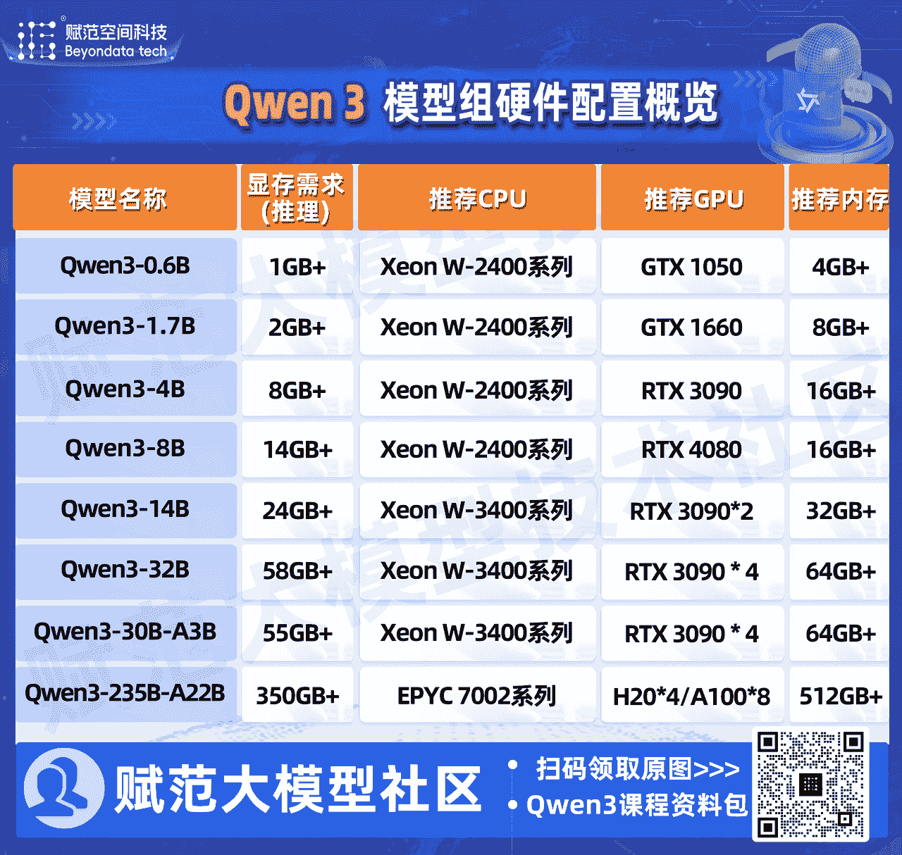
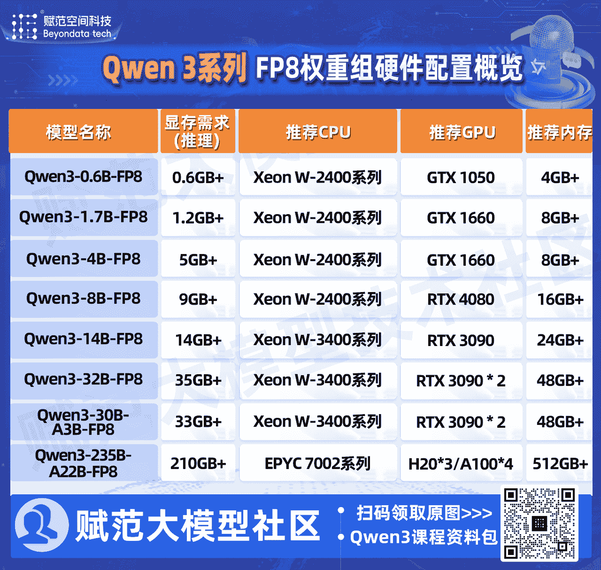
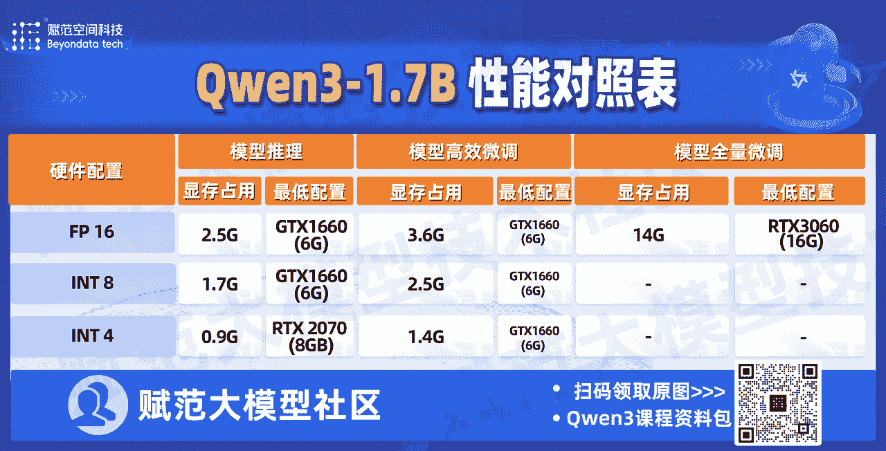
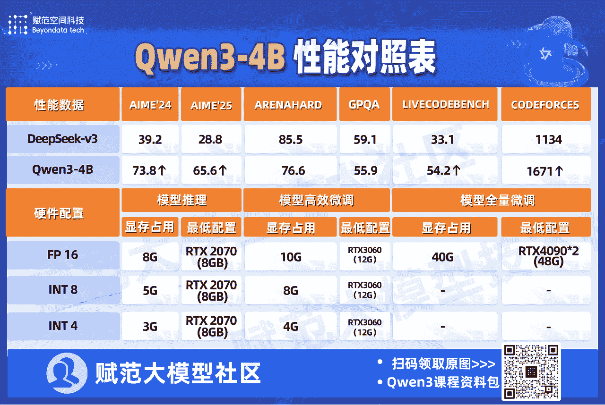
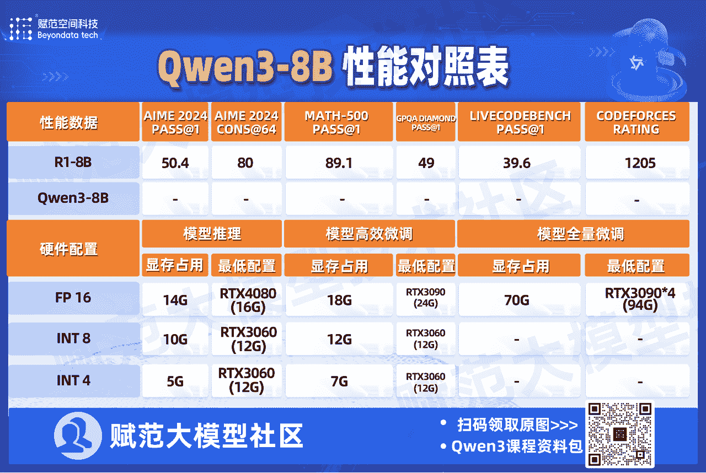
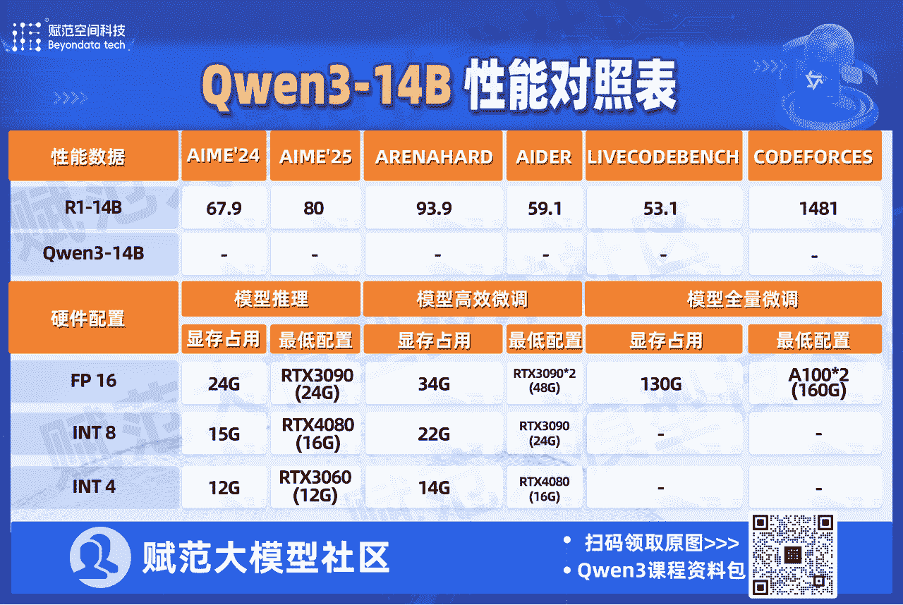
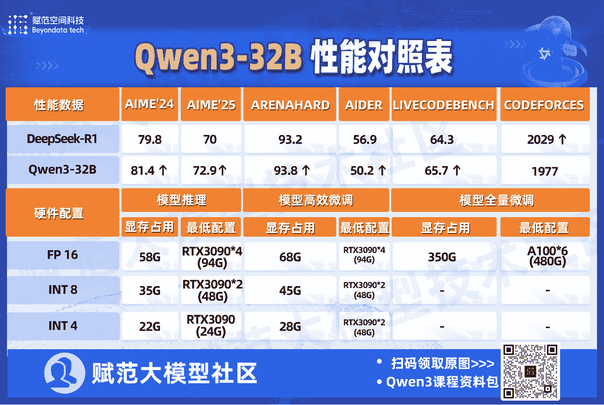
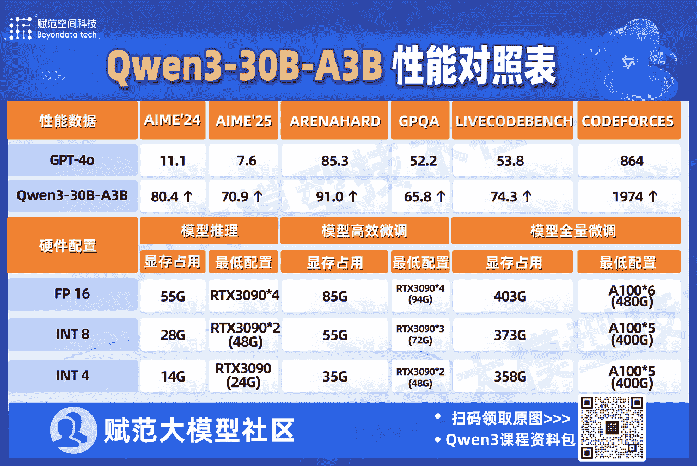
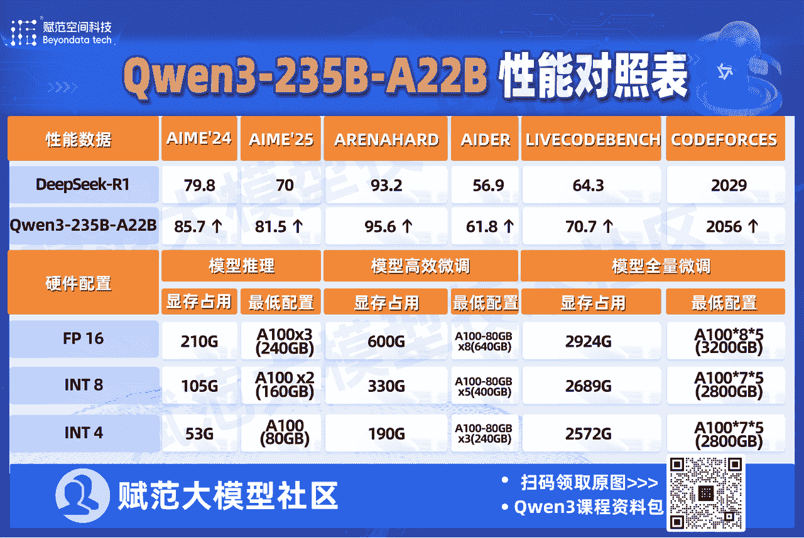

# Qwen3系列模型配置硬件参考自查表

> 来源：[https://kq4b3vgg5b.feishu.cn/docx/J1Frd7TLNodFIAxfEEMcWwBBnsA](https://kq4b3vgg5b.feishu.cn/docx/J1Frd7TLNodFIAxfEEMcWwBBnsA)

# Part 1. Qwen3模型组硬件配置

# Part 2. Qwen3系列全尺寸模型硬件配置表

### Qwen3-0.6

性能指数：⭐️⭐️ 同尺寸开源模型SOTA（最佳性能）

适用场景：移动端应用&个人助理

### Qwen-1.7B

性能指数：⭐️⭐️ 同尺寸开源模型SOTA（最佳性能）

适用场景：移动端应用&个人助理

### Qwen-4B

性能指数：⭐️⭐️⭐️ 平均性能大约比DeepSeek-V3高25~30%

适用场景：高校实验室&小型团队使用

### Qwen-8B

性能指数：⭐️⭐️⭐️ 同尺寸开源模型SOTA（最佳性能）

适用场景：高校实验室&小型团队使用

### Qwen-14B

性能指数：⭐️⭐️⭐️⭐️ 同尺寸开源模型SOTA（最佳性能）

适用场景：适用于一般商业场景

### Qwen-32B

性能指数：⭐️⭐️⭐️⭐️⭐️ 整体性能约比DeepSeek-R1高4~5%

适用场景：适用于高性能要求商业场景

### Qwen-30B-A3B

性能指数：⭐️⭐️⭐️⭐️⭐️ 整体性能远超GPT-4o，平均领先约23.7个百分点

适用场景：适用于高性能要求商业场景

### Qwen-235B-A22B

性能指数：目前开源最强MOE大模型，各项指标均创所有国产模型及全球开源模型的性能新高

适用场景：适用于高性能要求商业场景

