# 3.1 大模型配置硬件参考自查表

> 来源：[https://kq4b3vgg5b.feishu.cn/docx/YNgrds0jrooSvBxb4JLciorrntf](https://kq4b3vgg5b.feishu.cn/docx/YNgrds0jrooSvBxb4JLciorrntf)

## Part 1.大模型推理与训练通用硬件选配表

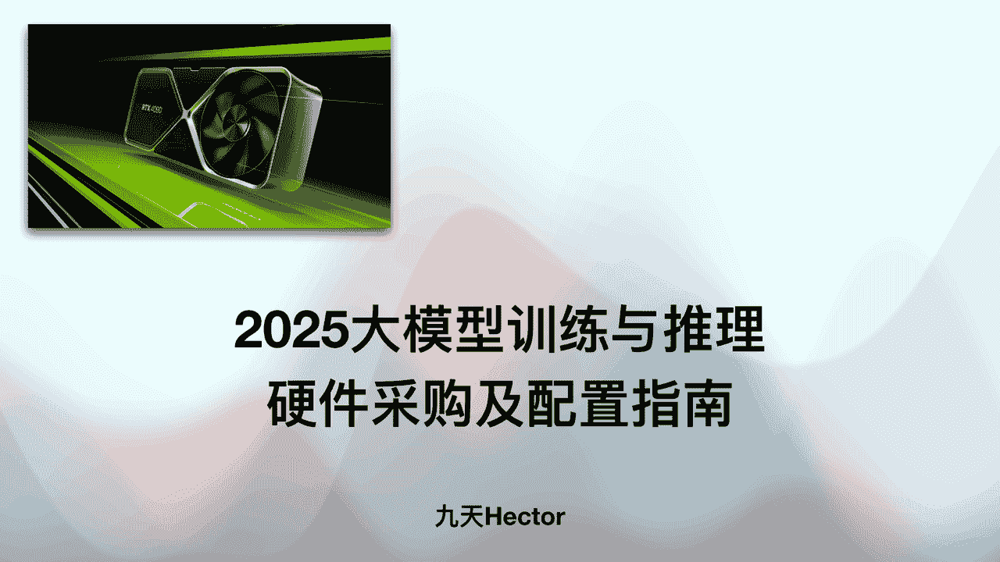

[大模型部署与训练硬件选择指南.pdf](https://internal-api-drive-stream.feishu.cn/space/api/box/stream/download/all/GRMvbshEVoPBCOxVBdzc24j7nfd)

+   PCIe、NVLink、NVSsitch技术对比

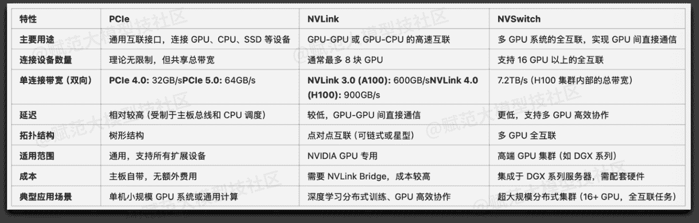

+   A100各系显卡对比图

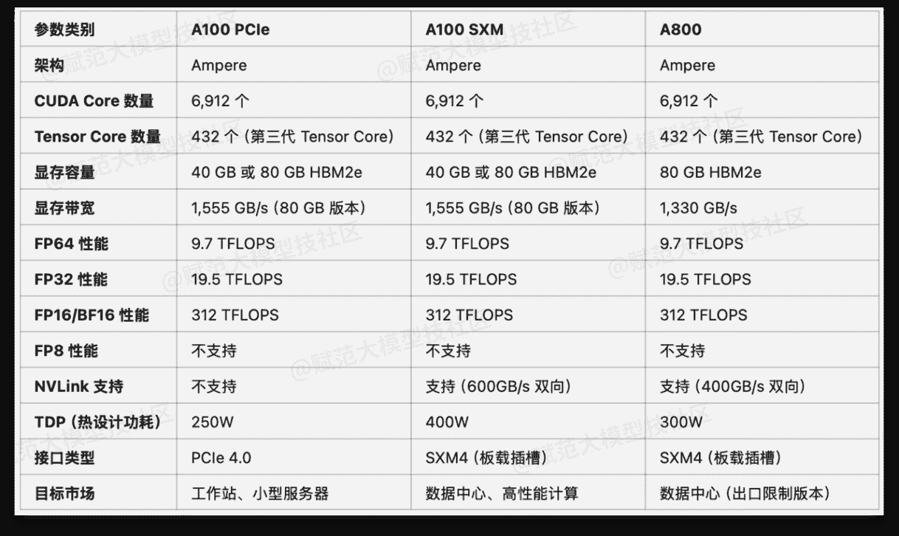

+   英伟达显卡主要分类及命名规则

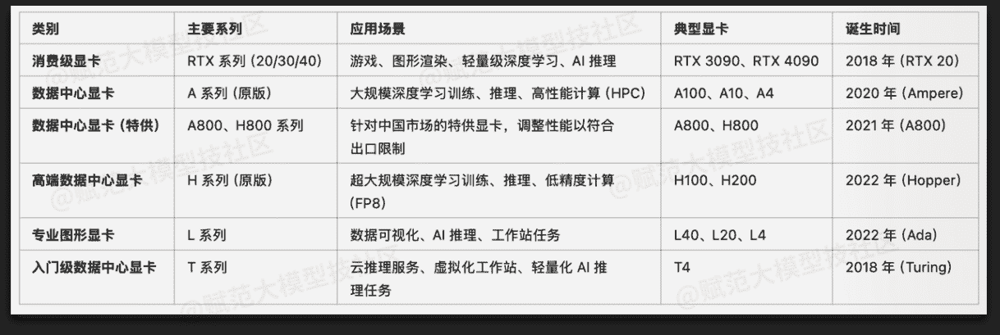

+   英伟达各类显卡功能总结

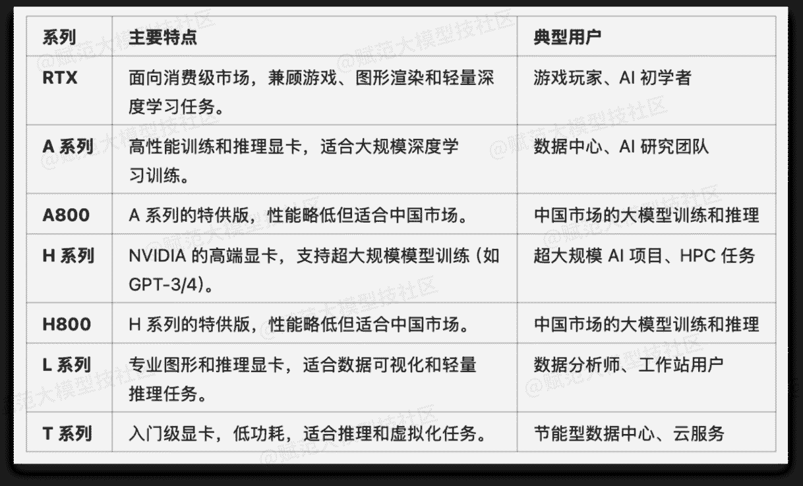

+   英伟达主流显卡性能对比图

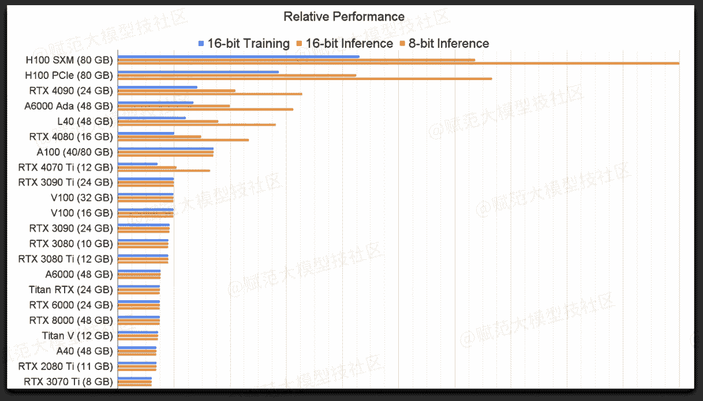

+   英伟达主流显卡性价比对比图

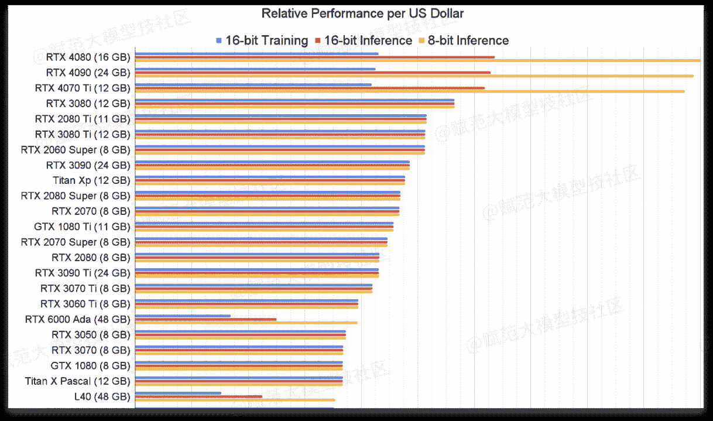

+   不同尺寸、不同精度大模型推理所需显存及硬件推荐

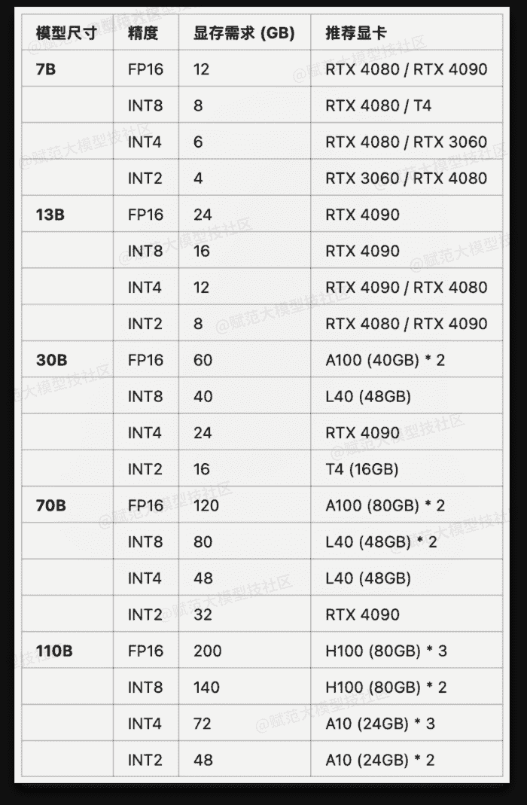

+   不同尺寸、不同精度大模型训练所需显存及硬件推荐

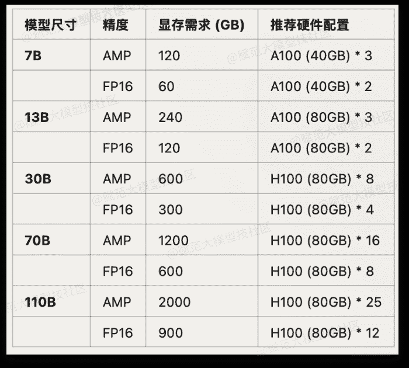

+   不同尺寸、不同精度大模型高效微调所需显存及硬件推荐

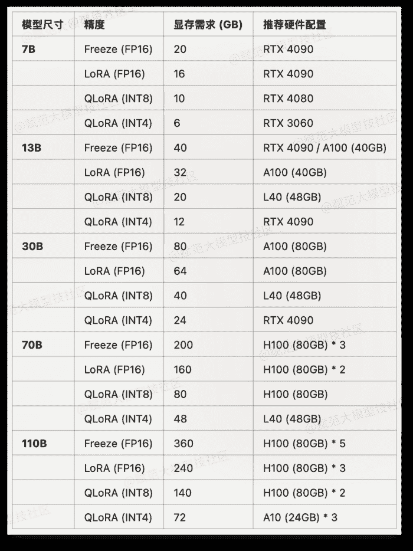

+   各类典型场景下GPU配置方案推荐

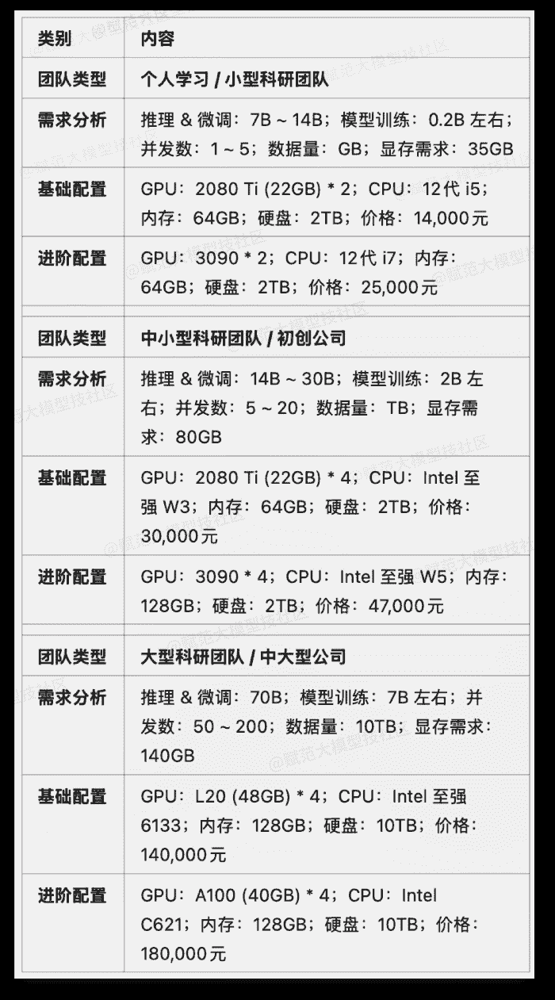

## Part 2.DeepSeek R1各模型硬件需求

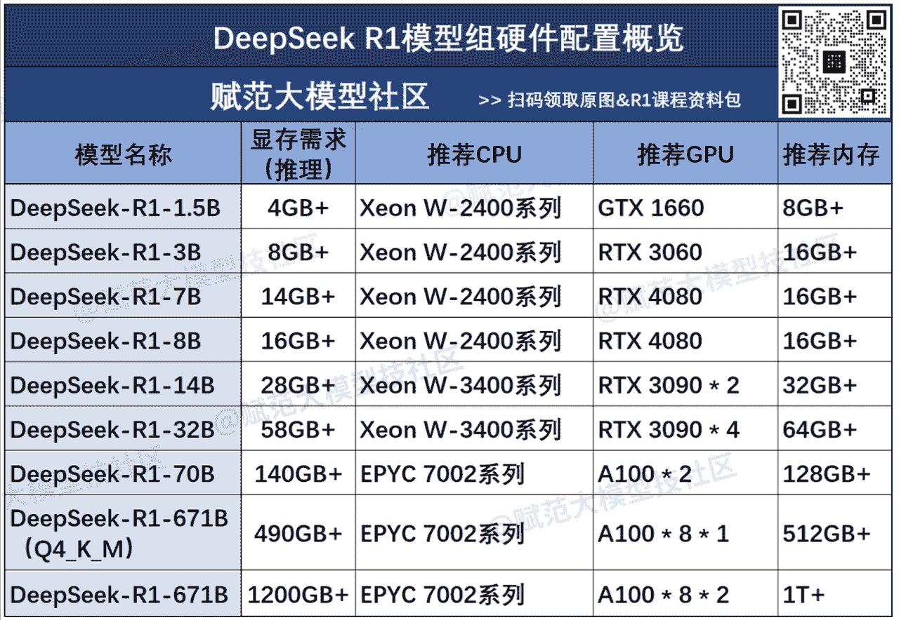

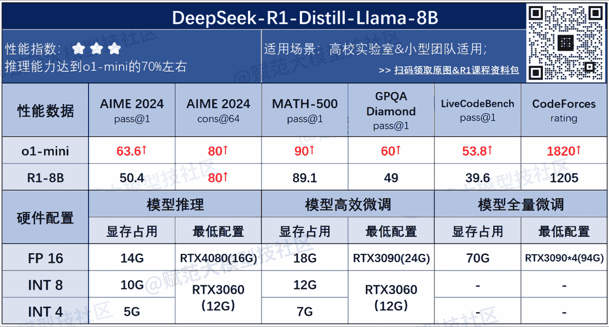

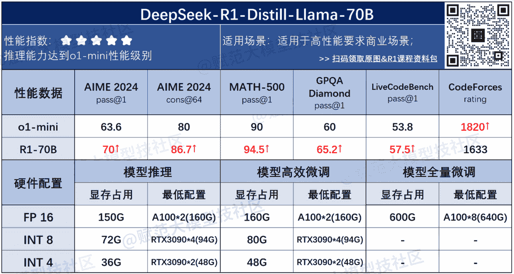

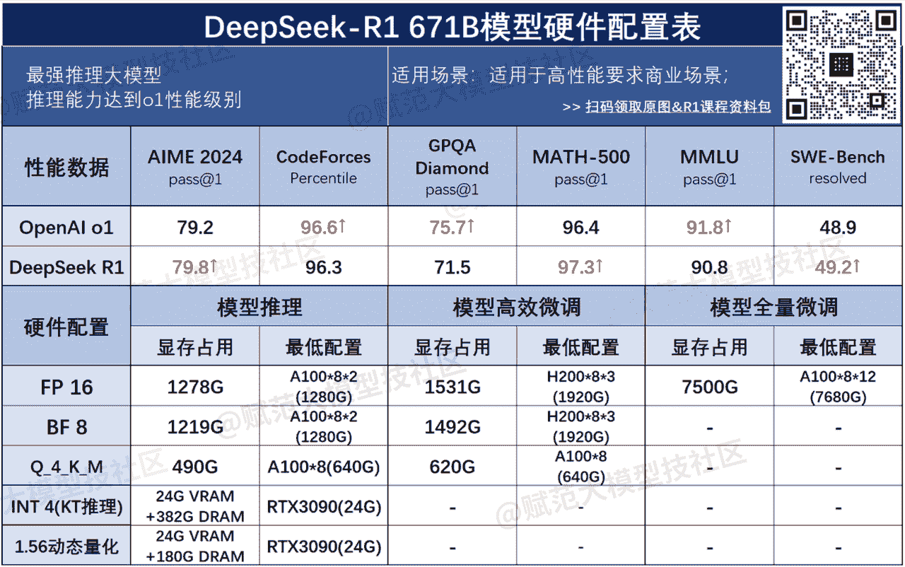

## Part 3.DeepSeek R1硬件选配思维导图

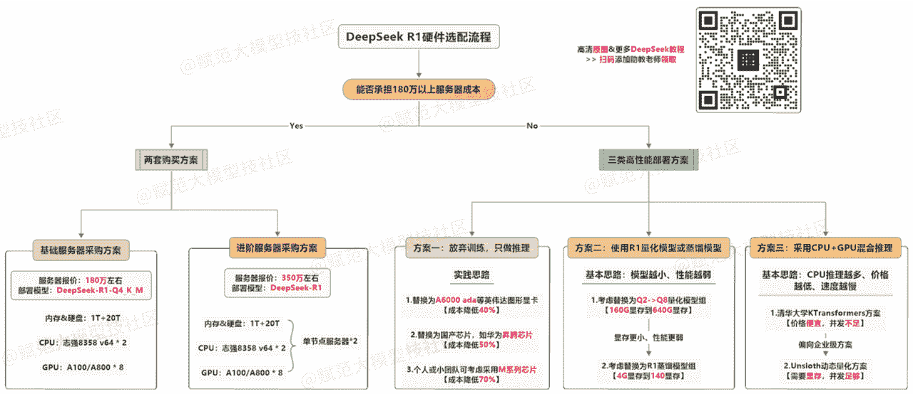