# GPT-4.1 模型API介绍【翻译文档】

> 来源：[https://kq4b3vgg5b.feishu.cn/docx/QuLndloMno9Jh6x3oMcci6Nxnr5](https://kq4b3vgg5b.feishu.cn/docx/QuLndloMno9Jh6x3oMcci6Nxnr5)

+   GPT-4.1 API官网地址：https://openai.com/index/gpt-4-1/

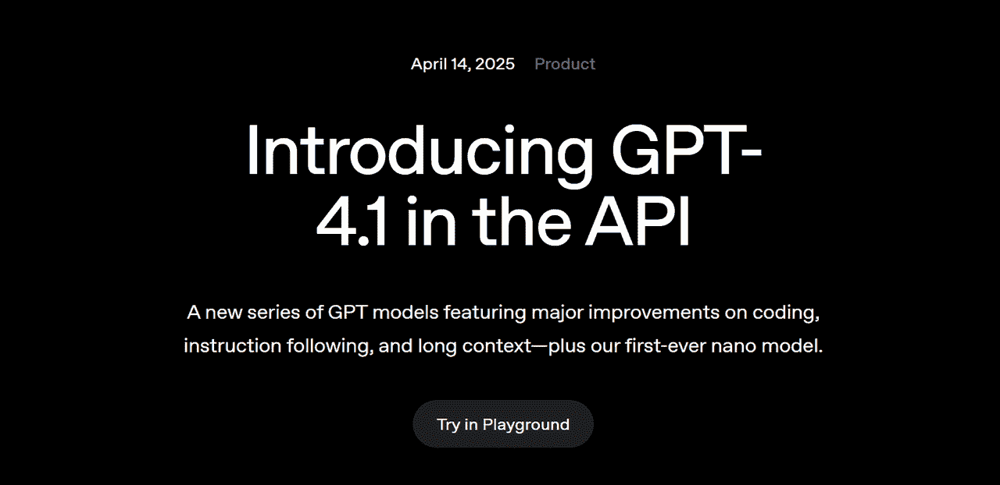

## **GPT-4.1 API正式发布**

这是一个全新的 GPT 模型系列，在代码能力、指令理解和长上下文处理方面有了重大提升 —— 并且首次推出了 nano 级别的小型模型。今天，我们在 API 中发布了三个新模型：GPT-4.1、GPT-4.1 mini 和 GPT-4.1 nano。这些模型在各方面的表现都优于 GPT-4o 和 GPT-4o mini，尤其在代码生成和指令遵循能力上取得了显著提升。

**它们的上下文窗口更大 **—**— 支持最多 **100万个tokens 的上下文 —— 同时具备更强的长上下文理解能力，能更有效地利用这么长的上下文信息。这些模型的知识截止日期更新到了 2024年6月，也就是说它们掌握的信息比之前的模型更新。

## GPT-4.1 在以下行业标准评测中表现出色

+   **编程能力**：**在 SWE****-bench Ve**rified（一个代码修复/编程能力评测基准）上，GPT‑4.1 取得了 54.6% 的分数，相较 GPT-4o 提升了 21.4 个百分点（绝对值提升），相较 GPT-4.5 提升了 26.6 个百分点——使它成为当前领先的编程能力模型之一。

+   **指令遵循能力**：**在 Sca**le 公司推出的 Multi**Challenge** 基准测试（用于衡量模型跟随人类指令的能力）中，GPT‑4.1 得分 38.3%，比 GPT‑4o 提升了 10.5 个百分点。

+   **长上下文理解能力**：在 Video-MME 基准测试中（该测试用于评估多模态**长上下文理解**能力），GPT-4.**1 在“长****视频无字幕”这个**类别上取得了 72.0% 的得分，比 GPT-4o 提升了 6.7 个百分点，创下了新的 SOTA（state-of-the-art，最先进水平）。

**尽管这些基准测**试**提供了有**价值的参**考信息，**我们训练这些**模型的重点仍然是 **实际应用的效用。通过与开发者社区的紧密合作与共创，我们对模型进行了优化，重点提升那些对开发者应用最关键的任务表现。为实现这一目标，GPT‑4.1 系列模型在更低成本下提供了卓越性能。这些模型在延迟—性能权衡曲线上的每一个点都带来了性能的突破。

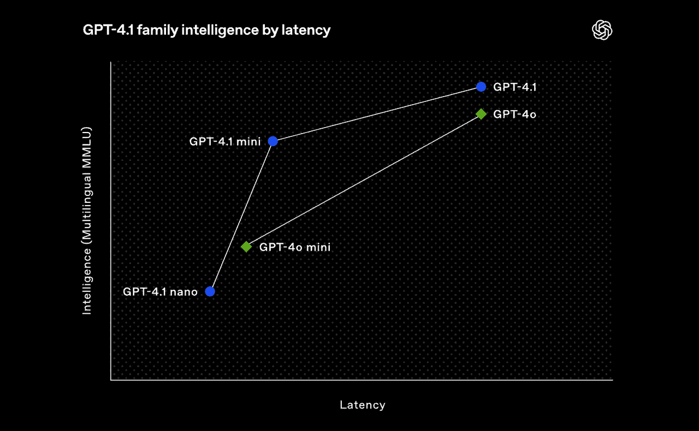

GPT-4.1 mini 在小模型性能方面实现了重大飞跃，甚至在许多基准测试中超过了 GPT-4o。它在智能评测中与 GPT-4o 相当甚至更优，延迟减少近一半，成本降低了 83%。

**对开发**者来说，这意味着更**强的性价比，尤其适合中轻**量任务。对于**对低延迟有极**高要求的任务，GPT‑**4.1 **nano 是我们当前最快、**最便宜的模型。它虽然**体积小巧，但支持 100 万 **toke****ns 的**上**下文窗口**，性能仍非常出色：在 MML**U（多任务语言理解）上得分** 80.1%；GPQA（高级问答**评测）得分** 50.3%Aider polyglot 编程评测中得分 9.8% —— 甚至高于 GPT‑4o mini。这使它非常适用于如文本分类、自动补全等任务。

当 GPT‑4.1 与例如 Responses API 这样的原语（primitives）结合使用时，开发者现在可以构建出更加实用、可靠的智能体，用于完成以下真实任务：软件工程中的自动化编程或维护；从大规模文档中提取关键信息；自动回应用户请求（无需人工干预）；以及其他各种复杂任务。

请注意：**GPT‑4.1 仅通过 AP****I 提供，而****在 ChatGPT 应用中，****GPT‑4.1 **中许多**在指令遵循、编程能力**和智能表现上的改进，已经逐步融合进了最新版本的 GPT‑4o，未来还会继续集成更多改进。我们也将开始在 API 中淘汰 GPT‑4.5 预览版，因为 GPT‑4.1 在许多关键能力上提供了更优或相近的性能，同时成本更低、响应更快。

GPT‑4.5 预览版将在 **2025年7月14日**** 停止服务，****OpenAI** 预留了三个月过渡期，便于**开发者完成迁移。GPT‑4**.5 起初是作为一个研究预览模型发布的，旨在探索和测试一种大型、计算密集型的模型架构，我们从开发者的使用反馈中收获了许多宝贵经验。

我们将在未来的 API 模型中继续延续** GPT‑4.5 中你们**喜爱**的特质，包括：创意**性、写作质量、幽默感以及细腻的语言表达能力。接下来，我们将详细介绍 GPT‑4.1 在多个基准测试中的表现，并分享一些早期用户（如 Windsurf、Qodo、Hex、Blue J、汤森路透和凯雷集团）在真实生产环境中、针对特定领域任务的实际应用案例。

## Coding

GPT‑4.1 在多种编程任务上相较 GPT‑4o 有显著提升，包括以智能体方式解决编程任务、前端开发、减少无关改动、可靠地遵循 diff 格式、保持工具使用一致性等方面。

在 SWE-bench Verified（一个衡量真实世界软件工程能力的基准测试）中，GPT‑4.1 完成了 54.6% 的任务，而 GPT‑4o（2024 年 11 月 20 日版本）仅完成了 33.2%。这体现了模型在浏览代码仓库、完成任务、以及生成既能运行又能通过测试的代码方面的能力提升。

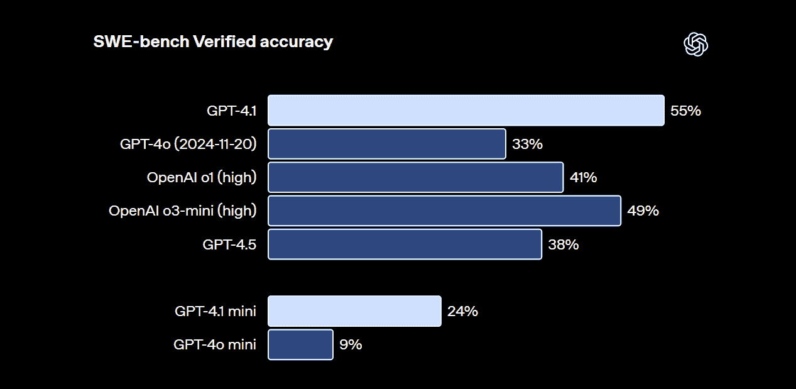

在 SWE-bench Verified 中，模型会被提供一个代码仓库和一个 issue 描述，任务是生成一个补丁以解决该问题。性能高度依赖于使用的提示词和工具。为了帮助复现和理解我们的结果，我们在此描述了 GPT‑4.1 的设置方式（链接）。我们的评分中排除了 500 个问题中的 23 个，因为这些问题的解决方案无法在我们的基础设施上运行；如果保守地将这些问题计为 0 分，那么 54.6% 的得分将变为 52%。

对于希望修改大型文件的 API 开发者来说，GPT‑4.1 在各种格式的代码 diff 操作中更加可靠。在 Aider 的 polyglot diff 基准测试中，GPT‑4.1 的得分是 GPT‑4o 的两倍多，甚至比 GPT‑4.5 高出 8 个百分点。该评测不仅衡量模型在多种编程语言中的能力，也考察模型在生成整文件和 diff 格式变更方面的表现。我们对 GPT‑4.1 进行了专门训练，使其更可靠地遵循 diff 格式，这可以让开发者仅让模型输出变更的行，而非重写整个文件，从而节省成本和延迟。

如需获得最佳的代码 diff 效果，请参考我们的提示词指南。对于偏好重写整个文件的开发者，我们将 GPT‑4.1 的输出 token 上限提升到了 32,768 tokens（GPT‑4o 的上限为 16,384 tokens）。我们还推荐使用 Predicted Outputs（链接）来减少完整文件重写的延迟。

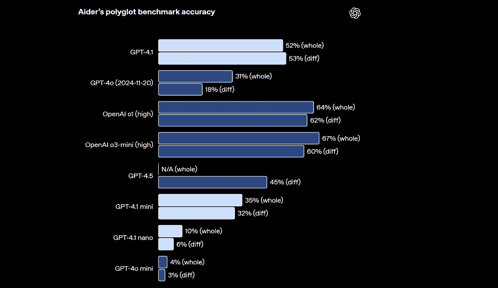

在 Aider 的 polyglot 基准测试中，模型通过编辑 Exercism（链接）中的源代码文件来解决编程练习，并允许一次重试。“whole” 格式要求模型重写整个文件，这可能较慢且成本较高。“diff” 格式则要求模型输出一系列搜索/替换块。

GPT‑4.1 在前端开发方面也比 GPT‑4o 有大幅提升，能够构建功能更完整、视觉更美观的 Web 应用。在我们的对比测试中，付费人工评审在 80% 的情况下更偏好 GPT‑4.1 生成的网站而非 GPT‑4o 的版本。

> **提示词（Prompt）**：制作一个抽认卡（flashcard）的网页应用。用户应能够：

+   创建抽认卡，

+   搜索已有的抽认卡，

+   复习抽认卡，

+   查看已复习卡片的统计信息。

> **预加载****：预加载十张卡片**，每**张卡片包**含一个印地语单词或短语及其英文翻译。

> **复习界面****：在复习界面中，点击卡****片或按下**空格键应触发平滑的 3D 翻转动画，翻转后显示翻译内容。按左右方向键应能切换卡片。

> **搜索界面****：搜索栏应在用户输入查**询内容时，动态地显示匹配结果列表。

> **统计界面****：统计页面应**显示用户已复习卡片的数量图表，以及正确率百分比。

> **创建卡片界面**：创建卡片页面应允许用户指定卡片的正反面内容，并将其加入用户的卡片集合中。

> **界面导航**：上述所有界面应可通过**侧边栏（sidebar）访问**。

> **技术要求**：生成一个单页 React 应用（Single Page App），所有样式使用内联样式（inline）完成。

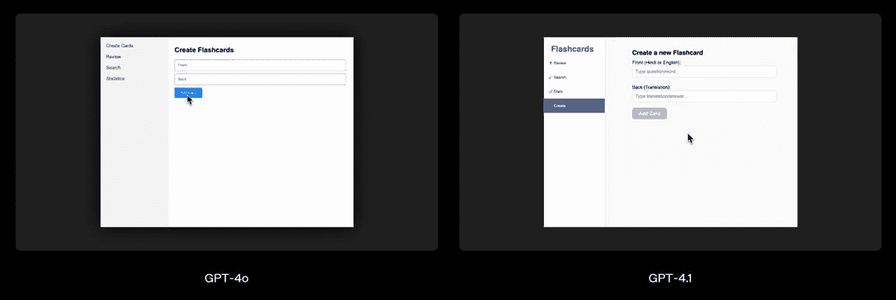

[20250415020606_rec_.mp4](https://internal-api-drive-stream.feishu.cn/space/api/box/stream/download/all/TkAWb6FFIo5A0HxWhojcgD1wnRh)

除了上述基准测试外，GPT‑4.1 在遵循格式方面更可靠，且更少进行多余的修改。在我们的内部评估中，代码中的多余修改从 GPT‑4o 的 9% 降至 GPT‑4.1 的 2%。

## **真实世界示例**

**Windsurf**：在 Windsurf 的内部编码基准测试中，**GPT‑4.**1** 的得****分比 GP**T‑4o 高出 60%，而这个评分与“代码首次评审就被接受的频率”高度相关。他们的用户指出，GPT‑4.1 在工具调用方面的效率提高了 30%，重复不必要修改或以过于狭隘、渐进方式理解代码的可能性降低了 约 50%。这些改进使工程团队的迭代更快，工作流程更流畅。

**Qodo**：Qodo 通过 GitHub Pull Request 自动生成高质量代码评审，对 GPT‑4.1 与其他主流模型进行了对比测试，采用的是他们基于微调基准而设计的方法学。在 200 个具有代表性的真实 PR 中，使用相同提示词和条件，他们发现 GPT‑4.1 在 55% 的情况下生成了更好的建议。值得注意的是，他们发现 GPT‑4.1 在两个方面表现突出：

+   **精确性**（知道什么时候**不需要给建议**）

+   **全面性****（在必要时能提**供详尽分析）同时还能聚焦于真正关键的问题。

**指令遵循能力**

GPT‑4.1 更加可靠地遵循指令，我们在多种指令遵循评估中测得了显著的提升。我们开发了一个内部指令遵循评估体系，用于在多个维度和关键类别上跟踪模型表现，包括：

+   **格式遵循**：根据指定的格式（如 XML、YAML、Markdown 等）生成响应；

+   **否定性指令**：指明模型**不应该做什么**（例如：“不要提示用户联系技术支持”）；

+   **顺序性指令**：要求模型**按照特定顺序**执行一系列操作（例如：“先询问用户姓名，再询问邮箱地址”）；

+   **内容要求**：输出内容中**必须包含某些特定信息**（例如：“营养计划中必须包括蛋白质含量”）；

+   **排序要求**：要求模型以特定方式对输出进行排序（例如：“按人口数量对国家进行排序”）；

+   **控制自信度**：要求模型在缺乏信息时说出“我不知道”，或提供备选方案（例如：“如果不知道答案，请提供支持邮箱地址”）。

这些类别是根据开发者反馈中指出的最相关、最重要的指令遵循维**度总结而来的。在****每个类别**中，我们又细分为简单、中等、困难三类提示。GPT‑4.1 尤其在困难提示上的表现相比 GPT‑4o 有显著提升。

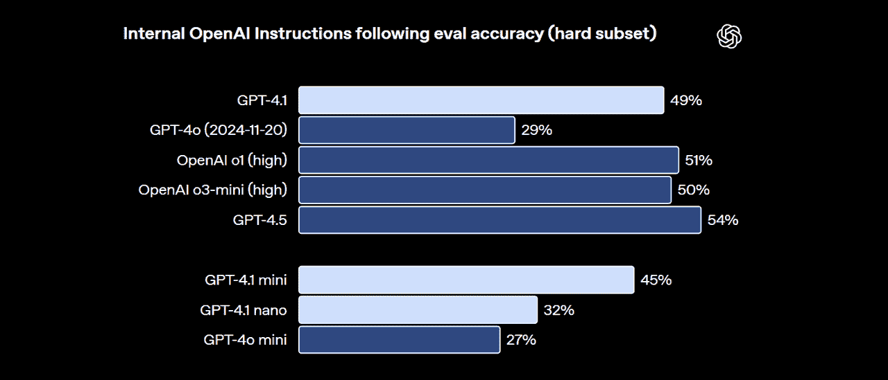

我们的**内部指令遵循评估****基于真实开发者的使用案例**与反馈，涵盖了多种复杂程度的任务，并辅以对格式、表达详细程度、长度等方面的指令要求。

**多轮指令遵循能力**对许多开发者来说至关重要 —— 模型需要在对话进行多轮之后仍能保持上下**文一致性，并准确记住用户先**前说过的内容。我们对 GPT‑4.1 进行了训练，使其更擅长从对话历史中提取信息，从而实现更加自然、连贯的对话体验。来自 Scale 的 MultiChallenge 基准测试正是评估这种能力的有效工具，GPT‑4.1 在该测试中的表现比 GPT‑4o 提高了 10.5 个百分点。

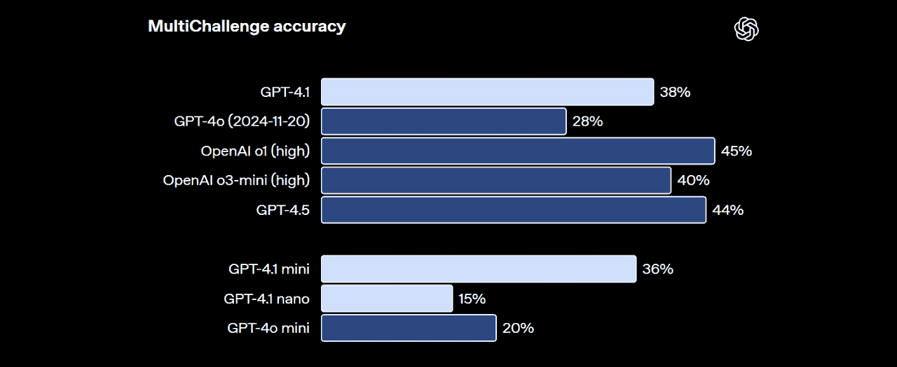

在 MultiChallenge（链接）中，模型**需要在多**轮对话中正确地使用来自过往消息的四类信息。

GPT‑4.1 在 **IFEval** 评测中也取得了 **87.4%**** 的成绩，**而 GPT‑4o 的得分**为 81.**0%。IFEval 使用包含可验证指令的提示词进行评测，例如明确要求输出内容的长度，或要求避免使用某些术语或格式。

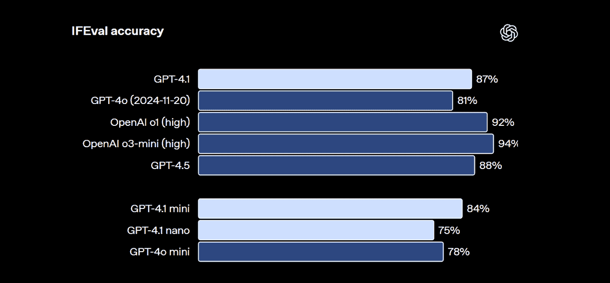

**在 IFEval（链**接）中，模型必须生成符合各种精细指令要求的回答。

更**强的指令遵循能力不仅****能让现有应**用更加可靠，还能让此前受限于“可靠性差”的一些新应用成为可能。一些早期测试者指出，GPT‑4.1 有时会更倾向于字面理解指令，因此我们建议在编写提示词时应尽可能明确且具体。如需了解 GPT‑4.1 的提示词编写最佳实践，请参考提示词指南。

**真实世界示例**

**Blue J****：在 Blue J ****内部最具挑战**性**的真实税**务场景**基准测试中，GPT**‑4.1 的准确率比 GPT‑4o 高出 53%**。这种准确性的飞跃 —— 对于**系统性能和用户满意度而言都至关重要 —— 充分体现了 GPT‑4.1 在理解复杂法规和处理长上下文中细致指令方面的显著提升。对 Blue J 的用户来说，这意味着更快速、更可靠的税务研究流程，以及更多时间专注于高价值的顾问服务。

**Hex**：在 Hex 最具挑战性的 **SQL 测评集****（链接）中，**GP**T‑4.**1** 的表现**提升接近 2 倍，在指令遵循**与语义理解方面取得了重**大突破。模型在从大型、模糊的**数据库结构（sche**ma）中准确选择表格方面更具可靠性 —— 这是一个上游决策点，直接影响整体准确率，而且仅靠提示词调优难以做到。对 Hex 来说，这带来了人工调试量的显著减少，并且更快速地实现了可用于生产环境的工作流程。

## 长上下文（Long Context）

GPT‑4.1、GPT‑4.1 mini 和 **GPT‑4.1 nano **都能处理最多 100 万个 tokens 的上下文长度 —— 相比之前的 GPT‑4o 模型最多只能处理 128,000 tokens，这是一次大幅提升。100 万个 tokens 超过了 8 份完整 React 代码库的长度，因此长上下文特别适用于处理大型代码库或大量长文档的场景。

我们对 GPT‑4.1 进行了训练，使其能在完整的 100 万 token 长度范围内稳定地聚焦关键信息。此外，我们还训练它在识别相关文本、忽略干扰内容方面比 GPT‑4o 更加可靠，无论是处理长上下文还是短上下文。长上下文理解能力对于法律、编程、客户支持等众多领域的应用至关重要。

下面是 GPT‑4.1 在长上下文中检索一段小而隐藏的信息（“针”）的能力测试结果。我们将**这段信息放置在上下文**窗口的不同位置，**GPT‑4.1 在所有位置、所有**上下文长度下都能准确检索到“针”，即使是在接近 100 万 tokens 的上下文长度中也毫无问题。这说明它可以在输入中无论信息位置如何，都能成功提取出对当前任务有用的关键细节。

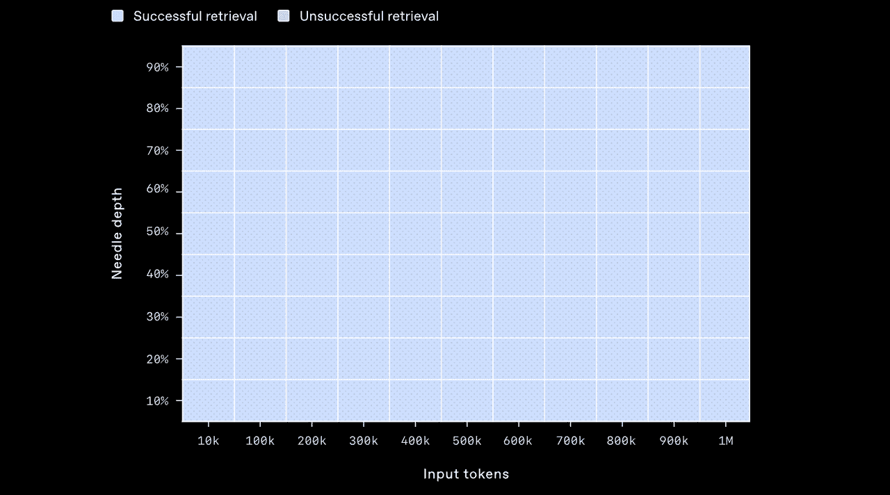

在我们的内部“大海捞针（needle in a haystack）”测试中，GPT‑4.1、GPT‑4.1 mini 和 GPT‑4.1 nano 在整个 1M 长度内的所有位置都能检索到“针”。

然而，现实中的任务往往并不像检索一个明确的“针”那**么简单。我们发现**用户通常**希望模型不仅能够检****索多个信息片段，还要能理解它们之**间的关系。为了展示这一能力，我们开源了一个新评测集：OpenAI-MRCR（Multi-Round Coreference）。

**OpenAI-MRCR** 测试模型能否在上下文中找到并正确区分多个“针”。

测试内容是一系列合成的多轮对话，用户向助手请求写作内容，例如“写一首关于貘（**tapirs）的诗”或“写一****篇关于**岩石的博客文章”。随后，我们会在上下文中插入 2、4 或 8 条相同的请求。模型最后必须提取出对应某一特定请求实例的回答（例如：“请给我第三首关于貘的诗”）。

**难点在**于这些请求与其他上下**文内容之间的相**似性 —— 模型很容易被微小的差别误导，比如短**篇小说 vs. 诗歌、****貘 vs. 青蛙。我们发**现，GPT‑4.1 在最长**可达 1**28K tokens 的上下文中优于 GPT‑4o，并在 100 万 tokens 的上下文长度下依然保持了强劲表现。

不过这个任务仍然非常困难 —— 即**使对高级推理模型而言也****是如此。我们也已经公开**发布了该评测数据集，鼓励更多研究者深入**研究真实**场景下的长上下文信息检索问题。在 OpenAI-MRCR 中，模型需要回答一个问题，该问题要求模型在 2、4 或 8 个用户提示中进行正确区分，这些提示被分散在多个干扰信息之间。

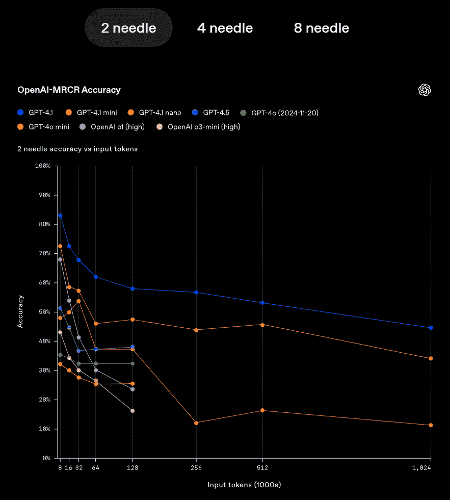

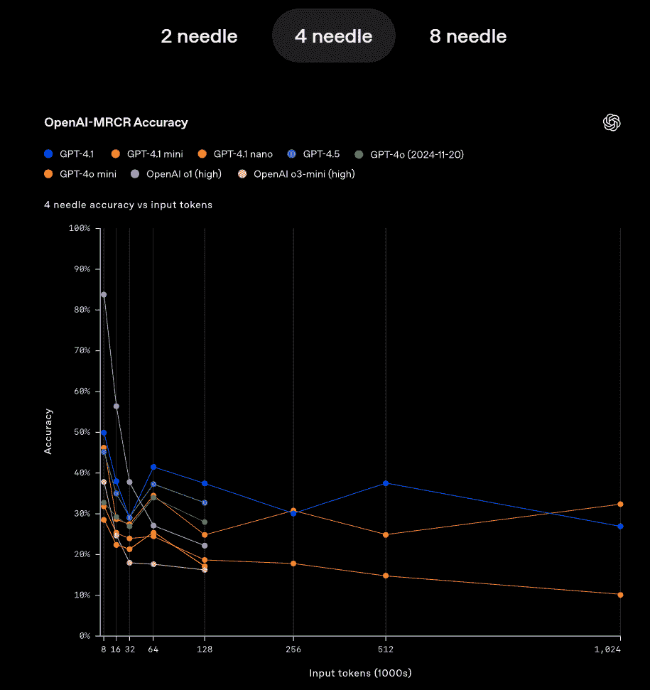

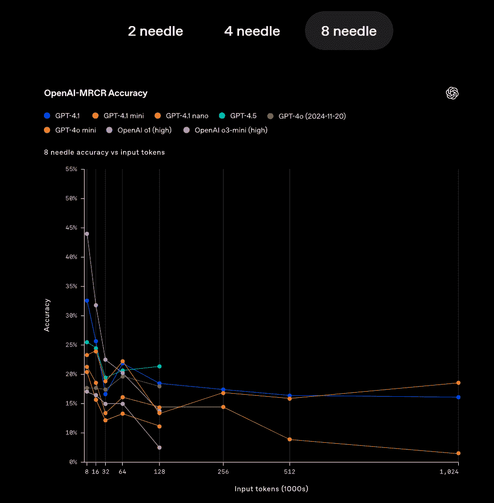

我们还发布了 **Graphwalks** 数据集（链接），用于评估**多跳式的长上下文推理能力****。许多开发者**在使用长上下文的场景中，往往需要模型执行多步逻辑跳跃——例如在编写代码时跳转多个文件之间，或在解答复杂法律问题时进行文档间交叉引用。

**一个模型（****甚至人类）在理论上可****以通过一次性阅读完成** OpenAI-MRCR 的任务，但 Graphwalks 的设计目的就是要求模型在上下文中跨越多个位置进行推理，而非顺序扫描即可解决。

**Graphwalks** 会在上下文中填入一个由十六进制哈希组成的有向图（direct**ed g**raph**），然后要求模型从图中****的随机节点开始执行广**度优先**搜索（BFS）**，最后返回指定深度的所有节点。GPT‑4.1 在这一基准测试中取得了 61.7% 的准确率，与 o1 模型相当，并显著超过 GPT‑4o。

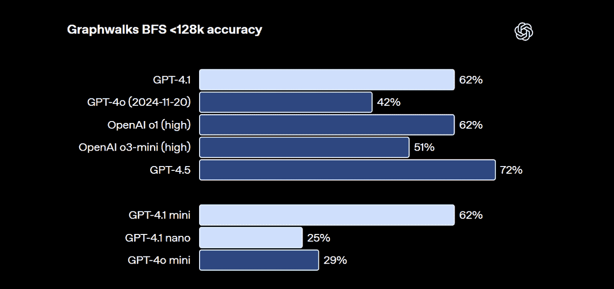

在 **Graphwalks**中，模型需要在一个大型图中从随机节点开始执行广度优先搜索。

基**准测试虽然提供了有**价值的数据，但无法展现模型的全部能力。因此我们还与一批 alpha 合作伙伴合作，在他们的真实长上下文任务中测试了 GPT‑4.1 的性能。

**真实世界示例**

> 汤森路透（Thomson Reuters）：

> **Thomson R**euters 使用 GPT‑4.1 对其法律工**作专业级 AI 助手 CoCo****unsel 进行了测试。与 ****GPT‑4o 相比，在**其内部的长上下文基准测试**中，GPT‑4.1 的多文**档审**阅准确率**提**升了 17**% ——这是衡量 CoCounsel 是否能胜任处理多个冗长文档的复杂法律工作流的关键指标。他们特别指出，GPT‑4.1 在跨来源维持上下文一致性方面表现极其可靠，同时能准确识别文档之间的细微关系，如冲突条款或补充上下文等 —— 这些任务对法律分析和决策至关重要。

> **凯雷集团（Carlyle）****：

> Carlyle 利**用 GPT‑4.1 从多个冗长文档中精确提取细粒**度财务数据，包括 **PDF、Ex**cel 以及其**他复杂格式。**根据其内部评估结果，GP**T‑4.1 在处理数据密集型超大文档时的检索能力提升了 50%，并且是首个成功克服其他模型关键局限的模型，包括：

+   “大海捞针”式检索（needle-in-the-haystack）

+   中段丢失（lost-in-the-middle）问题

+   跨文档多跳推理（multi-hop reasoning）

> **除了模型****的性能与准确性之外**，开发者还需要响应快速的模型，以满足用户需求并跟上交互节奏。我们已经对推理架构进行了优化，以减少生成第一个 token 的时间（time to first token）。通过启用提示词缓存（prompt caching），还可以进一步降低延迟并节省成本。

**在我们初**步测试中，GP**T‑4.1 在处理 1**2**8,000 tokens 上下文时，**第 95 百分位延迟（p95）约为 15 秒；在 100 万 tokens 上下文场景下，延迟可达 30 秒以内。而 GPT‑4.1 mini 和 nano 的响应速度更快，例如：对于含有 128,000 输入 tokens 的查询，GPT‑4.1 nano 在大多数情况下可在 5 秒内返回第一个 token。

当然可以，以下是这一段内容的完整翻译：

## **视觉理解（Vision）**

**GPT‑4.1 系列在图**像理解方面表现极其出色，尤其是 GPT‑4.1 mini，其性能实现了显著跃升，在图像评测中常常超过 GPT‑4o。

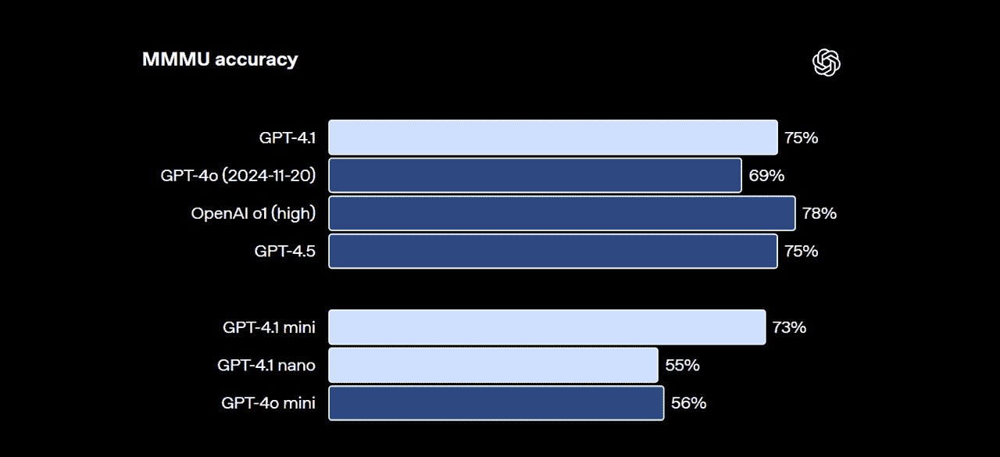

在 **MMMU**评测中，模型需要回答包含图表、示意图、地图等内容的问题。（注：即使图片未显示，许多答案仍可通过上下文推理或猜测得出。）

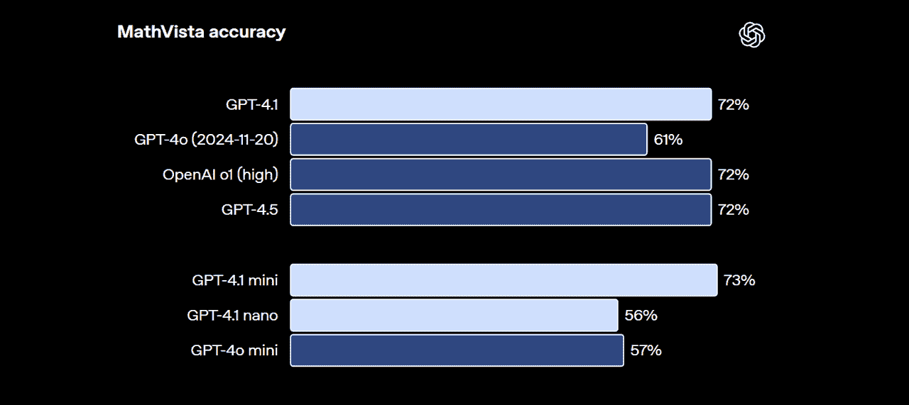

在 **MathVista**评测中，模型需要解决带有视觉内容的数学题目。

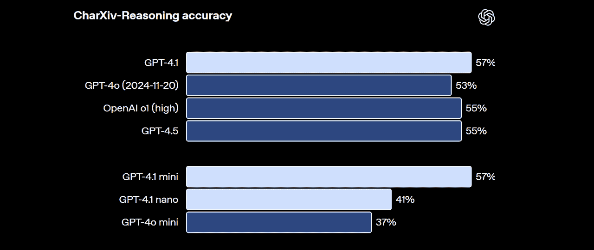

在 CharXiv-Reasoning评测中，模型需要回答关于科学论文中的图表内容的问题。

**长上下文处理能力对****多模态应用也非常**重要，例如**处理长视频**内容。在 Video-MM**E（链接）**评测中（长视频、无字幕场景），模型需基于 30-60 分钟时长、无字幕的视频回答多项选择题。GPT‑4.1 在该任务中达到了当前最先进的水平，得分为 72.0%，相比 GPT‑4o 的 65.3% 有明显提升。

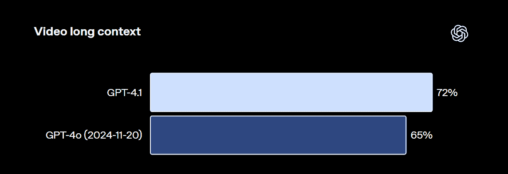

在 **Video-MME**（链接）中，模型需基于 30-60 分钟的无字幕视频内容回答多项选择题。

## **价格（Pricing）**

GPT**‑4.1、GPT‑4.1**** mini** 和** GPT‑4**.1 na**no 现已全面向所有开发**者开放使用。通过**对推理系统进行**效率优化，我**们能够为 GPT‑4.1 系**列提供更低的价格。在典型查询场**景下，GPT‑4.1 ****的价格比 G****PT‑4o 低 26%，**而 GPT‑4.1 nano 是我们迄今为止最便宜、最快速的模型。对于重复传入相同上下文内容的请求，我们还将 提示词缓存（prompt caching） 的折扣从此前的 50% 提高至 75%，适用于这组新模型。最后，我们提供的长上下文支持不会收取额外费用 —— 仍按标准的 每 token 单价计费。

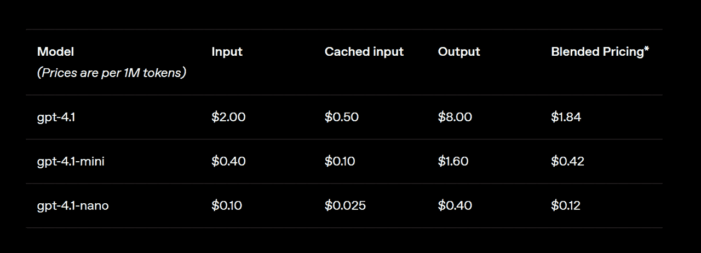

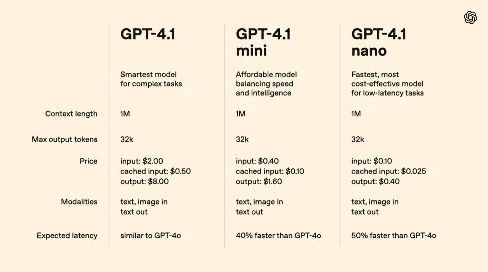

## **结语（Conclusion）**

GPT‑4.1 是 AI 实用化道路上的一个重要进展。通过紧**密关注开**发**者在真实世界中的**需求 —— 从编程、指令遵循，到长上下文理解 ——这一系列模型为构建智能系统与复杂的智能体应用开启了全新可能。

我们持续被开发者社区的创造力所激励，也非常期待看到你们将使用 GPT‑4.1 构建出怎样的精彩项目。

## **附录（Appendix）**

完整的评测结果列表，涵盖了学术测试、编程能力、指令遵循、长上下文、视觉理解与函数调用等方面，详见下方。

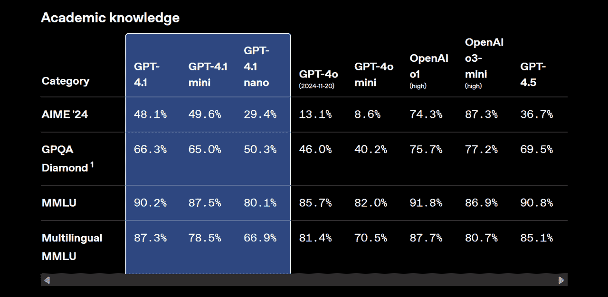

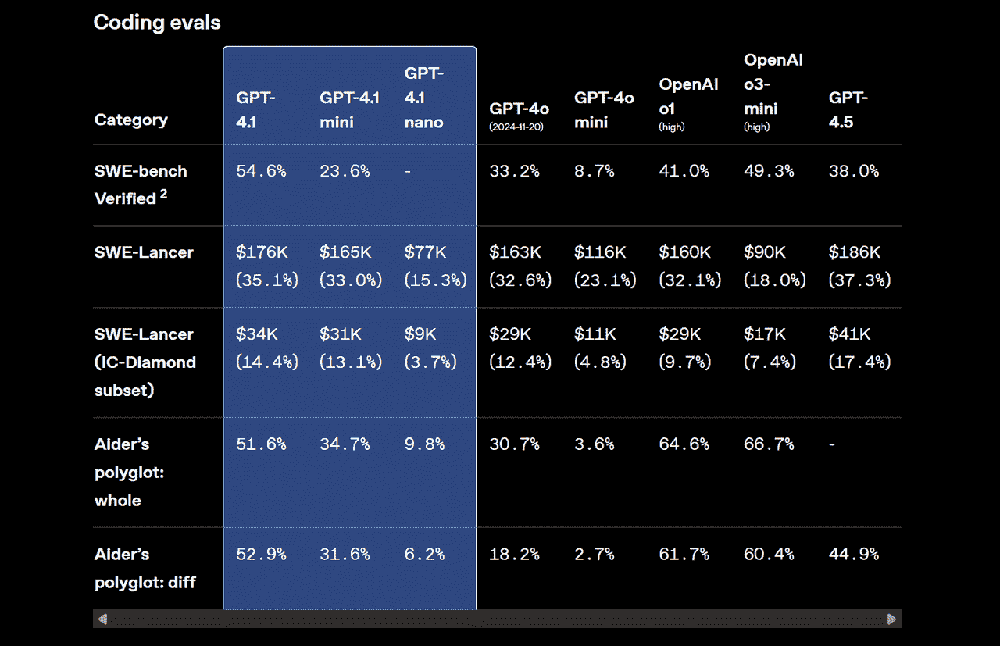

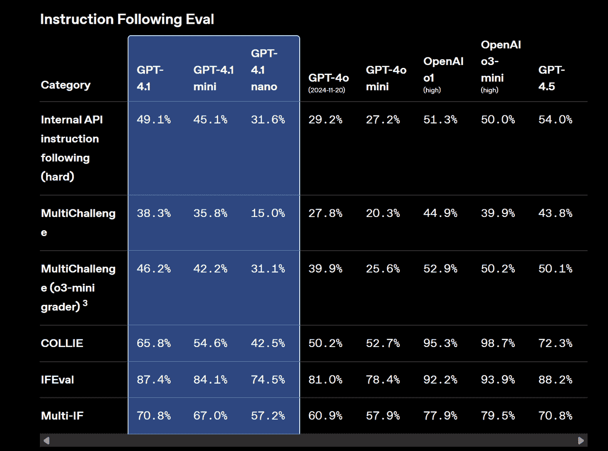

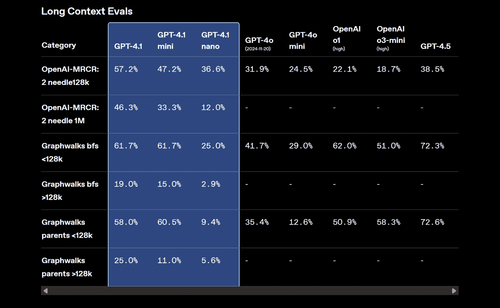

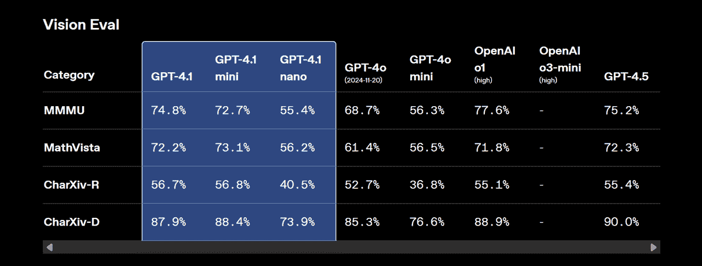

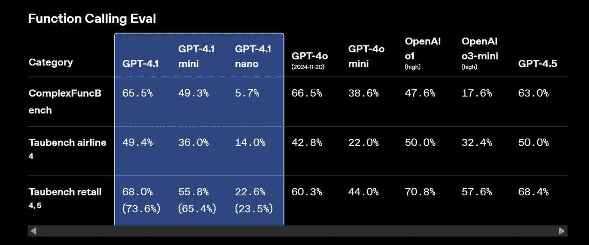