# o4&GPT-4.1快速入门实战：Mini DeepResearch

> 来源：[`https://kq4b3vgg5b.feishu.cn/docx/XLiydIEptoBhUVxkGtbcFvDTnNf`](https://kq4b3vgg5b.feishu.cn/docx/XLiydIEptoBhUVxkGtbcFvDTnNf)

## 课程说明

体验课内容节选自《2025大模型Agent智能体开发实战》(春季班)完整版付费课程

体验课时间有限，若想深度学习大模型技术，欢迎大家报名由我主讲的《2025大模型Agent智能体开发实战》(春季班)

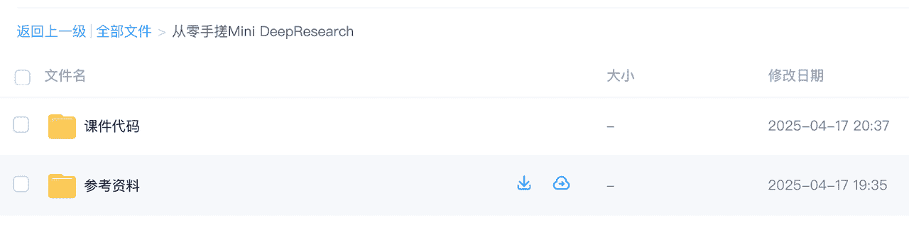


此外，公开课全套学习资料，已上传至网盘

（链接：`https://pan.baidu.com/s/1XB5eqK0q008QV9RPNLxC4w` 提取码: x5xh ）

需要更系统深入学习大模型可扫码⬆️添加助教咨询喔～

---

## 《2025大模型Agent智能体开发实战》体验课

## GPT-4.1&o4快速入门 从零手搓Mini DeepResearch

## 一、GPT-4.1和o3模型入门介绍

### 1.GPT-4.1模型介绍

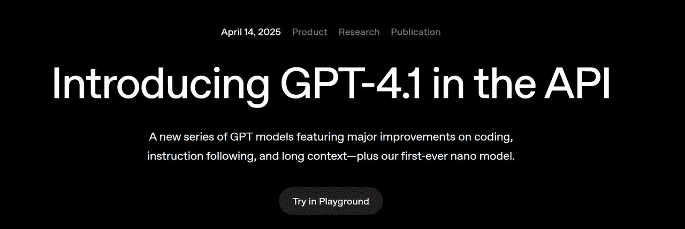

GPT-4.1 API官网地址：`https://openai.com/index/gpt-4-1/`

GPT-4.1是一个全新的 GPT 模型系列，在代码能力、指令理解和长上下文处理方面有了重大提升 —— 并且首次推出了 nano 级别的小型模型。OpenAI在 API 中发布了三个新模型：GPT-4.1、GPT-4.1 mini 和 GPT-4.1 nano。这些模型在各方面的表现都优于 GPT-4o 和 GPT-4o mini，尤其在代码生成和指令遵循能力上取得了显著提升。

GPT-4.1上下文窗口更大 —— 支持最多 100万个tokens 的上下文 —— 同时具备更强的长上下文理解能力，能更有效地利用这么长的上下文信息。这些模型的知识截止日期更新到了 2024年6月，也就是说它们掌握的信息比之前的模型更新。

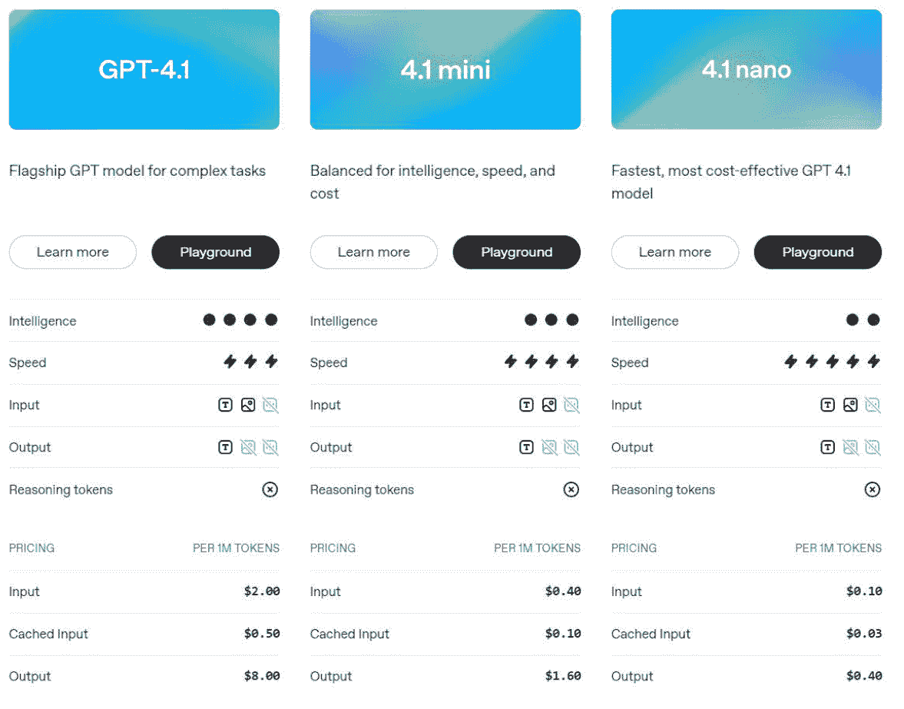

编程能力：在 SWE-bench Verified（一个代码修复/编程能力评测基准）上，GPT‑4.1 取得了 54.6% 的分数，相较 GPT-4o 提升了 21.4 个百分点（绝对值提升），相较 GPT-4.5 提升了 26.6 个百分点——使它成为当前领先的编程能力模型之一。

指令遵循能力：在 Scale 公司推出的 MultiChallenge 基准测试（用于衡量模型跟随人类指令的能力）中，GPT‑4.1 得分 38.3%，比 GPT‑4o 提升了 10.5 个百分点。

长上下文理解能力：在 Video-MME 基准测试中（该测试用于评估多模态长上下文理解能力），GPT-4.1 在“长视频无字幕”这个类别上取得了 72.0% 的得分，比 GPT-4o 提升了 6.7 个百分点，创下了新的 SOTA（state-of-the-art，最先进水平）。

尽管这些基准测试提供了有价值的参考信息，我们训练这些模型的重点仍然是 实际应用的效用。通过与开发者社区的紧密合作与共创，我们对模型进行了优化，重点提升那些对开发者应用最关键的任务表现。为实现这一目标，GPT‑4.1 系列模型在更低成本下提供了卓越性能。这些模型在延迟—性能权衡曲线上的每一个点都带来了性能的突破。

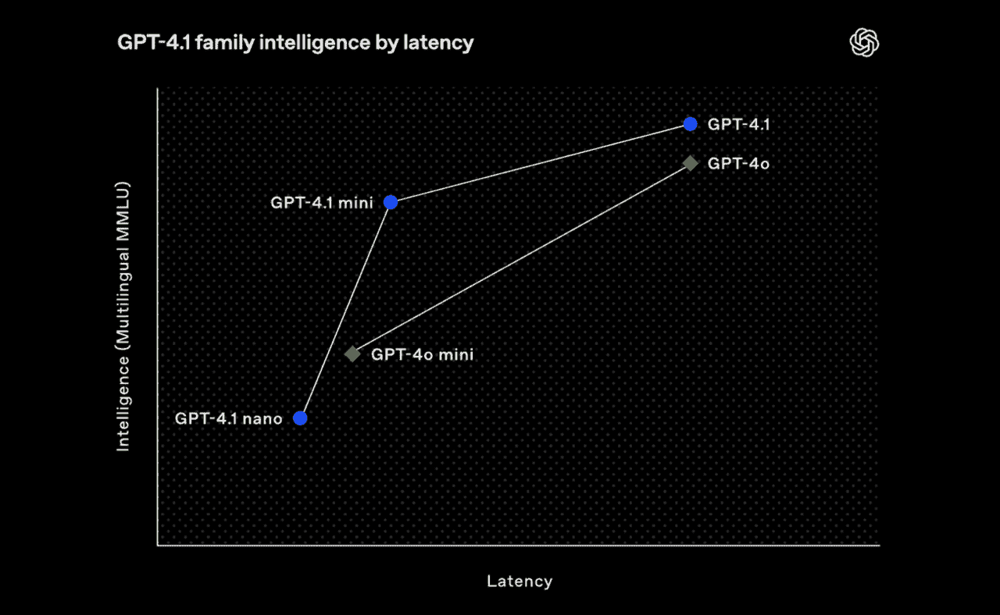

此外，GPT‑4.1、GPT‑4.1 mini 和 GPT‑4.1 nano 都能处理最多 100 万个 tokens 的上下文长度 —— 相比之前的 GPT‑4o 模型最多只能处理 128,000 tokens，这是一次大幅提升。100 万个 tokens 超过了 8 份完整 React 代码库的长度，因此长上下文特别适用于处理大型代码库或大量长文档的场景。

OpenAI对 GPT‑4.1 进行了训练，使其能在完整的 100 万 token 长度范围内稳定地聚焦关键信息。此外，我们还训练它在识别相关文本、忽略干扰内容方面比 GPT‑4o 更加可靠，无论是处理长上下文还是短上下文。长上下文理解能力对于法律、编程、客户支持等众多领域的应用至关重要。

下面是 GPT‑4.1 在长上下文中检索一段小而隐藏的信息（“针”）的能力测试结果。我们将这段信息放置在上下文窗口的不同位置，GPT‑4.1 在所有位置、所有上下文长度下都能准确检索到“针”，即使是在接近 100 万 tokens 的上下文长度中也毫无问题。这说明它可以在输入中无论信息位置如何，都能成功提取出对当前任务有用的关键细节。

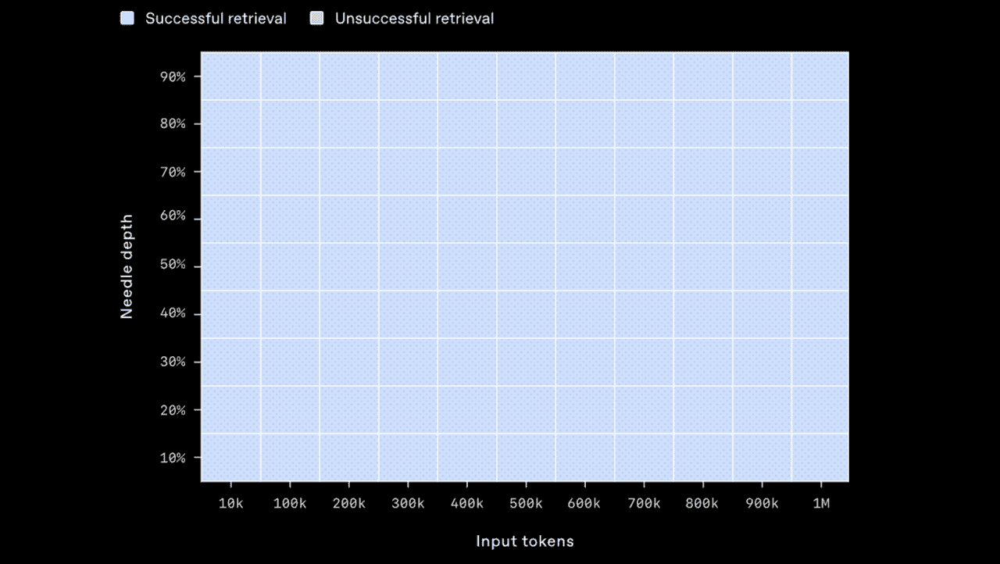

### 2.OpenAI o3与o4-mini模型介绍

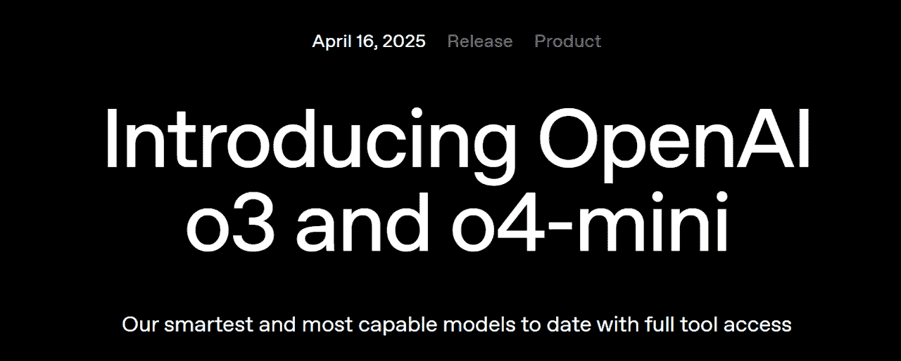

官网介绍地址：`https://openai.com/index/introducing-o3-and-o4-mini/`

o3 模型：最强推理系统

o3 被 OpenAI 称为其最强大的推理模型，专为处理复杂的数学、编程、科学和视觉任务而设计，它在多个基准测试中表现出色，例如在 Codeforces 上达到了 2727 的 Elo 分数，远超前代模型 o1 的 1891 分。o3 采用了“链式思维”（Chain-of-Thought）机制，能够在生成答案之前进行多步骤的推理，提升了准确性和深度。此外，o3 还支持图像输入，能够分析图表、草图等视觉信息，增强了其在多模态任务中的表现。

o4-mini 模型：高效且经济实惠

o4-mini 是一款小型化的推理模型，旨在提供快速、成本效益高的推理能力，特别适用于数学、编程和视觉任务。它在 AIME 2024 和 2025 基准测试中表现优异，超越了其前代模型 o3-mini 。o4-mini 支持文本和图像输入，能够在推理过程中分析白板草图等视觉信息，提升了其在多模态任务中的适用性。此外，o4-mini 还支持函数调用、结构化输出和长上下文处理（最多支持 20 万个 token），适合开发人员构建智能代理和复杂应用

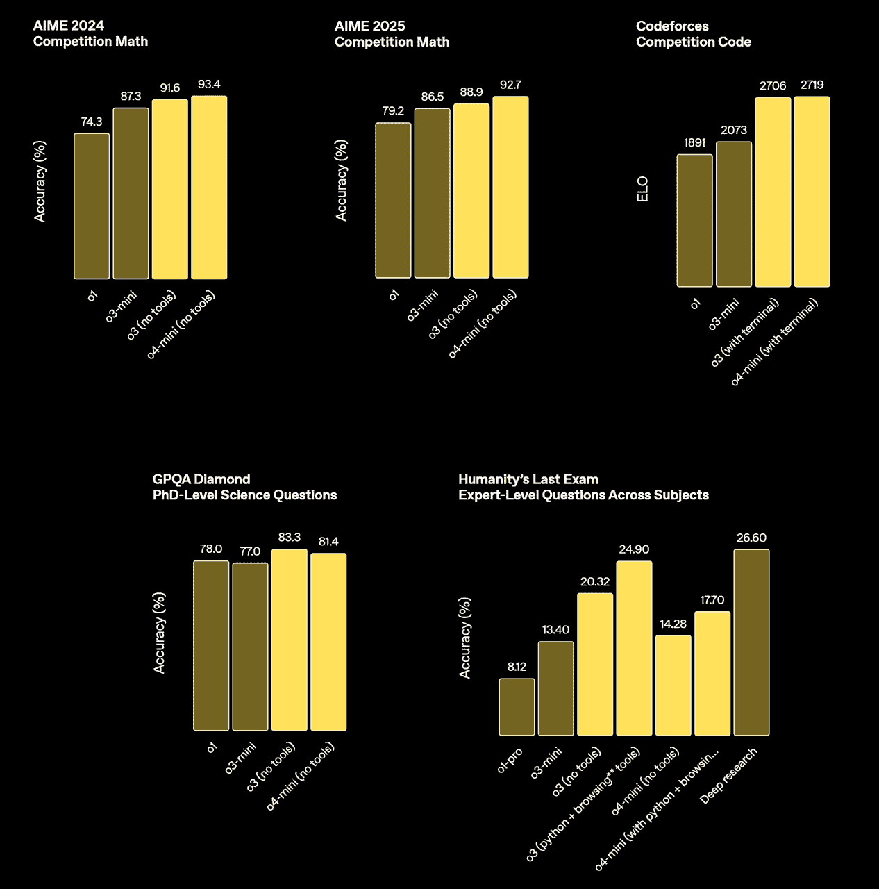

此外，o3 和 o4-mini 均支持多种工具集成：

+   Web 浏览器：实时获取最新信息。
+   Python：执行代码和数据分析。
+   图像和文件分析：处理上传的图像和文件。
+   图像生成：生成和编辑图像内容。
+   画布（Canvas）：进行图形化创作和编辑。
+   自动化：执行预定任务和作业。
+   文件搜索：查找和提取文件中的信息。
+   记忆：记住用户的偏好和历史信息

这些工具的集成使得 o3 和 o4-mini 能够在处理复杂任务时提供更高的灵活性和效率。

## 二、GPT-4.1、o3模型和Agent SDK快速调用测试

```
from openai import OpenAI
import os
from dotenv import load_dotenv
load_dotenv(override=True)
from IPython.display import display, Code, Markdown, Image
import nest_asyncio
nest_asyncio.apply()  # 允许事件循环嵌套
from agents import function_tool
import asyncio
```

实例化客户端

```
# 读取模型API-KEY
API_KEY = os.getenv("API_KEY")
BASE_URL = os.getenv("BASE_URL")
```

```
# 实例化客户端
client = OpenAI(api_key=API_KEY, 
                base_url=BASE_URL)
```

```
models_list = client.models.list()
models_list.data
```


```
[Model(id=&#x27;gpt-4o-audio-preview-2024-12-17&#x27;, created=1734034239, object=&#x27;model&#x27;, owned_by=&#x27;system&#x27;),
 Model(id=&#x27;dall-e-3&#x27;, created=1698785189, object=&#x27;model&#x27;, owned_by=&#x27;system&#x27;),
 Model(id=&#x27;text-embedding-3-large&#x27;, created=1705953180, object=&#x27;model&#x27;, owned_by=&#x27;system&#x27;),
 Model(id=&#x27;dall-e-2&#x27;, created=1698798177, object=&#x27;model&#x27;, owned_by=&#x27;system&#x27;),
 Model(id=&#x27;o4-mini-2025-04-16&#x27;, created=1744133506, object=&#x27;model&#x27;, owned_by=&#x27;system&#x27;),
 Model(id=&#x27;gpt-4o-audio-preview-2024-10-01&#x27;, created=1727389042, object=&#x27;model&#x27;, owned_by=&#x27;system&#x27;),
 Model(id=&#x27;o4-mini&#x27;, created=1744225351, object=&#x27;model&#x27;, owned_by=&#x27;system&#x27;),
 Model(id=&#x27;gpt-4-0125-preview&#x27;, created=1706037612, object=&#x27;model&#x27;, owned_by=&#x27;system&#x27;),
 Model(id=&#x27;gpt-4-turbo-preview&#x27;, created=1706037777, object=&#x27;model&#x27;, owned_by=&#x27;system&#x27;),
 Model(id=&#x27;gpt-4.1-nano&#x27;, created=1744321707, object=&#x27;model&#x27;, owned_by=&#x27;system&#x27;),
 Model(id=&#x27;gpt-4.1-nano-2025-04-14&#x27;, created=1744321025, object=&#x27;model&#x27;, owned_by=&#x27;system&#x27;),
 Model(id=&#x27;gpt-4o-realtime-preview-2024-10-01&#x27;, created=1727131766, object=&#x27;model&#x27;, owned_by=&#x27;system&#x27;),
 Model(id=&#x27;gpt-4o-realtime-preview&#x27;, created=1727659998, object=&#x27;model&#x27;, owned_by=&#x27;system&#x27;),
 Model(id=&#x27;babbage-002&#x27;, created=1692634615, object=&#x27;model&#x27;, owned_by=&#x27;system&#x27;),
 Model(id=&#x27;tts-1-hd-1106&#x27;, created=1699053533, object=&#x27;model&#x27;, owned_by=&#x27;system&#x27;),
 Model(id=&#x27;gpt-4&#x27;, created=1687882411, object=&#x27;model&#x27;, owned_by=&#x27;openai&#x27;),
 Model(id=&#x27;text-embedding-ada-002&#x27;, created=1671217299, object=&#x27;model&#x27;, owned_by=&#x27;openai-internal&#x27;),
 Model(id=&#x27;tts-1-hd&#x27;, created=1699046015, object=&#x27;model&#x27;, owned_by=&#x27;system&#x27;),
 Model(id=&#x27;gpt-4o-mini-audio-preview&#x27;, created=1734387424, object=&#x27;model&#x27;, owned_by=&#x27;system&#x27;),
 Model(id=&#x27;gpt-4o-audio-preview&#x27;, created=1727460443, object=&#x27;model&#x27;, owned_by=&#x27;system&#x27;),
 Model(id=&#x27;o1-preview-2024-09-12&#x27;, created=1725648865, object=&#x27;model&#x27;, owned_by=&#x27;system&#x27;),
 Model(id=&#x27;gpt-4o-mini-realtime-preview&#x27;, created=1734387380, object=&#x27;model&#x27;, owned_by=&#x27;system&#x27;),
 Model(id=&#x27;gpt-4.1-mini&#x27;, created=1744318173, object=&#x27;model&#x27;, owned_by=&#x27;system&#x27;),
 Model(id=&#x27;gpt-4o-mini-realtime-preview-2024-12-17&#x27;, created=1734112601, object=&#x27;model&#x27;, owned_by=&#x27;system&#x27;),
 Model(id=&#x27;gpt-3.5-turbo-instruct-0914&#x27;, created=1694122472, object=&#x27;model&#x27;, owned_by=&#x27;system&#x27;),
 Model(id=&#x27;gpt-4o-mini-search-preview&#x27;, created=1741391161, object=&#x27;model&#x27;, owned_by=&#x27;system&#x27;),
 Model(id=&#x27;gpt-4.1-mini-2025-04-14&#x27;, created=1744317547, object=&#x27;model&#x27;, owned_by=&#x27;system&#x27;),
 Model(id=&#x27;tts-1-1106&#x27;, created=1699053241, object=&#x27;model&#x27;, owned_by=&#x27;system&#x27;),
 Model(id=&#x27;chatgpt-4o-latest&#x27;, created=1723515131, object=&#x27;model&#x27;, owned_by=&#x27;system&#x27;),
 Model(id=&#x27;davinci-002&#x27;, created=1692634301, object=&#x27;model&#x27;, owned_by=&#x27;system&#x27;),
 Model(id=&#x27;gpt-3.5-turbo-1106&#x27;, created=1698959748, object=&#x27;model&#x27;, owned_by=&#x27;system&#x27;),
 Model(id=&#x27;gpt-4o-search-preview&#x27;, created=1741388720, object=&#x27;model&#x27;, owned_by=&#x27;system&#x27;),
 Model(id=&#x27;gpt-4-turbo&#x27;, created=1712361441, object=&#x27;model&#x27;, owned_by=&#x27;system&#x27;),
 Model(id=&#x27;gpt-4o-realtime-preview-2024-12-17&#x27;, created=1733945430, object=&#x27;model&#x27;, owned_by=&#x27;system&#x27;),
 Model(id=&#x27;gpt-3.5-turbo-instruct&#x27;, created=1692901427, object=&#x27;model&#x27;, owned_by=&#x27;system&#x27;),
 Model(id=&#x27;gpt-3.5-turbo&#x27;, created=1677610602, object=&#x27;model&#x27;, owned_by=&#x27;openai&#x27;),
 Model(id=&#x27;gpt-4-1106-preview&#x27;, created=1698957206, object=&#x27;model&#x27;, owned_by=&#x27;system&#x27;),
 Model(id=&#x27;gpt-4o-mini-search-preview-2025-03-11&#x27;, created=1741390858, object=&#x27;model&#x27;, owned_by=&#x27;system&#x27;),
 Model(id=&#x27;gpt-4o-2024-11-20&#x27;, created=1739331543, object=&#x27;model&#x27;, owned_by=&#x27;system&#x27;),
 Model(id=&#x27;whisper-1&#x27;, created=1677532384, object=&#x27;model&#x27;, owned_by=&#x27;openai-internal&#x27;),
 Model(id=&#x27;gpt-4o-2024-05-13&#x27;, created=1715368132, object=&#x27;model&#x27;, owned_by=&#x27;system&#x27;),
 Model(id=&#x27;gpt-4-turbo-2024-04-09&#x27;, created=1712601677, object=&#x27;model&#x27;, owned_by=&#x27;system&#x27;),
 Model(id=&#x27;gpt-3.5-turbo-16k&#x27;, created=1683758102, object=&#x27;model&#x27;, owned_by=&#x27;openai-internal&#x27;),
 Model(id=&#x27;o1-preview&#x27;, created=1725648897, object=&#x27;model&#x27;, owned_by=&#x27;system&#x27;),
 Model(id=&#x27;gpt-4-0613&#x27;, created=1686588896, object=&#x27;model&#x27;, owned_by=&#x27;openai&#x27;),
 Model(id=&#x27;computer-use-preview-2025-03-11&#x27;, created=1741377021, object=&#x27;model&#x27;, owned_by=&#x27;system&#x27;),
 Model(id=&#x27;computer-use-preview&#x27;, created=1734655677, object=&#x27;model&#x27;, owned_by=&#x27;system&#x27;),
 Model(id=&#x27;gpt-4.5-preview&#x27;, created=1740623059, object=&#x27;model&#x27;, owned_by=&#x27;system&#x27;),
 Model(id=&#x27;gpt-4.5-preview-2025-02-27&#x27;, created=1740623304, object=&#x27;model&#x27;, owned_by=&#x27;system&#x27;),
 Model(id=&#x27;gpt-4o-search-preview-2025-03-11&#x27;, created=1741388170, object=&#x27;model&#x27;, owned_by=&#x27;system&#x27;),
 Model(id=&#x27;tts-1&#x27;, created=1681940951, object=&#x27;model&#x27;, owned_by=&#x27;openai-internal&#x27;),
 Model(id=&#x27;omni-moderation-2024-09-26&#x27;, created=1732734466, object=&#x27;model&#x27;, owned_by=&#x27;system&#x27;),
 Model(id=&#x27;text-embedding-3-small&#x27;, created=1705948997, object=&#x27;model&#x27;, owned_by=&#x27;system&#x27;),
 Model(id=&#x27;o1-2024-12-17&#x27;, created=1734326976, object=&#x27;model&#x27;, owned_by=&#x27;system&#x27;),
 Model(id=&#x27;o1&#x27;, created=1734375816, object=&#x27;model&#x27;, owned_by=&#x27;system&#x27;),
 Model(id=&#x27;gpt-4o-mini-tts&#x27;, created=1742403959, object=&#x27;model&#x27;, owned_by=&#x27;system&#x27;),
 Model(id=&#x27;gpt-4o&#x27;, created=1715367049, object=&#x27;model&#x27;, owned_by=&#x27;system&#x27;),
 Model(id=&#x27;o1-pro&#x27;, created=1742251791, object=&#x27;model&#x27;, owned_by=&#x27;system&#x27;),
 Model(id=&#x27;o1-pro-2025-03-19&#x27;, created=1742251504, object=&#x27;model&#x27;, owned_by=&#x27;system&#x27;),
 Model(id=&#x27;o3-mini&#x27;, created=1737146383, object=&#x27;model&#x27;, owned_by=&#x27;system&#x27;),
 Model(id=&#x27;o3-mini-2025-01-31&#x27;, created=1738010200, object=&#x27;model&#x27;, owned_by=&#x27;system&#x27;),
 Model(id=&#x27;gpt-4o-mini&#x27;, created=1721172741, object=&#x27;model&#x27;, owned_by=&#x27;system&#x27;),
 Model(id=&#x27;gpt-4o-2024-08-06&#x27;, created=1722814719, object=&#x27;model&#x27;, owned_by=&#x27;system&#x27;),
 Model(id=&#x27;gpt-4.1&#x27;, created=1744316542, object=&#x27;model&#x27;, owned_by=&#x27;system&#x27;),
 Model(id=&#x27;gpt-4o-transcribe&#x27;, created=1742068463, object=&#x27;model&#x27;, owned_by=&#x27;system&#x27;),
 Model(id=&#x27;gpt-4.1-2025-04-14&#x27;, created=1744315746, object=&#x27;model&#x27;, owned_by=&#x27;system&#x27;),
 Model(id=&#x27;gpt-4o-mini-2024-07-18&#x27;, created=1721172717, object=&#x27;model&#x27;, owned_by=&#x27;system&#x27;),
 Model(id=&#x27;gpt-4o-mini-transcribe&#x27;, created=1742068596, object=&#x27;model&#x27;, owned_by=&#x27;system&#x27;),
 Model(id=&#x27;o1-mini&#x27;, created=1725649008, object=&#x27;model&#x27;, owned_by=&#x27;system&#x27;),
 Model(id=&#x27;gpt-4o-mini-audio-preview-2024-12-17&#x27;, created=1734115920, object=&#x27;model&#x27;, owned_by=&#x27;system&#x27;),
 Model(id=&#x27;gpt-3.5-turbo-0125&#x27;, created=1706048358, object=&#x27;model&#x27;, owned_by=&#x27;system&#x27;),
 Model(id=&#x27;o1-mini-2024-09-12&#x27;, created=1725648979, object=&#x27;model&#x27;, owned_by=&#x27;system&#x27;),
 Model(id=&#x27;omni-moderation-latest&#x27;, created=1731689265, object=&#x27;model&#x27;, owned_by=&#x27;system&#x27;)]
```


## 模型调用测试与 Agents SDK 功能测试

### 测试调用 GPT-4.1 模型

```
response = client.chat.completions.create(
    model="gpt-4.1",
    messages=[
        {"role": "user", "content": "你好，好久不见!"}
    ]
)
```

```
# 输出生成的响应内容
print(response.choices[0].message.content)
```

你好！很高兴再次见到你！😊 有什么我可以帮忙的吗？

### 测试调用 o4-mini 模型

```
response = client.chat.completions.create(
    model="o4-mini",
    messages=[
        {"role": "user", "content": "你好，好久不见!"}
    ]
)
```

```
# 输出生成的响应内容
print(response.choices[0].message.content)
```

你好！确实好久不见了，最近过得怎么样？有什么新鲜事想和我分享吗？

```
response
```

```
ChatCompletion(id='chatcmpl-BNDW49onkvg8CvaBoqgxu3i0RKFQI', choices=[Choice(finish_reason='stop', index=0, logprobs=None, message=ChatCompletionMessage(content='你好！确实好久不见了，最近过得怎么样？有什么新鲜事想和我分享吗？', refusal=None, role='assistant', annotations=[], audio=None, function_call=None, tool_calls=None))], created=1744873200, model='o4-mini-2025-04-16', object='chat.completion', service_tier='default', system_fingerprint=None, usage=CompletionUsage(completion_tokens=236, prompt_tokens=12, total_tokens=248, completion_tokens_details=CompletionTokensDetails(accepted_prediction_tokens=0, audio_tokens=0, reasoning_tokens=192, rejected_prediction_tokens=0), prompt_tokens_details=PromptTokensDetails(audio_tokens=0, cached_tokens=0)))
```

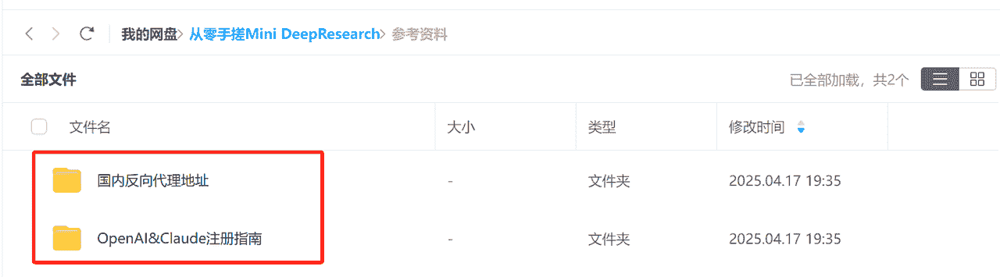


### Agents SDK 功能测试

OpenAI 于 2025 年 3 月发布了全新的 Agents SDK，这是一个轻量级且功能强大的 Python 开源框架，旨在简化多智能体（Multi-Agent）系统的构建与管理。该 SDK 使开发者能够高效地设计、协调和调试复杂的 AI 工作流，广泛适用于客服、自动化办公、编程助手等场景。

Agents SDK 的设计理念是提供足够的功能以满足实际需求，同时保持简洁易用，降低开发门槛。其核心组成包括

+   `Agent`（智能体）配置了指令、工具、输入输出验证（Guardrails）和任务委托（Handoffs）的语言模型

+   `Handoffs`（任务委托）允许智能体将任务委托给其他专门的智能体，适用于多智能体协作

+   `Guardrails`（安全验证）对输入和输出进行验证，确保交互符合预定标准

+   `Tracing`（执行追踪）内置的执行追踪功能，帮助开发者可视化、调试和优化智能体工作流

这些功能使得 SDK 能够支持多种工作流模式，包括确定性流程、迭代循环等，适应不同的应用需求。

```
from openai import AsyncOpenAI
from agents import OpenAIChatCompletionsModel, Agent, Runner, set_default_openai_client, set_tracing_disabled
from agents.model_settings import ModelSettings
from pydantic import BaseModel
from agents import Agent, WebSearchTool
from agents.model_settings import ModelSettings
```

```
external_client = AsyncOpenAI(
    base_url = BASE_URL,
    api_key = API_KEY, 
)
```

```
set_default_openai_client(external_client)
set_tracing_disabled(True)
```

```
agent = Agent(name="Assistant", instructions="你是一名助人为乐的助手。")
```

```
result = await Runner.run(agent, "请写一首关于编程中递归的俳句。") 
```

> 俳（pái）句。

```
print(result.final_output)
```

函数自调用，  
层层嵌套无尽，  
答案渐明。

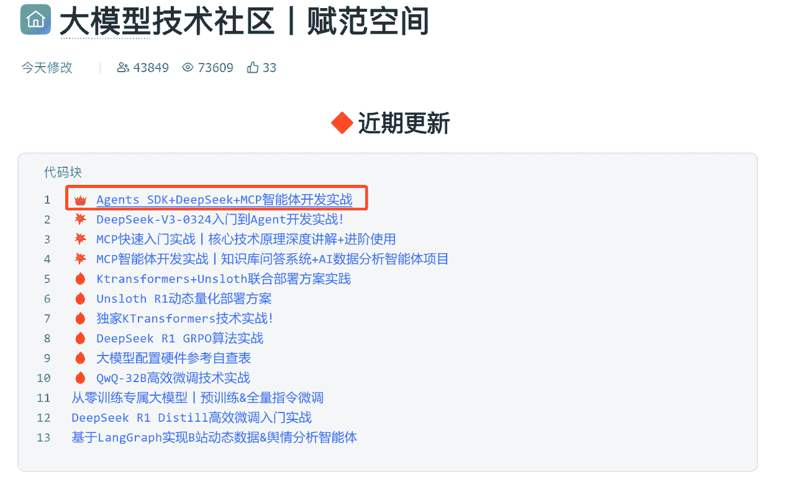


## 三、从零到一快速搭建 Mini DeepResearch

OpenAI 于 2025 年初推出了 ChatGPT 的全新功能——Deep Research（深度研究），这是一项革命性的 AI 代理能力，旨在帮助用户高效完成复杂的研究任务。通过自动化的信息搜集、分析和报告生成，Deep Research 能在短时间内完成原本需要数小时甚至数天的工作，极大地提升了知识工作的效率和质量。

Deep Research 的核心优势包括：

+   多步骤推理与信息整合 利用最新的 OpenAI o3 模型，Deep Research 能够从多个来源收集信息，进行深入分析，并整合成结构化的报告

+   自动化研究流程 用户只需提出研究主题，AI 会自动规划研究步骤，执行信息搜集与分析，最终生成详尽的报告

+   引用来源明确 生成的报告中包含清晰的引用来源，便于用户进行验证和进一步阅读

+   支持文件上传 用户可以上传相关文档或数据表格，AI 将结合这些信息进行更精准的分析

+   适用多种领域 无论是市场调研、政策分析、科学研究，还是个人决策支持，Deep Research 都能提供有力的支持

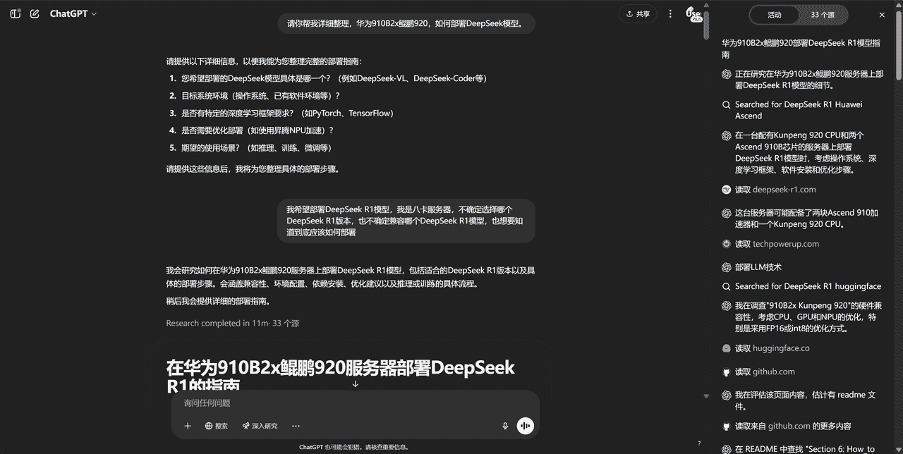

### Mini DeepResearch 视频演示

```
from IPython.display import Video
```

```
Video("https://ml2022.oss-cn-hangzhou.aliyuncs.com/%E6%BC%94%E7%A4%BA%E8%A7%86%E9%A2%91.mp4", width=800, height=400)
```

Your browser does not support the video element.

### 项目规划

目标：构建一个“研究型助手”，可以：

1. 接收一个研究主题（如“AI 对教育的影响”）
2. 自动规划应该搜索的子问题/关键词
3. 每个关键词在网上搜索信息、摘要
4. 把多个摘要汇总成一份完整的研究报告

也就是说，这是一个「具备规划能力 + 工具调用 + 总结归纳」能力的系统。

### 项目架构

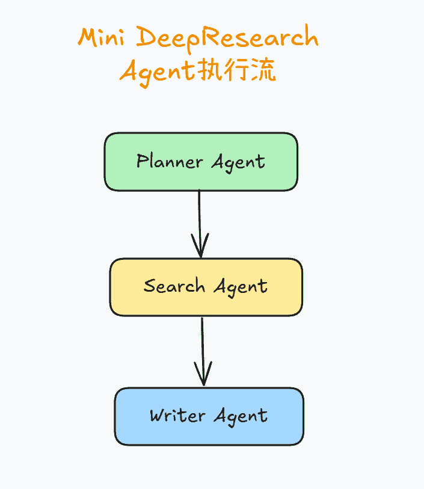

三个核心 Agent 简介

| Agent 名 | 职责 |
| --- | --- |
| `planner_agent` | 生成研究关键词和搜索策略 |
| `search_agent` | 负责执行网络搜索 + 总结内容（使用工具） |
| `writer_agent` | 汇总所有搜索结果，编写报告 |

### Planner Agent 执行流程

```
PROMPT = (
    "You are a helpful research assistant. Given a query, come up with a set of web searches "
    "to perform to best answer the query. Output between 10 and 20 terms to query for."
)


class WebSearchItem(BaseModel):
    reason: str
    "Your reasoning for why this search is important to the query."

    query: str
    "The search term to use for the web search."


class WebSearchPlan(BaseModel):
    searches: list[WebSearchItem]
    """A list of web searches to perform to best answer the query."""


planner_agent = Agent(
    name="PlannerAgent",
    instructions=PROMPT,
    model="o4-mini",
    output_type=WebSearchPlan,
)
```

```
planner_agent_res = await Runner.run(planner_agent, "我想深入了解下MCP（Model Context Protocol）这项技术。") 
```

```
planner_agent_res.final_output
```

```
WebSearchPlan(searches=[WebSearchItem(reason='查找MCP（Model Context Protocol）的基础概念与定义', query='MCP Model Context Protocol overview'), WebSearchItem(reason='获取MCP官方文档或规范手册', query='Model Context Protocol MCP documentation'), WebSearchItem(reason='下载MCP协议规范的PDF或白皮书', query='MCP protocol spec PDF'), WebSearchItem(reason='了解MCP的系统架构和设计原理', query='MCP Model Context Protocol architecture'), WebSearchItem(reason='探索MCP在不同场景下的应用案例', query='MCP Model Context Protocol use cases'), WebSearchItem(reason='查找如何实现MCP协议的技术细节', query='Implementing MCP Model Context Protocol'), WebSearchItem(reason='寻找MCP的API调用示例和代码片段', query='MCP API examples'), WebSearchItem(reason='评估MCP协议的性能表现', query='MCP Model Context Protocol performance benchmarks'), WebSearchItem(reason='研究MCP协议的安全性与最佳实践', query='MCP security best practices'), WebSearchItem(reason='对比MCP与其他上下文管理协议的异同', query='MCP vs other context protocols'), WebSearchItem(reason='寻找MCP的入门教程和快速上手指南', query='MCP tutorial'), WebSearchItem(reason='查找学术论文中关于MCP的研究', query='MCP Model Context Protocol research paper'), WebSearchItem(reason='搜索MCP的开源实现库', query='MCP open source library'), WebSearchItem(reason='阅读中文相关文章以获取本地化解读', query='MCP 模型 上下文 协议 文章'), WebSearchItem(reason='获取MCP中文白皮书或技术报告', query='MCP 模型 上下文 协议 白皮书')])
```


# Planner Agent 搜索计划生成与解析

## 搜索计划示例

```
WebSearchPlan(searches=[WebSearchItem(reason='To understand the basic concept and overview of MCP.', query='Model Context Protocol overview'), WebSearchItem(reason='To find out how MCP is applied in different fields.', query='Model Context Protocol applications'), WebSearchItem(reason='To explore the technical specifications of MCP.', query='Model Context Protocol technical specifications'), WebSearchItem(reason='To research the history and development of MCP.', query='History of Model Context Protocol'), WebSearchItem(reason='To understand the benefits of using MCP in technology.', query='Advantages of Model Context Protocol'), WebSearchItem(reason='To look into the limitations or challenges of using MCP.', query='Limitations of Model Context Protocol'), WebSearchItem(reason='To find academic papers or research on MCP.', query='Model Context Protocol research papers'), WebSearchItem(reason='To see if there are any existing case studies about MCP implementation.', query='Model Context Protocol case studies'), WebSearchItem(reason='To compare MCP with other similar protocols.', query='Model Context Protocol vs other protocols'), WebSearchItem(reason='To understand the role of MCP in digital communication or data management.', query='Model Context Protocol in digital communication'), WebSearchItem(reason='To find tutorials or guides on implementing MCP.', query='Model Context Protocol implementation guide'), WebSearchItem(reason='To gather information about companies using MCP.', query='Companies using Model Context Protocol'), WebSearchItem(reason='To find future developments or upcoming trends involving MCP.', query='Future of Model Context Protocol'), WebSearchItem(reason='To find any potential security issues related to MCP.', query='Model Context Protocol security issues'), WebSearchItem(reason='To learn about the architecture of MCP.', query='Model Context Protocol architecture'), WebSearchItem(reason='To find any conferences or workshops focused on MCP.', query='Model Context Protocol conferences workshops'), WebSearchItem(reason='To examine the role of MCP in IoT or smart devices.', query='Model Context Protocol in IoT'), WebSearchItem(reason='To find interviews or expert opinions on MCP.', query='Model Context Protocol expert opinions'), WebSearchItem(reason='To determine the cost implications of adopting MCP.', query='Cost of implementing Model Context Protocol'), WebSearchItem(reason='To see how MCP interacts with AI and machine learning technologies.', query='Model Context Protocol and AI'), WebSearchItem(reason='To identify the key components of MCP.', query='Key components of Model Context Protocol'), WebSearchItem(reason='To look for any open-source projects related to MCP.', query='Open-source projects for Model Context Protocol'), WebSearchItem(reason='To understand how MCP can influence user experience design.', query='Model Context Protocol and UX design'), WebSearchItem(reason='To find out any standardized tests or benchmarks for MCP.', query='Model Context Protocol benchmarks tests'), WebSearchItem(reason="To explore MCP's role in cloud computing.", query='Model Context Protocol in cloud computing')])
```

```
planner_agent_res.final_output.searches[0]
```

```
WebSearchItem(reason='To understand the basic concept and overview of MCP.', query='Model Context Protocol overview')
```

```
query='MCP Model Context Protocol overview'
query
```

```
'MCP Model Context Protocol overview'
```

需要注意的是，`Planner Agent` 的职责是：接收一个研究主题，生成一份“搜索计划（`WebSearchPlan`）”，告诉系统应该搜索哪些子问题/关键词以及搜索这些关键词的理由。具体代码解释如下：

```
from pydantic import BaseModel
```

导入 `Pydantic`，用于定义结构化数据模型。它是整个 `Agent` SDK 中用于类型校验 + 数据结构定义的核心库。

```
from agents import Agent
```

导入 SDK 的核心类 `Agent`，我们后面会实例化一个具体的 `Agent` 实体 `planner_agent`。

```
PROMPT = (
    "You are a helpful research assistant. Given a query, come up with a set of web searches "
    "to perform to best answer the query. Output between 20 and 30 terms to query for."
)
```

定义这个 `Agent` 的提示词（`Prompt`），告诉 LLM：

+ 你是一个研究助手；
+ 收到一个主题后，请生成 20 到 30 条搜索建议；
+ 每条建议应当包括 搜索关键词 + 搜索原因。

接下来是两个重要的数据结构定义：

```
class WebSearchItem(BaseModel):
    reason: str
    "Your reasoning for why this search is important to the query."

    query: str
    "The search term to use for the web search."
```

这是一个“单个搜索建议”的结构，包含两个字段：

| 字段 | 说明 |
| --- | --- |
| `reason` | 你为什么要搜索这个关键词？（用于解释搜索动机） |
| `query` | 你要搜索的关键词本身 |

```
class WebSearchPlan(BaseModel):
    searches: list[WebSearchItem]
    """A list of web searches to perform to best answer the query."""
```

这是“搜索计划”的整体结构，包含一个列表 `searches`，每项是上面的 `WebSearchItem`。

其中模型输出结构化的关键在这：

```
output_type=WebSearchPlan,
```

它告诉 `planner_agent` “你必须输出一份结构化的 `WebSearchPlan` 对象，里面包含多个 `WebSearchItem`。”这样可以约束模型输出格式，也便于下一步自动解析内容。

+ `search_agent`

```
from agents import Agent, WebSearchTool
from agents.model_settings import ModelSettings
```

```
INSTRUCTIONS = (
    "You are a research assistant. Given a search term, you search the web for that term and "
    "produce a concise summary of the results. The summary must 2-3 paragraphs and less than 300 "
    "words. Capture the main points. Write succinctly, no need to have complete sentences or good "
    "grammar. This will be consumed by someone synthesizing a report, so its vital you capture the "
    "essence and ignore any fluff. Do not include any additional commentary other than the summary "
    "itself."
)

search_agent = Agent(
    name="Search agent",
    instructions=INSTRUCTIONS,
    tools=[WebSearchTool()],
    model_settings=ModelSettings(tool_choice="required"),
)
```

```
search_agent_res = await Runner.run(search_agent, query)
```

```
search_agent_res.final_output
```


# Model Context Protocol (MCP) 概述

The Model Context Protocol (MCP) is an open standard developed by Anthropic to facilitate seamless integration between AI models and external tools, data sources, and applications. By providing a standardized interface, MCP enables AI systems to interact directly with web and mobile applications, enhancing their functionality and efficiency. This protocol is particularly beneficial for AI assistants and chatbots, allowing them to perform tasks across different platforms without the need for custom integrations. However, while MCP offers significant advantages in terms of integration and productivity, it also introduces challenges related to security, privacy, and authentication that need to be carefully managed. ([axios.com](https://www.axios.com/2025/04/17/model-context-protocol-anthropic-open-source?utm_source=openai))

MCP operates on a client-server architecture, where AI applications (hosts) connect to MCP servers through MCP clients. These servers expose specific functionalities, such as accessing external data sources or executing predefined functions, which the AI models can utilize. The protocol supports multiple transport methods, including standard input/output (STDIO) for local integrations and HTTP with Server-Sent Events (SSE) for remote connections. Communication within MCP is based on the JSON-RPC 2.0 message format, ensuring a standardized structure for requests and responses. This design allows for dynamic context management, enabling AI systems to retrieve and update contextual information efficiently during interactions. ([k33g.hashnode.dev](https://k33g.hashnode.dev/understanding-the-model-context-protocol-mcp?utm_source=openai))

By standardizing the way AI models interact with external resources, MCP addresses the limitations of traditional AI systems that often operate in isolation from real-world data and tools. It provides a universal interface for AI applications to access content repositories, business platforms, and development environments, thereby enhancing their relevance and context-awareness. The adoption of MCP is growing, with companies like Block and Apollo integrating the protocol, and developer tools such as Replit, Windsurf, and Cursor utilizing it to offer more effective coding assistance. Despite the challenges associated with its implementation, MCP is seen as a foundational tool for advancing towards more autonomous and capable AI agents. ([blog.apify.com](https://blog.apify.com/what-is-model-context-protocol/?utm_source=openai))

## search_agent：网页搜索智能体

`search_agent` 的作用是接收一个`搜索关键词`，调用 Web 搜索工具，然后根据搜索结果生成一份简洁的摘要（2-3 段，<300词），不带评论，只保留信息本身。也就是说，这是整个系统中真正“去网上查资料”的角色。具体代码解释如下：

```
from agents import Agent, WebSearchTool
from agents.model_settings import ModelSettings
```

其中：

+   `Agent`：导入 `SDK` 的智能体基类；
+   `WebSearchTool`：一个由 `Agents SDK` 内置的网页搜索工具，调用它可以模拟 “上网搜索” 的效果；
+   `ModelSettings`：可以配置一些模型使用时的行为，比如是否必须使用工具。

### 重点提示词 `INSTRUCTIONS`

```
INSTRUCTIONS = (
    "You are a research assistant. Given a search term, you search the web for that term and"
    "produce a concise summary of the results. The summary must 2-3 paragraphs and less than 300"
    "words. Capture the main points. Write succinctly, no need to have complete sentences or good"
    "grammar. This will be consumed by someone synthesizing a report, so its vital you capture the"
    "essence and ignore any fluff. Do not include any additional commentary other than the summary"
    "itself."
)
```

这是模型的行为提示，翻译一下这段内容的精髓：

| 指令含义 | 说明 |
| --- | --- |
| 你是一个研究助手 | 模拟一个能查资料的人 |
| 给你关键词后上网搜索 | 关键词来自 `planner_agent` |
| 写出 2-3 段简洁总结 | 每次搜索结果必须压缩成 300 字以内的摘要 |
| 用要点式语言、可以语法不完整 | 不要求像论文，重点是信息密度高 |
| 不要添加自己的评论 | 不能主观判断，只提取信息 |
| 最终目的是为后续写报告的人准备素材 | 所以格式自由，内容集中就行 |

### 创建 `search_agent` 对象

```
search_agent = Agent(
    name="Search agent",
    instructions=INSTRUCTIONS,
    tools=[WebSearchTool()],
    model_settings=ModelSettings(tool_choice="required"),
)
```

其中`name="Search agent"`是`Agent`名称，用于日志和上下文显示。而`instructions=INSTRUCTIONS`告诉大语言模型它要怎么完成任务。`tools=[WebSearchTool()]`设置它可以使用的工具。在这个 case 中，它只能用 `WebSearchTool`，这是 `SDK` 内置的网页搜索工具。而`model_settings=ModelSettings(tool_choice="required")`则表示：强制要求模型一定要调用工具（`WebSearchTool`）来完成任务。不允许模型“凭空回答”或“胡编搜索内容”，这有助于提升真实性。

### 总结流程

```
关键词（来自 planner_agent） → search_agent →
     🔍 使用 WebSearchTool 搜索
     ✂️ 根据结果生成 2-3 段摘要
     📦 返回给 writer_agent 写整合报告
```

## writer_agent：报告合成智能体

### 导入与基础定义

```
# Agent used to synthesize a final report from the individual summaries.
from pydantic import BaseModel

from agents import Agent
```

### 提示词 `PROMPT`

```
PROMPT = (
    "You are a senior researcher tasked with writing a cohesive report for a research query. "
    "You will be provided with the original query, and some initial research done by a research "
    "assistant.\n"
    "You should first come up with an outline for the report that describes the structure and "
    "flow of the report. Then, generate the report and return that as your final output.\n"
    "The final output should be in markdown format, and it should be lengthy and detailed. Aim "
    "for 5-10 pages of content, at least 1000 words."
)


class ReportData(BaseModel):
    short_summary: str
    """A short 2-3 sentence summary of the findings."""

    markdown_report: str
    """The final report"""

    follow_up_questions: list[str]
    """Suggested topics to research further"""
```

### 创建 `writer_agent` 对象

```
writer_agent = Agent(
    name="WriterAgent",
    instructions=PROMPT,
    model="o3-mini",
    output_type=ReportData,
)
```

### Writer Agent 中文变体

```
PROMPT_TEMP = (
    "You are a senior researcher tasked with writing a cohesive report for a research query. "
    "You will be provided with the original query, and some initial research done by a research "
    "assistant.\n"
    "You should first come up with an outline for the report that describes the structure and "
    "flow of the report. Then, generate the report and return that as your final output.\n"
    "The final output should be in markdown format, and it should be lengthy and detailed. Aim "
    "for 10-20 pages of content, at least 1500 words."
    "最终结果请用中文输出。"
)


class ReportData(BaseModel):
    short_summary: str
    """A short 2-3 sentence summary of the findings."""

    markdown_report: str
    """The final report"""

    follow_up_questions: list[str]
    """Suggested topics to research further"""


writer_agent = Agent(
    name="WriterAgent",
    instructions=PROMPT_TEMP,
    model="o4-mini",
    output_type=ReportData,
)
```

### 执行与输出

```
writer_agent_res = await Runner.run(writer_agent_temp, search_agent_res.final_output)
```

```
writer_agent_res.final_output
```


# Writer Agent 与报告生成流程

## ReportData 数据结构

```
ReportData(short_summary='本文报告详细介绍了模型上下文协议（MCP）的基础概念、架构、优势和面临的安全、隐私及认证挑战，并讨论了其在实际应用中的案例及未来发展趋势。', markdown_report='# 模型上下文协议（MCP）详细报告\n\n本文旨在探讨由 Anthropic 提出的模型上下文协议（MCP），它作为一个开放标准，为人工智能模型与外部工具、数据源和应用程序之间的无缝集成提供了统一的接口。本报告将从MCP的基本架构、集成优势、面临的挑战以及实际应用案例等多方面展开详细阐述。\n\n## 1. 引言\n\n在当今信息技术飞速发展的时代，人工智能系统的需求不断升级，不仅要求模型具备更强大的计算能力，同时也需要与多种外部资源进行有效连接。传统的AI系统往往孤立于数据和工具之外，而 MCP 正是为解决这一痛点而设计的。作为一种开放标准，MCP 为 AI 模型与各种外部资源之间建立了一种通用的、标准化的接口，大大提高了系统的上下文感知能力和实际应用效率。\n\n## 2. MCP 的基本架构\n\n### 2.1 客户端-服务器架构\n\nMCP 采用客户端-服务器模式：\n\n- **服务器端：** MCP 服务器负责公开特定功能，如访问外部数据源、执行预定义函数等，这为AI模型提供了丰富的外部信息和功能支持。\n\n- **客户端：** AI 应用程序（或者说宿主）通过 MCP 客户端与服务器建立连接，从而实现功能调用和数据交换。\n\n### 2.2 通信协议与格式\n\nMCP 的通信机制基于 JSON-RPC 2.0 消息格式，这确保了请求与响应数据的标准化和一致性。通过这种设计，MCP 可以实现动态句境管理，使得 AI 系统能在交互过程中高效地检索和更新上下文信息。\n\n### 2.3 传输方式\n\nMCP 支持多种传输方法：\n\n- **STDIO:** 适用于本地集成，利用标准输入输出进行通信。\n- **HTTP 与 SSE:** 针对远程连接，利用 HTTP 协议和服务器发送事件（Server-Sent Events）实现数据流的持续通信。\n\n## 3. MCP 的优势\n\n### 3.1 跨平台无缝集成\n\n通过 MCP，AI 模型能够直接与 Web 和移动应用程序等不同平台进行互动，而无需为每个平台编写定制化集成代码，显著降低了开发难度和时间成本。\n\n### 3.2 提高生产效率与上下文感知\n\n标准化的接口允许 AI 系统快速集成外部数据和工具，这不仅增加了模型的实时信息获取能力，也使其在执行任务时更加语境相关和高效，从而极大提升了生产效率。\n\n### 3.3 扩展性与通用性\n\n作为一个开放标准，MCP 使得各种开发平台、商业平台及代码辅助工具（如 Replit、Windsurf、Cursor 等）能够更加容易地支持高效的 AI 助手和聊天机器人应用，推动了整个技术生态的进步。\n\n## 4. 面临的挑战\n\n虽然 MCP 在集成和提高效率方面有着明显优势，但它也带来了新的挑战：\n\n### 4.1 安全性问题\n\n将 AI 模型开放至外部数据源和服务不可避免地增加了潜在攻击面。必须采取严格的安全措施，确保数据传输安全、通信过程不被非法篡改。\n\n### 4.2 隐私保护\n\n在跨平台数据交互过程中，用户隐私保护成为一个关键问题。如何在实现高效数据交换的同时，防止敏感信息泄露，需要在协议设计和实现上做出严密规划。\n\n### 4.3 认证与授权\n\nMCP 的开放特性要求在各个环节中引入可靠的认证和授权机制，保证只有经过验证的请求才能获得数据和执行相关功能，这对系统的设计提出了更高的要求。\n\n## 5. 应用案例与现状\n\n随着 MCP 在技术社区中的逐步普及，许多公司和开发工具已经开始应用这一协议：\n\n- **企业应用：** 如 Block 与 Apollo 等知名企业已经将 MCP 集成到它们的产品中，以实现自动化和智能化的业务处理。\n- **开发工具支持：** 一些开发工具（比如 Replit、Windsurf 以及 Cursor）利用 MCP 为开发者提供高效的编码辅助和实时调试功能，进一步提高了软件开发效率。\n\n这些应用案例展示了 MCP 的广泛适用性和未来的发展潜力，也为进一步完善和推广该标准提供了宝贵的实践经验。\n\n## 6. 总结与未来展望\n\nMCP 为 AI 模型实现与外部世界的有效连接提供了统一、标准化的解决方案，虽然在实现过程中面临安全、隐私和认证等问题，但其在提高系统生产力和语境感知方面的优势已被广泛认可。\n\n未来，随着技术的进一步发展和标准的不断完善，MCP有望在更多领域发挥关键作用，推动 AI 系统向更高水平的自动化和智能化进化。同时，相关的安全和隐私保护技术也将不断更新，以应对日益严峻的数据安全形势。\n\n总之，MCP不仅是当前AI系统技术升级的重要工具，更为未来更加开放和智能的系统协同工作奠定了坚实的基础。', follow_up_questions=['MCP标准在不同应用场景中的具体实现效果如何？', '如何有效应对MCP带来的安全和隐私挑战？', '有哪些实际应用案例能够进一步证明MCP的优势？', '未来MCP可能面临哪些新的技术或市场挑战？'])
```

## Writer Agent 角色与职责

`WriterAgent`是整个研究系统的“输出终结者”，负责把之前所有搜索到的信息，综合成一份完整、结构化、可阅读的长篇报告。该 Agent 的任务是：

- 收到研究主题和之前的所有搜索摘要；
- 先写一个大纲（outline）；
- 然后根据大纲写出一份详细的 Markdown 格式报告；
- 同时生成一个简短总结和一些后续可以研究的问题。

## 核心代码实现

### 依赖导入

```
# Agent used to synthesize a final report from the individual summaries.
from pydantic import BaseModel
from agents import Agent
```

### 提示词定义

```
PROMPT = (
    "You are a senior researcher tasked with writing a cohesive report for a research query. "
    "You will be provided with the original query, and some initial research done by a research "
    "assistant.\n"
    "You should first come up with an outline for the report that describes the structure and "
    "flow of the report. Then, generate the report and return that as your final output.\n"
    "The final output should be in markdown format, and it should be lengthy and detailed. Aim "
    "for 15-20 pages of content, at least 3000 words."
    "最终结果请用中文输出。"
)
```

提示词要点：

| 行为 | 说明 |
| --- | --- |
| 角色设定 | 你是一个资深研究员（senior researcher） |
| 输入 | 会拿到：研究主题 + 搜索摘要 |
| 第一步 | 写出报告结构（outline） |
| 第二步 | 写出 Markdown 报告正文 |
| 要求 | 长、详细、有逻辑（10-20页，3000+词） |
| 输出格式 | Markdown 格式（如 # 一级标题, - 列表 等） |
| 语言风格 | 精炼、学术、结构清晰 |

这个 prompt 是整个系统中最“生成型”的一个 prompt。

### 输出模型定义

紧接着是输出数据结构定义，定义一个 `ReportData` 类，用来约束模型的输出结构：

```
class ReportData(BaseModel):
    short_summary: str
    """A short 2-3 sentence summary of the findings."""

    markdown_report: str
    """The final report"""

    follow_up_questions: list[str]
    """Suggested topics to research further"""
```

字段含义如下：

| 字段名 | 类型 | 说明 |
| --- | --- | --- |
| `short_summary` | `str` | 对研究结果的简要总结（2~3 句话） |
| `markdown_report` | `str` | 报告正文，Markdown 格式，内容详实 |
| `follow_up_questions` | `list[str]` | 建议后续可以进一步研究的问题列表 |

注意：这个结构就是通过 `output_type=ReportData` 来告诉 SDK 要求模型输出这个结构，否则 SDK 会报错或解析失败。

### Agent 实例化

紧接着创建 `Agent` 实例：

```
writer_agent = Agent(
    name="WriterAgent",
    instructions=PROMPT,
    model="gpt-4.1",
    output_type=ReportData,
)
```

| 参数 | 含义 |
| --- | --- |
| `name` | Agent 名 |
| `instructions` | 提示词指令 |
| `model` | 使用的模型（这里是 `"o3-mini"`，可以替换为 `gpt-4o` 等） |
| `output_type` | 指定输出为 `ReportData` 类型，支持结构化结果 |

## 工作流程

整体流程总结如下：

```
1. 用户输入研究主题 → planner_agent → 搜索关键词列表
2. 每个关键词 → search_agent → 搜索摘要
3. 所有摘要集合 + 原始主题 → writer_agent →
     📌 输出：
     - short_summary
     - markdown_report（正文）
     - follow_up_questions（可继续研究的问题）
```

最终返回的是一个完整结构化的 `ReportData` 对象。

## ResearchManager 主类编写


# ResearchManager 研究管理器

## 代码实现

### `ResearchManager` 类

```python
from rich.markdown import Markdown

class ResearchManager:
    def __init__(self):
        print("初始化已完成，欢迎使用。使用前请确认相关模型能够被顺利调用。")

    async def run(self, query: str) -> None:
        # Indicate that the research process is starting
        print("Starting research...")

        # Step 1: Generate search plan using planner_agent
        search_plan = await self._plan_searches(query)
        # Step 2: Perform the searches using search_agent
        search_results = await self._perform_searches(search_plan)
        # Step 3: Write the final report using writer_agent
        report = await self._write_report(query, search_results)

        # Final printed report
        print("\n\n=====REPORT=====\n\n")
        display(Markdown(report.markdown_report))
        print("\n\n=====FOLLOW UP QUESTIONS=====\n\n")
        follow_up_questions = "\n".join(report.follow_up_questions)
        display(Markdown(follow_up_questions))
        
        # 保存为 Markdown 文件
        self.save_report_as_md(query, report.markdown_report)
    
    async def _plan_searches(self, query: str) -> WebSearchPlan:
        print("Planning searches...")
        result = await Runner.run(
            planner_agent,
            f"Query: {query}",
        )
        return result.final_output_as(WebSearchPlan)

    async def _perform_searches(self, search_plan: WebSearchPlan) -> list[str]:
        print("Starting searching...")
        num_completed = 0
        tasks = [asyncio.create_task(self._search(item)) for item in search_plan.searches]
        results = []
        for task in asyncio.as_completed(tasks):
            result = await task
            if result is not None:
                results.append(result)
            num_completed += 1
            print(f"Searching... {num_completed}/{len(tasks)} completed")
        return results

    async def _search(self, item: WebSearchItem) -> str | None:
        print(f"Search term: {item.query}\nReason for searching: {item.reason}")
        try:
            result = await Runner.run(
                search_agent,
                input=f"Search term: {item.query}\nReason for searching: {item.reason}"
            )
            return str(result.final_output)
        except Exception:
            return None

    async def _write_report(self, query: str, search_results: list[str]) -> ReportData:
        print("Thinking about report...")
        print(f"Original query: {query}\nSummarized search results: {search_results}")
        
        # Use run instead of run_streamed to avoid async context issues
        result = await Runner.run(
            writer_agent,
            input=f"Original query: {query}\nSummarized search results: {search_results}",
        )

        update_messages = [
            "Thinking about report...",
            "Planning report structure...",
            "Writing outline...",
            "Creating sections...",
            "Cleaning up formatting...",
            "Finalizing report...",
            "Finishing report...",
        ]

        last_update = time.time()
        next_message = 0
        for _ in result.new_items:
            if time.time() - last_update > 5 and next_message < len(update_messages):
                print(update_messages[next_message])
                next_message += 1
                last_update = time.time()

        return result.final_output_as(ReportData)

    def save_report_as_md(self, query: str, markdown_content: str) -> None:
        """
        保存生成的报告为 Markdown 文件
        """
        # 创建文件夹（如果不存在）
        folder_name = "research_reports"
        if not os.path.exists(folder_name):
            os.makedirs(folder_name)

        # 使用用户的查询作为文件名
        sanitized_query = query.replace(" ", "_").replace("：", "").replace("?", "")
        file_name = f"{folder_name}/关于{sanitized_query}调研报告.md"

        # 写入 Markdown 文件
        with open(file_name, "w", encoding="utf-8") as file:
            file.write(markdown_content)

        print(f"Report saved as: {file_name}")
```

## 使用示例

```python
manager = ResearchManager()
```

```python
test_query = "AI在教育中的应用"
```

```python
await manager.run(test_query)
```

### 效果展示

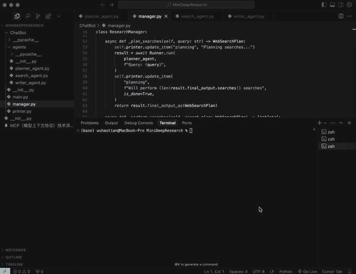

[`演示视频.mov`](https://internal-api-drive-stream.feishu.cn/space/api/box/stream/download/all/Q1oEbPwUJoeVF4x93OHc642lnAT)

```text
Starting research...

Planning searches...

Starting searching...

Search term: AI applications in educationReason for searching: To understand the general applications of AI in the education sector.

Search term: AI education case studiesReason for searching: To explore case studies of AI in education.

Search term: AI personalized learning educationReason for searching: To find information on AI-assisted personalized learning.

Search term: AI impact on student engagement and outcomesReason for searching: To examine how AI is improving student engagement and outcomes.

Search term: Universities using AI technology in educationReason for searching: To look for educational institutions using AI technology.

Search term: Challenges AI implementation educationReason for searching: To discover challenges of implementing AI in education.

Search term: AI tools for educators 2023Reason for searching: To identify AI tools and platforms for educators.

Search term: AI tutors teaching assistants educationReason for searching: To analyze the role of AI tutors and teaching assistants.

Search term: Future trends AI educationReason for searching: To find out about the future trends of AI in education.

Search term: AI education ethical considerationsReason for searching: To look for policies and ethical considerations for AI in education.

Search term: AI administrative tasks educationReason for searching: To understand how AI can assist in administrative tasks in education.

Search term: AI educational content creationReason for searching: To examine the impact of AI on educational content creation.

Search term: AI language learning educationReason for searching: To explore AI's role in language learning and translation.

Search term: AI special education supportReason for searching: To investigate how AI can support special education needs.

Search term: AI in student assessment and gradingReason for searching: To find information on AI's role in student assessment and grading.

Searching... 1/15 completed

Searching... 2/15 completed

Searching... 3/15 completed

Searching... 4/15 completed

Searching... 5/15 completed

Searching... 6/15 completed

Searching... 7/15 completed

Searching... 8/15 completed

Searching... 9/15 completed

Searching... 10/15 completed

Searching... 11/15 completed

Searching... 12/15 completed

Searching... 13/15 completed

Searching... 14/15 completed

Searching... 15/15 completed

Thinking about report...
```


# AI 在教育中的应用

Original query: AI在教育中的应用

Summarized search results indicate that AI is increasingly integrated into education, presenting both opportunities and challenges.

## Challenges

Implementing AI in education presents several challenges. Access and equity issues arise as not all students have equal access to the necessary technology and internet connectivity, potentially widening the digital divide. ((https://toxigon.com/ai-in-education-challenges-and-solutions?utm_source=openai)) Data privacy is another significant concern, with AI systems collecting substantial amounts of personal information, necessitating strict regulations and transparency to protect student data. ((https://aquariusai.ca/blog/exploring-the-challenges-and-constraints-of-ai-in-education-unraveling-the-complexities-of-integrating-artificial-intelligence-into-learning-environments?utm_source=openai)) Additionally, AI algorithms can perpetuate existing biases if trained on biased data, leading to unfair outcomes in educational settings. ((https://ismrpune.edu.in/challenges-of-artificial-intelligence-in-education/?utm_source=openai))

Teacher resistance and the need for comprehensive training also pose challenges, as educators may feel overwhelmed or threatened by AI integration. ((https://toxigon.com/challenges-of-ai-in-education?utm_source=openai)) Over-reliance on AI could diminish criticals and freeing up administrative personnel for more complex issues. Email automation tools sort, categorize, and draft responses to routine messages, ensuring timely communication. In data management, AI systems maintain and update student records, including grades and attendance, while AI-driven analytics generate reports on various aspects of school operations, aiding informed decision-making. ((https://airevolution.medium.com/ai-in-education-automating-administrative-tasks-d79c7934ab77?utm_source=openai))

The adoption of AI in educational administration offers several benefits, including increased efficiency by automating repetitive tasks, cost savings through reduced manual labor and errors, and enhanced accuracy in data management. For example, AI tools can automate grading assignments and providing feedback, allowing educators to focus more on teaching. ((https://ahex.co/ai-in-education-sector-automating-administrative-tasks/?utm_source=openai)) Additionally, AI assists in financial management by aiding in budgeting, financial planning, and expense tracking, leading to better resource allocation. ((https://redresscompliance.com/ai-educational-adminisitration/?utm_source=openai)) Overall, AI's integration into educational administration is transforming school operations, making them more efficient, responsive, and innovative.

## Educational Tools and Teaching Practices

Educators are increasingly integrating AI tools into their teaching practices to enhance learning experiences and streamline administrative tasks. ChatGPT, for instance, is being utilized to simplify complex topics, allowing more time for in-depth discussions. Teachers have also employed it for creative assignments, such as generating raps about vectors or translating Shakespeare into modern English. However, concerns about accuracy and potential misuse persist, prompting educators to develop strategies for effective and responsible AI integration. ((https://time.com/6300950/ai-schools-chatgpt-teachers/?utm_source=openai))

Several AI-powered platforms have emerged to support educators. Gradescope automates grading for various assessments, reducing the time spent on manual evaluation. Fetchy assists in generating customized lesson plans and teaching resources, while Ivy Chatbot enhances communication by answering common student inquiries around the clock. Cognii offers personalized virtual tutoring, and Querium provides AI-driven instruction in STEM subjects. These tools aim to personalize learning, improve engagement, and alleviate educators' workloads. ((https://blog.magickpen.com/10-best-ai-tools-for-education-in-2023/?utm_source=openai))

Despite the potential benefits, the integration of AI in education presents challenges. School administrators are grappling with developing policies and guidelines for AI usage, with concerns about data privacy, accuracy, and the risk of over-reliance on technology. Some districts have temporarily banned certain AI tools, while others are exploring their potential to enhance teaching and learning. Experts advocate for a balanced approach, emphasizing the need for clear policies and thoughtful integration to maximize AI's positive impact while mitigating risks. ((https://www.axios.com/2024/02/28/ai-school-chiefs-jobs-teaching-guidelines?utm_source=openai), (https://www.ft.com/content/dd777c4e-31da-47bc-8241-91d39fe8020c?utm_source=openai))

## Student Engagement and Learning Outcomes

Artificial Intelligence (AI) is significantly transforming education by enhancing student engagement and improving learning outcomes. AI-powered adaptive learning technologies analyze individual student performance to tailor educational content, ensuring that learners are appropriately challenged and supported. This personalization fosters a sense of agency and motivation, leading to increased engagement and better academic results. ((https://fxmweb.com/insights/ai-in-education-improving-student-engagement-and-outcomes.html?utm_source=openai)) Intelligent tutoring systems simulate one-on-one interactions, offering immediate, personalized feedback and guidance, which helps students address learning gaps and deepen their understanding. ((https://thecasehq.com/ai-powered-learning-enhancing-student-engagement-and-outcomes/?utm_source=openai))

AI also introduces interactive and immersive learning environments through virtual and augmented reality, providing hands-on experiences that make education more engaging and memorable. Gamification, facilitated by AI, incorporates game-like elements into educational activities, motivating students through rewards and challenges. ((https://toxigon.com/how-AI-enhances-student-engagement?utm_source=openai)) Additionally, AI-driven tools offer real-time feedback and assessments, allowing students to understand and correct mistakes promptly, thereby enhancing their learning experience. ((https://www.grant-graham.co.uk/en/grant-and-graham-blog/the-future-of-education-how-ai-is-revolutionizing-student-engagement-and-learning?utm_source=openai))

However, the integration of AI in education presents challenges. Over-reliance on AI tools can lead to diminished critical thinking skills and potential academic dishonesty. Studies have shown that students who depend heavily on AI for assignments may perform worse in exams due to a lack of deep understanding. ((https://www.axios.com/2024/08/15/ai-tutors-learning-education-khan-academy-wharton?utm_source=openai)) Educators emphasize the importance of using AI as a teaching aid rather than a substitute for human instruction, advocating for balanced integration to maximize benefits while mitigating risks. ((https://www.ft.com/content/26ff910a-d19e-444b-9e4c-f06e6d546db3?utm_source=openai))

## Ethical Considerations

Integrating artificial intelligence (AI) into education presents several ethical considerations that must be addressed to ensure equitable and responsible use. Key concerns include data privacy and security, bias and fairness, transparency and accountability, and the impact on teaching and learning.

### Data Privacy and Security

AI systems in education collect extensive student data, such as academic records and personal information. Protecting this data is crucial to prevent misuse and breaches. Institutions should implement robust security measures, including data anonymization, encryption, and strict access controls. Transparency about data collection and usage practices is essential to maintain trust among students and parents. ((https://toxigon.com/ethical-considerations-of-ai-in-education?utm_source=openai))

### Bias and Fairness

AI algorithms can inadvertently perpetuate existing biases if trained on unrepresentative data, leading to unfair treatment of certain student groups. To mitigate this, it's important to use diverse datasets, conduct regular audits, and involve stakeholders from various backgrounds in AI development to promote inclusivity. ((https://educationandacademy.com/top-5-ethical-considerations-for-ai-in-education/?utm_source=openai))

### Transparency and Accountability

The decision-making processes of AI systems should be clear to educators, students, and parents. Developing explainable AI models and educating users on their functionality can build trust. Establishing clear guidelines and accountability measures ensures responsible AI deployment in educational settings. ((https://teachbetter.ai/ethical-considerations-for-deploying-ai-in-k-12-education/?utm_source=openai))

### Impact on Teaching and Learning

While AI can enhance educational experiences, it should complement, not replace, human teachers. Maintaining the human element in education is vital for addressing students' emotional and social needs. Educators should be actively involved in integrating AI tools to ensure they support, rather than dictate, teaching practices. ((https://toxigon.com/ai-and-education-ethical-considerations?utm_source=openai))

Addressing these ethical considerations is essential for the responsible integration of AI in education, ensuring that technological advancements benefit all students equitably.

## Global Case Studies

Artificial Intelligence (AI) is increasingly being integrated into educational settings worldwide, enhancing personalized learning, administrative efficiency, and inclusivity. In China, the Ministry of Education has initiated a comprehensive reform to embed AI across all educational levels, aiming to cultivate skills such as independent thinking and problem-solving among students and teachers. This strategy aligns with China's broader goal of fostering innovation and sustaining economic growth. ((https://www.reuters.com/world/asia-pacific/china-rely-artificial-intelligence-education-reform-bid-2025-04-17/?utm_source=openai))

In the United States, institutions like the University of Toronto's Rotman School of Management have developed AI assistants, such as "All Day TA," which successfully handled 12,000 student queries over a semester. This tool has been adopted by approximately 100 universities globally, demonstrating AI's potential to enhance personalized learning and provide instant feedback. However, challenges remain, including concerns about over-reliance on AI potentially diminishing critical thinking skills. ((https://www.ft.com/content/daa0f68d-774a-4e5e-902c-5d6e8bf687dc?utm_source=openai))

AI is also playing a pivotal role in supporting students with disabilities. Tools like chatbots and word prediction programs assist students in keeping pace with their peers, enriching their learning experiences. Despite concerns about over-reliance, AI holds promise in leveling the academic playing field for students with various impairments. ((https://apnews.com/article/ff1f51379b3861978efb0c1334a2a953?utm_source=openai))

Educational institutions are actively exploring AI's potential to enhance learning experiences. For instance, Ravenswood School has integrated Generative AI tools to support Socratic learning, emphasizing critical thinking and collaboration while maintaining human agency. Similarly, SUNY Empire State University is incorporating AI across its programs, from digital media arts to cybersecurity, preparing students for dynamic careers by merging creativity with cutting-edge technology. ((https://www.ai-in-education.co.uk/resources/ravenswood-case-study-using-ai-to-enhance-socratic-learning?utm_source=openai), (https://sunyempire.edu/ai/case-studies-ai-at-suny-empire/?utm_source=openai))

These case studies illustrate AI's transformative impact on education, offering personalized learning experiences, supporting diverse student needs, and prompting educators to adapt teaching methodologies to harness AI's full potential responsibly.

## Personalized Learning

Artificial Intelligence (AI) is increasingly transforming education by enabling personalized learning experiences tailored to individual student needs. AI-powered platforms analyze students' strengths, weaknesses, and learning styles to create customized learning paths, enhancing engagement and improving academic outcomes. For instance, adaptive learning systems adjust lesson difficulty based on real-time performance, ensuring students are appropriately challenged and supported. Additionally, AI provides immediate feedback, allowing learners to correct mistakes promptly and reinforcing their understanding of the material. ((https://www.thomsonkids.com/the-power-of-ai-in-personalized-learning/?utm_source=openai))

Educators also benefit from AI integration, as it automates administrative tasks like grading and progress tracking, freeing up time for personalized instruction and mentorship. AI-driven tools can generate problem sets, prepare assessments, and offer data-driven insights into student performance, enabling teachers to tailor their teaching strategies effectively. However, challenges persist, including concerns about data privacy, potential biases in AI algorithms, and the risk of over-reliance on technology. Ensuring equitable access to AI resources is crucial to prevent exacerbating existing educational inequalities. ((https://www.ft.com/content/dd777c4e-31da-47bc-8241-91d39fe8020c?utm_source=openai))

Real-world applications of AI in education are evident globally. China has announced plans to integrate AI into all levels of its educational system to enhance innovation and economic growth. In the United States, platforms like Khan Academy's "Khanmigo" provide AI-powered tutoring, offering personalized support across various subjects and assisting teachers with lesson planning and data analysis. Similarly, language learning apps like Duolingo utilize AI to generate content rapidly and offer personalized learning experiences, such as practicing conversations via video calls with AI. These developments underscore AI's potential to revolutionize education by making learning more accessible, engaging, and tailored to individual needs. ((https://www.reuters.com/world/asia-pacific/china-rely-artificial-intelligence-education-reform-bid-2025-04-17/?utm_source=openai), (https://time.com/7012801/kristen-dicerbo/?utm_source=openai), (https://www.axios.com/2025/04/04/axios-event-pittsburgh-local-ai-duolingo-education?utm_source=openai))

## Recent Developments: AI-Powered Personalized Learning

- [China to rely on artificial intelligence in education reform bid](https://www.reuters.com/world/asia-pacific/china-rely-artificial-intelligence-education-reform-bid-2025-04-17/?utm_source=openai)
- [Axios Event: AI is "hugely transformational" for Duolingo and education, CEO says](https://www.axios.com/2025/04/04/axios-event-pittsburgh-local-ai-duolingo-education?utm_source=openai)
- [AI is a game changer for students with disabilities. Schools are still learning to harness it](https://apnews.com/article/ff1f51379b3861978efb0c1334a2a953?utm_source=openai)

## Language Learning and Translation

Artificial intelligence (AI) is significantly transforming language learning and translation by offering personalized, interactive, and efficient educational experiences. AI-powered platforms like Duolingo and Babbel utilize machine learning and natural language processing to tailor lessons to individual learners, adapting content based on user performance to maintain engagement and motivation. These applications often incorporate gamification elements, turning lessons into interactive challenges with points, levels, and rewards, fostering an environment where learners are excited to continue. ((https://bibliolingua.eu/the-role-of-ai-in-language-learning/?utm_source=openai)) Additionally, AI-driven chatbots provide real-time feedback on pronunciation and grammar, allowing learners to practice conversations in a judgment-free space, which is crucial for building confidence and proficiency. ((https://aicompetence.org/ai-in-language-learning/?utm_source=openai))

In the realm of translation, AI is breaking language barriers by developing models that support a wide array of languages, including those with limited written resources. For instance, Google's initiative to translate 110 new languages, including 31 African languages such as Dyula, Wolof, Baoulé, and Tamazight, aims to bridge language gaps and bring communities together. This effort involves collaboration with linguists and institutions to gather data and train AI models, addressing challenges posed by predominantly oral languages. ((https://www.lemonde.fr/en/economy/article/2024/07/07/google-bets-on-african-languages-including-dyula-wolof-baoule-and-tamazight_6676960_19.html?utm_source=openai)) Similarly, organizations like Tarjimly are leveraging AI to assist refugees by training models on lesser-serviced languages, enhancing accessibility and communication for marginalized communities. ((https://apnews.com/article/9f5b1e83bcc51b5ce9e36cc72f3a51f3?utm_source=openai))

Despite these advancements, AI in language learning and translation faces challenges, including accuracy issues with regional dialects and less common languages, as well as difficulties in capturing cultural context and nuances. Moreover, concerns about data privacy and the ethical use of user information are prominent, necessitating robust security measures and transparency. While AI serves as a valuable tool, the human brain's ability to interpret and make sense of translations remains unmatched, highlighting the continued importance of human involvement in language education and translation processes. ((https://www.ft.com/content/bf59d849-a085-4b3e-a4c2-8c71d99f5cf5?utm_source=openai))

## Recent Developments: AI and Language Education

- [China to rely on artificial intelligence in education reform bid](https://www.reuters.com/world/asia-pacific/china-rely-artificial-intelligence-education-reform-bid-2025-04-17/?utm_source=openai)
- [Axios Event: AI is "hugely transformational" for Duolingo and education, CEO says](https://www.axios.com/2025/04/04/axios-event-pittsburgh-local-ai-duolingo-education?utm_source=openai)
- [Google bets on African languages, including Dyula, Wolof, Baoulé and Tamazight](https://www.lemonde.fr/en/economy/article/2024/07/07/google-bets-on-african-languages-including-dyula-wolof-baoule-and-tamazight_6676960_19.html?utm_source=openai)

## Emerging Trends

Artificial Intelligence (AI) is poised to significantly transform education through several emerging trends. One key development is the integration of AI into educational systems to enhance teaching methods and curricula. For instance, China has announced plans to incorporate AI across all educational levels to foster skills like independent thinking and problem-solving, aiming to boost innovation and economic growth. ((https://www.reuters.com/world/asia-pacific/china-rely-artificial-intelligence-education-reform-bid-2025-04-17/?utm_source=openai)) Similarly, companies like Google are investing in AI education initiatives, such as a $120 million fund and the "Grow with Google" program, to equip workers and lawmakers with AI skills, thereby influencing global AI policies and opportunities. ((https://www.reuters.com/technology/artificial-intelligence/google-pushes-global-agenda-educate-workers-lawmakers-ai-2025-01-25/?utm_source=openai))

Another significant trend is the development of AI-driven personalized learning experiences. Adaptive learning systems utilize AI to tailor educational content to individual student needs, adjusting in real-time based on performance. This approach has been shown to enhance learning outcomes by providing customized resources and activities. ((https://en.wikipedia.org/wiki/Adaptive_learning?utm_source=openai)) Additionally, AI-powered tools like Khan Academy's "Khanmigo" function as personalized tutors, offering support across various subjects and assisting teachers with lesson planning and data analysis. ((https://time.com/7012801/kristen-dicerbo/?utm_source=openai)) Similarly, Duolingo's CEO highlights AI's role in creating personalized language learning experiences, including AI-driven conversation practice, with plans to expand into subjects like math and music. ((https://www.axios.com/2025/04/04/axios-event-pittsburgh-local-ai-duolingo-education?utm_source=openai))

AI is also enhancing accessibility and inclusivity in education. AI-driven tools can provide real-time transcription services for students with hearing impairments or text-to-speech functionalities for those with visual impairments, making learning materials more accessible. Furthermore, AI can identify students at risk of falling behind by analyzing performance data, enabling timely interventions to support their educational journey. ((https://toxigon.com/ai-in-education-future-trends?utm_source=openai)) However, the integration of AI in education raises ethical considerations, including data privacy, potential biases in AI algorithms, and the digital divide. Addressing these challenges is crucial to ensure that AI serves as a tool to augment, rather than replace, the role of educators, fostering a more effective and inclusive learning environment. ((https://toxigon.com/ai-in-education-future-trends-2025?utm_source=openai))

## Recent Developments: Education Sector AI Trends

- [China to rely on artificial intelligence in education reform bid](https://www.reuters.com/world/asia-pacific/china-rely-artificial-intelligence-education-reform-bid-2025-04-17/?utm_source=openai)
- [Google pushes global agenda to educate workers, lawmakers on AI](https://www.reuters.com/technology/artificial-intelligence/google-pushes-global-agenda-educate-workers-lawmakers-ai-2025-01-25/?utm_source=openai)
- [Axios Event: AI is "hugely transformational" for Duolingo and education, CEO says](https://www.axios.com/2025/04/04/axios-event-pittsburgh-local-ai-duolingo-education?utm_source=openai)

## Special Education

Artificial Intelligence (AI) is transforming special education by offering personalized learning experiences tailored to individual student needs. AI-powered tools can analyze a student's performance in real-time, adjusting the difficulty of tasks to match their abilities, thereby ensuring that each learner receives appropriate support. For instance, adaptive learning systems utilize computer algorithms to customize educational content, enhancing engagement and comprehension for students with diverse learning requirements. ((https://en.wikipedia.org/wiki/Adaptive_learning?utm_source=openai))

AI also enhances accessibility through assistive technologies such as speech recognition software for students with motor impairments and text-to-speech tools for those with visual challenges. These innovations facilitate communication and interaction, enabling students to engage more effectively with peers and educators. Additionally, AI-driven diagnostic tools can identify learning disabilities early by analyzing student data, allowing for timely interventions that can significantly improve educational outcomes. ((https://mylearnomics.com/ai-in-special-education-enhancing-student-support/?utm_source=openai))

However, the integration of AI in special education presents challenges, including ethical concerns related to data privacy and the potential for bias. Ensuring that AI systems are used responsibly and transparently is crucial to prevent the perpetuation of existing inequalities. Moreover, practical implementation issues such as resource availability and the need for teacher training must be addressed to effectively incorporate AI into educational settings. ((https://toxigon.com/ai-in-special-education-opportunities-and-challenges?utm_source=openai))

## AI's Impact on Special Education: Opportunities and Concerns

- [A New Era of Special Education Begins with Inclusive AI](https://time.com/7018588/special-olympics-ai-idd-artificial-intelligence/?utm_source=openai)
- [AI is a game changer for students with disabilities. Schools are still learning to harness it](https://apnews.com/article/ff1f51379b3861978efb0c1334a2a953?utm_source=openai)


=====REPORT=====


# 人工智能在教育中的应用：机遇、挑战与未来趋势

## 引言

近年来，人工智能（AI）在教育领域的应用取得了显著进展，正以前所未有的速度改变着传统教育模式。从定制化学习到智能辅助系统，从自动化教务管理到多语言教育平台，AI技术正在塑造一个更具包容性、个性化和高效的教学环境。本报告将深入探讨AI在教育中的多元应用，分析其为教育带来的机遇与挑战，并通过全球多个案例研究展示不同国家和地区在整合AI技术时的策略和经验。最后，报告将对未来趋势和政策制定提出展望，旨在为教育工作者和决策者提供全面的参考。

## 一、AI技术在教育中的演变

### 1.1 从早期计算机辅助教学到智能化教学

教育技术的发展已历经数十年，从最初的计算机辅助教学（CAI）到如今的智能化学习平台，技术的演进始终与教育的需求密切相关。随着机器学习和自然语言处理技术的成熟，传统的教学模式正在迅速转变为更加动态且适应性强的教育模型。

### 1.2 技术驱动下的教育变革

近年来的在线教育平台和移动学习应用展示了极大的灵活性和个性化，其中AI扮演了极为关键的角色。通过分析学生的学习数据，AI系统能够实时调整教学策略，推荐个性化的学习内容，从而大大提高学习效率和学生参与度。

## 二、人工智能在教育中的主要应用

### 2.1 定制化与个性化学习

#### 2.1.1 智能辅导系统

智能辅导系统如Khan Academy的Khanmigo和哈佛大学CS50课程中使用的CS50 Duck，依据学生的个体需求和实时表现提供定制化教学支持。这类系统不仅能够帮助学生解决难题，还可以设计个性化的学习路径，确保学习内容既具有挑战性又不至于过难。

#### 2.1.2 自适应学习平台

自适应学习技术如DreamBox和Knewton通过分析学生的行为数据，实时调整课程难度和内容，以满足不同能力水平的学生需求。此举旨在解决传统“一刀切”教学模式下学习效果不均的问题，帮助每个学生按其节奏进步。

### 2.2 教学辅助与教师支持

#### 2.2.1 智能教务管理

AI在教育管理中的应用同样广泛，从招生、排课到考勤管理，AI系统通过优化资源配置和自动化处理日常事务，大大减轻了传统教育机构的行政负担。例如，利用人脸识别和生物识别技术进行考勤管理，不仅提高了记录准确性，也节省了大量人力。

#### 2.2.2 内容生成与评测

Educators正在借助AI工具进行内容创作，例如自动生成测试题、评估作业以及制定个性化的学习计划。Gradescope等平台利用AI自动批改写作和数学作业，不仅提高了评分速度，还能提供即时反馈，使得教师可以专注于更具创造性的教学工作。

### 2.3 语言学习与翻译

#### 2.3.1 多语种支持与个性化教学

AI在语言教育领域的应用也在不断扩展。平台如Duolingo使用机器学习和自然语言处理技术，为用户提供个性化的学习体验，通过在线对话和互动游戏不断提高语言能力。同时，各大技术公司正在开发面向低资源语言的翻译模型，如Google在非洲语言上的尝试，努力缩小全球语言鸿沟。

#### 2.3.2 AI驱动的翻译工具

借助AI技术，翻译工具能够高效处理多种语言，甚至支持一些资源稀缺的地方性语言。通过与语言学家和地区机构合作，AI翻译系统不断改进自身质量，从而促进全球跨文化交流和融合。

### 2.4 特殊教育支持

#### 2.4.1 个性化辅助与适应性技术

对于残障学生，AI提供了前所未有的支持。语音识别、文字转语音以及智能诊断工具能够协助教师针对特殊需求设计个性化学习方案。通过不断监测学习进程和行为数据，AI系统有助于及早发现学习障碍并提出干预建议。

#### 2.4.2 增强包容性与公平性

尽管特殊教育体系面临诸多挑战，AI的应用为建立一个更加包容的教育环境提供了切实的技术支持。AI通过个性化学习和智能辅助工具，力图为所有学生提供平等的学习机会，即使在资源不足的环境中，也能大幅提升教育效果。

## 三、当前的挑战与问题

### 3.1 技术与经济障碍

尽管AI在教育中的应用前景广阔，但高昂的技术成本和设备需求使得部分欠发达地区或低收入学校难以做到全面采用。这种技术门槛可能加剧数字鸿沟，使得贫困地区的学生在信息时代中处于不利地位。

### 3.2 数据隐私与安全问题

AI系统通过大量收集学生数据以实现个性化教学，但这也引发了数据隐私和保护的严峻挑战。数据泄露、未经授权的数据使用等风险要求学校和政府制定严格的隐私政策，确保学生信息的安全和透明。

### 3.3 算法偏见与公平性问题

训练数据中的偏见可能会导致AI系统在评测和内容生成时产生不公正的结果。例如，在考试评分和入学评估中，算法偏见可能会无意中强化社会和经济不平等，影响学生的未来发展。

### 3.4 教师培训与角色转变

教师对AI技术的接受度参差不齐。部分教师担心AI会取代传统教学，导致岗位不稳定；而另一些则认为AI可以作为有力的教学辅助工具，从而提升课堂效率。无论如何，教师必须接受适当的培训，以充分利用这些技术，并在教学中发挥主导作用。

### 3.5 过度依赖技术的风险

当学生过度依赖AI辅导和自动化工具时，可能会削弱他们的批判性思维和自我探索能力。教育工作者担心，过度依赖技术会使传统的深度学习和人际互动受到忽视，从而影响学生的综合素质培养。

## 四、全球案例分析与政策响应

### 4.1 国际视角下的AI整合

#### 4.1.1 美国的应用实践

在美国，许多大学和中小学开始大规模整合AI技术。例如，加州州立大学已在旗下23个校区部署了ChatGPT Edu，旨在为近50万师生提供个性化辅导和行政支持。类似地，德克萨斯大学奥斯汀分校推出了名为“Sage”的AI辅导平台，教师可以利用这一工具针对学生个性化定制教学内容。

#### 4.1.2 中国的教育改革

中国正积极推动一项涵盖各级教育的AI改革计划。教育部宣布将全面引入AI技术，到2025年，将在教学方法、教材编写和师资培训等方面广泛应用人工智能。此举既是技术革新，更是经济转型与创新驱动战略的重要组成部分。

#### 4.1.3 国际合作与多元调适

除美国和中国外，欧洲、印度、中东等地区也在探讨AI在教育中的应用。阿布扎比的Mohamed Bin Zayed University of Artificial Intelligence和印度的Universal AI University分别在课程设置和跨学科研究中注入AI元素，这些举措为全球AI教育提供了典范。

### 4.2 政策制定与伦理考量

为了应对上述挑战，各国纷纷提出了相关政策和监管措施。例如，针对数据隐私和安全的问题，不少国家已开始制定严格的信息保护法规；与此同时，确保AI系统透明度和可解释性也成为政策创新的重要方向。有效的监管不仅能够保护学生隐私和权益，还能为AI技术的合理应用提供制度保障。

## 五、未来趋势与展望

### 5.1 融合技术与教育理念的双向进化

未来的教育模式将会更加依赖AI系统来实现个性化教育和教学辅助。然而，技术仅仅是手段，其根本目的是为提升学生能力和社会整体素质服务。教师和AI应相辅相成，形成以学生为中心的全新教学生态系统。

### 5.2 持续优化与跨界合作

随着技术不断成熟，跨学科和跨领域合作将成为推动AI教育发展的关键。学校、技术公司、监管机构和研究机构之间需要建立紧密的合作伙伴关系，共同探索和解决AI应用中出现的各类问题。

### 5.3 教育公平与技术普及

未来政策的制定将更加注重教育公平性，确保所有学生均能获得高质量的AI教育资源。通过补贴、技术培训和公共平台的建立，努力缩小城乡和经济条件不同带来的教育差距，使得AI技术真正成为普惠教育的工具。

### 5.4 伦理与责任的持续讨论

随着AI技术在教育中扮演越来越重要的角色，围绕伦理和责任的讨论也必将日益激烈。各界需要共同参与，确保技术进步不会牺牲学生隐私和基本权益，同时通过公开讨论和社会监督，促进透明和负责任的技术应用。

## 结论

人工智能在教育中的应用无疑为学习带来了前所未有的机遇和变革。通过个性化学习路径、智能辅助系统和自动化的行政管理，AI技术正在为全球教育注入新的活力。然而，与此同时，数据隐私、算法偏见、教师培训以及公平性等挑战也不容忽视。为了确保技术能够真正服务于教育和社会，必须在持续创新的同时建立严格的监管机制和伦理框架。未来，通过跨界合作、政策完善与技术进步，AI有望成为推动教育公平与卓越的重要引擎，帮助培养适应数字时代需求的下一代人才。

## 后续讨论的问题

1. 如何在确保数据隐私的前提下充分发挥AI技术在个性化教育中的优势？
2. 在解决算法偏见问题上，应采取哪些具体措施以确保不同学生群体的公平受益？
3. 教师在使用AI辅助工具的过程中面临哪些具体挑战，如何进行有效培训和支持？
4. 各国在教育政策和技术整合上存在哪些差异，这些差异如何影响全球教育公平性？
5. 未来如何平衡AI辅助下的学习效率与学生自主性、创造力的培养？


# FOLLOW UP QUESTIONS

如何在不同地区推广AI技术，同时保证教育资源的公平性？

哪些策略能够有效缓解AI在教育应用中引起的教师焦虑和抵制？

如何构建透明和负责任的AI系统以解决数据隐私和安全问题？

未来教育中，AI工具应如何与传统教学方法有效融合？

Report saved as: `research_reports/关于AI在教育中的应用调研报告.md`
