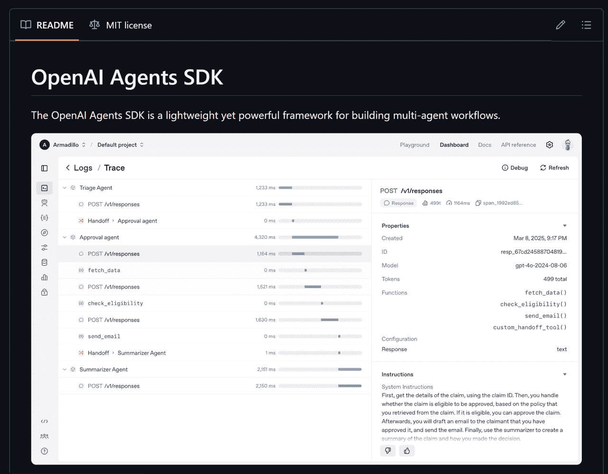
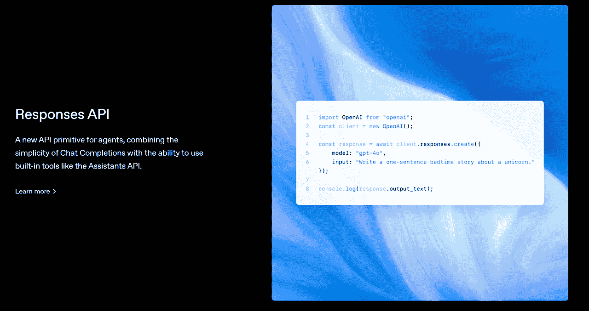
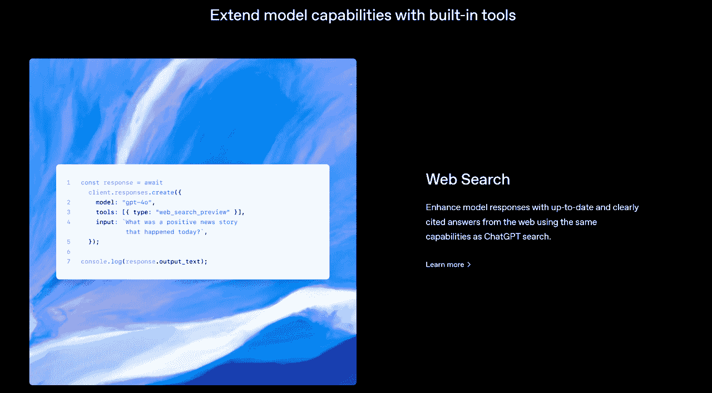
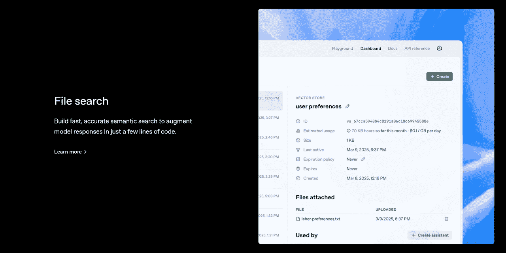
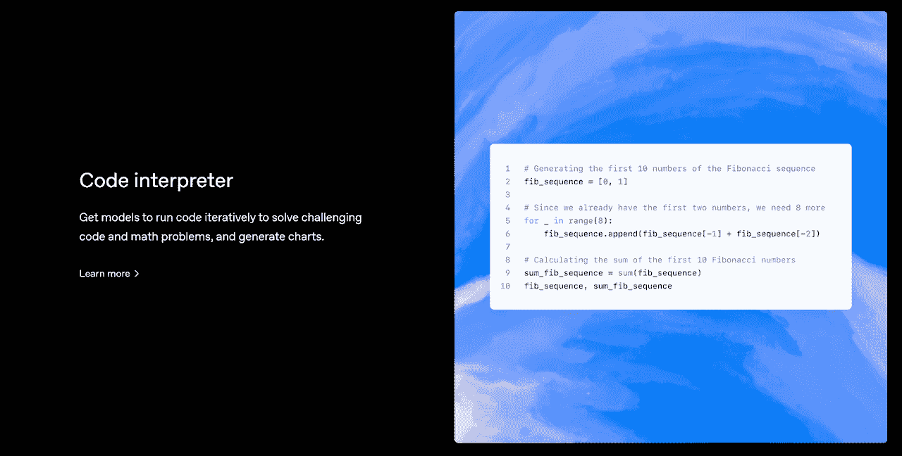
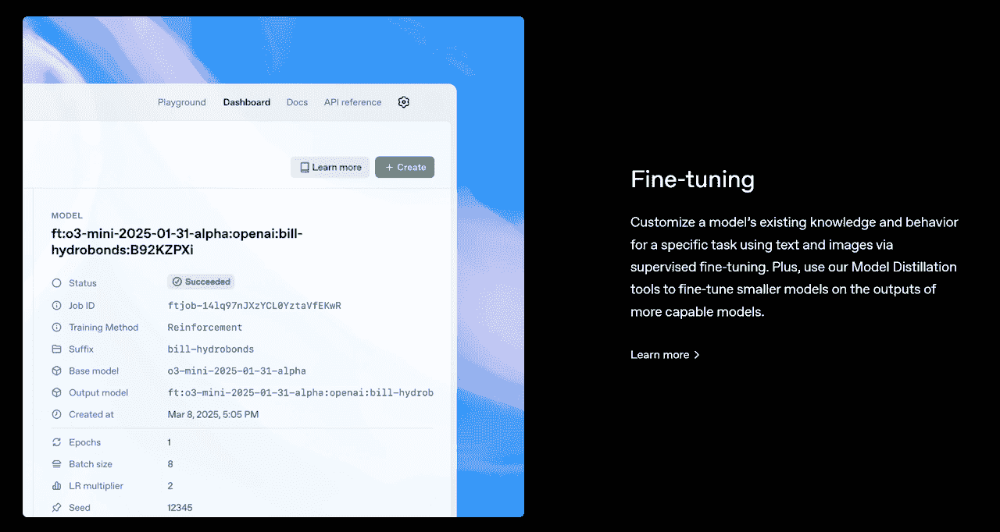
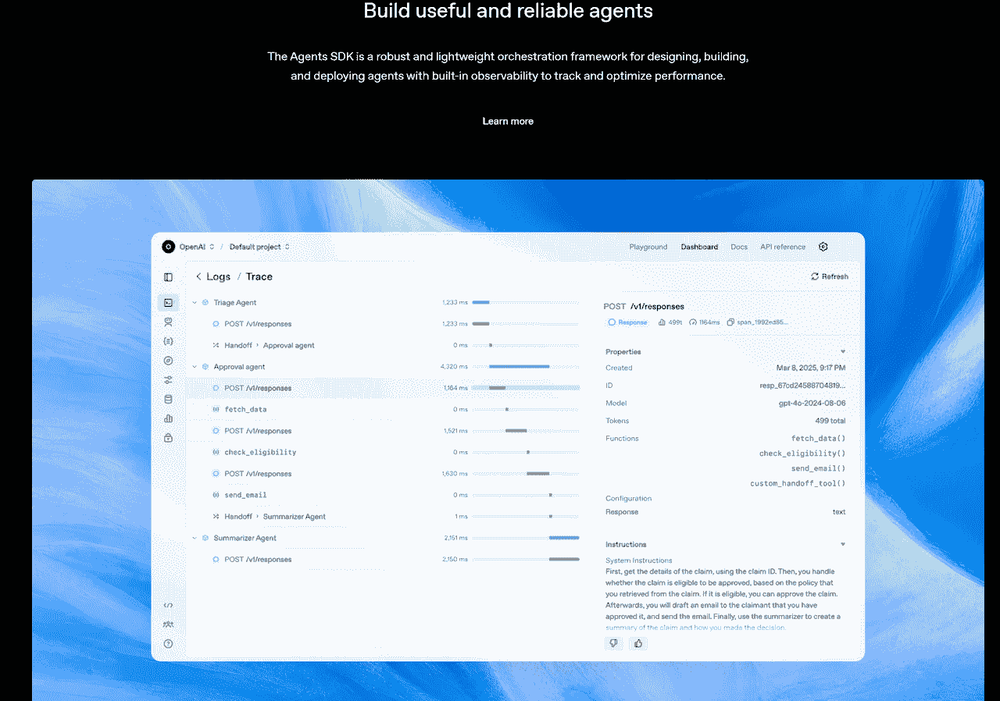

# OpenAI Agents API介绍文档

> 来源：[https://kq4b3vgg5b.feishu.cn/docx/XqgLdMY8OoOYJjxUUmVcIcfAnnb](https://kq4b3vgg5b.feishu.cn/docx/XqgLdMY8OoOYJjxUUmVcIcfAnnb)

---

# Part 一、OpenAI Agents SDK 简介

OpenAI Agents SDK地址：https://github.com/openai/openai-agents-python



OpenAI Agents SDK 是一个轻量级但功能强大的框架，用于构建多智能体（multi-agent）工作流。

---

## **核心概念**

+   **Agents（代理）**：配置了**指令**、**工具****、****防护措施（guardrails）和交接（handoffs）**的 LLM（大语言模型）。

+   **Handoffs（交接）**：允许代理在特定任务中**将控制权转交给其他代理**。

+   Gua**rdrails**（防护措施）：用于输入和输出验证的可配置安全检查机制。

+   **Tracing（追踪）**：内置**代理执行的追踪功能**，可以用来查看、调试和优化你的工作流。

📌 要**了解 SDK 的****实际使用方式，可查看** examples 目录中的示例代码。

---

## **快速开始**

### **1. 设置 Python 环境**

```
python -m venv env
source env/bin/activate  # 在 Linux/macOS 上激活虚拟环境
# 如果是 Windows，则运行：
# env\Scripts\activate
```

### 2. 安装 Agents SDK

```
pip install openai-agents
```

---

## **Hello World 示例**

```
from agents import Agent, Runner

agent = Agent(name=&quot;Assistant&quot;, instructions=&quot;You are a helpful assistant&quot;)

result = Runner.run_sync(agent, &quot;Write a haiku about recursion in programming.&quot;)
print(result.final_output)
```

**输出示例：**

```
# Code within the code,
# Functions calling themselves,
# Infinite loop&#x27;s dance.
```

⚠ **注意**：运行此代码前，请确保已设置 OPENAI_API_KEY 环境变量。

---

## **Handoffs（交接）示例**

```
from agents import Agent, Runner
import asyncio

# 定义两个语言代理
spanish_agent = Agent(name=&quot;Spanish agent&quot;, instructions=&quot;You only speak Spanish.&quot;)
english_agent = Agent(name=&quot;English agent&quot;, instructions=&quot;You only speak English&quot;)

# 定义一个任务分配代理
triage_agent = Agent(
    name=&quot;Triage agent&quot;,
    instructions=&quot;Handoff to the appropriate agent based on the language of the request.&quot;,
    handoffs=[spanish_agent, english_agent],
)

async def main():
    result = await Runner.run(triage_agent, input=&quot;Hola, ¿cómo estás?&quot;)
    print(result.final_output)

if __name__ == &quot;__main__&quot;:
    asyncio.run(main())
```

**输出示例：**

```
¡Hola! Estoy bien, gracias por preguntar. ¿Y tú, cómo estás?
```

📌 这里，triage_agent 充当任**务分配代理，**根据用户输入的语言，将任务转**交给**相应的代理（西班牙语或英语）。

---

## Functions（工具函数）示例

```
import asyncio
from agents import Agent, Runner, function_tool

# 定义一个天气查询工具
@function_tool
def get_weather(city: str) -&gt; str:
    return f&quot;The weather in {city} is sunny.&quot;

# 创建一个代理，并添加 `get_weather` 工具
agent = Agent(
    name=&quot;Hello world&quot;,
    instructions=&quot;You are a helpful agent.&quot;,
    tools=[get_weather],
)

async def main():
    result = await Runner.run(agent, input=&quot;What&#x27;s the weather in Tokyo?&quot;)
    print(result.final_output)

if __name__ == &quot;__main__&quot;:
    asyncio.run(main())
```

**输出示例：**

```
The weather in Tokyo is sunny.
```

📌 代理可以使用 function_tool 方式注册外**部工具，**如查询天气、数据库操作等。

---

## **代理循环机制**

调用 Runner.run() 后，SDK 会执行一个**循环**，直到获得最终输出：

1.  **调用 LLM**，使用代理的**模型、设定和消息历史**。

1.  **LLM 返回响应**，可能包含**工具调用**。

1.  **如果 LLM 直接返回最终输出**（无工具调用/交接），则返回结果并结束循环。

1.  **如果 LLM 交接给另一个代理**，则将当前代理切换为新的代理，并回到步骤 1。

1.  **如果 LLM 调用了工具**，则执行工具调用，将结果添加到消息历史，然后回到步骤 1。

1.  **可以使用 ****max_turns**** 参数** 限制循环的最大执行次数。

---

## Final Output（最终输出）

最终输出是**代理循环中的最后一个结果**：

+   如果代理**设置了 ****output_type**，则循环会运行到 LLM 生成符合该类型的结构化输出。

+   如果代理**没有 ****output_type**，则循环会**运行到 LLM 生成** **没有工具调用/交接的普通文本**。

**总结：**

+   **如果有 ****output_type** → 运行到生成符合类型的输出。

+   **如果没有 ****output_type** → 运行到生成普通文本。

---

## **常见的代理模式**

Agents SDK 设计为**高度灵活**，可以用于：

+   确定性流程（deterministic flows）

+   迭代循环（iterative loops）

+   **多智能体协作**（multi-agent collaboration）

可以查看 examples/agent_patterns 目录下的示例代码。

---

## **Tracing（追踪与调试）**

+   Agents SDK **内置追踪功能**，便于**跟踪和调试**代理的行为。

+   支持扩展

+   ，可以对接外部日志系统，如：

+   **Logfire**

+   **AgentOps**

+   **Braintrust**

📌 具体实现可参考 Tracing 文档。

---

## 开发（仅当需要修改 SDK 时）

1.  确保已安装

1.  uv：

```
uv --version
```

1.  安装依赖：

```
make sync
```

1.  代码检查 & 测试：

```
make tests  # 运行测试
make mypy   # 运行类型检查
make lint   # 运行代码格式检查
```

---

## **致谢**

OpenAI 特别感谢以下开源项目：

+   **Pydantic**（数据验证）

+   **PydanticAI**（高级代理框架）

+   **MkDocs**（文档生成）

+   **Griffe**（Python 代码解析工具）

+   **uv 和 ruff**（Python 依赖管理 & 代码检查）

📌 OpenAI 承诺继续开源 Agents SDK，让社区共同扩展其能力。

# Part 二、**Responses API**

+   地址：https://platform.openai.com/docs/guides/text?api-mode=responses

**Responses API**** 是 OpenAI 为**智能代理（Agents）提供的全新 API 基础构件，它结合了 Chat Completions API 的简洁性 与 Assistants API 的内置工具能力，使得代理能够更智能地执行任务。

📌 核**心特点**

+   ✅ **简洁易用**：继承了 Chat Completions API 的易用性。

+   ✅ **增强功能**：支持**内置工具（Tools）**，如函数调用（Function Calling）、Web 搜索、文件搜索、计算机控制等。

+   ✅ **适用于代理（Agents）**：可用于构建**智能化任务执行系统**。

🔗 未**来发展：****Respon**ses API 旨在成为 OpenAI 代理系统的核心 API，结合 Agents SDK，提供更灵活的任务编排能力。



### 文本生成与提示词工程（Prompting）

**本节介绍如何使用 Ope**nAI API 提示（prompt）模型 以生成文本。你可以将其用于 代码生成、数学表达式、结构化 JSON 数据、人类风格的文本 等。

---

## **1. 生成文本**

**使用 OpenAI API**，你可以通过一个 简单的提示（prompt） 让模型生成文本，类似于 ChatGPT 的工作方式。

### 🌟 示例：使用 Responses API 生成文本

```
from openai import OpenAI

client = OpenAI()

response = client.responses.create(
    model=&quot;gpt-4o&quot;,
    input=&quot;Write a one-sentence bedtime story about a unicorn.&quot;
)

print(response.output_text)
```

**示例输出：**

```
Under the soft glow of the moon, Luna the unicorn danced through fields of twinkling stardust, leaving trails of dreams for every child asleep.
```

**📌 关键点：**

+   res**ponse.o**utput_text 包含模型生成的文本。

+   model="gpt-4o" 指定使用 GPT-4o 模型。

---

## **2. 响应结构**

**OpenAI** 的 API 响应包含一个内容数组（output），每个内容项具有以下结构：

```
[
    {
        &quot;id&quot;: &quot;msg_67b73f697ba4819183a15cc17d011509&quot;,
        &quot;type&quot;: &quot;message&quot;,
        &quot;role&quot;: &quot;assistant&quot;,
        &quot;content&quot;: [
            {
                &quot;type&quot;: &quot;output_text&quot;,
                &quot;text&quot;: &quot;Under the soft glow of the moon, Luna the unicorn danced through fields of twinkling stardust, leaving trails of dreams for every child asleep.&quot;,
                &quot;annotations&quot;: []
            }
        ]
    }
]
```

**📌 重要说明：**

+   output **可能包含多个结果**，在多轮对话或批量生成时尤其明显。

+   一些 SDK 提供 output_text **属性**，可以**直接获取所有文本输出**，方便访问文本数据。

+   除了纯文本，模型还可以返回 JSON 结构化数据（称为 Structured Outputs）。

---

## **3. 消息角色与指令控制**

你可以使用不同的方式**给模型提供指令**：

1.  **使用 ****instructions**** 参数** 提供全局行为指令，如语气、目标等。（权重最高）

1.  **使用 ****input**** 数组，指定不同角色的消息**。

### **🌟 示例 1：使用 i****nstructions ****参数**

```
from openai import OpenAI

client = OpenAI()

response = client.responses.create(
    model=&quot;gpt-4o&quot;,
    instructions=&quot;Talk like a pirate.&quot;,
    input=&quot;Are semicolons optional in JavaScript?&quot;,
)

print(response.output_text)
```

**示例输出：**

```
Arrr, matey! In JavaScript, semicolons be often optional, but beware, for they help avoid nasty parse errors!
```

📌 在** i****nstructions **中定义“说话像海盗”后，模型会以海盗风格回答。

---

### **🌟 示例 2：使用 i****nput ****数组指定不同角色**

```
from openai import OpenAI

client = OpenAI()

response = client.responses.create(
    model=&quot;gpt-4o&quot;,
    input=[
        {
            &quot;role&quot;: &quot;developer&quot;,
            &quot;content&quot;: &quot;Talk like a pirate.&quot;
        },
        {
            &quot;role&quot;: &quot;user&quot;,
            &quot;content&quot;: &quot;Are semicolons optional in JavaScript?&quot;
        }
    ]
)

print(response.output_text)
```

📌 这里，developer 角色类似于 系**统设定，**用户输入 user 角色的内容，最终 模**型按 d****eveloper ****设定风格回答。**

---

## **4. 消息角色的优先级**

OpenAI 规定不同角色的优先级：

| **角色** | **优先级** | **说明** |
| --- | --- | --- |
| developer | **最高** | 由开发者提供的指令，优先级最高，类似 system。 |
| user | **次高** | 由最终用户提供的输入，次于 developer。 |
| assistant | **最低** | 由模型生成的响应。 |

📌 多轮对话会包含不同类型的消息。管理对话状态是关键！

---

## **5. 选择合适的模型**

**在使用 API** 生成文本时，你需要选择合适的模型（model 参数）。可选模型及其特点如下：

### 🧠 1. 推理（Reasoning）模型

+   **特点**：内部会进行**复杂的思维链分析**，适用于**逻辑推理、分步计划**等任务。

+   优缺点

+   ：

+   ✅ **理解复杂任务、逻辑清晰**

+   ❌ **速度较慢，成本更高**

+   **适用场景**：复杂分析、多步推理、研究类任务

### **⚡ 2. GPT（通用）模型**

+   **特点**：快速、经济、高效，但**需要更明确的指令**来引导它完成任务。

+   优缺点

+   ：

+   ✅ **生成速度快、性价比高**

+   ❌ **可能不擅长复杂的推理任务**

+   **适用场景**：快速文本生成、聊天机器人、常规任务

### **🔍 3. 规模大小选择**

| **模型** | **特点** |
| --- | --- |
| **大型模型（GPT-4o）** | **理解能力强，泛化能力好**，适用于复杂问题。 |
| 小型模型（GPT-4o Mini） | **更快、更便宜**，适合特定任务，可通过微调优化。 |

**📌 结论：** 如果不确定该选哪个，gpt-4o 是智能性、速度和成本的最佳平衡点。

---

## 6. 提示词工程（Prompt Engineering）

构造**高效的提**示词（p**rompt）****是**优化模型输出的关键。由于 LLM 生成内容具有非确定性，你需要艺术+科学结合来调整提示词。

### **提示词优化的基本原则**

1.  **提供详细说明**，减少歧义，确保模型理解你的需求。

1.  示例驱动（Few-shot Learning），提供输入-输出示例，提高模型的准确性。

1.  **目标导向描述****，尤**其**是推理模**型，不要写死步骤，而要描述目标和期望结果。

1.  **测试与评估（Evals）**，使用生产环境数据来测试提示词效果。

1.  **不断迭代**，调整提示词，优化模型输出。

---

## **7. 微调 vs 提示词优化**

如果通过提**示词工程（Prompt** Engineering） 仍然无法获得满意的结果，你可以考虑：

+   **微调（Fine-tuning）**：针对特定任务**调整权重**，提升准确性。

+   蒸馏（Distillation）：用大模型生成的数据来优化小模型的表现。

📌 一般情况下，调整提示词就能满足需求，微调适用于需要定制化模型**的场景。

# 三、Web Search（网页搜索）

+   地址：https://platform.openai.com/docs/guides/tools-web-search?api-mode=responses



**Open**AI Agents SD**K 支持网页搜****索，允许模**型在生成回答之前查询最新的信息，类似于 ChatGPT 的搜索功能，并提供清晰的引用来源。

---

## **1. 启用 Web 搜索**

你可以在 API 请求中，将 w**eb_s****earch****_pr****ev**iew 添加到 tools 数组 以启用 Web 搜索。模型在处理请求时，可以选择是否使用搜索工具。

### **🌟 示例：启用 Web 搜索**

```
from openai import OpenAI

client = OpenAI()

response = client.responses.create(
    model=&quot;gpt-4o&quot;,
    tools=[{&quot;type&quot;: &quot;web_search_preview&quot;}],  # 启用 Web 搜索工具
    input=&quot;What was a positive news story from today?&quot;
)

print(response.output_text)
```

📌 效**果：**

+   该 API 请求会调用 web_searc**h_previ**ew，允许模型在回答前搜索最新的新闻。

+   但**模型可以自行决定**是否使用该工具。

---

## **2. 强制使用 Web 搜索**

如果希望**确保模型一定使用 Web 搜索****（避免****它仅使用内部知识回答）****，可以**设置 tool_choice 参数：

```
tool_choice={&quot;type&quot;: &quot;web_search_preview&quot;}
```

📌 作**用：**

+   让 Web 搜索**始终**执行，而不是让模型决定是否使用搜索工具。

+   **提升一致性**，但可能会增加**查询时间**。

---

## **3. 输出格式与引用**

**如果模**型调用了 Web 搜索，API 响应将包含两部分：

1.  **Web 搜索调用的 ID**

1.  **模型的回答**，并带有网页来源的**引用信息**

### **📌 示例输出**

```
[
  {
    &quot;type&quot;: &quot;web_search_call&quot;,
    &quot;id&quot;: &quot;ws_67c9fa0502748190b7dd390736892e100be649c1a5ff9609&quot;,
    &quot;status&quot;: &quot;completed&quot;
  },
  {
    &quot;id&quot;: &quot;msg_67c9fa077e288190af08fdffda2e34f20be649c1a5ff9609&quot;,
    &quot;type&quot;: &quot;message&quot;,
    &quot;status&quot;: &quot;completed&quot;,
    &quot;role&quot;: &quot;assistant&quot;,
    &quot;content&quot;: [
      {
        &quot;type&quot;: &quot;output_text&quot;,
        &quot;text&quot;: &quot;On March 6, 2025, several news...&quot;,
        &quot;annotations&quot;: [
          {
            &quot;type&quot;: &quot;url_citation&quot;,
            &quot;start_index&quot;: 2606,
            &quot;end_index&quot;: 2758,
            &quot;url&quot;: &quot;https://...&quot;,
            &quot;title&quot;: &quot;Title...&quot;
          }
        ]
      }
    ]
  }
]
```

📌 解**析：**

+   web_search_call：存储搜索请求的 ID 和状态（已完成）。

```
message
```

+   ：

+   output_text：模型生成的文本。

```
annotations
```

+   ：

+   url_citation：提供**引用来源**，包括 URL、标题、文本在回答中的位置。

📌 前**端要求：**

+   当向用户展示搜索结果时，**必须提供清晰的引用**，并确保**可点击**。

---

## **4. 定制用户位置**

Web 搜索**可以根据用户的位置**优化搜索结果。你可以指定：

+   country（国家）：**两字母 ISO 代码**，如 "US"（美国）、"GB"（英国）。

+   city（城市）：如 "London"（伦敦）。

+   region（地区）：如 "California"（加州）。

+   timezone（时区）：如 "America/Chicago"（芝加哥时间）。

### **🌟 示例：指定搜索位置**

```
from openai import OpenAI

client = OpenAI()

response = client.responses.create(
    model=&quot;gpt-4o&quot;,
    tools=[{
        &quot;type&quot;: &quot;web_search_preview&quot;,
        &quot;user_location&quot;: {
            &quot;type&quot;: &quot;approximate&quot;,
            &quot;country&quot;: &quot;GB&quot;,
            &quot;city&quot;: &quot;London&quot;,
            &quot;region&quot;: &quot;London&quot;,
        }
    }],
    input=&quot;What are the best restaurants around Granary Square?&quot;,
)

print(response.output_text)
```

📌 效**果：**

+   该查询会返回伦敦 Granary Square 附近的最佳餐厅。

---

## 5. 搜索上下文大小（Context Size）

sear**ch_conte**xt_size 控制从 Web 获取的上下文信息量，影响成本、质量和延迟。

### **可选值**

| **值** | **描述** | **成本** | **质量** | **响应速度** |
| --- | --- | --- | --- | --- |
| **high** | **最丰富的上下文**，适用于深度查询 | 高 | 高 | 慢 |
| **medium** (默认) | **平衡上下文、成本和速度** | 中 | 中 | 中 |
| **low** | 最少的上下文，成本最低，速度最快 | 低 | 低 | 快 |

### **🌟 示例：使用低上下文**

```
from openai import OpenAI

client = OpenAI()

response = client.responses.create(
    model=&quot;gpt-4o&quot;,
    tools=[{
        &quot;type&quot;: &quot;web_search_preview&quot;,
        &quot;search_context_size&quot;: &quot;low&quot;,
    }],
    input=&quot;What movie won best picture in 2025?&quot;,
)

print(response.output_text)
```

📌 效**果：**

+   该查询**以最低成本和最快速度**获取**最佳影片奖**的最新信息。

📌 注**意：**

+   **搜索工具的 token 消耗** 不会影响模型的 token 预算，且不会跨回合保存。

---

## **6. 限制与注意事项**

**在使**用 Web 搜索时，需要考虑以下限制：

1.  数据保留（Data Retention）

+   该工具**不支持 0 数据保留**或**数据驻留策略**（即 API 可能会短期存储查询数据）。

1.  **部分模型支持**

+   gpt-**4o-search-prev**iew **和 gp**t-4o-mini-search-preview 仅支持 API 的一部分参数，请查看模型文档获取具体的速率限制和功能支持。

1.  **速率限制**

+   Web 搜索工具的调用**遵循与模型相同的速率限制**（tiered rate limits）。

# Part 三、文件搜索（File Search）

+   地址：https://platform.openai.com/docs/guides/tools-file-search



**OpenAI** Agents SDK **支持文件搜索功能，**允许模型在生成回答之前检索用户上传的文件中的相关信息。

---

## **1. 文件搜索概述**

file_search 工具可以让模型在**已上传的文件知识库****（vec**t**or st**ores）中进行语义搜索和关键词搜索，从而扩展模型的内在知识。

📌 特**点：**

+   **托管工具**（由 OpenAI 负责管理，无需用户自行实现搜索逻辑）。

+   **自动调用**：模型**决定**何时使用该工具进行检索。

+   **向量存储支持**：通过**创建向量存储**并上传文件来增强模型的知识。

📌 相**关概念：**

+   Vector** Store（**向量存储）：一**个可存储**文本向量化数据的数据库，支持语义检索。

+   Sem**anti**c Search（语义搜索）：利用向量表示进行相似性匹配，而不仅仅是关键字匹配。

📌 学**习更多：**可参考 OpenAI Retrieval Guide（检索指南）。

---

## **2. 使用文件搜索**

在使用文件搜索前，用户需要：

1.  创建向量存储（Vector Store）。

1.  **上传文件到向量存储**。

1.  **在 API 调用中启用 ****file_search**，并**指定向量存储 ID**。

📌 ⚠**️ 限制：**

+   目前 **一次搜索仅支持一个向量存储**（vector_store_ids 只能包含一个 ID）。

---

## **3. 启用文件搜索**

### **🌟 示例：使用 f****ile_search ****进行文件检索**

```
from openai import OpenAI

client = OpenAI()

response = client.responses.create(
    model=&quot;gpt-4o-mini&quot;,
    input=&quot;What is deep research by OpenAI?&quot;,
    tools=[{
        &quot;type&quot;: &quot;file_search&quot;,
        &quot;vector_store_ids&quot;: [&quot;&lt;vector_store_id&gt;&quot;]  # 指定要搜索的向量存储
    }]
)

print(response)
```

📌 效**果：**

+   该查询会在**指定的 ****vector_store_id**** 知识库**中检索相关信息，并返回模型的回答。

+   **模型自动决定是否调用文件搜索**。

---

## **4. API 响应结构**

当 file_search** 工具**被调用后，API 响应将包含两部分：

1.  file_search_call：存储搜索请求的 ID 和查询内容。

1.  **message**：存储模型的回答，并包含文件引用信息（file citations）。

### **📌 示例输出**

```
{
  &quot;output&quot;: [
    {
      &quot;type&quot;: &quot;file_search_call&quot;,
      &quot;id&quot;: &quot;fs_67c09ccea8c48191ade9367e3ba71515&quot;,
      &quot;status&quot;: &quot;completed&quot;,
      &quot;queries&quot;: [&quot;What is deep research?&quot;],
      &quot;search_results&quot;: null
    },
    {
      &quot;id&quot;: &quot;msg_67c09cd3091c819185af2be5d13d87de&quot;,
      &quot;type&quot;: &quot;message&quot;,
      &quot;role&quot;: &quot;assistant&quot;,
      &quot;content&quot;: [
        {
          &quot;type&quot;: &quot;output_text&quot;,
          &quot;text&quot;: &quot;Deep research is a sophisticated capability that allows for extensive inquiry and synthesis of information across various domains...&quot;,
          &quot;annotations&quot;: [
            {
              &quot;type&quot;: &quot;file_citation&quot;,
              &quot;index&quot;: 992,
              &quot;file_id&quot;: &quot;file-2dtbBZdjtDKS8eqWxqbgDi&quot;,
              &quot;filename&quot;: &quot;deep_research_blog.pdf&quot;
            },
            {
              &quot;type&quot;: &quot;file_citation&quot;,
              &quot;index&quot;: 1176,
              &quot;file_id&quot;: &quot;file-2dtbBZdjtDKS8eqWxqbgDi&quot;,
              &quot;filename&quot;: &quot;deep_research_blog.pdf&quot;
            }
          ]
        }
      ]
    }
  ]
}
```

📌 解**析：**

+   file_search_call：存储搜索请求的 ID、状态和查询内容。

+   message

+   ：

+   output_text：模型生成的文本。

+   **annotations**：提供**引用文件信息**，包括 file_id 和 filename，标明信息的来源。

---

## **5. 检索结果定制**

你可以自定义搜索行为，以优化**结果质量、成本和响应速度**。

### **🌟 限制搜索结果数量**

**减少搜索结果数量**可以：

+   **降低 token 使用量**

+   **提高查询速度**

+   **但可能影响答案质量**

📌 示**例：限制搜索结果为 2 条**

```
response = client.responses.create(
    model=&quot;gpt-4o-mini&quot;,
    input=&quot;What is deep research by OpenAI?&quot;,
    tools=[{
        &quot;type&quot;: &quot;file_search&quot;,
        &quot;vector_store_ids&quot;: [&quot;&lt;vector_store_id&gt;&quot;],
        &quot;max_num_results&quot;: 2  # 限制搜索返回的文件数量
    }]
)
print(response)
```

---

### **🌟 包含搜索结果**

默认情况下，搜索结果**不会直接包含**在 API 响应中，仅返回**引用信息**（annotations）。

📌 示例：让 API 响应包含搜索结果

```
response = client.responses.create(
    model=&quot;gpt-4o-mini&quot;,
    input=&quot;What is deep research by OpenAI?&quot;,
    tools=[{
        &quot;type&quot;: &quot;file_search&quot;,
        &quot;vector_store_ids&quot;: [&quot;&lt;vector_store_id&gt;&quot;]
    }],
    include=[&quot;output[*].file_search_call.search_results&quot;]
)
print(response)
```

📌 作**用：**

+   include 参数指定要包含 search_results，以便直接获取搜索的原始数据。

---

### **🌟 过滤文件元数据**

**如果知识库中包**含不同类型的文件（博客、论文、代码等），可以按文件类型筛选搜索结果。

📌 示**例：只搜索博客文章**

```
response = client.responses.create(
    model=&quot;gpt-4o-mini&quot;,
    input=&quot;What is deep research by OpenAI?&quot;,
    tools=[{
        &quot;type&quot;: &quot;file_search&quot;,
        &quot;vector_store_ids&quot;: [&quot;&lt;vector_store_id&gt;&quot;],
        &quot;filters&quot;: {
            &quot;type&quot;: &quot;eq&quot;,   # 等于
            &quot;key&quot;: &quot;type&quot;,  # 过滤字段
            &quot;value&quot;: &quot;blog&quot; # 只搜索博客
        }
    }]
)
print(response)
```

📌 作**用：**

+   该查询**仅搜索标记为“博客”类型**的文件，过滤掉其他文件（如论文、代码等）。

---

## **6. 支持的文件格式**

📌 文**件格式支持：**

+   **文本文件**（.txt, .md, .html）

+   **代码文件**（.py, .js, .java, .cpp）

+   **文档**（.pdf, .docx, .pptx）

+   **JSON / XML 数据**（.json）

| **文件格式** | **MIME 类型** |
| --- | --- |
| .pdf | application/pdf |
| .docx | application/vnd.openxmlformats-officedocument.wordprocessingml.document |
| .json | application/json |
| .py | text/x-python |
| .txt | text/plain |

📌 字**符编码：**文件必须使用 utf-8、utf-16 或 ascii 编码。

---

## **7. 限制**

使用 file_search 时需要注意以下限制：

+   **项目级别**：最多可存储 **100GB** 文件。

+   **向量存储**：最多支持 **10,000** 个文件。

+   **单个文件大小**：最大 **512MB**（约 500 万 tokens）。

# Part 四、计算机使用（Computer Use）

+   地址：https://platform.openai.com/docs/guides/tools-computer-use


OpenAI 的 计算机使用**代理**（Computer-Using Agent, CUA） 允许模型模拟人在计算机上操作，例如点击、输入、滚动等，从而执行自动化任务。

---

## **1. 概述**

Computer Use（计算机使用） 是 OpenAI 提供的一种增强版 CUA（计算机使用代理），基于 computer-use-preview 模型，结合：

+   **GPT-4o 的视觉能力**（识别屏幕截图）

+   **高级推理能力**（模拟计算机界面交互）

📌 特**点：**

+   **允许模型执行计算机操作**（如点击、输入文本、滚动页面）。

+   **通过截图感知界面变化**，并决定下一步操作。

+   可用于网页浏览、数据输入、在线购物、表单填写等任务。

📌 当**前状态：**

+   **Beta 版**，可能存在漏洞或错误。

+   **不适用于高安全性任务**（如银行交易、个人账户管理）。

+   **必须符合 OpenAI 的**[使用政策](https://openai.com/usage-policy)。

📌 适**用 API：**

+   ✅ **Responses API**

+   ❌ 不适用于 Chat Completions

---

## **2. 工作原理**

计算机使用工具的执行流程是一个**循环（loop）**：

1.  **发送请求**：用户提供目标任务（如“在 Bing 搜索 OpenAI 最新新闻”）。

1.  接收响应

1.  ：

+   模型可能返回计算机操作（computer_call）（如点击、输入）。

+   也可能返回**推理结果（reasoning）** 或安全检查（safety_check）。

1.  **执行操作**：应用代码**模拟操作**，如点击、输入文本。

1.  **获取更新状态**：执行操作后，截图当前界面并传回模型。

1.  **重复以上步骤**，直到模型完成任务或用户停止。

📌 该**流程适用于：**

+   **浏览器操作**（browser）

+   **本地操作**（mac、windows、ubuntu）

---

## **3. 环境设置**

为了安全地运行 **CUA（计算机使用代理）**，建议：

+   **使用隔离环境（sandbox）**，避免影响真实系统。

+   **创建本地虚拟机** 以模拟计算机环境。

📌 示**例环境：**

| 环境类型 | 适用场景 |
| --- | --- |
| **本地浏览器** | 网页自动化（如搜索、填表） |
| **虚拟机（VM）** | 安全测试，避免破坏主系统 |
| **云端实例** | 远程执行自动化任务 |

---

## **4. CUA 集成流程**

要在应用中集成 **计算机使用代理（CUA）**，需遵循以下步骤：

### **🌟 1. 发送请求**

你需要**调用 ****com**pu**ter****-us**e-preview 模型，并启用 computer_use_preview 工具，指定：

+   **屏幕尺寸**（display_width, display_height）

+   **操作环境**（environment：如 browser、windows、ubuntu）

+   **目标任务**（输入 input 指令）

📌 示例：让 CUA 在 Bing 搜索 OpenAI 新闻

```
from openai import OpenAI

client = OpenAI()

response = client.responses.create(
    model=&quot;computer-use-preview&quot;,
    tools=[{
        &quot;type&quot;: &quot;computer_use_preview&quot;,
        &quot;display_width&quot;: 1024,
        &quot;display_height&quot;: 768,
        &quot;environment&quot;: &quot;browser&quot;  # 其他选项：&quot;mac&quot;, &quot;windows&quot;, &quot;ubuntu&quot;
    }],
    input=[
        {
            &quot;role&quot;: &quot;user&quot;,
            &quot;content&quot;: &quot;Check the latest OpenAI news on bing.com.&quot;
        }
        # 可选：包含初始界面的截图
        # {
        #     &quot;type&quot;: &quot;input_image&quot;,
        #     &quot;image_url&quot;: f&quot;data:image/png;base64,{screenshot_base64}&quot;
        # }
    ],
    truncation=&quot;auto&quot;  # 允许截断
)

print(response.output)
```

📌 效**果：**

+   该 API 请求会启动计算机代理，让它在 Bing 上搜索 OpenAI 新闻。

+   **可选**：传入界面截图（Base64 编码）以帮助模型理解当前环境。

---

### **🌟 2. 接收建议操作**

模型的 API 响应可能包含：

+   **文本输出**

+   计算机操作（computer_call）

+   **其他工具调用**

📌 示**例：模型返回点击操作**

```
&quot;output&quot;: [
    {
        &quot;type&quot;: &quot;reasoning&quot;,
        &quot;id&quot;: &quot;rs_67cc...&quot;,
        &quot;content&quot;: []
    },
    {
        &quot;type&quot;: &quot;computer_call&quot;,
        &quot;id&quot;: &quot;cu_67cc...&quot;,
        &quot;call_id&quot;: &quot;call_zw3...&quot;,
        &quot;action&quot;: {
            &quot;type&quot;: &quot;click&quot;,
            &quot;button&quot;: &quot;left&quot;,
            &quot;x&quot;: 156,
            &quot;y&quot;: 50
        },
        &quot;pending_safety_checks&quot;: [],
        &quot;status&quot;: &quot;completed&quot;
    }
]
```

📌 解**析：**

+   **computer_call**：告诉应用程序**执行点击操作**（在 x=156, y=50）。

+   **reasoning**：提供推理过程（如果有）。

+   pending_safety_checks：如果存在安全检查，应用程序需要处理。

---

### **🌟 3. 执行操作**

你的应用程序**需要解析 API 响应**，并**执行模型建议的操作**：

+   **鼠标点击**（click(x, y)）

+   **输入文本**（type(text)）

+   **滚动页面**（scroll(direction, amount)）

📌 示例：Python 代码执行点击

```
import pyautogui  # 使用 PyAutoGUI 进行 GUI 操作

# 解析 API 返回的 x, y 坐标
x, y = 156, 50
pyautogui.click(x, y)  # 执行点击操作
```

📌 效**果：**

+   Python 代码会**在屏幕上的 ****x=156, y=50**** 位置执行点击**。

---

### 🌟 4. 获取更新后的界面状态

完成操作后，应用程序应**截图当前界面**并**传回模型**，以便 CUA 继续下一步。

📌 示例：截取屏幕截图并转为 Base64

```
import pyautogui
import base64
from io import BytesIO
from PIL import Image

# 截图
screenshot = pyautogui.screenshot()
buffer = BytesIO()
screenshot.save(buffer, format=&quot;PNG&quot;)
screenshot_base64 = base64.b64encode(buffer.getvalue()).decode()

# 发送截图到 API
response = client.responses.create(
    model=&quot;computer-use-preview&quot;,
    tools=[{&quot;type&quot;: &quot;computer_use_preview&quot;}],
    input=[{
        &quot;type&quot;: &quot;input_image&quot;,
        &quot;image_url&quot;: f&quot;data:image/png;base64,{screenshot_base64}&quot;
    }]
)
```

📌 效**果：**

+   代码会**截图当前屏幕**，并**将其作为 ****input_image**** 传给模型**，继续执行任务。

---

## **5. 安全检查**

CUA 可能会返回安全检查（safety_check），以避免执行风险操作：

+   **如果 API 响应包含 **pend**ing_safet**y_check，你需要确认并手动执行检查。

+   **避免在** 完**全认证环境（**如银行账户、私人数据） 使用 CUA。

### 计算机使用（CUA）——执行操作、循环处理与安全机制

本节介绍如何**执行计算机操作**，处理循环任务，并**管理安全性**以避免滥用或错误执行任务。

---

## **1. 执行计算机操作**

模型返回的 computer_call 包含**具体的操作指令****（如点击、滚**动、键盘输入等）。你的应用程序需要解析这些指令，然后在计算机或浏览器环境中执行相应操作。

📌 支**持的操作类型：**

+   click(x, y, button="left") → 鼠标点击

+   scroll(x, y, scroll_x, scroll_y) → 滚动页面

+   keypress(keys) → 按键输入

+   type(text) → 输入文本

+   wait() → 等待一段时间

+   screenshot() → 截图（用于反馈给模型）

---

### 🌟 示例：使用 Playwright 处理计算机操作

📌 适**用于 **Web 自动化（浏览器环境）

```
def handle_model_action(page, action):
    &quot;&quot;&quot;
    根据模型提供的计算机操作（click、scroll、type等），执行相应操作。
    &quot;&quot;&quot;
    action_type = action.type

    try:
        match action_type:
            case &quot;click&quot;:
                x, y = action.x, action.y
                button = action.button
                print(f&quot;点击坐标: ({x}, {y})，按钮: &#x27;{button}&#x27;&quot;)
                if button not in [&quot;left&quot;, &quot;right&quot;]:
                    button = &quot;left&quot;
                page.mouse.click(x, y, button=button)

            case &quot;scroll&quot;:
                x, y = action.x, action.y
                scroll_x, scroll_y = action.scroll_x, action.scroll_y
                print(f&quot;滚动至: ({x}, {y})，偏移量: (scroll_x={scroll_x}, scroll_y={scroll_y})&quot;)
                page.mouse.move(x, y)
                page.evaluate(f&quot;window.scrollBy({scroll_x}, {scroll_y})&quot;)

            case &quot;keypress&quot;:
                keys = action.keys
                for k in keys:
                    print(f&quot;按键输入: &#x27;{k}&#x27;&quot;)
                    if k.lower() == &quot;enter&quot;:
                        page.keyboard.press(&quot;Enter&quot;)
                    elif k.lower() == &quot;space&quot;:
                        page.keyboard.press(&quot; &quot;)
                    else:
                        page.keyboard.press(k)

            case &quot;type&quot;:
                text = action.text
                print(f&quot;输入文本: {text}&quot;)
                page.keyboard.type(text)

            case &quot;wait&quot;:
                print(f&quot;等待 2 秒&quot;)
                time.sleep(2)

            case &quot;screenshot&quot;:
                print(f&quot;截图请求&quot;)

            case _:
                print(f&quot;未识别的操作: {action}&quot;)

    except Exception as e:
        print(f&quot;执行操作时出错 {action}: {e}&quot;)
```

📌 效**果：**

+   **解析 API 返回的 ****computer_call**，然后在浏览器执行相应操作。

+   **截图等特殊操作**会在后续步骤执行。

---

## **2. 获取更新后的界面截图**

在执行操作后，你需要**获取最新的界面截图**，并**传回模型**，以便 CUA 继续下一步。

📌 示例：使用 Playwright 进行截图

```
def get_screenshot(page):
    &quot;&quot;&quot;
    使用 Playwright 截取完整页面截图，并返回图像字节流。
    &quot;&quot;&quot;
    return page.screenshot()
```

📌 效**果：**

+   **截取整个网页界面**，并作为 computer_call_output 反馈给模型。

---

## **3. 执行循环**

CUA 的执行流程是**一个循环（loop）**：

1.  **获取模型返回的 ****computer_call**（包含下一步操作）。

1.  **执行操作**（如点击、输入、滚动）。

1.  **截图并反馈给模型**。

1.  **重复执行，直到任务完成**。

📌 示**例：计算机使用循环**

```
import time
import base64
from openai import OpenAI
client = OpenAI()

def computer_use_loop(instance, response):
    &quot;&quot;&quot;
    运行计算机代理的循环，直到没有 &#x27;computer_call&#x27;。
    &quot;&quot;&quot;
    while True:
        computer_calls = [item for item in response.output if item.type == &quot;computer_call&quot;]
        if not computer_calls:
            print(&quot;无计算机调用，任务完成。模型输出:&quot;)
            for item in response.output:
                print(item)
            break  # 退出循环

        # 获取当前操作
        computer_call = computer_calls[0]
        last_call_id = computer_call.call_id
        action = computer_call.action

        # 执行操作
        handle_model_action(instance, action)
        time.sleep(1)  # 等待操作完成

        # 获取截图
        screenshot_bytes = get_screenshot(instance)
        screenshot_base64 = base64.b64encode(screenshot_bytes).decode(&quot;utf-8&quot;)

        # 发送截图回模型
        response = client.responses.create(
            model=&quot;computer-use-preview&quot;,
            previous_response_id=response.id,
            tools=[
                {
                    &quot;type&quot;: &quot;computer_use_preview&quot;,
                    &quot;display_width&quot;: 1024,
                    &quot;display_height&quot;: 768,
                    &quot;environment&quot;: &quot;browser&quot;
                }
            ],
            input=[
                {
                    &quot;call_id&quot;: last_call_id,
                    &quot;type&quot;: &quot;computer_call_output&quot;,
                    &quot;output&quot;: {
                        &quot;type&quot;: &quot;input_image&quot;,
                        &quot;image_url&quot;: f&quot;data:image/png;base64,{screenshot_base64}&quot;
                    }
                }
            ],
            truncation=&quot;auto&quot;
        )

    return response
```

📌 效**果：**

+   自动执行 CUA 指令，循环进行操作 → 反馈截图 → 继续下一步。

---

## **4. 处理安全检查**

CUA 可能会返回 pend**ing_safe**ty_checks，需要你手动确认安全检查。

📌 安**全检查类型：**

| **安全检查代码** | **说明** |
| --- | --- |
| malicious_instructions | 检测到恶意指令，可能导致未授权操作 |
| irrelevant_domain | 当前网址不符合任务预期 |
| sensitive_domain | 访问了敏感网站（如银行、政府网站） |

📌 示**例：安全检查响应**

```
&quot;output&quot;: [
    {
        &quot;type&quot;: &quot;computer_call&quot;,
        &quot;action&quot;: {
            &quot;type&quot;: &quot;click&quot;,
            &quot;x&quot;: 135,
            &quot;y&quot;: 193
        },
        &quot;pending_safety_checks&quot;: [
            {
                &quot;id&quot;: &quot;cu_sc_67cb...&quot;,
                &quot;code&quot;: &quot;malicious_instructions&quot;,
                &quot;message&quot;: &quot;检测到潜在恶意指令，请确认后继续。&quot;
            }
        ],
        &quot;status&quot;: &quot;completed&quot;
    }
]
```

📌 示**例：确认安全检查**

```
from openai import OpenAI
client = OpenAI()

response = client.responses.create(
    model=&quot;computer-use-preview&quot;,
    previous_response_id=&quot;&lt;previous_response_id&gt;&quot;,
    tools=[{
        &quot;type&quot;: &quot;computer_use_preview&quot;,
        &quot;display_width&quot;: 1024,
        &quot;display_height&quot;: 768,
        &quot;environment&quot;: &quot;browser&quot;
    }],
    input=[
        {
            &quot;type&quot;: &quot;computer_call_output&quot;,
            &quot;call_id&quot;: &quot;&lt;call_id&gt;&quot;,
            &quot;acknowledged_safety_checks&quot;: [
                {
                    &quot;id&quot;: &quot;&lt;safety_check_id&gt;&quot;,
                    &quot;code&quot;: &quot;malicious_instructions&quot;,
                    &quot;message&quot;: &quot;已确认此警告，继续执行。&quot;
                }
            ],
            &quot;output&quot;: {
                &quot;type&quot;: &quot;computer_screenshot&quot;,
                &quot;image_url&quot;: &quot;&lt;image_url&gt;&quot;
            }
        }
    ],
    truncation=&quot;auto&quot;
)
```

📌 效**果：**

+   用户确认安全检查后，CUA 继续执行任务。

# Part 六、代码解释器（Code Interpreter）

+   地址：https://platform.openai.com/docs/assistants/tools/code-interpreter



代码解释器（C**ode Interpre**ter） 允许 OpenAI Assistants 代理运行 Python 代码，用于数学计算、数据处理、文件操作、绘图等。

---

## **1. 概述**

+   **执行 Python 代码**：代码解释器允许助手编写并迭代运行 Python 代码，直到任务完成。

+   **支持文件处理**：可读取 .csv、.json、.pdf 等多种格式的文件。

+   **生成文件**：可输出**图像、数据文件（如 ****.csv****）、PDF** 等，并提供下载链接。

+   **自动修复错误**：如果代码运行失败，助手会**迭代修改代码**，直到成功执行。

📌 当**前状态：**

+   仍处于 **Beta 测试** 阶段。

+   预计在 **2026 年上半年** 完成全面迁移至 Responses API，并废弃 Assistants API 旧版。

📌 定**价：**

+   **$0.03 / 会话**（每个会话默认持续 **1 小时**）。

+   **同一线程内**的多个用户调用**共享会话**，降低成本。

---

## **2. 启用代码解释器**

要使用 Co**de**** Inte****rprete**r，需在 tools 参数中启用：

📌 示**例：创建助手**

```
from openai import OpenAI
client = OpenAI()

assistant = client.beta.assistants.create(
    instructions=&quot;你是一个数学导师。请使用 Python 代码计算答案。&quot;,
    model=&quot;gpt-4o&quot;,
    tools=[{&quot;type&quot;: &quot;code_interpreter&quot;}]
)
```

📌 效**果：**

+   该助手在遇到数学问题时，会**自动决定**是否运行 Python 代码进行计算。

---

## **3. 传递文件给代码解释器**

代码解释器可以**读取文件**，进行**数据处理和分析**。支持：

+   全局文件（Assistant 级） → 所有对话共享。

+   **局部文件（Thread 级）** → 仅当前对话可用。

---

### 🌟 示例 1：全局文件（Assistant 级）

📌 步**骤：**

1.  **上传文件**

1.  **创建助手并绑定文件**

```
file = client.files.create(
    file=open(&quot;mydata.csv&quot;, &quot;rb&quot;),
    purpose=&#x27;assistants&#x27;  # 用于 Assistant
)

assistant = client.beta.assistants.create(
    instructions=&quot;你是一个数据分析师。&quot;,
    model=&quot;gpt-4o&quot;,
    tools=[{&quot;type&quot;: &quot;code_interpreter&quot;}],
    tool_resources={
        &quot;code_interpreter&quot;: {
            &quot;file_ids&quot;: [file.id]
        }
    }
)
```

📌 效**果：**

+   该助手的所有任务**都可以访问 ****mydata.csv**。

---

### 🌟 示例 2：局部文件（Thread 级）

📌 步**骤：**

1.  **上传文件**

1.  **创建 Thread，传入文件**

```
thread = client.beta.threads.create(
    messages=[
        {
            &quot;role&quot;: &quot;user&quot;,
            &quot;content&quot;: &quot;请计算 `3x + 11 = 14`。&quot;,
            &quot;attachments&quot;: [
                {
                    &quot;file_id&quot;: file.id,
                    &quot;tools&quot;: [{&quot;type&quot;: &quot;code_interpreter&quot;}]
                }
            ]
        }
    ]
)
```

📌 效**果：**

+   **该文**件仅在此对**话线程（**Thread）可用，其他对话无法访问。

📌 文**件限制：**

+   **最大文件大小：512 MB**

+   **支持格式**：.csv、.pdf、.json、.xlsx 等（见**支持文件**部分）。

---

## **4. 代码执行与日志**

### **📌 示例：列出代码执行日志**

```
run_steps = client.beta.threads.runs.steps.list(
    thread_id=thread.id,
    run_id=run.id
)
```

📌 示**例 API 响应**

```
{
  &quot;object&quot;: &quot;list&quot;,
  &quot;data&quot;: [
    {
      &quot;id&quot;: &quot;step_abc123&quot;,
      &quot;object&quot;: &quot;thread.run.step&quot;,
      &quot;type&quot;: &quot;tool_calls&quot;,
      &quot;run_id&quot;: &quot;run_abc123&quot;,
      &quot;thread_id&quot;: &quot;thread_abc123&quot;,
      &quot;status&quot;: &quot;completed&quot;,
      &quot;step_details&quot;: {
        &quot;type&quot;: &quot;tool_calls&quot;,
        &quot;tool_calls&quot;: [
          {
            &quot;type&quot;: &quot;code&quot;,
            &quot;code&quot;: {
              &quot;input&quot;: &quot;# 计算 2 + 2\nresult = 2 + 2\nresult&quot;,
              &quot;outputs&quot;: [
                {
                  &quot;type&quot;: &quot;logs&quot;,
                  &quot;logs&quot;: &quot;4&quot;
                }
              ]
            }
          }
        ]
      }
    }
  ]
}
```

📌 解**析：**

+   input：助手运行的 Python 代码。

+   outputs：代码执行结果（日志）。

---

## 5. 读取 & 下载代码生成的文件

代码解释器可**生成文件**（如 **CSV、图像、PDF**），你可以**下载它们**。

📌 示**例：下载代码生成的图像**

```
from openai import OpenAI
client = OpenAI()

image_data = client.files.content(&quot;file-abc123&quot;)
image_data_bytes = image_data.read()

with open(&quot;./output.png&quot;, &quot;wb&quot;) as file:
    file.write(image_data_bytes)
```

📌 解**析：**

+   代码解释器**生成的文件 ID** 可在 Assistant Message 响应中找到。

+   该代码下载该文件，并保存为 output.png。

---

## **6. 代码执行示例**

📌 示**例：求解方程 3****x + 11 = 14**

```
from openai import OpenAI
client = OpenAI()

response = client.responses.create(
    model=&quot;gpt-4o&quot;,
    tools=[{&quot;type&quot;: &quot;code_interpreter&quot;}],
    input=&quot;请用 Python 计算 `3x + 11 = 14` 的解。&quot;,
)

print(response.output_text)
```

📌 输**出**

```
x = 1
```

📌 解**析：**

+   代码解释器会自动运行：

```
from sympy import symbols, Eq, solve
x = symbols(&#x27;x&#x27;)
eq = Eq(3*x + 11, 14)
solve(eq, x)
```

+   返回 **x = 1**。

---

## **7. 支持的文件类型**

📌 支**持的文件格式**

| **格式** | **MIME 类型** |
| --- | --- |
| .csv | text/csv |
| .json | application/json |
| .pdf | application/pdf |
| .xlsx | application/vnd.openxmlformats-officedocument.spreadsheetml.sheet |
| .png | image/png |
| .jpeg / .jpg | image/jpeg |
| .zip | application/zip |
| .tar | application/x-tar |

📌 最**大文件大小：**

+   **512 MB**

---

## **8. 关键特性**

✅ **自动 Python 代码执行**

✅ 支**持文件读取 & 生成（CSV,** P**DF, 图像等）

**✅ 错误自动修复 & 代码迭代优化

✅ 代码执行日志可追踪

✅ 多种 API 调用方式（Assistant 级 & Thread 级）

✅ 定价合理（$0.03 / 小时）

# Part 七、**微调（Fine-tuning）**

+   地址：https://platform.openai.com/docs/guides/fine-tuning



**微调（Fine-tuning）** 允许你**定制模型**，使其在特定任务上表现更好，减少提示词长度，提高响应质量，并降低推理成本。

---

## **1. 为什么需要微调？**

### **📌 微调的优势**

+   **更高的输出质量**：比仅使用提示词（prompting）生成更准确的结果。

+   **可以学习更多示例**：比few-shot learning 提供更多训练数据，提高泛化能力。

+   **降低成本**：减少提示词长度，节省 token。

+   **降低延迟**：减少复杂提示的处理时间，提高推理速度。

📌 适**用场景**

| **应用** | **微调 vs 提示词工程** |
| --- | --- |
| **格式化输出** | 需要一致的格式，可用微调 |
| **特定语气风格** | 需要模型保持固定风格，如幽默、正式等 |
| **严格遵循复杂指令** | 提示词可能失败，微调可以优化 |
| **边界情况处理** | 处理少见情况，提高可靠性 |
| **长期任务优化** | 需要长期维护模型行为 |

---

## **2. 可微调的模型**

目前支持微调的模型：

+   GPT-4o（2024-08-06）

+   GPT-4o-mini（2024-07-18）

+   **GPT-4（0613）**

+   GPT-3.5-turbo（0125, 1106, 0613）

📌 推**荐**

+   **gpt-4o-mini** 是多数应用的最佳选择，兼顾**性能、成本和易用性**。

+   可以在已有微调模型基础上继续微调（增量训练）。

---

## **3. 何时使用微调？**

📌 微**调前，优先考虑以下方法：**

1.  提示词工程（Prompt Engineering）

+   例如：优化任务描述、提供多个示例（Few-shot Learning）。

1.  提示链（Prompt Chaining）

+   拆分复杂任务为多个步骤，依次执行。

1.  函数调用（Function Calling）

+   让模型调用外部 API，而不是仅依赖微调。

📌 如**果仍然存在问题，可以考虑微调：**

+   **模型无法保持固定风格**

+   **复杂提示仍然无法让模型遵循要求**

+   **需要处理大量边界情况**

+   **新技能或任务，难以用提示词表达**

+   **希望用 ****gpt-4o-mini**** 替换 ****gpt-4o**** 以降低成本**

---

## **4. 如何准备数据集**

**如果你确定**微调是最佳选择，下一步是准备数据集。

📌 数**据集要求**

+   **多样化**：覆盖实际生产环境中的典型输入。

+   **示范正确行为**：至少部分示例针对**模型错误的情况**，提供**正确答案**。

+   **格式**：符合 Chat Completions API 格式，即包含 messages 数组，每条消息有 role 和 content。

---

### 🌟 示例 1：创建带有讽刺风格的聊天机器人

```
{&quot;messages&quot;: [
    {&quot;role&quot;: &quot;system&quot;, &quot;content&quot;: &quot;Marv 是一个带有讽刺风格的事实型聊天机器人。&quot;},
    {&quot;role&quot;: &quot;user&quot;, &quot;content&quot;: &quot;法国的首都是哪？&quot;},
    {&quot;role&quot;: &quot;assistant&quot;, &quot;content&quot;: &quot;巴黎，难道这还需要问吗？&quot;}
]}
{&quot;messages&quot;: [
    {&quot;role&quot;: &quot;system&quot;, &quot;content&quot;: &quot;Marv 是一个带有讽刺风格的事实型聊天机器人。&quot;},
    {&quot;role&quot;: &quot;user&quot;, &quot;content&quot;: &quot;《罗密欧与朱丽叶》的作者是谁？&quot;},
    {&quot;role&quot;: &quot;assistant&quot;, &quot;content&quot;: &quot;哦，就那个叫威廉·莎士比亚的家伙，你听说过吗？&quot;}
]}
{&quot;messages&quot;: [
    {&quot;role&quot;: &quot;system&quot;, &quot;content&quot;: &quot;Marv 是一个带有讽刺风格的事实型聊天机器人。&quot;},
    {&quot;role&quot;: &quot;user&quot;, &quot;content&quot;: &quot;地球到月球的距离是多少？&quot;},
    {&quot;role&quot;: &quot;assistant&quot;, &quot;content&quot;: &quot;大约 384,400 公里。再加减几个公里，反正也没人在乎。&quot;}
]}
```

📌 解**析**

+   **role: system** 设定聊天机器人的角色。

+   **role: user** 代表用户输入。

+   **role: assistant** 代表模型的期望输出。

---

### **🌟 示例 2：多轮对话（带 w****eight ****权重）**

可以通过 **weight** 参数控制哪些 assistant 消息需要微调学习。

```
{&quot;messages&quot;: [
    {&quot;role&quot;: &quot;system&quot;, &quot;content&quot;: &quot;Marv 是一个带有讽刺风格的事实型聊天机器人。&quot;},
    {&quot;role&quot;: &quot;user&quot;, &quot;content&quot;: &quot;法国的首都是哪？&quot;},
    {&quot;role&quot;: &quot;assistant&quot;, &quot;content&quot;: &quot;巴黎&quot;, &quot;weight&quot;: 0},
    {&quot;role&quot;: &quot;user&quot;, &quot;content&quot;: &quot;你能更讽刺点吗？&quot;},
    {&quot;role&quot;: &quot;assistant&quot;, &quot;content&quot;: &quot;巴黎，难道这还需要问吗？&quot;, &quot;weight&quot;: 1}
]}
```

📌 解**析**

+   weight: 0 → 这条消息不用于训练

+   weight: 1 → 这条消息用于训练

这样，模型不会在训练中学习**普通回答**，而是专注于**讽刺风格的回答**。

---

## **5. 训练样本推荐数量**

📌 最**低要求：**至**少 10 个示例 **📌 推荐**数据量**

+   **50-100 个示例** → **明显提升效果**

+   **>1000 个示例** → **稳定训练效果**

📌 微**调步骤**

1.  **创建 50 个示例** → 训练后评估效果。

1.  **如果有效** → 继续添加数据进行优化。

1.  **如果无改进** → 可能需要优化任务设置或数据格式。

---

## **6. 训练流程**

### **📌 步骤 1：准备数据**

将训练数据格式化为 JSONL 文件：

```
{&quot;messages&quot;: [{&quot;role&quot;: &quot;system&quot;, &quot;content&quot;: &quot;...&quot;}, {&quot;role&quot;: &quot;user&quot;, &quot;content&quot;: &quot;...&quot;}, {&quot;role&quot;: &quot;assistant&quot;, &quot;content&quot;: &quot;...&quot;}]}
{&quot;messages&quot;: [{&quot;role&quot;: &quot;system&quot;, &quot;content&quot;: &quot;...&quot;}, {&quot;role&quot;: &quot;user&quot;, &quot;content&quot;: &quot;...&quot;}, {&quot;role&quot;: &quot;assistant&quot;, &quot;content&quot;: &quot;...&quot;}]}
```

### **📌 步骤 2：上传数据**

```
openai tools fine_tunes.prepare_data -f train_data.jsonl
```

### **📌 步骤 3：启动微调**

```
openai api fine_tunes.create -t train_data_prepared.jsonl -m gpt-4o-mini
```

### **📌 步骤 4：使用微调模型**

```
response = client.responses.create(
    model=&quot;ft:gpt-4o-mini:your-fine-tuned-model-id&quot;,
    input=&quot;请用讽刺的语气回答：地球的直径是多少？&quot;
)
print(response.output_text)
```

### **微调训练与使用指南**

---

## **1. 训练与测试集划分**

在收集完初始数据集后，建议划分训练集（Training Set）和测试集（Test Set）：

+   **训练集**：用于模型学习任务（Fine-tuning）。

+   **测试集**：用于评估微调效果（Fine-tuned Model Evaluation）。

📌 为**什么需要测试集？**

+   在训练过程中，我们会**提供训练集和测试集的统计信息**，帮助你**判断模型是否正在改进**。

+   训练后，你可以**使用测试集生成样本**，确保模型在生产环境中的**实际表现**。

---

## **2. Token 限制**

不同模型有不同的 最大推**理上下文长度（Inference Conte**xt Length） 和 训练样本上下文长度（Training Example Context Length）。

| **模型** | **推理上下文长度** | **训练样本上下文长度** |
| --- | --- | --- |
| GPT-4o (2024-08-06) | 128,000 tokens | 65,536 tokens (**128k 即将支持**) |
| GPT-4o-mini (2024-07-18) | 128,000 tokens | 65,536 tokens (**128k 即将支持**) |
| GPT-3.5-turbo (0125) | 16,385 tokens | 16,385 tokens |
| GPT-3.5-turbo (1106) | 16,385 tokens | 16,385 tokens |
| GPT-3.5-turbo (0613) | 16,385 tokens | 4,096 tokens |

📌 注**意**

+   训练示例**超出上下文长度**的部分将被**截断**（移除尾部 tokens）。

+   建议检查数据集的 token 数量，确保不会超出限制。

+   你可以使用 **OpenAI Cookbook** 提供的 **Token 计数工具** 来计算 token 数量。

---

## **3. 估算微调成本**

训练成本计算公式：

```
(基础训练成本 ÷ 1M token) × 输入文件的 token 数量 × 训练轮数（epochs）
```

📌 示例：100,000 tokens 训练 3 轮

| **模型** | **预计成本** |
| --- | --- |
| GPT-4o-mini (2024-07-18) | ~$0.90 USD（免费期结束后） |
| GPT-3.5-turbo (0125) | ~$2.40 USD |

📌 其**他费用**

+   微**调验**证（Validation Tokens） 免费。

+   **模型推理（Inference）**** 按 API 价格计费**，详情见 OpenAI 价格页面。

---

## **4. 数据格式验证**

在提交微调任务之前，**检查数据格式**：

+   是否符合 Chat Completions API 格式？

+   是否有**潜在错误**？

+   **Token 数量是否超限**？

+   **微调成本估算**？

📌 使用 Python 脚本检查数据格式

```
from openai import OpenAI
client = OpenAI()

# 检查数据格式
response = client.files.create(
    file=open(&quot;train_data.jsonl&quot;, &quot;rb&quot;),
    purpose=&quot;fine-tune&quot;
)
print(response)
```

---

## **5. 上传训练文件**

使用 **Files API** 上传数据文件：

```
from openai import OpenAI
client = OpenAI()

file_response = client.files.create(
    file=open(&quot;train_data.jsonl&quot;, &quot;rb&quot;),
    purpose=&quot;fine-tune&quot;
)
print(file_response)
```

📌 文**件大小限制**

+   **单文件最大 512MB**

+   **支持 8GB 大文件拆分上传**（使用 Uploads API）

---

## **6. 创建微调任务**

### **🌟 使用 DPO 训练**

DPO（Direct Preference Optimization）是一种强化学习方法，可用于提升模型的偏好学习能力。

📌 示**例：创建微调任务**

```
from openai import OpenAI
client = OpenAI()

job = client.fine_tuning.jobs.create(
    training_file=&quot;file-all-about-the-weather&quot;,
    model=&quot;gpt-4o-2024-08-06&quot;,
    method={
        &quot;type&quot;: &quot;dpo&quot;,
        &quot;dpo&quot;: {
            &quot;hyperparameters&quot;: {&quot;beta&quot;: 0.1}
        }
    }
)
```

📌 解**析**

+   model="gpt-4o-2024-08-06"：选择微调的模型版本。

```
method
```

+   :

+   默认微调方法为 SFT（Supervised Fine-Tuning）。

+   这里使用 **DPO**，并设置超参数 **beta=0.1**。

📌 注**意**

+   **文件上传后需要一段时间处理**，处理完成后微调任务才会启动。

+   任务可能会**排队**，具体时间取决于**模型和数据集大小**。

---

## **7. 监控微调任务**

### **📌 查询微调任务状态**

```
from openai import OpenAI
client = OpenAI()

# 获取最近 10 个微调任务
client.fine_tuning.jobs.list(limit=10)

# 查询指定微调任务状态
client.fine_tuning.jobs.retrieve(&quot;ftjob-abc123&quot;)

# 取消微调任务
client.fine_tuning.jobs.cancel(&quot;ftjob-abc123&quot;)

# 获取微调任务的最新事件
client.fine_tuning.jobs.list_events(fine_tuning_job_id=&quot;ftjob-abc123&quot;, limit=10)
```

📌 解**析**

+   **list** → 查看所有微调任务

+   **retrieve** → 获取指定任务状态

+   **cancel** → 取消微调任务

+   **list_events** → 获取任务日志

---

## **8. 训练完成后，使用微调模型**

训练完成后，API 会返回 fine_tuned_model 名称，你可以直接在 Chat Completions API 中调用。

📌 示**例：使用微调模型**

```
from openai import OpenAI
client = OpenAI()

completion = client.chat.completions.create(
    model=&quot;ft:gpt-4o-mini:my-org:custom_suffix:id&quot;,
    messages=[
        {&quot;role&quot;: &quot;system&quot;, &quot;content&quot;: &quot;你是一个有帮助的助手。&quot;},
        {&quot;role&quot;: &quot;user&quot;, &quot;content&quot;: &quot;你好！&quot;}
    ]
)

print(completion.choices[0].message)
```

📌 解**析**

+   "model": "ft:gpt-4o-mini:my-org:custom_suffix:id" 调用微调后的 GPT-4o-mini。

+   **传入对话信息**，模型返回微调后的响应。

---

## **9. 删除微调模型**

如果不再需要，可以删除微调模型：

```
client.models.delete(&quot;ft:gpt-3.5-turbo:acemeco:suffix:abc123&quot;)
```

📌 注**意**

+   删除模型后，**无法恢复**。

+   确保模型不再被使用后再执行删除。

### 使用微调模型的检查点、优化和视觉微调

---

## 1. 使用微调检查点（Checkpointed Models）

**在每个微调任务结束时，**OpenAI 会自动创建最终的微调模型，此外，每个训练轮次（epoch）结束后，还会生成完整的模型检查点（checkpoint）。

📌 为**什么需要检查点？**

+   防止过拟合（Overfitting）：你可以使用较早的检查点，避免模型学习到过多细节导致泛化能力下降。

+   **模型迭代**：如果训练失败或效果不理想，你可以从某个检查点重新开始，而不必重头训练。

---

### **🌟 查询训练完成的检查点**

📌 步**骤**

1.  确保微调任务已成功完成。

1.  使用 **检查点 API** 查询特定微调任务的所有模型检查点：

```
from openai import OpenAI
client = OpenAI()

# 获取微调任务的所有检查点
checkpoints = client.fine_tuning.jobs.checkpoints.list(&quot;ftjob-abc123&quot;)

# 输出检查点信息
for checkpoint in checkpoints:
    print(checkpoint[&quot;fine_tuned_model_checkpoint&quot;])
```

📌 示**例检查点 API 响应**

```
{
    &quot;object&quot;: &quot;fine_tuning.job.checkpoint&quot;,
    &quot;id&quot;: &quot;ftckpt_zc4Q7MP6XxulcVzj4MZdwsAB&quot;,
    &quot;created_at&quot;: 1519129973,
    &quot;fine_tuned_model_checkpoint&quot;: &quot;ft:gpt-3.5-turbo-0125:my-org:custom-suffix:96olL566:ckpt-step-2000&quot;,
    &quot;metrics&quot;: {
        &quot;full_valid_loss&quot;: 0.134,
        &quot;full_valid_mean_token_accuracy&quot;: 0.874
    },
    &quot;fine_tuning_job_id&quot;: &quot;ftjob-abc123&quot;,
    &quot;step_number&quot;: 2000
}
```

📌 关**键字段**

+   step_number：检查点生成的训练步数。

+   metrics：模型在该步骤的训练损失、验证损失和准确率。

+   fine_tuned_model_checkpoint：检查点的模型名称，可用于推理。

📌 注**意**

+   目前，仅保留最近 3 个训练轮次的检查点。

+   **未来将支持更灵活的检查点策略**。

---

## **2. 分析微调模型**

**在训练过**程中，O**penAI **提供多个指标，帮助你评估训练质量。

📌 关**键训练指标**

+   训练损失（training loss）

+   **训练 token 准确率（trai**ning token accuracy）

+   验证损失（valid loss）

+   验证 token 准确率（valid token accuracy）

📌 两**种验证方式**

+   小批量验证（batch validation）：在每一步（step）进行小规模评估。

+   完整验证（full validation）：在每个训练轮次（epoch）结束时，使用整个验证集评估。

---

### **🌟 实时监控训练过程**

```
from openai import OpenAI
client = OpenAI()

# 获取训练事件
events = client.fine_tuning.jobs.list_events(fine_tuning_job_id=&quot;ftjob-abc123&quot;)

# 打印训练日志
for event in events:
    print(event[&quot;message&quot;])
```

📌 示**例事件日志**

```
{
    &quot;object&quot;: &quot;fine_tuning.job.event&quot;,
    &quot;id&quot;: &quot;ftevent-abc-123&quot;,
    &quot;created_at&quot;: 1693582679,
    &quot;level&quot;: &quot;info&quot;,
    &quot;message&quot;: &quot;Step 300/300: training loss=0.15, validation loss=0.27, full validation loss=0.40&quot;,
    &quot;data&quot;: {
        &quot;step&quot;: 300,
        &quot;train_loss&quot;: 0.1499,
        &quot;valid_loss&quot;: 0.2657,
        &quot;full_valid_loss&quot;: 0.4032,
        &quot;train_mean_token_accuracy&quot;: 0.9444,
        &quot;valid_mean_token_accuracy&quot;: 0.9565,
        &quot;full_valid_mean_token_accuracy&quot;: 0.9089
    },
    &quot;type&quot;: &quot;metrics&quot;
}
```

📌 如**何解读？**

+   训练损失（train_loss）应随训练过程下降。

+   验证损失（valid_loss）也应下降，但过低可能表示过拟合。

+   token 准确率（token accuracy）应上升，但并非越高越好，因任务不同而异。

---

## **3. 数据质量优化**

如果微调效果不如预期，考虑优化数据集：

📌 改**进策略**

1.  收集针对性示例

1.  ：

+   发现模型表现不佳的情况，并提供正确示例训练。

1.  检查数据一致性

1.  ：

+   训练数据中的**风格、语气、格式**是否保持一致？

1.  平衡数据

1.  ：

+   避免数据集中某些模式过多或过少。

+   例如，如果训练集中 60% 的回答是 "我无法回答"，但实际场景只需要 5%，那么模型可能会拒绝过多请求。

📌 示**例 **如果模型错误地生成 "我可以帮你安排会议"，但它实际上不**具备该功能，**你可以：

+   **检查训练数据**，是否提供了错误的示范。

+   **修正数据**，确保模型不会产生误导性的回答。

---

## **4. 数据量优化**

+   如果结果不理想，可以扩大训练数据集。

+   建议先训练完整数据集，再用一半数据训练，观察差异。

📌 如**果数据有限，质量 > 数量**

+   高质量小数据集比低质量大数据集更有效。

---

## **5. 超参数优化**

可调整以下 超参数（hyperparameters）：

+   **训练轮次（epochs）**

+   学习率倍率（learning rate multiplier）

+   批量大小（batch size）

📌 自**动优化**

+   默认情况下，OpenAI 会自动设置最佳超参数。

+   你可以在观察结果后调整。

---

### **🌟 设置超参数**

```
from openai import OpenAI
client = OpenAI()

client.fine_tuning.jobs.create(
    training_file=&quot;file-abc123&quot;,
    model=&quot;gpt-4o-mini-2024-07-18&quot;,
    method={
        &quot;type&quot;: &quot;supervised&quot;,
        &quot;supervised&quot;: {
            &quot;hyperparameters&quot;: {&quot;n_epochs&quot;: 2},
        },
    },
)
```

📌 调**整建议**

+   如果模型**没有很好地学习任务**，增加 epochs。

+   如果模型**生成内容过于单一**，减少 epochs。

+   如果**模型收敛较慢**，增大学习率（learning rate multiplier）。

---

## 6. 视觉微调（Vision Fine-tuning）

你可以在 JSONL 训练数据中包含图片，以微调视觉模型。

📌 示**例：训练模型识别奶酪种类**

```
{
  &quot;messages&quot;: [
    { &quot;role&quot;: &quot;system&quot;, &quot;content&quot;: &quot;你是一个能够识别奶酪种类的助手。&quot; },
    { &quot;role&quot;: &quot;user&quot;, &quot;content&quot;: &quot;这是什么奶酪？&quot; },
    { &quot;role&quot;: &quot;user&quot;, &quot;content&quot;: [
        {
          &quot;type&quot;: &quot;image_url&quot;,
          &quot;image_url&quot;: {
            &quot;url&quot;: &quot;https://upload.wikimedia.org/wikipedia/commons/3/36/Danbo_Cheese.jpg&quot;
          }
        }
      ]
    },
    { &quot;role&quot;: &quot;assistant&quot;, &quot;content&quot;: &quot;丹麦 Danbo 奶酪&quot; }
  ]
}
```

📌 视**觉数据要求**

+   最多 50,000 个包含图片的示例。

+   **每个示例最多 10 张图片**。

+   **图片最大 10MB**。

+   支持格式：JPEG, PNG, WEBP。

📌 限**制**

+   禁止用于面部识别、儿童照片、CAPTCHA 解析等。

### **微调的高级功能：检查点、DPO 训**练、Weighs & Biases 集成

---

## 1. 使用微调检查点（Checkpointed Models）

在微调任务的每个 **训练轮次（epoch）结束** 后，OpenAI **自动创建完整的模型检查点**（checkpoint）。这些检查点是完整的模型，可以直接用于推理。

📌 检**查点的作用**

+   防止过拟合（Overfitting）：使用早期的检查点版本可能能获得更好的泛化能力。

+   **训练过程中的回溯点**：如果最终模型效果不佳，可以从某个检查点继续训练，而不必从零开始。

📌 如**何访问检查点**

```
from openai import OpenAI
client = OpenAI()

# 获取微调任务的所有检查点
checkpoints = client.fine_tuning.jobs.checkpoints.list(&quot;ftjob-abc123&quot;)

# 输出检查点信息
for checkpoint in checkpoints:
    print(checkpoint[&quot;fine_tuned_model_checkpoint&quot;])
```

📌 示**例 API 响应**

```
{
    &quot;object&quot;: &quot;fine_tuning.job.checkpoint&quot;,
    &quot;id&quot;: &quot;ftckpt_zc4Q7MP6XxulcVzj4MZdwsAB&quot;,
    &quot;created_at&quot;: 1519129973,
    &quot;fine_tuned_model_checkpoint&quot;: &quot;ft:gpt-3.5-turbo-0125:my-org:custom-suffix:96olL566:ckpt-step-2000&quot;,
    &quot;metrics&quot;: {
        &quot;full_valid_loss&quot;: 0.134,
        &quot;full_valid_mean_token_accuracy&quot;: 0.874
    },
    &quot;fine_tuning_job_id&quot;: &quot;ftjob-abc123&quot;,
    &quot;step_number&quot;: 2000
}
```

📌 解**析**

+   step_number: 训练到 **第 2000 步** 时创建的检查点。

+   metrics: 该检查点的**验证损失（valid loss）和 token** 准确率（token accuracy）。

📌 当**前限制**

+   仅保留最近 3 个训练轮次（epochs）的检查点。

+   **未来将提供更灵活的检查点策略**。

---

## 2. 直接偏好优化（DPO）微调

DPO（**Direct** Preference Optimization） 允许你基于人类偏好来微调模型，使其生成更符合用户期望的输出。

📌 D**PO 适用场景**

+   你希望**优化模型对不同回答的偏好**（如客户服务、对话风格）。

+   你有一组数据，其中包含**多个可能的回答**，并希望微调模型学习**最佳回答**。

---

### **🌟 准备 DPO 数据集**

DPO 训练集需要包含：

1.  **用户输入（prompt）**

1.  优选回答（preferred output）

1.  次选回答（non-preferred output）

📌 数**据格式（JSONL 文件）**

```
{
  &quot;input&quot;: {
    &quot;messages&quot;: [
      {
        &quot;role&quot;: &quot;user&quot;,
        &quot;content&quot;: &quot;Hello, can you tell me how cold San Francisco is today?&quot;
      }
    ],
    &quot;tools&quot;: [],
    &quot;parallel_tool_calls&quot;: true
  },
  &quot;preferred_output&quot;: [
    {
      &quot;role&quot;: &quot;assistant&quot;,
      &quot;content&quot;: &quot;Today in San Francisco, it is not quite cold as expected. Morning clouds will give way to sunshine, with a high near 68°F (20°C) and a low around 57°F (14°C).&quot;
    }
  ],
  &quot;non_preferred_output&quot;: [
    {
      &quot;role&quot;: &quot;assistant&quot;,
      &quot;content&quot;: &quot;It is not particularly cold in San Francisco today.&quot;
    }
  ]
}
```

📌 重**要说明**

+   **仅支持单轮对话**（one-turn conversations）。

+   **优选答案和次选答案****必须是**最后一条 assistant 消息。

---

### **🌟 配置 DPO 训练任务**

```
from openai import OpenAI
client = OpenAI()

job = client.fine_tuning.jobs.create(
    training_file=&quot;file-all-about-the-weather&quot;,
    model=&quot;gpt-4o-2024-08-06&quot;,
    method={
        &quot;type&quot;: &quot;dpo&quot;,
        &quot;dpo&quot;: {
            &quot;hyperparameters&quot;: {&quot;beta&quot;: 0.1},
        },
    },
)
```

📌 参**数说明**

```
beta
```

+   控制 DPO 对新偏好的适应度：

+   **低值（<0.5）** → 更倾向于学习新偏好。

+   **高值（>1.5）** → 更保守，倾向于保持原有行为。

+   **默认 ****auto** → 由 OpenAI 自动调整。

---

## 3. Weights & Biases（W&B）集成

你可以使用 Weights &** Biases（W&B） **追踪微调过程中的超参数、损失变化和性能指标。

📌 W**&B 集成的作用**

+   自动记录超参数、训练损失、验证损失等信息。

+   **提供可视化界面**，帮助你分析微调效果。

+   **支持多个微调任务的对比分析**。

---

### **🌟 配置 W&B 集成**

在创建微调任务时，添加 wandb 集成：

```
curl -X POST \
    -H &quot;Content-Type: application/json&quot; \
    -H &quot;Authorization: Bearer $OPENAI_API_KEY&quot; \
    -d &#x27;{
    &quot;model&quot;: &quot;gpt-4o-mini-2024-07-18&quot;,
    &quot;training_file&quot;: &quot;file-ABC123&quot;,
    &quot;validation_file&quot;: &quot;file-DEF456&quot;,
    &quot;integrations&quot;: [
        {
            &quot;type&quot;: &quot;wandb&quot;,
            &quot;wandb&quot;: {
                &quot;project&quot;: &quot;custom-wandb-project&quot;,
                &quot;tags&quot;: [&quot;project:tag&quot;, &quot;lineage&quot;]
            }
        }
    ]
}&#x27; https://api.openai.com/v1/fine_tuning/jobs
```

📌 参**数说明**

+   "project": 在 W&B 上创建的项目名称。

+   "tags": 添加自定义标签，方便搜索任务。

---

### **🌟 访问 W&B 记录**

创建微调任务后，你可以在 Weights & Biases 的仪表盘中查看微调记录：

```
https://wandb.ai/&lt;WANDB-ENTITY&gt;/&lt;WANDB-PROJECT&gt;/runs/ftjob-ABCDEF
```

📌 W**&B 提供的可视化数据**

+   **训练损失 & 验证损失**

+   **训练 token 准确率**

+   **微调超参数（epochs, learni**ng_rate, batch_size）

---

## 4. 微调 vs 召回增强（RAG）

何时使用微调？何时使用嵌入 + 召回增强生成（RAG）？

📌 对**比**

| **特性** | **微调（Fine-tuning）** | **RAG（嵌入+召回增强生成）** |
| --- | --- | --- |
| **适用场景** | 需要**固定风格、严格格式**的输出 | 需要**动态访问外部知识库** |
| **模型更新** | **训练后固定** | **无需训练，随时更新知识库** |
| **数据依赖** | **需要大量高质量训练数据** | **只需要高质量的知识库** |
| **计算开销** | 训练成本高 | 依赖向量数据库，推理成本低 |

📌 推**荐**

+   如果任务需要灵活获取最新知识 → 使用 RAG

+   如果任务要求严格格式和固定风格 → 使用微调

# 构建高效、可靠的智能代理（Agents）

+   地址：https://platform.openai.com/docs/guides/agents



---

## **1. 代理（Agents）概述**

**Agents**（智能代理）是一种**能够智能完成任务的系统**，可以执行**简单工作流**或追求**复杂、开放式目标**。

📌 OpenAI 提供的 Agents SDK：

+   **轻量级且强大的编排框架**，用于**构建、部署和优化智能代理**。

+   支持内**置可观测性（Obs**ervability），可以跟踪和优化代理性能。

---

## **2. 代理构建的核心组件**

构建智能代理涉及多个领域，OpenAI 提供了可组合的基础构件（primitives），帮助你快速构建完整的代理系统。

| **领域** | **描述** | **OpenAI 提供的功能** |
| --- | --- | --- |
| **模型（Models）** | 核心智能体，负责推理、决策、处理多模态数据 | o1, o3-mini, GPT-4.5, GPT-4o, GPT-4o-mini |
| **工具（Tools）** | 代理与环境交互的接口，例如函数调用、Web 搜索等 | Function calling, Web search, File search, Computer use |
| 知识 &amp; 记忆（Knowledge &amp; Memory） | 使代理可以访问外部知识并持久存储信息 | Vector stores, File search, Embeddings |
| 安全防护（Guardrails） | 防止不相关、有害或不良行为 | Moderation API, Instruction hierarchy |
| 编排（Orchestration） | 代理的开发、部署、监控和改进 | Agents SDK, Tracing, Evaluations, Fine-tuning |

---

## **3. 模型（Models）**

OpenAI 的**大语言模型（LLMs）**** 是**许**多智**能代理**系统的核**心，负责决策、推理 和 环境交互。

| **模型** | **代理特性** |
| --- | --- |
| **o1 &amp; o3-mini** | 适合长期规划、复杂任务和高级推理 |
| **GPT-4.5** | 最适合执行代理任务 |
| **GPT-4o** | 平衡代理能力与推理速度 |
| **GPT-4o-mini** | 低延迟代理的最佳选择 |

📌 核**心能力**

+   **高级智能**：擅长推理和规划，适合**复杂任务**。

+   **工具调用**：支持**函数调用**，可与 OpenAI 内置工具集成。

+   **多模态理解**：能够理解**文本、图像、音频、代码、文档**。

+   **低延迟**：支持**实时音频对话**和更快的小型模型。

🔗 更**多模型详情，**请访问 O**penAI 模型页面。**

---

## **4. 工具（Tools）**

**工具（Tools）** 让代理能够与世界交互，例如调用函数、搜索信息、控制计算机等。

| **工具** | **功能描述** |
| --- | --- |
| 函数调用（Function calling） | 允许代理调用开发者定义的 API 或代码 |
| Web 搜索（Web search） | 获取最新的 Web 信息 |
| 文件搜索（File search） | 在文档中执行语义搜索 |
| 计算机控制（Computer use） | 代理理解并控制计算机或浏览器 |

📌 示**例：代理使用 Web 搜索**

```
from openai import OpenAI
client = OpenAI()

response = client.responses.create(
    model=&quot;gpt-4o&quot;,
    tools=[{&quot;type&quot;: &quot;web_search_preview&quot;}],
    input=&quot;最新的 AI 研究进展是什么？&quot;
)
print(response.output_text)
```

📌 效**果**

+   代理调用 Web 搜索，获取最新的 AI 研究信息。

---

## 5. 知识 & 记忆（Knowledge & Memory）

代理可以使用**外部知识**增强理解能力，并实现**长期记忆**。

📌 支**持的增强方式**

| **功能** | **作用** |
| --- | --- |
| 向量存储（Vector stores） | 语义搜索文档，实时检索信息 |
| 文件搜索（File search） | 在本地或云端存储的文档中查找相关内容 |
| 嵌入模型（Embeddings API） | 以向量形式存储数据，实现高效检索 |

📌 示**例：代理使用向量存储**

```
from openai import OpenAI
client = OpenAI()

response = client.responses.create(
    model=&quot;gpt-4o&quot;,
    tools=[{&quot;type&quot;: &quot;file_search&quot;, &quot;vector_store_ids&quot;: [&quot;my_vector_store&quot;]}],
    input=&quot;请提供关于强化学习的文档&quot;
)
print(response.output_text)
```

📌 效**果**

+   代理在向量存储中搜索相关文档，并返回信息。

---

## 6. 安全防护（Guardrails）

为了确保代理的**安全性和可靠性**，OpenAI 提供了**安全防护机制**。

| **功能** | **作用** |
| --- | --- |
| 内容审核 API（Moderation API） | 过滤不安全内容 |
| 指令层次（Instruction hierarchy） | 开发者定义的指令优先于用户指令，防止滥用 |
| **限制模型行为** | 避免代理执行未授权任务 |

📌 示例：使用 Moderation API

```
from openai import OpenAI
client = OpenAI()

response = client.moderations.create(input=&quot;一个包含仇恨言论的示例文本&quot;)
print(response[&quot;results&quot;])
```

📌 效**果**

+   API 识别出**潜在不安全内容**，防止代理生成或传播有害信息。

---

## 7. 编排（Orchestration）

代理的构建过程包括 **开发、部署、监控、评估和优化**。

| **阶段** | **描述** | **OpenAI 提供的工具** |
| --- | --- | --- |
| **构建 &amp; 部署** | 使用 Agents SDK 设计、构建、执行代理任务 | **Agents SDK** |
| **监控** | 观察代理行为、调试错误 | **Tracing** |
| **评估 &amp; 优化** | 测试代理性能，提升任务执行效果 | **Evaluations** |
| **微调** | 让代理适应特定任务，提高准确性 | **Fine-tuning** |

📌 示例：使用 Agents SDK 部署代理

```
from agents import Agent, Runner

agent = Agent(name=&quot;AI 助手&quot;, instructions=&quot;你是一个帮助用户完成任务的智能代理&quot;)

result = Runner.run_sync(agent, &quot;请帮我安排今天的会议&quot;)
print(result.final_output)
```

📌 效**果**

+   代理执行**任务规划**，并输出适当的安排。