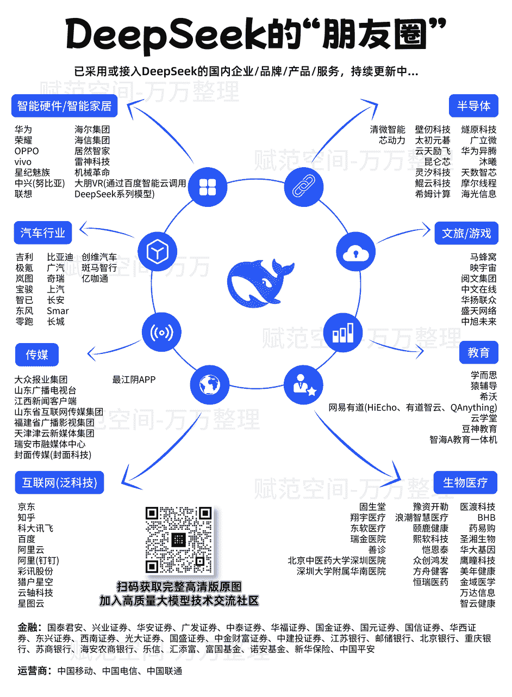
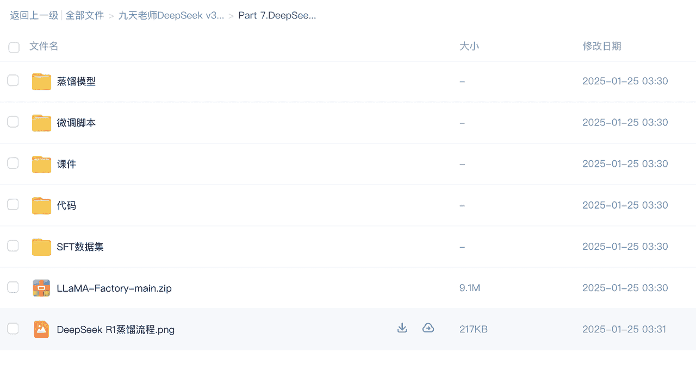
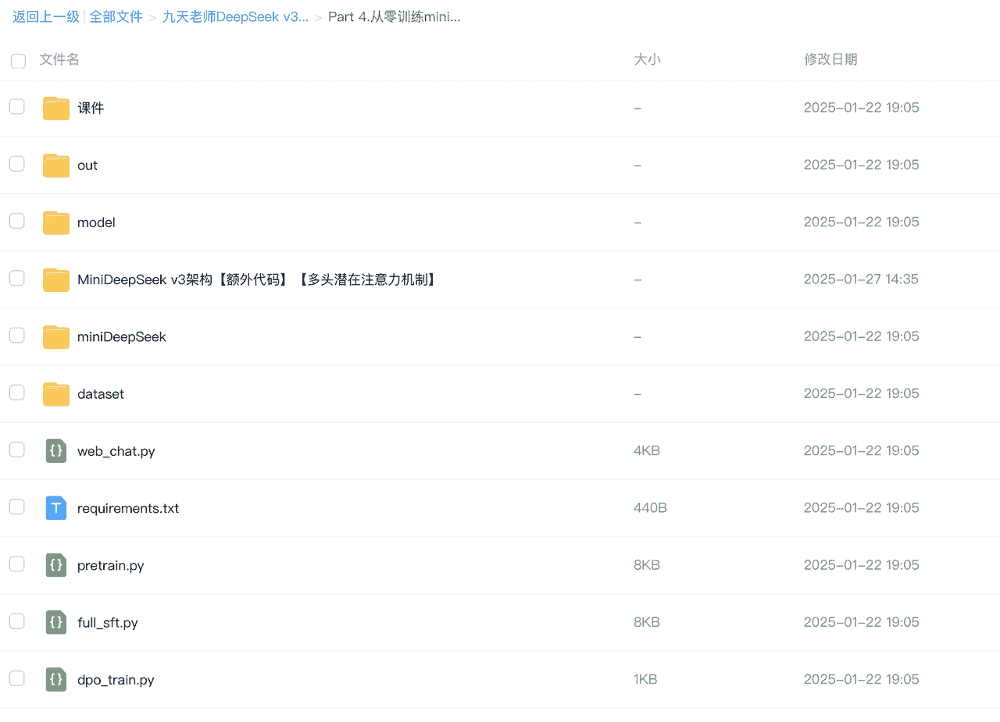

# 3.3 DeepSeek 系列专栏合集

> 来源：https://kq4b3vgg5b.feishu.cn/docx/QGtjdN9UKoED68xGlM2cQbZgnTe

> Hi，这里是由万万整理的「DeepSeek 系列模型技术合集」，收录了咱们研发团队独家自研的一手大模型硬核干货学习资料，并持续更新中，建议小伙伴们收藏起来随查随用，技术能力涨涨涨🆙～

## DeepSeek-V3.2

### 实际评测

⭐️ [DeepSeek-V3.2-Exp：利用 DeepSeek 稀疏注意力机制提升长上下文效率（课件）](https://kq4b3vgg5b.feishu.cn/wiki/SEZjwoh4qiBI6nkOn8acgsWrnpc?from=from_copylink)

+   [性能暴涨！DeepSeek-V3.2模型解读与实战评测！追平Gemini 3.0 Pro，模型编程、数学、Agent开发能力跻身全球第一梯队，开源新SOTA！（视频）](https://www.bilibili.com/video/BV13rSHBBEoG)

⭐️ Part 1.DeepSeek-V3.2快速上手与Function calling功能实现.ipynb

⭐️ Part 2.DeepSeek-V3.2+LangChain 1.1 Agent开发实战.ipynb

⭐️ Part 3.DeepSeek-V3.2 RAG系统开发实战.ipynb

[Part 1.DeepSeek-V3.2快速上手与Function calling功能实现.ipynb](https://internal-api-drive-stream.feishu.cn/space/api/box/stream/download/all/TUiQbNGBNobOcVxB1ekcmt5rnec)

[Part 2.DeepSeek-V3.2+LangChain 1.1 Agent开发实战.ipynb](https://internal-api-drive-stream.feishu.cn/space/api/box/stream/download/all/KhVtb3SsjoIYg5xFasmceSpyn2e)

[Part 3.DeepSeek-V3.2 RAG系统开发实战.ipynb](https://internal-api-drive-stream.feishu.cn/space/api/box/stream/download/all/TzKeblFBHoEYrkxLXsrcSPcanVf)

### 进阶实战

⭐️ LangChain DeepAgents 项目介绍（课件）

⭐️ [DeeSeek-v3.2 + DeepAgents 构建AI深度代理（课件）](https://kq4b3vgg5b.feishu.cn/wiki/IP2cwC46ai8UlCkSjOIcQYhJnNb?from=from_copylink)

⭐️ DeepAgents 应用开发实战（课件）

+   [1:1复刻Manus！LangChain1.0的最新框架DeepAgents+DeepSeek-v3.2构建深度研究智能体！（视频）](https://www.bilibili.com/video/BV1V42kBZEkB)

## DeepSeekMath-V2

### 实际评测

⭐️ DeepSeekMath_V2_中文精翻版_中英对照版

+   [DeepSeekMath-V2开启模型训练新范式！自验证数学推理训练流程深度详解，DeepSeek-V4序章开启！（视频）](https://www.bilibili.com/video/BV1HgSLBvEab)

## DeepSeek-OCR

### 实际评测

+   [DeepSeek-OCR深度解读+上手指南！高精度表格、公式、CAD图字符&语义混合识别，多模态混合DeepSeek实战（视频）](https://www.bilibili.com/video/BV1eJWUzTECU)

### 部署调用

⭐️ DeepSeek-OCR快速入门实战（课件）

+   [保姆级DeepSeek-OCR部署与调用指南！文字+图表+CAD图+手写体公式高精度识别，PDF到MarkDown一键转化！最强开源OCR模型快速入门实战！（视频）](https://www.bilibili.com/video/BV1TPsBzaEdh)

### 进阶实战

+   [最强开源PaddleOCR-VL+DeepSeek-OCR从零搭建复杂PDF解析链路，企业级多模态RAG系统开发实战！CAD图、架构图、图片、表格细粒度溯源（视频）](https://www.bilibili.com/video/BV1GasBzVEej)

### 团队自研工具

⭐️ DeepSeek-OCR-Web 项目已开源【使用文档】

🔗 Github开源地址：DeepSeek-OCR-Web

+   [【团队自研】DeepSeek-OCR-Web项目开源！零门槛一键部署+网页端一键OCR应用！（视频）](https://www.bilibili.com/video/BV17ks5z7E3U)

## DeepSeek V3

### 实际评测

⭐️ DeepSeek-V3-0324模型深度解析（课件）

+   [最强Agent大模型！DeepSeek-V3-0324模型详细介绍与深度评测！（视频）](https://www.bilibili.com/video/BV1zrZNYYEyA)

+   【深度】DeepSeek v3性能评测与技术解析（视频）

⭐️ DeepSeek V3.1 模型性能实测【提示词模板】

+   [DeepSeek更新！6分钟速览V3.1性能，DeepSeek VS Claude一手实测！（视频）](https://www.bilibili.com/video/BV18XePzAEWC)

⭐️ [DeepSeek-V3.2-Exp：利用 DeepSeek 稀疏注意力机制提升长上下文效率（中文论文）](https://kq4b3vgg5b.feishu.cn/wiki/SEZjwoh4qiBI6nkOn8acgsWrnpc?from=from_copylink)

+   [架构大突破，DeepSeek-V3.2重磅发布！成本暴降50%！原论文解读+模型特性介绍+DeepSeek稀疏注意力原理介绍！（视频）](https://b23.tv/4QoKpXJ)

### 部署调用

⭐️ DeepSeek v3 API接入指南（课件）

⭐️ DeepSeek v3 Function calling（课件）

⭐️ Open-WebUI接入DeepSeek v3流程详解（课件）

+   [DeepSeek-v3调用指南与Function calling技术实战（视频）](https://www.bilibili.com/video/BV1JuwVewELc)

⭐️ DeepSeek v3本地部署流程（课件）

+   [DeepSeek v3本地部署与transformer库调用流程（视频）](https://www.bilibili.com/video/BV1jjwVe4EKn)

### 进阶之路

#### 1、DeepSeek v3+GraphRAG实战

⭐️ DeepSeek借助GraphRAG搭建知识库问答机器人（课件）

+   [DeepSeek v3+GraphRAG知识谱图检索增强技术实战（视频）](https://www.bilibili.com/video/BV1Xwc6eoEW5)

#### 2、LangGraph+DeepSeek 开发实战

⭐️ [LCEL快速入门与实战（课件）](https://kq4b3vgg5b.feishu.cn/wiki/PduuwYX6CiPsHQkUOeecHLj0nYf?from=from_copylink)

⭐️ LangGraph 基础入门与 Agent 开发实战（课件）

⭐️ 【补充资料】Windows安装Docker（课件）

⭐️ 【补充资料】Serper API使用与数据预处理拆解（课件）

⭐️ 【补充材料】Windows安装Mysql数据库（课件）

+   [【8小时合集】DeepSeek v3 构建RAG丨可视化Multi-Agent开发实战（视频）](https://www.bilibili.com/video/BV1FRFNerEnh/)

#### 3、DeepSeek+Swarm智能体开发

⭐️ [DeepSeek借助Swarm搭建Multi-Agent多代理智能体（课件）](https://kq4b3vgg5b.feishu.cn/wiki/J5dqwMC1civtduk6AwwcrKkwnzh?from=from_copylink)

+   [DeepSeek v3借助Swarm搭建Multi-Agent技术入门实战（视频）](https://www.bilibili.com/video/BV1T8czeSEf1)

#### 4、从零训练DeepSeek模型

⭐️ MiniDeepSeek分词器训练流程（课件）

⭐️ MiniDeepSeek预训练（课件）

⭐️ [MiniDeepSeek后训练：全量指令微调+DPO强化学习微调（课件）](https://kq4b3vgg5b.feishu.cn/wiki/DVxAwaZTjib2JhkodoAcw7YonHf?from=from_copylink)

+   [手动复现DeepSeek v3训练过程丨模型预训练+全量指令微调+DPO强化学习微调（视频）](https://www.bilibili.com/video/BV1KtwueYE54)

#### 5、DS-V3-0324 借助MCP进行Agent开发实战

⭐️ DeepSeek Function calling功能详解（课件）

⭐️ [MCP+DeepSeek-V3-0324搭建miniManus开发实战（课件）](https://kq4b3vgg5b.feishu.cn/wiki/EjmSwWPjHiL0YLkImmec7RjXnwh?from=from_copylink)

⭐️ DeepSeek Function calling响应模式介绍（课件）

⭐️ DeepSeek企业级智能体MiniManus开发实战（课件）

+   [DeepSeek智能体开发实战，从零手搓Mini Manus！4小时从零入门到实操企业级Agent项目（视频）](https://www.bilibili.com/video/BV1L3ZDYDEnE)

#### 6、Agents SDK+DeepSeek-V3-0324+MCP智能体开发实战

⭐️ [Agents SDK+DeepSeek+MCP智能体开发实战「上」（课件）](https://kq4b3vgg5b.feishu.cn/wiki/WPAtwSxFGi5oBUkqHWscmiDdnmd?from=from_copylink)

⭐️ [Agents SDK+DeepSeek+MCP智能体开发实战「下」（课件）](https://kq4b3vgg5b.feishu.cn/wiki/I1cDwCAekiOgpkkbFnJcTx61n2j?from=from_copylink)

## DeepSeek_Prover_V2

### 实际评测

⭐️ DeepSeek_Prover_V2【官方翻译文档】

+   [AGI超级加速器！DeepSeek-Prover-V2深度解读｜全球首款形式化数学大模型｜管道递归法训练最强理性大模型（视频）](https://www.bilibili.com/video/BV1hTGezfE6v)

### 「热点速递」DeepSeek 0224开源周连续5天追更解读（偏原理）！

1.  FlashMLA性能测试（课件）  ➡️   Deepseek又开源封神！FlashMLA推理速度怒飙3倍！（视频）

1.  [DeepEP项目介绍与调用指南](https://kq4b3vgg5b.feishu.cn/wiki/M13JwwOzEi2AoUk8Y1ocypPunqh?from=from_copylink)  ➡️   重磅开源DeepEP，大模型训练&推理效率暴涨！（视频）

1.  DeepGEMM项目介绍与本地部署指南  ➡️  DeepSeek重磅开源DeepGEMM矩阵加速库（视频）

1.  [DeepSeek正式发布DualPipe，梁文峰亲自带队研发神级双向管道并行算加速（视频）](https://www.bilibili.com/video/BV1Gj9AYMEki)

1.  [3FS文件系统本地部署与调用流程  ➡️  DeepSeek开源周压轴发布3FS，全球唯一大模型分布式文件管理系统（视频）](https://www.bilibili.com/video/BV1Xh93YfEV1)

## DeepSeek R1

### 实际评测

⭐️ DeepSeek-R1-0528模型评测流程与完整测评报告（课件）

⭐️ DeepSeek-R1-0528模型评测流程与完整测评报告（课件）

+   [比肩Claude 4，拥有强悍MCP性能！最强开源大模型DeepSeek R1 0528性能评测与深度解读（视频）](https://www.bilibili.com/video/BV1x1jrzDEu4)

+   DeepSeek-R1-0528重大升级！新功能介绍与性能评测（视频）

+   DeepSeek R1全面解析！小尺寸推理模型企业可本地部署（视频）

+   DeepSeek R1开源情况介绍+模型组基本情况介绍（视频）

+   [零基础揭秘DeepSeek R1训练流程！多阶段GRPO强化学习训练技术揭秘！（视频）](https://www.bilibili.com/video/BV1ESAMepE4K)

### 部署调用

🔥大模型配置硬件参考自查表！！（点我点我）

+   [重写万行代码+重构项目结构，KTransformers最新V0.24版部署与调用实战！（视频）](https://www.bilibili.com/video/BV1czZDYaEZ5)

⭐️ [最新Ktransformers v0.24并发部署 DeepSeek-R1&V3模型（课件）](https://kq4b3vgg5b.feishu.cn/wiki/SCAdwFToUiS8Dyk6njHc39FpnIC?from=from_copylink)

+   [60G内存+14G显存！！KTransformers部署Unsloth动态量化DeepSeek R1满血模型（视频）](https://www.bilibili.com/video/BV1AL9mY2E5a)

⭐️ Ktransformers+Unsloth联合部署方案实践（课件）

+   [万元服务器运行满血DeepSeek！全网最全低成本部署方案+硬件采购避坑指南！（视频）](https://www.bilibili.com/video/BV1K7ACewEfM)

⭐️ [DeepSeek R1本地部署与调用方法（课件）](https://kq4b3vgg5b.feishu.cn/wiki/XGnowJW70ikV6hkXzbhcLWYGnBc?from=from_copylink)

+   [DeepSeek R1&蒸馏模型本地部署指南丨DeepSeek R1离线调用（视频）](https://www.bilibili.com/video/BV1UofEYXEtv)

⭐️ [DeepSeek R1 + Open-WebUI多功能企业级部署实战（课件）](https://kq4b3vgg5b.feishu.cn/wiki/Kw00w4KfCin7sRkAJjtcOYmWnYs?from=from_copylink)

⭐️ [独家KTransformers技术实战！（课件）](https://kq4b3vgg5b.feishu.cn/wiki/HOrmwchRGi7WQBk5eBCcZFTsn3I?from=from_copylink)

+   [独家KTransformers技术实战！单卡4090运行DeepSeek满血版（视频）](https://www.bilibili.com/video/BV1kyAke9EBA)

# DeepSeek 技术方案与课程索引

## Unsloth 与 Ktra 部署方案

⭐️[`Unsloth`](https://kq4b3vgg5b.feishu.cn/wiki/UC0Yw4WzTix4fAkboPccaop1nvg?from=from_copylink)[ R1动态量化部署方案（课件）](https://kq4b3vgg5b.feishu.cn/wiki/UC0Yw4WzTix4fAkboPccaop1nvg?from=from_copylink)

+   最低0显存，独家`Unsloth`动态量化部署满血DeepSeek（视频）

⭐️[`Ktra`](https://kq4b3vgg5b.feishu.cn/wiki/QJ5ywpjnvieTKZk5kPHcG3sLnkd?from=from_copylink)[nsformer](https://kq4b3vgg5b.feishu.cn/wiki/QJ5ywpjnvieTKZk5kPHcG3sLnkd?from=from_copylink)s+`Unsloth`联合部署方案实践（课件）

## ☑️ 进阶之路

### 1、模型蒸馏实战

⭐️DeepSeek R1模型蒸馏入门实战（课件）

⭐️DeepSeek R1蒸馏模型部署与调用（课件）

⭐️DeepSeek-R1蒸馏1.5B Qwen模型调用流程（课件）

+   [模型蒸馏快速入门丨从零训练DeepSeek R1 Distill模型](https://www.bilibili.com/video/BV1X1FoeBEgW)（视频）

### 2、R1高效微调实战

⭐️DeepSeek R1高效微调入门（课件）

⭐️DeepSeek R1 Distill高效微调入门实战（课件）

+   [训练定制化DeepSeek R1！零基础DeepSeek R1高效微调实战](https://www.bilibili.com/video/BV1YjN8eGE1H)（视频）

### 3、论文精读 - GRPO算法实战

⭐️DeepSeek R1 GRPO算法实战（课件）

+   [DeepSeek R1论文逐段精读与训练流程代码复现｜GRPO原理介绍与代码复现](https://www.bilibili.com/video/BV1n9NfezErB)（视频）

### 4、搭建本地知识库问答

⭐️DeepSeek R1本地知识库问答快速实战（课件）

+   DeepSeek R1搭建本地知识库问答系统（视频）

### 5、DeepSeek接入MCP

⭐️MCP快速入门实战丨核心技术原理深度讲解+进阶使用（课件）

+   [MCP技术入门实战！DeepSeek、`ollama`、`vLLM`接入`MCP`，从零手撕代码搭建`MCP Client`与`MCP Server`](https://www.bilibili.com/video/BV1NLXCYTEbj)（视频）

### 6、R1-0528+MCP开发Agent实战

⭐️R1-0528模型接入指南（课件）

⭐️R1-0528 Function calling功能实现方法（课件）

⭐️R1-0528+MCP进行Agent开发实战（课件）

+   [全新DeepSeek-R1-0528模型Function Call与MCP技术实战！R1接入`Agents SDK`、`ADK`，借助`MCP`进行智能体开发实战！](https://www.bilibili.com/video/BV1h77jzoEak)（视频）

## ⭕️ DeepSeek Janus

### ☑️ 实际评测

+   Janus Pro入门介绍丨文生图+图像识别（视频）

### ☑️ 部署调用

⭐️DeepSeek Janus本地部署与调用实战（课件）

⭐️Janus Pro本地调用指南(课件)

+   Janus Pro本地部署与调用实战！（视频）

## ⭕️ DeepSeek的朋友圈：

> DeepSeek系列教学视频持续更新中，数据、代码、权重等全公开！由于文件格式原因无法上传飞书社区，已整理至每个课件开头部分，需要的小伙伴可自取喔！（更系统深入学习大模型添加⬇️助理，即可咨询正课呀～

