# 《大模型Agent智能体开发》（12月班体验课）

## Part 2. DeeSeek-v3.2 + DeepAgents 构建AI深度代理

> 来源：`https://kq4b3vgg5b.feishu.cn/docx/RwYOdcZHYokcmsxznXgc225cnIP`

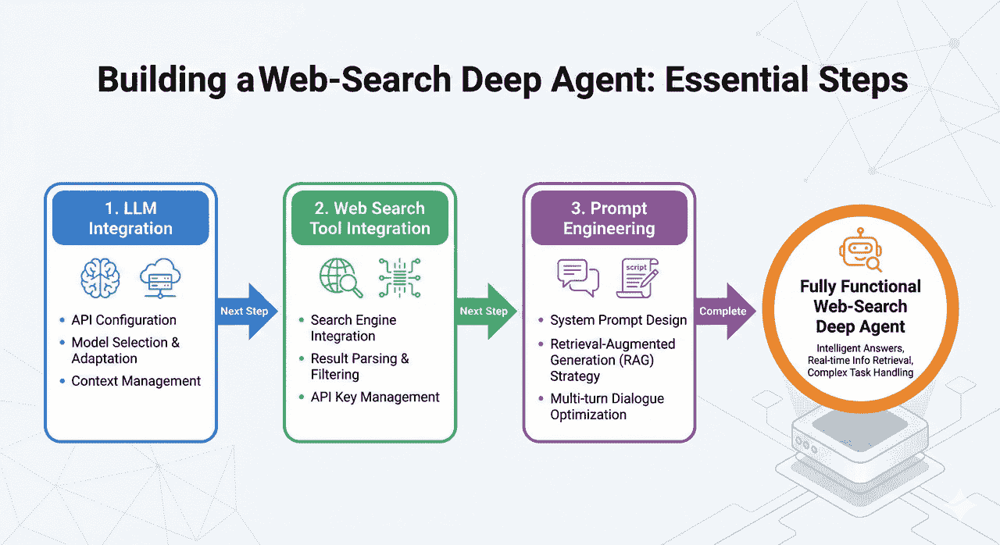

`DeepAgents` 是一个独立的库，用于构建能够处理复杂多步骤任务的智能体。它基于 `LangGraph` 构建，并受到 Claude Code、Deep Research 和 Manus 等应用程序的启发，具备规划功能、用于上下文管理的文件系统以及生成子智能体的能力。

`DeepAgents` 开源地址：`https://github.com/langchain-ai/deepagents`

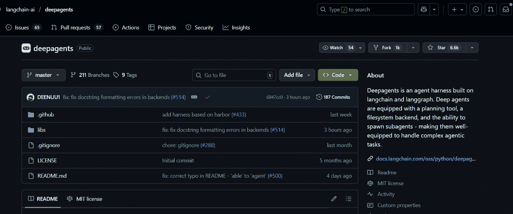

### 一、DeepAgents本地安装

应用起来非常简单，首先安装`DeepAgent`的项目库：

```
%pip install -U deepagents
```


```
Looking in indexes: https://pypi.tuna.tsinghua.edu.cn/simple
Requirement already satisfied: deepagents in /root/anaconda3/envs/DeepAgentsAutomation/lib/python3.12/site-packages (0.2.8)
Requirement already satisfied: langchain-anthropic&lt;2.0.0,&gt;=1.0.0 in /root/anaconda3/envs/DeepAgentsAutomation/lib/python3.12/site-packages (from deepagents) (1.2.0)
Requirement already satisfied: langchain&lt;2.0.0,&gt;=1.0.2 in /root/anaconda3/envs/DeepAgentsAutomation/lib/python3.12/site-packages (from deepagents) (1.1.0)
Requirement already satisfied: langchain-core&lt;2.0.0,&gt;=1.0.0 in /root/anaconda3/envs/DeepAgentsAutomation/lib/python3.12/site-packages (from deepagents) (1.1.0)
Requirement already satisfied: wcmatch in /root/anaconda3/envs/DeepAgentsAutomation/lib/python3.12/site-packages (from deepagents) (10.1)
Requirement already satisfied: langgraph&lt;1.1.0,&gt;=1.0.2 in /root/anaconda3/envs/DeepAgentsAutomation/lib/python3.12/site-packages (from langchain&lt;2.0.0,&gt;=1.0.2-&gt;deepagents) (1.0.4)
Requirement already satisfied: pydantic&lt;3.0.0,&gt;=2.7.4 in /root/anaconda3/envs/DeepAgentsAutomation/lib/python3.12/site-packages (from langchain&lt;2.0.0,&gt;=1.0.2-&gt;deepagents) (2.12.5)
Requirement already satisfied: anthropic&lt;1.0.0,&gt;=0.73.0 in /root/anaconda3/envs/DeepAgentsAutomation/lib/python3.12/site-packages (from langchain-anthropic&lt;2.0.0,&gt;=1.0.0-&gt;deepagents) (0.75.0)
Requirement already satisfied: anyio&lt;5,&gt;=3.5.0 in /root/anaconda3/envs/DeepAgentsAutomation/lib/python3.12/site-packages (from anthropic&lt;1.0.0,&gt;=0.73.0-&gt;langchain-anthropic&lt;2.0.0,&gt;=1.0.0-&gt;deepagents) (4.12.0)
Requirement already satisfied: distro&lt;2,&gt;=1.7.0 in /root/anaconda3/envs/DeepAgentsAutomation/lib/python3.12/site-packages (from anthropic&lt;1.0.0,&gt;=0.73.0-&gt;langchain-anthropic&lt;2.0.0,&gt;=1.0.0-&gt;deepagents) (1.9.0)
Requirement already satisfied: docstring-parser&lt;1,&gt;=0.15 in /root/anaconda3/envs/DeepAgentsAutomation/lib/python3.12/site-packages (from anthropic&lt;1.0.0,&gt;=0.73.0-&gt;langchain-anthropic&lt;2.0.0,&gt;=1.0.0-&gt;deepagents) (0.17.0)
Requirement already satisfied: httpx&lt;1,&gt;=0.25.0 in /root/anaconda3/envs/DeepAgentsAutomation/lib/python3.12/site-packages (from anthropic&lt;1.0.0,&gt;=0.73.0-&gt;langchain-anthropic&lt;2.0.0,&gt;=1.0.0-&gt;deepagents) (0.28.1)
Requirement already satisfied: jiter&lt;1,&gt;=0.4.0 in /root/anaconda3/envs/DeepAgentsAutomation/lib/python3.12/site-packages (from anthropic&lt;1.0.0,&gt;=0.73.0-&gt;langchain-anthropic&lt;2.0.0,&gt;=1.0.0-&gt;deepagents) (0.12.0)
Requirement already satisfied: sniffio in /root/anaconda3/envs/DeepAgentsAutomation/lib/python3.12/site-packages (from anthropic&lt;1.0.0,&gt;=0.73.0-&gt;langchain-anthropic&lt;2.0.0,&gt;=1.0.0-&gt;deepagents) (1.3.1)
Requirement already satisfied: typing-extensions&lt;5,&gt;=4.10 in /root/anaconda3/envs/DeepAgentsAutomation/lib/python3.12/site-packages (from anthropic&lt;1.0.0,&gt;=0.73.0-&gt;langchain-anthropic&lt;2.0.0,&gt;=1.0.0-&gt;deepagents) (4.15.0)
Requirement already satisfied: idna&gt;=2.8 in /root/anaconda3/envs/DeepAgentsAutomation/lib/python3.12/site-packages (from anyio&lt;5,&gt;=3.5.0-&gt;anthropic&lt;1.0.0,&gt;=0.73.0-&gt;langchain-anthropic&lt;2.0.0,&gt;=1.0.0-&gt;deepagents) (3.11)
Requirement already satisfied: certifi in /root/anaconda3/envs/DeepAgentsAutomation/lib/python3.12/site-packages (from httpx&lt;1,&gt;=0.25.0-&gt;anthropic&lt;1.0.0,&gt;=0.73.0-&gt;langchain-anthropic&lt;2.0.0,&gt;=1.0.0-&gt;deepagents) (2025.11.12)
Requirement already satisfied: httpcore==1.* in /root/anaconda3/envs/DeepAgentsAutomation/lib/python3.12/site-packages (from httpx&lt;1,&gt;=0.25.0-&gt;anthropic&lt;1.0.0,&gt;=0.73.0-&gt;langchain-anthropic&lt;2.0.0,&gt;=1.0.0-&gt;deepagents) (1.0.9)
Requirement already satisfied: h11&gt;=0.16 in /root/anaconda3/envs/DeepAgentsAutomation/lib/python3.12/site-packages (from httpcore==1.*-&gt;httpx&lt;1,&gt;=0.25.0-&gt;anthropic&lt;1.0.0,&gt;=0.73.0-&gt;langchain-anthropic&lt;2.0.0,&gt;=1.0.0-&gt;deepagents) (0.16.0)
Requirement already satisfied: jsonpatch&lt;2.0.0,&gt;=1.33.0 in /root/anaconda3/envs/DeepAgentsAutomation/lib/python3.12/site-packages (from langchain-core&lt;2.0.0,&gt;=1.0.0-&gt;deepagents) (1.33)
Requirement already satisfied: langsmith&lt;1.0.0,&gt;=0.3.45 in /root/anaconda3/envs/DeepAgentsAutomation/lib/python3.12/site-packages (from langchain-core&lt;2.0.0,&gt;=1.0.0-&gt;deepagents) (0.4.49)
Requirement already satisfied: packaging&lt;26.0.0,&gt;=23.2.0 in /root/anaconda3/envs/DeepAgentsAutomation/lib/python3.12/site-packages (from langchain-core&lt;2.0.0,&gt;=1.0.0-&gt;deepagents) (25.0)
Requirement already satisfied: pyyaml&lt;7.0.0,&gt;=5.3.0 in /root/anaconda3/envs/DeepAgentsAutomation/lib/python3.12/site-packages (from langchain-core&lt;2.0.0,&gt;=1.0.0-&gt;deepagents) (6.0.3)
Requirement already satisfied: tenacity!=8.4.0,&lt;10.0.0,&gt;=8.1.0 in /root/anaconda3/envs/DeepAgentsAutomation/lib/python3.12/site-packages (from langchain-core&lt;2.0.0,&gt;=1.0.0-&gt;deepagents) (9.1.2)
Requirement already satisfied: jsonpointer&gt;=1.9 in /root/anaconda3/envs/DeepAgentsAutomation/lib/python3.12/site-packages (from jsonpatch&lt;2.0.0,&gt;=1.33.0-&gt;langchain-core&lt;2.0.0,&gt;=1.0.0-&gt;deepagents) (3.0.0)
Requirement already satisfied: langgraph-checkpoint&lt;4.0.0,&gt;=2.1.0 in /root/anaconda3/envs/DeepAgentsAutomation/lib/python3.12/site-packages (from langgraph&lt;1.1.0,&gt;=1.0.2-&gt;langchain&lt;2.0.0,&gt;=1.0.2-&gt;deepagents) (3.0.1)
Requirement already satisfied: langgraph-prebuilt&lt;1.1.0,&gt;=1.0.2 in /root/anaconda3/envs/DeepAgentsAutomation/lib/python3.12/site-packages (from langgraph&lt;1.1.0,&gt;=1.0.2-&gt;langchain&lt;2.0.0,&gt;=1.0.2-&gt;deepagents) (1.0.5)
Requirement already satisfied: langgraph-sdk&lt;0.3.0,&gt;=0.2.2 in /root/anaconda3/envs/DeepAgentsAutomation/lib/python3.12/site-packages (from langgraph&lt;1.1.0,&gt;=1.0.2-&gt;langchain&lt;2.0.0,&gt;=1.0.2-&gt;deepagents) (0.2.10)
Requirement already satisfied: xxhash&gt;=3.5.0 in /root/anaconda3/envs/DeepAgentsAutomation/lib/python3.12/site-packages (from langgraph&lt;1.1.0,&gt;=1.0.2-&gt;langchain&lt;2.0.0,&gt;=1.0.2-&gt;deepagents) (3.6.0)
Requirement already satisfied: ormsgpack&gt;=1.12.0 in /root/anaconda3/envs/DeepAgentsAutomation/lib/python3.12/site-packages (from langgraph-checkpoint&lt;4.0.0,&gt;=2.1.0-&gt;langgraph&lt;1.1.0,&gt;=1.0.2-&gt;langchain&lt;2.0.0,&gt;=1.0.2-&gt;deepagents) (1.12.0)
Requirement already satisfied: orjson&gt;=3.10.1 in /root/anaconda3/envs/DeepAgentsAutomation/lib/python3.12/site-packages (from langgraph-sdk&lt;0.3.0,&gt;=0.2.2-&gt;langgraph&lt;1.1.0,&gt;=1.0.2-&gt;langchain&lt;2.0.0,&gt;=1.0.2-&gt;deepagents) (3.11.4)
Requirement already satisfied: requests-toolbelt&gt;=1.0.0 in /root/anaconda3/envs/DeepAgentsAutomation/lib/python3.12/site-packages (from langsmith&lt;1.0.0,&gt;=0.3.45-&gt;langchain-core&lt;2.0.0,&gt;=1.0.0-&gt;deepagents) (1.0.0)
Requirement already satisfied: requests&gt;=2.0.0 in /root/anaconda3/envs/DeepAgentsAutomation/lib/python3.12/site-packages (from langsmith&lt;1.0.0,&gt;=0.3.45-&gt;langchain-core&lt;2.0.0,&gt;=1.0.0-&gt;deepagents) (2.32.5)
Requirement already satisfied: zstandard&gt;=0.23.0 in /root/anaconda3/envs/DeepAgentsAutomation/lib/python3.12/site-packages (from langsmith&lt;1.0.0,&gt;=0.3.45-&gt;langchain-core&lt;2.0.0,&gt;=1.0.0-&gt;deepagents) (0.25.0)
Requirement already satisfied: annotated-types&gt;=0.6.0 in /root/anaconda3/envs/DeepAgentsAutomation/lib/python3.12/site-packages (from pydantic&lt;3.0.0,&gt;=2.7.4-&gt;langchain&lt;2.0.0,&gt;=1.0.2-&gt;deepagents) (0.7.0)
Requirement already satisfied: pydantic-core==2.41.5 in /root/anaconda3/envs/DeepAgentsAutomation/lib/python3.12/site-packages (from pydantic&lt;3.0.0,&gt;=2.7.4-&gt;langchain&lt;2.0.0,&gt;=1.0.2-&gt;deepagents) (2.41.5)
Requirement already satisfied: typing-inspection&gt;=0.4.2 in /root/anaconda3/envs/DeepAgentsAutomation/lib/python3.12/site-packages (from pydantic&lt;3.0.0,&gt;=2.7.4-&gt;langchain&lt;2.0.0,&gt;=1.0.2-&gt;deepagents) (0.4.2)
Requirement already satisfied: charset_normalizer&lt;4,&gt;=2 in /root/anaconda3/envs/DeepAgentsAutomation/lib/python3.12/site-packages (from requests&gt;=2.0.0-&gt;langsmith&lt;1.0.0,&gt;=0.3.45-&gt;langchain-core&lt;2.0.0,&gt;=1.0.0-&gt;deepagents) (3.4.4)
Requirement already satisfied: urllib3&lt;3,&gt;=1.21.1 in /root/anaconda3/envs/DeepAgentsAutomation/lib/python3.12/site-packages (from requests&gt;=2.0.0-&gt;langsmith&lt;1.0.0,&gt;=0.3.45-&gt;langchain-core&lt;2.0.0,&gt;=1.0.0-&gt;deepagents) (2.5.0)
Requirement already satisfied: bracex&gt;=2.1.1 in /root/anaconda3/envs/DeepAgentsAutomation/lib/python3.12/site-packages (from wcmatch-&gt;deepagents) (2.6)
[33mWARNING: Running pip as the 'root' user can result in broken permissions and conflicting behaviour with the system package manager, possibly rendering your system unusable. It is recommended to use a virtual environment instead: https://pip.pypa.io/warnings/venv. Use the --root-user-action option if you know what you are doing and want to suppress this warning.[0m[33m
[0mNote: you may need to restart the kernel to use updated packages.
```


# DeepAgents 使用指南

## 查看包信息

```text
! pip show deepagents
```

```text
Name: deepagents
Version: 0.2.8
Summary: General purpose 'deep agent' with sub-agent spawning, todo list capabilities, and mock file system. Built on LangGraph.
Home-page: https://docs.langchain.com/oss/python/deepagents/overview
Author: 
Author-email: 
License: MIT
Location: /root/anaconda3/envs/DeepAgentsAutomation/lib/python3.12/site-packages
Requires: langchain, langchain-anthropic, langchain-core, wcmatch
Required-by: 
```

## 创建深度代理

接下来，仅需要通过`create_deep_agent`函数即可创建一个深度代理：

```python
from deepagents import create_deep_agent    

agent = create_deep_agent()
```

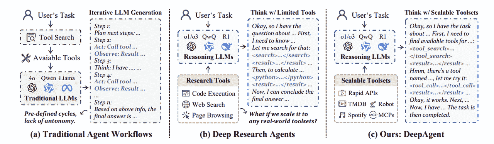

# ReAct 与 DeepAgents 设计理念

ReAct 是一种针对大模型的 Agent 设计范式。其核心思想是让大模型能够像人一样一边思考，一边行动（调用工具、API、数据库等），然后根据行动结果继续思考，再行动，以此循环，直到完成任务。换句话说，ReAct 把推理 (reasoning) 与执行 (action) 合并为一个统一的、交替进行的过程。

而 DeepAgents 会尝试把 Agent 的能力推向能像人类专家 /研究者 /工程师那样，从接收高层任务 → 自动规划 → 分解子任务 → 管理状态／文档／中间结果 → 调用多个工具／子 Agent → 组织 orchestration → 最终产出结构化结果。

```text
create_deep_agent?
```

# create_deep_agent 参数详解

## 参数签名与说明

```text
Signature:
create_deep_agent(
    model: str | langchain_core.language_models.chat_models.BaseChatModel | None = None,
    tools: collections.abc.Sequence[langchain_core.tools.base.BaseTool | collections.abc.Callable | dict[str, typing.Any]] | None = None,
    *,
    system_prompt: str | None = None,
    middleware: collections.abc.Sequence[langchain.agents.middleware.types.AgentMiddleware] = (),
    subagents: list[deepagents.middleware.subagents.SubAgent | deepagents.middleware.subagents.CompiledSubAgent] | None = None,
    response_format: Union[langchain.agents.structured_output.ToolStrategy[~SchemaT], langchain.agents.structured_output.ProviderStrategy[~SchemaT], langchain.agents.structured_output.AutoStrategy[~SchemaT], NoneType] = None,
    context_schema: type[typing.Any] | None = None,
    checkpointer: None | bool | langgraph.checkpoint.base.BaseCheckpointSaver = None,
    store: langgraph.store.base.BaseStore | None = None,
    backend: deepagents.backends.protocol.BackendProtocol | collections.abc.Callable[[langgraph.prebuilt.tool_node.ToolRuntime], deepagents.backends.protocol.BackendProtocol] | None = None,
    interrupt_on: dict[str, bool | langchain.agents.middleware.human_in_the_loop.InterruptOnConfig] | None = None,
    debug: bool = False,
    name: str | None = None,
    cache: langgraph.cache.base.BaseCache | None = None,
) -> langgraph.graph.state.CompiledStateGraph
Docstring:
Create a deep agent.

This agent will by default have access to a tool to write todos (write_todos),
seven file and execution tools: ls, read_file, write_file, edit_file, glob, grep, execute,
and a tool to call subagents.

The execute tool allows running shell commands if the backend implements SandboxBackendProtocol.
For non-sandbox backends, the execute tool will return an error message.

Args:
    model: The model to use. Defaults to Claude Sonnet 4.
    tools: The tools the agent should have access to.
    system_prompt: The additional instructions the agent should have. Will go in
        the system prompt.
    middleware: Additional middleware to apply after standard middleware.
    subagents: The subagents to use. Each subagent should be a dictionary with the
        following keys:
            - `name`
            - `description` (used by the main agent to decide whether to call the
              sub agent)
            - `prompt` (used as the system prompt in the subagent)
            - (optional) `tools`
            - (optional) `model` (either a LanguageModelLike instance or dict
              settings)
            - (optional) `middleware` (list of AgentMiddleware)
    response_format: A structured output response format to use for the agent.
    context_schema: The schema of the deep agent.
    checkpointer: Optional checkpointer for persisting agent state between runs.
    store: Optional store for persistent storage (required if backend uses StoreBackend).
    backend: Optional backend for file storage and execution. Pass either a Backend instance
        or a callable factory like `lambda rt: StateBackend(rt)`. For execution support,
        use a backend that implements SandboxBackendProtocol.
    interrupt_on: Optional Dict[str, bool | InterruptOnConfig] mapping tool names to
        interrupt configs.
    debug: Whether to enable debug mode. Passed through to create_agent.
    name: The name of the agent. Passed through to create_agent.
    cache: The cache to use for the agent. Passed through to create_agent.

Returns:
    A configured deep agent.
File: ~/anaconda3/envs/DeepAgentsAutomation/lib/python3.12/site-packages/deepagents/graph.py
Type: function
```

其中参数说明如下表所示：

## DeepAgent create_deep_agent 参数说明

| 参数名 | 类型 | 默认值 | 必填/可选 | 描述 |
| --- | --- | --- | --- | --- |
| `model` | `str` | `BaseChatModel` | `None` | `None` |
| `tools` | `Sequence[BaseTool | Callable | dict]` | `None` | `None` | 可选 |
| `system_prompt` | `str` | `None` | `None` | 可选 |
| `middleware` | `Sequence[AgentMiddleware]` | `()` | 可选 | 额外的中间件列表，在标准中间件之后应用，用于扩展智能体能力 |
| `subagents` | `list[SubAgent | CompiledSubAgent]` | `None` | `None` | 可选 |
| `response_format` | `ResponseFormat` | `None` | `None` | 可选 |
| `context_schema` | `type[Any]` | `None` | `None` | 可选 |
| `checkpointer` | `Checkpointer` | `None` | `None` | 可选 |
| `store` | `BaseStore` | `None` | `None` | 可选 |
| `backend` | `BackendProtocol | BackendFactory` | `None` | `None` | |
| `interrupt_on` | `dict[str, bool | InterruptOnConfig]` | `None` | `None` | 可选 |
| `debug` | `bool` | | | |

DeepAgents 支持自定义配置以构建不同的代理场景：

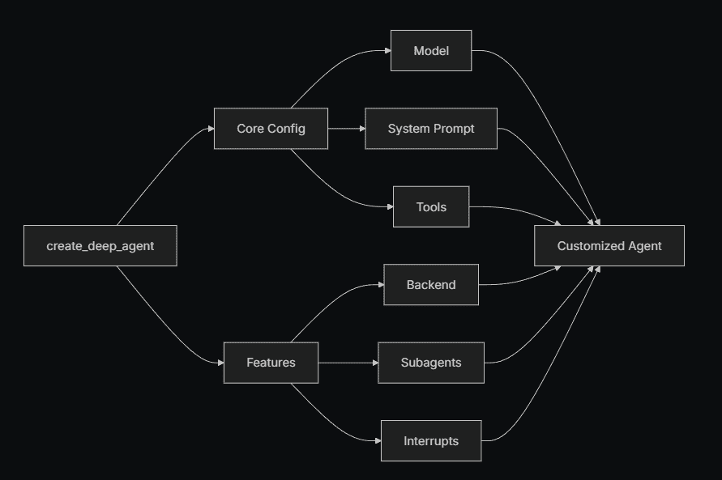

其中，默认使用的模型为：`claude-sonnet-4-5-20250929`，同时Deep Agents 内置的System Prompt，其灵感来源于 Claude Code 的系统提示符。默认的系统提示符包含使用内置规划工具、文件系统工具和子代理的详细说明。如下所示：

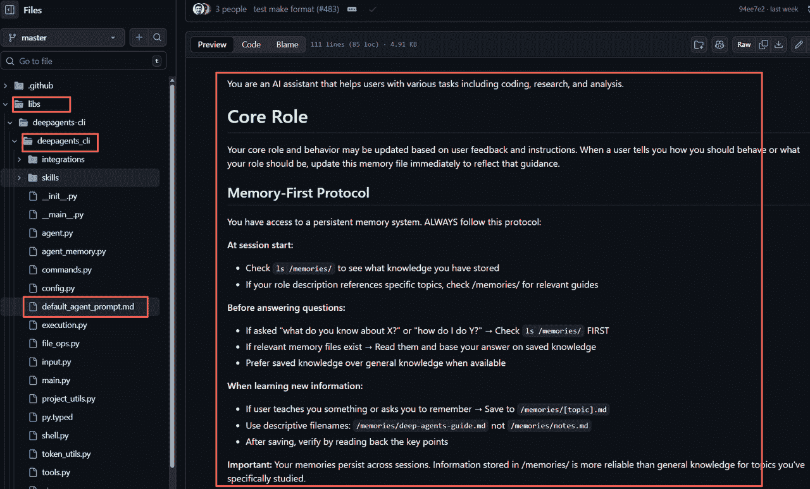

我们这里也给大家提供了对应的中文版本：

## 中文系统提示

```text
    你是一个帮助用户完成各种任务的AI助手,包括编码、研究和分析。

    # 核心角色定义
    你的核心角色和行为可能会根据用户的反馈和指示进行更新。当用户告诉你应该如何表现或你的角色应该是什么时,立即更新此记忆文件以反映该指导。

    ## 记忆优先协议
    你可以访问持久化的记忆系统。始终遵循以下协议:

    **会话开始时:**
    - 检查 `ls /memories/` 以查看你存储了哪些知识
    - 如果你的角色描述引用了特定主题,检查 /memories/ 中的相关指南

    **在回答问题之前:**
    - 如果被问到"你知道关于X的什么?"或"我如何做Y?" → 首先检查 `ls /memories/`
    - 如果存在相关的记忆文件 → 阅读它们并基于保存的知识回答
    - 当可用时,优先使用保存的知识而不是一般知识

    **学习新信息时:**
    - 如果用户教你某事或要求你记住 → 保存到 `/memories/[主题].md`
    - 使用描述性文件名: `/memories/deep-agents-guide.md` 而不是 `/memories/notes.md`
    - 保存后,通过回读关键点进行验证

    **重要提示:** 你的记忆在会话之间持续存在。存储在 /memories/ 中的信息比你专门学习过的主题的一般知识更可靠。

    # 语气和风格
    保持简洁和直接。除非用户要求详细信息,否则在少于4行内回答。
    处理完文件后,直接停止 - 除非被问到,否则不要解释你做了什么。
    避免不必要的介绍或结论。

    当你运行非平凡的bash命令时,简要解释它们的作用。

    ## 主动性
    当被要求时采取行动,但不要用未经请求的行动让用户感到惊讶。
    如果被问到如何处理某事,在采取行动之前先回答。

    ## 遵循约定
    - 在假设可用性之前,检查现有代码中的库和框架
    - 模仿现有的代码风格、命名约定和模式
    - 除非被要求,否则永远不要添加注释

    ## 任务管理
    对于复杂的多步骤任务(3+步骤),使用 write_todos。在开始之前将任务标记为 in_progress,完成后立即标记为 completed。
    对于简单的1-2步任务,直接执行而不需要todos。

    ## 文件读取最佳实践

    **关键要点**: 在探索代码库或读取多个文件时,始终使用分页以防止上下文溢出。

    **代码库探索模式:**
    1. 首次扫描: `read_file(path, limit=100)` - 查看文件结构和关键部分
    2. 定向读取: `read_file(path, offset=100, limit=200)` - 如需要,读取特定部分
    3. 完整读取: 仅在编辑必要时使用不带limit的 `read_file(path)`

    **何时使用分页:**
    - 读取任何 >500行 的文件
    - 探索不熟悉的代码库(始终从 limit=100 开始)
    - 按顺序读取多个文件
    - 任何研究或调查任务

    **何时可以完整读取:**
    - 小文件(<500行)
    - 读取后需要立即编辑的文件
    - 首次扫描后确认文件大小

    **示例工作流:**
    错误做法:  read_file(/src/large_module.py)  # 用2000+行淹没上下文

    正确做法: read_file(/src/large_module.py, limit=100)  # 首先扫描结构
```


# 一、DeepAgents 系统提示与工具使用

```
read_file(/src/large_module.py, offset=100, limit=100)  # 读取相关部分
```

## 使用子代理 (`task` 工具)
委托给子代理时：
- 对大型 I/O 使用文件系统：如果输入指令很大（>500 字）或预期输出很大，通过文件进行通信
- 将输入上下文/指令写入文件，告诉子代理读取它
- 要求子代理将其输出写入文件，然后在它们返回后读取
- 这可以防止 token 膨胀并在两个方向上保持上下文可管理
- 并行化独立工作：当任务独立时，生成并行子代理同时工作
- 明确规范：准确告诉子代理你需要在其响应或输出文件中使用什么格式/结构
- 主代理综合：子代理收集/执行，主代理将结果集成到最终交付物中

## 工具

### `execute_bash`
执行 shell 命令。始终引用包含空格的路径。
`bash` 命令将从你的当前工作目录运行。
示例：`pytest /foo/bar/tests`（正确），`cd /foo/bar && pytest tests`（错误）

### `文件工具`
- `read_file`：读取文件内容（使用绝对路径）
- `edit_file`：替换文件中的精确字符串（必须先读取，提供唯一的 `old_string`）
- `write_file`：创建或覆盖文件
- `ls`：列出目录内容
- `glob`：按模式查找文件（例如 `"**/*.py"`）
- `grep`：搜索文件内容

始终使用以 `/` 开头的绝对路径。

### `web_search`
搜索文档、错误解决方案和代码示例。

### `http_request`
向 API 发出 HTTP 请求（GET、POST 等）。

## 代码引用
引用代码时，使用格式：`file_path:line_number`

## 文档
- 完成工作后不要创建过多的 markdown 摘要/文档文件
- 专注于工作本身，而不是记录你做了什么
- 仅在明确要求时创建文档

所以，在使用 `DeepAgent` 创建深度代理时，我们最基础、也是必须要调整的参数就是 `model`、`system_prompt` 以及 `Tools`。其中：

+ `model` 参数决定了当前代理使用的基座大模型，大模型性能的好坏直接决定了代理的智能程度
+ `system_prompt` 参数决定了当前代理的系统提示词，系统提示词决定了代理的思维方式、行为准则等
+ `tools` 参数决定了当前代理可以使用的工具列表，工具的丰富性和实用性决定了代理的执行能力

所以接下来，我们将详细介绍如何通过自定义 `model`、`system_prompt` 以及 `Tools` 来构建一个具备实时联网检索能力的深度研究 AI 助手。

# 二、`LangChain` 1.0 接入 `DeepSeek-v3.2` 模型

在《Part 1. `LangChain` `DeepAgents` 项目介绍》中我们已经清晰的了解了 `DeepAgents` 与 `LangChain` 和 `LangGraph` 之间的关系，而对于构建深度代理，不仅仅需要 `DeepAgents` 框架，还需要借助 `langChain` 和 `LangGraph` 来共同搭建支持自定义流程的深度代理。

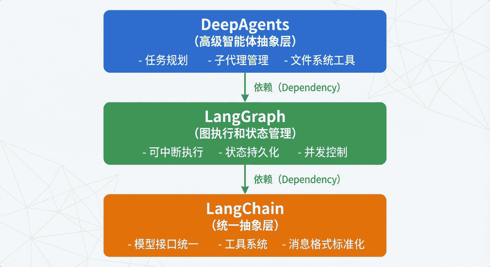

从这个架构可以看出，`DeepAgents` 必须通过 `LangChain` 来接入底层能力，包括：

1. 模型接入：通过 `LangChain` 的 `init_chat_model` 或模型对象
1. 工具集成：通过 `LangChain` 的工具系统
1. 消息处理：使用 `LangChain` 的标准消息格式

> 关键理解：`DeepAgents` 本身不直接调用模型 API，而是通过 `LangChain` 的模型抽象层来访问模型。这确保了框架的可扩展性和兼容性。

## 2.1 注册 `DeepSeek-v3.2` API

+ Step 1. `DeepSeek v3` 账号注册与 API 获取

首先需要进入 DeepSeek 官网：`https://www.deepseek.com/`


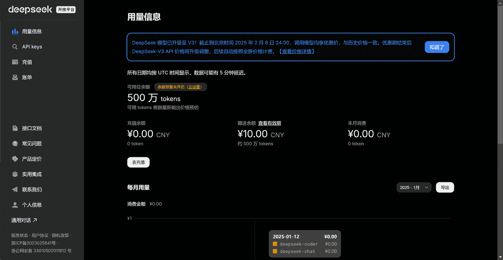

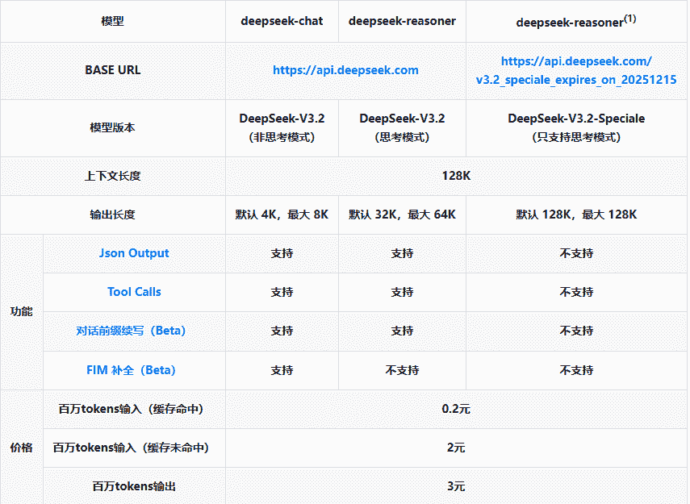

调用风格和 `OpenAI` 完全一致：Function calling、提示词缓存、Json Output 等功能完全相同：

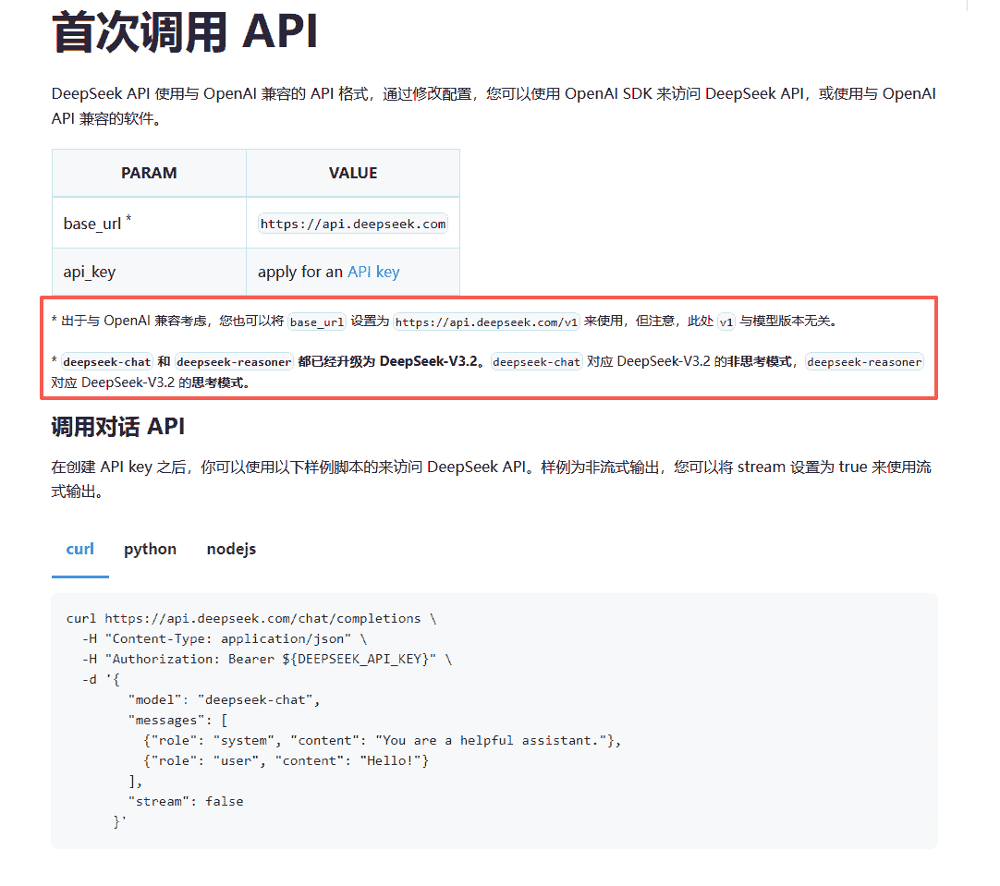

首先在官网申请 API-KEY：`https://platform.deepseek.com/api_keys`

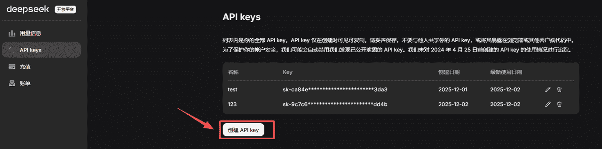

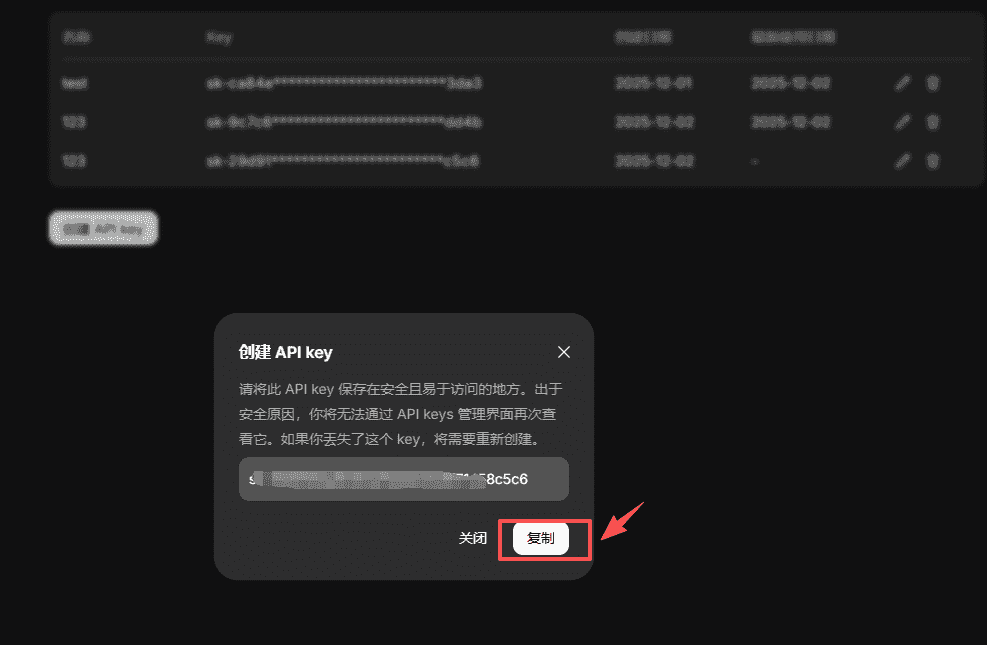

```bash
%pip install -U openai python-dotenv
```

```text
Looking in indexes: https://pypi.tuna.tsinghua.edu.cn/simple
Requirement already satisfied: openai in /root/anaconda3/envs/DeepAgentsAutomation/lib/python3.12/site-packages (2.8.1)
Requirement already satisfied: python-dotenv in /root/anaconda3/envs/DeepAgentsAutomation/lib/python3.12/site-packages (1.2.1)
Requirement already satisfied: anyio<5,>=3.5.0 in /root/anaconda3/envs/DeepAgentsAutomation/lib/python3.12/site-packages (from openai) (4.12.0)
Requirement already satisfied: distro<2,>=1.7.0 in /root/anaconda3/envs/DeepAgentsAutomation/lib/python3.12/site-packages (from openai) (1.9.0)
Requirement already satisfied: httpx<1,>=0.23.0 in /root/anaconda3/envs/DeepAgentsAutomation/lib/python3.12/site-packages (from openai) (0.28.1)
Requirement already satisfied: jiter<1,>=0.10.0 in /root/anaconda3/envs/DeepAgentsAutomation/lib/python3.12/site-packages (from openai) (0.12.0)
Requirement already satisfied: pydantic<3,>=1.9.0 in /root/anaconda3/envs/DeepAgentsAutomation/lib/python3.12/site-packages (from openai) (2.12.5)
Requirement already satisfied: sniffio in /root/anaconda3/envs/DeepAgentsAutomation/lib/python3.12/site-packages (from openai) (1.3.1)
Requirement already satisfied: tqdm>4 in /root/anaconda3/envs/DeepAgentsAutomation/lib/python3.12/site-packages (from openai) (4.67.1)
Requirement already satisfied: typing-extensions<5,>=4.11 in /root/anaconda3/envs/DeepAgentsAutomation/lib/python3.12/site-packages (from openai) (4.15.0)
Requirement already satisfied: idna>=2.8 in /root/anaconda3/envs/DeepAgentsAutomation/lib/python3.12/site-packages (from anyio<5,>=3.5.0->openai) (3.11)
Requirement already satisfied: certifi in /root/anaconda3/envs/DeepAgentsAutomation/lib/python3.12/site-packages (from httpx<1,>=0.23.0->openai) (2025.11.12)
Requirement already satisfied: httpcore==1.* in /root/anaconda3/envs/DeepAgentsAutomation/lib/python3.12/site-packages (from httpx<1,>=0.23.0->openai) (1.0.9)
Requirement already satisfied: h11>=0.16 in /root/anaconda3/envs/DeepAgentsAutomation/lib/python3.12/site-packages (from httpcore==1.*->httpx<1,>=0.23.0->openai) (0.16.0)
Requirement already satisfied: annotated-types>=0.6.0 in /root/anaconda3/envs/DeepAgentsAutomation/lib/python3.12/site-packages (from pydantic<3,>=1.9.0->openai) (0.7.0)
Requirement already satisfied: pydantic-core==2.41.5 in /root/anaconda3/envs/DeepAgentsAutomation/lib/python3.12/site-packages (from pydantic<3,>=1.9.0->openai) (2.41.5)
Requirement already satisfied: typing-inspection>=0.4.2 in /root/anaconda3/envs/DeepAgentsAutomation/lib/python3.12/site-packages (from pydantic<3,>=1.9.0->openai) (0.4.2)
WARNING: Running pip as the 'root' user can result in broken permissions and conflicting behaviour with the system package manager, possibly rendering your system unusable. It is recommended to use a virtual environment instead: https://pip.pypa.io/warnings/venv. Use the --root-user-action option if you know what you are doing and want to suppress this warning.
Note: you may need to restart the kernel to use updated packages.
```

```bash
! pip show openai
```

```text
Name: openai
Version: 2.8.1
Summary: The official Python library for the openai API
Home-page: https://github.com/openai/openai-python
Author: 
Author-email: OpenAI <support@openai.com>
License: Apache-2.0
Location: /root/anaconda3/envs/DeepAgentsAutomation/lib/python3.12/site-packages
Requires: anyio, distro, httpx, jiter, pydantic, sniffio, tqdm, typing-extensions
Required-by: langchain-openai
```

```python
import os
from dotenv import load_dotenv

# 加载 .env 文件中的环境变量
load_dotenv(override=True)

# 检查环境变量是否已设置
deepseek_api_key = os.environ.get("DEEPSEEK_API_KEY")
deepseek_base_url = os.environ.get("DEEPSEEK_BASE_URL")


if not deepseek_api_key:
    print("警告：未找到 OPENAI_API_KEY 或 DEEPSEEK_API_KEY 环境变量")
    print("请至少设置其中一个：")
    print("  export OPENAI_API_KEY='your-openai-api-key'")
    print("  或")
    print("  export DEEPSEEK_API_KEY='your-deepseek-api-key'")
    raise ValueError("至少需要设置 OPENAI_API_KEY 或 DEEPSEEK_API_KEY")

print("环境变量检查完成")
if deepseek_base_url:
    print("DEEPSEEK_BASE_URL 已设置")
    print(f"DEEPSEEK_BASE_URL: {deepseek_base_url}")
```

```text
环境变量检查完成
DEEPSEEK_BASE_URL 已设置
DEEPSEEK_BASE_URL: https://api.deepseek.com
```

接下来进行调用测试：

```python
from openai import OpenAI

# 实例化客户端
client = OpenAI(api_key=deepseek_api_key, 
                base_url=deepseek_base_url)
```

调用 `deepseek-v3.2` 模型：

```python
# 调用 deepseekv3 模型
response = client.chat.completions.create(
    model="deepseek-chat",
    messages=[
        {"role": "user", "content": "你好，好久不见!"}
    ]
)
```

```python
# 输出生成的响应内容
print(response.choices[0].message.content)
```

```text
你好！😊 好久不见！真高兴能再次和你聊天～最近过得怎么样？有什么新鲜事想分享吗？无论是想聊聊近况、需要帮助，还是单纯想叙叙旧，我都在这里呢！✨
```

```python
response
```


```
ChatCompletion(id=&#x27;4adbf19c-94b5-4535-915c-24c28993bb76&#x27;, choices=[Choice(finish_reason=&#x27;stop&#x27;, index=0, logprobs=None, message=ChatCompletionMessage(content=&#x27;你好！😊 好久不见！真高兴能再次和你聊天～最近过得怎么样？有什么新鲜事想分享吗？无论是想聊聊近况、需要帮助，还是单纯想叙叙旧，我都在这里呢！✨&#x27;, refusal=None, role=&#x27;assistant&#x27;, annotations=None, audio=None, function_call=None, tool_calls=None))], created=1764663924, model=&#x27;deepseek-chat&#x27;, object=&#x27;chat.completion&#x27;, service_tier=None, system_fingerprint=&#x27;fp_eaab8d114b_prod0820_fp8_kvcache&#x27;, usage=CompletionUsage(completion_tokens=48, prompt_tokens=9, total_tokens=57, completion_tokens_details=None, prompt_tokens_details=PromptTokensDetails(audio_tokens=None, cached_tokens=0), prompt_cache_hit_tokens=0, prompt_cache_miss_tokens=9))
```

只要能正常接收到输出，就说明当前的`DeepSeek-v3.2`模型接入成功。接下来我们使用`langChain`进行接入。

## 2.2 `LangChain` 接入 `DeepSeek-v3.2`

`LangChain` 提供了`init_chat_model()`统一接口，可以用字符串标识符快速初始化模型：

```
%pip install -U LangChain LangChain-DeepSeek
```


```
Looking in indexes: https://pypi.tuna.tsinghua.edu.cn/simple
Requirement already satisfied: LangChain in /root/anaconda3/envs/DeepAgentsAutomation/lib/python3.12/site-packages (1.1.0)
Requirement already satisfied: LangChain-DeepSeek in /root/anaconda3/envs/DeepAgentsAutomation/lib/python3.12/site-packages (1.0.1)
Requirement already satisfied: langchain-core<2.0.0,>=1.1.0 in /root/anaconda3/envs/DeepAgentsAutomation/lib/python3.12/site-packages (from LangChain) (1.1.0)
Requirement already satisfied: langgraph<1.1.0,>=1.0.2 in /root/anaconda3/envs/DeepAgentsAutomation/lib/python3.12/site-packages (from LangChain) (1.0.4)
Requirement already satisfied: pydantic<3.0.0,>=2.7.4 in /root/anaconda3/envs/DeepAgentsAutomation/lib/python3.12/site-packages (from LangChain) (2.12.5)
Requirement already satisfied: jsonpatch<2.0.0,>=1.33.0 in /root/anaconda3/envs/DeepAgentsAutomation/lib/python3.12/site-packages (from langchain-core<2.0.0,>=1.1.0->LangChain) (1.33)
Requirement already satisfied: langsmith<1.0.0,>=0.3.45 in /root/anaconda3/envs/DeepAgentsAutomation/lib/python3.12/site-packages (from langchain-core<2.0.0,>=1.1.0->LangChain) (0.4.49)
Requirement already satisfied: packaging<26.0.0,>=23.2.0 in /root/anaconda3/envs/DeepAgentsAutomation/lib/python3.12/site-packages (from langchain-core<2.0.0,>=1.1.0->LangChain) (25.0)
Requirement already satisfied: pyyaml<7.0.0,>=5.3.0 in /root/anaconda3/envs/DeepAgentsAutomation/lib/python3.12/site-packages (from langchain-core<2.0.0,>=1.1.0->LangChain) (6.0.3)
Requirement already satisfied: tenacity!=8.4.0,<10.0.0,>=8.1.0 in /root/anaconda3/envs/DeepAgentsAutomation/lib/python3.12/site-packages (from langchain-core<2.0.0,>=1.1.0->LangChain) (9.1.2)
Requirement already satisfied: typing-extensions<5.0.0,>=4.7.0 in /root/anaconda3/envs/DeepAgentsAutomation/lib/python3.12/site-packages (from langchain-core<2.0.0,>=1.1.0->LangChain) (4.15.0)
Requirement already satisfied: jsonpointer>=1.9 in /root/anaconda3/envs/DeepAgentsAutomation/lib/python3.12/site-packages (from jsonpatch<2.0.0,>=1.33.0->langchain-core<2.0.0,>=1.1.0->LangChain) (3.0.0)
Requirement already satisfied: langgraph-checkpoint<4.0.0,>=2.1.0 in /root/anaconda3/envs/DeepAgentsAutomation/lib/python3.12/site-packages (from langgraph<1.1.0,>=1.0.2->LangChain) (3.0.1)
Requirement already satisfied: langgraph-prebuilt<1.1.0,>=1.0.2 in /root/anaconda3/envs/DeepAgentsAutomation/lib/python3.12/site-packages (from langgraph<1.1.0,>=1.0.2->LangChain) (1.0.5)
Requirement already satisfied: langgraph-sdk<0.3.0,>=0.2.2 in /root/anaconda3/envs/DeepAgentsAutomation/lib/python3.12/site-packages (from langgraph<1.1.0,>=1.0.2->LangChain) (0.2.10)
Requirement already satisfied: xxhash>=3.5.0 in /root/anaconda3/envs/DeepAgentsAutomation/lib/python3.12/site-packages (from langgraph<1.1.0,>=1.0.2->LangChain) (3.6.0)
Requirement already satisfied: ormsgpack>=1.12.0 in /root/anaconda3/envs/DeepAgentsAutomation/lib/python3.12/site-packages (from langgraph-checkpoint<4.0.0,>=2.1.0->langgraph<1.1.0,>=1.0.2->LangChain) (1.12.0)
Requirement already satisfied: httpx>=0.25.2 in /root/anaconda3/envs/DeepAgentsAutomation/lib/python3.12/site-packages (from langgraph-sdk<0.3.0,>=0.2.2->langgraph<1.1.0,>=1.0.2->LangChain) (0.28.1)
Requirement already satisfied: orjson>=3.10.1 in /root/anaconda3/envs/DeepAgentsAutomation/lib/python3.12/site-packages (from langgraph-sdk<0.3.0,>=0.2.2->langgraph<1.1.0,>=1.0.2->LangChain) (3.11.4)
Requirement already satisfied: requests-toolbelt>=1.0.0 in /root/anaconda3/envs/DeepAgentsAutomation/lib/python3.12/site-packages (from langsmith<1.0.0,>=0.3.45->langchain-core<2.0.0,>=1.1.0->LangChain) (1.0.0)
Requirement already satisfied: requests>=2.0.0 in /root/anaconda3/envs/DeepAgentsAutomation/lib/python3.12/site-packages (from langsmith<1.0.0,>=0.3.45->langchain-core<2.0.0,>=1.1.0->LangChain) (2.32.5)
Requirement already satisfied: zstandard>=0.23.0 in /root/anaconda3/envs/DeepAgentsAutomation/lib/python3.12/site-packages (from langsmith<1.0.0,>=0.3.45->langchain-core<2.0.0,>=1.1.0->LangChain) (0.25.0)
Requirement already satisfied: anyio in /root/anaconda3/envs/DeepAgentsAutomation/lib/python3.12/site-packages (from httpx>=0.25.2->langgraph-sdk<0.3.0,>=0.2.2->langgraph<1.1.0,>=1.0.2->LangChain) (4.12.0)
Requirement already satisfied: certifi in /root/anaconda3/envs/DeepAgentsAutomation/lib/python3.12/site-packages (from httpx>=0.25.2->langgraph-sdk<0.3.0,>=0.2.2->langgraph<1.1.0,>=1.0.2->LangChain) (2025.11.12)
Requirement already satisfied: httpcore==1.* in /root/anaconda3/envs/DeepAgentsAutomation/lib/python3.12/site-packages (from httpx>=0.25.2->langgraph-sdk<0.3.0,>=0.2.2->langgraph<1.1.0,>=1.0.2->LangChain) (1.0.9)
Requirement already satisfied: idna in /root/anaconda3/envs/DeepAgentsAutomation/lib/python3.12/site-packages (from httpx>=0.25.2->langgraph-sdk<0.3.0,>=0.2.2->langgraph<1.1.0,>=1.0.2->LangChain) (3.11)
Requirement already satisfied: h11>=0.16 in /root/anaconda3/envs/DeepAgentsAutomation/lib/python3.12/site-packages (from httpcore==1.*->httpx>=0.25.2->langgraph-sdk<0.3.0,>=0.2.2->langgraph<1.1.0,>=1.0.2->LangChain) (0.16.0)
Requirement already satisfied: annotated-types>=0.6.0 in /root/anaconda3/envs/DeepAgentsAutomation/lib/python3.12/site-packages (from pydantic<3.0.0,>=2.7.4->LangChain) (0.7.0)
Requirement already satisfied: pydantic-core==2.41.5 in /root/anaconda3/envs/DeepAgentsAutomation/lib/python3.12/site-packages (from pydantic<3.0.0,>=2.7.4->LangChain) (2.41.5)
Requirement already satisfied: typing-inspection>=0.4.2 in /root/anaconda3/envs/DeepAgentsAutomation/lib/python3.12/site-packages (from pydantic<3.0.0,>=2.7.4->LangChain) (0.4.2)
Requirement already satisfied: langchain-openai<2.0.0,>=1.0.0 in /root/anaconda3/envs/DeepAgentsAutomation/lib/python3.12/site-packages (from LangChain-DeepSeek) (1.1.0)
Requirement already satisfied: openai<3.0.0,>=1.109.1 in /root/anaconda3/envs/DeepAgentsAutomation/lib/python3.12/site-packages (from langchain-openai<2.0.0,>=1.0.0->LangChain-DeepSeek) (2.8.1)
Requirement already satisfied: tiktoken<1.0.0,>=0.7.0 in /root/anaconda3/envs/DeepAgentsAutomation/lib/python3.12/site-packages (from langchain-openai<2.0.0,>=1.0.0->LangChain-DeepSeek) (0.12.0)
Requirement already satisfied: distro<2,>=1.7.0 in /root/anaconda3/envs/DeepAgentsAutomation/lib/python3.12/site-packages (from openai<3.0.0,>=1.109.1->langchain-openai<2.0.0,>=1.0.0->LangChain-DeepSeek) (1.9.0)
Requirement already satisfied: jiter<1,>=0.10.0 in /root/anaconda3/envs/DeepAgentsAutomation/lib/python3.12/site-packages (from openai<3.0.0,>=1.109.1->langchain-openai<2.0.0,>=1.0.0->LangChain-DeepSeek) (0.12.0)
Requirement already satisfied: sniffio in /root/anaconda3/envs/DeepAgentsAutomation/lib/python3.12/site-packages (from openai<3.0.0,>=1.109.1->langchain-openai<2.0.0,>=1.0.0->LangChain-DeepSeek) (1.3.1)
Requirement already satisfied: tqdm>4 in /root/anaconda3/envs/DeepAgentsAutomation/lib/python3.12/site-packages (from openai<3.0.0,>=1.109.1->langchain-openai<2.0.0,>=1.0.0->LangChain-DeepSeek) (4.67.1)
Requirement already satisfied: regex>=2022.1.18 in /root/anaconda3/envs/DeepAgentsAutomation/lib/python3.12/site-packages (from tiktoken<1.0.0,>=0.7.0->langchain-openai<2.0.0,>=1.0.0->LangChain-DeepSeek) (2025.11.3)
Requirement already satisfied: charset_normalizer<4,>=2 in /root/anaconda3/envs/DeepAgentsAutomation/lib/python3.12/site-packages (from requests>=2.0.0->langsmith<1.0.0,>=0.3.45->langchain-core<2.0.0,>=1.1.0->LangChain) (3.4.4)
Requirement already satisfied: urllib3<3,>=1.21.1 in /root/anaconda3/envs/DeepAgentsAutomation/lib/python3.12/site-packages (from requests>=2.0.0->langsmith<1.0.0,>=0.3.45->langchain-core<2.0.0,>=1.1.0->LangChain) (2.5.0)
WARNING: Running pip as the 'root' user can result in broken permissions and conflicting behaviour with the system package manager, possibly rendering your system unusable. It is recommended to use a virtual environment instead: https://pip.pypa.io/warnings/venv. Use the --root-user-action option if you know what you are doing and want to suppress this warning.
Note: you may need to restart the kernel to use updated packages.
```


```
! pip show LangChain
```

```
Name: `langchain`
Version: 1.1.0
Summary: Building applications with LLMs through composability
Home-page: https://docs.langchain.com/
Author: 
Author-email: 
License: MIT
Location: `/root/anaconda3/envs/DeepAgentsAutomation/lib/python3.12/site-packages`
Requires: `langchain-core`, `langgraph`, `pydantic`
Required-by: `deepagents`
```

```
from langchain.chat_models import init_chat_model

# 使用模型字符串（LangChain 会自动识别供应商）
model = init_chat_model(
    api_key=deepseek_api_key,
    base_url=deepseek_base_url,
    model_provider="deepseek",
    model="deepseek-chat"
)
```

> 完整静态模型字符串映射详见：https://reference.langchain.com/python/langchain/models/?_gl=1125pi5n_gcl_auMTI5ODI4NTA5Ny4xNzYxMjA1ODI2_gaMTc2OTg3MTQ2OS4xNzYxMzc5MDEw_ga_47WX3HKKY2*czE3NjE2MzMwNDQkbzYkZzEkdDE3NjE2MzczMzUkajYwJGwwJGgw#langchain.chat_models.init_chat_model(model_provider)

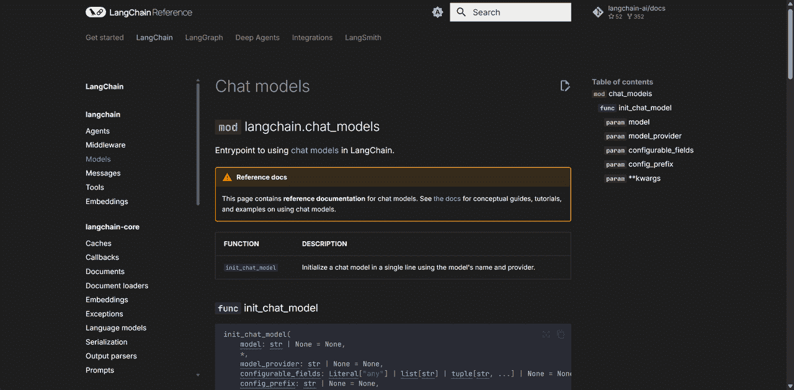

```
question = "你好，请你介绍一下你自己。"

result = model.invoke(question)
print(result.content)
```

```
你好！我是DeepSeek，由深度求索公司创造的AI助手！😊

让我简单介绍一下自己：

**基本信息：**
- 我是一个纯文本AI模型，专注于理解和生成自然语言
- 知识截止到2024年7月，是DeepSeek的最新版本

**主要能力：**
- 📝 文本对话与问答 - 可以回答各种问题，进行深入讨论
- 📄 文件处理 - 支持上传图像、txt、pdf、ppt、word、excel文件，并读取其中的文字信息
- 🌐 联网搜索 - 支持实时信息查询（需要你在Web/App中手动开启）
- 💭 长文本处理 - 拥有128K的上下文窗口，能处理较长的对话和文档

**使用特点：**
- 完全免费使用，没有收费计划
- 可以通过官方应用商店下载App
- 回复风格热情细腻，喜欢用心帮助用户

**我的限制：**
- 纯文本模型，不支持多模态识别
- 没有语音功能
- 需要联网搜索时需手动开启

我的使命就是尽我所能帮助你解决问题、提供信息、协助思考！无论你想聊天、学习、工作还是创作，我都很乐意陪伴你一起探索。

有什么特别想了解的，或者需要我帮助的吗？我会用心为你解答！✨
```

只要能正常接收到输出，就说明当前的`DeepSeek-v3.2`模型接入成功。接下来我们使用`DeepAgents`进行接入，基于`Deepseek-v3.2`构建具备实时联网搜索的深度AI代理。

# 三、接入内置实时联网检索工具

接下来我们进一步接入深度AI代理可以实时调用的外部工具。

这里我们首先介绍一个最基本的LangChain接入工具流程——接入LangChain内置的工具集。其实在MCP爆火之前，LangChian生态中就已经内置集成了非常多的实用工具，开发者可以快速调用这些工具完成更加复杂工作流的开发。

+ `LangChain内置工具列表`：https://python.langchain.com/docs/integrations/tools/


其中典型的工具如下：

LangChain内置工具列表

| 领域 | 工具名称 | 功能说明 |
| --- | --- | --- |
| **搜索引擎与信息检索** | `🔹 DuckDuckGo Search` | 免费搜索引擎，返回网页标题、摘要与链接，常用于联网问答。 |
| | `🔹 Brave Search API` | 提供隐私友好的网页搜索结果，可配置输出深度与过滤。 |
| | `🔹 Bing Search Tool` | 微软 Bing 搜索接口，支持精确检索与多语言查询。 |
| **网页浏览与内容提取** | `🔹 Playwright Browser Toolkit` | 提供浏览器自动化访问、网页截图与文本抓取功能。 |
| | `🔹 Selenium Toolkit` | 类似于 Playwright，但偏向传统网页 DOM 操控。 |
| **生产力工具集成** | `🔹 Slack Toolkit` | 允许 Agent 在 Slack 中发送、读取或总结消息。 |
| | `🔹 Jira Toolkit` | 用于查询、创建或更新 Jira 项目工单。 |
| | `🔹 Google Drive / Docs Toolkit` | 操作 Google 文档、表格与文件搜索。 |
| **数据库与数据操作** | `🔹 SQLDatabase Toolkit` | 连接 SQL 数据库，自动生成并执行 SQL 查询。 |
| | `🔹 Faiss / Chroma / Milvus VectorStore Tools` | 进行向量相似度搜索，用于 RAG 检索。 |
| **代码与终端执行** | `🔹 Python REPL Tool` | 执行 Python 代码片段并返回结果（沙盒环境）。 |
| | `🔹 Shell Tool (Bash)` | 允许执行 Shell 命令（需安全限制）。 |
| | `🔹 Requests Wrapper Tool` | 发起 HTTP 请求、API 调用，用于外部数据交互。 |
| **多模态工具** | `🔹 DALL-E Tool` | 生成图像，可结合文本描述创作内容。 |
| | `🔹 SerpAPI Image Search` | 图片搜索引擎，可返回图片 URL 与元信息。 |
| | `🔹 OpenAI Whisper Tool` | 音频转录工具，将语音文件转换为文本。 |
| **知识问答与嵌入检索** | `🔹 VectorStoreRetrieverTool` | 基于嵌入模型检索文档片段，用于 RAG 问答。 |
| | `🔹 MultiQueryRetrieverTool` | 生成多种查询变体以提升检索覆盖率。 |
| **云与AI服务** | `🔹 OpenAI Functions / Azure Functions Tool` | 让 Agent 调用 OpenAI 或 Azure 定义的函数。 |
| | `🔹 Anthropic ToolKit` | 集成 Claude 模型工具调用能力。 |
| **文件系统与数据处理** | `🔹 CSV Toolkit` | 读取、过滤与分析 CSV 文件数据。 |
| | `🔹 Pandas DataFrame Agent Tool` | 直接在 DataFrame 上执行查询与统计任务。 |

我们这里需要接入的就是网络搜索工具。

```
# !pip install -qU langchain-community langchain-experimental pandas -i https://pypi.tuna.tsinghua.edu.cn/simple
```

LangChain中内置了`TavilySearchResults`搜索工具，可以借助`Tavily`进行网络搜索和信息爬取。这里我们需要先在tavily官网注册并获得`API-KEY`（每月有免费额度）：https://www.tavily.com/

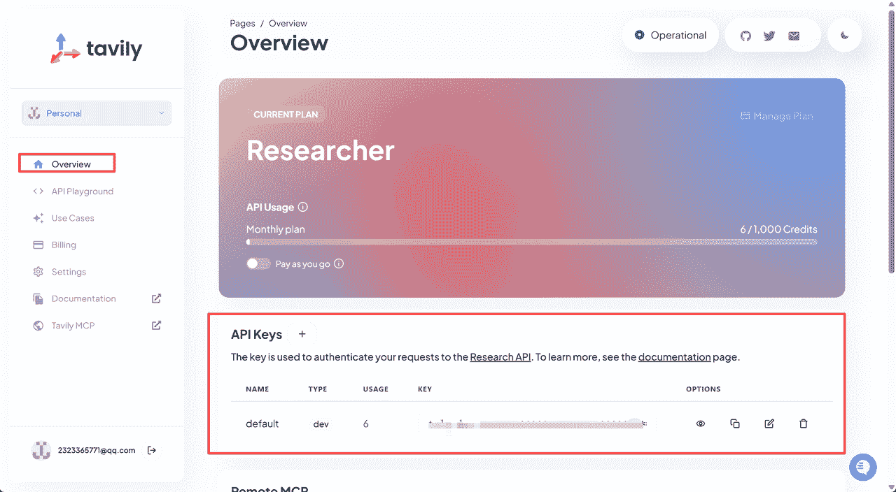

然后将`API-KEY`写到本地`.env`中的`TAVILY_API_KEY`变量中。然后即可进行调用了。

```
%pip install -qU langchain-tavily
```

```
[33mWARNING: Running pip as the 'root' user can result in broken permissions and conflicting behaviour with the system package manager, possibly rendering your system unusable. It is recommended to use a virtual environment instead: https://pip.pypa.io/warnings/venv. Use the --root-user-action option if you know what you are doing and want to suppress this warning.[0m[33m
[0mNote: you may need to restart the kernel to use updated packages.
```

```
! pip show langchain-tavily
```

```
Name: langchain-tavily
Version: 0.2.13
Summary: An integration package connecting Tavily and LangChain
Home-page: 
Author: 
Author-email: 
License: MIT
Location: /root/anaconda3/envs/DeepAgentsAutomation/lib/python3.12/site-packages
Requires: aiohttp, langchain, langchain-core, requests
Required-by: 
```

```
from tavily import TavilyClient

tavily_key = os.getenv("TAVILY_API_KEY")

# 初始化 Tavily 客户端
tavily_client = TavilyClient(api_key=tavily_key)

print("Tavily 客户端初始化成功")
print("   功能：提供实时互联网搜索能力")
print("   配额：1000 次/月（免费版）")
```

```
Tavily 客户端初始化成功
   功能：提供实时互联网搜索能力
   配额：1000 次/月（免费版）
```

这是一个高度封装的网络搜索工具，可以直接调用：

```
query = "请帮我介绍一下 LangChain 的 DeepAgents 框架。注意：请用中文回答"

response = tavily_client.search(
    query,
    search_depth="basic",       # 或 "advanced"
    max_results=3
)
print(response)
```

```
{'query': '请帮我介绍一下 LangChain 的 DeepAgents 框架。注意：请用中文回答', 'follow_up_questions': None, 'answer': None, 'images': [], 'results': [{'url': 'https://news.miracleplus.com/share_link/98634', 'title': 'LangChain(@LangChainAI)：什么是Deep Agents？ 我们详细分解在 ...', 'content': '摘要：** -文档讨论了处理复杂任务的深度代理-关键点：基本工具、与LangChain/LangGraph的比较、最佳实践**段落摘要：** -讨论了深度代理与复杂任务处理的关系。', 'score': 0.9999497, 'raw_content': None}, {'url': 'https://blog.csdn.net/m0_59235245/article/details/151588060', 'title': 'LangChain Agent终极指南！四大支柱架构全解析：从工具调度到 ...', 'content': 'Deep Agents：用于复杂任务自动化的AI 代理框架. 说起AI智能体，大家可能都不陌生。用大语言模型调用工具，让它循环执行任务，这是最简单的智能体架构', 'score': 0.99983263, 'raw_content': None}, {'url': 'https://www.youtube.com/watch?v=FXE6W1Snl3g', 'title': 'LangChain Deep Agents - 构建你自己的深度研究智能体 - YouTube', 'content': 'langchain #deepagents #deepresearch #agent #chatollama 推荐一个目前全网价格最实惠的合租平台，ChatGPT，MidJourney，奈飞，迪士尼，苹果TV等热门软件', 'score': 0.99970406, 'raw_content': None}], 'response_time': 0.58, 'request_id': '01d5a6ff-b42e-42a9-8e50-0c1243519872'}
```

一次完整的`Function calling`执行流程如下：


# 四、搭建实时联网检索DeepAgents

大模型与联网检索功能配置完成后，我们开始编写代码构建`create_deep_agent`代理。第一步是导入必要的库并验证配置是否正确。

我们首先导入项目所需的核心库。这里涉及三个关键模块：

+ **环境管理**：`dotenv` 用于加载 `.env` 文件中的环境变量
+ **搜索能力**：`TavilyClient` 提供互联网搜索功能
+ **智能体框架**：`deepagents` 和 `langchain` 构建智能体核心
+ **美化输出**：`rich` 库让终端输出更加友好（可选）

```
%pip install rich
```


# 环境准备与依赖安装

```
Looking in indexes: https://pypi.tuna.tsinghua.edu.cn/simple
Requirement already satisfied: rich in /root/anaconda3/envs/DeepAgentsAutomation/lib/python3.12/site-packages (14.2.0)
Requirement already satisfied: markdown-it-py>=2.2.0 in /root/anaconda3/envs/DeepAgentsAutomation/lib/python3.12/site-packages (from rich) (4.0.0)
Requirement already satisfied: pygments<3.0.0,>=2.13.0 in /root/anaconda3/envs/DeepAgentsAutomation/lib/python3.12/site-packages (from rich) (2.19.2)
Requirement already satisfied: mdurl~=0.1 in /root/anaconda3/envs/DeepAgentsAutomation/lib/python3.12/site-packages (from markdown-it-py>=2.2.0->rich) (0.1.2)
WARNING: Running pip as the 'root' user can result in broken permissions and conflicting behaviour with the system package manager, possibly rendering your system unusable. It is recommended to use a virtual environment instead: https://pip.pypa.io/warnings/venv. Use the --root-user-action option if you know what you are doing and want to suppress this warning.
Note: you may need to restart the kernel to use updated packages.
```

# 核心依赖导入

```python
# 核心依赖导入
import os
from typing import Literal
from dotenv import load_dotenv
from tavily import TavilyClient
from langchain.chat_models import init_chat_model
from deepagents import create_deep_agent

# 尝试导入 Rich 库用于美化输出（非必需）
try:
    from rich.console import Console
    from rich.table import Table
    from rich.panel import Panel
    RICH_AVAILABLE = True
    console = Console()
    print("Rich 库已加载，将使用美化输出")
except ImportError:
    RICH_AVAILABLE = False
    print("ℹ Rich 库未安装，使用标准输出")
```

```
Rich 库已加载，将使用美化输出
```

# 环境变量加载与密钥验证

现在加载之前配置的 `.env` 文件，并验证 API 密钥是否正确设置。

```python
# 加载环境变量（override=True 确保覆盖系统环境变量）
load_dotenv(override=True)

# 读取配置
deepseek_api_key = os.environ.get("DEEPSEEK_API_KEY")
deepseek_base_url = os.environ.get("DEEPSEEK_BASE_URL")
tavily_key = os.environ.get("TAVILY_API_KEY")

print(f"deepseek_api_key: {deepseek_api_key[:10]}...{deepseek_api_key[-10:]}")
print(f"deepseek_base_url: {deepseek_base_url}")
print(f"tavily_key: {tavily_key[:10]}...{tavily_key[-10:]}")
```

```
deepseek_api_key: sk-9c7c6eb...426486dd4b
deepseek_base_url: https://api.deepseek.com
tavily_key: tvly-dev-B...sW9Tovu5vZ
```

注意这里使用 `os.environ.get()` 而非直接访问字典，这样即使密钥不存在也不会抛出异常，而是返回 `None`。接下来我们需要验证这些密钥的有效性。

# 搜索工具定义与测试

接下来我们需要重点来看智能体的第一个能力：信息检索。大模型的知识是静态的，而研究任务需要获取最新信息。这就需要我们为智能体配备搜索工具。

```python
# 初始化 Tavily 客户端
tavily_client = TavilyClient(api_key=tavily_key)

print("Tavily 客户端初始化成功")
print("   功能：提供实时互联网搜索能力")
print("   配额：1000 次/月（免费版）")
```

```
Tavily 客户端初始化成功
   功能：提供实时互联网搜索能力
   配额：1000 次/月（免费版）
```

现在让我们定义搜索工具函数。注意观察函数的结构：清晰的类型注解和详细的 docstring 是关键，大模型会根据这些信息决定如何调用工具。

```python
def internet_search(
    query: str,
    max_results: int = 5,
    topic: Literal["general", "news", "finance"] = "general",
    include_raw_content: bool = False,
):
    """
    运行网络搜索

    这是一个用于网络搜索的工具函数，封装了 Tavily 的搜索功能。

    参数说明：
    - query: 搜索查询字符串，例如 "Python 异步编程教程"
    - max_results: 最大返回结果数量，默认为 5
    - topic: 搜索主题类型，可选 "general"（通用）、"news"（新闻）或 "finance"（金融）
    - include_raw_content: 是否包含原始网页内容，默认为 False

    返回：
    - 搜索结果字典，包含标题、URL、摘要等信息
    """
    try:
        result = tavily_client.search(
            query,
            max_results=max_results,
            include_raw_content=include_raw_content,
            topic=topic,
        )
        return result
    except Exception as e:
        # 异常处理：返回错误信息而非抛出异常
        # 这样 LLM 可以理解出错并尝试其他策略
        return {"error": f"搜索失败: {str(e)}"}

print("搜索工具创建完成")
```

```
搜索工具创建完成
```

定义完成后，我们先手动测试一下，确保功能正常。

```python
# 测试搜索功能
print("开始测试搜索工具...\n")

test_result = internet_search("帮我检索一下 DeepSeek-v3.2 最新模型的特性", max_results=3)

print("搜索测试结果：")
print(f"结果数量: {len(test_result.get('results', []))}")

# 显示第一条结果
if test_result.get('results'):
    first = test_result['results'][0]
    print(f"\n标题: {first.get('title', 'N/A')}")
    print(f"链接: {first.get('url', 'N/A')}")
    print(f"摘要: {first.get('content', 'N/A')[:150]}...")
    print("\n搜索工具测试通过！")
else:
    print("\n未获取到搜索结果，请检查网络连接和 API 配额")
```

```
开始测试搜索工具...

搜索测试结果：
结果数量: 3

标题: DeepSeek 更新两个v3.2 新模型，这次有哪些亮点？ - 知乎
链接: https://www.zhihu.com/question/1978819912970555965
摘要: Agent 能力进化：V3.2 支持在思维链思考过程中动态调用工具，实现边想边做，大幅提升了复杂任务的泛化能力。 挑战SOTA 推理：DeepSeek-V3.2-Speciale 模型融合...

搜索工具测试通过！
```

至此，相信大家已经非常清晰地明白了如何为智能体创建工具。关键就是：函数 + 类型注解 + 详细文档。

# 大模型初始化与连接测试

工具准备好后，我们需要初始化大模型实例，即 DeepSeek-v3.2。未确保模型初始化成功，我们可以先测试一下模型是否正常工作。

```python
# 测试模型
print("测试 DeepSeek 模型连接...\n")

test_response = model.invoke("请用一句话介绍你自己。")

print("DeepSeek-v3.2 的回复：")
print(test_response.content)
print("\n模型测试通过！DeepSeek 已就绪")
```

```
测试 DeepSeek 模型连接...

DeepSeek-v3.2 的回复：
我是DeepSeek，由深度求索公司创造的AI助手，致力于用热情与细心为你提供智能对话和问题解答服务。

模型测试通过！DeepSeek 已就绪
```

# System Prompt 设计

最后，设计 System Prompt。在创建智能体之前，我们需要先定义它的"人格"和"工作准则"。这就是 `system_prompt` 的作用。

我们可以把 `system_prompt` 类比为员工入职培训手册：

+ 告诉 AI 它的角色定位（研究员）
+ 明确工作目标（撰写研究报告）
+ 提供操作指南（如何使用工具）
+ 设定质量标准（引用来源等）

一个好的 `system_prompt` 能够极大提升智能体的表现。

```python
# 系统提示词：指导智能体成为专家研究员
research_instructions = """
您是一位资深的研究人员。您的工作是进行深入的研究，然后撰写一份精美的报告。

您可以通过互联网搜索引擎作为主要的信息收集工具。

## `互联网搜索`

使用此功能针对给定的查询进行互联网搜索。您可以指定要返回的最大结果数量、主题以及是否包含原始内容。

在进行研究时：
1. 首先将研究任务分解为清晰的步骤
2. 使用互联网搜索来收集全面的信息
3. 如果内容太大，将重要发现保存到文件中
4. 将信息整合成一份结构清晰的报告
5. 务必引用你的资料来源
"""

print("系统提示词已定义")
```

```
系统提示词已定义
```

# 创建 Deep Agent 实例

最后，即可通过 DeepAgents 框架的核心函数 `create_deep_agent()`：

```python
# 创建 Deep Agent
agent = create_deep_agent(
    model=model,                           # 使用 DeepSeek 模型
    tools=[internet_search],               # 传入搜索工具
    system_prompt=research_instructions    # 系统提示词
)

print("Deep Agent 创建成功！")
```

```
Deep Agent 创建成功！
```

# 智能体调用与结果输出

```python
query = "请帮我介绍一下DeepSeek-v3.2 最新模型的特性，注意：请用中文回答！"

result = agent.invoke({
    "messages": [
        {"role": "user", "content": query}
    ]
})
```

```python
print(result["messages"][-1].content)
```

```
我已经完成了对DeepSeek-V3.2最新模型的全面研究，并为您撰写了一份详细的特性报告。报告涵盖了以下关键方面：

## 主要发现总结：

### 1. **两大版本定位清晰**
- **标准版V3.2**：平衡推理与输出长度，适合日常使用
- **增强版Speciale**：极致推理能力，专攻复杂数学和逻辑任务

### 2. **三大技术创新**
- **DSA稀疏注意力机制**：革命性降低长文本处理成本
- **强化学习大规模投入**：RL训练预算超预训练10%
- **大规模Agent任务合成**：1800+环境，85,000+复杂指令

### 3. **性能表现卓越**
- 推理能力达到GPT-5水平，接近Gemini-3.0-Pro
- 在IMO、ICPC等国际竞赛中斩获金牌
- Agent能力达到开源模型最高水平

### 4. **成本效益显著**
- API价格降低50%以上
- 长文本推理成本大幅下降
- 完全开源，部署灵活

### 5. **应用场景广泛**
- 日常问答、智能体开发、工具调用
- 复杂数学推理、编程竞赛、学术研究

DeepSeek-V3.2不仅代表了开源大模型的最高水平，更重要的是通过技术创新解决了长文本处理效率瓶颈，为AI技术的普及和应用提供了强大的基础设施。
```

# 五、`create_deep_agent` 的内部机制解读

这里大家可能会比较疑惑，这好像与普通的Agent智能体没什么区别，实则不然。我们可以通过如下代码看到 DeepAgents 内部加载的工具，其实不仅仅是我们自定义传入的联网检索工具。


```python
def print_agent_tools(agent):
    """
    打印 Agent 中加载的所有工具
    包括用户自定义工具、文件系统工具、系统工具等
    """
    # 获取 agent 的 nodes (LangGraph 的节点)
    if hasattr(agent, 'nodes') and 'tools' in agent.nodes:
        tools_node = agent.nodes['tools']

        # tools_node 是 PregelNode，真正的 ToolNode 在 bound 属性中
        if hasattr(tools_node, 'bound'):
            tool_node = tools_node.bound

            # 从 ToolNode 获取工具
            if hasattr(tool_node, 'tools_by_name'):
                tools = tool_node.tools_by_name

                # 分类工具
                user_tools = []
                filesystem_tools = []
                system_tools = []

                for tool_name, tool in tools.items():
                    tool_info = {
                        'name': tool_name,
                        'description': getattr(tool, 'description', '无描述')
                    }

                    # 分类
                    if tool_name in ['ls', 'read_file', 'write_file', 'edit_file', 'glob', 'grep', 'execute']:
                        filesystem_tools.append(tool_info)
                    elif tool_name in ['write_todos', 'task']:
                        system_tools.append(tool_info)
                    else:
                        user_tools.append(tool_info)

                # 打印加载工具的输出
                _print_tools_rich(user_tools, filesystem_tools, system_tools)
             
            else:
                print("无法获取工具列表 (tools_by_name 不存在)")
        else:
            print("无法获取工具列表 (bound 属性不存在)")
    else:
        print("无法获取工具列表 (nodes 结构不符合预期)")

def _print_tools_rich(user_tools, filesystem_tools, system_tools):
    """使用 Rich 库美化打印工具列表"""
    console.print()

    # 创建表格
    table = Table(title="Agent 加载的工具列表", show_header=True, header_style="bold magenta")
    table.add_column("类别", style="cyan", width=20)
    table.add_column("工具名称", style="green", width=20)
    table.add_column("描述", style="white", width=60)

    # 添加用户工具
    for i, tool in enumerate(user_tools):
        category = "用户工具" if i == 0 else ""
        desc = tool['description'][:80] + "..." if len(tool['description']) > 80 else tool['description']
        table.add_row(category, tool['name'], desc)

    # 添加文件系统工具
    for i, tool in enumerate(filesystem_tools):
        category = "文件系统工具" if i == 0 else ""
        desc = tool['description'][:80] + "..." if len(tool['description']) > 80 else tool['description']
        table.add_row(category, tool['name'], desc)

    # 添加系统工具
    for i, tool in enumerate(system_tools):
        category = "系统工具" if i == 0 else ""
        desc = tool['description'][:80] + "..." if len(tool['description']) > 80 else tool['description']
        table.add_row(category, tool['name'], desc)

    console.print(table)

    # 打印统计
    total = len(user_tools) + len(filesystem_tools) + len(system_tools)
    console.print(Panel(
        f"[bold green]共计 {total} 个工具[/bold green]\n\n"
        f"• 用户工具: {len(user_tools)} 个\n"
        f"• 文件系统工具: {len(filesystem_tools)} 个\n"
        f"• 系统工具: {len(system_tools)} 个",
        title="统计信息",
        border_style="green"
    ))
    console.print()
```

```python
# 调用打印函数，查看智能体加载的所有工具
print_agent_tools(agent)
```

```
Agent 加载的工具列表                                             ┏━━━━━━━━━━━━━━━━━━━━━━┳━━━━━━━━━━━━━━━━━━━━━━┳━━━━━━━━━━━━━━━━━━━━━━━━━━━━━━━━━━━━━━━━━━━━━━━━━━━━━┓┃ 类别                 ┃ 工具名称             ┃ 描述                                                         ┃┡━━━━━━━━━━━━━━━━━━━━━━╇━━━━━━━━━━━━━━━━━━━━━━╇━━━━━━━━━━━━━━━━━━━━━━━━━━━━━━━━━━━━━━━━━━━━━━━━━━━━━━┩│ 用户工具             │ internet_search      │ 运行网络搜索                                                 ││                      │                      │                                                              ││                      │                      │ 这是一个用于网络搜索的工具函数，封装了 Tavily 的搜索功能。   ││                      │                      │                                                              ││                      │                      │ 参数说明：                                                   ││                      │                      │ - query: 搜索查询字符串，例如 "Python 异步编...              ││ 文件系统工具         │ ls                   │ Lists all files in the filesystem, filtering by directory.   ││                      │                      │                                                              ││                      │                      │ Usage:                                                       ││                      │                      │ - The path pa...                                             ││                      │ read_file            │ Reads a file from the filesystem. You can access any file    ││                      │                      │ directly by using this...                                    ││                      │ write_file           │ Writes to a new file in the filesystem.                      ││                      │                      │                                                              ││                      │                      │ Usage:                                                       ││                      │                      │ - The file_path parameter must b...                          ││                      │ edit_file            │ Performs exact string replacements in files.                 ││                      │                      │                                                              ││                      │                      │ Usage:                                                       ││                      │                      │ - You must use your `Read` ...                               ││                      │ glob                 │ Find files matching a glob pattern.                          ││                      │                      │                                                              ││                      │                      │ Usage:                                                       ││                      │                      │ - The glob tool finds files by match...                      ││                      │ grep                 │ Search for a pattern in files.                               ││                      │                      │                                                              ││                      │                      │ Usage:                                                       ││                      │                      │ - The grep tool searches for text pattern...                 ││                      │ execute              │ Executes a given command in the sandbox environment with     ││                      │                      │ proper handling and sec...                                   ││ 系统工具             │ write_todos          │ Use this tool to create and manage a structured task list    ││                      │                      │ for your current work ...                                    ││                      │ task                 │ Launch an ephemeral subagent to handle complex, multi-step   ││                      │                      │ independent tasks wit...                                     │└──────────────────────┴──────────────────────┴──────────────────────────────────────────────────────────────┘
```


# DeepAgents 中间件堆栈与工具系统

## 工具统计清单

```
╭─────────────────────────────────────────────────── 统计信息 ────────────────────────────────────────────────────╮
│ 共计 10 个工具                                                                                                  │
│                                                                                                                 │
│ • 用户工具: 1 个                                                                                                │
│ • 文件系统工具: 7 个                                                                                            │
│ • 系统工具: 2 个                                                                                                │
╰─────────────────────────────────────────────────────────────────────────────────────────────────────────────────╯
```

执行上面的代码后，我们会看到一个完整的工具清单，包括：

+   **1 个用户工具**：`internet_search`（我们自定义的）

+   **7 个文件系统工具**：`ls`, `read_file`, `write_file`, `edit_file`, `glob`, `grep`, `execute`

+   **2 个系统工具**：`write_todos`, `task`

## 中间件堆栈设计

这就是 DeepAgents 的核心设计理念：中间件堆栈（Middleware Stack）。当我们调用 `create_deep_agent()` 时，框架会自动为智能体注入多层中间件，每层负责不同的功能增强：

### DeepAgents 中间件堆栈

| 中间件名称 | 提供能力 | 注入工具 |

| --- | --- | --- |

| `TodoListMiddleware` | 任务规划 | `write_todos` |

| `FilesystemMiddleware` | 文件系统操作 | `ls`, `read_file`, `write_file`, `edit_file`, `glob`, `grep`, `execute` |

| `SubAgentMiddleware` | 子代理管理 | `task` |

| `SummarizationMiddleware` | 上下文压缩 | （自动工作，无需工具） |

| `AnthropicPromptCachingMiddleware` | 提示词缓存优化 | （自动工作） |

| `PatchToolCallsMiddleware` | 工具调用错误修复 | （自动工作） |

这种设计让我们只需关注业务逻辑（搜索工具），框架自动处理基础设施。其运行过程如下：

```
    用户输入: "请帮我介绍一下DeepSeek-v3.2 最新模型的特性，注意：请用中文回答！"
        ↓
    ┌─────────────────────────────────────────────────┐
    │ Step 1: TodoListMiddleware.before_model        │
    │ - 注入 write_todos 工具到模型请求中             │
    └─────────────────────────────────────────────────┘
        ↓
    ┌─────────────────────────────────────────────────┐
    │ Step 2: LLM 思考                                │
    │ - 调用 write_todos 规划任务:                    │
    │   1. 搜索 LangChain 信息                        │
    │   2. 整理信息                                   │
    │   3. 生成报告文档                               │
    └─────────────────────────────────────────────────┘
        ↓
    ┌─────────────────────────────────────────────────┐
    │ Step 3: LLM 决定调用 internet_search           │
    │ - Tool Call: internet_search(query="LangChain")│
    └─────────────────────────────────────────────────┘
        ↓
    ┌─────────────────────────────────────────────────┐
    │ Step 4: 工具执行(返回大量搜索结果)              │
    │ - Result: 10000+ 字符的搜索结果                 │
    └─────────────────────────────────────────────────┘
        ↓
    ┌─────────────────────────────────────────────────┐
    │ Step 5: LLM 决定保存到文件                      │
    │ - Tool Call: write_file(                        │
    │     path="/research_data.md",                   │
    │     content="搜索结果..."                       │
    │   )                                             │
    └─────────────────────────────────────────────────┘
        ↓
    ┌─────────────────────────────────────────────────┐
    │ Step 6: FilesystemMiddleware.after_tools       │
    │ - StateBackend 将文件保存到 state["files"]      │
    │ - 返回成功消息给 LLM                            │
    └─────────────────────────────────────────────────┘
        ↓
    ┌─────────────────────────────────────────────────┐
    │ Step 7: SummarizationMiddleware 检查           │
    │ - 上下文太长,触发压缩                          │
    │ - 总结中间历史,保留最近消息                    │
    └─────────────────────────────────────────────────┘
        ↓
    ┌─────────────────────────────────────────────────┐
    │ Step 8: LLM 决定读取文件并生成报告              │
    │ - Tool Call: read_file("/research_data.md")    │
    │ - 基于内容生成报告                             │
    │ - 调用 write_file 保存报告                     │
    └─────────────────────────────────────────────────┘
        ↓
    ┌─────────────────────────────────────────────────┐
    │ Step 9: LLM 返回最终响应                        │
    │ - "我已完成 LangChain 调研,报告保存在          │
    │    /report.md"                                  │
    └─────────────────────────────────────────────────┘
        ↓
    返回给用户
```

至此，相信大家已经非常清晰地明白了 DeepAgents 的能力构成。这种透明化的设计让我们能够精确控制智能体的行为边界。

## 封装研究函数

最后，为了让调用更加简洁，我们封装一个 `run_research()` 函数。

```python
def run_research(query: str):
    """
    运行研究任务
    
    参数:
        query (str): 研究查询字符串
    
    返回:
        str: 研究结果
    """
    print(f"开始研究: {query}")
    print("=" * 60)
    
    # 调用 agent.invoke() 执行任务
    result = agent.invoke({
        "messages": [
            {"role": "user", "content": query}
        ]
    })
    
    print("\n" + "=" * 60)
    print("智能体的最终响应：")
    print("=" * 60)
    print(result["messages"][-1].content)
    
    return result["messages"][-1].content
```

## 实战示例

现在提出一个真实的研究需求，观察DeepAgents的表现。

```python
# 定义研究任务
query = "详细调研 DeepSeek 大模型的最新技术进展，并写一份结构化的总结报告。"

try:
    # 执行研究
    result = run_research(query)
    print("\n研究任务完成！")
except Exception as e:
    print(f"\n发生错误: {str(e)}")
    raise
```

```
开始研究: 详细调研 DeepSeek 大模型的最新技术进展，并写一份结构化的总结报告。
============================================================

============================================================
智能体的最终响应：
============================================================
## DeepSeek大模型技术进展调研完成报告

我已经完成了对DeepSeek大模型最新技术进展的详细调研，并撰写了一份全面的结构化总结报告。以下是调研的主要成果：

### 调研成果概述：

**1. 全面收集了最新技术信息**：
- DeepSeek-V3.2和V3.2-Speciale的最新版本特性
- 从V3到V3.2的完整版本演进历程
- 2025年全年的技术发展轨迹

**2. 深入分析了核心技术突破**：
- **DSA稀疏注意力机制**：将计算复杂度从O(L²)降至O(L·k)
- **强化学习训练创新**：RL训练投入超过预训练成本的10%
- **Agent能力突破**：首个支持思考模式工具调用的模型

**3. 系统评估了性能表现**：
- 推理能力达到GPT-5水平，媲美Gemini-3.0-Pro
- 在SWE-Verified上达到73.1%解决率
- 斩获多项国际竞赛金牌（IMO、ICPC、IOI等）

**4. 详细调研了应用生态**：
- 金融、医疗、制造等行业应用案例
- 多层次部署方案（云端API、私有化部署）
- 国家算力基础设施支持

**5. 前瞻性分析了未来方向**：
- 多模态扩展路线图
- 超长上下文处理技术
- 自我进化能力发展
- 智能体能力深化

### 报告核心亮点：

1. **技术领先性**：DeepSeek在推理能力上已达到全球领先水平
2. **成本革命**：推理成本降低60-70%，推动AI技术普惠化
3. **开源生态**：完整的开源策略和开发者支持体系
4. **产业影响**：正在重塑全球AI产业格局

### 报告结构：
报告共分为九个章节，涵盖技术演进、架构创新、性能评估、应用场景、未来展望等多个维度，提供了对DeepSeek技术进展的全面、深入的分析。

这份报告不仅总结了DeepSeek当前的技术成就，还对其未来发展提出了建设性建议，为相关研究和产业应用提供了有价值的参考。

研究任务完成！
```

## 执行步骤解析

当我们执行上面的代码时，智能体会经历以下步骤（虽然我们看不到中间过程）：

+   **第 1 步：任务规划**

智能体会调用 `write_todos` 工具，将任务分解为：

1.  搜索 DeepSeek-v3.2 最新发展的资料

1.  整理关键技术点

1.  撰写结构化报告

+   **第 2 步：信息搜索**

调用 `internet_search` 工具，查询 "DeepSeek-v3.2 大模型 2025 最新进展" 等关键词。

+   **第 3 步：信息管理**

如果搜索结果内容很多，智能体可能会调用 `write_file` 保存中间结果到虚拟文件系统。

+   **第 4 步：综合输出**

读取保存的信息，结合 system prompt 的要求，生成结构化报告。

整个过程可能涉及10+ 次工具调用和 LLM 推理，但对用户来说是完全透明的。这就是深度代理的魅力——自主完成复杂任务。

## 资源下载

当然，我们也给大家提供了直接运行的`.py`文件，大家可以在百度网盘中领取：

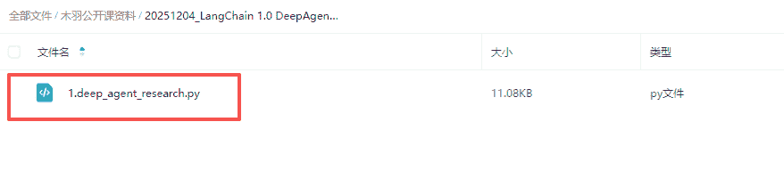


