# 3. DeepAgents 应用开发实战

> 来源：[https://kq4b3vgg5b.feishu.cn/docx/JBFJdsY91oCrI6xYMMWcZ991nWg](https://kq4b3vgg5b.feishu.cn/docx/JBFJdsY91oCrI6xYMMWcZ991nWg)

---

# 《大模型Agent智能体开发》（12月班体验课）

## Part 3. DeepAgents 应用开发实战

在前面的课程中，我们已经成功构建了一个具备实时联网检索能力的 DeepAgents 研究智能体。但是，当我们运行智能体时，往往只能看到最终的结果，而无法观察到智能体内部的执行过程。

在本课程中，我们将学习三种方法来可视化和应用DeepAgents的执行过程：

1.  LangGraph Studio 可视化：使用 LangGraph 官方提供的可视化界面，实时观察智能体的执行流程；

1.  DeepAgents UI 可视化：使用 DeepAgents 官方提供的可视化界面，实时观察智能体的执行流程；

1.  **代码打印中间结果**：通过编程方式打印智能体的每一步执行过程，包括 AI 思考、工具调用和工具响应

这三种方法各有优势，LangGraph Studio 提供了图形化的界面，DeepAgents UI 则提供了用户友好的应用形态，而代码打印则是能帮助大家理解如何提取DeepAgents的执行过程用于外部应用程序的集成。

# 一、DeepAgents 运行环境准备

为了进行可视化调试，我们首先需要确保已经创建了 DeepAgents 智能体。这里我们复用前面课程中已经配置好的代码。

```
# 核心依赖导入
import os
from typing import Literal
from dotenv import load_dotenv
from tavily import TavilyClient
from deepagents import create_deep_agent

# 加载环境变量
load_dotenv(override=True)

# 读取配置
deepseek_api_key = os.environ.get(&quot;DEEPSEEK_API_KEY&quot;)
deepseek_base_url = os.environ.get(&quot;DEEPSEEK_BASE_URL&quot;, &quot;https://api.deepseek.com&quot;)
tavily_key = os.environ.get(&quot;TAVILY_API_KEY&quot;)

print(&quot;环境变量加载完成&quot;)
```

```
环境变量加载完成
```

```
from langchain.chat_models import init_chat_model

# 使用模型字符串（LangChain 会自动识别供应商）
model = init_chat_model(
    api_key=deepseek_api_key,
    base_url=deepseek_base_url,
    model_provider=&quot;deepseek&quot;,
    model=&quot;deepseek-chat&quot;
)
```

```
# 初始化 Tavily 客户端
tavily_client = TavilyClient(api_key=tavily_key)

def internet_search(
    query: str,
    max_results: int = 5,
    topic: Literal[&quot;general&quot;, &quot;news&quot;, &quot;finance&quot;] = &quot;general&quot;,
    include_raw_content: bool = False,
):
    &quot;&quot;&quot;
    运行网络搜索
    
    这是一个用于网络搜索的工具函数，封装了 Tavily 的搜索功能。
    
    参数说明：
    - query: 搜索查询字符串，例如 &quot;Python 异步编程教程&quot;
    - max_results: 最大返回结果数量，默认为 5
    - topic: 搜索主题类型，可选 &quot;general&quot;（通用）、&quot;news&quot;（新闻）或 &quot;finance&quot;（金融）
    - include_raw_content: 是否包含原始网页内容，默认为 False
    
    返回：
    - 搜索结果字典，包含标题、URL、摘要等信息
    &quot;&quot;&quot;
    try:
        result = tavily_client.search(
            query,
            max_results=max_results,
            include_raw_content=include_raw_content,
            topic=topic,
        )
        return result
    except Exception as e:
        # 异常处理：返回错误信息而非抛出异常
        # 这样 LLM 可以理解出错并尝试其他策略
        return {&quot;error&quot;: f&quot;搜索失败: {str(e)}&quot;}

print(&quot;搜索工具创建完成&quot;)
```

```
搜索工具创建完成
```

# 二、使用 LangGraph Studio 进行可视化

DeepAgents底层构建的是图结构，而图结构是由LangGraph支撑，大家可以思考一个问题：DeepAgents基于LangGraph框架可以开发出各种复杂的应用、Agent、Workflow等，那么这些应用、Agent、Workflow等在生产中如何部署和运行呢？ 解决方案就是把它们部署成一个Server。 而对如何方便高效的把LangGraph的Graph部署成一个Server，LangGraph官方提供了LangGraph Platform，其完整架构如下所示：

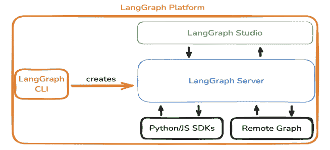

+   LangGraph Studio：桌面版应用（目前仅支持Mac）和本地运行（适用于所有操作系统）；

+   **LangServer**：最终构建出来的服务，提供Assistant API接口；

+   **Python/JS SDK**：通过接口可以直接和 LangServer 提供的各个API接口连接；

+   **Remote Graph**：类似于之前LangServe的用法，可以直接用 Graph 的接口去调用，这样拿到的Graph就是一个 Runable对象，就可以去调用它的invoke，batch 等。

LangGraph Studio 是专为 LangGraph 图式代理打造的本地/云端 IDE，具备可视化节点和状态及实时调试功能。LangGraph Studio 在本地可视化运行时会自动把调用过程上传到 LangSmith；而在 LangSmith 网页端查看任何 Trace 时，又能一键Run in Studio回放整条执行链，所以它是通过统一 Trace SDK 与 LangSmith 紧密集成。而LangGraph CLI则是构建这个项目的关键

首先，我们需要安装 LangGraph CLI 工具：

```
# 安装 LangGraph CLI（如果尚未安装）

%pip install -qU langgraph-cli
```

```
WARNING: Running pip as the &#x27;root&#x27; user can result in broken permissions and conflicting behaviour with the system package manager, possibly rendering your system unusable. It is recommended to use a virtual environment instead: https://pip.pypa.io/warnings/venv. Use the --root-user-action option if you know what you are doing and want to suppress this warning.
Note: you may need to restart the kernel to use updated packages.
```

首先需要说明的是，如果想要把一个定义的Graph添加到LangGraph Studio中，需要严格按照官方要求的项目结构进行构建，需要执行的步骤依次是：

+   **Step 1. 创建一个****Networ**kSearchAgent项目主文件夹

我们这里创建一个NetworkSearchAgent文件夹，如下图所示：

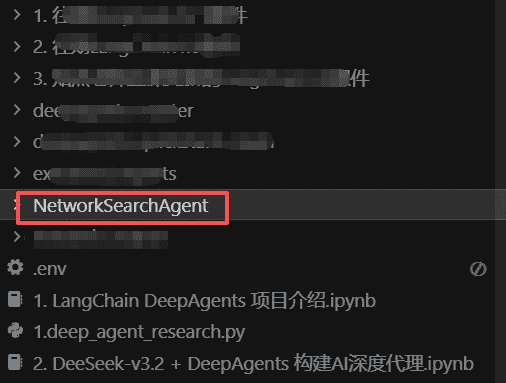

+   **Step 2. 创建****re**quirements.txt文件

在NetworkSearchAgent文件夹中，新建一个requirements.txt文件，里面需要填写在运行该项目时需要安装的依赖项，如下所示：

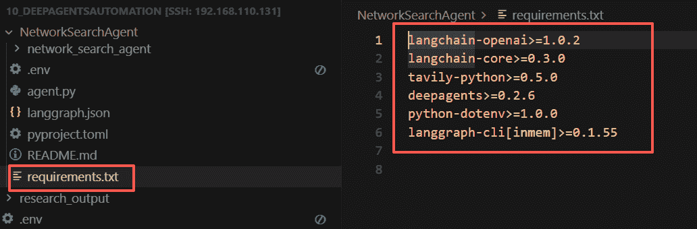

+   Step 3. 注册LangSmith（可选）

对于企业级的Agent项目，为了更好的监控智能体实时运行情况，我们可以考虑借助LangSmith进行追踪（会将智能体运行情况实时上传到LangGraph官网并进行展示）。

要开始使用 LangSmith，我们需要创建一个帐户。可以在这里注册一个免费帐户进入LangSmith登录页面： https://smith.langchain.com/ ， 支持使用 Google、GitHub、Discord 和电子邮件登录。

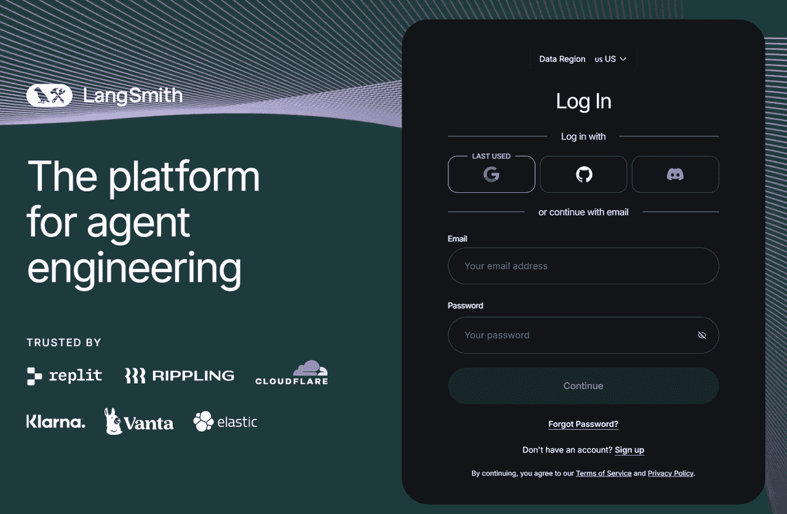

注册并等登录后，可以直接查看到仪表板：

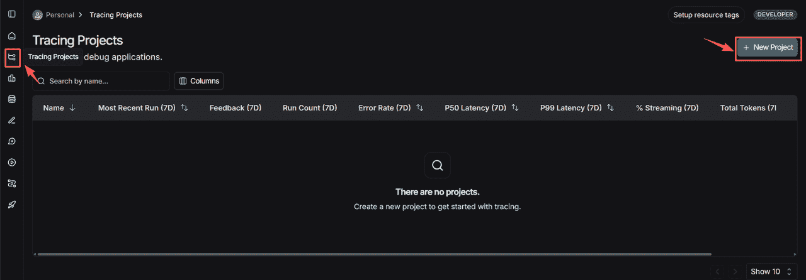

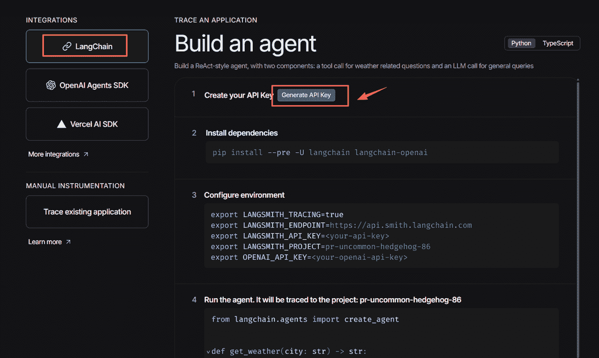

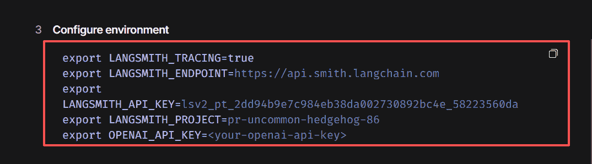

在构建程序跟踪前，首先需要创建一个 API 密钥，该密钥将允许我们的项目开始向 Langsmith 发送跟踪数据。创建完密钥后，在后续配置环境变量环节设置开启追踪、并输入密钥即可接入LangSmith。

+   **Step 4. 创建****.env****配置文件**

在NetworkSearchAgent文件夹中，新建一个.env文件，将敏感信息（如API密钥）放在环境变量中而不是硬编码。如下所示：

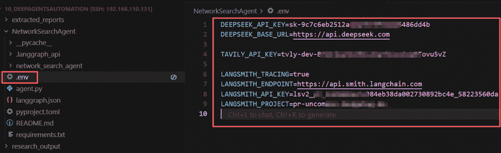

这里需要注意的是，如果不设置LangSmith，则无需设置中间三个环境变量，而具体工具也可以根据实际需求进行设置。

+   **Step 5. 创建****agent.py****核心文件**

在NetworkSearchAgent文件夹中创建agent.py文件，在该文件中编写构建图的具体运行逻辑，如状态、节点、变、图的编译等。此外，在使用LangGraph CLI创建智能体项目时，会自动设置记忆相关内容，并进行持久化记忆存储，无需手动设置。因此此时智能体代码如下所示：

```
    from langchain.chat_models import init_chat_model
    from deepagents import create_deep_agent

    from network_search_agent.prompts import SYSTEM_PROMPT
    from network_search_agent.tools import internet_search

    # 初始化模型(DeepSeek)
    model = init_chat_model(
        model=&quot;deepseek:deepseek-chat&quot;,
        temperature=0.0|
    )

    # 创建智能体
    agent = create_deep_agent(
        model=model,
        tools=[internet_search],
        system_prompt=SYSTEM_PROMPT,
    )
```

+   **Step 6. 创建****langgraph.json****文件**

在NetworkSearchAgent文件夹中，新建一个langgraph.json文件，在该json文件中配置项目信息，遵循规范如下所示：

+   必须包含 dependencies 和 graphs 字段

+   graphs 字段格式："图名": "文件路径:变量名"

+   配置文件必须放在与Python文件同级或更高级的目录

注意: 项目文件的名称必须为langgraph.json。如下所示：

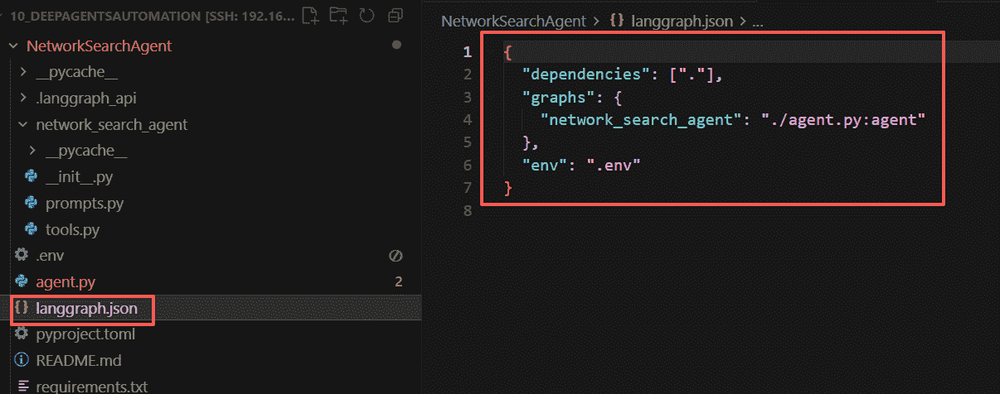

其中：

+   dependencies: ["./"] - 告诉LangGraph在当前目录查找依赖项（会自动读取requirements.txt）

+   chatbot: "./graph.py:graph" - 定义图名为chatbot，来自graph.py文件中的graph变量

+   env: ".env" - 指定环境变量文件位置

最终完整项目结构如下所示：

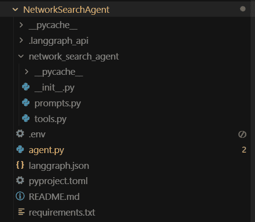

完整的代码已经上传至百度网盘中的NetworkSearchAgent文件夹中，大家可以扫描下方二维码免费领取

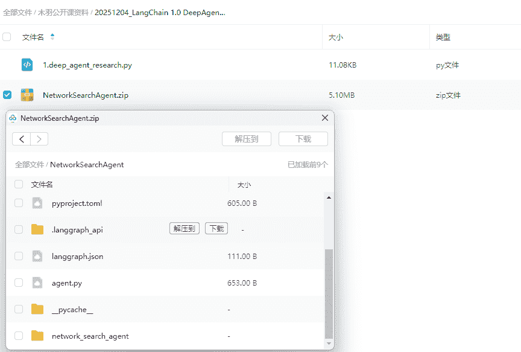


+   **Step 7. 安装****langgraph-cli****以及其他依赖**

然后，安装langgraph-cli依赖，执行如下代码：

```
    pip install -U &quot;langgraph-cli[inmem]&quot;
```

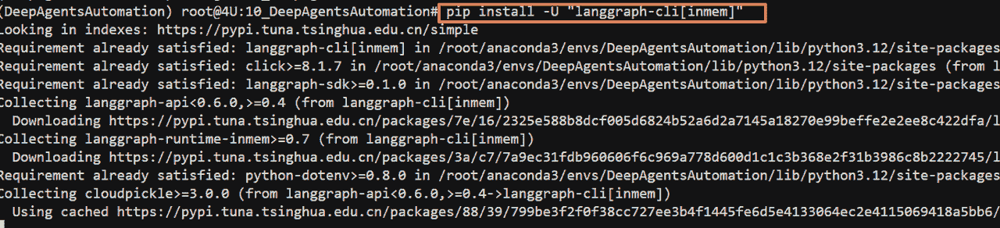

然后进入到NetworkSearchAgent文件夹，安装相关基础依赖：

```
    pip install -r requirements.txt
```

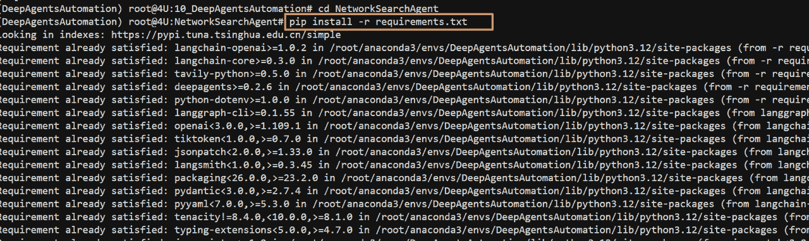

最后，进入到NetworkSearchAgent文件夹，执行LangGraph dev即可启动项目

```
    langgraph dev
```

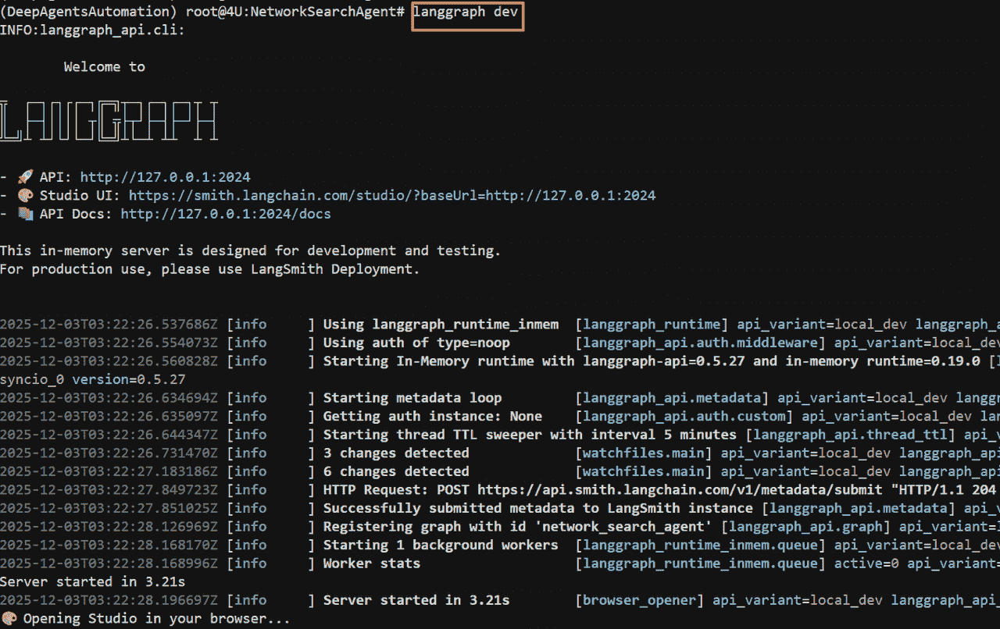

启动成功后能看到三个连接，其中第一个连接是当前部署完成后的服务端口，第二个是LangGraph Studio的可视化页面，第三个端口是端口说明。

# 三、DeepAgents部署后调用流程

+   后端服务接口

这里我们首先可以看下第三个连接，其中包含了详细的接口调用方法：

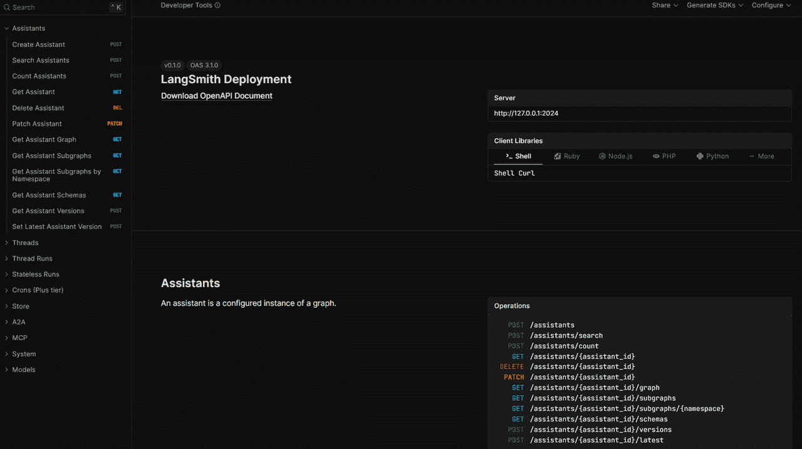

这些暴露的接口和调用方法，接下来就可以用于进行进一步开发和测试。

+   LangGraph Studio

然后我们可点击Studio UI中显示的链接，在浏览器中打开并访问Studio，如下所示：

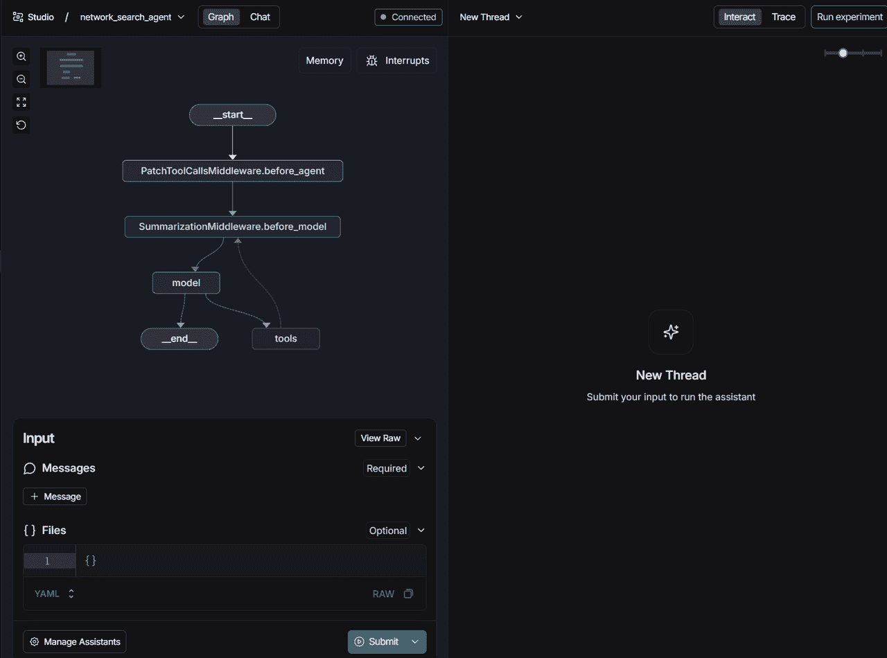

完整演示流程如下所示：

```
from IPython.display import Video

Video(&quot;https://ml2022.oss-cn-hangzhou.aliyuncs.com/2025-06-26%2019-29-04.mp4&quot;, width=1500, height=400)
```

Your browser does not support the video element.

# 四、Deep Agents UI 开发

除了 LangGraph Studio，我们还可以将 LangGraph 服务器连接到专为 deepagents 设计的 UI ：https://github.com/langchain-ai/deep-agents-ui

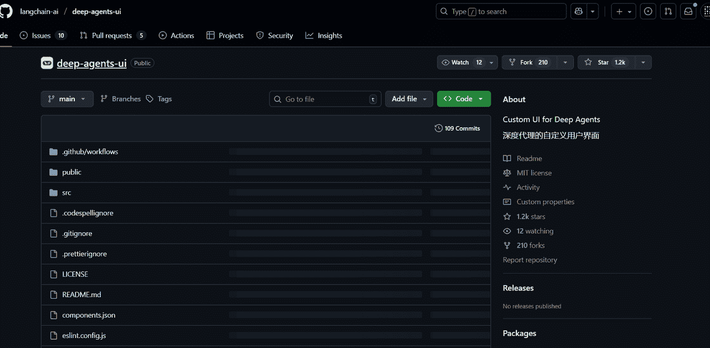

+   Step 1. 克隆 Deep Agents UI 仓库

```
    git clone https://github.com/langchain-ai/deep-agents-ui.git
    cd deep-agents-ui
```

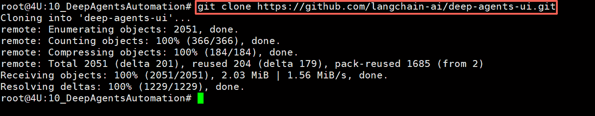

+   Step 2. 安装依赖

执行如下代码安装依赖：

```
    npm install
```

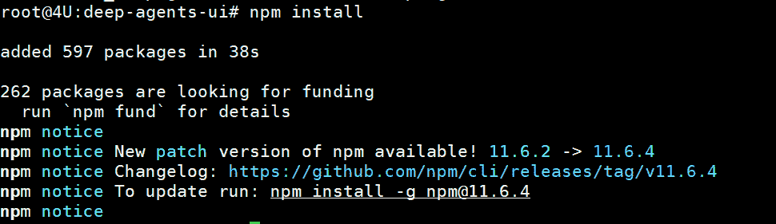

+   Step 3. 启动 UI

执行如下代码启动 UI：

```
    npm run dev
```

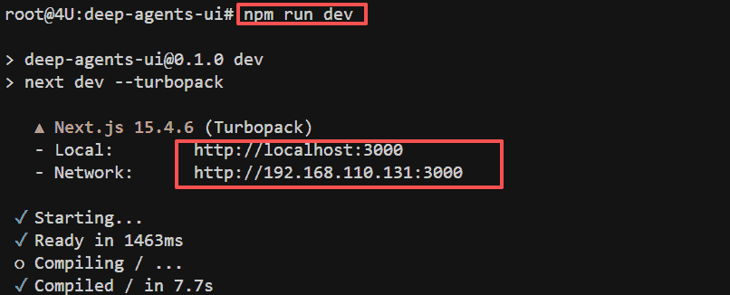

+   Step 4. 连接到 LangGraph Server

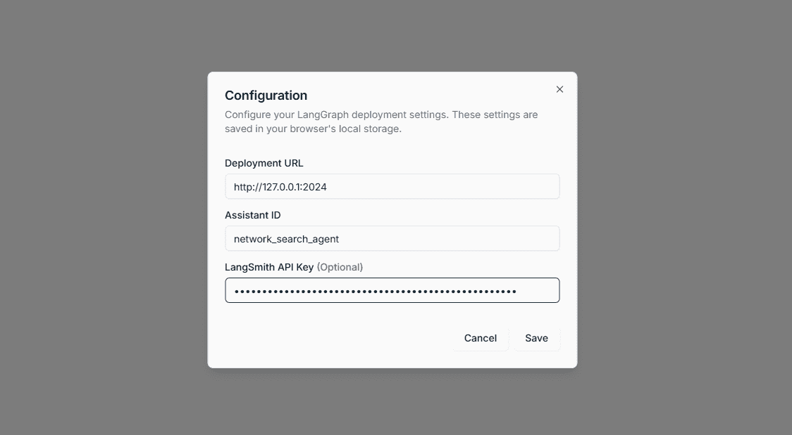

Deep Agents UI 提供了更友好的聊天界面和文件系统可视化功能。

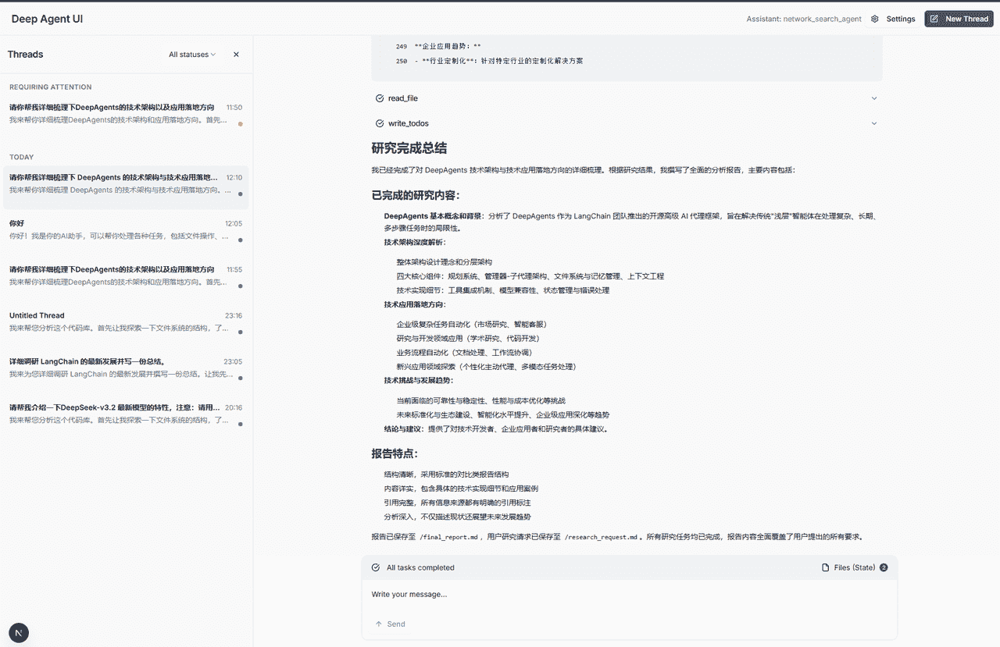

运行演示效果如下：

```
from IPython.display import Video

Video(&quot;https://muyu20241105.oss-cn-beijing.aliyuncs.com/images/202512031242162.mp4&quot;, width=1500, height=400)
```

Your browser does not support the video element.

# 五、【进阶实战】 代码环境提取DeepAgents运行状态

除了使用 LangGraph Studio，我们还可以通过编程方式打印智能体的执行过程。这种方法更适合在研发环境中进行调试和分析。DeepAgents 基于 LangGraph 构建，支持流式输出。我们可以使用 agent.stream() 方法来实时获取执行过程中的每一步。

```
# 核心依赖导入
import os
from typing import Literal
from dotenv import load_dotenv
from tavily import TavilyClient
from deepagents import create_deep_agent

# 加载环境变量
load_dotenv(override=True)

# 读取配置
deepseek_api_key = os.environ.get(&quot;DEEPSEEK_API_KEY&quot;)
deepseek_base_url = os.environ.get(&quot;DEEPSEEK_BASE_URL&quot;, &quot;https://api.deepseek.com&quot;)
tavily_key = os.environ.get(&quot;TAVILY_API_KEY&quot;)

print(&quot;环境变量加载完成&quot;)
```

```
环境变量加载完成
```

```
from langchain.chat_models import init_chat_model

# 使用模型字符串（LangChain 会自动识别供应商）
model = init_chat_model(
    api_key=deepseek_api_key,
    base_url=deepseek_base_url,
    model_provider=&quot;deepseek&quot;,
    model=&quot;deepseek-chat&quot;
)
```

```
# 初始化 Tavily 客户端
tavily_client = TavilyClient(api_key=tavily_key)

def internet_search(
    query: str,
    max_results: int = 5,
    topic: Literal[&quot;general&quot;, &quot;news&quot;, &quot;finance&quot;] = &quot;general&quot;,
    include_raw_content: bool = False,
):
    &quot;&quot;&quot;
    运行网络搜索
    
    这是一个用于网络搜索的工具函数，封装了 Tavily 的搜索功能。
    
    参数说明：
    - query: 搜索查询字符串，例如 &quot;Python 异步编程教程&quot;
    - max_results: 最大返回结果数量，默认为 5
    - topic: 搜索主题类型，可选 &quot;general&quot;（通用）、&quot;news&quot;（新闻）或 &quot;finance&quot;（金融）
    - include_raw_content: 是否包含原始网页内容，默认为 False
    
    返回：
    - 搜索结果字典，包含标题、URL、摘要等信息
    &quot;&quot;&quot;
    try:
        result = tavily_client.search(
            query,
            max_results=max_results,
            include_raw_content=include_raw_content,
            topic=topic,
        )
        return result
    except Exception as e:
        # 异常处理：返回错误信息而非抛出异常
        # 这样 LLM 可以理解出错并尝试其他策略
        return {&quot;error&quot;: f&quot;搜索失败: {str(e)}&quot;}

print(&quot;搜索工具创建完成&quot;)
```

```
搜索工具创建完成
```

```
# 文件写入工具
def write_local_file(file_path: str, content: str) -&gt; dict:
    &quot;&quot;&quot;
    将内容写入本地文件
    
    这是一个用于将内容保存到本地文件的工具函数。
    
    参数说明：
    - file_path: 文件路径，例如 &quot;report.md&quot; 或 &quot;./reports/research_report.md&quot;
    - content: 要写入文件的内容（字符串）
    
    返回：
    - 包含操作结果的字典，如果成功则返回 {&quot;status&quot;: &quot;success&quot;, &quot;file_path&quot;: file_path}
    - 如果失败则返回 {&quot;status&quot;: &quot;error&quot;, &quot;error&quot;: &quot;错误信息&quot;}
    &quot;&quot;&quot;
    try:
        # 确保目录存在
        import os
        directory = os.path.dirname(file_path)
        if directory and not os.path.exists(directory):
            os.makedirs(directory, exist_ok=True)
        
        # 写入文件
        with open(file_path, &#x27;w&#x27;, encoding=&#x27;utf-8&#x27;) as f:
            f.write(content)
        
        return {
            &quot;status&quot;: &quot;success&quot;,
            &quot;file_path&quot;: file_path,
            &quot;message&quot;: f&quot;文件已成功保存到: {file_path}&quot;
        }
    except Exception as e:
        return {
            &quot;status&quot;: &quot;error&quot;,
            &quot;error&quot;: f&quot;写入文件失败: {str(e)}&quot;
        }

print(&quot;文件写入工具创建完成&quot;)
```

```
文件写入工具创建完成
```

```
# 系统提示词
research_instructions = &quot;&quot;&quot;您是一位资深的研究人员。您的工作是进行深入的研究，然后撰写一份精美的报告。

您可以通过互联网搜索引擎作为主要的信息收集工具。

## 可用工具

### `互联网搜索`
使用此功能针对给定的查询进行互联网搜索。您可以指定要返回的最大结果数量、主题以及是否包含原始内容。

### `写入本地文件`
使用此功能将研究报告保存到本地文件。当您完成研究并生成报告后，请使用此工具将完整的报告内容保存到文件中。
- 文件路径建议使用 .md 格式（Markdown），例如 &quot;research_report.md&quot; 或 &quot;./reports/报告名称.md&quot;
- 请确保报告内容完整、结构清晰，包含所有章节和引用来源

## 工作流程

在进行研究时：
1. 首先将研究任务分解为清晰的步骤
2. 使用互联网搜索来收集全面的信息
3. 将信息整合成一份结构清晰的报告
4. **重要**：完成报告后，务必使用 `写入本地文件` 工具将完整报告保存到本地文件
5. 务必引用你的资料来源

**注意**：请确保在完成研究后，将完整的报告内容保存到文件中，这样用户可以方便地查看和保存报告。
&quot;&quot;&quot;

# 创建 Deep Agent
agent = create_deep_agent(
    model=model,
    tools=[internet_search, write_local_file],
    system_prompt=research_instructions
)

print(&quot;DeepAgents 创建成功！&quot;)
```

```
DeepAgents 创建成功！
```

```
# 导入必要的库
import json
from rich.console import Console
from rich.panel import Panel
from rich.markdown import Markdown
from rich.json import JSON

# 导入 Rich 库
try:
    from rich.console import Console
    from rich.panel import Panel
    from rich.markdown import Markdown
    from rich.json import JSON
    RICH_AVAILABLE = True
    console = Console()
    print(&quot;Rich 库已加载，将使用美化输出&quot;)
except ImportError:
    RICH_AVAILABLE = False
    console = None
    print(&quot;Rich 库未安装，将使用标准输出&quot;)
```

```
Rich 库已加载，将使用美化输出
```

我们创建一个调试函数，可以实时打印智能体的执行过程。这个函数会显示：

+   AI 的思考过程

+   工具调用的详细信息

+   工具响应的内容

+   最终的研究报告

```
def debug_agent(query: str, save_to_file: str = None):
    &quot;&quot;&quot;
    运行智能体并打印中间过程（使用 Rich 美化输出）
    
    参数:
        query: 用户查询
        save_to_file: 保存最终输出到文件(可选)
    
    返回:
        str: 最终的研究报告
    &quot;&quot;&quot;

    console.print(Panel.fit(
        f&quot;[bold cyan]查询:[/bold cyan] {query}&quot;,
        border_style=&quot;cyan&quot;
    ))
    
    step_num = 0
    final_response = None
    
    # 实时流式输出
    for event in agent.stream(
        {&quot;messages&quot;: [{&quot;role&quot;: &quot;user&quot;, &quot;content&quot;: query}]},
        stream_mode=&quot;values&quot;
    ):
        step_num += 1
        
        console.print(f&quot;\n[bold yellow]{&#x27;─&#x27; * 80}[/bold yellow]&quot;)
        console.print(f&quot;[bold yellow]步骤 {step_num}[/bold yellow]&quot;)
        console.print(f&quot;[bold yellow]{&#x27;─&#x27; * 80}[/bold yellow]&quot;)
        
        if &quot;messages&quot; in event:
            messages = event[&quot;messages&quot;]
            
            if messages:
                msg = messages[-1]
                
                # 保存最终响应
                if hasattr(msg, &#x27;content&#x27;) and msg.content and not hasattr(msg, &#x27;tool_calls&#x27;):
                    final_response = msg.content
                
                # AI 思考
                if hasattr(msg, &#x27;content&#x27;) and msg.content:
                    # 如果内容太长,只显示前300字符作为预览
                    content = msg.content
                    if len(content) &gt; 300 and not (hasattr(msg, &#x27;tool_calls&#x27;) and msg.tool_calls):
                        preview = content[:300] + &quot;...&quot;
                        console.print(Panel(
                            f&quot;{preview}\n\n[dim](内容较长,完整内容将在最后显示)[/dim]&quot;,
                            title=&quot;[bold green]AI 思考[/bold green]&quot;,
                            border_style=&quot;green&quot;
                        ))
                    else:
                        console.print(Panel(
                            content,
                            title=&quot;[bold green]AI 思考[/bold green]&quot;,
                            border_style=&quot;green&quot;
                        ))
                
                # 工具调用
                if hasattr(msg, &#x27;tool_calls&#x27;) and msg.tool_calls:
                    for tool_call in msg.tool_calls:
                        tool_info = {
                            &quot;工具名称&quot;: tool_call.get(&#x27;name&#x27;, &#x27;unknown&#x27;),
                            &quot;参数&quot;: tool_call.get(&#x27;args&#x27;, {})
                        }
                        console.print(Panel(
                            JSON(json.dumps(tool_info, ensure_ascii=False)),
                            title=&quot;[bold blue]工具调用[/bold blue]&quot;,
                            border_style=&quot;blue&quot;
                        ))
                
                # 工具响应
                if hasattr(msg, &#x27;name&#x27;) and msg.name:
                    response = str(msg.content)[:500]
                    if len(str(msg.content)) &gt; 500:
                        response += f&quot;\n... (共 {len(str(msg.content))} 字符)&quot;
                    
                    console.print(Panel(
                        response,
                        title=f&quot;[bold magenta]工具响应: {msg.name}[/bold magenta]&quot;,
                        border_style=&quot;magenta&quot;
                    ))
    
    console.print(&quot;\n[bold green]任务完成![/bold green]\n&quot;)
    
    return final_response

print(&quot;调试函数已创建&quot;)
```

```
调试函数已创建
```

现在让我们使用调试函数来运行一个研究任务，观察智能体的执行过程：

```
# 示例：使用调试函数运行研究任务
query = &quot;详细调研 LangChain DeepAgents 框架的核心特性，并写一份结构化的总结报告。&quot;

# 使用调试函数）
result = debug_agent(query)
```

╭────────────────────────────────────────────────────────────────────────────────╮│ 查询: 详细调研 LangChain DeepAgents 框架的核心特性，并写一份结构化的总结报告。 │╰────────────────────────────────────────────────────────────────────────────────╯

────────────────────────────────────────────────────────────────────────────────

步骤 1

────────────────────────────────────────────────────────────────────────────────

╭──────────────────────────────────────────────────── AI 思考 ────────────────────────────────────────────────────╮│ 详细调研 LangChain DeepAgents 框架的核心特性，并写一份结构化的总结报告。                                        │╰─────────────────────────────────────────────────────────────────────────────────────────────────────────────────╯

────────────────────────────────────────────────────────────────────────────────

步骤 2

────────────────────────────────────────────────────────────────────────────────

╭──────────────────────────────────────────────────── AI 思考 ────────────────────────────────────────────────────╮│ 详细调研 LangChain DeepAgents 框架的核心特性，并写一份结构化的总结报告。                                        │╰─────────────────────────────────────────────────────────────────────────────────────────────────────────────────╯

────────────────────────────────────────────────────────────────────────────────

步骤 3

────────────────────────────────────────────────────────────────────────────────

╭──────────────────────────────────────────────────── AI 思考 ────────────────────────────────────────────────────╮│ 我将为您详细调研 LangChain DeepAgents                                                                           ││ 框架的核心特性，并撰写一份结构化的总结报告。让我先创建一个任务列表来组织这个复杂的研究工作。                    │╰─────────────────────────────────────────────────────────────────────────────────────────────────────────────────╯

╭─────────────────────────────────────────────────── 工具调用 ────────────────────────────────────────────────────╮│ {                                                                                                               ││   "工具名称": "write_todos",                                                                                    ││   "参数": {                                                                                                     ││     "todos": [                                                                                                  ││       {                                                                                                         ││         "content": "调研 LangChain DeepAgents 框架的基本概念和背景",                                            ││         "status": "in_progress"                                                                                 ││       },                                                                                                        ││       {                                                                                                         ││         "content": "研究 DeepAgents 的核心架构和设计理念",                                                      ││         "status": "pending"                                                                                     ││       },                                                                                                        ││       {                                                                                                         ││         "content": "分析 DeepAgents 的主要特性和功能",                                                          ││         "status": "pending"                                                                                     ││       },                                                                                                        ││       {                                                                                                         ││         "content": "调研 DeepAgents 与其他 LangChain 组件的集成",                                               ││         "status": "pending"                                                                                     ││       },                                                                                                        ││       {                                                                                                         ││         "content": "收集实际应用案例和使用场景",                                                                ││         "status": "pending"                                                                                     ││       },                                                                                                        ││       {                                                                                                         ││         "content": "撰写结构化的总结报告",                                                                      ││         "status": "pending"                                                                                     ││       },                                                                                                        ││       {                                                                                                         ││         "content": "保存报告到本地文件",                                                                        ││         "status": "pending"                                                                                     ││       }                                                                                                         ││     ]                                                                                                           ││   }                                                                                                             ││ }                                                                                                               │╰─────────────────────────────────────────────────────────────────────────────────────────────────────────────────╯

────────────────────────────────────────────────────────────────────────────────

步骤 4

────────────────────────────────────────────────────────────────────────────────

╭──────────────────────────────────────────────────── AI 思考 ────────────────────────────────────────────────────╮│ Updated todo list to [{'content': '调研 LangChain DeepAgents 框架的基本概念和背景', 'status': 'in_progress'},   ││ {'content': '研究 DeepAgents 的核心架构和设计理念', 'status': 'pending'}, {'content': '分析 DeepAgents          ││ 的主要特性和功能', 'status': 'pending'}, {'content': '调研 DeepAgents 与其他 LangChain 组件的集成', 'status':   ││ 'pending'}, {'content...                                                                                        ││                                                                                                                 ││ (内容较长,完整内容将在最后显示)                                                                                 │╰─────────────────────────────────────────────────────────────────────────────────────────────────────────────────╯

╭───────────────────────────────────────────── 工具响应: write_todos ─────────────────────────────────────────────╮│ Updated todo list to [{'content': '调研 LangChain DeepAgents 框架的基本概念和背景', 'status': 'in_progress'},   ││ {'content': '研究 DeepAgents 的核心架构和设计理念', 'status': 'pending'}, {'content': '分析 DeepAgents          ││ 的主要特性和功能', 'status': 'pending'}, {'content': '调研 DeepAgents 与其他 LangChain 组件的集成', 'status':   ││ 'pending'}, {'content': '收集实际应用案例和使用场景', 'status': 'pending'}, {'content': '撰写结构化的总结报告', ││ 'status': 'pending'}, {'content': '保存报告到本地文件', 'status': 'pending'}]                                   │╰─────────────────────────────────────────────────────────────────────────────────────────────────────────────────╯

────────────────────────────────────────────────────────────────────────────────

步骤 5

────────────────────────────────────────────────────────────────────────────────

╭──────────────────────────────────────────────────── AI 思考 ────────────────────────────────────────────────────╮│ 现在让我开始进行调研。首先搜索 LangChain DeepAgents 的基本信息：                                                │╰─────────────────────────────────────────────────────────────────────────────────────────────────────────────────╯

╭─────────────────────────────────────────────────── 工具调用 ────────────────────────────────────────────────────╮│ {                                                                                                               ││   "工具名称": "internet_search",                                                                                ││   "参数": {                                                                                                     ││     "query": "LangChain DeepAgents 框架 核心特性 介绍",                                                         ││     "max_results": 10                                                                                           ││   }                                                                                                             ││ }                                                                                                               │╰─────────────────────────────────────────────────────────────────────────────────────────────────────────────────╯

────────────────────────────────────────────────────────────────────────────────

步骤 6

────────────────────────────────────────────────────────────────────────────────

╭──────────────────────────────────────────────────── AI 思考 ────────────────────────────────────────────────────╮│ {"query": "LangChain DeepAgents 框架 核心特性 介绍", "follow_up_questions": null, "answer": null, "images": [], ││ "results": [{"url": "https://devpress.csdn.net/aibjcy/692aa8052087ae0db79d7444.html", "title":                  ││ "【收藏必备】DeepAgents深度解读：从0到1构建复杂任务智能体", "content": "如果你在 LangChain 生态中开发，可以通过 ││ **LangGraph** 从底层掌控工作流，例如...                                                                         ││                                                                                                                 ││ (内容较长,完整内容将在最后显示)                                                                                 │╰─────────────────────────────────────────────────────────────────────────────────────────────────────────────────╯

╭─────────────────────────────────────────── 工具响应: internet_search ───────────────────────────────────────────╮│ {"query": "LangChain DeepAgents 框架 核心特性 介绍", "follow_up_questions": null, "answer": null, "images": [], ││ "results": [{"url": "https://devpress.csdn.net/aibjcy/692aa8052087ae0db79d7444.html", "title":                  ││ "【收藏必备】DeepAgents深度解读：从0到1构建复杂任务智能体", "content": "如果你在 LangChain 生态中开发，可以通过 ││ **LangGraph** 从底层掌控工作流，例如：什么时候由 AI 决策、什么时候固化流程；使用 ReAct 还是 Plan-then-Execute   ││ 等范式 —— 但实现复杂度相对较高。 DeepAgents 是 LangChain 公司在 LangGraph 与 LangChain                          ││ 之后推出的**第三个独立开源 Agent 框架**，与前两者形成清晰分工： * DeepAgents：在 LangChain 的高层接口 +         ││ LangGraph                                                                                                       ││ ... (共 16461 字符)                                                                                             │╰─────────────────────────────────────────────────────────────────────────────────────────────────────────────────╯

────────────────────────────────────────────────────────────────────────────────

步骤 7

────────────────────────────────────────────────────────────────────────────────

╭──────────────────────────────────────────────────── AI 思考 ────────────────────────────────────────────────────╮│ 现在让我更新任务状态并继续搜索更多详细信息：                                                                    │╰─────────────────────────────────────────────────────────────────────────────────────────────────────────────────╯

╭─────────────────────────────────────────────────── 工具调用 ────────────────────────────────────────────────────╮│ {                                                                                                               ││   "工具名称": "write_todos",                                                                                    ││   "参数": {                                                                                                     ││     "todos": [                                                                                                  ││       {                                                                                                         ││         "content": "调研 LangChain DeepAgents 框架的基本概念和背景",                                            ││         "status": "completed"                                                                                   ││       },                                                                                                        ││       {                                                                                                         ││         "content": "研究 DeepAgents 的核心架构和设计理念",                                                      ││         "status": "in_progress"                                                                                 ││       },                                                                                                        ││       {                                                                                                         ││         "content": "分析 DeepAgents 的主要特性和功能",                                                          ││         "status": "pending"                                                                                     ││       },                                                                                                        ││       {                                                                                                         ││         "content": "调研 DeepAgents 与其他 LangChain 组件的集成",                                               ││         "status": "pending"                                                                                     ││       },                                                                                                        ││       {                                                                                                         ││         "content": "收集实际应用案例和使用场景",                                                                ││         "status": "pending"                                                                                     ││       },                                                                                                        ││       {                                                                                                         ││         "content": "撰写结构化的总结报告",                                                                      ││         "status": "pending"                                                                                     ││       },                                                                                                        ││       {                                                                                                         ││         "content": "保存报告到本地文件",                                                                        ││         "status": "pending"                                                                                     ││       }                                                                                                         ││     ]                                                                                                           ││   }                                                                                                             ││ }                                                                                                               │╰─────────────────────────────────────────────────────────────────────────────────────────────────────────────────╯

────────────────────────────────────────────────────────────────────────────────

步骤 8

────────────────────────────────────────────────────────────────────────────────

╭──────────────────────────────────────────────────── AI 思考 ────────────────────────────────────────────────────╮│ Updated todo list to [{'content': '调研 LangChain DeepAgents 框架的基本概念和背景', 'status': 'completed'},     ││ {'content': '研究 DeepAgents 的核心架构和设计理念', 'status': 'in_progress'}, {'content': '分析 DeepAgents      ││ 的主要特性和功能', 'status': 'pending'}, {'content': '调研 DeepAgents 与其他 LangChain 组件的集成', 'status':   ││ 'pending'}, {'conte...                                                                                          ││                                                                                                                 ││ (内容较长,完整内容将在最后显示)                                                                                 │╰─────────────────────────────────────────────────────────────────────────────────────────────────────────────────╯

╭───────────────────────────────────────────── 工具响应: write_todos ─────────────────────────────────────────────╮│ Updated todo list to [{'content': '调研 LangChain DeepAgents 框架的基本概念和背景', 'status': 'completed'},     ││ {'content': '研究 DeepAgents 的核心架构和设计理念', 'status': 'in_progress'}, {'content': '分析 DeepAgents      ││ 的主要特性和功能', 'status': 'pending'}, {'content': '调研 DeepAgents 与其他 LangChain 组件的集成', 'status':   ││ 'pending'}, {'content': '收集实际应用案例和使用场景', 'status': 'pending'}, {'content': '撰写结构化的总结报告', ││ 'status': 'pending'}, {'content': '保存报告到本地文件', 'status': 'pending'}]                                   │╰─────────────────────────────────────────────────────────────────────────────────────────────────────────────────╯

────────────────────────────────────────────────────────────────────────────────

步骤 9

────────────────────────────────────────────────────────────────────────────────

╭──────────────────────────────────────────────────── AI 思考 ────────────────────────────────────────────────────╮│ 让我搜索更多关于 DeepAgents 架构和设计理念的信息：                                                              │╰─────────────────────────────────────────────────────────────────────────────────────────────────────────────────╯

╭─────────────────────────────────────────────────── 工具调用 ────────────────────────────────────────────────────╮│ {                                                                                                               ││   "工具名称": "internet_search",                                                                                ││   "参数": {                                                                                                     ││     "query": "DeepAgents 架构设计 子智能体 subagent 文件系统 规划能力",                                         ││     "max_results": 8                                                                                            ││   }                                                                                                             ││ }                                                                                                               │╰─────────────────────────────────────────────────────────────────────────────────────────────────────────────────╯

────────────────────────────────────────────────────────────────────────────────

步骤 10

────────────────────────────────────────────────────────────────────────────────

╭──────────────────────────────────────────────────── AI 思考 ────────────────────────────────────────────────────╮│ {"query": "DeepAgents 架构设计 子智能体 subagent 文件系统 规划能力", "follow_up_questions": null, "answer":     ││ null, "images": [], "results": [{"url": "https://zhuanlan.zhihu.com/p/1935481980641863575", "title": "Deep      ││ Agents：构建深度思考和执行复杂任务的Agent", "content": "Deep Agents 通过引入详细的系统提示、规划工具、子Agent   ││ 和文件系统这四大支柱，成功地克服了这些局限。这种...                                                             ││                                                                                                                 ││ (内容较长,完整内容将在最后显示)                                                                                 │╰─────────────────────────────────────────────────────────────────────────────────────────────────────────────────╯

╭─────────────────────────────────────────── 工具响应: internet_search ───────────────────────────────────────────╮│ {"query": "DeepAgents 架构设计 子智能体 subagent 文件系统 规划能力", "follow_up_questions": null, "answer":     ││ null, "images": [], "results": [{"url": "https://zhuanlan.zhihu.com/p/1935481980641863575", "title": "Deep      ││ Agents：构建深度思考和执行复杂任务的Agent", "content": "Deep Agents 通过引入详细的系统提示、规划工具、子Agent   ││ 和文件系统这四大支柱，成功地克服了这些局限。这种更先进的架构赋予了Agent 深度规划、任务", "score": 0.99996376,   ││ "raw_content": null}, {"url": "https://devpress.csdn.net/aibjcy/691ab92882fbe0098cac4f6c.html", "title":        ││ "它有“身体”但没有“大脑”？DeepAgents实战，告别浅尝辄止", "content": "                                            ││ ... (共 9274 字符)                                                                                              │╰─────────────────────────────────────────────────────────────────────────────────────────────────────────────────╯

────────────────────────────────────────────────────────────────────────────────

步骤 11

────────────────────────────────────────────────────────────────────────────────

╭──────────────────────────────────────────────────── AI 思考 ────────────────────────────────────────────────────╮│ 现在让我更新任务状态并继续研究 DeepAgents 的主要特性：                                                          │╰─────────────────────────────────────────────────────────────────────────────────────────────────────────────────╯

╭─────────────────────────────────────────────────── 工具调用 ────────────────────────────────────────────────────╮│ {                                                                                                               ││   "工具名称": "write_todos",                                                                                    ││   "参数": {                                                                                                     ││     "todos": [                                                                                                  ││       {                                                                                                         ││         "content": "调研 LangChain DeepAgents 框架的基本概念和背景",                                            ││         "status": "completed"                                                                                   ││       },                                                                                                        ││       {                                                                                                         ││         "content": "研究 DeepAgents 的核心架构和设计理念",                                                      ││         "status": "completed"                                                                                   ││       },                                                                                                        ││       {                                                                                                         ││         "content": "分析 DeepAgents 的主要特性和功能",                                                          ││         "status": "in_progress"                                                                                 ││       },                                                                                                        ││       {                                                                                                         ││         "content": "调研 DeepAgents 与其他 LangChain 组件的集成",                                               ││         "status": "pending"                                                                                     ││       },                                                                                                        ││       {                                                                                                         ││         "content": "收集实际应用案例和使用场景",                                                                ││         "status": "pending"                                                                                     ││       },                                                                                                        ││       {                                                                                                         ││         "content": "撰写结构化的总结报告",                                                                      ││         "status": "pending"                                                                                     ││       },                                                                                                        ││       {                                                                                                         ││         "content": "保存报告到本地文件",                                                                        ││         "status": "pending"                                                                                     ││       }                                                                                                         ││     ]                                                                                                           ││   }                                                                                                             ││ }                                                                                                               │╰─────────────────────────────────────────────────────────────────────────────────────────────────────────────────╯

────────────────────────────────────────────────────────────────────────────────

步骤 12

────────────────────────────────────────────────────────────────────────────────

╭──────────────────────────────────────────────────── AI 思考 ────────────────────────────────────────────────────╮│ Updated todo list to [{'content': '调研 LangChain DeepAgents 框架的基本概念和背景', 'status': 'completed'},     ││ {'content': '研究 DeepAgents 的核心架构和设计理念', 'status': 'completed'}, {'content': '分析 DeepAgents        ││ 的主要特性和功能', 'status': 'in_progress'}, {'content': '调研 DeepAgents 与其他 LangChain 组件的集成',         ││ 'status': 'pending'}, {'con...                                                                                  ││                                                                                                                 ││ (内容较长,完整内容将在最后显示)                                                                                 │╰─────────────────────────────────────────────────────────────────────────────────────────────────────────────────╯

╭───────────────────────────────────────────── 工具响应: write_todos ─────────────────────────────────────────────╮│ Updated todo list to [{'content': '调研 LangChain DeepAgents 框架的基本概念和背景', 'status': 'completed'},     ││ {'content': '研究 DeepAgents 的核心架构和设计理念', 'status': 'completed'}, {'content': '分析 DeepAgents        ││ 的主要特性和功能', 'status': 'in_progress'}, {'content': '调研 DeepAgents 与其他 LangChain 组件的集成',         ││ 'status': 'pending'}, {'content': '收集实际应用案例和使用场景', 'status': 'pending'}, {'content':               ││ '撰写结构化的总结报告', 'status': 'pending'}, {'content': '保存报告到本地文件', 'status': 'pending'}]           │╰─────────────────────────────────────────────────────────────────────────────────────────────────────────────────╯

────────────────────────────────────────────────────────────────────────────────

步骤 13

────────────────────────────────────────────────────────────────────────────────

╭──────────────────────────────────────────────────── AI 思考 ────────────────────────────────────────────────────╮│ 让我搜索更多关于 DeepAgents 特性的详细信息：                                                                    │╰─────────────────────────────────────────────────────────────────────────────────────────────────────────────────╯

╭─────────────────────────────────────────────────── 工具调用 ────────────────────────────────────────────────────╮│ {                                                                                                               ││   "工具名称": "internet_search",                                                                                ││   "参数": {                                                                                                     ││     "query": "DeepAgents write_todos task 工具 中间件 文件系统 后端",                                           ││     "max_results": 8                                                                                            ││   }                                                                                                             ││ }                                                                                                               │╰─────────────────────────────────────────────────────────────────────────────────────────────────────────────────╯

────────────────────────────────────────────────────────────────────────────────

步骤 14

────────────────────────────────────────────────────────────────────────────────

╭──────────────────────────────────────────────────── AI 思考 ────────────────────────────────────────────────────╮│ {"query": "DeepAgents write_todos task 工具 中间件 文件系统 后端", "follow_up_questions": null, "answer": null, ││ "images": [], "results": [{"url": "https://zhuanlan.zhihu.com/p/1968832113655682815", "title":                  ││ "DeepAgents：智能体框架的核心组件解析 - 知乎专栏", "content":                                                   ││ "为复杂的多步骤任务添加待办事项管理功能。该中间件自动为智能体提供 write_todos 工具和系统提示，以指导有效...     ││                                                                                                                 ││ (内容较长,完整内容将在最后显示)                                                                                 │╰─────────────────────────────────────────────────────────────────────────────────────────────────────────────────╯

╭─────────────────────────────────────────── 工具响应: internet_search ───────────────────────────────────────────╮│ {"query": "DeepAgents write_todos task 工具 中间件 文件系统 后端", "follow_up_questions": null, "answer": null, ││ "images": [], "results": [{"url": "https://zhuanlan.zhihu.com/p/1968832113655682815", "title":                  ││ "DeepAgents：智能体框架的核心组件解析 - 知乎专栏", "content":                                                   ││ "为复杂的多步骤任务添加待办事项管理功能。该中间件自动为智能体提供 write_todos                                   ││ 工具和系统提示，以指导有效的任务规划。 初始化的时候非常简单，", "score": 0.9999573, "raw_content": null},       ││ {"url": "https://devpress.csdn.net/aibjcy/691fbd9f82fbe0098cad6f62.html", "title":                              ││ "DeepAgents深度解析：LangChain生态下构建智能Agent的终极指南！", "content                                        ││ ... (共 8565 字符)                                                                                              │╰─────────────────────────────────────────────────────────────────────────────────────────────────────────────────╯

────────────────────────────────────────────────────────────────────────────────

步骤 15

────────────────────────────────────────────────────────────────────────────────

╭──────────────────────────────────────────────────── AI 思考 ────────────────────────────────────────────────────╮│ 现在让我更新任务状态并研究 DeepAgents 与其他 LangChain 组件的集成：                                             │╰─────────────────────────────────────────────────────────────────────────────────────────────────────────────────╯

╭─────────────────────────────────────────────────── 工具调用 ────────────────────────────────────────────────────╮│ {                                                                                                               ││   "工具名称": "write_todos",                                                                                    ││   "参数": {                                                                                                     ││     "todos": [                                                                                                  ││       {                                                                                                         ││         "content": "调研 LangChain DeepAgents 框架的基本概念和背景",                                            ││         "status": "completed"                                                                                   ││       },                                                                                                        ││       {                                                                                                         ││         "content": "研究 DeepAgents 的核心架构和设计理念",                                                      ││         "status": "completed"                                                                                   ││       },                                                                                                        ││       {                                                                                                         ││         "content": "分析 DeepAgents 的主要特性和功能",                                                          ││         "status": "completed"                                                                                   ││       },                                                                                                        ││       {                                                                                                         ││         "content": "调研 DeepAgents 与其他 LangChain 组件的集成",                                               ││         "status": "in_progress"                                                                                 ││       },                                                                                                        ││       {                                                                                                         ││         "content": "收集实际应用案例和使用场景",                                                                ││         "status": "pending"                                                                                     ││       },                                                                                                        ││       {                                                                                                         ││         "content": "撰写结构化的总结报告",                                                                      ││         "status": "pending"                                                                                     ││       },                                                                                                        ││       {                                                                                                         ││         "content": "保存报告到本地文件",                                                                        ││         "status": "pending"                                                                                     ││       }                                                                                                         ││     ]                                                                                                           ││   }                                                                                                             ││ }                                                                                                               │╰─────────────────────────────────────────────────────────────────────────────────────────────────────────────────╯

────────────────────────────────────────────────────────────────────────────────

步骤 16

────────────────────────────────────────────────────────────────────────────────

╭──────────────────────────────────────────────────── AI 思考 ────────────────────────────────────────────────────╮│ Updated todo list to [{'content': '调研 LangChain DeepAgents 框架的基本概念和背景', 'status': 'completed'},     ││ {'content': '研究 DeepAgents 的核心架构和设计理念', 'status': 'completed'}, {'content': '分析 DeepAgents        ││ 的主要特性和功能', 'status': 'completed'}, {'content': '调研 DeepAgents 与其他 LangChain 组件的集成', 'status': ││ 'in_progress'}, {'c...                                                                                          ││                                                                                                                 ││ (内容较长,完整内容将在最后显示)                                                                                 │╰─────────────────────────────────────────────────────────────────────────────────────────────────────────────────╯

╭───────────────────────────────────────────── 工具响应: write_todos ─────────────────────────────────────────────╮│ Updated todo list to [{'content': '调研 LangChain DeepAgents 框架的基本概念和背景', 'status': 'completed'},     ││ {'content': '研究 DeepAgents 的核心架构和设计理念', 'status': 'completed'}, {'content': '分析 DeepAgents        ││ 的主要特性和功能', 'status': 'completed'}, {'content': '调研 DeepAgents 与其他 LangChain 组件的集成', 'status': ││ 'in_progress'}, {'content': '收集实际应用案例和使用场景', 'status': 'pending'}, {'content':                     ││ '撰写结构化的总结报告', 'status': 'pending'}, {'content': '保存报告到本地文件', 'status': 'pending'}]           │╰─────────────────────────────────────────────────────────────────────────────────────────────────────────────────╯

────────────────────────────────────────────────────────────────────────────────

步骤 17

────────────────────────────────────────────────────────────────────────────────

╭──────────────────────────────────────────────────── AI 思考 ────────────────────────────────────────────────────╮│ 让我搜索 DeepAgents 与 LangChain、LangGraph 的集成信息：                                                        │╰─────────────────────────────────────────────────────────────────────────────────────────────────────────────────╯

╭─────────────────────────────────────────────────── 工具调用 ────────────────────────────────────────────────────╮│ {                                                                                                               ││   "工具名称": "internet_search",                                                                                ││   "参数": {                                                                                                     ││     "query": "DeepAgents LangChain LangGraph 集成 关系 架构层次",                                               ││     "max_results": 8                                                                                            ││   }                                                                                                             ││ }                                                                                                               │╰─────────────────────────────────────────────────────────────────────────────────────────────────────────────────╯

────────────────────────────────────────────────────────────────────────────────

步骤 18

────────────────────────────────────────────────────────────────────────────────

╭──────────────────────────────────────────────────── AI 思考 ────────────────────────────────────────────────────╮│ {"query": "DeepAgents LangChain LangGraph 集成 关系 架构层次", "follow_up_questions": null, "answer": null,     ││ "images": [], "results": [{"url": "https://www.cnblogs.com/itech/p/19189589", "title": "LangChain、LangGraph 和 ││ DeepAgents - iTech - 博客园", "content": "# iTech's Blog ## 持续集成微信公众号cicdops   www.cicdops.co...       ││                                                                                                                 ││ (内容较长,完整内容将在最后显示)                                                                                 │╰─────────────────────────────────────────────────────────────────────────────────────────────────────────────────╯

╭─────────────────────────────────────────── 工具响应: internet_search ───────────────────────────────────────────╮│ {"query": "DeepAgents LangChain LangGraph 集成 关系 架构层次", "follow_up_questions": null, "answer": null,     ││ "images": [], "results": [{"url": "https://www.cnblogs.com/itech/p/19189589", "title": "LangChain、LangGraph 和 ││ DeepAgents - iTech - 博客园", "content": "# iTech's Blog ## 持续集成微信公众号cicdops   www.cicdops.com *       ││ 博客园 LangChain、LangGraph 和 DeepAgents                                                                       ││ 都是同一个生态系统中的工具，但它们各自具有不同的核心功能和设计目标。LangChain 提供基础组件，LangGraph           ││ 专注于复杂的控制流编排，而 DeepAgents 则是一个专注于构建高度自治、长期运行的智能体的框架。 | 特性 (Feature) |   ││ LangChain | LangGraph | DeepA                                                                                   ││ ... (共 8030 字符)                                                                                              │╰─────────────────────────────────────────────────────────────────────────────────────────────────────────────────╯

────────────────────────────────────────────────────────────────────────────────

步骤 19

────────────────────────────────────────────────────────────────────────────────

╭──────────────────────────────────────────────────── AI 思考 ────────────────────────────────────────────────────╮│ 现在让我更新任务状态并收集实际应用案例：                                                                        │╰─────────────────────────────────────────────────────────────────────────────────────────────────────────────────╯

╭─────────────────────────────────────────────────── 工具调用 ────────────────────────────────────────────────────╮│ {                                                                                                               ││   "工具名称": "write_todos",                                                                                    ││   "参数": {                                                                                                     ││     "todos": [                                                                                                  ││       {                                                                                                         ││         "content": "调研 LangChain DeepAgents 框架的基本概念和背景",                                            ││         "status": "completed"                                                                                   ││       },                                                                                                        ││       {                                                                                                         ││         "content": "研究 DeepAgents 的核心架构和设计理念",                                                      ││         "status": "completed"                                                                                   ││       },                                                                                                        ││       {                                                                                                         ││         "content": "分析 DeepAgents 的主要特性和功能",                                                          ││         "status": "completed"                                                                                   ││       },                                                                                                        ││       {                                                                                                         ││         "content": "调研 DeepAgents 与其他 LangChain 组件的集成",                                               ││         "status": "completed"                                                                                   ││       },                                                                                                        ││       {                                                                                                         ││         "content": "收集实际应用案例和使用场景",                                                                ││         "status": "in_progress"                                                                                 ││       },                                                                                                        ││       {                                                                                                         ││         "content": "撰写结构化的总结报告",                                                                      ││         "status": "pending"                                                                                     ││       },                                                                                                        ││       {                                                                                                         ││         "content": "保存报告到本地文件",                                                                        ││         "status": "pending"                                                                                     ││       }                                                                                                         ││     ]                                                                                                           ││   }                                                                                                             ││ }                                                                                                               │╰─────────────────────────────────────────────────────────────────────────────────────────────────────────────────╯

────────────────────────────────────────────────────────────────────────────────

步骤 20

────────────────────────────────────────────────────────────────────────────────

╭──────────────────────────────────────────────────── AI 思考 ────────────────────────────────────────────────────╮│ Updated todo list to [{'content': '调研 LangChain DeepAgents 框架的基本概念和背景', 'status': 'completed'},     ││ {'content': '研究 DeepAgents 的核心架构和设计理念', 'status': 'completed'}, {'content': '分析 DeepAgents        ││ 的主要特性和功能', 'status': 'completed'}, {'content': '调研 DeepAgents 与其他 LangChain 组件的集成', 'status': ││ 'completed'}, {'con...                                                                                          ││                                                                                                                 ││ (内容较长,完整内容将在最后显示)                                                                                 │╰─────────────────────────────────────────────────────────────────────────────────────────────────────────────────╯

╭───────────────────────────────────────────── 工具响应: write_todos ─────────────────────────────────────────────╮│ Updated todo list to [{'content': '调研 LangChain DeepAgents 框架的基本概念和背景', 'status': 'completed'},     ││ {'content': '研究 DeepAgents 的核心架构和设计理念', 'status': 'completed'}, {'content': '分析 DeepAgents        ││ 的主要特性和功能', 'status': 'completed'}, {'content': '调研 DeepAgents 与其他 LangChain 组件的集成', 'status': ││ 'completed'}, {'content': '收集实际应用案例和使用场景', 'status': 'in_progress'}, {'content':                   ││ '撰写结构化的总结报告', 'status': 'pending'}, {'content': '保存报告到本地文件', 'status': 'pending'}]           │╰─────────────────────────────────────────────────────────────────────────────────────────────────────────────────╯

────────────────────────────────────────────────────────────────────────────────

步骤 21

────────────────────────────────────────────────────────────────────────────────

╭──────────────────────────────────────────────────── AI 思考 ────────────────────────────────────────────────────╮│ 让我搜索 DeepAgents 的实际应用案例：                                                                            │╰─────────────────────────────────────────────────────────────────────────────────────────────────────────────────╯

╭─────────────────────────────────────────────────── 工具调用 ────────────────────────────────────────────────────╮│ {                                                                                                               ││   "工具名称": "internet_search",                                                                                ││   "参数": {                                                                                                     ││     "query": "DeepAgents 应用案例 实际使用 场景 示例 项目",                                                     ││     "max_results": 8                                                                                            ││   }                                                                                                             ││ }                                                                                                               │╰─────────────────────────────────────────────────────────────────────────────────────────────────────────────────╯

────────────────────────────────────────────────────────────────────────────────

步骤 22

────────────────────────────────────────────────────────────────────────────────

╭──────────────────────────────────────────────────── AI 思考 ────────────────────────────────────────────────────╮│ {"query": "DeepAgents 应用案例 实际使用 场景 示例 项目", "follow_up_questions": null, "answer": null, "images": ││ [], "results": [{"url": "https://modelscope.cn/models/mayao20240629/Lagent", "title":                           ││ "Lagent：从零搭建你的Multi-Agent - 模型详情页", "content": "1.2 Agent的应用场景.                                ││ Agent技术的应用领域其实十分广泛，涵盖了从交通、医疗到教育、家居和娱乐等生活的方方面面，以下列举2个...           ││                                                                                                                 ││ (内容较长,完整内容将在最后显示)                                                                                 │╰─────────────────────────────────────────────────────────────────────────────────────────────────────────────────╯

╭─────────────────────────────────────────── 工具响应: internet_search ───────────────────────────────────────────╮│ {"query": "DeepAgents 应用案例 实际使用 场景 示例 项目", "follow_up_questions": null, "answer": null, "images": ││ [], "results": [{"url": "https://modelscope.cn/models/mayao20240629/Lagent", "title":                           ││ "Lagent：从零搭建你的Multi-Agent - 模型详情页", "content": "1.2 Agent的应用场景.                                ││ Agent技术的应用领域其实十分广泛，涵盖了从交通、医疗到教育、家居和娱乐等生活的方方面面，以下列举2个实际例子。    ││ （1）自动驾驶系统. 应用", "score": 0.9978677, "raw_content": null}, {"url":                                     ││ "https://blog.csdn.net/m0_59164520/article/details/155015212", "title": "解锁AI的“手脚”！LangChain              ││ DeepAgents沙箱，让Agent第一次安全 ...", "con                                                                    ││ ... (共 5714 字符)                                                                                              │╰─────────────────────────────────────────────────────────────────────────────────────────────────────────────────╯

────────────────────────────────────────────────────────────────────────────────

步骤 23

────────────────────────────────────────────────────────────────────────────────

╭──────────────────────────────────────────────────── AI 思考 ────────────────────────────────────────────────────╮│ 现在让我更新任务状态并开始撰写报告：                                                                            │╰─────────────────────────────────────────────────────────────────────────────────────────────────────────────────╯

╭─────────────────────────────────────────────────── 工具调用 ────────────────────────────────────────────────────╮│ {                                                                                                               ││   "工具名称": "write_todos",                                                                                    ││   "参数": {                                                                                                     ││     "todos": [                                                                                                  ││       {                                                                                                         ││         "content": "调研 LangChain DeepAgents 框架的基本概念和背景",                                            ││         "status": "completed"                                                                                   ││       },                                                                                                        ││       {                                                                                                         ││         "content": "研究 DeepAgents 的核心架构和设计理念",                                                      ││         "status": "completed"                                                                                   ││       },                                                                                                        ││       {                                                                                                         ││         "content": "分析 DeepAgents 的主要特性和功能",                                                          ││         "status": "completed"                                                                                   ││       },                                                                                                        ││       {                                                                                                         ││         "content": "调研 DeepAgents 与其他 LangChain 组件的集成",                                               ││         "status": "completed"                                                                                   ││       },                                                                                                        ││       {                                                                                                         ││         "content": "收集实际应用案例和使用场景",                                                                ││         "status": "completed"                                                                                   ││       },                                                                                                        ││       {                                                                                                         ││         "content": "撰写结构化的总结报告",                                                                      ││         "status": "in_progress"                                                                                 ││       },                                                                                                        ││       {                                                                                                         ││         "content": "保存报告到本地文件",                                                                        ││         "status": "pending"                                                                                     ││       }                                                                                                         ││     ]                                                                                                           ││   }                                                                                                             ││ }                                                                                                               │╰─────────────────────────────────────────────────────────────────────────────────────────────────────────────────╯

────────────────────────────────────────────────────────────────────────────────

步骤 24

────────────────────────────────────────────────────────────────────────────────

╭──────────────────────────────────────────────────── AI 思考 ────────────────────────────────────────────────────╮│ Updated todo list to [{'content': '调研 LangChain DeepAgents 框架的基本概念和背景', 'status': 'completed'},     ││ {'content': '研究 DeepAgents 的核心架构和设计理念', 'status': 'completed'}, {'content': '分析 DeepAgents        ││ 的主要特性和功能', 'status': 'completed'}, {'content': '调研 DeepAgents 与其他 LangChain 组件的集成', 'status': ││ 'completed'}, {'con...                                                                                          ││                                                                                                                 ││ (内容较长,完整内容将在最后显示)                                                                                 │╰─────────────────────────────────────────────────────────────────────────────────────────────────────────────────╯

╭───────────────────────────────────────────── 工具响应: write_todos ─────────────────────────────────────────────╮│ Updated todo list to [{'content': '调研 LangChain DeepAgents 框架的基本概念和背景', 'status': 'completed'},     ││ {'content': '研究 DeepAgents 的核心架构和设计理念', 'status': 'completed'}, {'content': '分析 DeepAgents        ││ 的主要特性和功能', 'status': 'completed'}, {'content': '调研 DeepAgents 与其他 LangChain 组件的集成', 'status': ││ 'completed'}, {'content': '收集实际应用案例和使用场景', 'status': 'completed'}, {'content':                     ││ '撰写结构化的总结报告', 'status': 'in_progress'}, {'content': '保存报告到本地文件', 'status': 'pending'}]       │╰─────────────────────────────────────────────────────────────────────────────────────────────────────────────────╯

────────────────────────────────────────────────────────────────────────────────

步骤 25

────────────────────────────────────────────────────────────────────────────────

╭──────────────────────────────────────────────────── AI 思考 ────────────────────────────────────────────────────╮│ 基于我的调研，我现在将撰写一份关于 LangChain DeepAgents 框架核心特性的结构化总结报告。                          ││                                                                                                                 ││ # LangChain DeepAgents 框架核心特性深度调研报告                                                                 ││                                                                                                                 ││ ## 摘要                                                                                                         ││                                                                                                                 ││ DeepAgents 是 LangChain 生态系统中的第三个独立开源 Agent 框架，定位为 "AI 智能体工具集"（Agent                  ││ Harness）。它建立在 LangChain 的高层接口和 LangGraph                                                            ││ 的运行时之上，专注于构建具备深度思考与执行能力的智能体系统。本报告详细分析了 DeepAgents                         ││ 的核心特性、架构设计、与其他 LangChain 组件的集成关系，以及实际应用场景。                                       ││                                                                                                                 ││ ## 1. 框架定位与背景                                                                                            ││                                                                                                                 ││ ### 1.1 在 LangChain 生态系统中的位置                                                                           ││ DeepAgents 是 LangChain 公司继 LangChain 和 LangGraph 之后推出的第三个独立开源 Agent                            ││ 框架，三者形成清晰的分工体系：                                                                                  ││ - **LangChain**: AI 智能体框架（Agent Framework），提供基础组件和抽象能力                                       ││ - **LangGraph**: AI 智能体运行时（Agent Runtime），负责状态管理和流程控制                                       ││ - **DeepAgents**: AI 智能体工具集（Agent Harness），提供高级封装和深度能力                                      ││                                                                                                                 ││ ### 1.2 设计灵感来源                                                                                            ││ DeepAgents 的设计灵感来源于多个先进的 AI 应用：                                                                 ││ - **Claude Code**: Anthropic 的代码生成工具                                                                     ││ - **Deep Research**: OpenAI 的深度研究工具                                                                      ││ - **Manus**: 专注于文件系统集成的智能体应用                                                                     ││                                                                                                                 ││ 这些应用在处理超长、超复杂任务时展现出的能力，为 DeepAgents 的设计提供了重要参考。                              ││                                                                                                                 ││ ## 2. 核心架构设计                                                                                              ││                                                                                                                 ││ ### 2.1 四大支柱架构                                                                                            ││ DeepAgents 通过四大核心支柱构建深度智能体：                                                                     ││                                                                                                                 ││ 1. **规划工具（Planning Tool）**                                                                                ││    - 内置 `write_todos` 工具，支持任务分解和进度跟踪                                                            ││    - 智能体能够将复杂任务分解为离散步骤                                                                         ││    - 支持动态调整计划以适应新信息                                                                               ││                                                                                                                 ││ 2. **子智能体系统（Subagents）**                                                                                ││    - 内置 `task` 工具，支持创建专业化子智能体                                                                   ││    - 实现类似人类团队的协作机制                                                                                 ││    - 支持角色分工和专业化处理                                                                                   ││                                                                                                                 ││ 3. **文件系统集成（File System）**                                                                              ││    - 提供完整的文件读写操作能力                                                                                 ││    - 支持持久化存储中间结果和上下文信息                                                                         ││    - 突破上下文窗口限制，支持长期任务                                                                           ││                                                                                                                 ││ 4. **详细系统提示（Detailed System Prompt）**                                                                   ││    - 提供结构化的指令工程                                                                                       ││    - 确保智能体遵循特定工作流程                                                                                 ││    - 提高任务执行的可靠性和一致性                                                                               ││                                                                                                                 ││ ### 2.2 中间件架构                                                                                              ││ DeepAgents 采用模块化的中间件架构，包含三大核心中间件：                                                         ││                                                                                                                 ││ 1. **TodoListMiddleware**: 提供 `write_todos` 规划工具                                                          ││ 2. **FilesystemMiddleware**: 提供 6 个文件系统操作工具                                                          ││ 3. **SubAgentMiddleware**: 提供 `task` 工具用于子智能体委托                                                     ││                                                                                                                 ││ ## 3. 核心特性详解                                                                                              ││                                                                                                                 ││ ### 3.1 任务规划与分解                                                                                          ││ - **write_todos 工具**: 智能体能够自动创建、更新和管理任务清单                                                  ││ - **动态调整**: 根据任务执行情况和新信息动态调整计划                                                            ││ - **进度跟踪**: 实时监控任务执行状态和完成情况                                                                  ││                                                                                                                 ││ ### 3.2 子智能体协作                                                                                            ││ - **专业化分工**: 支持创建具有特定角色和能力的子智能体                                                          ││ - **动态创建**: 根据任务需求动态生成子智能体                                                                    ││ - **团队协作**: 多个子智能体协同工作，类似人类团队分工                                                          ││                                                                                                                 ││ ### 3.3 文件系统操作                                                                                            ││ - **完整文件操作**: 支持读、写、创建、删除、重命名、移动等操作                                                  ││ - **持久化存储**: 中间结果和上下文信息可持久化保存                                                              ││ - **虚拟文件系统**: 支持虚拟模式和真实文件系统模式                                                              ││                                                                                                                 ││ ### 3.4 后端抽象层                                                                                              ││ - **BackendProtocol 协议**: 统一的存储抽象接口                                                                  ││ - **多种存储策略**: 支持本地文件系统、内存存储、云存储等                                                        ││ - **路由配置**: 可根据路径模式路由到不同的后端存储                                                              ││                                                                                                                 ││ ### 3.5 人机交互控制                                                                                            ││ - **中断机制**: 支持在特定工具调用时暂停执行                                                                    ││ - **审批流程**: 支持 approve/edit/reject 三种决策类型                                                           ││ - **人工干预**: 确保关键操作得到人工确认                                                                        ││                                                                                                                 ││ ## 4. 技术实现细节                                                                                              ││                                                                                                                 ││ ### 4.1 创建深度智能体                                                                                          ││ ```python                                                                                                       ││ from deepagents import create_deep_agent                                                                        ││                                                                                                                 ││ # 默认创建包含所有核心中间件的深度智能体                                                                        ││ agent = create_deep_agent(                                                                                      ││     model="openai:gpt-4o",                                                                                      ││     tools=[...],                                                                                                ││     system_prompt="..."                                                                                         ││ )                                                                                                               ││ ```                                                                                                             ││                                                                                                                 ││ ### 4.2 子智能体配置                                                                                            ││ ```python                                                                                                       ││ subagent_config = {                                                                                             ││     "name": "research-agent",                                                                                   ││     "description": "用于深度研究复杂问题",                                                                      ││     "system_prompt": "专业的研究助手，擅长多步骤信息收集",                                                      ││     "tools": ,                                                                                                  ││     "model": "openai:gpt-4o"  # 可选，覆盖主智能体模型                                                          ││ }                                                                                                               ││ ```                                                                                                             ││                                                                                                                 ││ ### 4.3 后端配置                                                                                                ││ ```python                                                                                                       ││ from deepagents.backends import CompositeBackend, FilesystemBackend, StoreBackend                               ││ from langgraph.store.memory import InMemoryStore                                                                ││                                                                                                                 ││ backend = CompositeBackend(                                                                                     ││     default=FilesystemBackend(root_dir="./fs", virtual_mode=True),                                              ││     routes={"/memories/": StoreBackend(store=InMemoryStore())}                                                  ││ )                                                                                                               ││ ```                                                                                                             ││                                                                                                                 ││ ## 5. 与其他 LangChain 组件的集成                                                                               ││                                                                                                                 ││ ### 5.1 三层架构关系                                                                                            ││ ```                                                                                                             ││ DeepAgents (工具集)                                                                                             ││     ↓                                                                                                           ││ LangGraph (运行时)                                                                                              ││     ↓                                                                                                           ││ LangChain (框架)                                                                                                ││ ```                                                                                                             ││                                                                                                                 ││ ### 5.2 功能对比                                                                                                ││                                                                                                                 ││ | 特性 | LangChain | LangGraph | DeepAgents |                                                                   ││ |------|-----------|-----------|------------|                                                                   ││ | **状态管理** | 手动传递状态 | 内置显式状态管理 | 持久化状态管理 |                                             ││ | **核心功能** | 组件库、简单智能体循环 | 人在回路、流式传输、可视化调试 | 规划工具、文件系统、子智能体 |       ││ | **学习曲线** | 较低 | 较陡 | 在 LangChain/LangGraph 基础上深入 |                                              ││ | **适用场景** | 基础 LLM 应用 | 复杂控制流编排 | 长期运行、复杂任务 |                                          ││                                                                                                                 ││ ### 5.3 技术栈依赖                                                                                              ││ - **底层依赖**: LangGraph 提供运行时支持                                                                        ││ - **中间层**: LangChain 提供基础组件和抽象                                                                      ││ - **上层封装**: DeepAgents 提供高级功能和易用接口                                                               ││                                                                                                                 ││ ## 6. 应用场景与案例                                                                                            ││                                                                                                                 ││ ### 6.1 典型应用场景                                                                                            ││ 1. **深度研究任务**: 多步骤信息收集、分析和报告生成                                                             ││ 2. **复杂项目执行**: 长期运行、需要持续跟踪的任务                                                               ││ 3. **团队协作模拟**: 多个专业化智能体协同工作                                                                   ││ 4. **代码生成与维护**: 类似 Claude Code 的代码开发任务                                                          ││ 5. **数据分析流水线**: 数据收集、处理、分析和可视化                                                             ││                                                                                                                 ││ ### 6.2 实际案例                                                                                                ││ 1. **市场调研智能体**: 自动收集市场信息、分析趋势、生成报告                                                     ││ 2. **学术研究助手**: 文献检索、分析、总结和论文撰写                                                             ││ 3. **代码开发团队**: 架构师、开发人员、测试人员角色分工                                                         ││ 4. **客户服务系统**: 多轮对话、问题诊断、解决方案推荐                                                           ││                                                                                                                 ││ ### 6.3 优势体现                                                                                                ││ - **处理长周期任务**: 支持执行长达数天甚至数月的任务                                                            ││ - **突破上下文限制**: 通过文件系统解决上下文窗口限制                                                            ││ - **提高可靠性**: 结构化的工作流程和人工干预机制                                                                ││ - **降低开发复杂度**: 开箱即用的高级功能封装                                                                    ││                                                                                                                 ││ ## 7. 发展趋势与展望                                                                                            ││                                                                                                                 ││ ### 7.1 技术发展趋势                                                                                            ││ 1. **标准化接口**: API 接口趋于统一，跨平台兼容性增强                                                           ││ 2. **生态扩展**: 社区共建成为主流，集成项目快速增长                                                             ││ 3. **易用性提升**: 目标让非专业开发者也能快速构建智能体                                                         ││ 4. **生产就绪**: 企业级部署和运维支持不断完善                                                                   ││                                                                                                                 ││ ### 7.2 未来发展方向                                                                                            ││ 1. **更智能的规划**: 自适应任务分解和资源分配                                                                   ││ 2. **更紧密的集成**: 与更多外部系统和工具的深度集成                                                             ││ 3. **更强的协作能力**: 多智能体协作机制的进一步优化                                                             ││ 4. **更好的可观测性**: 更完善的监控、调试和优化工具                                                             ││                                                                                                                 ││ ## 8. 总结与建议                                                                                                ││                                                                                                                 ││ ### 8.1 核心价值总结                                                                                            ││ DeepAgents 的核心价值在于将先进的 AI 智能体设计模式框架化、产品化，为开发者提供：                               ││ - **工程化框架**: 解决复杂任务的系统化方法                                                                      ││ - **开箱即用**: 预置的核心中间件和工具                                                                          ││ - **灵活扩展**: 模块化架构支持定制化开发                                                                        ││ - **生产就绪**: 企业级特性和可靠性保障                                                                          ││                                                                                                                 ││ ### 8.2 使用建议                                                                                                ││ 1. **适用场景选择**: 适合复杂、多步骤、长期运行的任务                                                           ││ 2. **学习路径建议**: 先掌握 LangChain 基础，再学习 LangGraph，最后深入 DeepAgents                               ││ 3. **开发策略**: 充分利用预置中间件，避免重复造轮子                                                             ││ 4. **部署考虑**: 注意文件系统权限和人机交互配置                                                                 ││                                                                                                                 ││ ### 8.3 技术选型指南                                                                                            ││ - **简单任务**: 使用 LangChain 的 `create_agent`                                                                ││ - **复杂控制流**: 使用 LangGraph 构建自定义工作流                                                               ││ - **深度智能体**: 使用 DeepAgents 的高级功能                                                                    ││                                                                                                                 ││ ## 参考文献                                                                                                     ││                                                                                                                 ││ 1. LangChain 官方文档: https://docs.langchain.com/oss/python/deepagents/overview                                ││ 2. DeepAgents GitHub 仓库: https://github.com/hwchase17/deepagents                                              ││ 3. LangChain 博客: https://blog.langchain.com/deep-agents/                                                      ││ 4. 技术社区分析文章: https://devpress.csdn.net/aibjcy/692aa8052087ae0db79d7444.html                             ││ 5. 架构对比分析: https://www.cnblogs.com/itech/p/19189589                                                       ││                                                                                                                 ││ ---                                                                                                             ││                                                                                                                 ││ **报告完成时间**: 2024年                                                                                        ││ **调研方法**: 网络搜索、技术文档分析、社区资料收集                                                              ││ **数据来源**: 官方文档、GitHub 仓库、技术博客、社区讨论                                                         ││                                                                                                                 ││ 现在让我更新任务状态并保存报告：                                                                                │╰─────────────────────────────────────────────────────────────────────────────────────────────────────────────────╯

╭─────────────────────────────────────────────────── 工具调用 ────────────────────────────────────────────────────╮│ {                                                                                                               ││   "工具名称": "write_todos",                                                                                    ││   "参数": {                                                                                                     ││     "todos": [                                                                                                  ││       {                                                                                                         ││         "content": "调研 LangChain DeepAgents 框架的基本概念和背景",                                            ││         "status": "completed"                                                                                   ││       },                                                                                                        ││       {                                                                                                         ││         "content": "研究 DeepAgents 的核心架构和设计理念",                                                      ││         "status": "completed"                                                                                   ││       },                                                                                                        ││       {                                                                                                         ││         "content": "分析 DeepAgents 的主要特性和功能",                                                          ││         "status": "completed"                                                                                   ││       },                                                                                                        ││       {                                                                                                         ││         "content": "调研 DeepAgents 与其他 LangChain 组件的集成",                                               ││         "status": "completed"                                                                                   ││       },                                                                                                        ││       {                                                                                                         ││         "content": "收集实际应用案例和使用场景",                                                                ││         "status": "completed"                                                                                   ││       },                                                                                                        ││       {                                                                                                         ││         "content": "撰写结构化的总结报告",                                                                      ││         "status": "completed"                                                                                   ││       },                                                                                                        ││       {                                                                                                         ││         "content": "保存报告到本地文件",                                                                        ││         "status": "in_progress"                                                                                 ││       }                                                                                                         ││     ]                                                                                                           ││   }                                                                                                             ││ }                                                                                                               │╰─────────────────────────────────────────────────────────────────────────────────────────────────────────────────╯

────────────────────────────────────────────────────────────────────────────────

步骤 26

────────────────────────────────────────────────────────────────────────────────

╭──────────────────────────────────────────────────── AI 思考 ────────────────────────────────────────────────────╮│ Updated todo list to [{'content': '调研 LangChain DeepAgents 框架的基本概念和背景', 'status': 'completed'},     ││ {'content': '研究 DeepAgents 的核心架构和设计理念', 'status': 'completed'}, {'content': '分析 DeepAgents        ││ 的主要特性和功能', 'status': 'completed'}, {'content': '调研 DeepAgents 与其他 LangChain 组件的集成', 'status': ││ 'completed'}, {'con...                                                                                          ││                                                                                                                 ││ (内容较长,完整内容将在最后显示)                                                                                 │╰─────────────────────────────────────────────────────────────────────────────────────────────────────────────────╯

╭───────────────────────────────────────────── 工具响应: write_todos ─────────────────────────────────────────────╮│ Updated todo list to [{'content': '调研 LangChain DeepAgents 框架的基本概念和背景', 'status': 'completed'},     ││ {'content': '研究 DeepAgents 的核心架构和设计理念', 'status': 'completed'}, {'content': '分析 DeepAgents        ││ 的主要特性和功能', 'status': 'completed'}, {'content': '调研 DeepAgents 与其他 LangChain 组件的集成', 'status': ││ 'completed'}, {'content': '收集实际应用案例和使用场景', 'status': 'completed'}, {'content':                     ││ '撰写结构化的总结报告', 'status': 'completed'}, {'content': '保存报告到本地文件', 'status': 'in_progress'}]     │╰─────────────────────────────────────────────────────────────────────────────────────────────────────────────────╯

────────────────────────────────────────────────────────────────────────────────

步骤 27

────────────────────────────────────────────────────────────────────────────────

╭─────────────────────────────────────────────────── 工具调用 ────────────────────────────────────────────────────╮│ {                                                                                                               ││   "工具名称": "write_local_file",                                                                               ││   "参数": {                                                                                                     ││     "file_path": "./LangChain_DeepAgents_框架核心特性调研报告.md",                                              ││     "content": "# LangChain DeepAgents 框架核心特性深度调研报告\n\n## 摘要\n\nDeepAgents 是 LangChain 生态系统  ││   }                                                                                                             ││ }                                                                                                               │╰─────────────────────────────────────────────────────────────────────────────────────────────────────────────────╯

────────────────────────────────────────────────────────────────────────────────

步骤 28

────────────────────────────────────────────────────────────────────────────────

╭──────────────────────────────────────────────────── AI 思考 ────────────────────────────────────────────────────╮│ {"status": "success", "file_path": "./LangChain_DeepAgents_框架核心特性调研报告.md", "message":                 ││ "文件已成功保存到: ./LangChain_DeepAgents_框架核心特性调研报告.md"}                                             │╰─────────────────────────────────────────────────────────────────────────────────────────────────────────────────╯

╭────────────────────────────────────────── 工具响应: write_local_file ───────────────────────────────────────────╮│ {"status": "success", "file_path": "./LangChain_DeepAgents_框架核心特性调研报告.md", "message":                 ││ "文件已成功保存到: ./LangChain_DeepAgents_框架核心特性调研报告.md"}                                             │╰─────────────────────────────────────────────────────────────────────────────────────────────────────────────────╯

────────────────────────────────────────────────────────────────────────────────

步骤 29

────────────────────────────────────────────────────────────────────────────────

╭─────────────────────────────────────────────────── 工具调用 ────────────────────────────────────────────────────╮│ {                                                                                                               ││   "工具名称": "write_todos",                                                                                    ││   "参数": {                                                                                                     ││     "todos": [                                                                                                  ││       {                                                                                                         ││         "content": "调研 LangChain DeepAgents 框架的基本概念和背景",                                            ││         "status": "completed"                                                                                   ││       },                                                                                                        ││       {                                                                                                         ││         "content": "研究 DeepAgents 的核心架构和设计理念",                                                      ││         "status": "completed"                                                                                   ││       },                                                                                                        ││       {                                                                                                         ││         "content": "分析 DeepAgents 的主要特性和功能",                                                          ││         "status": "completed"                                                                                   ││       },                                                                                                        ││       {                                                                                                         ││         "content": "调研 DeepAgents 与其他 LangChain 组件的集成",                                               ││         "status": "completed"                                                                                   ││       },                                                                                                        ││       {                                                                                                         ││         "content": "收集实际应用案例和使用场景",                                                                ││         "status": "completed"                                                                                   ││       },                                                                                                        ││       {                                                                                                         ││         "content": "撰写结构化的总结报告",                                                                      ││         "status": "completed"                                                                                   ││       },                                                                                                        ││       {                                                                                                         ││         "content": "保存报告到本地文件",                                                                        ││         "status": "completed"                                                                                   ││       }                                                                                                         ││     ]                                                                                                           ││   }                                                                                                             ││ }                                                                                                               │╰─────────────────────────────────────────────────────────────────────────────────────────────────────────────────╯

────────────────────────────────────────────────────────────────────────────────

步骤 30

────────────────────────────────────────────────────────────────────────────────

╭──────────────────────────────────────────────────── AI 思考 ────────────────────────────────────────────────────╮│ Updated todo list to [{'content': '调研 LangChain DeepAgents 框架的基本概念和背景', 'status': 'completed'},     ││ {'content': '研究 DeepAgents 的核心架构和设计理念', 'status': 'completed'}, {'content': '分析 DeepAgents        ││ 的主要特性和功能', 'status': 'completed'}, {'content': '调研 DeepAgents 与其他 LangChain 组件的集成', 'status': ││ 'completed'}, {'con...                                                                                          ││                                                                                                                 ││ (内容较长,完整内容将在最后显示)                                                                                 │╰─────────────────────────────────────────────────────────────────────────────────────────────────────────────────╯

╭───────────────────────────────────────────── 工具响应: write_todos ─────────────────────────────────────────────╮│ Updated todo list to [{'content': '调研 LangChain DeepAgents 框架的基本概念和背景', 'status': 'completed'},     ││ {'content': '研究 DeepAgents 的核心架构和设计理念', 'status': 'completed'}, {'content': '分析 DeepAgents        ││ 的主要特性和功能', 'status': 'completed'}, {'content': '调研 DeepAgents 与其他 LangChain 组件的集成', 'status': ││ 'completed'}, {'content': '收集实际应用案例和使用场景', 'status': 'completed'}, {'content':                     ││ '撰写结构化的总结报告', 'status': 'completed'}, {'content': '保存报告到本地文件', 'status': 'completed'}]       │╰─────────────────────────────────────────────────────────────────────────────────────────────────────────────────╯

────────────────────────────────────────────────────────────────────────────────

步骤 31

────────────────────────────────────────────────────────────────────────────────

╭──────────────────────────────────────────────────── AI 思考 ────────────────────────────────────────────────────╮│ ## 调研完成总结                                                                                                 ││                                                                                                                 ││ 我已经完成了对 LangChain DeepAgents                                                                             ││ 框架核心特性的详细调研，并撰写了一份结构化的总结报告。以下是调研的主要发现：                                    ││                                                                                                                 ││ ### 核心发现：                                                                                                  ││                                                                                                                 ││ 1. **框架定位**：DeepAgents 是 LangChain 生态系统中的第三个独立开源框架，定位为 "AI 智能体工具集"（Agent        ││ Harness），建立在 LangChain 和 LangGraph 之上。                                                                 ││                                                                                                                 ││ 2. **四大支柱架构**：                                                                                           ││    - 规划工具（write_todos）                                                                                    ││    - 子智能体系统（task）                                                                                       ││    - 文件系统集成                                                                                               ││    - 详细系统提示                                                                                               ││                                                                                                                 ││ 3. **核心技术特性**：                                                                                           ││ ...                                                                                                             ││                                                                                                                 ││ (内容较长,完整内容将在最后显示)                                                                                 │╰─────────────────────────────────────────────────────────────────────────────────────────────────────────────────╯

任务完成!

当然，我们也给大家提供了直接运行的.py文件，大家可以在百度网盘中领取：

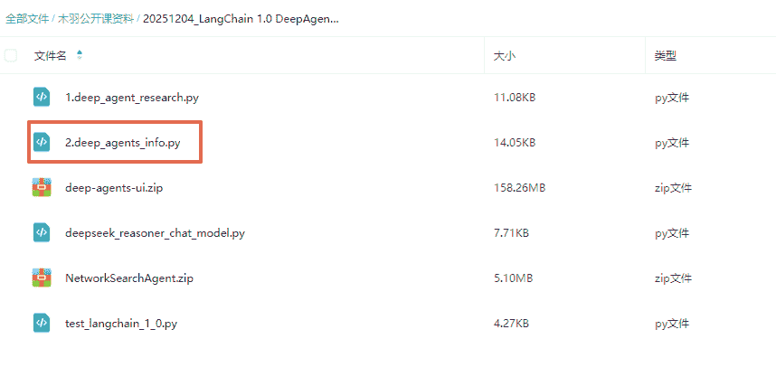

