# DeepSeek_Prover_V2

> 来源：[https://kq4b3vgg5b.feishu.cn/docx/BStOdAfpHovy6txAWq2cFwQ8nDd](https://kq4b3vgg5b.feishu.cn/docx/BStOdAfpHovy6txAWq2cFwQ8nDd)

deepseek

# **DeepSeek-Prover-V2: Advancing Formal Mathematical Re**asoning via Reinforcement Learning for Subgoal Decomposition

Z.Z. Ren*, Zhihong Shao*, Junxiao Song*, Huajian Xin†, Haocheng Wang†, Wanjia Zhao†, Liyue Zhang, Zhe Fu Qihao Zhu, Dejian Yang, Z.F. Wu, Zhibin Gou, Shirong Ma, Hongxuan Tang, Yuxuan Liu, Wenjun Gao

Daya Guo, Chong Ruan DeepSeek-AI

[**https://github.com/deepseek-a**](https://github.com/deepseek-ai/DeepSeek-Prover-V2)**i/DeepSee**k-Prover-V2 Abstract

We introduce DeepSeek-Prover-V2, an open-source large language model designed for formal theorem proving in Lean 4, with initialization data collected through a recursive theorem prov- ing pipeline powered by DeepSeek-V3. The cold-start training procedure begins by prompting DeepSeek-V3 to decompose complex problems into a series of subgoals. The proofs of resolved subgoals are synthesized into a chain-of-thought process, combined with DeepSeek-V3’s step- by-step reasoning, to create an initial cold start for reinforcement learning. This process enables us to integrate both informal and formal mathematical reasoning into a unified model. The resulting model, DeepSeek-Prover-V2-671B, achieves state-of-the-art performance in neural theorem proving, reaching 88.9% pass ratio on the MiniF2F-test and solving 49 out of 658 problems from PutnamBench. In addition to standard benchmarks, we introduce ProverBench, a collection of 325 formalized problems, to enrich our evaluation, including 15 selected prob- lems from the recent AIME competitions (years 24-25). Further evaluation on these 15 AIME problems shows that the model successfully solves 6 of them. In comparison, DeepSeek-V3 solves 8 of these problems using majority voting, highlighting that the gap between formal and informal mathematical reasoning in large language models is substantially narrowing.

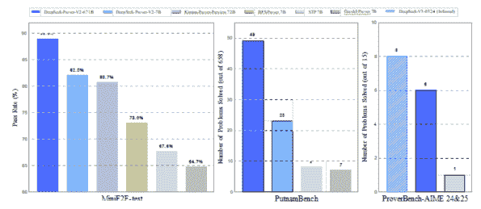

Figure 1 | Benchmark performance of DeepSeek-Prover-V2. On the AIME benchmark, DeepSeek- V3 is evaluated using the standard find-answer task for natural-language reasoning, while prover models generate Lean code to construct formal proofs for a given correct answer.

# 1.  Introduction

The emergence of reasoning capabilities in large language models (LLMs) has revolutionized numerous areas of artificial intelligence, particularly in the domain of mathematical problem solving(DeepSeek-AI, 2025).  These advancements are largely enabled by the paradigm of inference-time scaling, most notably through natural language chain-of-thought reasoning (Jaechetal.,2024). Rather than relying solely on a single forward pass to arrive at an answer, LLMs can reflect on intermediate reasoning steps, improving both accuracy and interpretability. Despite the success of natural language reasoning in solving competition-level mathematical problems, its application to formal theorem proving remains fundamentally challenging. LLMs perform natural language reasoning in an inherently informal manner, relying on heuristics, ap- proximations, and data-driven guessing patterns that often lack the rigorous structure required by formal verification systems. In contrast, proof assistants such as Lean (Moura and Ullrich, 2021), Isabelle (Paulson,1994), andCoq (Barrasetal.,1999) operateonstrictlogicalfoundations, where every proof step must be explicitly constructed and formally verified. These systems permit no ambiguity, implicit assumptions, or omission of details. Bridging the gap between informal, high-level reasoning and the syntactic rigor of formal verification systems remains a longstandingresearchchallengeinneuraltheoremproving (Yangetal.,2024).

To harness the strengths of informal mathematical reasoning in support of formal theorem proving, a classical approach is to hierarchically decompose formal proofs based on the guidance of natural-language proof sketches. Jiang et al. (2023) proposed a framework, called Draft, Sketch, and Prove (DSP), that leverages a large language model to generate proof sketches in natural language, which are subsequently translated into formal proof steps. This informal-to-formal theorem proving paradigm closely mirrors the concept of subgoals in hierarchical reinforcement learning (BartoandMahadevan,2003;Nachumetal.,2018;Eppeetal.,2022), wherecomplex tasks are broken down into a hierarchy of simpler subtasks that can be solved independently to progressively achieve the overarching objective.  In formal theorem proving, a subgoal is typically an intermediate proposition or lemma that contributes to the proof of a larger theorem (Zhaoetal.,2023,2024). This hierarchical decomposition aligns with human problem- solving strategies and supports modularity, reusability, and more efficient proof search (Wang et al.,2024b;Zheng et al.,2024). Recent studies have extended this paradigm by employing multi-tieredhierarchiesforstructuredproofgeneration (Wangetal.,2024a), andbyleveraging reinforcement learning techniques to optimize the decomposition of complex theorems into manageablesubgoals (Dongetal.,2024).

In this paper, we develop a reasoning model for subgoal decomposition, leveraging a suite of synthetic cold-start data and large-scale reinforcement learning to enhance its performance. To construct the cold-start dataset, we develop a simple yet effective pipeline for recursive theorem proving, utilizingDeepSeek-V3 (DeepSeek-AI,2024) asaunifiedtoolforbothsubgoaldecompo- sition and formalization. We prompt DeepSeek-V3 to decompose theorems into high-level proof sketches while simultaneously formalizing these proof steps in Lean 4, resulting in a sequence of subgoals. Since the subgoal decomposition is powered by a large general-purpose model, we use a smaller 7B model to handle the proof search for each subgoal, thereby reducing the associated computational burden. Additionally, we introduce a curriculum learning framework that lever- ages the decomposed subgoals to generate conjectural theorems, progressively increasing the difficulty of training tasks to better guide the model’s learning process. Once the decomposed steps of a challenging problem are resolved, we pair the complete step-by-step formal proof with the corresponding chain-of-thought from DeepSeek-V3 to create cold-start reasoning data. Based on the cold start, a subsequent reinforcement learning stage is applied to further strengthen

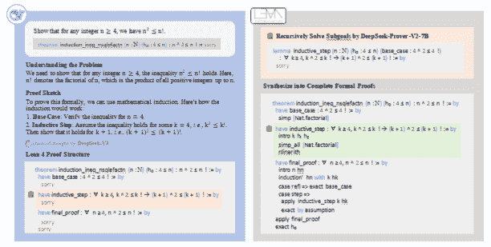

Figure 2 | Overview of the cold-start data collection process employed by DeepSeek-Prover-V2. We first prompt DeepSeek-V3 to generate a natural-language proof sketch while simultaneously formalizing it into a Lean statement with sorry placeholders for omitted proof details. A 7B prover model then recursively solves the decomposed subgoals. By combining these subgoal proofs, we construct a complete formal proof for the original complex problem. This composed proof is appended to DeepSeek-V3’s original chain-of-thought, creating high-quality cold-start training data for formal mathematical reasoning.

the connection between informal mathematical reasoning and formal proof construction. Our experiments show that reinforcement learning starting from the cold start of informal reasoning in task decomposition significantly enhances the model’s capabilities informal theorem prov- ing. The resulting DeepSeek-Prover-V2-671B model establishes a new state-of-the-art in neural theorem proving across multiple benchmarks.  On MiniF2F-test, it achieves 82.4% accuracy with Pass@32, improving to 88.9% with Pass@8192. The model shows strong generalization capabilities to college-level theorem proving, solving 37.1% of ProofNet-test problems with Pass@1024 and tackling 49 out of 658 challenging PutnamBench problems. Additionally, we contribute ProverBench, a benchmark dataset containing 325 formalized problems to advance neural theorem proving research, including 15 from the prestigious AIME competitions (years 24-25). DeepSeek-Prover-V2-671B successfully solves 6 of these 15 challenging AIME problems, further demonstrating its sophisticated mathematical reasoning capabilities.

# **2. Method**

## **2**.1.  Recursive Proof Search via Subgoal Decomposition

Decomposing the proof of a complex theorem into a sequence of smaller lemmas that serve as steppingstones is an effective strategy commonly employed by human mathematicians. Several previous studies have explored this hierarchical strategy in the context of neural theorem prov- ing, aiming to enhance proof search efficiency by leveraging the informal reasoning capabilities ofmodernLLMs (Jiangetal.,2023;Zhaoetal.,2023;Wangetal.,2024a;Dongetal.,2024). In thispaper, wedevelopasimpleyeteffectivepipelinethatutilizesDeepSeek-V3 (DeepSeek-AI, 2024) asaunifiedtoolforsubgoaldecompositioninformaltheoremproving.

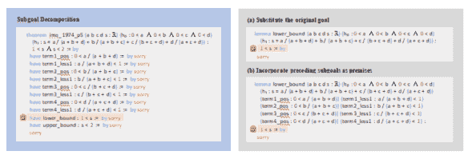

Figure 3 | An illustrative example of how we translate decomposed subgoals into a series of

lemma statements. We first (a) replace the original goal state and then (b) incorporate preceding subgoals as premises. Statement type (b) is used for recursive solving of complex problems,

while both types (a) and (b) are incorporated into the curriculum learning process.

**S**ketching Formal Proofs from Natural Language Reasoning.    Recent advances in large lan- guage models have led to significant breakthroughs in informal reasoning capabilities. To bridge the gap between formal and informal reasoning, we leverage cutting-edge general-purpose LLMs, recognized for their strong mathematical reasoning and instruction-following abilities, to construct the foundational framework of our theorem-proving system. Our findings indicate thatoff-the-shelfmodels, suchasDeepSeek-V3 (DeepSeek-AI,2024), arecapableofdecompos- ing proof steps and expressing them informal languages. To prove a given formal theorem statement, we prompt DeepSeek-V3 to first analyze the mathematical problem in natural lan- guage, then decompose the proof into smaller steps, translating each step into a corresponding Lean formal statement. Since general-purpose models are known to struggle with producing complete Lean proofs, we instruct DeepSeek-V3 to generate only a high-level proof sketch with the details omitted. The resulting chain of thought culminates in a Lean theorem composed of a sequence of have statements, each concluded with a sorry placeholder indicating a subgoal to be solved. This approach mirrors the human style of proof construction, in which a complex theorem is incrementally reduced to a sequence of more manageable lemmas.

**Recursive Resolut**ion of Subgoals.    Leveraging the subgoals generated by DeepSeek-V3, we adopt a recursive solving strategy to systematically resolve each intermediate proof step. We extract subgoal expressions from have statements to substitute them for the original goals in the given problems (see Figure 3(a)), andthenincorporatetheprecedingsubgoalsaspremises (see Figure 3(b)).  This construction enables subsequent subgoals to be resolved using the intermediate results of earlier steps, thereby promoting a more localized dependency structure and facilitating the development of simpler lemmas. To reduce the computational overhead of extensive proof search, we employ a smaller 7B prover model specifically optimized for processing the decomposed lemmas. Upon the successful resolution of all decomposed steps, a complete proof of the original theorem can be automatically derived.

**C**urriculum Learning for Subgoal-based Theorem Proving.   The training of prover models requires large formal-language problem sets, typically derived by formalizing existing natural- languagemathematicalcorpora (Xinetal.,2024a;Yingetal.,2024;Linetal.,2025). Although formalization of human-authored texts provides high-quality and diverse formalcontent, the resulting training signals for prover models are often sparse, as a large proportion of computa-

tional attempts do not yield successful proofs and therefore offer no positive reward signals. To generate denser training signals, Dong and Ma (2025) proposed a self-play approach that enriches training problem sets by generating tractable conjectures closely related to the original theorem statements, thereby enabling more efficient use of training compute. In this paper, we implement a straightforward approach that leverages subgoals to expand the scope of formal statements used for model training.  We generate two types of subgoal theorems, one incor- porating preceding subgoals as premises and one without, corresponding to Figure 3(b) and Figure 3(a), respectively.  Both types are integrated intotheexpertiterationstage(Poluand Sutskever,2020), establishing a curriculum that progressively guides the prover model toward systematically addressing a curated subset of challenging problems. This procedure builds on the same underlying principle as AlphaProof’s test-time reinforcement learning (DeepMind, 2024), whereinvariationsofatargetproblemaregeneratedtoenhancethemodel’scapabilityin

## solving challenging IMO-level problems.

**2**.2. Unifying Informal Reasoning and Proof Formalization

The algorithmic framework discussed above operates in two stages, leveraging two comple- mentary models: DeepSeek-V3 for lemma decomposition and a 7B prover model to complete the corresponding formal proof details. This pipeline provides a natural and scalable mecha- nism for synthesizing formal reasoning data by combining high-level reasoning from language models with precise formal verification. In this manner, we unify the capabilities of informal mathematical reasoning and proof formalization within a single model.

Cold Start by Synthetic Data.   We curate a subset of challenging problems that remain unsolved by the 7B prover model in an end-to-end manner, but for which all decomposed subgoals have been successfully resolved. By composing the proofs of all subgoals, we construct a complete formal proof for the original problem. This proof is then appended to DeepSeek-V3’s chain-of- thought, which outlines the corresponding lemma decomposition, thereby producing a cohesive synthesis of informal reasoning and subsequent formalization.  It enables the collection of hundreds of high-quality synthetic cold-start data, which serve as the foundation for training DeepSeek-Prover-V2. This cold-start dataset generation strategy differs from that of Kimina- Prover(Wang et al., 2025),a concurrent workonformalreasoningmodels.  Specifically, we synthesize data by formalizing natural-language proofs directly into structured formal proof sketches. In contrast, Kimina-Prover adopts a reverse workflow: it begins by collecting complete formal proofs alongside their informal counterparts, then uses general-purpose reasoning models to retrosynthesize intermediate natural-language reasoning steps into coherent thinking blocks.

**Reasoning-oriented Reinfo**rcement Learning.   After fine-tuning the prover model on the synthetic cold-start data, we perform a reinforcement learning stage to further enhance its ability to bridge informal reasoning with formal proof construction. Following the standard training objectiveforreasoningmodels (DeepSeek-AI,2025), weusebinarycorrect-or-incorrectfeedback as the primary form of reward supervision. During the training process, we observe that the structure of the generated proofs frequently diverges from the lemma decomposition provided by the chain-of-thought guidance. To address this issue, we incorporate a consistency reward in the early steps of training, which penalizes the structural misalignment, explicitly enforcing the inclusion of all decomposed have-structured lemmas in the final proof. In practice, enforcing this alignment enhances proof accuracy, especially on complex theorems that demand multi-step

## reasoning.

**2.3. Training Details o**f DeepSeek-Prover-V2

Two-Stage Training.   DeepSeek-Prover-V2 is developed through a two-stage training pipeline that establishes two complementary proof generation modes:

1.  **H**igh-efficiency non-Chain-of-Thought (non-CoT) mode: This mode is optimized for the rapid generation of formal Lean proof codes, focusing on producing concise proofs without explicit intermediate reasoning steps.

2.  **High-precision Chain-of-**Thought (CoT) mode: This mode systematically articulates intermediate reasoning steps, emphasizing transparency and logical progression, before constructing the final formal proofs.

ConsistentwithDeepSeek-Prover-V1.5(Xinetal., 2024b),thesetwogenerationmodesare governed by two distinct guiding prompts (see Appendix Afor examples). In the first stage, we employ expert iteration within a curriculum learning framework to train a non-CoT prover model, meanwhile, synthesizing proofs for hard problems through subgoal-based recursive proving.  The non-CoT generation mode is chosen to accelerate iterative training and data collection processes, as it offers significantly faster inference and validation cycles. Building on this foundation, the second stage leverages cold-start chain-of-thought (CoT) data synthesized by integrating DeepSeek-V3’s sophisticated mathematical reasoning patterns with our synthetic formal proofs.  The CoT mode is enhanced through a further reinforcement learning stage, following the standard training pipeline commonly used for reasoning models.

Expert Iteration.   The training procedure for the non-CoT mode of DeepSeek-Prover-V2 follows the paradigm of expert iteration (Polu and Sutskever,2020), a widely adopted framework for developing formal theorem provers. In each training iteration, the current best prover policy is used to generate proof attempts for those challenging problems that remain unsolved in prior iterations. Those successful attempts, verified by Lean proof assistant, are incorporated into the SFT dataset to train an improved model.  This iterative loop ensures that the model not only learns from the initial demonstration datasets but also distills its own successful reasoning  traces, progressively refining its ability to solve harder problems. The overall training procedure  remainslargelyalignedwiththatofDeepSeek-Prover-V1 (Xinetal.,2024a)andDeepSeek-Prover- V1.5 (Xin et al.,2024b), with only two modifications to the distribution of training problems. First, we incorporate additional problems derived from autoformalization and various open- sourcedatasets (Yingetal.,2024;DongandMa,2025;Linetal.,2025), broadeningthecoverage of the training problem domains. Second, we augment the dataset with problems generated through subgoal decomposition, aiming at solving more challenging instances from the valid splitoftheMiniF2Fbenchmark (Zhengetal.,2022).

Supervised Fine-tuning.   We perform supervised fine-tuning on DeepSeek-V3-Base-671B (DeepSeek-AI,2024) usingaconstantlearningrateof 5e-6 withinacontextwindowof 16,384 tokens. Our training corpus consists of two complementary sources: (1) non-CoT data collected through expert iteration, which produces Lean codes without intermediate reasoning steps; and (2) the cold-start CoT data described in Section 2.2, whichdistillsDeepSeek-V3’sadvanced mathematical reasoning processes into structured proving pathways. The non-CoT components emphasize formal verification skills in the Lean theorem prover ecosystem, while the CoT examples explicitly model the cognitive process of transforming mathematical intuition into formal proof structures.

Reinforcement Learning.   We employ Group Relative Policy Optimization (GRPO; Shaoetal., 2024) asourreinforcementlearningalgorithm, whichhasdemonstratedsuperioreffectiveness andefficiencyinreasoningtasks(DeepSeek-AI, 2025).  UnlikePPO(Schulmanetal., 2017), GRPO eliminates the need for a separate critic model by sampling a group of candidate proofs  for each theorem prompt and optimizing the policy based on their relative rewards. Training utilizes binary rewards, where each generated Lean proof receives a reward of 1 if verified as correct and 0 otherwise. To ensure effective learning, we curate training prompts to include only problems that are sufficiently challenging yet solvable by the supervised fine-tuned model. During each iteration, we sample 256 distinct problems, generating 32 candidate proofs per theorem with a maximum sequence length of 32,768 tokens.

Distillation.   WeextendthemaximumcontextlengthofDeepSeek-Prover-V1.5-Base-7B (Xin etal.,2024b) from 4,096 to 32,768 tokensandfine-tunethisextended-contextmodelusingrollout data collected during the reinforcement learning phase of DeepSeek-Prover-V2-671B. Alongside the CoT reasoning mode, we incorporate non-CoT proof data collected during expert iteration to enable a cost-efficient proving option that produces concise formal outputs with a small-size model. In addition, we perform the same reinforcement learning stage used in the training of the 671B model to boost the performance of DeepSeek-Prover-V2-7B.

# 3.  Experimental Results

In this section, we present a systematic evaluation of DeepSeek-Prover-V2 across diverse bench- mark datasets of formal theorem proving, covering both highschool competition problems and undergraduate-level mathematics.  All experimental results of DeepSeek-Prover-V2 are conductedwithLean 4.9.0, usingthesametestingenvironmentasDeepSeek-Prover-V1.5 (Xin et al.,2024b). Without further specification, baseline evaluation results are sourced from their

## respective original papers.

3.1.  Results on MiniF2F Benchmark

**MiniF2F **(Zhengetal., 2022) consistsof 488formalizedproblemstatementssourcedfroma diverse range of mathematical materials, including the AIME, AMC, and IMO competitions, alongwithselectedproblemsfromtheMATHdataset (Hendrycksetal.,2021). The benchmark includes Olympiad-level problems covering core areas of elementary mathematics, including algebra, number theory, and induction.  These problems are divided into two equally sized subsets, denoted by miniF2F-valid and miniF2F-test, each containing 244 problems with an identical distribution across subject areas. We reserve the miniF2F-test set exclusively for evalu- ating model performance, while the miniF2F-valid problems are incorporated into curriculum learning with subgoal decomposition. We adopt the revised version of miniF2F released by Wang et al. (2025), and further introducetwoadditionalrevisionstominiF2F-validandone revision to miniF2F-test (see Appendix C).

Comparison with SoTA Models.   Table 1summarizes a comparison of state-of-the-art formal theorem-proving modeling evaluated on the miniF2F-test dataset. The experimental results demonstrate that DeepSeek-Prover-V2-671B establishes a new state-of-the-art performance on the miniF2F-test benchmark, achieving an unprecedented 82.4% accuracy with only 32 samples when leveraging the CoT generation strategy. Notably, the more parameter-efficient

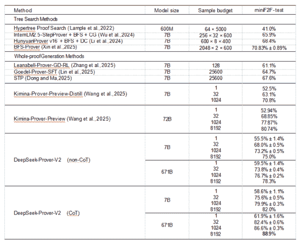

Table 1 | Comparison with state-of-the-art models on the miniF2F-test dataset. The notation μ ± σ denotes the average accuracy μ and the standard deviation σ . The tags CoT and non-CoT refer to two generation modes of a unified model, each guided by a different prompt.

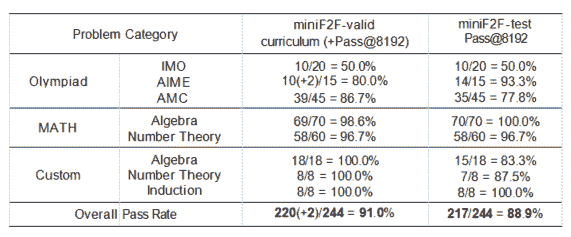

Table 2 | Problems solved by DeepSeek-Prover-V2-671B on the miniF2F benchmark. Results on miniF2F-valid are collected throughout the curriculum learning process, and DeepSeek-Prover- V2-671B is further invoked with Pass@8192 on the remaining problems.

DeepSeek-Prover-V2-7B also exhibits competitive performance, surpassing all existing open- source theorem provers in the literature. The comparative analysis further reveals a compelling scaling pattern: as the sample budget increases from 1 to 8192, the performance gap between the 7B and 671B variants widens considerably, with the larger model demonstrating superior sample efficiency and a steeper improvement trajectory.

**P**roving Challenging Problems through Subgoal-guided Curricula.    Table 2presents a de- tailed breakdown of the problems solved by DeepSeek-Prover-V2 on the miniF2Fbenchmark, where it achieves strong overall performance with a 91.0% pass rate on the validation set and 88.9% on the test set. Remarkably, our subgoal-guided curriculum learning framework, which integrates the general-purpose model DeepSeek-V3 with a lightweight specialized 7B prover, achieves a 90.2% success rate on miniF2F-valid, nearly matching the performance of DeepSeek- Prover-V2-671B. These findings highlight the potential of state-of-the-art general-purpose LLMs to extend beyond natural language understanding and effectively support complex formal reasoning tasks. Through strategic subgoal decomposition, the model is able to breakdown challenging problems into a sequence of tractable steps, serving as an effective bridge between informal reasoning and formal proof construction.

CoT vs. non-CoT.   The experimental results in Table 1 demonstrate a substantial perfor- mance advantage of the CoT reasoning mode over the non-CoT mode informal mathemat- ical reasoning. This reinforces the effectiveness of CoT prompting, which encourages decom- position of complex problems into intermedi- ate steps, and further confirms that inference-time scaling holds in the domain of formal theorem proving.

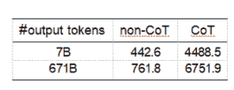

Table 3 | Average number of tokens generated by DeepSeek-Prover-V2 on miniF2F-test.

Complementing these findings, Table 3provides statistics on the number of tokens generated by DeepSeek-Prover-V2 under different reasoning modes. As expected, the CoT mode produces significantly longer outputs, reflecting its sophisticated reasoning process. Interestingly, within the non-CoT setting, the 671B model generates longer outputs on average compared to the 7B model. A closer examination reveals that, although explicit reasoning is not prompted in the non-CoT mode, the larger model often inserts brief natural language comments within the proof code that resemble implicit reasoning steps (see Appendix A). This suggests that high-capacity models may internalize and

## externalize intermediate reasoning implicitly, even in the absence of explicit CoT prompting

**3.2.  Results on Undergradu**ate-level Benchmarks

**ProofNet **(Azerbayevetal.,2023) consistsof 371 problemsinLean 3, drawnfromarangeof popular undergraduate pure mathematics textbooks, covering topics such as real and complex analysis, linear algebra, abstract algebra, and topology. We use the Lean 4 translation of ProofNet made available by Xin et al. (2024b), which is further divided into two splits: ProofNet-valid and ProofNet-test, containing 185 and 186 problems, respectively. The test split of ProofNet is reserved exclusively for model evaluation, as variants of the ProofNet-valid problems are included in the public synthetic dataset provided by Dong andMa (2025),whichisusedin our supervised fine-tuning. The results, shown in Table 4, indicate a substantial improvement in the pass rate of DeepSeek-Prover-V2 when using CoT reasoning compared to the non- CoT setting. Notably, despite the training data being predominantly drawn from high-school

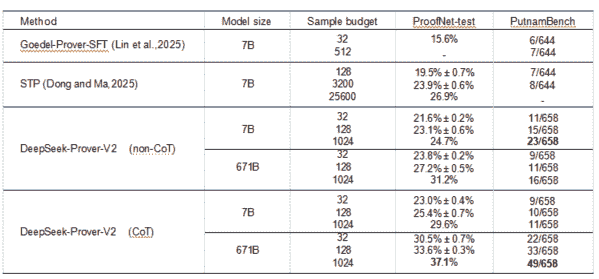

Table 4 | The experimental results on ProofNet-test and PutnamBench. The scores for Goedel- Prover-SFT and STP on PutnamBench are sourced from their original papers, which conducted evaluations on an earlier version of PutnamBench comprising 644 problems.

level mathematics, the model exhibits strong generalization to more advanced, college-level mathematical problems, underscoring its robust formal reasoning capabilities.

**PutnamBench **(Tsoukalasetal.,2024) isacontinuouslyupdatedbenchmarkfeaturingcompeti- tion mathematics problems from the William Lowell Putnam Mathematical Competition, spanning the years 1962 to 2023. The Putnam Competition is a highly prestigious annual mathematics competition for undergraduate students across the United States and Canada, encompassing a variety of college-level domains such as analysis, linear algebra, abstract algebra, combinatorics, probability, and set theory. We evaluate our model on the latest release of PutnamBench, which contains 658 problems formalized in Lean 4. We exclude problems that are incompatible with Lean 4.9.0 and evaluate the model on the remaining set of 649 problems. As shown in Table 4, DeepSeek-Prover-V2-671B demonstrates enhanced reasoning capabilities in the PutnamBench, solving 49 problems and significantly outperforming its non-CoT counterpart. These results further highlight the effectiveness of the CoT reasoning approach in handling challenging, college-level mathematical problems.

**Skill Discovery by Reinfo**rcement Learning.   An unexpected finding in our evaluation is the exceptional performance of DeepSeek-Prover-V2-7B with non-CoT generation mode on the PutnamBench dataset. Remarkably, this smaller 7B model successfully solves 13 problems that remain unsolved by its larger counterpart, DeepSeek-Prover-V2-671B, raising our total number of solved problems on PutnamBench from 49 to 62 out of 658. Upon closer examination of the model’s outputs, we identified a distinctive pattern in its reasoning approach: the 7B model frequently employs Cardinal .toNat and Cardinal.natCast_inj to handle problems in- volving finite cardinalities (see examples in Appendix B), which are noticeably absent in the outputs generated by the 671B version. This technique appears to enable the model to effectively solve a subset of problems that require nuanced manipulation of cardinal values.

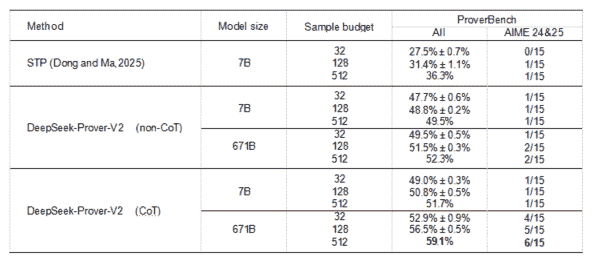

Table 6 | The experimental results on ProverBench. The All category represents the complete evaluation set consisting of 325 problems, while AIME 24&25 denotes a subset of 15 problems formalized from recent AIME competitions.  TheresultsforSTP(DongandMa, 2025)are evaluated using the open-source model weights.

## **3.3.  Results on Co**mbinatorial Problems

**CombiBench **(Liuetal., 2025)isacomprehen- sive benchmark comprising 100 combinatorial competition problems formalized in Lean 4, each paired with its corresponding natural-language statement.   We evaluate DeepSeek-Prover-V2 in the with-solution setting of this benchmark, where the correct answer is embedded in the Lean statement, allowing the evaluation to fo- cus solely on proof generation.  After filtering out problems incompatible with Lean 4.9.0 and those containing multiple sorry placeholders, we evaluate on 77 problems from the bench- mark and successfully solve 12 of them.

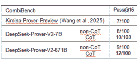

Table 5 | Evaluation results on CombiBench under the with-solution setting.

These results indicate that, while the prover model is primarily trained in number theory and algebra, it demonstrates promising generalization to combinatorial problems, despite their persistent difficulty.

## **3**.4.  ProverBench: Formalization of AIME and Textbook Problems

To enhance existing benchmarks and advance research informal theorem proving, we introduce a benchmark dataset comprising 325 problems. Of these, 15 are formalized from number theory and algebra questions featured in the recent AIME competitions (AIME 24 and 25), offering authentic high-school competition-level challenges. The remaining 310 problems are drawn from curated textbook examples and educational tutorials, contributing a diverse and pedagogically grounded collection of formalized mathematical problems.  This benchmark is designed to enable more comprehensive evaluation across both high-school competition problems and undergraduate-level mathematics.

AIME Formalization.   The American In- vitational Mathematics Examination (AIME)

is an annual mathematics competition de- signed to challenge and recognize talented highschool students who demonstrate ex- ceptional proficiency in mathematics. The problems from AIME 24&25 have become a standard benchmark for evaluating the rea- soning capabilities of large language mod- els.  In order to bridge the evaluation of model performance across formal and in- formal mathematical reasoning, we curate and formalize a subset of problems from AIME 24&25. To ensure cleaner formaliza-tions, we filter out geometry, combinatorics, and counting problems whose representations in Lean are potentially cumbersome.

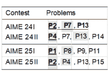

Table 7 | Selection of AIME 24&25 problems for formalization. Problems with underlined bolded indices have been solved by DeepSeek-Prover- V2. Problems solved by DeepSeek-V3-0324 using Maj@16 are highlighted with a gray background.

This results in 15 selected problems, covering competition- level topics in elementary number theory and algebra. We evaluate DeepSeek-V3-0324 on the selected set of problems using the standard find-answer task for natural-language mathematical reasoning. With majority voting over 16 sampled responses, the model successfully solves 8 out of 15 problems. In comparison, DeepSeek-Prover-V2-671B, operating under the formal proof generation setting with given correct answers, is able to construct valid formal proofs for 6 of 15 problems. This comparison highlights that the performance gap between informal mathematical reasoning and formal theorem proving is substantially narrowing, indicating growing alignment between linguistic understanding and formal logical rigor in advanced language models.

Textbook Formalization.   In addition to AIME

24&25, we augment our benchmark with prob- lems carefully selected from textbooks used in high  school  competitions  and undergraduate- level courses to strengthen coverage in specific mathematical domains. This curation process en- sures comprehensive representation across dif- ficulty levels and topic areas.  As a result, we formalize 310 problems that encompass a broad spectrum, ranging from elementary mathematics at the competition level to advanced topics typi- cally encountered in undergraduate studies. This comprehensive benchmark covers number the- ory, elementary algebra, linear algebra, abstract algebra,calculus, real analysis, complex analysis, functional analysis, and probability. The deliber- ate inclusion of this diverse array of mathematical fields allows for a thorough assessment of model capabilities across varying levels of abstraction

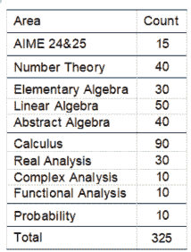

Table 8 | Distribution of mathematical areas represented in ProverBench.

and reasoning styles. Number theory and algebra problems test a model’s facility with discrete structures and equations, while analysis-oriented problems evaluate understanding of limits, continuity, and calculus. The abstract algebra and functional analysis components challenge models to reason about abstract structures and spaces, requiring sophisticated formal reasoning capabilities. The evaluation results are presented in Table 6. As shown,DeepSeek-Prover-V2-

671B with CoT reasoning consistently outperforms all baselines, reinforcing the trends observed

# in other benchmark evaluations.

**4.  Conclusion**

In this work, we propose a comprehensive pipeline for synthesizing cold-start reasoning data to advance formal theorem proving. Our data construction process is grounded in a recursive theorem-proving framework, wherein DeepSeek-V3 serves as a unified model for both subgoal decomposition and lemma formalization within the Lean 4 proof assistant. Our approach com- bines high-level proof sketches with formal steps, creating a sequence of manageable subgoals that can be efficiently solved using a smaller 7B model, significantly reducing computational re- quirements. The curriculum learning framework we developed uses these decomposed subgoals to generate increasingly difficult training tasks, creating a more effective learning progression. By pairing complete formal proofs with DeepSeek-V3’s chain-of-thought reasoning, we estab- lished valuable cold-start reasoning data that bridges informal mathematical thinking with formal proof structures. The subsequent reinforcement learning stage substantially enhanced this connection, leading to significant improvements informal theorem proving capabilities. The resulting model, DeepSeek-Prover-V2-671B, consistently outperforms all baselines across a range of benchmarks, spanning both high-school competition problems and undergraduate- level mathematics. Our future work will focus on scaling this paradigm to an AlphaProof-like system with the ultimate aim of tackling IMO-level mathematical problems that represent the frontier of automated theorem proving challenges.

**References**

Z. Azerbayev, B. Piotrowski, H. Schoelkopf, E. W. Ayers, D. Radev, and J. Avigad.  ProofNet: Autoformalizing and formally proving undergraduate-level mathematics.  arXiv preprint arXiv:2302.12433, 2023.

B. Barras, S. Boutin, C. Cornes, J. Courant, Y. Coscoy, D. Delahaye, D. de Rauglaudre, J.-C. Filliâtre, E. Giménez, H. Herbelin, et al. The Coq proof assistant reference manual. INRIA, version, 6(11):17–21, 1999.

A. G. Barto and S. Mahadevan. Recent advances in hierarchical reinforcement learning. Discrete event dynamic systems, 13:341–379, 2003.

De[e](https://deepmind.google/discover/blog/ai-solves-imo-problems-at-silver-medal-level/)pMind. AI achieves silver-medal standard solving international mathematical olympiad problems. https://deepmind.google/discover/blog/ai-solves-imo-problems-a t-silver-medal-level/,2024.

De[epS](https://arxiv.org/abs/2412.19437)eek-AI. Deepseek-v3 technical report, 2024. URL https://arxiv.org/abs/2412.194 37.

DeepSeek-AI. Deepseek-r1: Incentivizing reasoning capability in llms via reinforcement learning,

2025. URL https://arxiv.org/abs/2501.12948.

K. Dong and T. Ma. STP: Self-play llmtheorem provers with iterative conjecturing and proving. arXiv preprint arXiv:2502.00212, 2025.

K. Dong, A. Mahankali, and T. Ma. Formal theorem proving by rewarding llms to decompose proofs hierarchically. arXiv preprint arXiv:2411.01829, 2024.

M. Eppe, C. Gumbsch, M. Kerzel, P. D. Nguyen, M. V. Butz, and S. Wermter. Intelligent problem- solving as integrated hierarchical reinforcement learning. Nature Machine Intelligence, 4(1): 11–20, 2022.

D. Hendrycks, C. Burns, S. Kadavath, A. Arora, S. Basart, E. Tang, D. Song, and J. Steinhardt. Measuring mathematical problem solving with the MATH dataset. In Thirty-fifth Conference on Neural Information Processing Systems Datasets and Benchmarks Track (Round 2), 2021.

A. Jaech, A. Kalai, A. Lerer, A. Richardson, A. El-Kishky, A. Low, A. Helyar, A. Madry, A. Beutel,

A. Carney, et al. Openai o1 system card. arXiv preprint arXiv:2412.16720, 2024.

A. Q. Jiang, S. Welleck,J. P. Zhou, T. Lacroix,J. Liu, W. Li, M. Jamnik, G. Lample, and Y. Wu. Draft, sketch, and prove: Guiding formal theorem provers with informal proofs.  In The Eleventh International Conference on Learning Representations, 2023.

G. Lample, M.-A. Lachaux, T. Lavril, X. Martinet, A. Hayat, G. Ebner, A. Rodriguez, and T. Lacroix.   Hypertree proof search for neural theorem proving.   In Proceedings of the 36th International Conference on Neural Information Processing Systems, pages 26337–26349, 2022.

Y. Li, D. Du, L. Song, C. Li, W. Wang, T. Yang, and H. Mi.  Hunyuanprover: A scalable data synthesis framework and guided tree search for automated theorem proving. arXiv preprint arXiv:2412.20735, 2024.

Y. Lin, S. Tang, B. Lyu, J. Wu, H. Lin, K. Yang, J. Li, M. Xia, D. Chen, S. Arora, et al.  Goedel- Prover:  A frontier model for open-source automated theorem proving.    arXiv preprint arXiv:2502.07640, 2025.

J. L[iu, X.](https://moonshotai.github.io/CombiBench/) [Lin, J. Bayer, Y. Di](https://moonshotai.github.io/CombiBench/)llies, W. Jiang, X. Liang, R. Soletskyi, H. Wang, Y. Xie, B. Xiong, et al.  CombiBench: Benchmarking llm capability for combinatorial mathematics. https: //moonshotai.github.io/CombiBench/, 2025.

L. d. Moura and S. Ullrich.   The Lean 4 theorem prover and programming language.   In Automated Deduction–CADE 28: 28th International Conference on Automated Deduction, Virtual Event, July 12–15, 2021, Proceedings 28, pages 625–635. Springer, 2021.

O. Nachum, S. S. Gu, H. Lee, and S. Levine. Data-efficient hierarchical reinforcement learning. Advances in neural information processing systems, 31, 2018.

L. C. Paulson. Isabelle a Generic Theorem Prover. Springer Verlag, 1994.

S. Polu and I. Sutskever. Generative language modeling for automated theorem proving. arXiv preprint arXiv:2009.03393, 2020.

J. Schulman, F. Wolski, P. Dhariwal, A. Radford, and O. Klimov. Proximal policy optimization algorithms. arXiv preprint arXiv:1707.06347, 2017.

Z. Shao, P. Wang, Q. Zhu, R. Xu,J. Song, M. Zhang, Y. Li, Y. Wu, and D. Guo. DeepSeekMath: Pushing the limits of mathematical reasoning in open language models.   arXiv preprint arXiv:2402.03300, 2024.

G. Tsoukalas, J. Lee, J. Jennings, J. Xin, M. Ding, M. Jennings, A. Thakur, and S. Chaudhuri. PutnamBench: Evaluating neural theorem-provers on the putnam mathematical competi- tion. In The Thirty-eight Conference on Neural Information Processing Systems Datasets and Benchmarks Track, 2024.

H. Wang, H. Xin, Z. Liu, W. Li, Y. Huang,J. Lu, Y. Zhicheng,J. Tang, J. Yin, Z. Li, et al. Prov- ing theorems recursively.  In The Thirty-eighth Annual Conference on Neural Information Processing Systems, 2024a.

H. Wang, H. Xin, C. Zheng, Z. Liu, Q. Cao, Y. Huang, J. Xiong, H. Shi, E. Xie, J. Yin, et al. Lego-prover: Neural theorem proving with growing libraries. In The Twelfth International Conference on Learning Representations, 2024b.

H. Wang, M. Unsal, X. Lin, M. Baksys,J. Liu, M. D. Santos, F. Sung, M. Vinyes, Z. Ying, Z. Zhu, et al. Kimina-Prover Preview: Towards large formal reasoning models with reinforcement learning. arXiv preprint arXiv:2504.11354, 2025.

Z. Wu, S. Huang, Z. Zhou, H. Ying, J. Wang, D. Lin, and K. Chen.  Internlm2. 5-stepprover: Advancing automated theorem proving via expert iteration on large-scale lean problems. arXiv preprint arXiv:2410.15700, 2024.

H. Xin, D. Guo, Z. Shao, Z. Ren, Q. Zhu, B. Liu, C. Ruan, W. Li, and X. Liang.  DeepSeek- Prover: Advancing theorem proving in llms through large-scale synthetic data. arXiv preprint arXiv:2405.14333, 2024a.

H. Xin, Z. Ren, J. Song, Z. Shao, W. Zhao, H. Wang, B. Liu, L. Zhang, X. Lu, Q. Du, et al. DeepSeek-Prover-V1.5: Harnessing proof assistant feedback for reinforcement learning and monte-carlo tree search. arXiv preprint arXiv:2408.08152, 2024b.

R. Xin, C. Xi, J. Yang, F. Chen, H. Wu, X. Xiao, Y. Sun, S. Zheng, and K. Shen.  BFS-Prover: Scalable best-first tree search for llm-based automatic theorem proving.    arXiv preprint arXiv:2502.03438, 2025.

K. Yang, G. Poesia,J. He, W. Li, K. Lauter, S. Chaudhuri, and D. Song. Formal mathematical reasoning: A new frontier in AI. arXiv preprint arXiv:2412.16075, 2024.

H. Ying, Z. Wu, Y. Geng,J. Wang, D. Lin, and K. Chen.  Lean workbook: A large-scale lean problem set formalized from natural language math problems. In The Thirty-eight Conference on Neural Information Processing Systems Datasets and Benchmarks Track, 2024.

J. Zhang,Q. Wang,X. Ji,Y. Liu,Y. Yue, F. Zhang,D. Zhang,G. Zhou, and K. Gai. Leanabell-prover: Posttraining scaling informal reasoning. arXiv preprint arXiv:2504.06122, 2025.

X. Zhao, W. Li, and L. Kong. Decomposing the enigma: Subgoal-based demonstration learning for formal theorem proving. arXiv preprint arXiv:2305.16366, 2023.

X. Zhao, L. Zheng, H. Bo, C. Hu, U. Thakker, and L. Kong. Subgoalxl: Subgoal-based expert learning for theorem proving. arXiv preprint arXiv:2408.11172, 2024.

C. Zheng, H. Wang, E. Xie, Z. Liu,J. Sun, H. Xin,J. Shen, Z. Li, and Y. Li. Lyra: Orchestrating dual correction in automated theorem proving. Transactions on Machine Learning Research, 2024.

K. Zheng,J. M. Han,and S. Polu. miniF2F: a cross-system benchmark for formal olympiad-level mathematics. In International Conference on Learning Representations, 2022.

# **A**.  Examples of Non-CoT and CoT Prompting for Proof Generation

## **A.1.  Non-CoT Generation o**f DeepSeek-Prover-V2

Input：

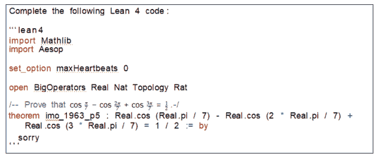

Outputs：

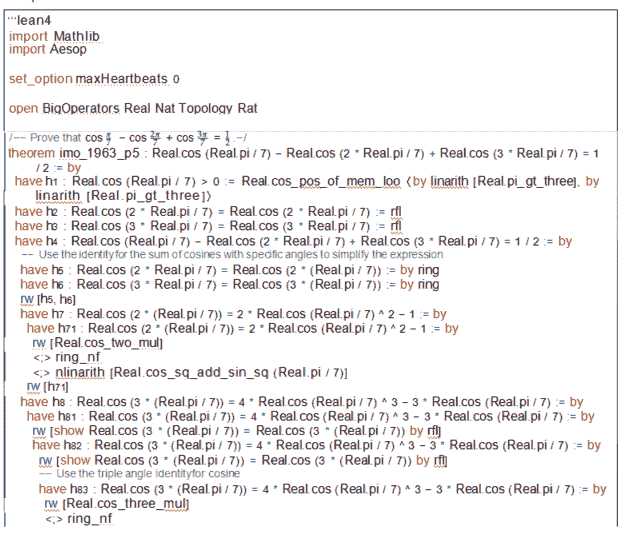

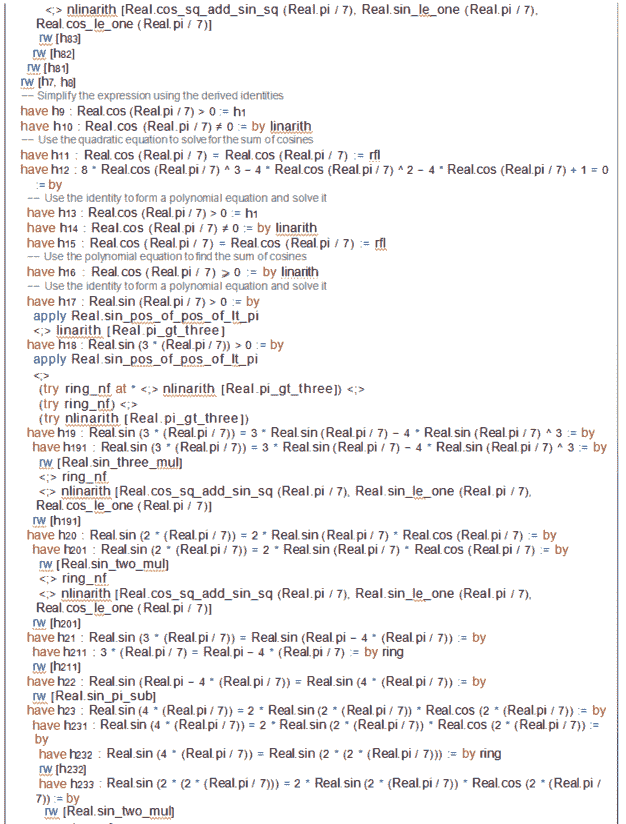

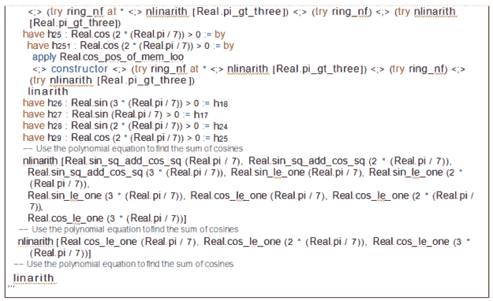

## **A.2.  CoT Generation Strategy o**f DeepSeek-Prover-V2

inputs：

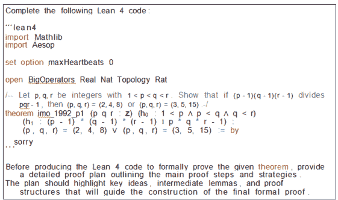

To enhance clarity, model outputs are reformulated using inline LaTeX expressions.

Output:

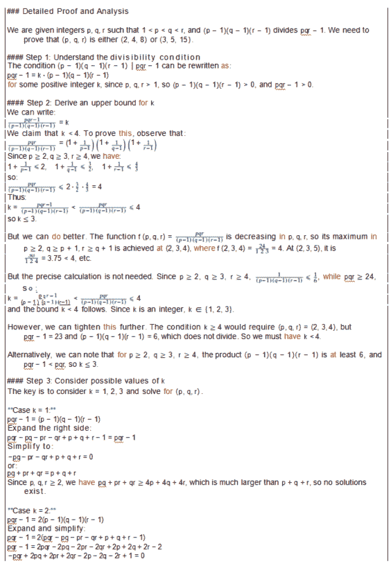

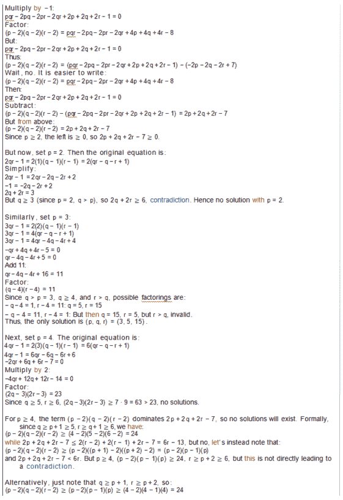

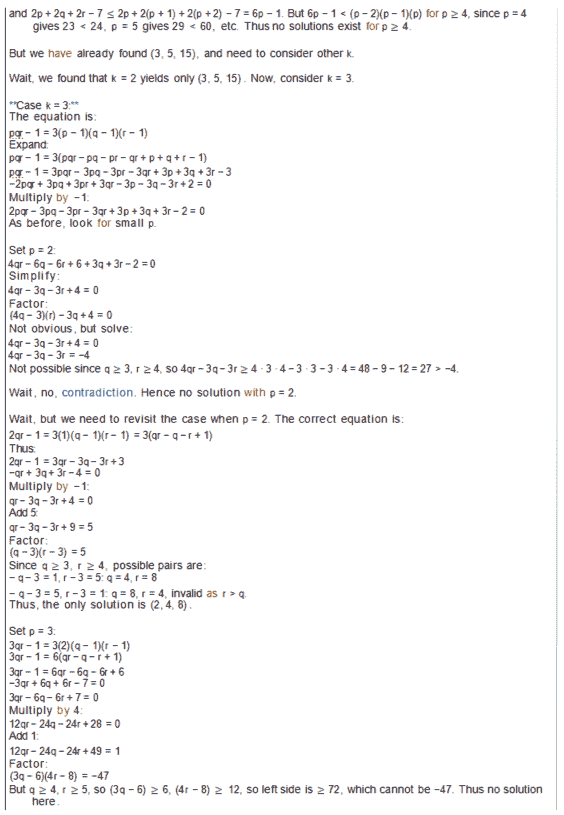

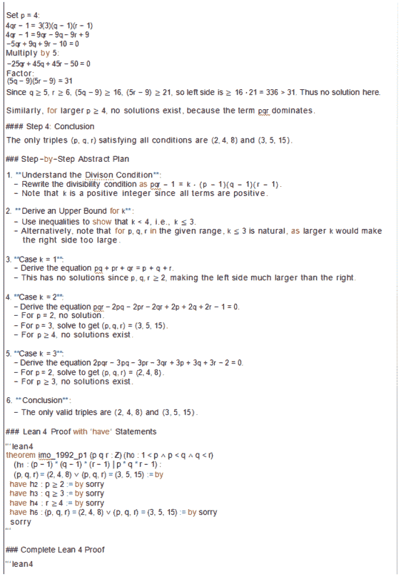

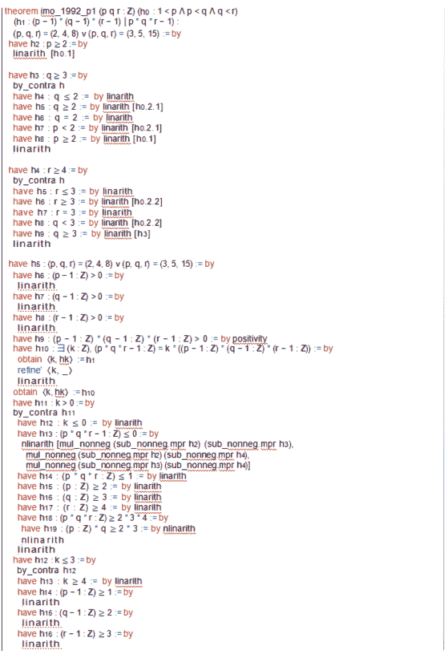

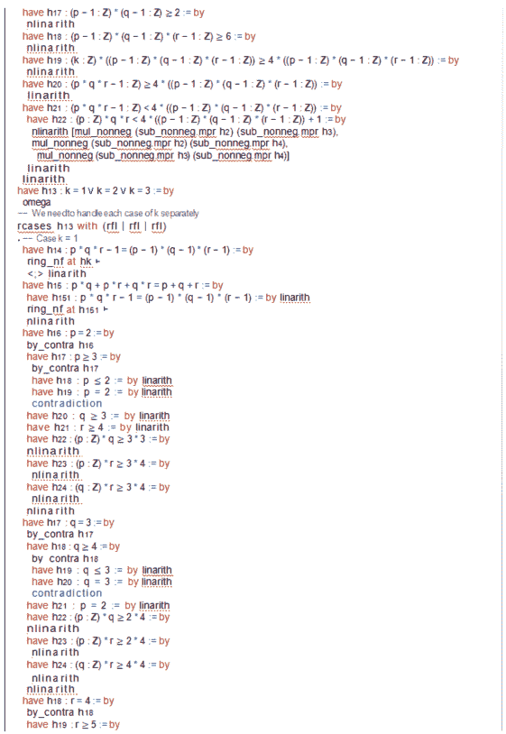

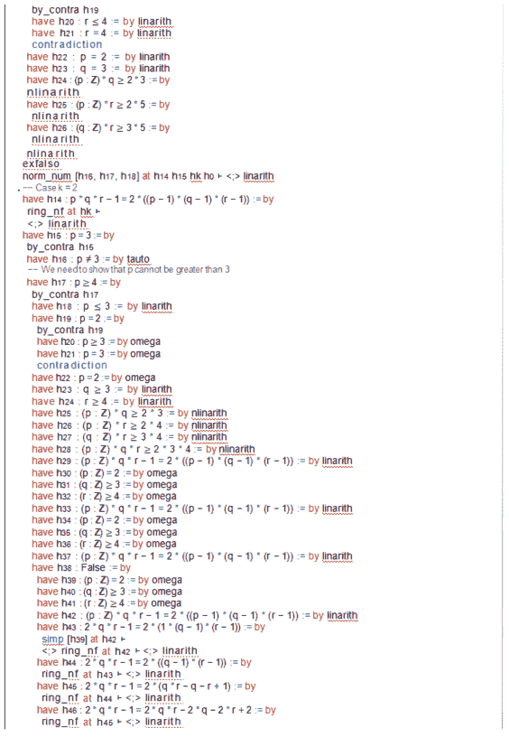

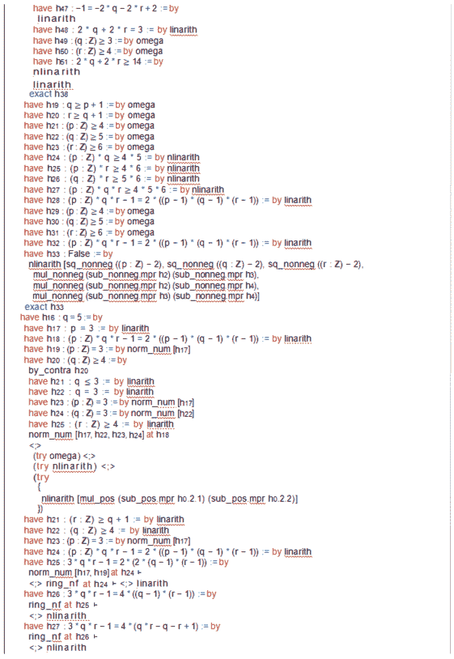

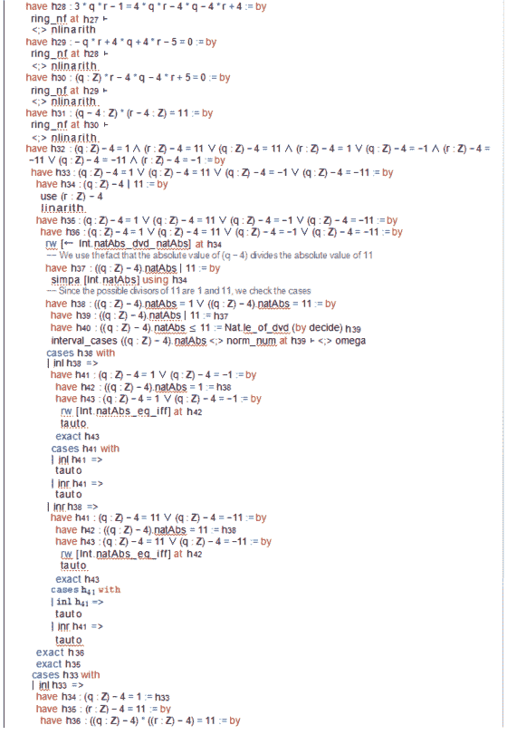

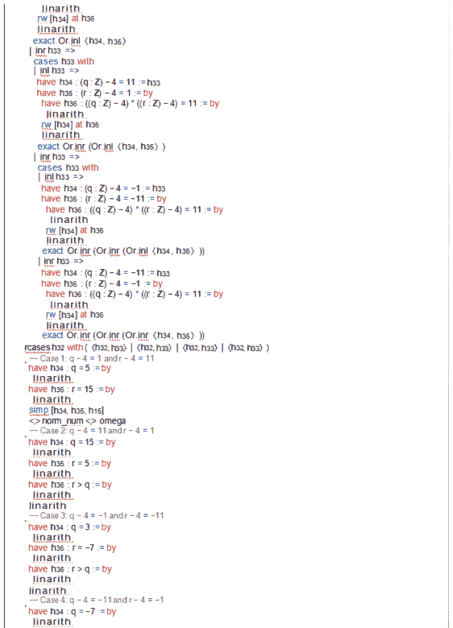

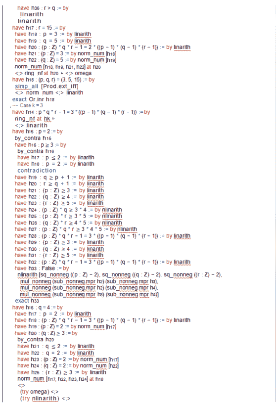

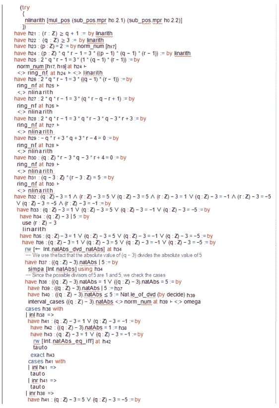

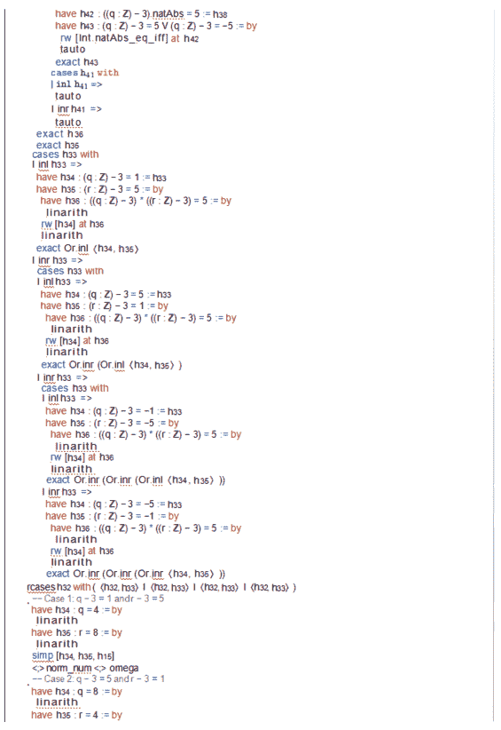

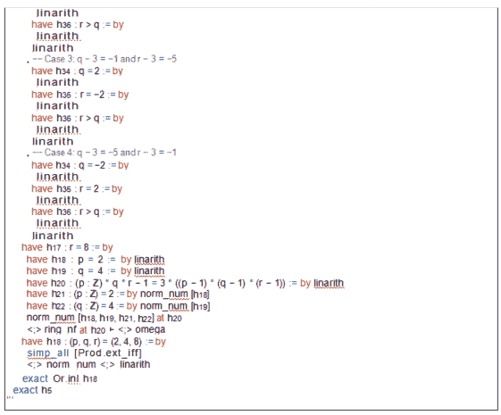

# **B.  Examples of the Proofs Generated b**y DeepSeek-Prover-V2-7B on Putnam- Bench

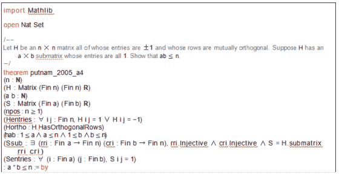

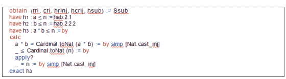

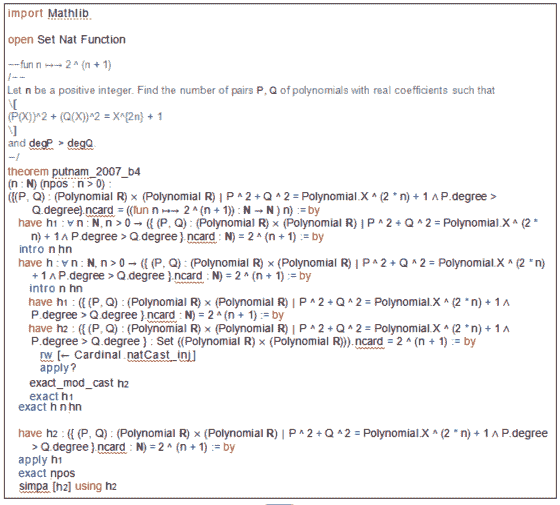

# C.  Revision to MiniF2F

1. mathd_algebra_247:

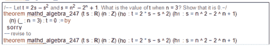

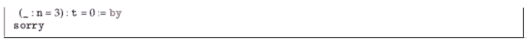

2.  induction_sum_odd:

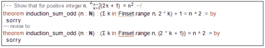

3.  induction_prod1p1onk3le3m1onn:

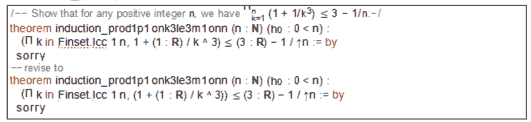