# `DeepSeek-Prover-V2`：通过强化学习推进子目标分解的正式数学推理

> 来源：[https://kq4b3vgg5b.feishu.cn/docx/O9audn0tYoPAF4xTMOvcKdD5nvc](https://kq4b3vgg5b.feishu.cn/docx/O9audn0tYoPAF4xTMOvcKdD5nvc)

Ren Z.Z.*、Shao Zhihong*、Song Junxiao*、Xin Huajian?、Wang Haocheng?、Zhao Wanjia?、Zhang Liyue、Fu Qihao Zhu Zhe、Yang Dejian、Wu Z.F.、Gou Zhibin、Ma Shirong、Tang Hongxuan、Liu Yuxuan、Gao Wenjun

郭代亚，阮崇`DeepSeek-AI`

[`https://github.com/deepseek-ai/DeepSeek-Prover-V2`](https://github.com/deepseek-ai/DeepSeek-Prover-V2) 摘要

我们介绍`DeepSeek-Prover-V2`，这是一个为`Lean 4`中的形式定理证明设计的开源大型语言模型，其初始化数据通过由`DeepSeek-V3`驱动的递归定理证明管道收集。冷启动训练过程首先通过提示`DeepSeek-V3`将复杂问题分解为一系列子目标开始。已解决的子目标证明被合成到一个思路链中，结合`DeepSeek-V3`的逐步推理，以创建强化学习的初始冷启动。这一过程使我们能够将非形式和形式数学推理整合到一个统一的模型中。最终得到的模型`DeepSeek-Prover-V2-671B`，在神经定理证明方面达到了最先进的性能，在`MiniF2F`测试中的通过率为88.9%，并解决了`PutnamBench`中658个问题中的49个。除了标准基准测试外，我们还引入了`ProverBench`，这是一组包含325个形式化问题的集合，以丰富我们的评估，其中包括最近`AIME`竞赛（第24-25届）中选出的15个问题。进一步评估这15个`AIME`问题显示，模型成功解决了其中的6个。相比之下，`DeepSeek-V3`通过多数投票解决了8个问题，这表明大型语言模型在形式化和非形式化数学推理之间的差距正在显著缩小。

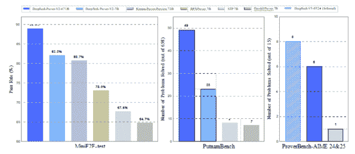

图1|`DeepSeek-Prover-V2`的基准性能。在`AIME`基准上，`DeepSeekV3`使用标准的`find-answer`任务进行自然语言推理评估，而prover模型生成`Lean`代码来构建给定正确答案的形式证明。

## 1. 介绍

大型语言模型（`LLMs`）中推理能力的出现已经革新了人工智能的许多领域，特别是在数学问题解决方面（`DeepSeek-AI`，2025）。这些进步主要得益于推理时间扩展范式，特别是通过自然语言思维链推理（Jaech等，2024）。与仅依赖一次前向传播来得出答案不同，`LLMs`可以反思中间的推理步骤，从而提高准确性和可解释性。尽管自然语言推理在解决竞赛级别的数学问题方面取得了成功，但将其应用于形式定理证明仍然具有根本性的挑战。`LLMs`以一种本质上非正式的方式进行自然语言推理，依赖于启发式方法、近似值和数据驱动的猜测模式，这些往往缺乏形式验证系统所需的严格结构。相比之下，像`Lean`（Moura和Ullrich，2021）、`Isabelle`（Paulson，1994）和`Coq`（Barras等，1999年）这样的证明助手则表现得更为严谨。它们基于严格的逻辑基础运行，每个证明步骤都必须明确构建并正式验证。这些系统不允许有任何歧义、隐含假设或细节遗漏。弥合非形式、高层次推理与形式验证系统的语法严谨性之间的差距，一直是神经定理证明领域长期的研究挑战（杨等，2024）。

为了利用非正式数学推理的优势来支持形式化定理证明，一种经典的方法是根据自然语言证明草图的指导，层次分解形式化证明。江等人（2023）提出了一种称为“草稿、草图和证明”（`DSP`）的框架，该框架利用大型语言模型生成自然语言的证明草图，随后将其翻译成形式化的证明步骤。这种从非正式到形式化的定理证明范式，与层次强化学习中的子目标概念非常相似（Barto和Mahadevan，2003；Nachum等，2018；Eppe等，2022年），复杂任务被分解为一系列更简单的子任务，这些子任务可以独立解决，逐步实现总体目标。在形式定理证明中，子目标通常是有助于证明更大定理的中间命题或引理（赵等，2023,2024）。这种层次分解与人类解决问题的策略相一致，支持模块化、可重用性和更高效的证明搜索（王等，2024b；郑等，2024）。最近的研究通过采用多层层次结构生成结构化的证明（王等，2024a），以及利用强化学习技术优化复杂定理的分解为易于管理的子目标（董等，2024），扩展了这一范式。

在本文中，我们开发了一个子目标分解的推理模型，利用一系列合成的冷启动数据和大规模强化学习来提高其性能。为了构建冷启动数据集，我们开发了一个简单而有效的递归定理证明流程，利用`DeepSeek-V3`（`DeepSeek-AI`，2024）作为子目标分解和形式化的统一工具。我们提示`DeepSeek-V3`将定理分解为高层次的证明草图，同时在`Lean 4`中形式化这些证明步骤，从而生成一系列子目标。由于子目标分解依赖于大型通用模型，我们使用较小的`7B`模型来处理每个子目标的证明搜索，从而减轻相关的计算负担。此外，我们引入了一种课程学习框架，该框架利用分解后的子目标生成假设定理，逐步增加训练任务的难度，以更好地指导模型的学习过程。一旦解决了具有挑战性问题的分解步骤，我们将完整的逐步形式化证明与`DeepSeek-V3`提供的思路链配对，创建冷启动推理数据。基于冷启动，后续应用强化学习阶段进一步增强模型。

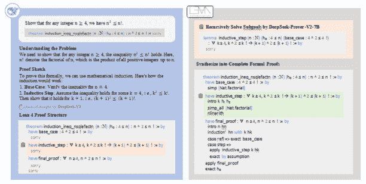

图2|`DeepSeek-Prover-V2`使用的冷启动数据收集过程概览。我们首先提示`DeepSeek-V3`生成自然语言证明草图，同时将其形式化为包含省略证明细节的`Lean`语句。然后，一个`7B`的证明模型递归地解决分解后的子目标。通过组合这些子目标的证明，我们构建了原始复杂问题的完整正式证明。该组合证明被附加到`DeepSeek-V3`的原始思路链中，从而为正式数学推理创建高质量的冷启动训练数据。

非形式数学推理与形式证明构造之间的联系。我们的实验表明，从非正式推理的冷启动开始进行强化学习，在任务分解中显著增强了模型在形式化定理证明中的能力。由此产生的`DeepSeek-Prover-V2-671B`模型在多个基准测试中建立了神经定理证明的新前沿。在`MiniF2F`测试中，它达到了82.4%的准确率，`Pass@32`，提高到88.9%，`Pass@8192`。该模型展示了强大的泛化能力，能够解决大学水平的定理证明问题，通过`Pass@1024`解决了37.1%的`ProofNet`测试问题，并解决了658个具有挑战性的`PutnamBench`问题中的49个。此外，我们贡献了`ProverBench`，一个包含325个形式化问题的基准数据集，以推动神经定理证明研究的发展，其中包括来自著名的`AIME`竞赛（第24-25年）的15个问题。`DeepSeek-Prover-V2-671B`成功解决了这15个具有挑战性的`AIME`问题中的6个，进一步证明了其复杂的数学推理能力。

## 2. 方法

### 2.1. 通过子目标分解实现递归证明搜索

将复杂定理的证明分解为一系列较小的引理，这些引理作为垫脚石，是人类数学家常用的有效策略。先前已有几项研究探讨了在神经定理证明中采用这种层次化策略，旨在通过利用现代大型语言模型（`LLMs`）的非形式推理能力来提高证明搜索效率（江等，2023；赵等，2023；王等，2024a；董等，2024）。本文中，我们开发了一种简单而有效的流程，利用`DeepSeek-V3`（`DeepSeek-AI`，2024）作为统一工具，在形式化定理证明中进行子目标分解。

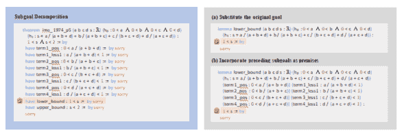

图3|我们如何将分解的子目标转化为一系列引理陈述的一个示例。我们首先(a)替换原始目标状态，然后(b)将先前的子目标作为前提纳入。陈述类型(b)用于递归解决复杂问题，而两种类型(a)和(b)则被纳入课程学习过程。

从自然语言推理中草拟形式证明。近年来，大型语言模型的进步在非形式推理能力方面取得了显著突破。为了弥合形式推理与非形式推理之间的差距，我们利用了前沿的通用语言模型，这些模型以其强大的数学推理和遵循指令的能力而著称，构建了我们定理证明系统的基础框架。我们的研究结果表明，现成的模型，如`DeepSeek-V3`（`DeepSeek-AI`，2024），能够分解证明步骤并用形式语言表达。为了证明一个给定的形式化定理陈述，我们首先提示`DeepSeek-V3`用自然语言分析数学问题，然后将证明分解为更小的步骤，每一步都转换成相应的`Lean`形式化陈述。由于通用模型在生成完整的`Lean`证明时存在困难，我们指示`DeepSeek-V3`仅生成高层次的证明草图，省略细节。最终的思路链以一系列“`have`”陈述组成`Lean`定理结束，每个陈述都以一个表示待解决子目标的“`sorry`”占位符结尾。这种方法反映了人类证明构建的方式，即将复杂的定理逐步简化为一系列更易管理的引理。

递归解决子目标。利用`DeepSeek-V3`生成的子目标，我们采用递归求解策略系统地解决每个中间证明步骤。我们从“`have`”语句中提取子目标表达式，用以替换给定问题中的原始目标（见图3(a)），然后将之前的子目标作为前提纳入（见图3(b)）。这种构造使得后续子目标能够利用早期步骤的中间结果来解决，从而促进更局部的依赖结构，并有助于简化引理的发展。为了减少大量证明搜索的计算开销，我们采用了一个专门优化用于处理分解引理的小型`7B`证明模型。在所有分解步骤成功解决后，可以自动推导出原始定理的完整证明。

基于子目标的定理证明课程学习。证明模型的训练需要大量的形式化问题集，通常通过将现有的自然语言数学语料库形式化而得（Xin等，2024a；Ying等，2024；Lin等，2025）。尽管人类撰写的文本形式化提供了高质量和多样化的形式内容，但由此产生的证明模型训练信号往往稀疏，因为很大一部分计算传统的尝试无法产生成功的证明，因此不会提供积极的奖励信号。为了生成更密集的训练信号，董和Ma（2025）提出了一种自玩方法，通过生成与原始定理陈述密切相关的可处理猜想来丰富训练问题集，从而实现训练计算的更高效利用。在本文中，我们采用了一种简单的方法，利用子目标扩展用于模型训练的形式化陈述范围。我们生成了两种类型的子目标定理，一种包含先前的子目标作为前提，另一种则不包含，分别对应图3(b)和图3(a)。这两种类型都被整合到专家迭代阶段（Polu和Sutskever，2020），建立了一个逐步引导证明模型系统地解决精心挑选的挑战性问题子集的课程。这一过程基于`AlphaProof`测试时强化学习（DeepMind，2024）的相同基本原则，即生成目标问题的不同变体以增强模型解决具有挑战性的`IMO`级别问题的能力。

### 2.2. 统一非形式推理与证明形式化

上述讨论的算法框架分为两个阶段，利用了两种互补的模型：`DeepSeek-V3`用于引理分解，以及一个`7B`的证明模型来完成相应的形式证明细节。这一流程提供了一种自然且可扩展的方法，通过结合语言模型的高层次推理与精确的形式验证，合成形式推理数据。这样，我们在单一模型中统一了非正式数学推理和证明形式化的功能。

冷启动合成数据。我们精心挑选了一组具有挑战性的问题，这些问题在端到端的`7B`证明模型中尚未解决，但所有分解的子目标均已成功解决。通过组合所有子目标的证明，我们构建了原始问题的完整形式证明。然后，该证明被附加到`DeepSeek-V3`的思路链中，该思路链概述了相应的引理分解，从而生成了一种非正式推理与后续形式化的连贯综合。它能够收集数百条高质量的冷启动合成数据，这些数据是训练`DeepSeek-Prover-V2`的基础。这种冷启动数据集生成策略与`KiminaProver`（Wang等人，2025）不同，后者是关于形式推理模型的并行研究。具体来说，我们通过将自然语言证明直接形式化为结构化的正式证明草图来合成数据。相比之下，`Kimina-Prover`采用的是反向工作流程：首先收集完整的正式证明及其非正式对应物，然后使用通用推理模型将中间的自然语言推理步骤逆向合成为连贯的思维块。

基于推理的强化学习。在使用合成冷启动数据对证明模型进行微调后，我们进行了强化学习阶段，以进一步增强其将非形式推理与正式证明构建相结合的能力。遵循推理模型的标准训练目标（`DeepSeek-AI`，2025），我们主要采用二元正确或错误反馈作为奖励监督的形式。在训练过程中，我们观察到生成的证明结构经常与链式思维引导提供的引理分解不一致。为了解决这一问题，我们在训练的早期阶段引入了一种一致性奖励机制，该机制惩罚结构上的不匹配，明确要求在最终证明中包含所有分解后的有结构引理。实际上，这种对齐的强制执行提高了证明的准确性，尤其是在需要多步骤推理的复杂定理上。

### 2.3. `DeepSeek-Prover-V2`的训练细节

两阶段训练。`DeepSeek-Prover-V2`是通过两阶段训练管道开发的，该管道建立了两种互补的证明生成模式：

1. 高效非思路链（`non-CoT`）模式：此模式针对快速生成正式的`Lean`证明代码进行了优化，专注于生成简洁的证明，而无需显式的中间推理步骤。

2. 高精度思路链（`CoT`）模式：此模式系统地阐述中间推理步骤，强调透明度和逻辑进展，然后构建最终的正式证明。

与`DeepSeek-Prover-V1.5`（Xin等，2024b）一致，这两种生成模式由两个不同的引导提示控制（详见附录A中的示例）。在第一阶段，我们采用专家迭代，在课程学习框架内训练一个非`CoT`证明模型，同时通过基于子目标的递归证明合成难题的证明。选择非`CoT`生成模式是为了加速迭代训练和数据收集过程，因为它提供了显著更快的推理和验证周期。在此基础上，第二阶段利用了冷启动链式思维（`CoT`）数据，通过将`DeepSeek-V3`的复杂数学推理模式与我们的合成形式证明相结合来实现。`CoT`模式通过进一步的强化学习阶段得到增强，遵循了通常用于推理模型的标准训练流程。

专家迭代。`DeepSeek-Prover-V2`的非`CoT`模式训练过程遵循专家迭代的范式（Polu和Sutskever，2020），这是开发形式化定理证明器广泛采用的框架。在每次训练迭代中，当前最佳证明策略用于生成那些在先前迭代中未解决的难题的证明尝试。这些由`Lean`证明助手验证的成功尝试被纳入`SFT`数据集，以训练改进后的模型。这一迭代循环不仅确保模型从初始演示数据集中学习，还提炼出自己的成功推理轨迹，逐步提高其解决更难问题的能力。总体训练过程与`DeepSeek-Prover-V1`（Xin等人，2024a）和`DeepSeek-ProverV1.5`（Xin等，2024b）大致一致，仅对训练问题的分布进行了两项修改。首先，我们引入了来自自动形式化和各种开源数据集（Ying等，2024；Dong和Ma，2025；Lin等，2025）的额外问题，扩大了训练问题领域的覆盖范围。其次，我们通过子目标分解生成的问题来扩充数据集，旨在解决`MiniF2F`基准测试（Zheng等，2022）有效划分中的更多挑战性实例。

监督微调。我们在`DeepSeek-V3-Base-671B`（`DeepSeek-AI`，2024）上进行监督微调，使用恒定的学习率`5e-6`，在`16,384`个标记的上下文中进行。我们的训练语料库由两个互补来源组成：（1）通过专家迭代收集的非`CoT`数据，生成无需中间推理步骤的`Lean`代码；以及（2）第2.2节中描述的冷启动`CoT`数据，将`DeepSeek-V3`的高级数学推理过程提炼为结构化的证明路径。非`CoT`组件强调`Lean`定理证明器生态系统中的形式验证技能，而`CoT`示例明确地建模了将数学直觉转化为形式证明结构的认知过程。

强化学习。我们采用群体相对策略优化（`GRPO`；Shao等人，2024）作为我们的强化学习算法，该算法在推理任务中表现出色且高效（`DeepSeek-AI`，2025）。与`PPO`（Schulman等人，2017）不同，`GRPO`通过为每个定理提示采样一组候选证明并根据它们的相对奖励优化策略，消除了对单独批评模型的需求。训练使用二元奖励，即每个生成的`Lean`证明如果被验证为正确则获得1个奖励，否则获得0个奖励。为了确保有效学习，我们精心挑选训练提示，仅包括那些对监督微调模型具有足够挑战性但又可解决的问题。在每次迭代中，我们采样256个不同的问题，为每个定理生成32个候选证明，最大序列长度为`32,768`个标记。

蒸馏。我们把`DeepSeek-Prover-V1.5-Base-7B`（Xin等人，2024b）的最大上下文长度从`4096`个标记扩展到`32768`个标记，并使用`DeepSeek-Prover-V2-671B`的强化学习阶段收集的`rollout`数据对扩展上下文模型进行微调。除了`CoT`推理模式外，我们还整合了专家迭代过程中收集的非`CoT`证明数据，以实现一种成本效益高的证明选项，该选项能够生成简洁的形式化输出，并且模型规模较小。此外，我们采用了与`671B`模型训练相同的强化学习阶段，以提升`DeepSeek-Prover-V2-7B`的性能。

## 3. 实验结果

在本节中，我们对`DeepSeek-Prover-V2`在多种形式定理证明基准数据集上的系统评估进行了介绍，涵盖了高中竞赛题目和本科水平的数学问题。`DeepSeek-Prover-V2`的所有实验结果均使用`Lean 4.9.0`进行，测试环境与`DeepSeek-Prover-V1.5`（Xin等，2024b）相同。除非另有说明，基线评估结果均来自各自原始论文。

### 3.1. `MiniF2F`基准测试结果

## 3.1. 高中水平基准测试结果

MiniF2F（郑等人，2022）由来自多种数学材料的488个正式问题陈述组成，包括AIME、AMC和IMO竞赛，以及MATH数据集（Hendrycks等人，2021）中选择的问题。基准测试包括涵盖初等数学核心领域的奥林匹克水平问题，涉及代数、数论和归纳法。这些问题被分为两个大小相等的子集，分别标记为`miniF2F-valid`和`miniF2F-test`，每个子集包含244个题目，各学科领域分布相同。我们专门保留`miniF2F-test`集用于评估模型性能，而`miniF2F-valid`题目则通过子目标分解融入课程学习中。我们采用了王等人（2025）发布的修订版`miniF2F`，并进一步对`miniF2F-valid`进行了两次额外修订，以及对`miniF2F-test`进行了一次修订（见附录C）。

与最先进模型的对比。表1总结了在`miniF2F`测试数据集上评估的最先进形式定理证明建模的比较。实验结果表明，`DeepSeek-Prover-V2-671B`在`miniF2F`测试基准上建立了新的最先进性能，在仅使用32个样本的情况下，通过利用CoT生成策略，实现了前所未有的82.4%的准确率。值得注意的是，参数效率更高的

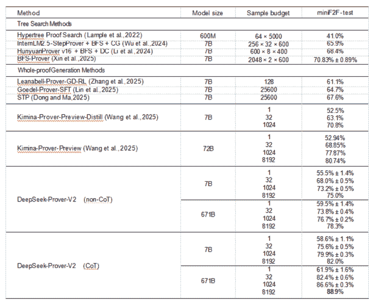

表1|在`miniF2F`测试数据集上与最先进模型的比较。符号 μ ± σ表示平均准确率 μ和标准差 σ 。标签CoT和non-CoT分别指统一模型的两种生成模式，每种模式由不同的提示引导。

|  | 问题类别 | `miniF2F`-有效课程（+`Pass@8192`） | `miniF2F`测试 通过`Pass@8192` |
| --- | --- | --- | --- |
| 奥林匹克 | IMO | `10/20 = 50.0%` `10 (+2)/15 = 80.0%` `39/45 = 86.7%` | `10/20 = 50.0%` `14/15 = 93.3%` `35/45 = 77.8%` |
| 数学 | 代数数论 | `69/70 = 98.6%` `58/60 = 96.7%` | `70/70 = 100.0%` `58/60 = 96.7%` |
| 自定义 | 代数数论 | `18/18 = 100.0%` `8/8 = 100.0%` `8/8 = 100.0%` | `15/18 = 83.3%` `7/8 = 87.5%` `8/8 = 100.0%` |
| 全面的 | 通过率 | `220(+2)/244 = 91.0%` | `217/244 = 88.9%` |

表2|`DeepSeek-Prover-V2-671B`在`miniF2F`基准上解决的问题。在整个课程学习过程中收集了`miniF2F-valid`上的结果，并在剩余问题上进一步调用`DeepSeek-Prover-V2-671B`和`Pass@8192`。

`DeepSeek-Prover-V2-7B`也表现出竞争力，超越了文献中所有现有的开源定理证明器。比较分析进一步揭示了一个引人注目的扩展模式：随着样本预算从1增加到8192，`7B`和`671B`版本之间的性能差距显著扩大，较大的模型展示了更优的样本效率和更快的改进轨迹。

通过子目标引导课程证明挑战性问题。表2详细列出了`DeepSeek-Prover-V2`在`miniF2F`基准测试中解决的问题，该模型在验证集上的通过率为91.0%，测试集上为88.9%，整体表现强劲。值得注意的是，我们的子目标引导课程学习框架，将通用模型`DeepSeek-V3`与轻量级专用`7B`证明器相结合，在`miniF2F-valid`上的成功率达到90.2%，几乎与`DeepSeek-Prover-V2-671B`的性能持平。这些发现突显了最先进的通用语言模型超越自然语言理解，有效支持复杂形式推理任务的潜力。通过战略子目标分解，模型能够将挑战性问题分解为一系列可处理的步骤，作为非正式推理和正式证明构建之间的有效桥梁。

CoT与非CoT。表1中的实验结果表明，在形式数学推理中，CoT推理模式比非CoT模式具有显著的性能优势。这进一步证实了CoT提示的有效性，它鼓励将复杂问题分解为中间步骤，并进一步确认了推理

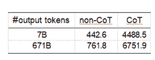

表3|`DeepSeek-Prover-V2`在`miniF2F-test`上生成的平均令牌数。

时间尺度在形式定理证明领域中起着重要作用。补充这些发现，表3提供了`DeepSeek-证明者V2`在不同推理模式下生成的令牌数量统计。不出所料，CoT模式产生的输出显著更长，反映了其复杂的推理过程。有趣的是，在非CoT设置中，`671B`模型平均生成的输出比`7B`模型更长。仔细检查发现，尽管在非CoT模式下没有显式推理的提示，但大型模型通常会在证明代码中插入简短的自然语言注释，这些注释类似于隐式推理步骤（见附录A）。这表明高容量模型可能在缺乏显式CoT提示的情况下，隐式地内化和外化中间推理过程。

## 3.2. 本科水平基准测试结果

ProofNet（Azerbayev等人，2023）包含371个问题，来自`Lean 3`中的多个广受欢迎的本科纯数学教科书，涵盖了实分析、复分析、线性代数、抽象代数和拓扑学等主题。我们使用了Xin等人（2024b）提供的`Lean 4`版本的`ProofNet`翻译，该版本进一步分为两个部分：`ProofNet-valid`和`ProofNet-test`，分别包含185个和186个问题。`ProofNet`的测试部分专门用于模型评估，因为Dong和Ma（2025）提供的公共合成数据集中包含了`ProofNet-valid`问题的变体，这些变体在我们的监督微调中被使用。表4所示的结果表明，与非CoT设置相比，使用CoT推理时`DeepSeek-Prover-V2`的通过率有了显著提高。值得注意的是，尽管训练数据主要来自高中

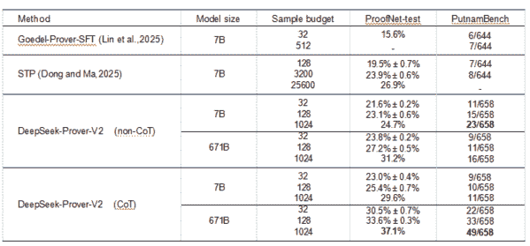

表4|`ProofNet`-测试和`PutnamBench`的实验结果。`Goedel-Prover-SFT`和`STP`在`PutnamBench`上的得分来自它们的原始论文，这些论文对包含644个问题的早期版本的`PutnamBench`进行了评估。

在高等数学中，该模型对更高级的大学水平的数学问题表现出强大的泛化能力，突出了其强大的形式推理能力。

`PutnamBench`（Tsoukalas等，2024）是一个不断更新的基准测试，包含来自威廉·洛厄尔·普特南数学竞赛的竞争性数学问题，时间跨度为1962年至2023年。普特南竞赛是美国和加拿大本科生的一项极具声望的年度数学竞赛，涵盖分析、线性代数、抽象代数、组合数学、概率论和集合论等多个大学水平领域。我们在最新的`PutnamBench`版本上评估了我们的模型，该版本包含658个用`Lean 4`形式化的题目。我们排除了与`Lean 4.9.0`不兼容的题目，并在剩余的649个题目上进行了评估。如表4所示，`DeepSeek-Prover-V2-671B`在`PutnamBench`中展示了增强的推理能力，解决了49个问题，并显著优于其非CoT版本。这些结果进一步证明了CoT推理方法在处理具有挑战性的大学水平数学问题方面的有效性。

通过强化学习发现技能。在我们的评估中，一个意外的发现是，在`PutnamBench`数据集上，`DeepSeek-Prover-V2-7B`在非CoT生成模式下的卓越表现。令人惊讶的是，这个较小的`7B`模型成功解决了13个问题，而其较大的对应模型`DeepSeek-Prover-V2-671B`未能解决这些问题，这使得我们在`PutnamBench`上解决的问题总数从49个增加到62个，占总问题数658个的一部分。通过对模型输出的仔细分析，我们识别出其推理方法中的一个独特模式：`7B`模型经常使用`Cardinal.toNat`和`Cardinal.natCast_inj`可以处理涉及有限基数的问题（见附录B中的示例），而这些问题在`671B`版本生成的输出中明显缺失。这种技术似乎使模型能够有效地解决需要对基数值进行细微操作的一小部分问题。

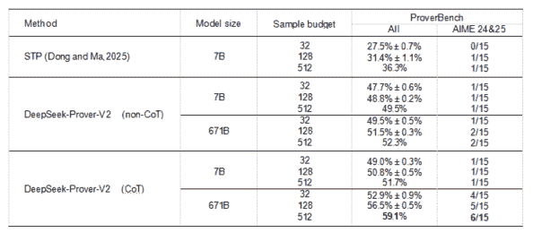

表6|`ProverBench`上的实验结果。`All`类别代表包含325个问题的完整评估集，而`AIME 24&25`表示从最近的`AIME`竞赛中形式化的15个问题子集。`STP`（Dong和Ma，2025）的结果使用开源模型权重进行评估。

## 3.3. 组合问题研究

`CombiBench`（刘等人，2025）是一个全面的基准测试集，包含100个用`Lean 4`形式化的组合竞赛问题，每个问题都配有一个相应的自然语言陈述。我们在该基准测试的有解设置中评估`DeepSeek-Prover-V2`，在此设置下，正确答案嵌入在`Lean`陈述中，使得评估可以专注于证明生成。在过滤掉与`Lean 4.9.0`不兼容的问题后

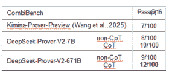

表5|在溶液存在条件下对`CombiBench`的评价结果。

对于包含多个抱歉占位符的问题，我们在基准测试中评估了77个问题，并成功解决了其中的12个。这些结果表明，尽管证明模型主要是在数论和代数领域进行训练的，但它在组合问题上的泛化能力仍然很有前景，尽管这些问题一直很困难。

## 3.4. ProverBench：AIME和教科书问题的形式化

为了提升现有的基准测试并推进形式化定理证明的研究，我们引入了一个包含325个问题的基准数据集。其中，15个问题是来自最近的`AIME`竞赛（`AIME 24`和`25`）中的数论和代数题目，提供了真实的高中竞赛级别的挑战。其余310个问题则选自精心挑选的教科书示例和教育教程，构成了一套多样且具有教学基础的形式化数学问题集合。该基准旨在实现对高中竞赛题目和本科水平数学的更全面评估。

`AIME`形式化。美国邀请数学考试（`AIME`）是一项年度数学竞赛，旨在挑战并认可在数学方面表现出色的高中生。`AIME 24&25`的题目已成为评估大型语言模型推理能力的标准基准。为了弥合正式和非正式数学推理模型性能评估之间的差距，我们整理并形式化了`AIME 24&25`中的一组题目，以确保更清晰的形式化

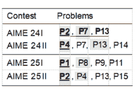

表7|`AIME 24`和`25`题的正式化选择。带有下划线加粗索引的问题已由`DeepSeek-Prover-V2`解决。使用`Maj@16`解决的`DeepSeek-V3-0324`问题以灰色背景突出显示。

我们从这些题目中筛选出几何、组合和计数问题，因为这些问题在`Lean`中的表示可能比较繁琐。这样就得到了15道题目，涵盖了初等数论和代数的竞赛水平主题。我们在选定的问题集上使用标准的找答案任务评估了`DeepSeek-V3-0324`，该任务涉及自然语言数学推理。通过多数投票超过16个采样响应，模型成功解决了15个问题中的8个。相比之下，`DeepSeek-Prover-V2-671B`在给定正确答案的形式证明生成设置下，能够为15个问题中的6个构建有效的形式证明。这一比较表明，非正式数学推理与形式定理证明之间的性能差距正在显著缩小，这表明高级语言模型在语言理解与形式逻辑严谨性方面日益趋同。

教科书形式化。除了`AIME 24&25`，我们还通过精心挑选高中竞赛和本科课程中使用的教科书中的题目来增强我们的基准测试，以加强特定数学领域的覆盖。这一精选过程确保了难度级别和主题领域的全面代表性。因此，我们正式化了涵盖广泛领域的310个问题，从竞赛级别的基础数学到本科阶段常见的高级主题。这一全面的基准涵盖了数论、初等代数、线性代数、抽象代数、微积分、实分析、复分析、泛函分析和概率论。有意纳入这些多样化的数学领域，使得模型能力在不同抽象层次上的评估更加彻底。

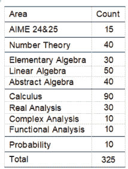

表8|`ProverBench`中所代表的数学领域的分布。

以及推理风格。数论和代数问题测试模型对离散结构和方程的掌握能力，而分析导向的问题则评估对极限、连续性和微积分的理解。抽象代数和泛函分析部分挑战模型对抽象结构和空间进行推理的能力，需要高深的形式推理技巧。评估结果见表6，如图所示，`DeepSeek-Prover-V2-671B`与CoT推理始终优于所有基线，强化了在其他基准评估中观察到的趋势。

# 4. 结论

在这项工作中，我们提出了一种综合管道，用于合成冷启动推理数据，以推进形式化定理证明。我们的数据构建过程基于递归定理证明框架，在`Lean 4`证明助手中，`DeepSeek-V3`作为子目标分解和引理形式化的统一模型。我们的方法结合了高层次的证明草图与正式步骤，创建了一系列可管理的子目标，可以使用较小的`7B`模型高效解决，显著减少了计算需求。我们开发的课程学习框架利用这些分解的子目标生成越来越难的训练任务，从而创建了一个更有效的学习进程。通过将完整的正式证明与`DeepSeek-V3`的思想链推理相结合，我们建立了宝贵的冷启动推理数据，弥合了非形式数学思维与正式证明结构之间的桥梁。后续的强化学习阶段显著增强了这一连接，从而大幅提升了形式定理证明的能力。由此产生的模型`DeepSeek-证明者-V2-671B`，在涵盖高中竞赛问题和本科水平数学的一系列基准测试中，始终优于所有基线模型。我们未来的工作将专注于将这一范式扩展到类似`AlphaProof`的系统，最终目标是解决代表自动化定理证明挑战前沿的IMO级别的数学问题。

**参考文献**

Z. Azerbayev，B. Piotrowski，H. Schoelkopf，E. W. Ayers，D. Radev 和 J. Avigad。`ProofNet`：自动形式化和形式证明本科水平的数学。arXiv预印本`arXiv:2302.12433`, 2023。

B. Barras，S. Boutin，C. Cornes，J. Courant，Y. Coscoy，D. Delahaye，D. de Rauglaudre，J.-C. Filliâtre，E. Gimenez，H. Herbelin 等人。`Coq`证明助手参考手册。INRIA，版本，6（11）：17-21, 1999。

A. G. Barto 和 S. Mahadevan。最近的层次强化学习进展。离散事件动态系统，13：341-379, 2003年。

DeepMind。AI达到国际数学奥林匹克竞赛银牌水平。`https://deepmind.google/discover/blog/ai-solves-imo-problems-at-silver-medal-level/`

DeepSeek-AI。DeepSeek-V3 技术报告，2024年。URL:`https://arxiv.org/abs/2412.19437`.

DeepSeek-AI。DeepSeek-R1：通过强化学习激励LLM的推理能力，2025. URL:`https://arxiv.org/abs/2501.12948`.

K. Dong 和 T. Ma。STP：具有迭代猜想和证明的自玩 LLM 定理证明器。arXiv 预印本`arXiv:2502.00212`, 2025。

K. Dong，A. Mahankali 和 T. Ma。通过奖励 LLMs 来分层分解证明的正式定理证明。arXiv 预印本`arXiv:2411.01829`, 2024。

M. Eppe、C. Gumbsch、M. Kerzel、P. D. Nguyen、M. V. Butz 和 S. Wermter。智能问题解决作为集成的层次强化学习。Nature Machine Intelligence，4(1)：11-20, 2022。

D. Hendrycks，C. Burns，S. Kadavath，A. Arora，S. Basart，E. Tang，D. Song，和 J. Steinhardt。使用 MATH 数据集测量数学问题解决。在第三十五届神经信息处理系统会议数据集和基准赛道（第二轮），2021年。

A. Jaech, A. Kalai, A. Lerer, A. Richardson, A. El-Kishky, A. Low, A. Helyar, A. Madry, A. Beutel, A. Carney, et al. OpenAI o1 系统卡。arXiv 预印本`arXiv:2412.16720`, 2024。

A. Q. Jiang，S. Welleck，J. P. Zhou，T. Lacroix，J. Liu，W. Li，M. Jamnik，G. Lample 和 Y. Wu。草图、素描和证明：用非正式的证明指导形式化的定理证明者。在第十一届国际学习表示会议上，2023年。

G. Lample、M.-A. Lachaux、T. Lavril、X. Martinet、A. Hayat、G. Ebner、A. Rodriguez 和 T. Lacroix。神经定理证明的超树证明搜索。第 36 届国际神经信息处理系统会议论文集，第 26337-26349 页，2022年。

Y. Li 等。HunyuanProver：一个可扩展的数据合成框架和指导树搜索，用于自动定理证明。arXiv 预印本`arXiv:2412.20735`, 2024。

Y. Lin, S. Tang, B. Lyu, J. Wu, H. Lin, K. Yang, J. Li, M. Xia, D. Chen, S. Arora, 等.`GoedelProver`:开源自动定理证明的前沿模型.arXiv预印本arXiv:2502.07640,2025.

J. Liu, X. Lin, J. Bayer, Y. Dillies, W. Jiang, X. Liang, R. Soletskyi, H. Wang, Y. Xie, B. Xiong,et al. `CombiBench`:组合数学的llm能力基准测试.`https://moonshotai.gi- thub.io/CombiBench/`,2025.

L. d. Moura和S. Ullrich.《精益4定理证明器与编程语言》 。见《自动推理——CADE 28：第 28届国际自动推理会议，虚拟活动，2021年7月12日至15日》，第28卷，第625-635页。施普林格出版社，2021年。

O. Nachum，S. S. Gu，H. Lee和S. Levine。数据高效层次强化学习 。神经信息处理系统进 展，31,2018。

L. C. Paulson. `Isabelle`是一个通用的定理证明程序。Springer Verlag，1994。

S. Polu 和 I. Sutskever. 用 于 自 动 定 理 证 明 的 生 成 语 言 建 模 。arXiv 预 印 本 arXiv： 2009.03393,2020。

J. Schulman、F. Wolski、P. Dhariwal、A. Radford和O. Klimov。近端策略优化算法。arXiv 预印本arXiv：1707.06347,2017。

Z. 邵、王、朱、徐、宋、张、李、吴和郭。`DeepSeekMath`：在开放语言模型中推动数学推理的 极限。arXiv预印本arXiv：2402.03300,2024。

G. Tsoukalas，J. Lee，J. Jennings，J. Xin，M. Ding，M. Jennings，A. Thakur， 和 S. Chaudhuri. `PutnamBench`：在putnam数学竞赛中评估神经定理证明器。在第38届神经信息处理系统会议数据集和基准赛道，2024年。

H. Wang, H. Xin, Z. Liu, W. Li, Y. Huang, J. Lu, Y. Zhicheng, J. Tang, J. Yin, Z. Li,递归证明定理.在第38届神经信息处理系统年会上,2024a.

H. Wang, H. Xin, C. Zheng, Z. Liu, Q. Cao, Y. Huang, J. Xiong, H. Shi, E. Xie, J. Yin,`Lego-prover`:使用不断增长的库进行神经定理证明.第十二届国际学习表示会议,2024b.

H. Wang, M. Unsal, X. Lin, M. Baksys, J. Liu, M. D. Santos, F. Sung, M. Vinyes, Z. Ying, Z. Zhu,等.`Kimina-Prover`预览:通过强化学习实现大型形式推理模型.arXiv预印本 arXiv:2504.11354,2025.

Z. 吴、黄、周、英、王、林和陈。`Internlm2.5`步证明者：通过专家迭代推进大规模精益问题 的自动定理证明。arXiv预印本arXiv：2410.15700,2024。

H. Xin，D. Guo，Z. Shao，Z. Ren，Q. Zhu，B. Liu，C. Ruan，W. Li， 和 X. Liang. `DeepSeekProver`： 通 过 大 规 模 合 成 数 据 推 进 llms 中 的 定 理 证 明 。arXiv预 印 本 arXiv： 2405.14333,2024a。

H. Xin，Z. Ren，J. Song，Z. Shao，W. Zhao，H. Wang，B. Liu，L. Zhang，X. Lu，Q. Du 等。`DeepSeek-Prover-V1。5`：利用证明辅助反馈进行强化学习和蒙特卡洛树搜索。arXiv预 印本arXiv：2408.08152,2024b。

R. 辛，C.西，J.杨，F.陈，H.吴，X.小，Y.孙，S.郑，和K.沈。`BFS-Prover`：基于llm的自动 定理证明的可扩展最佳优先树搜索。arXiv预印本arXiv：2502.03438,2025。

K. 杨，G. Poesia，J. He，W. Li，K. Lauter，S. Chaudhuri和D. Song。形式数学推理：人 工智能的新前沿。arXiv预印本arXiv：2412.16075,2024。

H. Ying，Z. Wu，Y. Geng，J. Wang，D. Lin，和K. Chen. `Lean`工作簿：从自然语言数学问题 形式化的大型精益问题集。在第38届神经信息处理系统数据集和基准赛道，2024年。

J. Zhang，Q. Wang，X. Ji，Y. Liu，Y. Yue，F. Zhang，D. Zhang，G. Zhou 和 K. Gai。 `Leanabell-prover`：形式推理中的后训练缩放。arXiv预印本arXiv：2504.06122,2025。

X. Zhao，W. Li和L. Kong.解开谜团：基于子目标的演示学习用于形式定理证明。arXiv预印本 arXiv：2305.16366,2023。

X. Zhao，L. Zheng，H. Bo，C. Hu，U. Thakker和L. Kong。`Subgoalxl`：基于子目标的定理证 明专家学习。arXiv预印本arXiv：2408.11172,2024。

C. 郑、王、谢、刘、孙、辛、沈、李、李。`Lyra`： 自动定理证明中的双重校正。《机器学习研 究学报》，2024年。

K. Zheng，J. M. Han和S. Polu. `miniF2F`：一个跨系统的正式奥林匹克数学竞赛基准。国际学 习表示会议，2022年。

## A. 非CoT和CoT提示生成证据的示例

### A.1. Non-CoT Generation of `DeepSeek-Prover-V2`

Input：

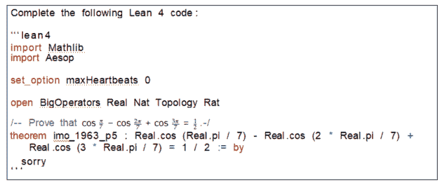

Outputs：

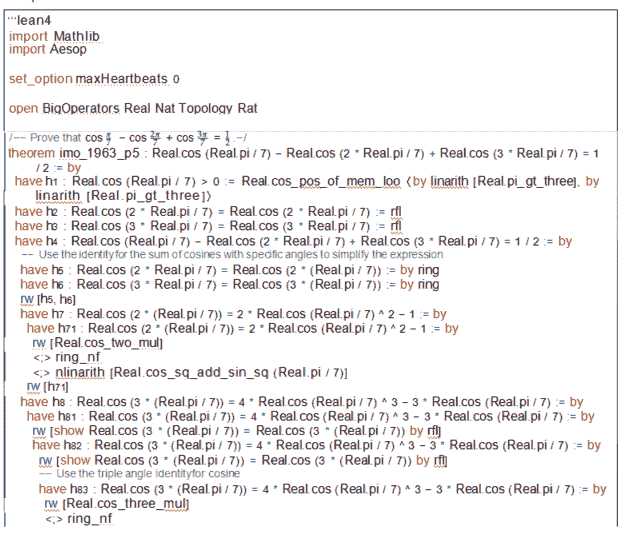

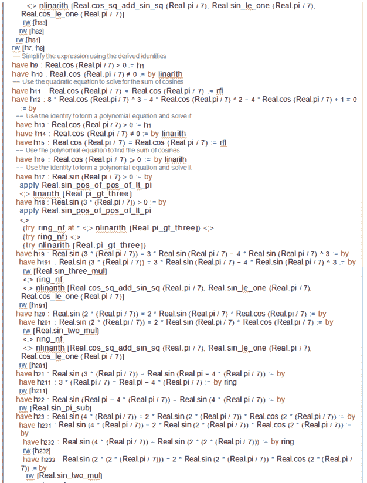

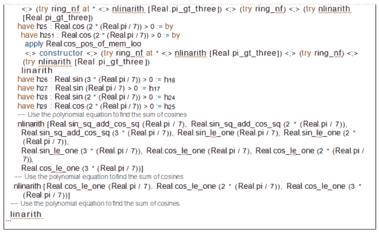

### A.2. CoT Generation Strategy of `DeepSeek-Prover-V2`

inputs：

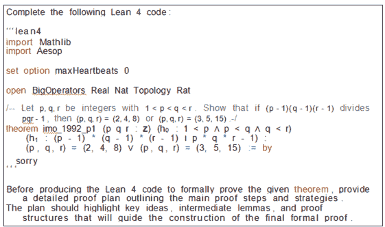

To enhance clarity, model outputs are reformulated using inline LaTeX expressions.

Output:

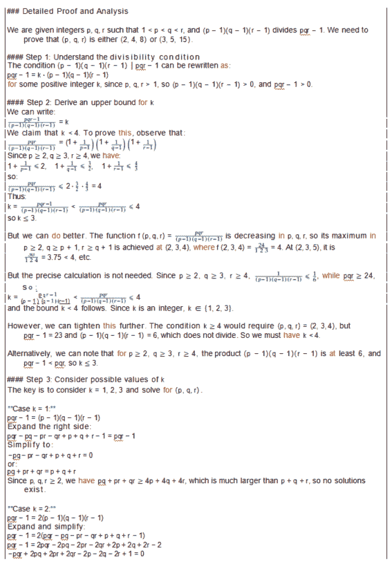

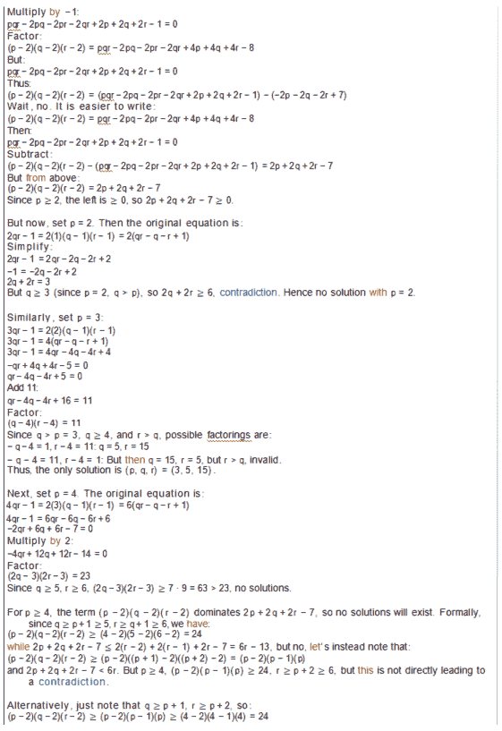

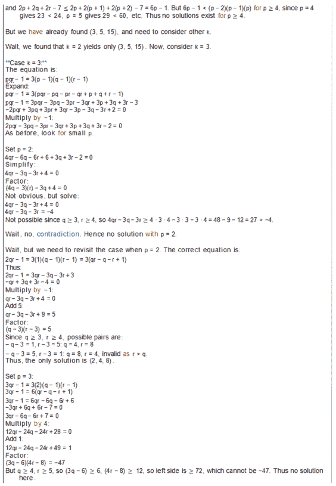

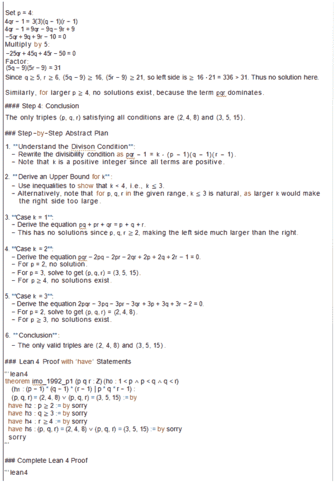

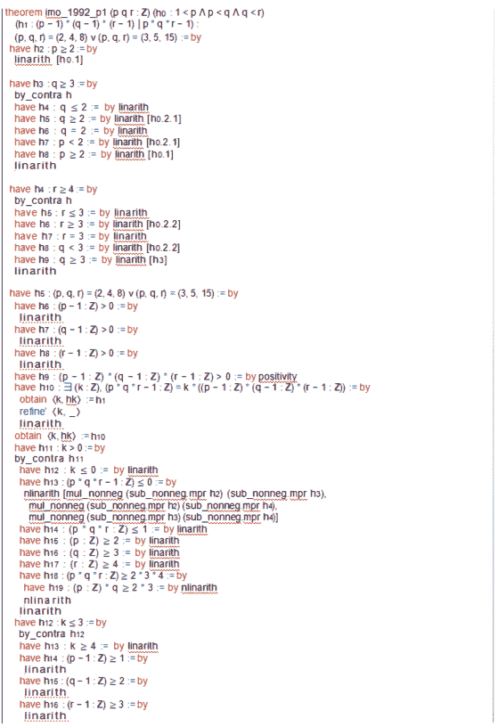

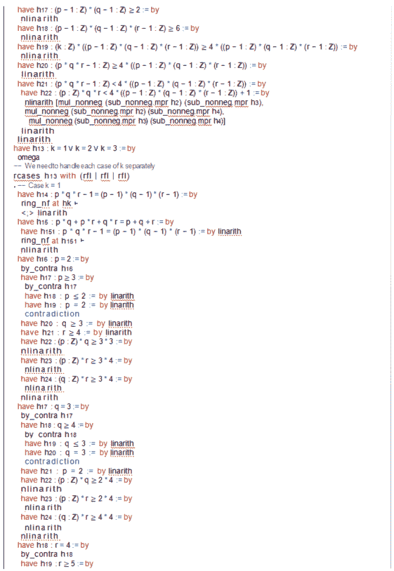

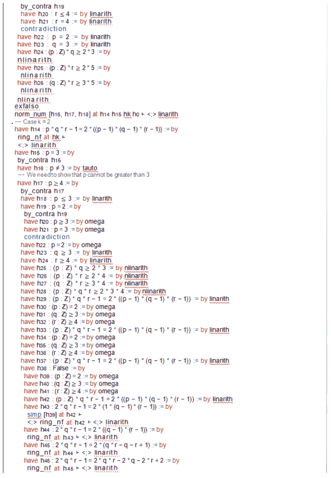

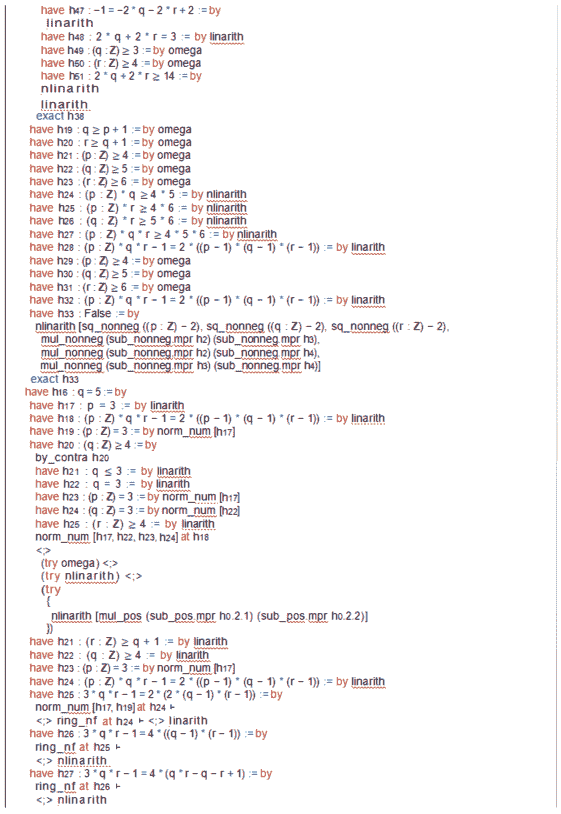

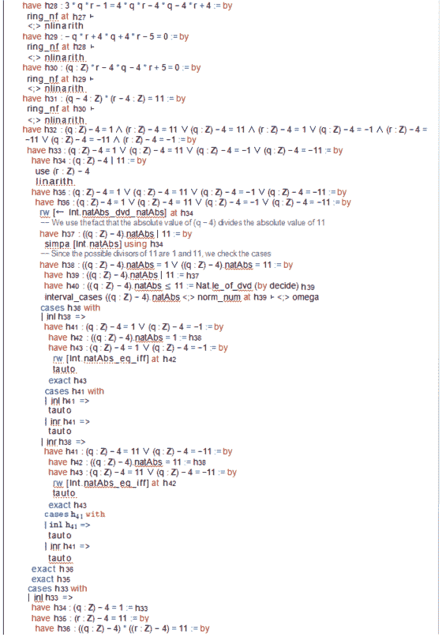

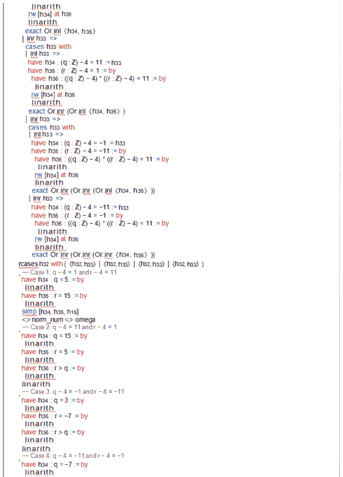

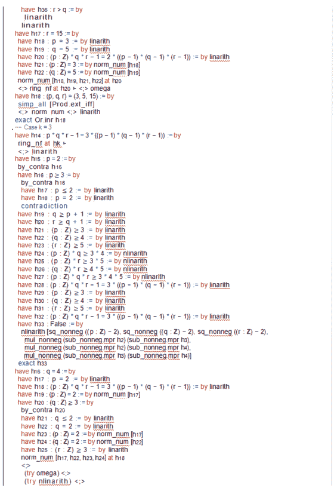

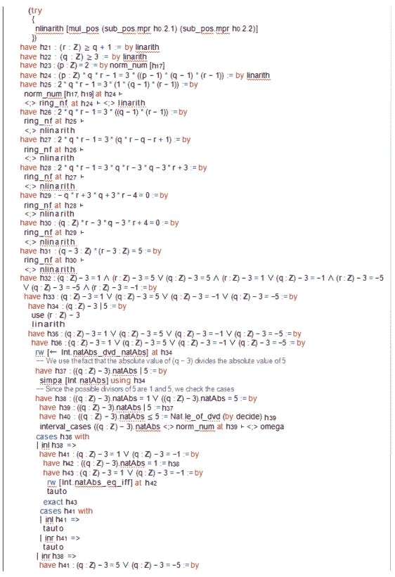

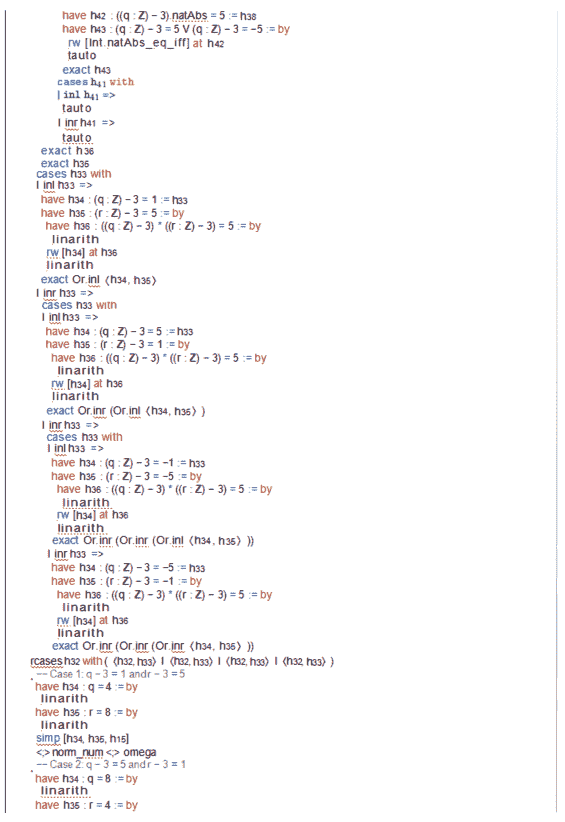

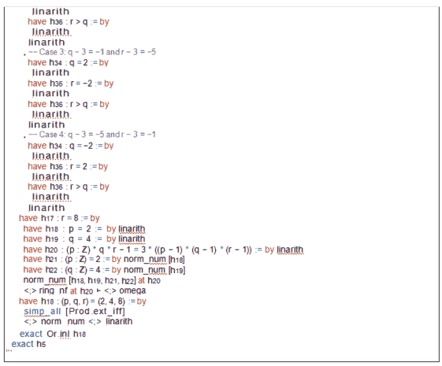

## B. Examples of the Proofs Generated by `DeepSeek-Prover-V2-7B` on `Putnam-Bench`

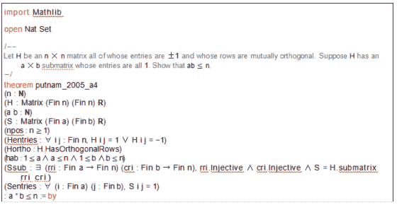

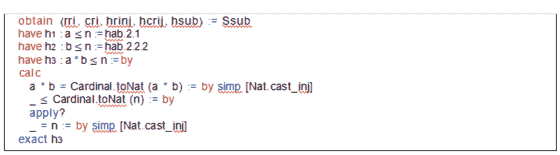

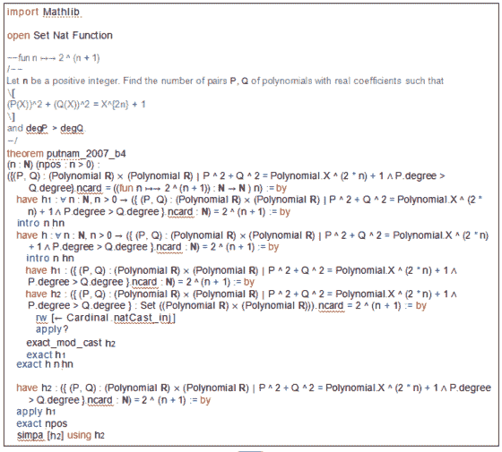

## C. Revision to `MiniF2F`

### 1. `mathd_algebra_247`:

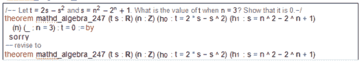

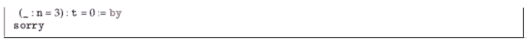

### 2. `induction_sum_odd`:

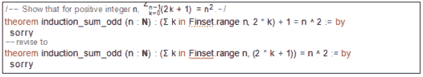

### 3. `induction_prod1p1onk3le3m1onn`:

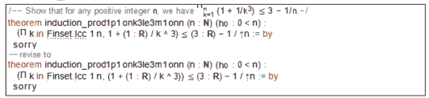
