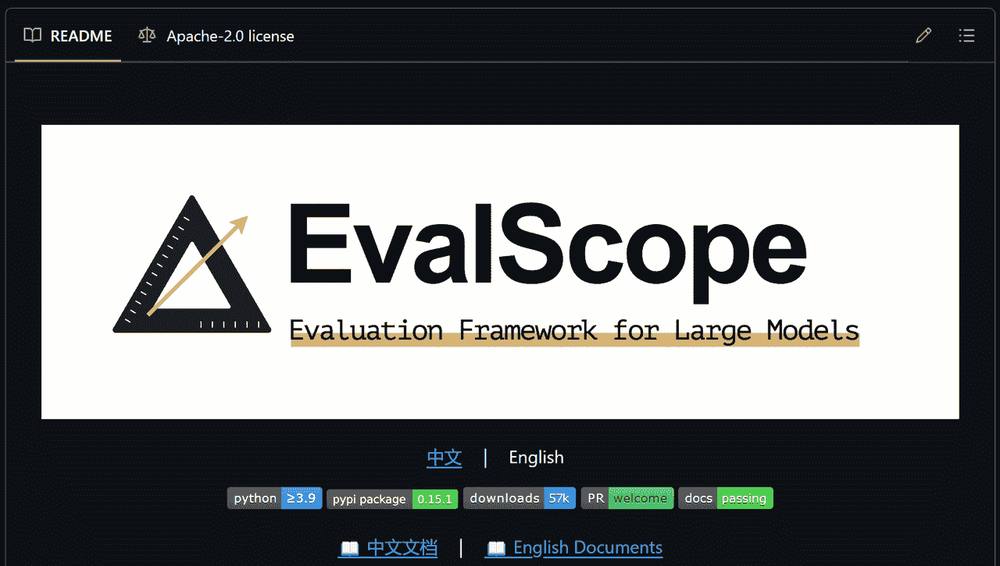
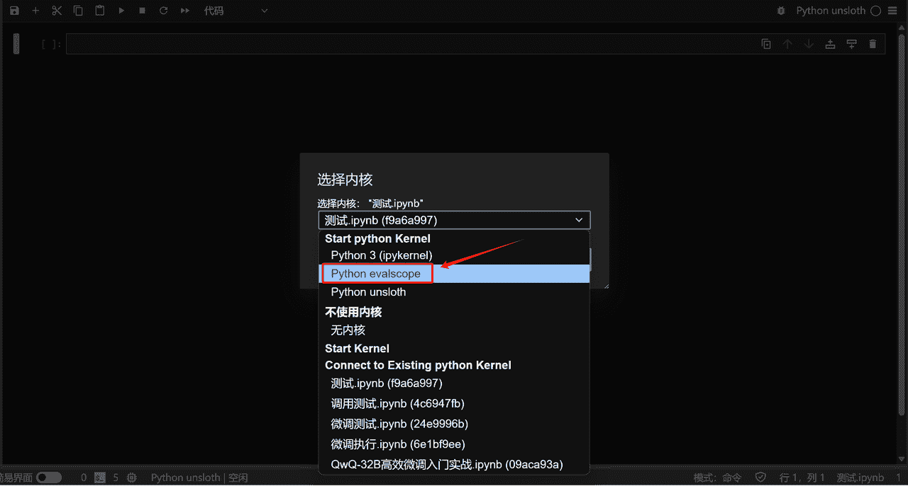
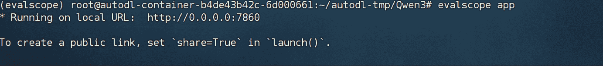
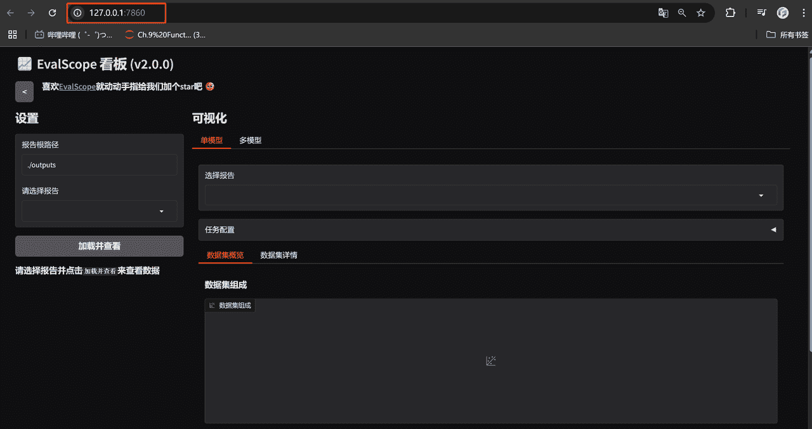
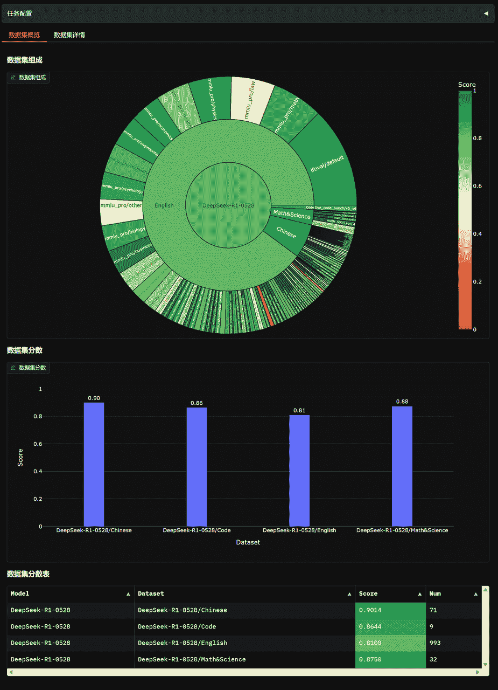
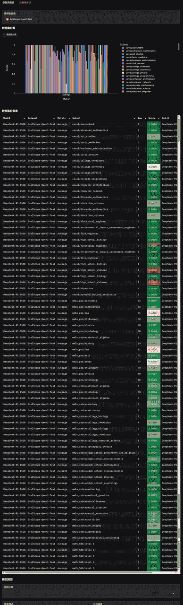

# DeepSeek-R1-0528模型评测流程与完整测评报告

> 来源：[https://kq4b3vgg5b.feishu.cn/docx/Fl93d2md8ognxax7FmgcRVxdnfc](https://kq4b3vgg5b.feishu.cn/docx/Fl93d2md8ognxax7FmgcRVxdnfc)

[我们可以借助EvalScope进行非常](https://github.com/modelscope/evalscope)准确的模型性能评估，项目官网：https://github.com/modelscope/evalscope



## EvalScope安装流程

为了避免和Unsloth的依赖产生冲突，EvalScope需要再单独创建虚拟环境，然后再进行安装，具体安装流程如下：

```
conda create --name evalscope python=3.11
conda init
source ~/.bashrc
conda activate evalscope

conda install jupyterlab
conda install ipykernel
python -m ipykernel install --user --name evalscope --display-name &quot;Python evalscope&quot;

pip install evalscope 
```

> 额外选项

```
pip install &#x27;evalscope[opencompass]&#x27;   # 安装 OpenCompass backend
pip install &#x27;evalscope[vlmeval]&#x27;       # 安装 VLMEvalKit backend
pip install &#x27;evalscope[rag]&#x27;           # 安装 RAGEval backend
pip install &#x27;evalscope[perf]&#x27;          # 安装 模型压测模块 依赖
pip install &#x27;evalscope[app]&#x27;           # 安装 可视化 相关依赖
```

> 此外，也可以考虑源码安装：

```
git clone https://github.com/modelscope/evalscope.git
cd evalscope/

pip install omegaconf

pip install -e .                  # 安装 Native backend
# 额外选项
pip install -e &#x27;.[opencompass]&#x27;   # 安装 OpenCompass backend
pip install -e &#x27;.[vlmeval]&#x27;       # 安装 VLMEvalKit backend
pip install -e &#x27;.[rag]&#x27;           # 安装 RAGEval backend
pip install -e &#x27;.[perf]&#x27;          # 安装 模型压测模块 依赖
pip install -e &#x27;.[app]&#x27;           # 安装 可视化 相关依赖
pip install -e &#x27;.[all]&#x27;           # 安装所有 backends (Native, OpenCompass, VLMEvalKit, RAGEval)
```

## 进行模型性能评估

接下来即可进一步进行模型性能评估。这里我们先尝试对其进行初始状态下的性能评估，然后等微调结束后，再进行新一轮的评估，进而对比微调前后模型性能变化情况。这里需要在Jupyter中选择evalscope kernel：



### 2.1 创建测评数据集

在Jupyter中运行如下代码：

```
from evalscope.collections import CollectionSchema, DatasetInfo, WeightedSampler
from evalscope.utils.io_utils import dump_jsonl_data

schema = CollectionSchema(name=&#x27;Qwen3&#x27;, datasets=[
    CollectionSchema(name=&#x27;English&#x27;, datasets=[
        DatasetInfo(name=&#x27;mmlu_pro&#x27;, weight=1, task_type=&#x27;exam&#x27;, tags=[&#x27;en&#x27;], args={&#x27;few_shot_num&#x27;: 0}),
        DatasetInfo(name=&#x27;mmlu_redux&#x27;, weight=1, task_type=&#x27;exam&#x27;, tags=[&#x27;en&#x27;], args={&#x27;few_shot_num&#x27;: 0}),
        DatasetInfo(name=&#x27;ifeval&#x27;, weight=1, task_type=&#x27;instruction&#x27;, tags=[&#x27;en&#x27;], args={&#x27;few_shot_num&#x27;: 0}),
    ]),
    CollectionSchema(name=&#x27;Chinese&#x27;, datasets=[
        DatasetInfo(name=&#x27;ceval&#x27;, weight=1, task_type=&#x27;exam&#x27;, tags=[&#x27;zh&#x27;], args={&#x27;few_shot_num&#x27;: 0}),
        DatasetInfo(name=&#x27;iquiz&#x27;, weight=1, task_type=&#x27;exam&#x27;, tags=[&#x27;zh&#x27;], args={&#x27;few_shot_num&#x27;: 0}),
    ]),
    CollectionSchema(name=&#x27;Code&#x27;, datasets=[
        DatasetInfo(name=&#x27;live_code_bench&#x27;, weight=1, task_type=&#x27;code&#x27;, tags=[&#x27;en&#x27;], args={&#x27;few_shot_num&#x27;: 0, &#x27;subset_list&#x27;: [&#x27;v5_v6&#x27;], &#x27;extra_params&#x27;: {&#x27;start_date&#x27;: &#x27;2025-01-01&#x27;, &#x27;end_date&#x27;: &#x27;2025-04-30&#x27;}}),
    ]),
    CollectionSchema(name=&#x27;Math&amp;Science&#x27;, datasets=[
        DatasetInfo(name=&#x27;math_500&#x27;, weight=1, task_type=&#x27;math&#x27;, tags=[&#x27;en&#x27;], args={&#x27;few_shot_num&#x27;: 0}),
        DatasetInfo(name=&#x27;aime24&#x27;, weight=1, task_type=&#x27;math&#x27;, tags=[&#x27;en&#x27;], args={&#x27;few_shot_num&#x27;: 0}),
        DatasetInfo(name=&#x27;aime25&#x27;, weight=1, task_type=&#x27;math&#x27;, tags=[&#x27;en&#x27;], args={&#x27;few_shot_num&#x27;: 0}),
        DatasetInfo(name=&#x27;gpqa&#x27;, weight=1, task_type=&#x27;knowledge&#x27;, tags=[&#x27;en&#x27;], args={&#x27;subset_list&#x27;: [&#x27;gpqa_diamond&#x27;], &#x27;few_shot_num&#x27;: 0})
    ])
])

# get the mixed data
mixed_data = WeightedSampler(schema).sample(100000000)  # set a large number to ensure all datasets are sampled
# dump the mixed data to a jsonl file
dump_jsonl_data(mixed_data, &#x27;outputs/qwen3_test.jsonl&#x27;)
```

> 也可以在以下网盘连接直接领取测评数据集：

> 链接: https://pan.baidu.com/s/1rphmJ2Qjp0apK9ngRt2FFA 提取码: bst7

### 2.2 模型评测流程

接下来即可继续在Jupyter中运行如下代码：

```
from evalscope import TaskConfig, run_task
task_cfg = TaskConfig(
    model=&#x27;deepseek-reasoner&#x27;,
    api_url=&#x27;https://api.deepseek.com&#x27;,
    eval_type=&#x27;service&#x27;,
    datasets=[
        &#x27;data_collection&#x27;,
    ],
    dataset_args={
        &#x27;data_collection&#x27;: {
            &#x27;dataset_id&#x27;: &#x27;modelscope/EvalScope-Qwen3-Test&#x27;,
            &#x27;filters&#x27;: {&#x27;remove_until&#x27;: &#x27;&lt;/think&gt;&#x27;}  # 过滤掉思考的内容
        }
    },
    eval_batch_size=128,
    generation_config={
        &#x27;max_tokens&#x27;: 30000,  # 最大生成token数，建议设置为较大值避免输出截断
        &#x27;temperature&#x27;: 0.6,  # 采样温度 (qwen 报告推荐值)
        &#x27;top_p&#x27;: 0.95,  # top-p采样 (qwen 报告推荐值)
        &#x27;top_k&#x27;: 20,  # top-k采样 (qwen 报告推荐值)
        &#x27;n&#x27;: 1,  # 每个请求产生的回复数量
    },
    timeout=60000,  # 超时时间
    stream=True,  # 是否使用流式输出
    limit=2000,  # 设置为2000条数据进行测试
)

run_task(task_cfg=task_cfg)
```

此时，Evalscope就会围绕模型的推理、指令跟随、代理能力和多语言支持方面能力进行测试，该数据包含mmlu_pro、ifeval、live_code_bench、math_500、aime24等各著名评估数据集。

### 2.3 查看模型能力评测结果

测评代码运行结束后，即可输入如下命令查看

evalscope app



然后打开浏览器输入网址localhost:7860，即可查模型测评结果了：



## DeepSeek-R1-0528模型详细评测报告

+   数据集概览部分内容如下：

本页面用于展示模型再不同评测方向上的平均得分



+   数据集详情部分内容如下：

本页面用于展示模型再各个测评数据集上的最终评分

