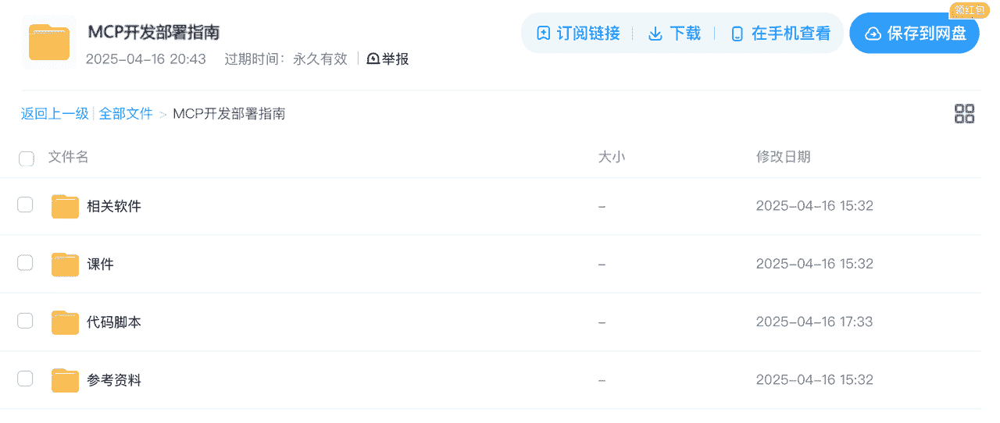
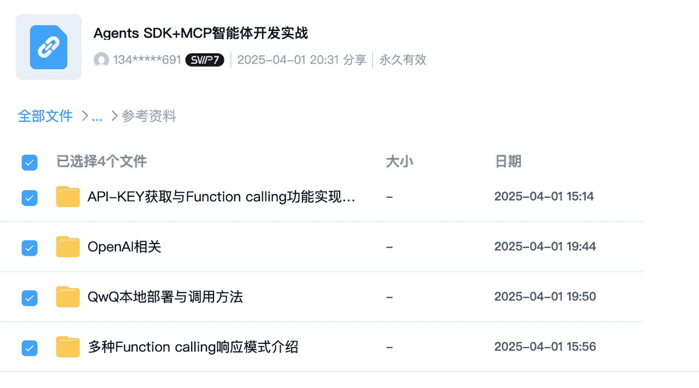

# 3.4 MCP系列技术实战合集

> 来源：[https://kq4b3vgg5b.feishu.cn/docx/SRXndDdS2opl9VxWUMpcGqXSn6f](https://kq4b3vgg5b.feishu.cn/docx/SRXndDdS2opl9VxWUMpcGqXSn6f)

**MCP****系**列教学视频持续更新中，数据、代码、权重等全公开！由于文件格式原因无法上传飞书社区，已整理至每个课件开头部分，需要的小伙伴可自取喔！（更系统深入学习大模型添加⬇️助理，即可咨询正课呀～

---

# MCP协议介绍

Anthropic 提出的模型上下文协议（MCP）是一种创新的开放标准，旨在标准化大型语言模型（LLM）与外部数据源和工具的集成，这一协议的提出回应了 AI 开发中日益增长的需求，即在不牺牲性能的情况下实现无缝集成和可扩展性。

对于 LLM 开发者，MCP 是一个变革性的协议。它消除了为每个数据源或工具进行定制集成的需要，减少了开发时间**和维护成本。从本质上**来说，**MCP是一种技术协议，一种智能**体Agent开发过程中共同约定的一种规范。在统一的规范下，大家的协作效率就能大幅提高，最终提升智能体Agent的开发效率。

研究显示，MCP 支持高级用例，如构建 AI 驱动的 IDE（如 Cursor、Sourcegraph Cody），个人助手与本地数据深度集成，以及跨不同系统的复杂工作流编排。它还减少了 LLM 的幻觉（hallucinations），通过实时数据访问提高上下文感知能力，并支持更自主的 AI 代理。

**而MCP解决的最大痛点，就是Agent**开发中调用外部工具的技术门槛过高的问题。为此，MCP提出了两个方案：

统一Function calling的运行规范。

MCP把大模型运行环境称作 MCP Client（客户端），把外部函数运行环境称作MCP Server（服务器），然后，统一MCP客户端和服务器的运行规范，并且要求MCP客户端和服务器之间，也统一按照某个既定的提示词模板进行通信。——避免MCP服务器的重复开发，也就是避免外部函数重复编写。

### **关键引文：**

+   [Introducing the Model Contex](https://www.anthropic.com/news/model-context-protocol)t Protocol Anthropic

+   Model Context Protocol Anthropic

+   Model Context Protocol GitHub

+   [Wh](https://www.forbes.com/sites/janakirammsv/2024/11/30/why-anthropics-model-context-protocol-is-a-big-step-in-the-evolution-of-ai-agents/)y Anthropic’s Model Context Protocol Is A Big Step In The Evolution Of AI Agents Forbes

+   [Model Context Protocol ](https://github.com/modelcontextprotocol/specification)specification GitHub

+   [MCP服务器集锦](https://github.com/punkpeye/awesome-mcp-servers)

---

# 快速阅览

我们团队在文档不同的位置进行了详细的介绍，您可以点击进入并查看具体的技术文档。

### ☑️** **实测解读

⭐️ [MCP官方技术翻译文档（课件）](https://kq4b3vgg5b.feishu.cn/wiki/ETqzwH4THiTY8kkGqAucYbSonPt?from=from_copylink)

+   [7分钟讲清楚MCP丨统一Function callin](https://www.bilibili.com/video/BV1uXQzYaEpJ)g规范，几行代码接入海量外部工具（视频）

### **☑️ 基础入门**

+   [【九天老师独家】MCP怎么学？独家MCP](https://www.bilibili.com/video/BV1Ke5FzcERJ)从入门到进阶保姆级学习路径规划！（视频）

⭐️ [MCP快速入门实战丨详解「客户端Clien](https://kq4b3vgg5b.feishu.cn/wiki/HhPmwc7TSikFpSkpUFDcGZ8PnCf?from=from_copylink)t+服务器server」开发流程（课件）

+   [M](https://www.bilibili.com/video/BV1NLXCYTEbj)CP技术开发入门实战！DeepSeek、ollama、vLLM接入MCP，从零搭建MCP Client与Server!（视频）

### **☑️ 快速实战**

1.  **高德MCP打造出行助理**

⭐️【教程】CherryStudio+高德MCP打造个人出行规划助理

+   [5](https://www.bilibili.com/video/BV137LBzJEvy)分钟打造一个AI出行助手，零基础也能学！最新版CherryStudio+高德MCP打造个人出行规划助理（视频）

### **☑️ **进阶之路

#### **MCP+谷歌ADK开发实战 **

⭐️[谷歌ADK快速入门调用（课件）](https://kq4b3vgg5b.feishu.cn/wiki/QF8bwl3mxirnQsk5WMpccvKtnuh?from=from_copylink)

⭐️ADK调用外部工具与接入MCP流程（课件）

⭐️谷歌开源Agent框架ADK接入MCP实战（课件）

#### 10大精选MCP工具与智能体开发实战【实战】

⭐️ 最热门MCP工具快速部署与智能体开发实战（课件）

+   [Cursor、阿里云百炼、Open-WebUI、Cherry S](https://www.bilibili.com/video/BV1dCo7YdEgK)tudio接入10大最热门MCP工具实战流程！零门槛搭建专属智能体应用！（视频）

#### 自己开发MCP工具并部署上线【实战】

⭐️从零到一详解【开发、部署上线、维护】MCP工具全流程！（课件）

⭐️[从](https://kq4b3vgg5b.feishu.cn/wiki/NmBIwIujUi27L4kNFNjc98wRnOf?from=from_copylink)零到一开发mcp-server-deepresearch，详解两大运行方式+三种信息传输实现方式（课件）

+   [D](https://www.bilibili.com/video/BV1PoLjzVEbx)eepResearch智能体开发实战教程！借助Agents SDK搭建Multi- Agent系统技术实战（视频）

+   [7分钟开发、测试&发布专属MCP全流程教程！独家](https://www.bilibili.com/video/BV1VHL6zsE5F)HTTP流式传输MCP开发实战！（视频）

#### MCP+Agents SDK智能体开发【实战】

⭐️ [Agents SDK+DeepSe](https://kq4b3vgg5b.feishu.cn/wiki/WPAtwSxFGi5oBUkqHWscmiDdnmd?from=from_copylink)ek+MCP智能体开发实战[上]（课件）

⭐️ [Agents SDK+DeepSe](https://kq4b3vgg5b.feishu.cn/wiki/I1cDwCAekiOgpkkbFnJcTx61n2j?from=from_copylink)ek+MCP智能体开发实战[下]（课件）

#### MCP+GraphRAG智能体开发【实战】

⭐️ [M](https://kq4b3vgg5b.feishu.cn/wiki/Srzow1KdAiPVvukW7oiclE1Knrb?from=from_copylink)CP智能体开发实战丨MCP+GraphRAG搭建检索增强智能体丨借助MCP搭建AI数据分析智能体（课件）

+   [MCP企业级智能体开发实战！知识库问答系统](https://www.bilibili.com/video/BV1n1ZuYjEzf)+AI数据分析智能体项目实战!（视频）

#### MCP+DS-V3搭建mini manus【实战】

⭐️ DeepSeek Function calling功能详解（课件）

⭐️ MCP+DeepSeek-V3搭建miniManus开发实战（课件）

⭐️ DeepSeek Function calling响应模式介绍（课件）

⭐️ DeepSeek企业级智能体MiniManus开发实战（课件）

+   [D](https://www.bilibili.com/video/BV1L3ZDYDEnE)eepSeek智能体开发实战，从零手搓Mini Manus！4小时从零入门到实操企业级Agent项目（视频）

#### HTTP流式传输 MCP服务器开发

⭐️ 流式HTTP MCP服务器开发指南（课件）

+   [企业级流式HTTP功能全面上线！实操MCP服务器开发](https://www.bilibili.com/video/BV1P7VSzwEXL)、测试、部署、异地调用完整流程！（视频）