# MCP技术翻译文档

> 来源：[https://kq4b3vgg5b.feishu.cn/docx/TWrAd5ksQoNzQFxHCihcjl2On7b](https://kq4b3vgg5b.feishu.cn/docx/TWrAd5ksQoNzQFxHCihcjl2On7b)

---

+   Anthropic MCP发布通告：https://www.anthropic.com/news/model-context-protocol

+   MCP GitHub主页：https://github.com/modelcontextprotocol


### **引入模型上下文协议（MCP）**

今天，我们正式**开源** Model **Conte**xt Pr**otoco**l（MCP，模型上下文协**议）**，这是一**种 全新的标准，用于将 AI **助手 连接到实际存储数据的 **系统，包括** 内容存**储库、企业工具、开发**环境 等。MCP 的目标是帮助 前沿大模型 生成 更优质、更相关的响应。

随着 **AI 助手** 进入主流应用，整个行业在 **模型能力** 方面投入了大量资源，推动了 **推理能力和质量** 的快速发展。然而，即便是**最先进的模型** 仍受限于 **数据孤岛** 和 **传统系统****，无法轻松访问外**部数据。每**新增一个数据源都需要 **单独的自定义集成，这使得 真正互联的 AI 生态 难以规模化扩展。

**MCP 解决了这****一挑战。它提供了一种** 通用、**开放的标准，用于**将 AI 系统与数据源连接在一起，取代传统的碎片化集成，实现更简洁、高效、稳定的 AI 数据访问方式。

---

### 🔹 什么是 Model Context Protocol（MCP）？

MCP 是一种 **开放标准**，它允许开发者 **安全地** 在 **数据源** 和 **AI 工具** 之间建立 **双向连接**。其架构非常简单：

+   **开发者可以通过 MCP 服务器** 公开他们的数据；

+   **AI 应用（MCP 客户端）** 可以连接到 MCP 服务器，获取所需数据。

今天，我们正式推出 **MCP 的三大核心组件**：

1.  **MCP 协议规范与 SDK**，供开发者构建与集成 MCP；

1.  Claude 桌面应用中的本地 MCP 服务器支持，便于开发者测试；

1.  **MCP 服务器的开源存储库**，帮助开发者快速接入不同系统。

**Claude 3.5 Sonn**et 具备 快速构建** MCP 服务器的能力**，让企业和个人能够 快速**连接最重****要的数据集，并与各种 A**I 工具** 无缝集成。为帮助开发者上手，我们提供了一些 预构建的 MC**P 服务器，支持 Google Drive、Slack、GitHub、Git、Postgres 和 Puppeteer 等主流企业系统。

---

### **🔹 早期采用者与行业集成**

目前，**Block** 和 **Apollo** 等企业已经在其系统中 **集成了 MCP**，而 **Zed、R**eplit、Codeium、S**ourcegrap**h 等开发工具公司也正在基于 MCP 增强其平台。MCP 使 AI 代理能够 更好地检索相关信息，以更深入地理解编程任务的上下文，从而生成更准确、更具功能性的代码，减少反复尝试。

Block 首席技术官 Dhanji R. Prasanna 表示：

> **“在** Block，开源**不仅是一**种开发模式，更是我们工作的基础。我们致力于打造推动变革的技术，并确保其作为公共资源对所有人开放。像 MCP 这样的开放技术，是连接 AI 与现实世界应用的桥梁，让创新变得透明、可访问，并且基于协作。我们很高兴能够参与 MCP 这个协议，并利用它来构建自主 AI 代理系统，让 AI 处理重复性工作，人类可以专注于创造性任务。”

以往，开发者需要为 **每个数据源** **单独维护连接器**，但 **MCP 让一切变得简单**——只需**基于 MCP 标准协议**构建数据集成。随着 **MCP 生态系统不断成熟**，AI 将能够 **无缝切换不同工具和数据集**，取代当今 **碎片化的集成方式**，构建更**可持续的 AI 互联架构**。

---

### **🚀 如何开始使用 MCP？**

开发者今天就可**以开始构建和测试 MCP** 连接器。所有 Claude.ai 计划 均支持 将 MCP 服务器连接到 Claude 桌面应用。

+   **Claude for Work** 订阅用户可以**本地测试 MCP 服务器**，将 Claude 连接到 **内部系统和数据集**。

+   我们很快将提供 **开发工具包**，帮助企业 **部署远程 MCP 服务器**，以服务整个 Claude for Work 组织。

你可以通过以下方式开始使用 MCP：

1.  在 Claude 桌面应用中安装预构建的 MCP 服务器

1.  阅读我们的快速入门指南，构建你的第一个 MCP 服务器

1.  参与我们的开源 MCP 连接器和实现项目

---

### **🌍 开放社区，构建未来**

MCP 是一个 **开放的、协作式的开源项目**，我们欢迎你的反馈！

无论你是：

+   **AI 工具开发者**，希望扩展 LLM 的能力；

+   **企业**，希望充分利用已有数据；

+   **技术探索者**，想尝试前沿 AI 应用；

我们邀请你共同打造未来的 AI 上下文标准，让 AI 更智能、更高效地理解和利用数据！

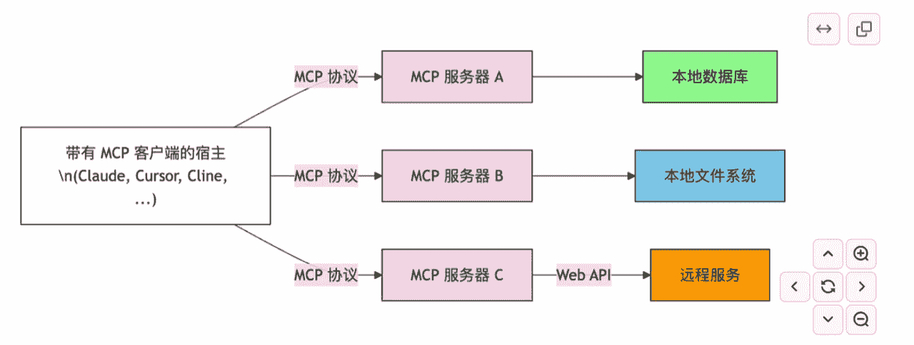

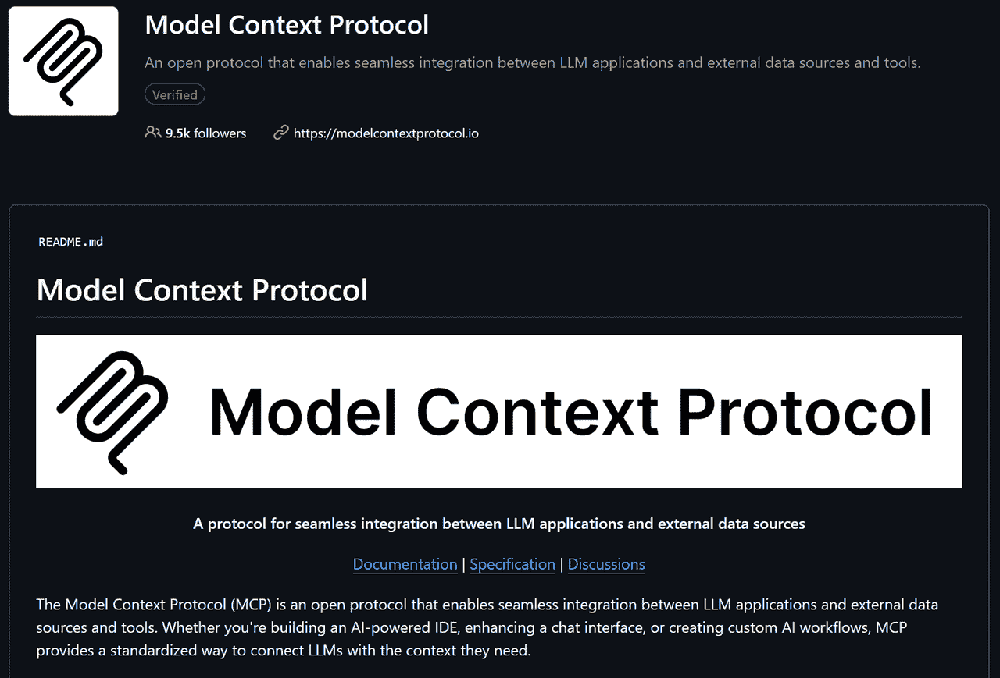

### **模型上下文协议（Model Co**ntext Protocol, MCP）

**模型上下文协议（MCP）** 是一种 **开放协议**，用于实现 **LLM 应用** 与 **外部数据源和工具**** 之间的无缝集成。无**论你是在**构建 A**I 驱动的 **IDE，优化 聊天界**面，还是创建 自定义 **AI 工作**流，MCP 提供了一种 标准化方式，让 LLM 能够访问所需的上下文信息。

---

## **🚀 入门指南**

📚 阅**读文档：**获取指南**和教程

** 🔍 查**看规范：了解协议的详细技术**规范

💻 使用官方 SDK 开始开发：

+   [TypeScript SDK](https://github.com/modelcontextprotocol/typescript-sdk)

+   [Python SDK](https://github.com/modelcontextprotocol/python-sdk)

+   [Java SDK](https://github.com/modelcontextprotocol/java-sdk)

+   [Kotlin SDK](https://github.com/modelcontextprotocol/kotlin-sdk)

---

## **📂 项目结构**

+   **specification** - MCP 协议规范与文档

+   **typescript-sdk** - TypeScript 版本的 SDK 实现

+   **python-sdk** - Python 版本的 SDK 实现

+   **java-sdk** - Java 版本的 SDK 实现

+   **kotlin-sdk** - Kotlin 版本的 SDK 实现

+   **docs** - 用户文档与开发指南

+   create-python-server - Python 服务器模板

+   create-typescript-server - TypeScript 服务器模板

+   create-kotlin-server - Kotlin 示例服务器

+   **servers** - 已维护的服务器列表

---

## **💡 贡献指南**

**我们欢迎各种**形**式的贡献**！无论是** 修复 b**ug、改进**文档，还**是 提议新功能，请参考 贡献指南 开始你的贡献之旅。

💬 有**问题？ **欢迎加入我们的 社**区论坛 **讨论。

---

## **🔍 关于 MCP**

MCP 是 由 Anthro**pic,** PBC 维护的开源项目，并对整个社区 开放贡献。

---

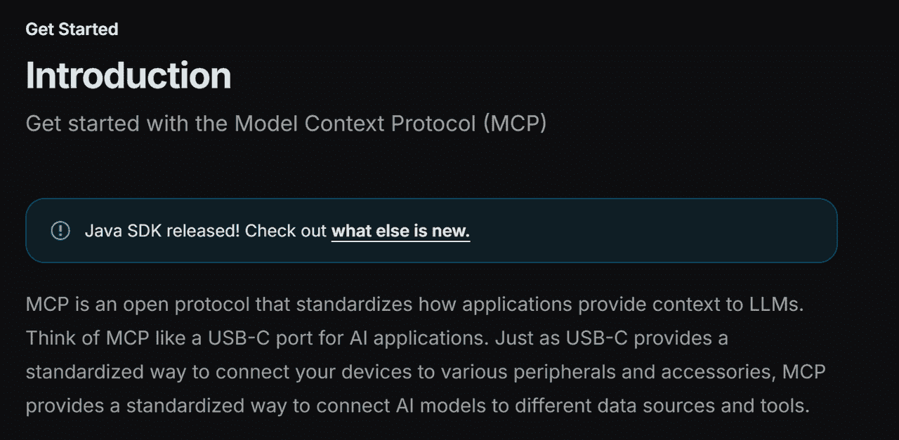

### 🚀 快速入门：Model Context Protocol（MCP）

## **简介**

立即开始学习 **模型上下文协议（MCP）**！

💡 J**ava SDK 已发布！ **了解最新动态。

MCP 是一种 **开放协议**，用于 标准化应用程序向 LLM 提供上下文的方**式。你可以把** MCP 想象成 AI 应用的** USB-C 接口。

**正如 **USB-C** 提供了 标准**化的方式 让设备连**接到各种外设和配件，MCP 提供了标准化方式，让 AI 模型 能够连接到 不同的数据源和工具。

---

## **🔹 为什么选择 MCP？**

MCP 让你能够在 LLM 之上构建智**能代理（A**gents）和复杂工作流。

LLM 需要与 数据和工具 集成，而 MCP 提供了：

✅ **丰富的预构建集成**，LL**M 可直接对接

✅ 跨 **LLM** 供应商的灵活性，**支持随时切换

✅ 数据安全的最佳实践，确保数据存储在本地基础设施中

---

## **🔹 MCP 的总体架构**

MCP 采用 客户端**-服务器**（Client-Server）架构，其中主机应用可以连接多个 MCP 服务器：

```
Internet
    ⬇
    Your Computer
    ⬇
    MCP Protocol
    ↙   ↓   ↘
MCP Server A  MCP Server B  MCP Server C
↙        ↓       ↘
Local Data A  Local Data B  Remote Service C
```

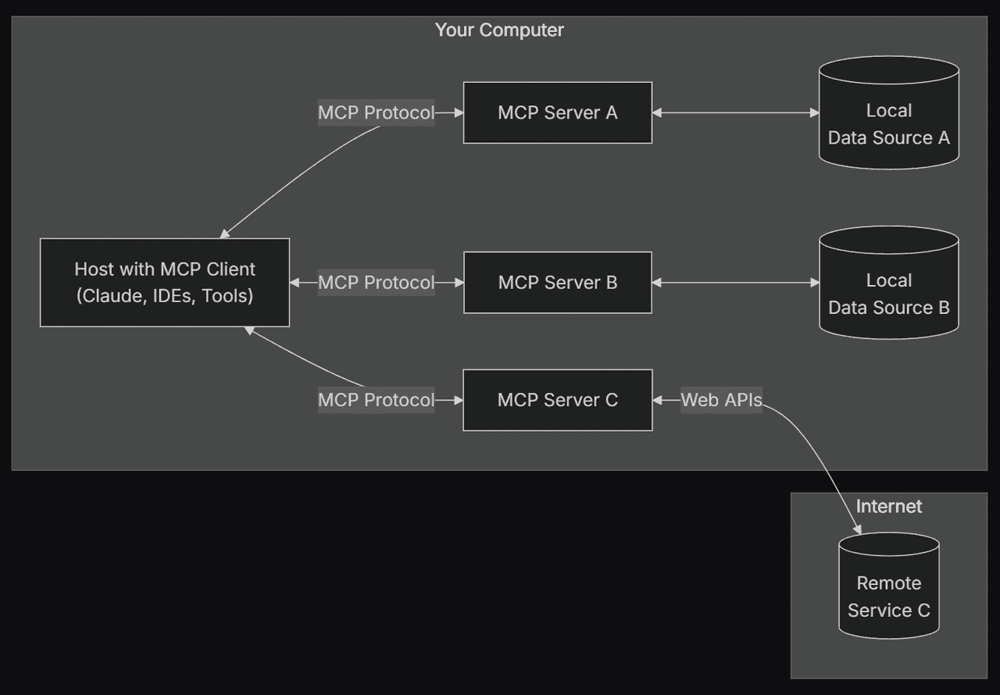

📌 M**CP 主要组件：**

+   **MCP 主机（Hosts）**：如 Claude 桌面应用、IDE、AI 工具，用于通过 MCP 访问数据

+   MCP 客户端（Clients）：负责 与 MCP 服务器建立 1:1 连接

+   MCP 服务器（Se**rvers）：轻量级程**序，通过 标准化的 MCP 协议 提供特定能力

+   本地数据**源（Local Data** Sources）：你的 计算机文件、数据库和服务，MCP 服务器可以安全访问

+   远程服务（**Remote Serv**ices）：可通过 API 访问的外部系统，MCP 服务器可以连接这些系统

---

## **🚀 如何开始使用 MCP？**

选择最适合你的路径：

### **🔹 快速入门**

+   **对于服务器开发者**：学习如何构建 **MCP 服务器**，让 Claude for Desktop 和其他客户端使用

+   **对于客户端开发者**：学习如何开发 **MCP 客户端**，支持所有 MCP 服务器

+   对于 Claude 桌面应用用户：开始使用 Claude for Desktop 内置的 MCP 服务器

---

## **🔹 示例**

+   **示例服务器**：查看官方提供的 **MCP 服务器及其实现**

+   **示例客户端**：查看支持 MCP 集成的 **客户端列表**

---

## **📚 教程**

+   **使用 LLM 构建 MCP****：学习如何使**用 Claude 加速 MCP 开发

+   **MCP 调试指南**：学习如何高效 **调试 MCP 服务器和集成**

+   **MCP Inspector**：使用 **交互式调试工具** 测试你的 MCP 服务器

---

## **🔍 深入探索 MCP**

+   **核心架构**：了解 MCP 如何连接客户端、服务器和 LLM

+   **资源管理**：如何 让 LLM 访问 MCP 服务器中的数据

+   **提示词（Prompts）**：创建 **可复用的提示词模板和工作流**

+   **工具（Tools）**：让 LLM 能够 **通过 MCP 服务器执行操作**

+   **采样（Sampling）**：允许 MCP 服务器 **向 LLM 请求推理**

+   **传输层（Transports）**：了解 MCP **的通信机制**

---

## **🌍 贡献 & 反馈**

### **🔹 想贡献代码？**

查看我们的 [**贡献指南**](https://chatgpt.com/c/67d28a8b-9e64-8000-bff6-da16089a3f12#)，帮助改进 MCP！

### **🔹 寻求支持 & 提交反馈**

📌 遇**到问题？想提交新功能建议？**

+   MCP 规范、**SDK、文档相关问题（开源）👉** 创建 GitHub Issue

+   **MCP 规范相关讨论 & 问答** 👉 参**与规范讨论**

+   其他 M**CP 开源组**件讨论 & 问答 👉 加入组织讨论

+   Clau**de.ap**p & Claude.ai 的 MCP 集成问题 👉 邮件联系 mcp-support@anthropic.com


### 🌤️ 为服务器开发者提供的指南

**使用 Claude for Desktop** 及其他客户端，构建你的 MCP 服务器

在本教程中，我们将 **构建一个 MCP 天气服务器**，并将其连接到 MCP 主机**（Cla**ude for De**sktop）**。我们将从 基础设置 开始，逐步拓展到 更复杂的用例。

---

## **🔹 我们要构建什么？**

许多 **LLM（包括 Claude）** 目前**无法**直接获取 **天气预报** 或 **严重天气警报**。让我们使用 **MCP** 来解决这个问题！

我们将构建一个服务器，提供 **两个工具（Tools）**：

+   **get-alerts** —— 获取严重天气警报

+   **get-forecast** —— 获取天气预报

然后，我们会将这个服务器 **连接到 MCP 主机**（本教程中是 Claude for Desktop）：

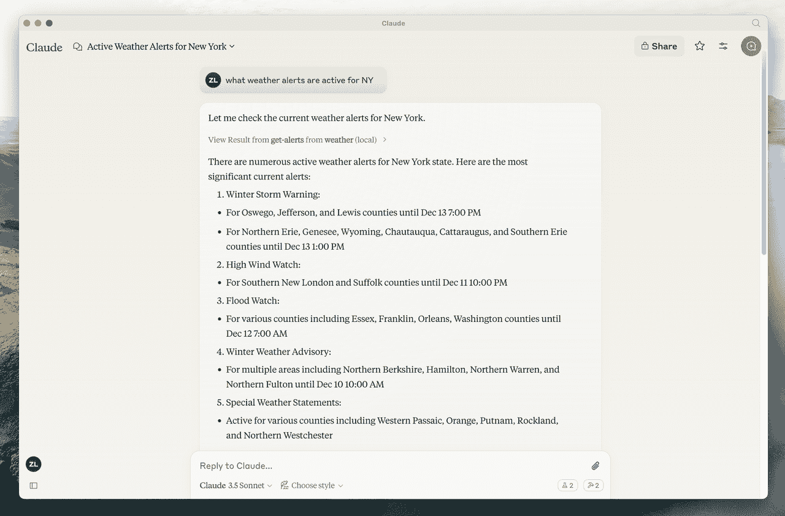

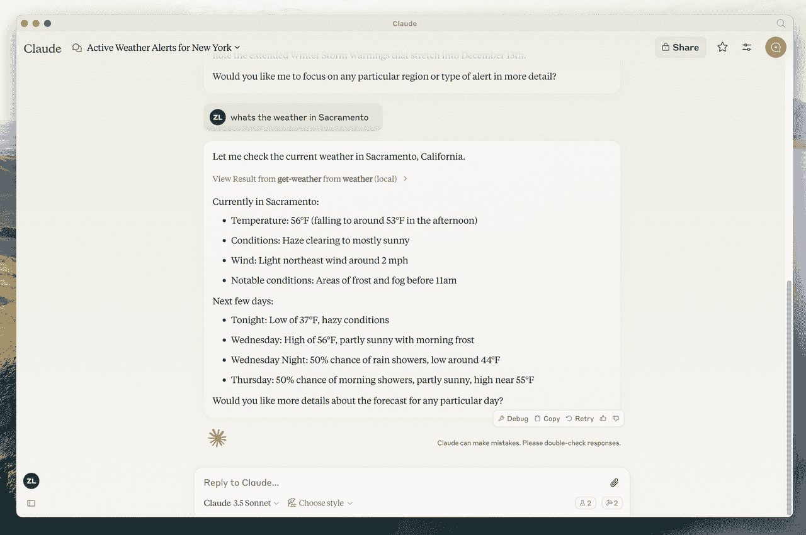

```
+------------------------+
|  Claude for Desktop   |  ←—— MCP 主机（Host）
+------------------------+
        ↓
   MCP Protocol
        ↓
+------------------------+
|     Weather Server    |  ←—— MCP 服务器（Server）
+------------------------+
```

📌 服务器可以连接到任何 MCP 客**户端。本教程选择 Cl**aude for **Desk**top** 仅仅是为了简化示例。

**如果你想创建 自定义 MCP 客户端，我们也有相应的 开发指南 和 支持 MCP 的客户端列表。

---

## **🔹 为什么选择 Claude for Des**ktop，而不是 Claude.ai？

Cla**ude for D**esktop 允许直接集成本地 MCP 服务器，而 Claude.ai（即 Web 版本）当前不支持本地 MCP 连接。

**如果你希望使用**** Clau**de 和 MCP 服务器进行 本地开发和测试，Claude for Desktop 是 更好的选择。

---

## **🔹 核心 MCP 概念**

MCP 服务器主要提供 **三种能力**：

1.  **资源（Resources）**：类似文件的数据，可以被客户端读取（如 API 响应、文件内容）。

1.  **工具（Tools）**：LLM 可以调用的函数（需要用户授权）。

1.  **提示词（Prompts）**：帮助用户完成特定任务的预定义模板。

📌 本教程主要关注 MCP 的 “工具（Tools）” 机制。

---

## 🔹 开始构建我们的天气服务器！

你可以选择以下编程语言：

+   🐍 P**ython**

+   🟢 N**ode.js**

+   ☕ **Java**

完整代码示例可以在 [**这里**](https://chatgpt.com/c/67d28a8b-9e64-8000-bff6-da16089a3f12#) 找到。

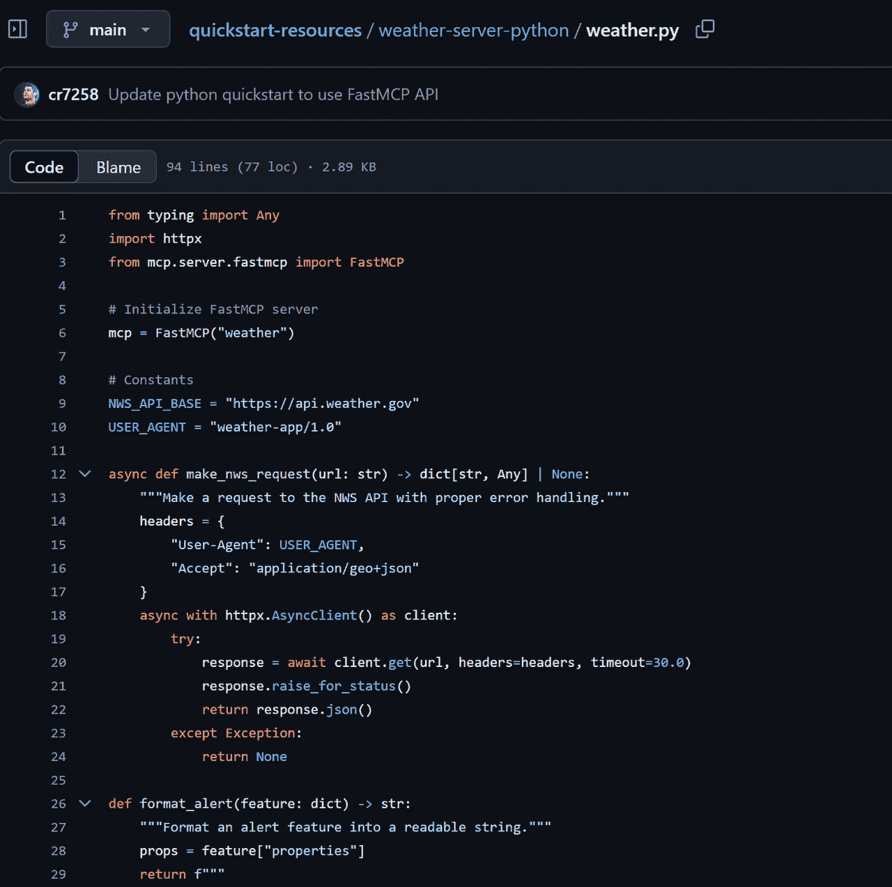

---

## **🔹 先决条件**

📌 在开始之前，你需要具备以下知识：

+   **Python 基础**

+   对 LLM（如 Claude）如何工作有基本了解

📌 系**统要求**

+   Python 3.10 或更高版本

+   MCP Python SDK 1.2.0 或更高版本

---

## **🔹 设置开发环境**

### **1️⃣ 安装 ****uv**** 并初始化 Python 项目**

🔹 M**acOS/Linux 安装 u****v**

```
curl -LsSf https://astral.sh/uv/install.sh | sh
```

📌 安**装完成后，重启终端，**确保 uv 命令可用。

🔹 W**indows 安装 u****v（**建议使用 WSL）

```
wsl curl -LsSf https://astral.sh/uv/install.sh | sh
```

---

### **2️⃣ 创建项目目录并设置环境**

🔹 M**acOS/Linux**

```
# Create a new directory for our project
uv init weather
cd weather

# Create virtual environment and activate it
uv venv
source .venv/bin/activate

# Install dependencies
uv add &quot;mcp[cli]&quot; httpx

# Create our server file
touch weather.py
```

---

接下来，我们将编写天气服务器代码！

### 🌤️ 构建你的 MCP 服务器

## **📌 导入依赖并初始化服务器**

在 weather.py 文件顶部，添加以下代码：

```
from typing import Any
import httpx
from mcp.server.fastmcp import FastMCP

# Initialize FastMCP server
mcp = FastMCP(&quot;weather&quot;)

# Constants
NWS_API_BASE = &quot;https://api.weather.gov&quot;
USER_AGENT = &quot;weather-app/1.0&quot;
```

📌 F**astMCP **通过 Python 的 类**型提示 **和 文**档字符串 **自动生成工具定义，使得 M**CP 工具 **的创建与维护变得更加简单。

---

## **🔹 添加辅助函数**

接下来，我们编写 **辅助函数**，用于向 美国国家气象局 API（NWS API） 发送请求，并格式化返回的数据。

```
async def make_nws_request(url: str) -&gt; dict[str, Any] | None:
    &quot;&quot;&quot;向 NWS API 发送请求，并进行错误处理&quot;&quot;&quot;
    headers = {
        &quot;User-Agent&quot;: USER_AGENT,
        &quot;Accept&quot;: &quot;application/geo+json&quot;
    }
    async with httpx.AsyncClient() as client:
        try:
            response = await client.get(url, headers=headers, timeout=30.0)
            response.raise_for_status()
            return response.json()
        except Exception:
            return None
def format_alert(feature: dict) -&gt; str:
    &quot;&quot;&quot;将天气警报信息格式化为可读字符串&quot;&quot;&quot;
    props = feature[&quot;properties&quot;]
    return f&quot;&quot;&quot;
事件: {props.get(&#x27;event&#x27;, &#x27;未知&#x27;)}
区域: {props.get(&#x27;areaDesc&#x27;, &#x27;未知&#x27;)}
严重程度: {props.get(&#x27;severity&#x27;, &#x27;未知&#x27;)}
描述: {props.get(&#x27;description&#x27;, &#x27;无描述&#x27;)}
说明: {props.get(&#x27;instruction&#x27;, &#x27;无具体说明&#x27;)}
&quot;&quot;&quot;
```

---

## **🔹 实现工具执行逻辑**

**工具执行处理**器负责**调用具体的工**具逻辑。让我们实现 获取天气警报 和 获取天气预报 的方法。

### **1️⃣ 获取天气警报**

```
@mcp.tool()
async def get_alerts(state: str) -&gt; str:
    &quot;&quot;&quot;获取美国某个州的天气警报
    Args:
        state: 美国州的两位字母代码（如 CA、NY）
    &quot;&quot;&quot;
    url = f&quot;{NWS_API_BASE}/alerts/active/area/{state}&quot;
    data = await make_nws_request(url)
    if not data or &quot;features&quot; not in data:
        return &quot;无法获取天气警报或当前无警报。&quot;
    if not data[&quot;features&quot;]:
        return &quot;该州当前无活动警报。&quot;
    alerts = [format_alert(feature) for feature in data[&quot;features&quot;]]
    return &quot;\n---\n&quot;.join(alerts)
```

---

### **2️⃣ 获取天气预报**

```
@mcp.tool()
async def get_forecast(latitude: float, longitude: float) -&gt; str:
    &quot;&quot;&quot;获取某个地理位置的天气预报
    Args:
        latitude: 纬度
        longitude: 经度
    &quot;&quot;&quot;
    # 获取天气网格的 API 端点
    points_url = f&quot;{NWS_API_BASE}/points/{latitude},{longitude}&quot;
    points_data = await make_nws_request(points_url)
    if not points_data:
        return &quot;无法获取该位置的天气数据。&quot;
    # 获取天气预报 URL
    forecast_url = points_data[&quot;properties&quot;][&quot;forecast&quot;]
    forecast_data = await make_nws_request(forecast_url)
    if not forecast_data:
        return &quot;无法获取详细天气预报信息。&quot;
    # 解析并格式化前 5 个时间段的预报
    periods = forecast_data[&quot;properties&quot;][&quot;periods&quot;]
    forecasts = []
    for period in periods[:5]:  # 仅显示最近 5 个时间段
        forecast = f&quot;&quot;&quot;
{period[&#x27;name&#x27;]}:
温度: {period[&#x27;temperature&#x27;]}°{period[&#x27;temperatureUnit&#x27;]}
风速: {period[&#x27;windSpeed&#x27;]} {period[&#x27;windDirection&#x27;]}
天气情况: {period[&#x27;detailedForecast&#x27;]}
&quot;&quot;&quot;
        forecasts.append(forecast)
    return &quot;\n---\n&quot;.join(forecasts)
```

---

## **🔹 运行服务器**

最后，我们需要初始化并运行服务器：

```
if 
name
 == &quot;
__main__
&quot;:
    # 运行 MCP 服务器
    mcp.run(transport=&#x27;stdio&#x27;)
```

📌 运**行服务器**

```
uv run weather.py
```

如果一切正常，你的 **MCP 服务器** 现在已经可以运行了 🎉！

---

## ✅ 测试 MCP 服务器（Claude for Desktop）

### 📌 安装 Claude for Desktop

确保你已安装 Claude** for** Desktop，并升级到 最新版本：

+   **MacOS** / **Windows**：[下载最新版本](https://claude.ai/)

📌 L**inux 用户：**目前 Claude f**or Desktop **不支持 Linux，你可以参考 MCP 客户端开发教程，自己构建一个客户端来连接服务器。

---

## 🔹 配置 Claude for Desktop

你需要 **手动配置 MCP 服务器** 以便 Claude 识别它：

1.  **打开 Claude 配置文件**：

```
code ~/Library/Application\ Support/Claude/claude_desktop_config.json
```

1.  📌 W**indows **用户可以使用 V**S Code **或 记**事本 **打开该文件。

1.  **添加 MCP 服务器配置** 在 mcpServers 字段中添加 **天气服务器** 配置：

```
{
    &quot;mcpServers&quot;: {
        &quot;weather&quot;: {
            &quot;command&quot;: &quot;uv&quot;,
            &quot;args&quot;: [
                &quot;--directory&quot;,
                &quot;/ABSOLUTE/PATH/TO/PARENT/FOLDER/weather&quot;,
                &quot;run&quot;,
                &quot;weather.py&quot;
            ]
        }
    }
}
```

1.  📌 注**意事项：**

+   command：如果 uv **无法直接识别**，你需要 **提供完整路径**（MacOS/Linux 运行 which uv，Windows 运行 where uv）。

+   /ABSOLUTE/PATH/TO/PARENT/F**OLDER/weathe**r 需要替换为 服务器所在目录的绝对路径。

1.  **保存配置文件**

1.  重启 Claude for Desktop，使配置生效。

---

## 🎉 你的 MCP 服务器已经成功连接！

现在，你可以在 Claud**e for **Des**ktop 中**使用 天气预报工具 和 警报查询工具，通过 MCP 让 Claude 访问实时天气数据 🌤️。

### ✅ 使用命令测试 MCP 服务器

### 🔹 确保 Claude for Desktop 识别到天气服务器

要确认 **Claude **for Deskt**op 能够正确识**别我们在天气服务器中注册的两个工具，请查找界面中的 锤子图标 🛠️。

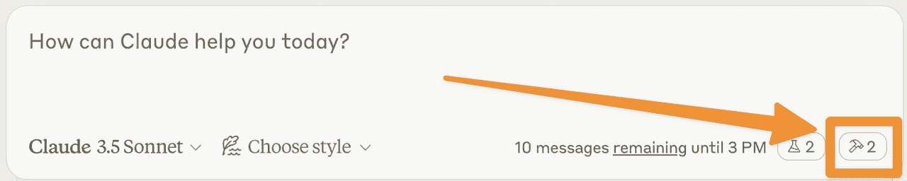

1.  点击 Claude for Desktop 界面中的 🛠️ 锤子图标

1.  **查看是否有以下两个工具**：

+   **get-alerts**（获取天气警报）

+   **get-forecast**（获取天气预报）

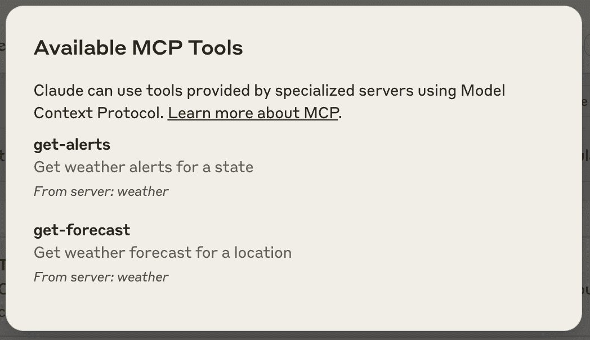

📌 如果 Claude 没有检测到服务器：

+   请查看 [**故障排查**](https://chatgpt.com/c/67d28a8b-9e64-8000-bff6-da16089a3f12#troubleshooting)** 部分**，获取调试技巧。

---

### 🔹 在 Claude for Desktop 中测试 MCP 服务器

如果 Claude 正确识别了 MCP 服务器，你可以运行以下命令进行测试：

```
What’s the weather in Sacramento?
（萨克拉门托的天气如何？）
What are the active weather alerts in Texas?
（德克萨斯州当前的天气警报有哪些？）
```


📌 注**意：**

+   由于我们使用的是 **美国国家气象局（NWS）API**，所以这些查询 **仅适用于美国地区**。

---

## **🔍 MCP 服务器的执行流程**

**当你**向 Claude 提问时，MCP 服务器会在幕后执行一系列步骤：

1️⃣ **客户端****（Claud**e for** Desktop）接收**你**的问题

2️⃣ Cla**ude **解析问题，分**析可用的 MCP 工具，决定 调用哪个工具

3️⃣ Claude 通过 MC**P 服务器执行选定的工**具（例如 **get-forecas**t 或** get-alerts**）

4️⃣ MCP 服务器获取结果，并将其返回给 Claude

5️⃣ Claude 解析结果，并 将其转换为自然语言回答

6️⃣ 最终结果显示在 Claude 界面中 🎉

---

## 🛠️ 故障排查（Troubleshooting）

如果 Claude for Desktop 无法检测到你的 MCP 服务器，你可能会遇到以下几类问题：

### 🔹 Claude for Desktop 集成问题

+   **检查 ****claud**e_desktop_config.json 配置文件

+   确保 "mcpServers" 配置正确，并使用 **绝对路径**

+   例如：

```
{
    &quot;mcpServers&quot;: {
        &quot;weather&quot;: {
            &quot;command&quot;: &quot;uv&quot;,
            &quot;args&quot;: [
                &quot;--directory&quot;,
                &quot;/ABSOLUTE/PATH/TO/PARENT/FOLDER/weather&quot;,
                &quot;run&quot;,
                &quot;weather.py&quot;
            ]
        }
    }
}
```

+   确认 MCP 服务器是否正在运行

```
uv run weather.py
```

+   确保 Claude for Desktop 是最新版本

+   你可以从 [Claude 官方网站](https://claude.ai/) 下载最新版。

---

### **🔹 天气 API 相关问题**

+   **网络请求失败**

+   确保你的服务器可以正常访问 **NWS API**

+   运行：

```
curl -H &quot;User-Agent: weather-app/1.0&quot; https://api.weather.gov/alerts/active
```

+   如果请求失败，请检查 **网络连接**

+   **API 速率限制**

+   NWS API **可能有访问频率限制**，请尝试稍后重试

📌 更**多高级调试技巧：** 查看我们的**M[CP 调试指南，](https://chatgpt.com/c/67d28a8b-9e64-8000-bff6-da16089a3f12#)**学习如何更高效地调**试 MCP 服务器与集成**。

---

## **🚀 下一步**

现在，你已经成功构建并测试了一个 MCP 服务器，接下来可以：

### **🔹 构建 MCP 客户端**

+   学习如何 **开发自己的 MCP 客户端**，连接 MCP 服务器。

### **🔹 查看示例服务器**

+   参考我们的 [**官方 MCP 服务器示例库**](https://chatgpt.com/c/67d28a8b-9e64-8000-bff6-da16089a3f12#)，探索更多 **MCP 服务器实现**。

### **🔹 MCP 调试指南**

+   了解如何 **高效调试 MCP 服务器**，排除常见错误。

### 🔹 使用 LLM 构建 MCP

+   学习如何使用 **Claude 和 LLM 技术**，加速 MCP 服务器的开发。


### **🤖 为客户端开发者提供的指南**

构建可集成所有 MCP 服务器的自定义客户端

---

## **🚀 目标**

在本教程中，你将学习如何 构建一个 LLM** 驱动的聊天机**器人客户**端，**[并让它连接到 MC](https://chatgpt.com/c/67d28a8b-9e64-8000-bff6-da16089a3f12#)P 服务器。

📌 建议：如果你还没有构建 MCP 服务器，建议先完成 服务器快速入门教程 以了解基础概念。

你可以使用以下编程语言：

+   🐍 P**ython**

+   🟢 N**ode.js**

+   ☕ **Java**

📌 完**整代码示例：**点[击这里](https://chatgpt.com/c/67d28a8b-9e64-8000-bff6-da16089a3f12#)

---

## **📌 系统要求**

在开始**之前，确保你的系统符合以下**要求：** ✅ Mac ****或 **Windows 电脑

✅ 已安装最新版 Python

✅ 已安装最新版 uv（用于管理 Python 项目）

---

## **🔹 设置开发环境**

### 1️⃣ 创建 Python 项目

```
# Create project directory
uv init mcp-client
cd mcp-client

# Create virtual environment
uv venv

# Activate virtual environment
# On Windows:
.venv\Scripts\activate
# On Unix or MacOS:
source .venv/bin/activate

# Install required packages
uv add mcp anthropic python-dotenv

# Remove boilerplate files
rm hello.py

# Create our main file
touch client.py
```

---

## **🔹 配置 API 密钥**

你需要从 **Anthropic 控制台** 获取 **API Key**。

### **1️⃣ 创建 ****.env**** 文件**

```
touch .env
```

### **2️⃣ 在 ****.env**** 文件中添加 API Key**

```
ANTHROPIC_API_KEY=&lt;your_key_here&gt;
```

📌 确保你的 API Key 是安全的！

### **3️⃣ 将 ****.env**** 添加到 ****.gitignore**

```
echo &quot;.env&quot; &gt;&gt; .gitignore
```

---

## **🔹 创建 MCP 客户端**

### 1️⃣ 导入依赖 & 创建基础客户端

在 client.py 文件中添加以下代码：

```
import asyncio
from typing import Optional
from contextlib import AsyncExitStack

from mcp import ClientSession, StdioServerParameters
from mcp.client.stdio import stdio_client

from anthropic import Anthropic
from dotenv import load_dotenv

load_dotenv()  # load environment variables from .env

class MCPClient:
    def __init__(self):
        # Initialize session and client objects
        self.session: Optional[ClientSession] = None
        self.exit_stack = AsyncExitStack()
        self.anthropic = Anthropic()
    # methods will go here
```

---

## **🔹 连接 MCP 服务器**

现在，我们实现 **连接 MCP 服务器** 的方法：

```
async def connect_to_server(self, server_script_path: str):
    &quot;&quot;&quot;连接到 MCP 服务器
    Args:
        server_script_path: 服务器脚本的路径（.py 或 .js 文件）
    &quot;&quot;&quot;
    is_python = server_script_path.endswith(&#x27;.py&#x27;)
    is_js = server_script_path.endswith(&#x27;.js&#x27;)
    if not (is_python or is_js):
        raise ValueError(&quot;服务器脚本必须是 .py 或 .js 文件&quot;)
    # 根据文件类型选择运行命令
    command = &quot;python&quot; if is_python else &quot;node&quot;
    server_params = StdioServerParameters(
        command=command,
        args=[server_script_path],
        env=None
    )
    # 启动 MCP 服务器并建立通信
    stdio_transport = await self.exit_stack.enter_async_context(stdio_client(server_params))
    self.stdio, self.write = stdio_transport
    self.session = await self.exit_stack.enter_async_context(ClientSession(self.stdio, self.write))
    await self.session.initialize()
    # 列出可用的工具
    response = await self.session.list_tools()
    tools = response.tools
    print(&quot;\n已连接到服务器，支持以下工具:&quot;, [tool.name for tool in tools])
```

📌 这**个方法的作用：**

1.  **检测** 服务器脚本是否是 .py 或 .js 文件

1.  **确定** 启动命令（Python 服务器用 python，Node.js 服务器用 node）

1.  **通过 MCP Stdio 协议** 连接到服务器

1.  **初始化 MCP 会话**

1.  **列出服务器支持的工具**，确保成功连接

---

### 🤖 处理查询逻辑（Query Processing Logic）

现在，我们来实现 **MCP 客户端的核心功能**，包括：

✅ **处理用户查询**

✅ 管理** Claud**e 对工具调用的响应

✅ 执行工具调用 并返回结果

---

### **🔹 处理查询并执行工具调用**

在 client.py 中添加以下方法：

```
async def process_query(self, query: str) -&gt; str:
    &quot;&quot;&quot;使用 Claude 处理查询并调用可用的 MCP 工具&quot;&quot;&quot;

    messages = [{&quot;role&quot;: &quot;user&quot;, &quot;content&quot;: query}]
    # 获取 MCP 服务器上注册的工具
    response = await self.session.list_tools()
    available_tools = [{
        &quot;name&quot;: tool.name,
        &quot;description&quot;: tool.description,
        &quot;input_schema&quot;: tool.inputSchema
    } for tool in response.tools]
    # 初次向 Claude 发送请求
    response = self.anthropic.messages.create(
        model=&quot;claude-3-5-sonnet-20241022&quot;,
        max_tokens=1000,
        messages=messages,
        tools=available_tools
    )
    final_text = []
    assistant_message_content = []
    # 解析 Claude 的响应
    for content in response.content:
        if content.type == &#x27;text&#x27;:
            final_text.append(content.text)
            assistant_message_content.append(content)
        elif content.type == &#x27;tool_use&#x27;:
            tool_name = content.name
            tool_args = content.input
            # 通过 MCP 服务器调用工具
            result = await self.session.call_tool(tool_name, tool_args)
            final_text.append(f&quot;[调用工具 {tool_name}，参数: {tool_args}]&quot;)
            assistant_message_content.append(content)
            messages.append({&quot;role&quot;: &quot;assistant&quot;, &quot;content&quot;: assistant_message_content})
            messages.append({
                &quot;role&quot;: &quot;user&quot;,
                &quot;content&quot;: [{
                    &quot;type&quot;: &quot;tool_result&quot;,
                    &quot;tool_use_id&quot;: content.id,
                    &quot;content&quot;: result.content
                }]
            })
            # 再次向 Claude 发送请求，获取最终回答
            response = self.anthropic.messages.create(
                model=&quot;claude-3-5-sonnet-20241022&quot;,
                max_tokens=1000,
                messages=messages,
                tools=available_tools
            )
            final_text.append(response.content[0].text)
    return &quot;\n&quot;.join(final_text)
```

📌 主**要逻辑：**

1.  获取 MCP 服务器上可用的工具

1.  向 Claude 发送请求，让 Claude 决定是否调用工具

1.  解析 Claude 的响应：

+   如果是普通文本，直接存储

+   如果是工具调用，则通过 MCP 服务器执行工具，并返回结果

1.  发送最终的 Claude 请求，让 Claude 生成完整的回复

---

### **🔹 交互式聊天界面**

我们现在添加 **交互式聊天循环**，让用户可以输入查询，并查看 Claude 的回答。

```
async def chat_loop(self):
    &quot;&quot;&quot;运行交互式聊天会话&quot;&quot;&quot;
    print(&quot;\n🚀 MCP 客户端已启动！&quot;)
    print(&quot;输入你的查询，或输入 &#x27;quit&#x27; 退出。&quot;)
    while True:
        try:
            query = input(&quot;\nQuery: &quot;).strip()
            if query.lower() == &#x27;quit&#x27;:
                break
            response = await self.process_query(query)
            print(&quot;\n&quot; + response)
        except Exception as e:
            print(f&quot;\n⚠️ 发生错误: {str(e)}&quot;)
async def cleanup(self):
    &quot;&quot;&quot;清理资源&quot;&quot;&quot;
    await self.exit_stack.aclose()
```

📌 主**要功能：**

+   提示用户输入查询

+   通过 process_query() 处理查询，并返回结果

+   支持 quit 命令退出会话

+   处理可能的错误

---

### **🔹 主程序入口**

最后，我们添加 **main()**** 入口，让程序可以接受命**令行参数，指定 要连接的 MCP 服务器。

```
async def main():
    if len(sys.argv) &lt; 2:
        print(&quot;使用方法: python client.py &lt;服务器脚本路径&gt;&quot;)
        sys.exit(1)
    client = MCPClient()
    try:
        await client.connect_to_server(sys.argv[1])
        await client.chat_loop()
    finally:
        await client.cleanup()
if 
name
 == &quot;
__main__
&quot;:
    import sys
    asyncio.run(main())
```

📌 执**行流程：**

1.  **检查是否提供了服务器路径**

1.  **初始化 MCP 客户端** 并连接 MCP 服务器

1.  **启动交互式聊天会话**

1.  **清理资源并退出**

---

## **💡 关键组件解析**

1️⃣ **客户端初始化**

+   MCPClient 负责管理 **MCP 会话** 和 **Claude API**

+   使用 AsyncExitStack **确保资源正确释放**

+   配置 **Anthropic 客户端** 用于 Claude 交互

2️⃣ **连接 MCP 服务器**

+   支持 Python 和 Node.js 服务器

+   **验证服务器脚本格式**

+   建立会话并列出 MCP 服务器上的可用工具

3️⃣ **处理查询**

+   **维持对话上下文**

+   解析 Claude 的响应，并执行工具调用

+   管理 Claude 与 MCP 工具之间的消息流

+   整合工具返回的结果，生成最终回复

4️⃣ **交互界面**

+   **提供简单的 CLI 界面**

+   **接收用户输入并显示 AI 响应**

+   **支持安全退出**

+   **包含基础错误处理**

5️⃣ **资源管理**

+   **确保资源正确清理**

+   **处理连接问题**

+   **实现优雅退出**

---

## **🛠️ 常见自定义点**

🔹 工**具调用**

+   在 process_query() 中 **自定义工具调用逻辑**

+   添加 **特定工具的错误处理**

+   进行 **工具结果格式化**

🔹 响**应处理**

+   自定义 **工具调用结果格式**

+   **增加响应过滤** 或 **转换**

+   添加 **日志记录**

🔹 用**户界面**

+   **增加 GUI 或 Web 界面**

+   **优化 CLI 输出**

+   **支持历史记录或自动补全**

---

## **🚀 运行 MCP 客户端**

### **📌 运行 MCP 客户端**

```
uv run client.py path/to/server.py   # 连接 Python 服务器
uv run client.py path/to/build/index.js   # 连接 Node.js 服务器
```

📌 示**例（**连接天气服务器）：

```
python client.py ~/projects/weather/src/weather/server.py
```

**MCP 客户端将执行以下操作：** ✅ 连接到 MCP 服**务器

✅ **列出可**用的 MCP 工具

✅ **启动交互式聊天界面

✅ 允许用户输入查询，执行工具调用，并 获取 Claude 的响应

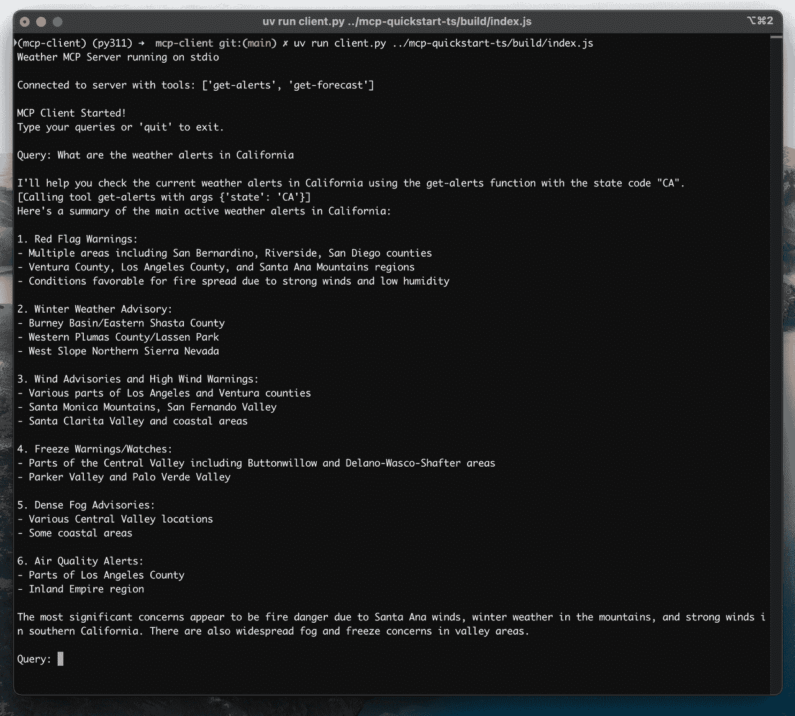

---

## **🔍 MCP 查询处理流程**

当你输入一个查询时，MCP 服务器的处理流程如下： 1️⃣ **客户端获取 M**CP 服务器上的工具列表

2️⃣ 向 Claude 发送查询，并附带工具信息

3️⃣ Claude 选择适当的工具（如果需要）

4️⃣ 客户端通过 MCP 服务器执行工具调用

5️⃣ 工具返回结果，并传递给 Claude

6️⃣ Claude 生成最终的自然语言回复

7️⃣ 响应显示在终端 🎉

---

## **✅ 最佳实践**

### **🛠️ 错误处理**

+   **始终使用 ****try-except**** 处理工具调用**

+   **提供清晰的错误消息**

+   **优雅处理服务器连接问题**

### **📌 资源管理**

+   **使用 ****AsyncExitStack**** 进行资源管理**

+   **在程序退出时释放连接**

+   **处理服务器断连情况**

### **🔒 安全性**

+   **API Key 存储在 ****.env**** 文件中**

+   **验证服务器返回的数据**

+   **谨慎管理工具调用权限**

---

## **🛠️ 故障排查**

### **🔹 服务器路径问题**

+   确保服务器路径正确

+   **使用绝对路径**，避免相对路径问题

+   Windows 用户请确保路径格式正确：

```
uv run client.py C:/projects/mcp-server/weather.py
```

### **🔹 响应时间**

+   **首次响应可能需要 30 秒**（初始化 & 处理请求）

+   **后续请求会更快**

+   **请勿在初次请求时中断进程**

### **🔹 常见错误**

+   File**NotFo**undError：检查 服务器路径

+   Conn**ection** refused：确保 服务器已运行

+   Tool** executio**n failed：确认 环境变量已正确设置

+   Timeout error：考虑增加超时时间

---

MCP Python SDK：https://github.com/modelcontextprotocol/python-sdk

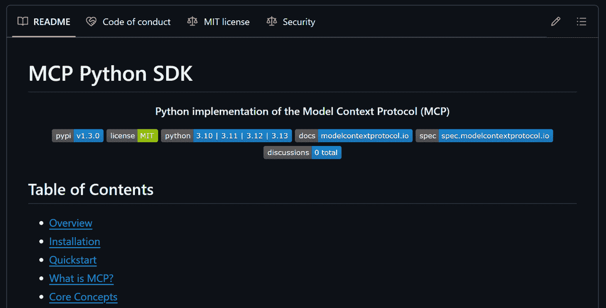

# **MCP Python SDK**

### **📌 MCP SDK 相关内容**

MCP SDK 提供了一套 **标准化** 的工具，让应用能够与 **LLM（大语言模型）** 交互，同时将数据和功能 **安全、标准化** 地暴露给 LLM 应用程序。

---

## **📖 目录**

1️⃣ **概览（Overview）**

2️⃣ 安装（Installation）

3️⃣ 快速入门（Quickstart）

4️⃣ 什么是 MCP？（What is MCP?）

5️⃣ 核心概念（Core Concepts）

+   **服务器（Server）**

+   **资源（Resources）**

+   **工具（Tools）**

+   **提示词（Prompts）**

+   **图片（Images）**

+   **上下文（Context）**
 6️⃣ 运行服务器（Running Your Server）

+   开发模式（Development Mode）

+   **Claude Desktop 集成（Claude **Desktop Integration）

+   直接执行（**Direct Execu**tion）
 7️⃣ 示例（Examples）

+   回声服务器（Echo Server）

+   SQLite 数据浏览器（SQLite Explorer）
 8️⃣ 高级用法（Advanced Usage）

+   低级服务器实现（Low-Level Server）

+   编写 MCP 客户端（Writing MCP Clients）

+   MCP 基础操作（MCP Primitives）

+   服务器能力（Server Capa**bilities）
 9**️⃣ 文档（Documentation）
 🔟 贡献（Contributing）
 1️⃣1️⃣ 许可证（License）

---

## **📌 概览**

**模型上下文协议（MCP）** 允许应用程序 **标准化地**** 向 LL**M 提**供上下文信息**，从而将 上下文管理 与 LLM 交互 分离开来。

📌 这**个 Python SDK 提供完整的 MCP** 规范**实现，使你可以轻松实**现以下**功能： ✅ 构建 M**CP 客户端，**可连接到任何 MCP **服务器**

✅ 创建 MC**P 服务器，向 LLM 提供资源、工具和提示词

✅ 使用标准化通信方式（如 stdio 和 SSE）

✅ 管理 MCP 协议的消息流与生命周期

---

## **📌 安装**

我们推荐使用 **uv** 来管理 Python 项目：

```
uv add &quot;mcp[cli]&quot;
```

**或者使用 ****pip**** 直接安装：**

```
pip install mcp
```

---

## **🚀 快速入门**

让我们创建一个简单的 **MCP 服务器**，它包含：

+   **一个计算器工具**

+   **一个个性化问候资源**

📌 创**建 s****erver.py ****文件，并添加以下代码：**

```
# server.py
from mcp.server.fastmcp import FastMCP

# Create an MCP server
mcp = FastMCP(&quot;Demo&quot;)

# Add an addition tool
@mcp.tool()
def add(a: int, b: int) -&gt; int:
    &quot;&quot;&quot;Add two numbers&quot;&quot;&quot;
    return a + b

# Add a dynamic greeting resource
@mcp.resource(&quot;greeting://{name}&quot;)
def get_greeting(name: str) -&gt; str:
    &quot;&quot;&quot;Get a personalized greeting&quot;&quot;&quot;
    return f&quot;Hello, {name}!&quot;
```

📌 在 Claude Desktop 中安装并运行该服务器：

```
mcp install server.py
```

📌 或者使用 MCP Inspector 测试：

```
mcp dev server.py
```

---

## **🤔 什么是 MCP？**

**MCP（模型上下文协议）** 允许你构建 **服务器**，向 LLM **安全、标准化** 地暴露数据和功能。可以把 MCP 服务器想象成 专门为 LLM 设计的 Web API。

📌 M**CP 服务器可以： **

✅ 通过资源（Resour**ces）暴露数据（类似于 GE**T API）

✅ 通过工具（Tools）提供功能（类似于 POST API）

✅ 通过提示词（Prompts）定义交互模式（可复用的 LLM 模板）

---

## **🔹 核心概念**

### **1️⃣ 服务器（Server）**

MCP 服务器是 **MCP 协议的核心接口**，它管理：

✅ **连接**

✅** 协议合规**性

**✅ 消息**路由

📌 示**例：**

```
# 添加服务器生命周期管理
from dataclasses import dataclass
from typing import AsyncIterator
from mcp.server.fastmcp import FastMCP
# 创建命名服务器
mcp = FastMCP(&quot;My App&quot;)
# 指定依赖项（如 pandas、numpy）
mcp = FastMCP(&quot;My App&quot;, dependencies=[&quot;pandas&quot;, &quot;numpy&quot;])
@dataclass
class AppContext:
    db: Database  # 这里替换为你的实际数据库类型
@asynccontextmanager
async def app_lifespan(server: FastMCP) -&gt; AsyncIterator[AppContext]:
    &quot;&quot;&quot;使用类型安全的上下文管理应用程序生命周期&quot;&quot;&quot;
    try:
        await db.connect()
        yield AppContext(db=db)
    finally:
        await db.disconnect()
# 传递生命周期管理器给 MCP 服务器
mcp = FastMCP(&quot;My App&quot;, lifespan=app_lifespan)
# 在工具函数中访问生命周期上下文
@mcp.tool()
def query_db(ctx: Context) -&gt; str:
    &quot;&quot;&quot;使用数据库进行查询&quot;&quot;&quot;
    db = ctx.request_context.lifespan_context[&quot;db&quot;]
    return db.query()
```

📌 以**上代码确保 MCP 服务器在启动**和关闭时正确管理资源（如数据库连接）。

---

### 2️⃣ 资源（Resources）

📌 资**源用于向 LLM 暴露数据，**类似于 R**EST API 的 G****ET ****端点。**

✅** 不应执行复杂计算或产生副作**用

#### **📌 示例：静态配置**

```
@mcp.resource(&quot;config://app&quot;)
def get_config() -&gt; str:
    &quot;&quot;&quot;提供静态应用配置&quot;&quot;&quot;
    return &quot;App 配置信息&quot;
```

#### **📌 示例：动态用户数据**

```
@mcp.resource(&quot;users://{user_id}/profile&quot;)
def get_user_profile(user_id: str) -&gt; str:
    &quot;&quot;&quot;提供动态用户数据&quot;&quot;&quot;
    return f&quot;用户 {user_id} 的个人资料&quot;
```

📌 资**源的作用： **

✅ 让 LLM **加载数据到上下文**，帮助**生成更准确的回答

** ✅ 支持静态和动态数据

✅ 可以结合 LLM 的检索增强生成（RAG）机制

### **📌 MCP SDK 进阶指南**

**MCP SDK 提供了一套标准化**工具**，让应用可以**通过 资源（Resources）、工具（Tools）和提示词（Prompts），以安全、标准化的方式与 LLM 进行交互。

---

## **🔹 工具（Tools）**

**工具（Tools）**** 允许 LLM 通过 MC**P 服务器执行操作。与** 资**源（R**esource**s） 不同，工具通常涉及 计算 并 可能产生副作用。

📌 示**例：计算 BMI**

```
@mcp.tool()
def calculate_bmi(weight_kg: float, height_m: float) -&gt; float:
    &quot;&quot;&quot;根据体重（kg）和身高（m）计算 BMI&quot;&quot;&quot;
    return weight_kg / (height_m ** 2)
```

📌 示**例：获取天气信息**

```
import httpx
@mcp.tool()
async def fetch_weather(city: str) -&gt; str:
    &quot;&quot;&quot;获取指定城市的当前天气&quot;&quot;&quot;
    async with httpx.AsyncClient() as client:
        response = await client.get(f&quot;https://api.weather.com/{city}&quot;)
        return response.text
```

✅ **工具的作用**

+   **执行计算**

+   **进行 API 调用**

+   **支持异步操作**

---

## **🔹 提示词（Prompts）**

**提示词（Prompts）** 是 **可复用模板**，帮助 LLM 以标准化方式与 MCP 服务器交互。

📌 示**例：代码审查**

```
@mcp.prompt()
def review_code(code: str) -&gt; str:
    return f&quot;请审查以下代码：\n\n{code}&quot;
```

📌 示**例：调试错误**

```
@mcp.prompt()
def debug_error(error: str) -&gt; list[Message]:
    return [
        UserMessage(&quot;我遇到了这个错误：&quot;),
        UserMessage(error),
        AssistantMessage(&quot;我来帮你调试。你目前尝试了哪些方法？&quot;)
    ]
```

✅ **提示词的作用**

+   **创建标准化 LLM 交互模板**

+   提供上下文，使 LLM 生成更精准的响应

+   **支持结构化对话**

---

## **🔹 图片处理（Images）**

FastMCP 提供 **Image** 类，可用于 **自动处理图片数据**。

📌 示**例：生成缩略图**

```
from mcp.server.fastmcp import FastMCP, Image
from PIL import Image as PILImage
@mcp.tool()
def create_thumbnail(image_path: str) -&gt; Image:
    &quot;&quot;&quot;根据图片路径创建缩略图&quot;&quot;&quot;
    img = PILImage.open(image_path)
    img.thumbnail((100, 100))
    return Image(data=img.tobytes(), format=&quot;png&quot;)
```

✅ **图片功能**

+   **支持 ****Image**** 类进行图片数据封装**

+   可用于 LLM 生成的多模态应用

---

## 🔹 上下文管理（Context）

Context 对象可以让工具和资源 **访问 MCP 服务器的内部能力**，如 **日志记录、进度跟踪、文件读取等**。

📌 示**例：批量处理多个文件**

```
from mcp.server.fastmcp import FastMCP, Context
@mcp.tool()
async def long_task(files: list[str], ctx: Context) -&gt; str:
    &quot;&quot;&quot;处理多个文件，并提供进度跟踪&quot;&quot;&quot;
    for i, file in enumerate(files):
        ctx.info(f&quot;正在处理 {file}&quot;)
        await ctx.report_progress(i, len(files))
        data, mime_type = await ctx.read_resource(f&quot;file://{file}&quot;)
    return &quot;所有文件处理完成&quot;
```

✅ **上下文的作用**

+   **支持进度跟踪**

+   **支持日志记录**

+   **可以读取 MCP 服务器的资源**

---

## **🚀 运行 MCP 服务器**

### **1️⃣ 开发模式**

使用 **MCP Inspector** 进行快速测试：

```
mcp dev server.py
```

📌 添**加依赖项**

```
mcp dev server.py --with pandas --with numpy
```

📌 挂**载本地代码**

```
mcp dev server.py --with-editable .
```

---

### 2️⃣ Claude Desktop 集成

📌 安**装 MCP 服务器**

```
mcp install server.py
```

📌 自**定义服务器名称**

```
mcp install server.py --name &quot;My Analytics Server&quot;
```

📌 传**递环境变量**

```
mcp install server.py -v API_KEY=abc123 -v DB_URL=postgres://...
mcp install server.py -f .env
```

---

### 3️⃣ 直接执行 MCP 服务器

📌 P**ython 方式**

```
from mcp.server.fastmcp import FastMCP
mcp = FastMCP(&quot;My App&quot;)
if name == &quot;__main__&quot;:
    mcp.run()
```

📌 运**行服务器**

```
python server.py
# 或者
mcp run server.py
```

---

## **🛠️ 示例**

### **1️⃣ Echo 服务器**

📌 示例：创建 MCP 服务器，回显消息

```
from mcp.server.fastmcp import FastMCP
mcp = FastMCP(&quot;Echo&quot;)
@mcp.resource(&quot;echo://{message}&quot;)
def echo_resource(message: str) -&gt; str:
    &quot;&quot;&quot;回显消息（资源）&quot;&quot;&quot;
    return f&quot;Resource echo: {message}&quot;
@mcp.tool()
def echo_tool(message: str) -&gt; str:
    &quot;&quot;&quot;回显消息（工具）&quot;&quot;&quot;
    return f&quot;Tool echo: {message}&quot;
@mcp.prompt()
def echo_prompt(message: str) -&gt; str:
    &quot;&quot;&quot;创建回显提示词&quot;&quot;&quot;
    return f&quot;请处理此消息: {message}&quot;
```

---

### 2️⃣ SQLite 数据浏览器

📌 示例：使用 SQLite 数据库

```
from mcp.server.fastmcp import FastMCP
import sqlite3
mcp = FastMCP(&quot;SQLite Explorer&quot;)
@mcp.resource(&quot;schema://main&quot;)
def get_schema() -&gt; str:
    &quot;&quot;&quot;返回数据库架构&quot;&quot;&quot;
    conn = sqlite3.connect(&quot;database.db&quot;)
    schema = conn.execute(
        &quot;SELECT sql FROM sqlite_master WHERE type=&#x27;table&#x27;&quot;
    ).fetchall()
    return &quot;\n&quot;.join(sql[0] for sql in schema if sql[0])
@mcp.tool()
def query_data(sql: str) -&gt; str:
    &quot;&quot;&quot;执行 SQL 查询&quot;&quot;&quot;
    conn = sqlite3.connect(&quot;database.db&quot;)
    try:
        result = conn.execute(sql).fetchall()
        return &quot;\n&quot;.join(str(row) for row in result)
    except Exception as e:
        return f&quot;错误: {str(e)}&quot;
```

---

## **⚙️ 进阶用法**

### 1️⃣ 低级服务器（Low-Level Server）

如果需要 **完全控制 MCP 服务器**，可以使用低级 API：

```
from contextlib import asynccontextmanager
from typing import AsyncIterator
@asynccontextmanager
async def server_lifespan(server: Server) -&gt; AsyncIterator[dict]:
    &quot;&quot;&quot;管理服务器生命周期&quot;&quot;&quot;
    try:
        await db.connect()
        yield {&quot;db&quot;: db}
    finally:
        await db.disconnect()
# 传递生命周期管理器给服务器
server = Server(&quot;example-server&quot;, lifespan=server_lifespan)
```

✅ **低级服务器 API 允许**：

+   **在服务器启动时初始化资源**

+   **在请求处理期间访问资源**

+   **在服务器关闭时清理资源**

```
from mcp.server.lowlevel import Server, NotificationOptions
from mcp.server.models import InitializationOptions
import mcp.server.stdio
import mcp.types as types

# Create a server instance
server = Server(&quot;example-server&quot;)

@server.list_prompts()
async def handle_list_prompts() -&gt; list[types.Prompt]:
    return [
        types.Prompt(
            name=&quot;example-prompt&quot;,
            description=&quot;An example prompt template&quot;,
            arguments=[
                types.PromptArgument(
                    name=&quot;arg1&quot;,
                    description=&quot;Example argument&quot;,
                    required=True
                )
            ]
        )
    ]

@server.get_prompt()
async def handle_get_prompt(
    name: str,
    arguments: dict[str, str] | None
) -&gt; types.GetPromptResult:
    if name != &quot;example-prompt&quot;:
        raise ValueError(f&quot;Unknown prompt: {name}&quot;)

    return types.GetPromptResult(
        description=&quot;Example prompt&quot;,
        messages=[
            types.PromptMessage(
                role=&quot;user&quot;,
                content=types.TextContent(
                    type=&quot;text&quot;,
                    text=&quot;Example prompt text&quot;
                )
            )
        ]
    )

async def run():
    async with mcp.server.stdio.stdio_server() as (read_stream, write_stream):
        await server.run(
            read_stream,
            write_stream,
            InitializationOptions(
                server_name=&quot;example&quot;,
                server_version=&quot;0.1.0&quot;,
                capabilities=server.get_capabilities(
                    notification_options=NotificationOptions(),
                    experimental_capabilities={},
                )
            )
        )

if __name__ == &quot;__main__&quot;:
    import asyncio
    asyncio.run(run())
```

---

## **📌 编写 MCP 客户端**

MCP SDK 提供 **高层客户端接口**，可用于连接 MCP 服务器：

```
from mcp import ClientSession, StdioServerParameters
from mcp.client.stdio import stdio_client

# Create server parameters for stdio connection
server_params = StdioServerParameters(
    command=&quot;python&quot;, # Executable
    args=[&quot;example_server.py&quot;], # Optional command line arguments
    env=None # Optional environment variables
)

# Optional: create a sampling callback
async def handle_sampling_message(message: types.CreateMessageRequestParams) -&gt; types.CreateMessageResult:
    return types.CreateMessageResult(
        role=&quot;assistant&quot;,
        content=types.TextContent(
            type=&quot;text&quot;,
            text=&quot;Hello, world! from model&quot;,
        ),
        model=&quot;gpt-3.5-turbo&quot;,
        stopReason=&quot;endTurn&quot;,
    )

async def run():
    async with stdio_client(server_params) as (read, write):
        async with ClientSession(read, write, sampling_callback=handle_sampling_message) as session:
            # Initialize the connection
            await session.initialize()

            # List available prompts
            prompts = await session.list_prompts()

            # Get a prompt
            prompt = await session.get_prompt(&quot;example-prompt&quot;, arguments={&quot;arg1&quot;: &quot;value&quot;})

            # List available resources
            resources = await session.list_resources()

            # List available tools
            tools = await session.list_tools()

            # Read a resource
            content, mime_type = await session.read_resource(&quot;file://some/path&quot;)

            # Call a tool
            result = await session.call_tool(&quot;tool-name&quot;, arguments={&quot;arg1&quot;: &quot;value&quot;})

if __name__ == &quot;__main__&quot;:
    import asyncio
    asyncio.run(run())
```

---

### 📌 MCP 基本构件（MCP Primitives）

MCP 协议定义了 三种核心构件（Primitives），MCP 服务器可以实现这些功能：

✅ **总结**：

+   **提示词（Prompts）**：用户主动选择的交互式模板，例如命令行快捷命令

+   **资源（Resources）**：由客户端提供的数据，例如配置文件、数据库记录、API 结果

+   **工具（Tools）**：LLM 可调用的执行逻辑，例如计算函数、数据存储、系统操作

---

## 📌 服务器能力（Server Capabilities）

MCP 服务器在初始化时会 **声明支持的功能**，即服务器的能力（Capabilities）。

✅ **总结**：

+   MCP 服务器在初始化时，必须声明其支持的能力

+   如果服务器支持“资源”（Resources），它可以订阅资源变更

+   **如果服务器支持“工具”（Tools）**，LLM 可以自动发现可用工具并调用它们

---

## 📌 文档（Documentation）

+   📄 Mo[del Conte](https://chatgpt.com/c/67d28a8b-9e64-8000-bff6-da16089a3f12#)xt Protocol 文档
 👉 官方 MCP 文档

+   📜 Mo[del Contex](https://chatgpt.com/c/67d28a8b-9e64-8000-bff6-da16089a3f12#)t Protocol 规范
 👉 MCP 详细技术规范

+   🔧 官方[支持的 MCP 服务器
](https://chatgpt.com/c/67d28a8b-9e64-8000-bff6-da16089a3f12#) 👉 官方 MCP 服务器列表

---

## **📌 贡献 & 许可证**

📌 贡**献指南 **[我们欢迎](https://chatgpt.com/c/67d28a8b-9e64-8000-bff6-da16089a3f12#)所有开发者参与 MCP 生态，详细指南见 贡献文档。

📌 许**可证 **MCP 采用 M**IT 许可证，**详情请查看 L**ICENSE 文件。**

---