# Agents SDK+DeepSeek+MCP智能体开发实战（下）

> 来源：[https://kq4b3vgg5b.feishu.cn/docx/Uvwmdabi3oLdAdxzWbScpdXlnWQ](https://kq4b3vgg5b.feishu.cn/docx/Uvwmdabi3oLdAdxzWbScpdXlnWQ)

## 课程说明

体验课内容节选自《2025大模型Agent智能体开发实战》(春季班)完整版付费课程

体验课时间有限，若想深度学习大模型技术，欢迎大家报名由我主讲的《2025大模型Agent智能体开发实战》(春季班)

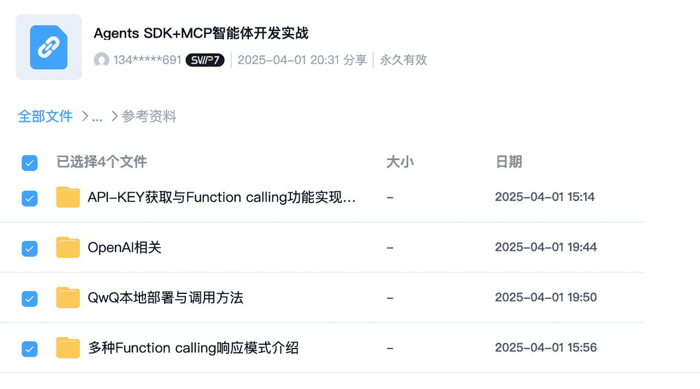


此外，公开课全套学习资料，已上传至网盘

（https://pan.baidu.com/s/1fHbHoyjCpqRIDwsqtujKdw?pwd=xarb）

需要更系统深入学习大模型可扫码⬆️添加助教咨询喔～

---

## 《2025大模型Agent智能体开发实战》体验课

### OpenAI开源Agents SDK + DeepSeek + MCP智能体开发实战（下）

```python
import openai
```

```python
openai.__version__
```

```python
'1.70.0'
```

```python
from openai import OpenAI
import os
from dotenv import load_dotenv
load_dotenv(override=True)
from openai import AsyncOpenAI
from agents import OpenAIChatCompletionsModel, Agent, Runner, set_default_openai_client
from agents.model_settings import ModelSettings
from contextlib import AsyncExitStack
```

```text
[non-fatal] Tracing: request failed: [Errno 99] Cannot assign requested address
[non-fatal] Tracing: request failed: [Errno 99] Cannot assign requested address
[non-fatal] Tracing: request failed: [Errno 99] Cannot assign requested address
[non-fatal] Tracing: max retries reached, giving up on this batch.
[non-fatal] Tracing: request failed: [Errno 99] Cannot assign requested address
[non-fatal] Tracing: request failed: [Errno 99] Cannot assign requested address
[non-fatal] Tracing: request failed: [Errno 99] Cannot assign requested address
[non-fatal] Tracing: max retries reached, giving up on this batch.
[non-fatal] Tracing: request failed: [Errno 99] Cannot assign requested address
[non-fatal] Tracing: request failed: [Errno 99] Cannot assign requested address
[non-fatal] Tracing: request failed: [Errno 99] Cannot assign requested address
[non-fatal] Tracing: max retries reached, giving up on this batch.
[non-fatal] Tracing: request failed: [Errno 99] Cannot assign requested address
[non-fatal] Tracing: request failed: [Errno 99] Cannot assign requested address
[non-fatal] Tracing: request failed: [Errno 99] Cannot assign requested address
[non-fatal] Tracing: max retries reached, giving up on this batch.
[non-fatal] Tracing: request failed: [Errno 99] Cannot assign requested address
[non-fatal] Tracing: request failed: [Errno 99] Cannot assign requested address
[non-fatal] Tracing: request failed: [Errno 99] Cannot assign requested address
[non-fatal] Tracing: max retries reached, giving up on this batch.
[non-fatal] Tracing: request failed: [Errno 99] Cannot assign requested address
[non-fatal] Tracing: request failed: [Errno 99] Cannot assign requested address
[non-fatal] Tracing: request failed: [Errno 99] Cannot assign requested address
[non-fatal] Tracing: max retries reached, giving up on this batch.
[non-fatal] Tracing: request failed: [Errno 99] Cannot assign requested address
[non-fatal] Tracing: request failed: [Errno 99] Cannot assign requested address
[non-fatal] Tracing: request failed: [Errno 99] Cannot assign requested address
[non-fatal] Tracing: max retries reached, giving up on this batch.
[non-fatal] Tracing: request failed: [Errno 99] Cannot assign requested address
[non-fatal] Tracing: request failed: [Errno 99] Cannot assign requested address
[non-fatal] Tracing: request failed: [Errno 99] Cannot assign requested address
[non-fatal] Tracing: max retries reached, giving up on this batch.
[non-fatal] Tracing: request failed: [Errno 99] Cannot assign requested address
[non-fatal] Tracing: request failed: [Errno 99] Cannot assign requested address
[non-fatal] Tracing: request failed: [Errno 99] Cannot assign requested address
[non-fatal] Tracing: max retries reached, giving up on this batch.
[non-fatal] Tracing: request failed: [Errno 99] Cannot assign requested address
[non-fatal] Tracing: request failed: [Errno 99] Cannot assign requested address
[non-fatal] Tracing: request failed: [Errno 99] Cannot assign requested address
[non-fatal] Tracing: max retries reached, giving up on this batch.
[non-fatal] Tracing: request failed: [Errno 99] Cannot assign requested address
[non-fatal] Tracing: request failed: [Errno 99] Cannot assign requested address
```

```python
import openai
from openai import OpenAI
import os
from dotenv import load_dotenv
load_dotenv(override=True)

from openai import AsyncOpenAI
from agents import OpenAIChatCompletionsModel, Agent, Runner, set_default_openai_client
from agents.model_settings import ModelSettings
from agents import function_tool
import requests, json
import pymysql

from agents import (
    Agent,
    HandoffOutputItem,
    ItemHelpers,
    MessageOutputItem,
    RunContextWrapper,
    Runner,
    ToolCallItem,
    ToolCallOutputItem,
    TResponseInputItem,
    function_tool,
    handoff,
    trace,
)
from agents.extensions.handoff_prompt import RECOMMENDED_PROMPT_PREFIX

from IPython.display import display, Code, Markdown, Image
```

```python
import os
import openai
import glob
import shutil

import numpy as np
import pandas as pd
import pymysql

import json
import io
import inspect
import requests
import re
import random
import string
import base64

from bs4 import BeautifulSoup
import dateutil.parser as parser
import tiktoken
from lxml import etree

import sys
from dotenv import load_dotenv
from openai import OpenAI

import matplotlib
import matplotlib.pyplot as plt
import seaborn as sns
from IPython.display import display, Code, Markdown, Image
from IPython import get_ipython
```

+ DeepSeek API调用流程回顾

```python
# 读取模型API-KEY
API_KEY = os.getenv("API_KEY")

# 实例化客户端
client = OpenAI(api_key=API_KEY, 
                base_url="https://api.deepseek.com")

# 调用 deepseekv3 模型
response = client.chat.completions.create(
    model="deepseek-chat",
    messages=[
        {"role": "user", "content": "你好，好久不见!请介绍下你自己。"}
    ]
)

# 输出生成的响应内容
print(response.choices[0].message.content)
```

```text
你好呀！确实好久不见～很高兴再次和你聊天！😊  

我是 **DeepSeek Chat**，由深度求索公司打造的智能AI助手。我的最新版本是 **DeepSeek-V3**，知识更新至 **2024年7月**，拥有 **128K 上下文记忆**，可以处理超长文本，还能阅读并分析 **PDF、Word、Excel、PPT** 等文件。  

✨ **我的特点**：  
- **免费使用**：目前不收费，放心提问！  
- **超强理解力**：能解答技术、学习、生活、娱乐等各种问题。  
- **文件阅读**：上传文档，我可以帮你总结、提取信息或分析内容。  
- **持续进步**：团队在持续优化我，让我更聪明、更贴心！  

你可以问我任何问题，比如最新科技动态、学习建议、写作灵感，或者单纯聊聊天～ 😃 最近有什么我可以帮你的吗？
```

+ Agents SDK基本调用流程回顾

```python
external_client = AsyncOpenAI(
    base_url = "https://api.deepseek.com",
    api_key=API_KEY, 
)

set_default_openai_client(external_client)

deepseek_model = OpenAIChatCompletionsModel(
    model="deepseek-chat",
    openai_client=external_client)
```

```python
agent = Agent(name="Assistant", 
              instructions="你是一名助人为乐的助手。",
              model=deepseek_model)

result = await Runner.run(agent, "请写一首关于编程中递归的俳句。") 

print(result.final_output)
```

```text
函数自调用，  
层层深入栈深处，  
基线终有归。
```

## 一、MCP入门介绍与接入Agents SDK基本流程

在3月27号，Agents SDK正式官宣支持MCP使用，这也使得Agents SDK的实际应用场景得到待拓展：


现在，我们仅需在创建Agent的时候，将MCP服务器视作为一项工具，即可顺利调用MCP服务器进行Agent开发。而实际在借助Agents SDK调用MCP的流程也非常简单，我们只需将MCP视作tools，即可进行调用。换而言之，就是如果使用Agents SDK作为Agent开发框架，则可以零门槛快速接入MCP海量服务器生态。

## 1. MCP技术回顾

MCP，全称是Model Context Protocol，模型上下文协议，由Claude母公司Anthropic于去年11月正式提出。


+   Anthropic MCP发布通告：https://www.anthropic.com/news/model-context-protocol

+   MCP GitHub主页：https://github.com/modelcontextprotocol

MCP的核心作用，是统一了Agent开发过程中，大模型调用外部工具的技术实现流程，从而大幅提高Agent开发效率。在MCP诞生之前，不同的外部工具各有不同的调用方法，要连接这些外部工具开发Agent，就必须“每一把锁单独配一把钥匙”，开发工作非常繁琐：


而MCP的诞生，则统一了这些外部工具的调用流程，使得无论什么样的工具，都可以借助MCP技术按照统一的一个流程快速接入到大模型中，从而大幅加快Agent开发效率。这就好比现在很多设备都可以使用type-c和电脑连接类似。


从技术实现角度来看，我们可以将MCP看成是Function calling的一种封装，通过server-client架构和一整套开发工具，来规范化Function calling开发流程。


换而言之，Agents SDK实现MCP技术流程如下：

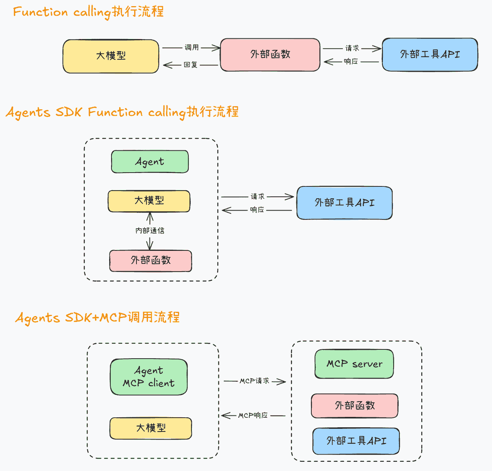

除此之外，实际上，MCP提供了三个方面的技术支持，其一是抽象的协议，也就是技术理论层面的设计；其二是一整套MCP的开发工具，也就是一些库，方便大家进行MCP工具（MCP Server）的开发并构建智能体；其三，MCP还提供了一整套非常丰富的开发生态，由于MCP是一套标准协议，任何MCP工具（MCP Server）都可以无缝接入任何MCP智能体中，也就是你开发的工具我也能用，我开发的工具你也能直接用。

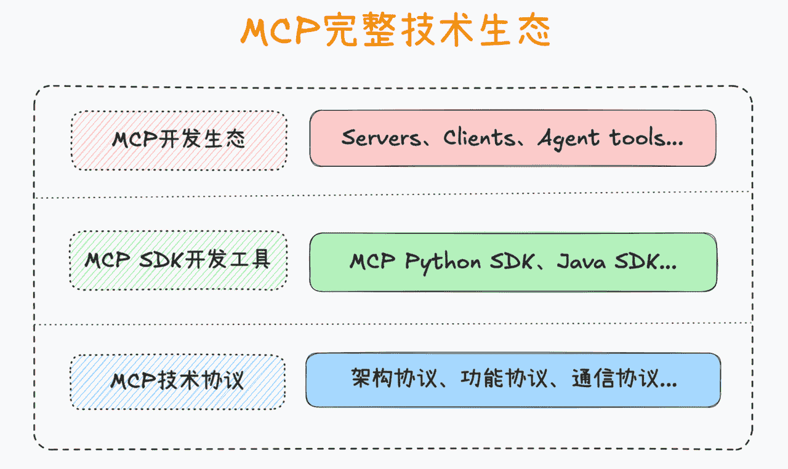

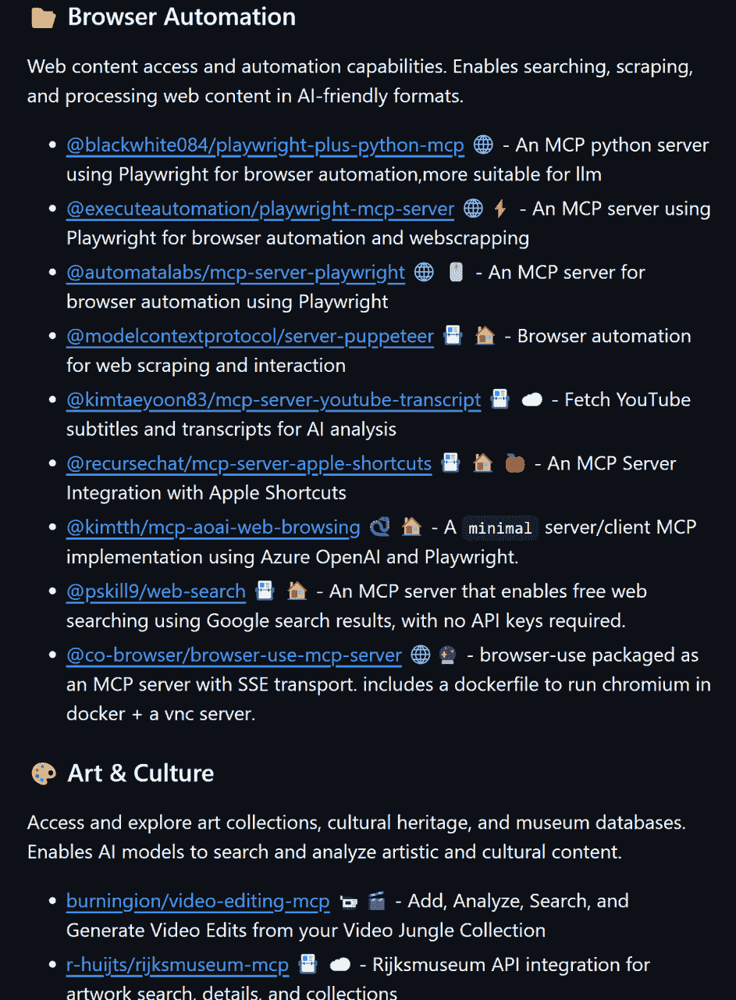

## 2. MCP参考公开课

+   《7分钟讲清楚MCP是什么？》：https://www.bilibili.com/video/BV1uXQzYaEpJ/


+   《从零到一，MCP技术开发入门实战！》：https://www.bilibili.com/video/BV1NLXCYTEbj/


+   《MCP企业级智能体开发实战！》：https://www.bilibili.com/video/BV1n1ZuYjEzf/


> 从零到一MCP入门与智能体开发进阶课件合集：


> 下图扫码即可领取：


## 3. MCP基础实践流程

接下来，我们先尝试手动实现一遍MCP实践流程，然后再考虑将已经部署好的server带入Agents SDK中，作为tools进行调用。

一个极简的天气查询MCP调用流程如下：

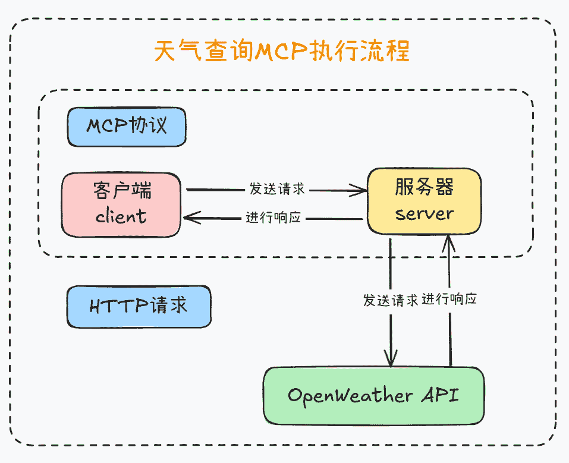

+   借助`uv`创建MCP运行环境

方法 1：使用 `pip` 安装（适用于已安装 `pip` 的系统）

```
pip install uv
```

方法 2：使用 `curl` 直接安装

如果你的系统没有 pip，可以直接运行：

```
curl -LsSf https://astral.sh/uv/install.sh | sh
```

这会自动下载 `uv` 并安装到 `/usr/local/bin`。

+   创建 MCP 客户端项目

```
# 创建项目目录
uv init mcp-client
cd mcp-client
```

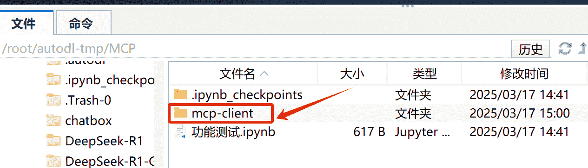

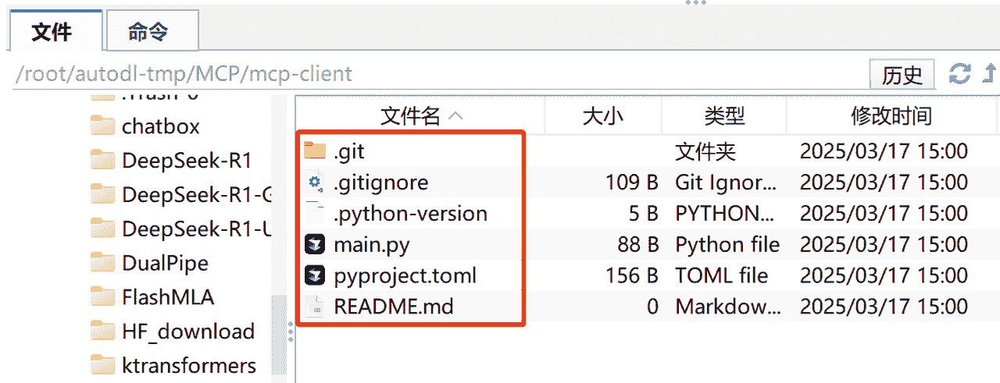

+   创建MCP客户端虚拟环境

```
# 创建虚拟环境
uv venv

# 激活虚拟环境
source .venv/bin/activate
```

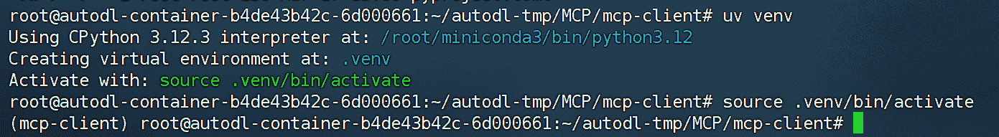

然后即可通过`add`方法在虚拟环境中安装相关的库。

```
# 安装 MCP SDK
uv add mcp openai python-dotenv httpx
```

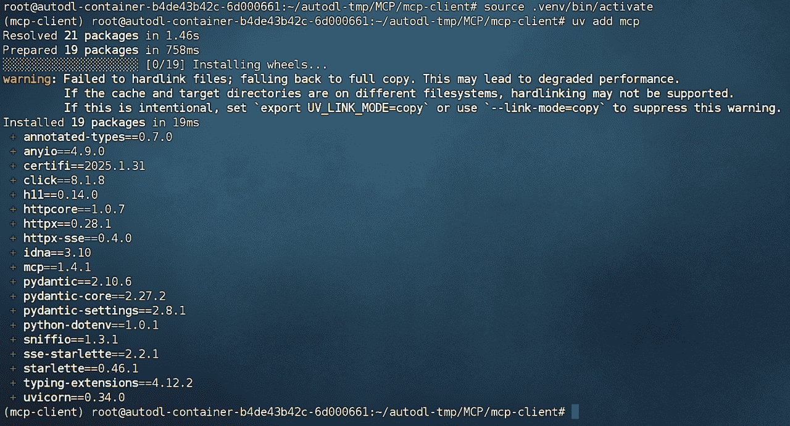

+   编写用于天气查询的server服务器代码：

这里我们需要在服务器上创建一个`server.py`，并写入如下代码：

```
import json
import httpx
from typing import Any
from mcp.server.fastmcp import FastMCP

# 初始化 MCP 服务器
mcp = FastMCP(&quot;WeatherServer&quot;)

# OpenWeather API 配置
OPENWEATHER_API_BASE = &quot;https://api.openweathermap.org/data/2.5/weather&quot;
API_KEY = &quot;YOUR_API_KEY&quot;  # 请替换为你自己的 OpenWeather API Key
USER_AGENT = &quot;weather-app/1.0&quot;

async def fetch_weather(city: str) -&gt; dict[str, Any] | None:
    &quot;&quot;&quot;
    从 OpenWeather API 获取天气信息。
    :param city: 城市名称（需使用英文，如 Beijing）
    :return: 天气数据字典；若出错返回包含 error 信息的字典
    &quot;&quot;&quot;
    params = {
        &quot;q&quot;: city,
        &quot;appid&quot;: API_KEY,
        &quot;units&quot;: &quot;metric&quot;,
        &quot;lang&quot;: &quot;zh_cn&quot;
    }
    headers = {&quot;User-Agent&quot;: USER_AGENT}

    async with httpx.AsyncClient() as client:
        try:
            response = await client.get(OPENWEATHER_API_BASE, params=params, headers=headers, timeout=30.0)
            response.raise_for_status()
            return response.json()  # 返回字典类型
        except httpx.HTTPStatusError as e:
            return {&quot;error&quot;: f&quot;HTTP 错误: {e.response.status_code}&quot;}
        except Exception as e:
            return {&quot;error&quot;: f&quot;请求失败: {str(e)}&quot;}

def format_weather(data: dict[str, Any] | str) -&gt; str:
    &quot;&quot;&quot;
    将天气数据格式化为易读文本。
    :param data: 天气数据（可以是字典或 JSON 字符串）
    :return: 格式化后的天气信息字符串
    &quot;&quot;&quot;
    # 如果传入的是字符串，则先转换为字典
    if isinstance(data, str):
        try:
            data = json.loads(data)
        except Exception as e:
            return f&quot;无法解析天气数据: {e}&quot;

    # 如果数据中包含错误信息，直接返回错误提示
    if &quot;error&quot; in data:
        return f&quot;⚠️ {data[&#x27;error&#x27;]}&quot;

    # 提取数据时做容错处理
    city = data.get(&quot;name&quot;, &quot;未知&quot;)
    country = data.get(&quot;sys&quot;, {}).get(&quot;country&quot;, &quot;未知&quot;)
    temp = data.get(&quot;main&quot;, {}).get(&quot;temp&quot;, &quot;N/A&quot;)
    humidity = data.get(&quot;main&quot;, {}).get(&quot;humidity&quot;, &quot;N/A&quot;)
    wind_speed = data.get(&quot;wind&quot;, {}).get(&quot;speed&quot;, &quot;N/A&quot;)
    # weather 可能为空列表，因此用 [0] 前先提供默认字典
    weather_list = data.get(&quot;weather&quot;, [{}])
    description = weather_list[0].get(&quot;description&quot;, &quot;未知&quot;)

    return (
        f&quot;🌍 {city}, {country}\n&quot;
        f&quot;🌡 温度: {temp}°C\n&quot;
        f&quot;💧 湿度: {humidity}%\n&quot;
        f&quot;🌬 风速: {wind_speed} m/s\n&quot;
        f&quot;🌤 天气: {description}\n&quot;
    )

@mcp.tool()
async def query_weather(city: str) -&gt; str:
    &quot;&quot;&quot;
    输入指定城市的英文名称，返回今日天气查询结果。
    :param city: 城市名称（需使用英文）
    :return: 格式化后的天气信息
    &quot;&quot;&quot;
    data = await fetch_weather(city)
    return format_weather(data)

if __name__ == &quot;__main__&quot;:
    # 以标准 I/O 方式运行 MCP 服务器
    mcp.run(transport=&#x27;stdio&#x27;)
```

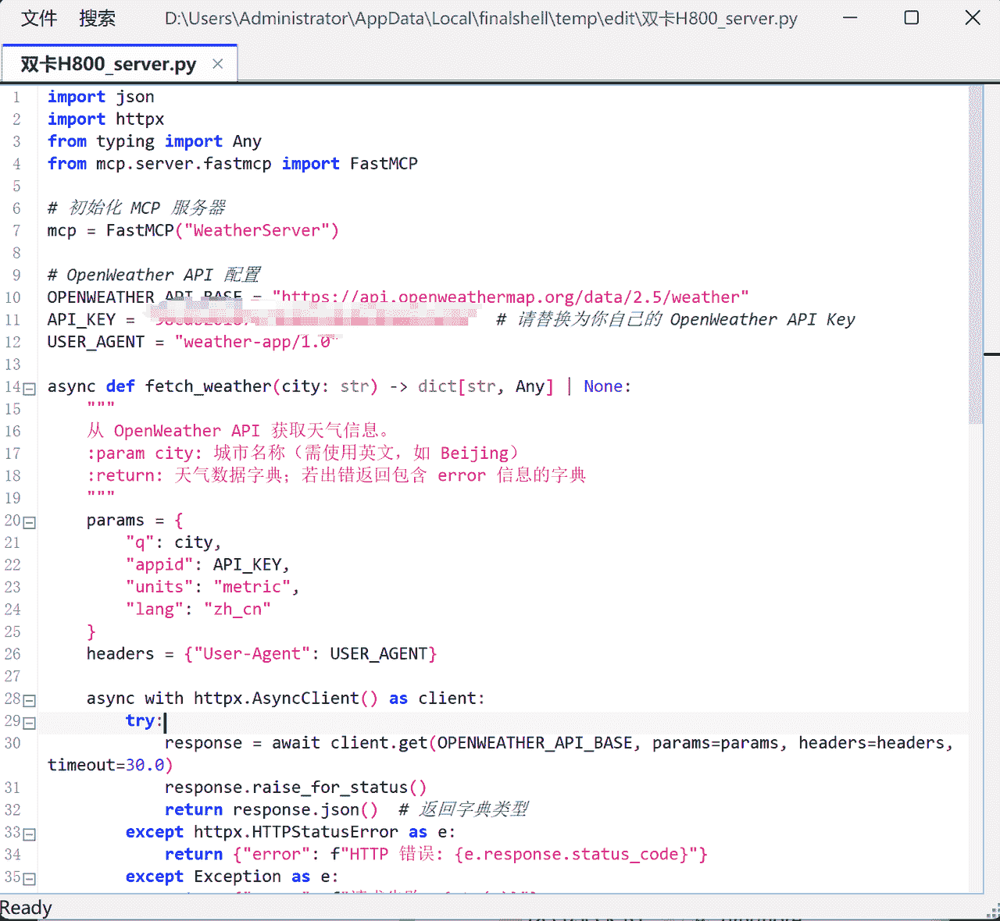

+   天气查询客户端client创建流程

然后创建一个可以和server进行通信的客户端，需要注意的是，该客户端需要包含大模型调用的基础信息。我们需要编写一个`client.py`脚本，聂荣如下：


```python
import asyncio
import os
import json
from typing import Optional
from contextlib import AsyncExitStack

from openai import OpenAI
from dotenv import load_dotenv

from mcp import ClientSession, StdioServerParameters
from mcp.client.stdio import stdio_client

# 加载 .env 文件，确保 API Key 受到保护
load_dotenv()

class MCPClient:
    def __init__(self):
        """初始化 MCP 客户端"""
        self.exit_stack = AsyncExitStack()
        self.openai_api_key = os.getenv("OPENAI_API_KEY")  # 读取 OpenAI API Key
        self.base_url = os.getenv("BASE_URL")  # 读取 BASE URL
        self.model = os.getenv("MODEL")  # 读取 model
        if not self.openai_api_key:
            raise ValueError("❌ 未找到 OpenAI API Key，请在 .env 文件中设置 OPENAI_API_KEY")
        self.client = OpenAI(api_key=self.openai_api_key, base_url=self.base_url) # 创建OpenAI client
        self.session: Optional[ClientSession] = None
        self.exit_stack = AsyncExitStack()

    async def connect_to_server(self, server_script_path: str):
        """连接到 MCP 服务器并列出可用工具"""
        is_python = server_script_path.endswith('.py')
        is_js = server_script_path.endswith('.js')
        if not (is_python or is_js):
            raise ValueError("服务器脚本必须是 .py 或 .js 文件")

        command = "python" if is_python else "node"
        server_params = StdioServerParameters(
            command=command,
            args=[server_script_path],
            env=None
        )

        # 启动 MCP 服务器并建立通信
        stdio_transport = await self.exit_stack.enter_async_context(stdio_client(server_params))
        self.stdio, self.write = stdio_transport
        self.session = await self.exit_stack.enter_async_context(ClientSession(self.stdio, self.write))

        await self.session.initialize()

        # 列出 MCP 服务器上的工具
        response = await self.session.list_tools()
        tools = response.tools
        print("\n已连接到服务器，支持以下工具:", [tool.name for tool in tools])

    async def process_query(self, query: str) -> str:
        """
        使用大模型处理查询并调用可用的 MCP 工具 (Function Calling)
        """
        messages = [{"role": "user", "content": query}]

        response = await self.session.list_tools()

        available_tools = [{
            "type": "function",
            "function": {
                "name": tool.name,
                "description": tool.description,
                "input_schema": tool.inputSchema
            }
        } for tool in response.tools]
        # print(available_tools)

        response = self.client.chat.completions.create(
            model=self.model,
            messages=messages,
            tools=available_tools
        )

        # 处理返回的内容
        content = response.choices[0]
        if content.finish_reason == "tool_calls":
            # 如果是需要使用工具，就解析工具
            tool_call = content.message.tool_calls[0]
            tool_name = tool_call.function.name
            tool_args = json.loads(tool_call.function.arguments)

            # 执行工具
            result = await self.session.call_tool(tool_name, tool_args)
            print(f"\n\n[Calling tool {tool_name} with args {tool_args}]\n\n")

            # 将模型返回的调用哪个工具数据和工具执行完成后的数据都存入messages中
            messages.append(content.message.model_dump())
            messages.append({
                "role": "tool",
                "content": result.content[0].text,
                "tool_call_id": tool_call.id,
            })

            # 将上面的结果再返回给大模型用于生产最终的结果
            response = self.client.chat.completions.create(
                model=self.model,
                messages=messages,
            )
            return response.choices[0].message.content

        return content.message.content

    async def chat_loop(self):
        """运行交互式聊天循环"""
        print("\n🤖 MCP 客户端已启动！输入 'quit' 退出")

        while True:
            try:
                query = input("\n你: ").strip()
                if query.lower() == 'quit':
                    break

                response = await self.process_query(query)  # 发送用户输入到 OpenAI API
                print(f"\n🤖 OpenAI: {response}")

            except Exception as e:
                print(f"\n⚠️ 发生错误: {str(e)}")

    async def cleanup(self):
        """清理资源"""
        await self.exit_stack.aclose()

async def main():
    if len(sys.argv) < 2:
        print("Usage: python client.py <path_to_server_script>")
        sys.exit(1)

    client = MCPClient()
    try:
        await client.connect_to_server(sys.argv[1])
        await client.chat_loop()
    finally:
        await client.cleanup()

if __name__ == "__main__":
    import sys
    asyncio.run(main())
```

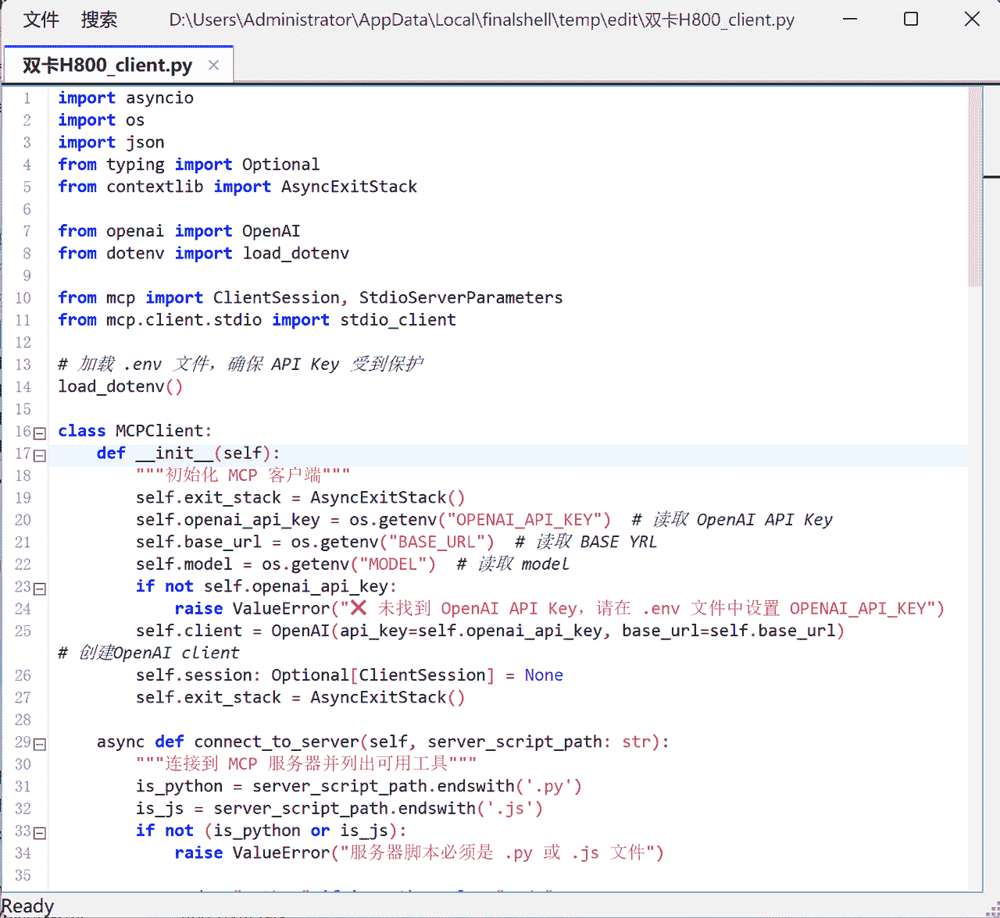

+ 创建 `.env` 文件

接下来继续创建一个 `.env` 文件，来保存大模型调用的 API-KEY

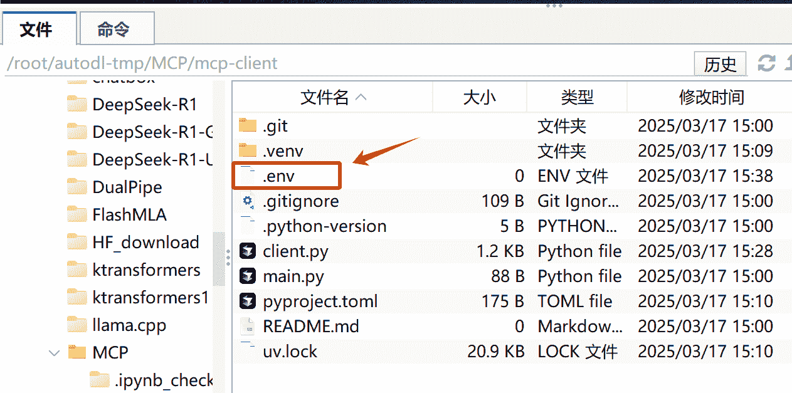

并写入如下内容：

```
BASE_URL=https://api.deepseek.com
MODEL=deepseek-chat
OPENAI_API_KEY=YOUR_DEEPSEEK_API_KEY
```

此时项目结构如下：

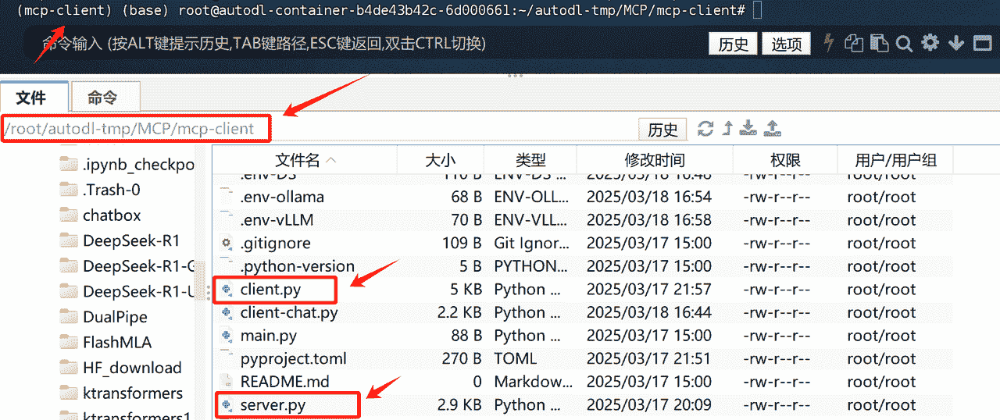

+ 运行 MCP 客户端+服务器

最后在命令行中执行如下命令，即可开启对话：

```bash
uv run client.py server.py
```

直接提问请问北京今天天气如何？运行结果如下所示：

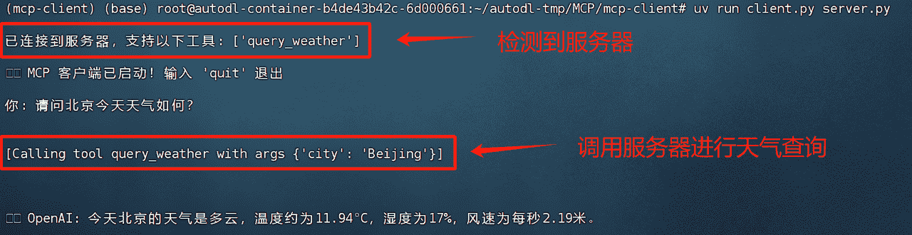

至此，即完成了一次简单的 MCP 执行流程。

### 4. MCP+Agents SDK基础调用流程

而在新版的 Agents SDK 中，Agents SDK 可以将某个对应的 Agent 封装为 client 与外部定义好的 server 进行通信。基本实现流程如下，还是查询天气的 `server.py`，现在将其复制到 `jupyter` 运行主目录下，并修改名称为 `weather_server.py`：

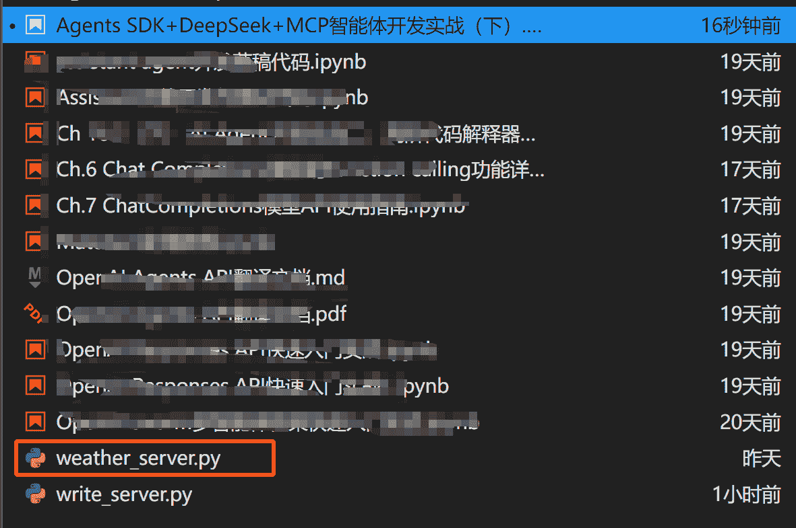

然后导入相关的库：

```python
import asyncio
import os
import shutil
import subprocess
import time
from typing import Any

from agents import Agent, Runner, gen_trace_id, trace
from agents.mcp import MCPServer, MCPServerStdio
from agents.model_settings import ModelSettings
```

同时定义 `Agent`+MCP 运行函数，要求带入 `MCPServer` 对象，且带入 `mcp_servers` 中，作为类似 `tools` 参数带入到当前 Agent 运行过程中：

```python
async def run(mcp_server: MCPServer):

    agent = Agent(
        name="Assistant",
        instructions="你是一名助人为乐的助手",
        mcp_servers=[mcp_server],
        model=deepseek_model
    )

    message = "请帮我查询北京今天天气如何？"
    print(f"Running: {message}")
    result = await Runner.run(starting_agent=agent, input=message)
    print(result.final_output)
```

然后创建 `mcp_run` 函数，负责开启外部 server 并运行 Agent：

```python
async def mcp_run():
    async with MCPServerStdio(
        name="Weather Server",
        cache_tools_list=True,
        params = {"command": "uv", "args": ["run", "weather_server.py"]}
    ) as server:
        await run(server)
```

✅ 关键组件解释：

+ `async with MCPServerStdio(...) as server:`

启动一个 MCP 工具服务器进程，使用标准输入输出（stdio）作为通信协议，并在上下文中运行（退出时会自动关闭）。

+ `name="Weather Server"`

给这个 MCP Server 起名为“天气服务器”，这只是用于日志和识别用的标识符。

+ `cache_tools_list=True`

意思是：首次加载工具时缓存工具列表，后续不需要重新请求工具元数据（提升效率）。

+ `params = {"command": "uv", "args": ["run", "weather_server.py"]}`

这是启动 MCP 工具服务器的 命令行参数，等价于在命令行里运行：

```bash
uv run weather_server.py
```

+ `uv`：同样使用 [uv](https://github.com/astral-sh/uv)，是一个快速的 Python 包和环境管理器，比 pip/venv 更高效。

+ `run weather_server.py`：运行一个你定义好的 MCP server。

最后测试运行：

```python
await mcp_run()
```

```
Running: 请帮我查询北京今天天气如何？
北京的今天天气如下：

🌍 北京, 中国
🌡 温度: 18.94°C
💧 湿度: 15%
🌬 风速: 4.52 m/s
🌤 天气: 多云

天气较为凉爽，适合外出活动哦！
```

> 从零到一MCP入门与智能体开发进阶课件合集：

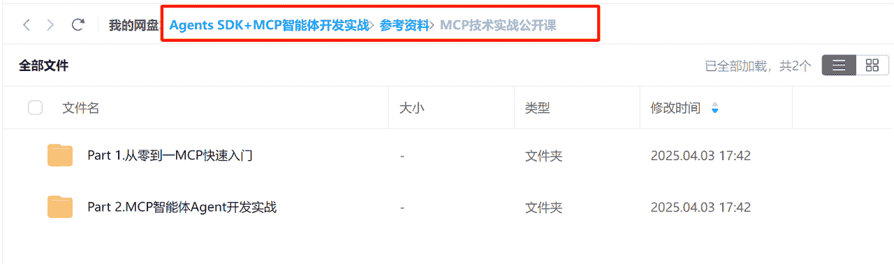

> 下图扫码即可领取：


## 二、Agents SDK+MCP进阶技术实践

### 1. Agents SDK接入更多开源MCP服务器流程

若要采用MCP技术栈，最核心的便利就在于可以快速接入海量MCP开源服务器，无需反复开发，即可快速丰富当前Agent功能。热门MCP server合集地址如下：


+   Model Context Protocol servers: https://github.com/modelcontextprotocol/servers

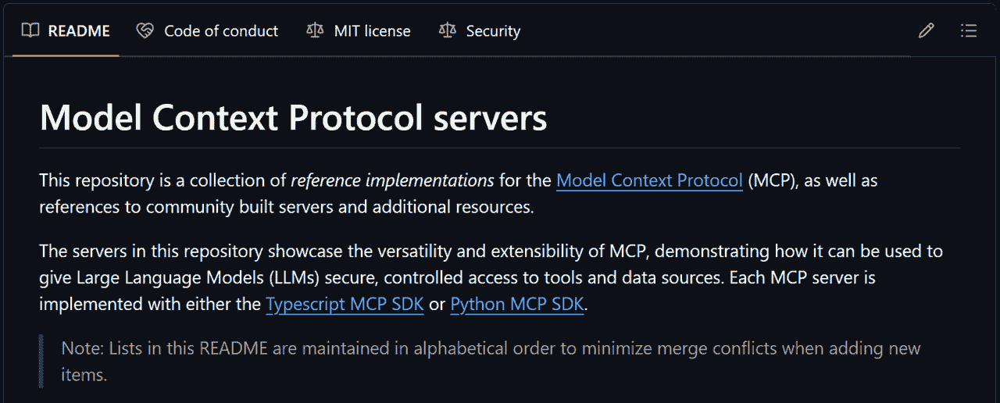

+   Awesome MCP Servers: https://github.com/punkpeye/awesome-mcp-servers

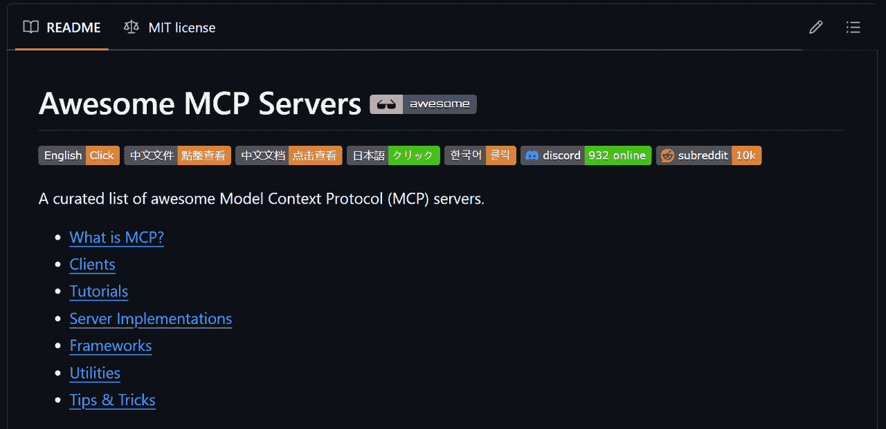

+   MCP导航： https://mcp.so/


接下来我们就先尝试接入一个开源的、开发人员常用的 MCP 服务器——`mcp-server-git`。

+   `mcp-server-git`：https://github.com/modelcontextprotocol/servers/tree/main/src/git

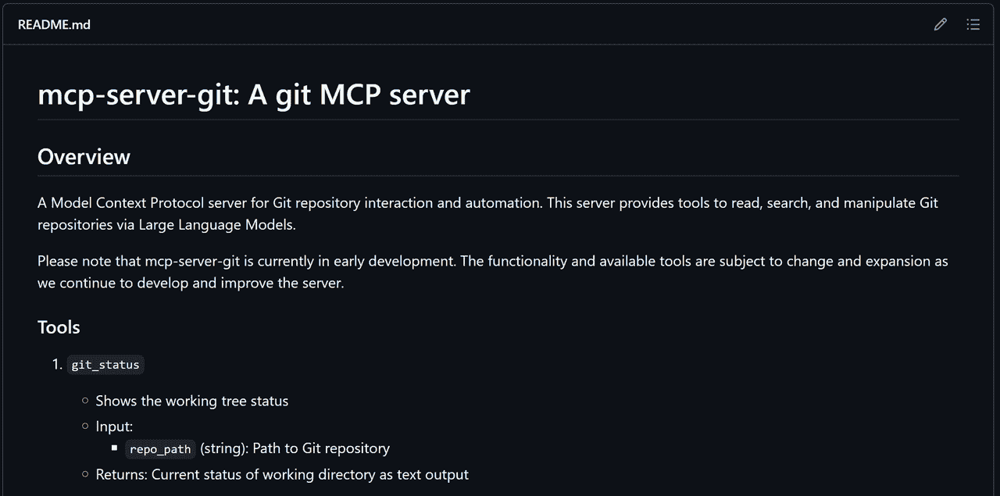

## MCP-Server-Git 简介

`mcp-server-git` 是一个遵循 Model Context Protocol (MCP) 的 Git 操作服务器，专为大语言模型与 Git 仓库的交互而设计。通过该服务，模型可以安全、结构化地完成 Git 操作，包括状态查询、差异比较、提交更改、分支管理等，从而实现自动化代码管理与协作。

### 核心功能

+   `查询仓库状态`：获取当前工作区和暂存区的变动情况（`git_status`、`git_diff_unstaged`、`git_diff_staged`）

+   `版本比较`：支持分支或提交之间的差异查看（`git_diff`）

+   `代码提交与暂存管理`：支持新增、暂存、撤销暂存、更改提交（`git_add`、`git_reset`、`git_commit`）

+   `日志查询与历史查看`：获取提交历史、查看具体提交内容（`git_log`、`git_show`）

+   `分支操作`：新建分支、切换分支（`git_create_branch`、`git_checkout`）

+   `仓库初始化`：支持新建空 Git 仓库（`git_init`）

## 调用方式

### 使用 `uvenv` 快速启动（推荐方式）

无需安装，只需一行命令即可运行：

```
uvenv run mcp-server-git
```

首次运行会从 PyPI 下载并缓存，后续启动速度更快。

### 接口调用格式（示例）

以 `git_status` 为例，MCP 工具调用格式如下：

```
{
  "tool": "git_status",
  "input": {
    "repo_path": "/path/to/your/git/repo"
  }
}
```

服务将返回 Git 工作目录当前状态的文本描述。

## `uvx`（已弃用）/ `uvenv` 工具安装与使用指南（Ubuntu）

`uvx`（现已由 `uvenv` 取代）是一个基于 Python 的零安装运行工具，可快速运行 Python 包，而无需手动安装或污染系统环境。

### `uvenv` 安装方法（Ubuntu）

打开终端，运行以下命令自动安装最新版 `uv`（含 `uvenv`）：

```
curl -Ls https://astral.sh/uv/install.sh | sh
```

或使用 `wget` 命令安装：

```
wget -qO- https://astral.sh/uv/install.sh | sh
```

安装完成后，验证是否安装成功：

```
uv --version
uvenv --help
```

### 可选：通过 `pip` 安装（不推荐）

```
pip install uv
```

虽然可以使用 `pip` 安装 `uv`，但官方推荐使用上面的安装脚本，因为：

+   安装的是预编译二进制版本，性能更好

+   功能更完整

+   自动将可执行文件添加到环境路径

### `uvenv` 功能说明

+   `无需提前安装`：`uvenv` 自动从 PyPI 拉取并运行 Python 包。

+   `隔离环境`：每次执行均为临时环境，避免污染系统全局环境。

+   `缓存机制`：首次拉取后自动缓存，后续使用直接读取缓存，提高运行速度。

+   `用途广泛`：适用于快速测试、命令行工具临时使用以及 Python 脚本的隔离执行。

### `uvenv` 基本使用方法

使用语法

```
uvenv run <package-name>
```

示例：运行 `mcp-server-git`

首次运行会自动从 PyPI 下载并缓存：

```
uvenv run mcp-server-git
```

再次运行则直接使用缓存，速度更快：

```
uvenv run mcp-server-git
```

### 更新缓存中的包

默认情况下，`uvenv` 不会自动检测和使用 PyPI 上的新版本。如果想强制使用最新版本，可以：

+   清理缓存后重新运行：

```
uv cache clear
uvenv run mcp-server-git
```

### 常用操作

+   `查看缓存位置`：

```
ls ~/.cache/uv
```

+   `清理缓存`（若需要）：

```
uv cache clear
```

+   `升级 `uv`/`uvenv` 工具`：

```
uv self update
```

+   `从 `uvx` 迁移提示`：如果你看到如下提示：

```
Deprecation Message: `uvx` is deprecated in favor of `uvenv`.
```

说明你已成功迁移到新版，请使用 `uvenv run <package>` 来代替原来的 `uvx <package>` 命令。

### 在 jupyter 中创建 Agent

接下来尝试在 jupyter 中创建 `Agent` 来完成调用：

```
async def run(mcp_server: MCPServer, directory_path: str):
    
    agent = Agent(
        name="Assistant",
        instructions=f"Answer questions about the git repository at {directory_path}, use that for repo_path",
        mcp_servers=[mcp_server],
        model=deepseek_model
    )

    message = "请帮我介绍下这个项目。"
    print(f"Running: {message}")
    result = await Runner.run(starting_agent=agent, input=message)
    print(result.final_output)
```

```
async def mcp_run(directory_path):
    async with MCPServerStdio(
        name="GitHub Server",
        cache_tools_list=True,
        params={"command": "uvenv", "args": ["run", "mcp-server-git"]},
    ) as server:
        await run(server, directory_path=directory_path)
```

接下来我们查询 DeepSeek 大模型部署推理加速库 Ktransformers 的新版本特性：

```
directory_path = 'https://github.com/kvcache-ai/ktransformers'
```

```
# 可选，设置代理
# os.environ['HTTP_PROXY'] = 'http://127.0.0.1:10080'
# os.environ['HTTPS_PROXY'] = 'http://127.0.0.1:10080'

# 取消代理设置
# os.environ.pop('HTTP_PROXY', None)
# os.environ.pop('HTTPS_PROXY', None)

# AutoDL学术加速
import subprocess
import os

result = subprocess.run('bash -c "source /etc/network_turbo && env | grep proxy"', shell=True, capture_output=True, text=True)
output = result.stdout
for line in output.splitlines():
    if '=' in line:
        var, value = line.split('=', 1)
        os.environ[var] = value
```

⚠ 需要注意的是，`mcp-server-git` 是一个持续运行的 CLI 工具服务，而受限于 jupyter 环境，以下代码运行结束后并不会自动退出，需要重启 jupyter-kernel 才能关闭进程，请谨慎运行：

```
await mcp_run(directory_path)
```

```
Running: 请帮我介绍下这个项目。
目前无法直接获取该项目的提交日志或详细信息。如果您能提供更具体的需求或问题，我可以帮助您进一步了解该项目。例如：

1. **项目功能**：您想了解该项目的核心功能或用途吗？
2. **代码结构**：是否需要查看项目的文件结构或某些文件的内容？
3. **贡献者**：是否需要了解项目的贡献者或活跃度？
4. **其他信息**：是否有其他特定的信息需要查询？

请告诉我您的具体需求，我将尽力协助！
```

而一种更加稳妥的方式，是定义 `py` 脚本并在命令行中运行：

```
import asyncio
import shutil

from agents import Agent, Runner, trace
from agents.mcp import MCPServer, MCPServerStdio


async def run(mcp_server: MCPServer, directory_path: str):
    agent = Agent(
        name="Assistant",
        instructions=f"Answer questions about the git repository at {directory_path}, use that for repo_path",
        mcp_servers=[mcp_server],
        model=deepseek_model
    )

    message = "请帮我介绍下这个项目。"
    print("\n" + "-" * 40)
    print(f"Running: {message}")
    result = await Runner.run(starting_agent=agent, input=message)
    print(result.final_output)


async def main():
    async with MCPServerStdio(
        cache_tools_list=True, 
        params={"command": "uvenv", "args": ["run", "mcp-server-git"]},
    ) as server:
        await run(server, directory_path)


if __name__ == "__main__":
    if not shutil.which("uvenv"):
        raise RuntimeError("uvx is not installed. Please install it with `pip install uvx`.")

    asyncio.run(main())
```

## 2. Agents SDK 接入多个 MCP 服务器流程

接下来我们继续介绍如何将 `Agents SDK` 同时接入多个 `MCP` 服务器，理论上，`MCP` 一个服务器能同时运行多个外部函数，而一个 `MCP Client` 则可以连接多个 `MCP` 服务器：

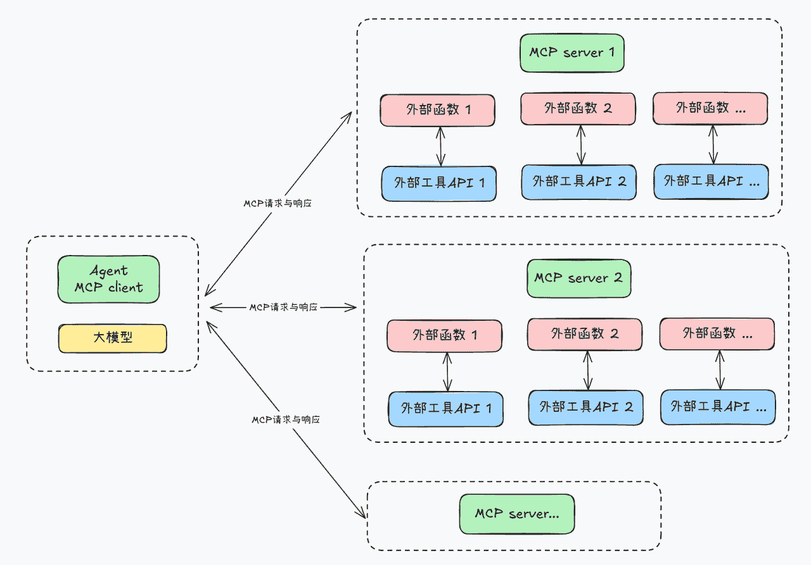

而 `Agents SDK` 本身也是可以作为 `MCP Client` 的，因此是完全可以连接多个 `MCP server`，其基本实现函数如下：

```
async def mcp_run_multi(servers_params, message):
    # 使用 AsyncExitStack 自动管理多个上下文退出
    async with AsyncExitStack() as stack:
        servers = []
        # 创建并进入所有 server 上下文
        for p in servers_params:
            server = MCPServerStdio(
                name=p.get("name", "Unnamed Server"),
                cache_tools_list=True,
                params={
                    "command": "uv",
                    "args": ["run", p["script"]],
                },
            )
            entered_server = await stack.enter_async_context(server)
            servers.append(entered_server)
        
        # 构造 agent，传入多个 server
        agent = Agent(
            name="Assistant",
            instructions="你是一名助人为乐的助手",
            mcp_servers=servers,
            model_settings=ModelSettings(tool_choice="required"),
            model=deepseek_model
        )
        
        print(f"Running: {message}")
        result = await Runner.run(starting_agent=agent, input=message)
        print(result.final_output)

        return result
```

这里我们尝试创建一个“写入本地文档”的 `MCP` 服务器：`weather_server.py`，代码如下：

```
import json
import httpx
from typing import Any
from mcp.server.fastmcp import FastMCP

# 初始化 MCP 服务器
mcp = FastMCP("WriteServer")
USER_AGENT = "write-app/1.0";

@mcp.tool()
async def write_file(content: str) -> str:
    """
    将指定内容写入本地文件。
    :param content: 必要参数，字符串类型，用于表示需要写入文档的具体内容。
    :return：是否成功写入
    """
    return "已成功写入本地文件。"

if __name__ == "__main__":
    # 以标准 I/O 方式运行 MCP 服务器
    mcp.run(transport='stdio')
```

并将其放在 Jupyter 主目录下：

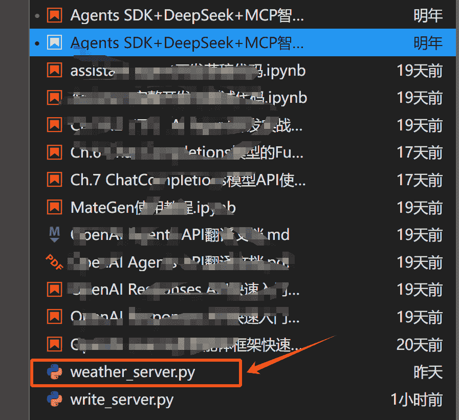

然后尝试同时调用多个 server，结果如下：


``` 
# 示例调用：传入多个 server 的配置
result = await mcp_run_multi(
    servers_params=[
        {"name": "Weather Server", "script": "weather_server.py"},
        {"name": "Writer Server", "script": "write_server.py"}
    ],
    message="请帮我查询北京天气，并写入本地文档。"
)
```

```
Running: 请帮我查询北京天气，并写入本地文档。
北京的天气信息已查询并成功写入本地文档：

🌍 Beijing, CN  
🌡 温度: 19.94°C  
💧 湿度: 13%  
🌬 风速: 5.51 m/s  
🌤 天气: 多云  
```

```
len(result.new_items)
```

```
5
```

```
result.new_items[0].raw_item
```

```
ResponseFunctionToolCall(arguments='{"city":"Beijing"}', call_id='call_0_a4e6781f-0fcd-46e6-ac92-b0d3b362a83f', name='query_weather', type='function_call', id='__fake_id__', status=None)
```

```
result.new_items[1].raw_item
```

```
{'call_id': 'call_0_a4e6781f-0fcd-46e6-ac92-b0d3b362a83f',
 'output': '{"type":"text","text":"🌍 Beijing, CN\n🌡 温度: 19.94°C\n💧 湿度: 13%\n🌬 风速: 5.51 m/s\n🌤 天气: 多云\n","annotations":null}',
 'type': 'function_call_output'}
```

```
result.new_items[2].raw_item
```

```
ResponseFunctionToolCall(arguments='{"content":"🌍 Beijing, CN\n🌡 温度: 19.94°C\n💧 湿度: 13%\n🌬 风速: 5.51 m/s\n🌤 天气: 多云"}', call_id='call_0_e137b744-d34a-4dba-8758-456c2aca5eb0', name='write_file', type='function_call', id='__fake_id__', status=None)
```

```
result.new_items[3].raw_item
```

```
{'call_id': 'call_0_e137b744-d34a-4dba-8758-456c2aca5eb0',
 'output': '{"type":"text","text":"已成功写入本地文件。","annotations":null}',
 'type': 'function_call_output'}
```

```
result.new_items[4].raw_item
```

```
ResponseOutputMessage(id='__fake_id__', content=[ResponseOutputText(annotations=[], text='北京的天气信息已查询并成功写入本地文档：\n\n🌍 Beijing, CN  
🌡 温度: 19.94°C  
💧 湿度: 13%  
🌬 风速: 5.51 m/s  
🌤 天气: 多云  
', type='output_text')], role='assistant', status='completed', type='message')
```

```
result.to_input_list()
```

```
[{'content': '请帮我查询北京天气，并写入本地文档。', 'role': 'user'},
 {'arguments': '{"city":"Beijing"}',
  'call_id': 'call_0_a4e6781f-0fcd-46e6-ac92-b0d3b362a83f',
  'name': 'query_weather',
  'type': 'function_call',
  'id': '__fake_id__'},
 {'call_id': 'call_0_a4e6781f-0fcd-46e6-ac92-b0d3b362a83f',
  'output': '{"type":"text","text":"🌍 Beijing, CN\n🌡 温度: 19.94°C\n💧 湿度: 13%\n🌬 风速: 5.51 m/s\n🌤 天气: 多云\n","annotations":null}',
  'type': 'function_call_output'},
 {'arguments': '{"content":"🌍 Beijing, CN\n🌡 温度: 19.94°C\n💧 湿度: 13%\n🌬 风速: 5.51 m/s\n🌤 天气: 多云"}',
  'call_id': 'call_0_e137b744-d34a-4dba-8758-456c2aca5eb0',
  'name': 'write_file',
  'type': 'function_call',
  'id': '__fake_id__'},
 {'call_id': 'call_0_e137b744-d34a-4dba-8758-456c2aca5eb0',
  'output': '{"type":"text","text":"已成功写入本地文件。","annotations":null}',
  'type': 'function_call_output'},
 {'id': '__fake_id__',
  'content': [{'annotations': [],
    'text': '北京的天气信息已查询并成功写入本地文档：\n\n🌍 Beijing, CN  
🌡 温度: 19.94°C  
💧 湿度: 13%  
🌬 风速: 5.51 m/s  
🌤 天气: 多云  
',
    'type': 'output_text'}],
  'role': 'assistant',
  'status': 'completed',
  'type': 'message'}]
```

不难看出，`Agents SDK`对于`MCP`实现过程基本遵照`Function calling`来执行。

``` 
# 示例调用：传入多个 server 的配置
result = await mcp_run_multi(
    servers_params=[
        {"name": "Weather Server", "script": "weather_server.py"},
        {"name": "Writer Server", "script": "write_server.py"}
    ],
    message="请帮我查询北京和杭州天气，并写入本地文档。"
)
```

```
Running: 请帮我查询北京和杭州天气，并写入本地文档。
已成功查询北京和杭州的天气信息，并写入本地文档。以下是天气详情：

### 北京天气
- **温度**: 17.94°C
- **湿度**: 16%
- **风速**: 3.24 m/s
- **天气**: 多云

### 杭州天气
- **温度**: 14.95°C
- **湿度**: 40%
- **风速**: 3.22 m/s
- **天气**: 晴

文件已保存。
```

```
len(result.new_items)
```

```
7
```

```
result.to_input_list()
```

```
[{'content': '请帮我查询北京和杭州天气，并写入本地文档。', 'role': 'user'},
 {'arguments': '{"city": "Beijing"}',
  'call_id': 'call_0_fe02f63b-7a08-4983-8098-6e50821100ac',
  'name': 'query_weather',
  'type': 'function_call',
  'id': '__fake_id__'},
 {'arguments': '{"city": "Hangzhou"}',
  'call_id': 'call_1_98d66c45-6268-42b5-bc0b-15a4cd857ece',
  'name': 'query_weather',
  'type': 'function_call',
  'id': '__fake_id__'},
 {'call_id': 'call_0_fe02f63b-7a08-4983-8098-6e50821100ac',
  'output': '{"type":"text","text":"🌍 Beijing, CN\n🌡 温度: 17.94°C\n💧 湿度: 16%\n🌬 风速: 3.24 m/s\n🌤 天气: 多云\n","annotations":null}',
  'type': 'function_call_output'},
 {'call_id': 'call_1_98d66c45-6268-42b5-bc0b-15a4cd857ece',
  'output': '{"type":"text","text":"🌍 Hangzhou, CN\n🌡 温度: 14.95°C\n💧 湿度: 40%\n🌬 风速: 3.22 m/s\n🌤 天气: 晴\n","annotations":null}',
  'type': 'function_call_output'},
 {'arguments': '{"content":"🌍 Beijing, CN\n🌡 温度: 17.94°C\n💧 湿度: 16%\n🌬 风速: 3.24 m/s\n🌤 天气: 多云\n\n🌍 Hangzhou, CN\n🌡 温度: 14.95°C\n💧 湿度: 40%\n🌬 风速: 3.22 m/s\n🌤 天气: 晴"}',
  'call_id': 'call_0_d9031a42-d5bb-4615-8adc-96c121b80eb3',
  'name': 'write_file',
  'type': 'function_call',
  'id': '__fake_id__'},
 {'call_id': 'call_0_d9031a42-d5bb-4615-8adc-96c121b80eb3',
  'output': '{"type":"text","text":"已成功写入本地文件。","annotations":null}',
  'type': 'function_call_output'},
 {'id': '__fake_id__',
  'content': [{'annotations': [],
    'text': '已成功查询北京和杭州的天气信息，并写入本地文档。以下是天气详情：\n\n### 北京天气\n- **温度**: 17.94°C\n- **湿度**: 16%\n- **风速**: 3.24 m/s\n- **天气**: 多云\n\n### 杭州天气\n- **温度**: 14.95°C\n- **湿度**: 40%\n- **风速**: 3.22 m/s\n- **天气**: 晴\n\n文件已保存。',
    'type': 'output_text'}],
  'role': 'assistant',
  'status': 'completed',
  'type': 'message'}]
```

整体实现流程和上一小节介绍的`Agents SDK` `Function calling`执行流程完全一致：

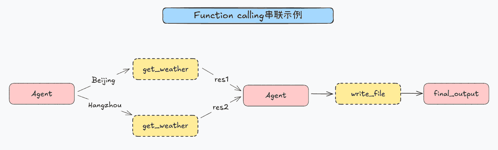

## 三、`Agents SDK`搭建`Agentic RAG`（1）：`GraphRAG` API调用与外部函数封装


### 1.`GraphRAG`安装与项目创建

+   Step 1.使用`pip`安装`graphrag`

```
pip install graphrag
```

Jupyter中可以使用如下方式进行安装：

```
pip install graphrag
```


```
Looking in indexes: http://mirrors.aliyun.com/pypi/simple
Collecting graphrag
  Downloading http://mirrors.aliyun.com/pypi/packages/79/02/298ed1dd0cab0527c2cdf0d1bf143f42829c7513e8f4138b413f67c3d265/graphrag-2.1.0-py3-none-any.whl (365 kB)
Requirement already satisfied: aiofiles<25.0.0,>=24.1.0 in /root/miniconda3/lib/python3.12/site-packages (from graphrag) (24.1.0)
Collecting azure-cosmos<5.0.0,>=4.9.0 (from graphrag)
  Downloading http://mirrors.aliyun.com/pypi/packages/61/dc/380f843744535497acd0b85aacb59565c84fc28bf938c8d6e897a858cd95/azure_cosmos-4.9.0-py3-none-any.whl (303 kB)
Requirement already satisfied: azure-identity<2.0.0,>=1.19.0 in /root/miniconda3/lib/python3.12/site-packages (from graphrag) (1.20.0)
Collecting azure-search-documents<12.0.0,>=11.5.2 (from graphrag)
  Downloading http://mirrors.aliyun.com/pypi/packages/e0/1b/2cbc9de289ec025bac468d0e7140e469a215ea3371cd043486f9fda70f7d/azure_search_documents-11.5.2-py3-none-any.whl (298 kB)
Requirement already satisfied: azure-storage-blob<13.0.0,>=12.24.0 in /root/miniconda3/lib/python3.12/site-packages (from graphrag) (12.24.1)
Collecting devtools<0.13.0,>=0.12.2 (from graphrag)
  Downloading http://mirrors.aliyun.com/pypi/packages/d1/ae/afb1487556e2dc827a17097aac8158a25b433a345386f0e249f6d2694ccb/devtools-0.12.2-py3-none-any.whl (19 kB)
Collecting environs<12.0.0,>=11.0.0 (from graphrag)
  Downloading http://mirrors.aliyun.com/pypi/packages/1a/21/1e0d8de234e9d0c675ea8fd50f9e7ad66fae32c207bc982f1d14f7c0835b/environs-11.2.1-py3-none-any.whl (12 kB)
Collecting fnllm<0.3.0,>=0.2.3 (from fnllm[azure,openai]<0.3.0,>=0.2.3->graphrag)
  Downloading http://mirrors.aliyun.com/pypi/packages/ef/30/3c6533dd3fd885fb258a59434537f1f0787021ee8854a8f5da6380c6870d/fnllm-0.2.5-py3-none-any.whl (73 kB)
Collecting future<2.0.0,>=1.0.0 (from graphrag)
  Downloading http://mirrors.aliyun.com/pypi/packages/da/71/ae30dadffc90b9006d77af76b393cb9dfbfc9629f339fc1574a1c52e6806/future-1.0.0-py3-none-any.whl (491 kB)
Collecting graspologic<4.0.0,>=3.4.1 (from graphrag)
  Downloading http://mirrors.aliyun.com/pypi/packages/6a/0b/9a167cec9cc4555b59cd282e8669998a50cb3f929a9a503965b24fa58a20/graspologic-3.4.1-py3-none-any.whl (5.2 MB)
Collecting json-repair<0.31.0,>=0.30.3 (from graphrag)
  Downloading http://mirrors.aliyun.com/pypi/packages/fd/2d/79a46330c4b97ee90dd403fb0d267da7b25b24d7db604c5294e5c57d5f7c/json_repair-0.30.3-py3-none-any.whl (18 kB)
Collecting lancedb<0.18.0,>=0.17.0 (from graphrag)
  Downloading http://mirrors.aliyun.com/pypi/packages/c8/6b/71e8b194aacaca41e4a05a91a87f3700c121d7f99efee92d6ce14f690680/lancedb-0.17.1-cp39-abi3-manylinux_2_28_x86_64.whl (30.2 MB)
Requirement already satisfied: networkx<4.0.0,>=3.4.2 in /root/miniconda3/lib/python3.12/site-packages (from graphrag) (3.4.2)
Requirement already satisfied: nltk==3.9.1 in /root/miniconda3/lib/python3.12/site-packages (from graphrag) (3.9.1)
Requirement already satisfied: numpy<2.0.0,>=1.25.2 in /root/miniconda3/lib/python3.12/site-packages (from graphrag) (1.26.4)
Requirement already satisfied: openai<2.0.0,>=1.57.0 in /root/miniconda3/lib/python3.12/site-packages (from graphrag) (1.66.3)
Requirement already satisfied: pandas<3.0.0,>=2.2.3 in /root/miniconda3/lib/python3.12/site-packages (from graphrag) (2.2.3)
Collecting pyarrow<16.0.0,>=15.0.0 (from graphrag)
  Downloading http://mirrors.aliyun.com/pypi/packages/f5/87/6270d60494909a45beac5afcb49f67b6a2f19ea07e25d130c62ae4e02bdc/pyarrow-15.0.2-cp312-cp312-manylinux_2_28_x86_64.whl (38.3 MB)
Requirement already satisfied: pydantic<3.0.0,>=2.10.3 in /root/miniconda3/lib/python3.12/site-packages (from graphrag) (2.10.6)
Requirement already satisfied: python-dotenv<2.0.0,>=1.0.1 in /root/miniconda3/lib/python3.12/site-packages (from graphrag) (1.0.1)
Requirement already satisfied: pyyaml<7.0.0,>=6.0.2 in /root/miniconda3/lib/python3.12/site-packages (from graphrag) (6.0.2)
Requirement already satisfied: rich<14.0.0,>=13.9.4 in /root/miniconda3/lib/python3.12/site-packages (from graphrag) (13.9.4)
Collecting spacy<4.0.0,>=3.8.4 (from graphrag)
  Downloading http://mirrors.aliyun.com/pypi/packages/f2/cb/b565f6e04fb9b2d19c3de105dec659c6d98cba17bfd371e455c11c206040/spacy-3.8.4-cp312-cp312-manylinux_2_17_x86_64.manylinux2014_x86_64.whl (31.8 MB)
Collecting textblob<0.19.0,>=0.18.0.post0 (from graphrag)
  Downloading http://mirrors.aliyun.com/pypi/packages/02/07/5fd2945356dd839974d3a25de8a142dc37293c21315729a41e775b5f3569/textblob-0.18.0.post0-py3-none-any.whl (626 kB)
Collecting tiktoken<0.9.0,>=0.8.0 (from graphrag)
  Downloading http://mirrors.aliyun.com/pypi/packages/26/32/e0e3a859136e95c85a572e4806dc58bf1ddf651108ae8b97d5f3ebe1a244/tiktoken-0.8.0-cp312-cp312-manylinux_2_17_x86_64.manylinux2014_x86_64.whl (1.2 MB)
Requirement already satisfied: tqdm<5.0.0,>=4.67.1 in /root/miniconda3/lib/python3.12/site-packages (from graphrag) (4.67.1)
Requirement already satisfied: typer<0.16.0,>=0.15.1 in /root/miniconda3/lib/python3.12/site-packages (from graphrag) (0.15.2)
Requirement already satisfied: typing-extensions<5.0.0,>=4.12.2 in /root/miniconda3/lib/python3.12/site-packages (from graphrag) (4.12.2)
Collecting umap-learn<0.6.0,>=0.5.6 (from graphrag)
  Downloading http://mirrors.aliyun.com/pypi/packages/3c/8f/671c0e1f2572ba625cbcc1faeba9435e00330c3d6962858711445cf1e817/umap_learn-0.5.7-py3-none-any.whl (88 kB)
Requirement already satisfied: click in /root/miniconda3/lib/python3.12/site-packages (from nltk==3.9.1->graphrag) (8.1.8)
Requirement already satisfied: joblib in /root/miniconda3/lib/python3.12/site-packages (from nltk==3.9.1->graphrag) (1.4.2)
Requirement already satisfied: regex>=2021.8.3 in /root/miniconda3/lib/python3.12/site-packages (from nltk==3.9.1->graphrag) (2024.11.6)
Requirement already satisfied: azure-core>=1.30.0 in /root/miniconda3/lib/python3.12/site-packages (from azure-cosmos<5.0.0,>=4.9.0->graphrag) (1.32.0)
Requirement already satisfied: cryptography>=2.5 in /root/miniconda3/lib/python3.12/site-packages (from azure-identity<2.0.0,>=1.19.0->graphrag) (42.0.5)
Requirement already satisfied: msal>=1.30.0 in /root/miniconda3/lib/python3.12/site-packages (from azure-identity<2.0.0,>=1.19.0->graphrag) (1.32.0)
Requirement already satisfied: msal-extensions>=1.2.0 in /root/miniconda3/lib/python3.12/site-packages (from azure-identity<2.0.0,>=1.19.0->graphrag) (1.3.1)
Collecting azure-common>=1.1 (from azure-search-documents<12.0.0,>=11.5.2->graphrag)
  Downloading http://mirrors.aliyun.com/pypi/packages/62/55/7f118b9c1b23ec15ca05d15a578d8207aa1706bc6f7c87218efffbbf875d/azure_common-1.1.28-py2.py3-none-any.whl (14 kB)
Requirement already satisfied: isodate>=0.6.0 in /root/miniconda3/lib/python3.12/site-packages (from azure-search-documents<12.0.0,>=11.5.2->graphrag) (0.7.2)
Requirement already satisfied: asttokens<3.0.0,>=2.0.0 in /root/miniconda3/lib/python3.12/site-packages (from devtools<0.13.0,>=0.12.2->graphrag) (2.4.1)
Requirement already satisfied: executing>=1.1.1 in /root/miniconda3/lib/python3.12/site-packages (from devtools<0.13.0,>=0.12.2->graphrag) (2.1.0)
Requirement already satisfied: pygments>=2.15.0 in /root/miniconda3/lib/python3.12/site-packages (from devtools<0.13.0,>=0.12.2->graphrag) (2.18.0)
Requirement already satisfied: marshmallow>=3.13.0 in /root/miniconda3/lib/python3.12/site-packages (from environs<12.0.0,>=11.0.0->graphrag) (3.26.1)
Collecting aiolimiter>=1.1.0 (from fnllm<0.3.0,>=0.2.3->fnllm[azure,openai]<0.3.0,>=0.2.3->graphrag)
  Downloading http://mirrors.aliyun.com/pypi/packages/f3/ba/df6e8e1045aebc4778d19b8a3a9bc1808adb1619ba94ca354d9ba17d86c3/aiolimiter-1.2.1-py3-none-any.whl (6.7 kB)
Requirement already satisfied: httpx>=0.27.0 in /root/miniconda3/lib/python3.12/site-packages (from fnllm<0.3.0,>=0.2.3->fnllm[azure,openai]<0.3.0,>=0.2.3->graphrag) (0.27.2)
Requirement already satisfied: tenacity>=8.5.0 in /root/miniconda3/lib/python3.12/site-packages (from fnllm<0.3.0,>=0.2.3->fnllm[azure,openai]<0.3.0,>=0.2.3->graphrag) (9.0.0)
Collecting POT<0.10,>=0.9 (from graspologic<4.0.0,>=3.4.1->graphrag)
  Downloading http://mirrors.aliyun.com/pypi/packages/5b/39/9c3eed29e954ddbac3ebe68123213826c8995e8acf8b54aa79d1956fda6a/POT-0.9.5-cp312-cp312-manylinux_2_17_x86_64.manylinux2014_x86_64.whl (901 kB)
Collecting anytree<3.0.0,>=2.12.1 (from graspologic<4.0.0,>=3.4.1->graphrag)
  Downloading http://mirrors.aliyun.com/pypi/packages/6a/fb/ff946843e6b55ae9fda84df3964d6c233cd2261dface789f5be02ab79bc5/anytree-2.12.1-py3-none-any.whl (44 kB)
Collecting beartype<0.19.0,>=0.18.5 (from graspologic<4.0.0,>=3.4.1->graphrag)
  Downloading http://mirrors.aliyun.com/pypi/packages/64/43/7a1259741bd989723272ac7d381a43be932422abcff09a1d9f7ba212cb74/beartype-0.18.5-py3-none-any.whl (917 kB)
Collecting gensim<5.0.0,>=4.3.2 (from graspologic<4.0.0,>=3.4.1->graphrag)
  Downloading http://mirrors.aliyun.com/pypi/packages/1a/07/7a0d5e6cab4da2769c8018f2472690ccb8cab191bf2fe46342dfd627486b/gensim-4.3.3-cp312-cp312-manylinux_2_17_x86_64.manylinux2014_x86_64.whl (26.6 MB)
Collecting graspologic-native<2.0.0,>=1.2.1 (from graspologic<4.0.0,>=3.4.1->graphrag)
  Downloading http://mirrors.aliyun.com/pypi/packages/e3/c0/58e3a2fc283a18b5ba7f751560d3f38e6286b23eceb0295f21dc20e4a18b/graspologic_native-1.2.3-cp38-abi3-manylinux_2_17_x86_64.manylinux2014_x86_64.whl (365 kB)
Collecting hyppo<0.5.0,>=0.4.0 (from graspologic<4.0.0,>=3.4.1->graphrag)
  Downloading http://mirrors.aliyun.com/pypi/packages/34/87/7940713f929d0280cff1bde207479cb588a0d3a4dd49a0e2e69bfff46363/hyppo-0.4.0-py3-none-any.whl (146 kB)
Requirement already satisfied: matplotlib<4.0.0,>=3.8.4 in /root/miniconda3/lib/python3.12/site-packages (from graspologic<4.0.0,>=3.4.1->graphrag) (3.9.2)
Requirement already satisfied: scikit-learn<2.0.0,>=1.4.2 in /root/miniconda3/lib/python3.12/site-packages (from graspologic<4.0.0,>=3.4.1->graphrag) (1.6.1)
Collecting scipy==1.12.0 (from graspologic<4.0.0,>=3.4.1->graphrag)
  Downloading http://mirrors.aliyun.com/pypi/packages/11/7d/850bfe9462fff393130519eb54f97d43ad9c280ec4297b4cb98b7c2e96cd/scipy-1.12.0-cp312-cp312-manylinux_2_17_x86_64.manylinux2014_x86_64.whl (37.8 MB)
Collecting seaborn<0.14.0,>=0.13.2 (from graspologic<4.0.0,>=3.4.1->graphrag)
  Downloading http://mirrors.aliyun.com/pypi/packages/83/11/00d3c3dfc25ad54e731d91449895a79e4bf2384dc3ac01809010ba88f6d5/seaborn-0.13.2-py3-none-any.whl (294 kB)
Collecting statsmodels<0.15.0,>=0.14.2 (from graspologic<4.0.0,>=3.4.1->graphrag)
  Downloading http://mirrors.aliyun.com/pypi/packages/fa/e1/60a652f18996a40a7410aeb7eb476c18da8a39792c7effe67f06883e9852/statsmodels-0.14.4-cp312-cp312-manylinux_2_17_x86_64.manylinux2014_x86_64.whl (10.7 MB)
Collecting deprecation (from lancedb<0.18.0,>=0.17.0->graphrag)
  Downloading http://mirrors.aliyun.com/pypi/packages/02/c3/253a89ee03fc9b9682f1541728eb66db7db22148cd94f89ab22528cd1e1b/deprecation-2.1.0-py2.py3-none-any.whl (11 kB)
INFO: pip is looking at multiple versions of lancedb to determine which version is compatible with other requirements. This could take a while.
Collecting lancedb<0.18.0,>=0.17.0 (from graphrag)
  Downloading http://mirrors.aliyun.com/pypi/packages/b2/11/c48248f984dfd8dfec0bb074465ca697cf64b6b71b0aa199c15ad0153597/lancedb-0.17.0-cp39-abi3-manylinux_2_28_x86_64.whl (29.9 MB)
Collecting pylance==0.20.0 (from lancedb<0.18.0,>=0.17.0->graphrag)
  Downloading http://mirrors.aliyun.com/pypi/packages/22/d2/acaf3328d1bd55201f9775d8b8a3f7c497966d3f3371e22aabb269cb4f0f/pylance-0.20.0-cp39-abi3-manylinux_2_28_x86_64.whl (33.5 MB)
Requirement already satisfied: packaging in /root/miniconda3/lib/python3.12/site-packages (from lancedb<0.18.0,>=0.17.0->graphrag) (23.2)
Requirement already satisfied: overrides>=0.7 in /root/miniconda3/lib/python3.12/site-packages (from lancedb<0.18.0,>=0.17.0->graphrag) (7.7.0)
Requirement already satisfied: anyio<5,>=3.5.0 in /root/miniconda3/lib/python3.12/site-packages (from openai<2.0.0,>=1.57.0->graphrag) (4.9.0)
Requirement already satisfied: distro<2,>=1.7.0 in /root/miniconda3/lib/python3.12/site-packages (from openai<2.0.0,>=1.57.0->graphrag) (1.9.0)
Requirement already satisfied: jiter<1,>=0.4.0 in /root/miniconda3/lib/python3.12/site-packages (from openai<2.0.0,>=1.57.0->graphrag) (0.9.0)
Requirement already satisfied: sniffio in /root/miniconda3/lib/python3.12/site-packages (from openai<2.0.0,>=1.57.0->graphrag) (1.3.1)
Requirement already satisfied: python-dateutil>=2.8.2 in /root/miniconda3/lib/python3.12/site-packages (from pandas<3.0.0,>=2.2.3->graphrag) (2.9.0.post0)
Requirement already satisfied: pytz>=2020.1 in /root/miniconda3/lib/python3.12/site-packages (from pandas<3.0.0,>=2.2.3->graphrag) (2025.1)
Requirement already satisfied: tzdata>=2022.7 in /root/miniconda3/lib/python3.12/site-packages (from pandas<3.0.0,>=2.2.3->graphrag) (2025.1)
Requirement already satisfied: annotated-types>=0.6.0 in /root/miniconda3/lib/python3.12/site-packages (from pydantic<3.0.0,>=2.10.3->graphrag) (0.7.0)
Requirement already satisfied: pydantic-core==2.27.2 in /root/miniconda3/lib/python3.12/site-packages (from pydantic<3.0.0,>=2.10.3->graphrag) (2.27.2)
Requirement already satisfied: markdown-it-py>=2.2.0 in /root/miniconda3/lib/python3.12/site-packages (from rich<14.0.0,>=13.9.4->graphrag) (3.0.0)
Collecting spacy-legacy<3.1.0,>=3.0.11 (from spacy<4.0.0,>=3.8.4->graphrag)
  Downloading http://mirrors.aliyun.com/pypi/packages/c3/55/12e842c70ff8828e34e543a2c7176dac4da006ca6901c9e8b43efab8bc6b/spacy_legacy-3.0.12-py2.py3-none-any.whl (29 kB)
Collecting spacy-loggers<2.0.0,>=1.0.0 (from spacy<4.0.0,>=3.8.4->graphrag)
  Downloading http://mirrors.aliyun.com/pypi/packages/33/78/d1a1a026ef3af911159398c939b1509d5c36fe524c7b644f34a5146c4e16/spacy_loggers-1.0.5-py3-none-any.whl (22 kB)
Collecting murmurhash<1.1.0,>=0.28.0 (from spacy<4.0.0,>=3.8.4->graphrag)
  Downloading http://mirrors.aliyun.com/pypi/packages/13/40/eed53da76a428f404ec9db6d0983691c61d2744fea7070c6b31caca31ac4/murmurhash-1.0.12-cp312-cp312-manylinux_2_5_x86_64.manylinux1_x86_64.manylinux_2_17_x86_64.manylinux2014_x86_64.whl (138 kB)
Collecting cymem<2.1.0,>=2.0.2 (from spacy<4.0.0,>=3.8.4->graphrag)
  Downloading http://mirrors.aliyun.com/pypi/packages/1d/68/8fa6efae17cd3b2ba9a2f83b824867c5b65b06f7aec3f8a0d0cabdeffb9b/cymem-2.0.11-cp312-cp312-manylinux_2_17_x86_64.manylinux2014_x86_64.whl (227 kB)
Collecting preshed<3.1.0,>=3.0.2 (from spacy<4.0.0,>=3.8.4->graphrag)
  Downloading http://mirrors.aliyun.com/pypi/packages/55/ea/9e6c1a7b1d623f6340379290d603a3b8a71ce52a93f842fbf7547f7f1812/preshed-3.0.9-cp312-cp312-manylinux_2_5_x86_64.manylinux1_x86_64.manylinux_2_17_x86_64.manylinux2014_x86_64.whl (156 kB)
Collecting thinc<8.4.0,>=8.3.4 (from spacy<4.0.0,>=3.8.4->graphrag)
  Downloading http://mirrors.aliyun.com/pypi/packages/4b/a3/3ec5e9d7cbebc3257b8223a3d188216b91ab6ec1e66b6fdd99d22394bc62/thinc-8.3.4-cp312-cp312-manylinux_2_17_x86_64.manylinux2014_x86_64.whl (3.7 MB)
Collecting wasabi<1.2.0,>=0.9.1 (from spacy<4.0.0,>=3.8.4->graphrag)
  Downloading http://mirrors.aliyun.com/pypi/packages/06/7c/34330a89da55610daa5f245ddce5aab81244321101614751e7537f125133/wasabi-1.1.3-py3-none-any.whl (27 kB)
Collecting srsly<3.0.0,>=2.4.3 (from spacy<4.0.0,>=3.8.4->graphrag)
  Downloading http://mirrors.aliyun.com/pypi/packages/c2/e6/861459e8241ec3b78c111081bd5efa414ef85867e17c45b6882954468d6e/srsly-2.5.1-cp312-cp312-manylinux_2_17_x86_64.manylinux2014_x86_64.whl (1.1 MB)
Collecting catalogue<2.1.0,>=2.0.6 (from spacy<4.0.0,>=3.8.4->graphrag)
  Downloading http://mirrors.aliyun.com/pypi/packages/9e/96/d32b941a501ab566a16358d68b6eb4e4acc373fab3c3c4d7d9e649f7b4bb/catalogue-2.0.10-py3-none-any.whl (17 kB)
Collecting weasel<0.5.0,>=0.1.0 (from spacy<4.0.0,>=3.8.4->graphrag)
  Downloading http://mirrors.aliyun.com/pypi/packages/2a/87/abd57374044e1f627f0a905ac33c1a7daab35a3a815abfea4e1bafd3fdb1/weasel-0.4.1-py3-none-any.whl (50 kB)
Requirement already satisfied: requests<3.0.0,>=2.13.0 in /root/miniconda3/lib/python3.12/site-packages (from spacy<4.0.0,>=3.8.4->graphrag) (2.32.3)
Requirement already satisfied: jinja2 in /root/miniconda3/lib/python3.12/site-packages (from spacy<4.0.0,>=3.8.4->graphrag) (3.1.6)
Requirement already satisfied: setuptools in /root/miniconda3/lib/python3.12/site-packages (from spacy<4.0.0,>=3.8.4->graphrag) (76.1.0)
Collecting langcodes<4.0.0,>=3.2.0 (from spacy<4.0.0,>=3.8.4->graphrag)
  Downloading http://mirrors.aliyun.com/pypi/packages/c3/6b/068c2ea7a712bf805c62445bd9e9c06d7340358ef2824150eceac027444b/langcodes-3.5.0-py3-none-any.whl (182 kB)
Requirement already satisfied: shellingham>=1.3.0 in /root/miniconda3/lib/python3.12/site-packages (from typer<0.16.0,>=0.15.1->graphrag) (1.5.4)
Requirement already satisfied: numba>=0.51.2 in /root/miniconda3/lib/python3.12/site-packages (from umap-learn<0.6.0,>=0.5.6->graphrag) (0.60.0)
Collecting pynndescent>=0.5 (from umap-learn<0.6.0,>=0.5.6->graphrag)
  Downloading http://mirrors.aliyun.com/pypi/packages/d2/53/d23a97e0a2c690d40b165d1062e2c4ccc796be458a1ce59f6ba030434663/pynndescent-0.5.13-py3-none-any.whl (56 kB)
Requirement already satisfied: idna>=2.8 in /root/miniconda3/lib/python3.12/site-packages (from anyio<5,>=3.5.0->openai<2.0.0,>=1.57.0->graphrag) (3.7)
Requirement already satisfied: six in /root/miniconda3/lib/python3.12/site-packages (from anytree<3.0.0,>=2.12.1->graspologic<4.0.0,>=3.4.1->graphrag) (1.16.0)
Requirement already satisfied: cffi>=1.12 in /root/miniconda3/lib/python3.12/site-packages (from cryptography>=2.5->azure-identity<2.0.0,>=1.19.0->graphrag) (1.16.0)
Collecting smart-open>=1.8.1 (from gensim<5.0.0,>=4.3.2->graspologic<4.0.0,>=3.4.1->graphrag)
  Downloading http://mirrors.aliyun.com/pypi/packages/7a/18/9a8d9f01957aa1f8bbc5676d54c2e33102d247e146c1a3679d3bd5cc2e3a/smart_open-7.1.0-py3-none-any.whl (61 kB)
Requirement already satisfied: certifi in /root/miniconda3/lib/python3.12/site-packages (from httpx>=0.27.0->fnllm<0.3.0,>=0.2.3->fnllm[azure,openai]<0.3.0,>=0.2.3->graphrag) (2025.1.31)
Requirement already satisfied: httpcore==1.* in /root/miniconda3/lib/python3.12/site-packages (from httpx>=0.27.0->fnllm<0.3.0,>=0.2.3->fnllm[azure,openai]<0.3.0,>=0.2.3->graphrag) (1.0.7)
Requirement already satisfied: h11<0.15,>=0.13 in /root/miniconda3/lib/python3.12/site-packages (from httpcore==1.*->httpx>=0.27.0->fnllm<0.3.0,>=0.2.3->fnllm[azure,openai]<0.3.0,>=0.2.3->graphrag) (0.14.0)
Collecting autograd>=1.3 (from hyppo<0.5.0,>=0.4.0->graspologic<4.0.0,>=3.4.1->graphrag)
  Downloading http://mirrors.aliyun.com/pypi/packages/6d/90/d13cf396989052cadd8511c1878b0913bbce28eeef5feb95710a92e03076/autograd-1.7.0-py3-none-any.whl (52 kB)
Collecting language-data>=1.2 (from langcodes<4.0.0,>=3.2.0->spacy<4.0.0,>=3.8.4->graphrag)
  Downloading http://mirrors.aliyun.com/pypi/packages/5d/e9/5a5ffd9b286db82be70d677d0a91e4d58f7912bb8dd026ddeeb4abe70679/language_data-1.3.0-py3-none-any.whl (5.4 MB)
Requirement already satisfied: mdurl~=0.1 in /root/miniconda3/lib/python3.12/site-packages (from markdown-it-py>=2.2.0->rich<14.0.0,>=13.9.4->graphrag) (0.1.2)
Requirement already satisfied: contourpy>=1.0.1 in /root/miniconda3/lib/python3.12/site-packages (from matplotlib<4.0.0,>=3.8.4->graspologic<4.0.0,>=3.4.1->graphrag) (1.3.1)
Requirement already satisfied: cycler>=0.10 in /root/miniconda3/lib/python3.12/site-packages (from matplotlib<4.0.0,>=3.8.4->graspologic<4.0.0,>=3.4.1->graphrag) (0.12.1)
Requirement already satisfied: fonttools>=4.22.0 in /root/miniconda3/lib/python3.12/site-packages (from matplotlib<4.0.0,>=3.8.4->graspologic<4.0.0,>=3.4.1->graphrag) (4.55.0)
Requirement already satisfied: kiwisolver>=1.3.1 in /root/miniconda3/lib/python3.12/site-packages (from matplotlib<4.0.0,>=3.8.4->graspologic<4.0.0,>=3.4.1->graphrag) (1.4.7)
Requirement already satisfied: pillow>=8 in /root/miniconda3/lib/python3.12/site-packages (from matplotlib<4.0.0,>=3.8.4->graspologic<4.0.0,>=3.4.1->graphrag) (11.0.0)
Requirement already satisfied: pyparsing>=2.3.1 in /root/miniconda3/lib/python3.12/site-packages (from matplotlib<4.0.0,>=3.8.4->graspologic<4.0.0,>=3.4.1->graphrag) (3.2.0)
Requirement already satisfied: PyJWT<3,>=1.0.0 in /root/miniconda3/lib/python3.12/site-packages (from PyJWT[crypto]<3,>=1.0.0->msal>=1.30.0->azure-identity<2.0.0,>=1.19.0->graphrag) (2.10.1)
Requirement already satisfied: llvmlite<0.44,>=0.43.0dev0 in /root/miniconda3/lib/python3.12/site-packages (from numba>=0.51.2->umap-learn<0.6.0,>=0.5.6->graphrag) (0.43.0)
Requirement already satisfied: charset-normalizer<4,>=2 in /root/miniconda3/lib/python3.12/site-packages (from requests<3.0.0,>=2.13.0->spacy<4.0.0,>=3.8.4->graphrag) (2.0.4)
Requirement already satisfied: urllib3<3,>=1.21.1 in /root/miniconda3/lib/python3.12/site-packages (from requests<3.0.0,>=2.13.0->spacy<4.0.0,>=3.8.4->graphrag) (2.1.0)
Requirement already satisfied: threadpoolctl>=3.1.0 in /root/miniconda3/lib/python3.12/site-packages (from scikit-learn<2.0.0,>=1.4.2->graspologic<4.0.0,>=3.4.1->graphrag) (3.6.0)
Collecting patsy>=0.5.6 (from statsmodels<0.15.0,>=0.14.2->graspologic<4.0.0,>=3.4.1->graphrag)
  Downloading http://mirrors.aliyun.com/pypi/packages/87/2b/b50d3d08ea0fc419c183a84210571eba005328efa62b6b98bc28e9ead32a/patsy-1.0.1-py2.py3-none-any.whl (232 kB)
Collecting blis<1.3.0,>=1.2.0 (from thinc<8.4.0,>=8.3.4->spacy<4.0.0,>=3.8.4->graphrag)
  Downloading http://mirrors.aliyun.com/pypi/packages/4d/59/b7571c5fa57b2198b5240f8cd790daf5749491cc17706e3a4b1528a75185/blis-1.2.0-cp312-cp312-manylinux_2_17_x86_64.manylinux2014_x86_64.whl (11.6 MB)
Collecting confection<1.0.0,>=0.0.1 (from thinc<8.4.0,>=8.3.4->spacy<4.0.0,>=3.8.4->graphrag)
  Downloading http://mirrors.aliyun.com/pypi/packages/0c/00/3106b1854b45bd0474ced037dfe6b73b90fe68a68968cef47c23de3d43d2/confection-0.1.5-py3-none-any.whl (35 kB)
Collecting cloudpathlib<1.0.0,>=0.7.0 (from weasel<0.5.0,>=0.1.0->spacy<4.0.0,>=3.8.4->graphrag)
  Downloading http://mirrors.aliyun.com/pypi/packages/e8/0f/b1a9b09a84ef98b9fc38d50c6b2815cb2256b804a78e7d838ddfbdc035c7/cloudpathlib-0.21.0-py3-none-any.whl (52 kB)
Requirement already satisfied: MarkupSafe>=2.0 in /root/miniconda3/lib/python3.12/site-packages (from jinja2->spacy<4.0.0,>=3.8.4->graphrag) (3.0.2)
Requirement already satisfied: pycparser in /root/miniconda3/lib/python3.12/site-packages (from cffi>=1.12->cryptography>=2.5->azure-identity<2.0.0,>=1.19.0->graphrag) (2.21)
Collecting marisa-trie>=1.1.0 (from language-data>=1.2->langcodes<4.0.0,>=3.2.0->spacy<4.0.0,>=3.8.4->graphrag)
  Downloading http://mirrors.aliyun.com/pypi/packages/9e/4c/2ba0b385e5f64ca4ddb0c10ec52ddf881bc4521f135948786fc339d1d6c8/marisa_trie-1.2.1-cp312-cp312-manylinux_2_17_x86_64.manylinux2014_x86_64.whl (1.4 MB)
Requirement already satisfied: wrapt in /root/miniconda3/lib/python3.12/site-packages (from smart-open>=1.8.1->gensim<5.0.0,>=4.3.2->graspologic<4.0.0,>=3.4.1->graphrag) (1.17.2)
Installing collected packages: cymem, azure-common, wasabi, spacy-loggers, spacy-legacy, smart-open, scipy, pyarrow, patsy, murmurhash, marisa-trie, json-repair, graspologic-native, future, deprecation, cloudpathlib, catalogue, blis, beartype, autograd, anytree, aiolimiter, tiktoken, textblob, srsly, pylance, preshed, POT, language-data, gensim, environs, devtools, statsmodels, seaborn, pynndescent, langcodes, lancedb, hyppo, fnllm, confection, azure-search-documents, azure-cosmos, weasel, umap-learn, thinc, spacy, graspologic, graphrag
  Attempting uninstall: scipy
    Found existing installation: scipy 1.15.2
    Uninstalling scipy-1.15.2:
      Successfully uninstalled scipy-1.15.2
  Attempting uninstall: pyarrow
    Found existing installation: pyarrow 19.0.1
    Uninstalling pyarrow-19.0.1:
      Successfully uninstalled pyarrow-19.0.1
  Attempting uninstall: tiktoken
    Found existing installation: tiktoken 0.9.0
    Uninstalling tiktoken-0.9.0:
      Successfully uninstalled tiktoken-0.9.0
Successfully installed POT-0.9.5 aiolimiter-1.2.1 anytree-2.12.1 autograd-1.7.0 azure-common-1.1.28 azure-cosmos-4.9.0 azure-search-documents-11.5.2 beartype-0.18.5 blis-1.2.0 catalogue-2.0.10 cloudpathlib-0.21.0 confection-0.1.5 cymem-2.0.11 deprecation-2.1.0 devtools-0.12.2 environs-11.2.1 fnllm-0.2.5 future-1.0.0 gensim-4.3.3 graphrag-2.1.0 graspologic-3.4.1 graspologic-native-1.2.3 hyppo-0.4.0 json-repair-0.30.3 lancedb-0.17.0 langcodes-3.5.0 language-data-1.3.0 marisa-trie-1.2.1 murmurhash-1.0.12 patsy-1.0.1 preshed-3.0.9 pyarrow-15.0.2 pylance-0.20.0 pynndescent-0.5.13 scipy-1.12.0 seaborn-0.13.2 smart-open-7.1.0 spacy-3.8.4 spacy-legacy-3.0.12 spacy-loggers-1.0.5 srsly-2.5.1 statsmodels-0.14.4 textblob-0.18.0.post0 thinc-8.3.4 tiktoken-0.8.0 umap-learn-0.5.7 wasabi-1.1.3 weasel-0.4.1
WARNING: Running pip as the 'root' user can result in broken permissions and conflicting behaviour with the system package manager. It is recommended to use a virtual environment instead: https://pip.pypa.io/warnings/venv
Note: you may need to restart the kernel to use updated packages.
```


# GraphRAG 2.1.0 公开课教学

需要注意的是，本次公开课采用`GraphRAG`最新版 `2.1.0`进行教学。

```
pip show graphrag
```

```
Name: graphrag
Version: 2.1.0
Summary: GraphRAG: A graph-based retrieval-augmented generation (RAG) system.
Home-page: 
Author: Alonso Guevara Fernández
Author-email: alonsog@microsoft.com
License: MIT
Location: /root/miniconda3/lib/python3.12/site-packages
Requires: aiofiles, azure-cosmos, azure-identity, azure-search-documents, azure-storage-blob, devtools, environs, fnllm, future, graspologic, json-repair, lancedb, networkx, nltk, numpy, openai, pandas, pyarrow, pydantic, python-dotenv, pyyaml, rich, spacy, textblob, tiktoken, tqdm, typer, typing-extensions, umap-learn
Required-by: 
Note: you may need to restart the kernel to use updated packages.
```

## 最新版GraphRAG特性

### 架构升级与知识图谱构建优化

#### 智能化的知识图谱构建

`GraphRAG` 2.0 在数据预处理阶段，通过大模型自动抽取文本中的实体及关系，构建出层次化的知识图谱。相比传统的简单文本片段检索，构建后的图谱能够以“社区”（topic-based clusters）的方式对数据进行组织，这样不仅可以覆盖全局信息，也能针对局部查询给出更精准的答案。

#### 动态社区选择机制

新版本引入了动态社区选择流程。系统会在生成响应之前，对知识图谱中不同“社区”的相关性进行评估，从而仅保留与当前查询最匹配的部分。这种机制能有效“丢弃”噪声数据，提高检索效率和答案的准确性。

### 查询流程与成本优化

#### 两阶段查询流程

`GraphRAG` 2.0 将整个流程拆分为“索引阶段”和“查询阶段”：

- 在索引阶段，系统利用大模型对原始数据进行结构化处理，提取实体及其关系，构建分层知识图谱；
- 在查询阶段，则先进行初步的相关性测试，再利用经过动态社区筛选的信息来生成上下文丰富、精准的回答。

这种分步处理不仅提高了检索的广度和深度，还能根据查询需求灵活调用大模型。

#### Token消耗大幅降低

为了应对大规模数据调用时高昂的成本，`GraphRAG` 2.0 对 LLM 的调用做了优化。据报道，在某些场景下整体 Token 消耗降低高达 77%，这使得系统在保证高质量回答的同时，也大幅提升了成本效率。

#### LazyGraphRAG 模式

新版本还推出了“`LazyGraphRAG`”模式——一种结合了向量检索和图结构检索优势的方案。该模式采用迭代深化的方式，只有在必要时才调用资源密集型的大模型进行深度分析，从而实现了与传统 `GraphRAG` 相比成本更低但效果相当的目标。

### 搜索结果质量与应用扩展

#### 精准且上下文丰富的答案

利用层次化的知识图谱和动态社区筛选，`GraphRAG` 2.0 能够生成更具有可解释性和上下文关联的答案。无论是全局性问题（例如“核心主题是什么？”）还是局部性查询（如“谁、何时、何地”等），系统都能根据不同场景调整检索策略，返回最相关的信息。

#### 多系统和多场景集成

此外，新版本在设计上也更注重与其它系统的集成能力，例如在数字营销场景中，通过与 URL 缩短服务、链接分析等工具相结合，为用户提供定制化且综合的查询反馈。

## 操作步骤

### Step 2. 创建检索项目文件夹

```
mkdir -p ./ragtest/input
```

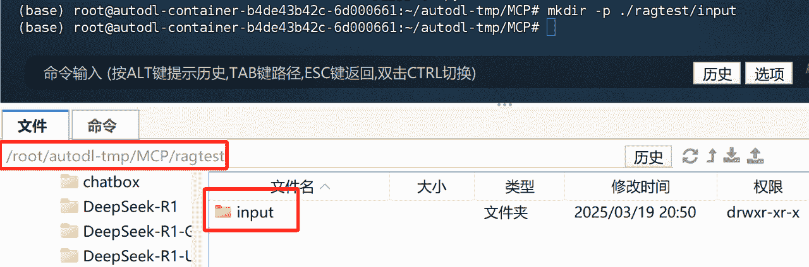

### Step 3. 上传数据集

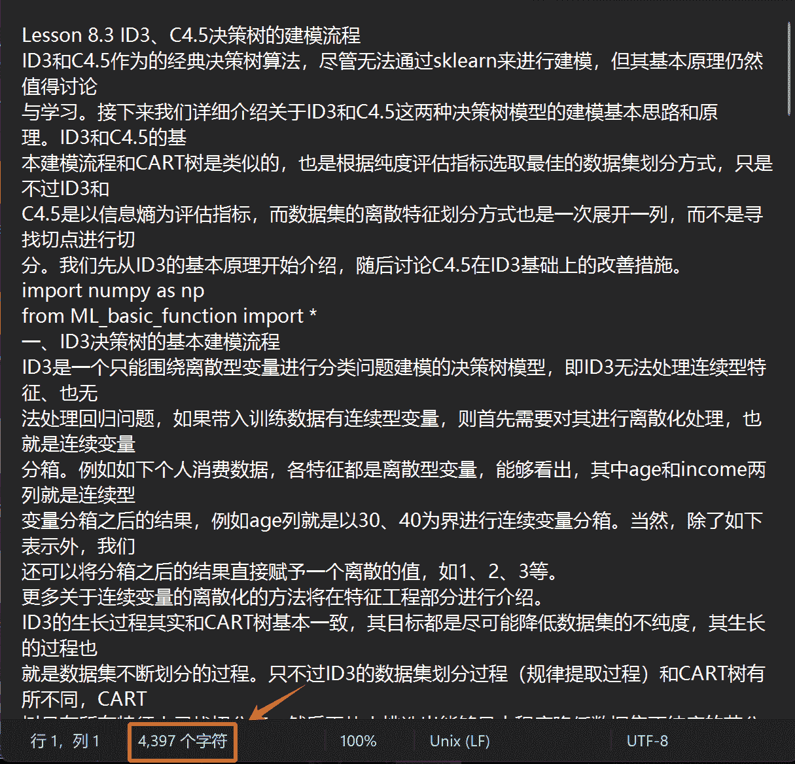

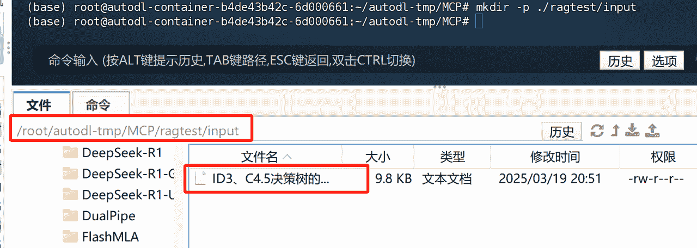

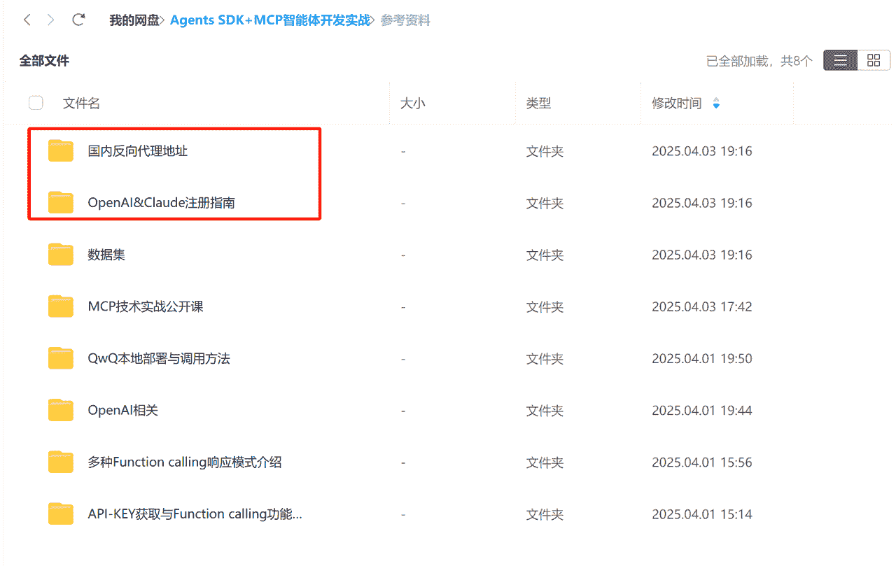

> 
> 此外，目前`GraphRAG`只支持`txt`和`csv`两种文本格式，付费课程2025大模型Agent智能体开发实战》（春季班）https://whakv.xetslk.com/s/pxKHG 中会详细介绍如何修改源码，拓展支持文件类型。


### Step 4. 初始化项目文件

```
graphrag init --root ./ragtest
```

```
!graphrag init --root ./ragtest
```

```
Initializing project at /root/autodl-tmp/MCP/ragtest
⠋ GraphRAG Indexer 
```

### Step 5. 修改项目配置

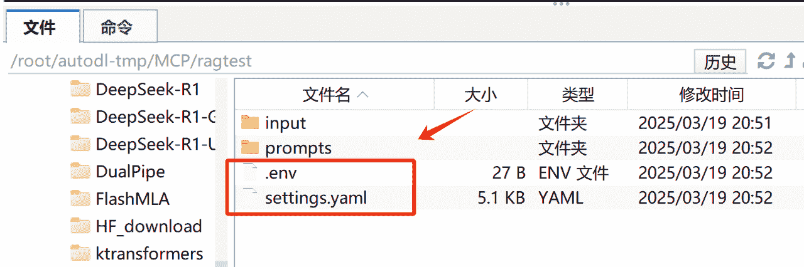

打开`.env`文件，填写DeepSeek API-KEY或OpenAI API-Key

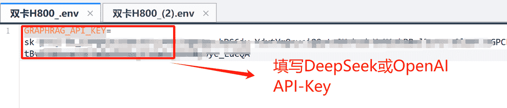

打开`setting.yaml`文件，填写模型名称和反向代理地址：

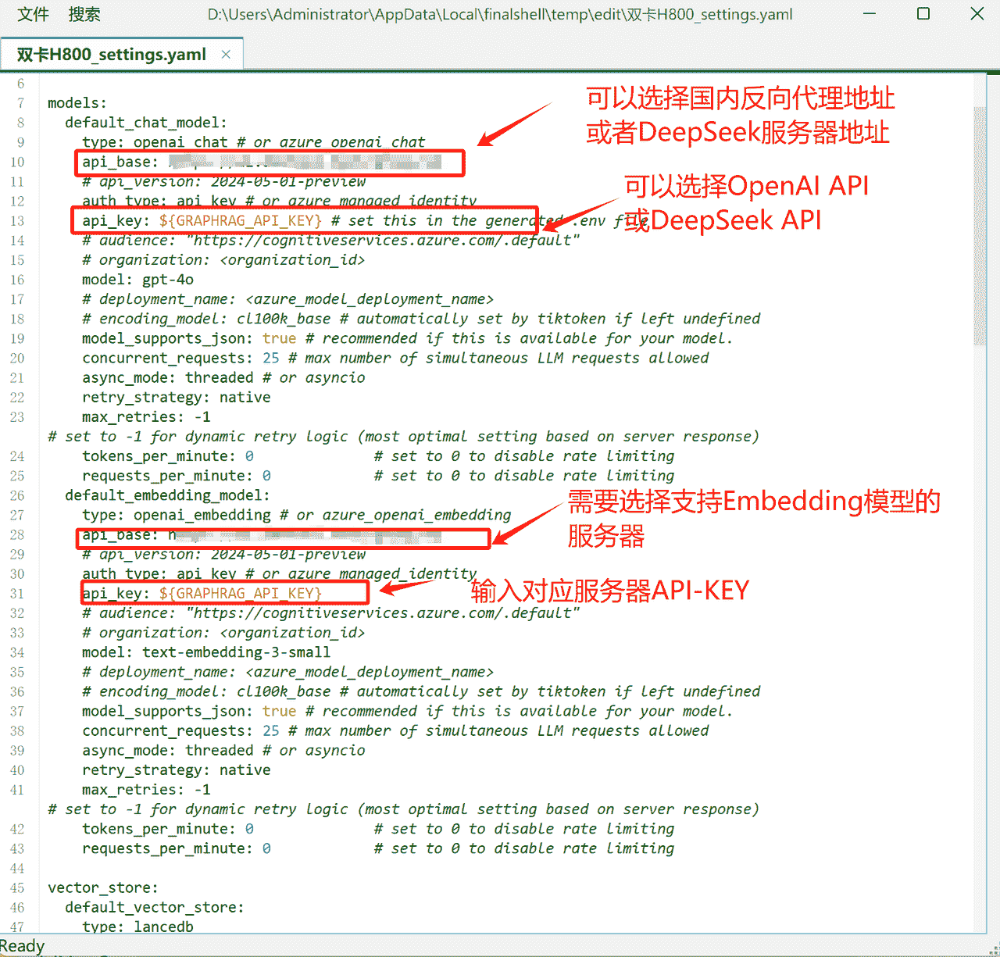

### 【可选】Step 6. 验证API-KEY和反向代理地址是否可以正常运行

```
from openai import OpenAI
```

```
api_key = 'your-openai-api-key'
```

```
# 实例化客户端
client = OpenAI(api_key=api_key, 
                base_url="反向代理地址")
```

```
# 调用 GPT-4o-mini 模型
response = client.chat.completions.create(
    model="gpt-4o-mini",
    messages=[
        {"role": "user", "content": "你好，好久不见!"}
    ]
)
```

```
# 输出生成的响应内容
print(response.choices[0].message.content)
```

```
你好！好久不见！你最近怎么样？有什么新鲜事分享吗？
```

然后查看当前API-KEY可以调用的模型：

```
models_list = client.models.list()
```

```
models_list.data
```


```
[Model(id='gpt-4o-2024-08-06', created=1722814719, object='model', owned_by='system'),
 Model(id='gpt-4o', created=1715367049, object='model', owned_by='system'),
 Model(id='o1-mini-2024-09-12', created=1725648979, object='model', owned_by='system'),
 Model(id='dall-e-2', created=1698798177, object='model', owned_by='system'),
 Model(id='gpt-4-1106-preview', created=1698957206, object='model', owned_by='system'),
 Model(id='gpt-3.5-turbo', created=1677610602, object='model', owned_by='openai'),
 Model(id='text-embedding-3-large', created=1705953180, object='model', owned_by='system'),
 Model(id='gpt-3.5-turbo-0125', created=1706048358, object='model', owned_by='system'),
 Model(id='babbage-002', created=1692634615, object='model', owned_by='system'),
 Model(id='gpt-4o-2024-11-20', created=1731975040, object='model', owned_by='system'),
 Model(id='gpt-4-turbo-preview', created=1706037777, object='model', owned_by='system'),
 Model(id='davinci-002', created=1692634301, object='model', owned_by='system'),
 Model(id='gpt-4-0125-preview', created=1706037612, object='model', owned_by='system'),
 Model(id='whisper-1', created=1677532384, object='model', owned_by='openai-internal'),
 Model(id='gpt-4o-mini', created=1721172741, object='model', owned_by='system'),
 Model(id='dall-e-3', created=1698785189, object='model', owned_by='system'),
 Model(id='gpt-4o-mini-2024-07-18', created=1721172717, object='model', owned_by='system'),
 Model(id='o1-preview', created=1725648897, object='model', owned_by='system'),
 Model(id='gpt-3.5-turbo-16k', created=1683758102, object='model', owned_by='openai-internal'),
 Model(id='o1-preview-2024-09-12', created=1725648865, object='model', owned_by='system'),
 Model(id='o1-mini', created=1725649008, object='model', owned_by='system'),
 Model(id='gpt-4o-2024-05-13', created=1715368132, object='model', owned_by='system'),
 Model(id='gpt-4o-realtime-preview', created=1727659998, object='model', owned_by='system'),
 Model(id='tts-1-hd-1106', created=1699053533, object='model', owned_by='system'),
 Model(id='gpt-4o-realtime-preview-2024-10-01', created=1727131766, object='model', owned_by='system'),
 Model(id='gpt-4', created=1687882411, object='model', owned_by='openai'),
 Model(id='gpt-4-0613', created=1686588896, object='model', owned_by='openai'),
 Model(id='text-embedding-ada-002', created=1671217299, object='model', owned_by='openai-internal'),
 Model(id='text-embedding-3-small', created=1705948997, object='model', owned_by='system'),
 Model(id='tts-1-hd', created=1699046015, object='model', owned_by='system'),
 Model(id='gpt-4-turbo', created=1712361441, object='model', owned_by='system'),
 Model(id='gpt-4-turbo-2024-04-09', created=1712601677, object='model', owned_by='system'),
 Model(id='gpt-3.5-turbo-1106', created=1698959748, object='model', owned_by='system'),
 Model(id='gpt-3.5-turbo-instruct', created=1692901427, object='model', owned_by='system'),
 Model(id='gpt-4o-audio-preview', created=1727460443, object='model', owned_by='system'),
 Model(id='gpt-4o-audio-preview-2024-10-01', created=1727389042, object='model', owned_by='system'),
 Model(id='tts-1', created=1681940951, object='model', owned_by='openai-internal'),
 Model(id='tts-1-1106', created=1699053241, object='model', owned_by='system'),
 Model(id='gpt-3.5-turbo-instruct-0914', created=1694122472, object='model', owned_by='system'),
 Model(id='chatgpt-4o-latest', created=1723515131, object='model', owned_by='system')]
```

## 2. GraphRAG 索引 Indexing 过程执行

一切准备就绪后，即可开始执行 `GraphRAG` 索引过程。

+ Step 7. 借助 `GraphRAG` 脚本自动执行 indexing

```
!graphrag index --root ./ragtest
```


# GraphRAG Indexer 执行日志

```
Logging enabled at /root/autodl-tmp/MCP/ragtest/logs/indexing-engine.log
🚀 LLM Config Params Validated
🚀 Embedding LLM Config Params Validated
Running standard indexing.
GraphRAG Indexer
├── Loading Input (InputFileType.text) - 1 files loaded (0 filtered)
🚀 create_base_text_units
                                                  id  ... n_tokens
0  4ba5acd798a419708cfe5cc86f1fcb6df907a20b1992ad ...  ...     1200
1  7a8436d7970da4b0e5c837b0a3eaaa196e6e2284c7c754 ...  ...     1200
2  1141affdc56bf8f5092b950b57febdedb884673ec6b23d ...  ...     1200
3  b5df95b6ec7e3aaea3f67db4914e1b2e874f3ac77fc3c8 ...  ...      558

[4 rows x 4 columns]
🚀 create_final_documents
                                                  id  ... metadata
0  2ef33abc7acb307f736e46c7f20fe87568b4e9bd6311cc ...  ...       NaN

[1 rows x 7 columns]
🚀 extract_graph
{'entities':                 title ...                                        
description
0                 ID3  ...  ID3 is a classic decision tree algorithm used ...
1                C4.5  ...  C4.5 is an improved version of the ID3 decisio...
2                CART  ...  CART (Classification and Regression Trees) is ...
3               NUMPY  ...  NumPy is a fundamental package for scientific ...
4   ML_BASIC_FUNCTION  ...  ML_basic_function is a module or library used ...
5              INCOME  ...  INCOME is a feature utilized in decision tree ...
6                 AGE  ...
7             STUDENT  ...  Student is a feature used in the ID3 decision ...
8       CREDIT_RATING  ...  Credit rating is a feature used in the ID3 dec...
9          GAIN RATIO  ...  Gain Ratio (GR) is a metric used in C4.5 to ev...
10  INFORMATION VALUE  ...

[11 rows x 5 columns], 'relationships':    source ...                          
description
0     ID3  ...  C4.5 is an improved version of the ID3 algorit...
1     ID3  ...  CART and ID3 are both decision tree algorithms...
2     ID3  ...  NumPy is used in the context of implementing t...
3     ID3  ...  ML_basic_function is used in the context of im...
4     ID3  ...  The ID3 algorithm utilizes the feature "Age" t...
5     ID3  ...  The ID3 algorithm utilizes "Income" as a featu...
6    C4.5  ...  NumPy is used in the context of implementing t...
7    C4.5  ...  ML_basic_function is used in the context of im...
8    C4.5  ...  Age is used as a feature in the C4.5 decision ...
9    C4.5  ...  Income is used as a feature in the C4.5 decisi...
10    ID3  ...  Student is used as a feature in the ID3 algori...
11    ID3  ...  Credit rating is used as a feature in the ID3 ...
12   C4.5  ...  C4.5 is an improved version of the ID3 algorit...
13   C4.5  ...  C4.5 shares a method with CART for handling co...
14   C4.5  ...  C4.5 uses Information Value to adjust Informat...
15   C4.5  ...  C4.5 calculates Gain Ratio to guide the select...

[16 rows x 5 columns]
🚀 finalize_graph
🚀 create_communities
                                     id human_readable_id  ...      period size
0  7e784ce6-8831-408b-96d7-6ef538060351                 0  ...  2025-03-19    6
1  a11b74e1-cde3-40d4-b94f-41c8943fccce                 1  ...  2025-03-19    5

[2 rows x 12 columns]
🚀 create_final_text_units
                                                  id  ... covariate_ids
0  4ba5acd798a419708cfe5cc86f1fcb6df907a20b1992ad ...  ...             []
1  7a8436d7970da4b0e5c837b0a3eaaa196e6e2284c7c754 ...  ...             []
2  1141affdc56bf8f5092b950b57febdedb884673ec6b23d ...  ...             []
3  b5df95b6ec7e3aaea3f67db4914e1b2e874f3ac77fc3c8 ...  ...             []

[4 rows x 8 columns]
🚀 create_community_reports
                                 id  human_readable_id  ...      period  size
0  1ac7a32afc444419a890034fa8a07a23                  0  ...  2025-03-19     6
1  741dd41161c442968adf80b829391ca6                  1  ...  2025-03-19     5

[2 rows x 15 columns]
🚀 generate_text_embeddings
{'community.full_content':                                  id                  
embedding
0  1ac7a32afc444419a890034fa8a07a23  [0.022195708006620407, 
-0.018380820751190186, ...
1  741dd41161c442968adf80b829391ca6  [-0.004288347437977791, 
-0.018359897658228874, ..., 'text_unit.text':                                    
id                                          embedding
0  4ba5acd798a419708cfe5cc86f1fcb6df907a20b1992ad ...  [0.004080102313309908, 
-0.025719715282320976, ...
1  7a8436d7970da4b0e5c837b0a3eaaa196e6e2284c7c754 ...  [0.03197648376226425, 
-0.004146269056946039, 0 ...
2  1141affdc56bf8f5092b950b57febdedb884673ec6b23d ...  [0.004956738092005253, 
-0.010794674046337605, ...
3  b5df95b6ec7e3aaea3f67db4914e1b2e874f3ac77fc3c8 ...  [0.0041420189663767815, 
-0.008617035113275051, ..., 'entity.description':                                
id                                          embedding
0   4671139f-7c6b-49d5-9975-a6e421965e33  [-0.014987517148256302, 
-0.025671809911727905, ...
1   c41918f5-2915-4636-9535-d97ba52398ec  [0.027884094044566154, 
-0.013612603768706322, ...
2   2627cb98-5579-4632-9cea-f4dd6c94e62f  [0.00040230865124613047, 
0.004047541879117489, ...
3   066e010e-119f-4001-b6f0-4a4650b8e8bb  [-0.02801547758281231, 
6.209584535099566e-05, ...
4   df1425f5-7bb7-4d37-abdb-a942a3e2d4cb  [-0.05015850067138672, 
0.017463017255067825, 0 ...
5   9f33839e-9c4d-46c6-b18d-f648f08b2e20  [0.007000381126999855, 
0.025825968012213707, 0 ...
6   d656184f-9029-4454-bc9c-7837cb4f5bcc  [0.07592508941888809, 
0.004072447773069143, -0 ...
7   bd59b770-64f7-43e5-903f-d6c76879f21c  [-0.0005834496696479619, 
-0.027669785544276237...
8   263fca4a-1400-4232-b144-14cfb5dd53b1  [0.010702051222324371, 
0.015957409515976906, -...
9   41427d71-fc60-4e03-9765-f3eac498328a  [-0.01288720965385437, 
0.024143291637301445, 0 ...
10  md6c6d742-b0f7-447e-93ab-15da21a4d06c  [0.020873581990599632, 
-0.009732553735375404, ...
}
[2025-03-19T13:00:07Z WARN lance::dataset::write::insert] No existing dataset at /root/autodl-tmp/MCP/ragtest/output/lancedb/default-community-full_content.lance, it will be created
[2025-03-19T13:00:08Z WARN lance::dataset::write::insert] No existing dataset at /root/autodl-tmp/MCP/ragtest/output/lancedb/default-text_unit-text.lance, it will be created
[2025-03-19T13:00:10Z WARN lance::dataset::write::insert] No existing dataset at /root/autodl-tmp/MCP/ragtest/output/lancedb/default-entity-description.lance, it will be created
🚀 All workflows completed successfully.
```


该命令也可以在终端内运行，结果如图：

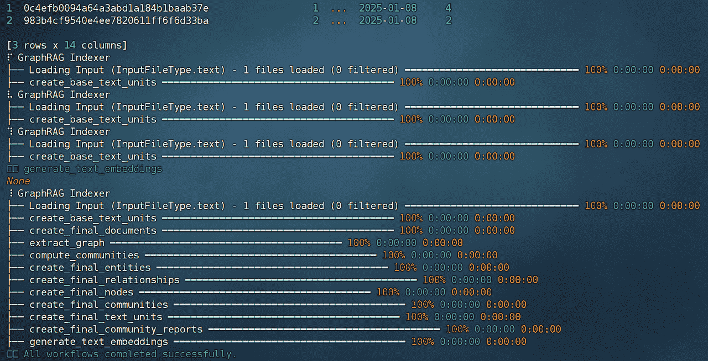

运行结束后，各知识图谱相关数据集都保存在`output`文件夹中：

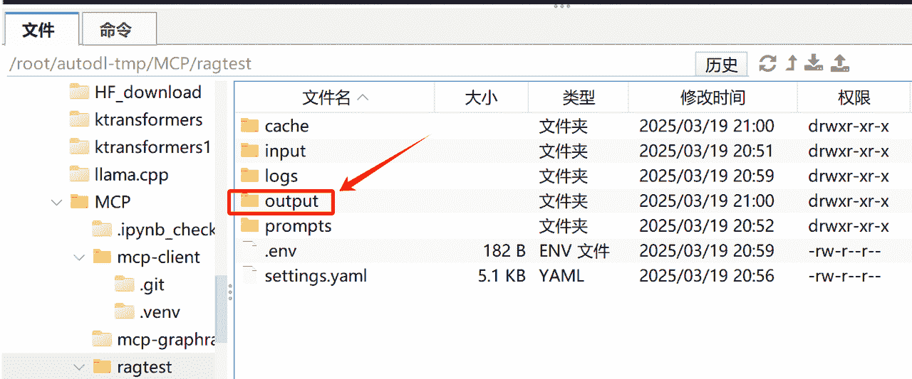

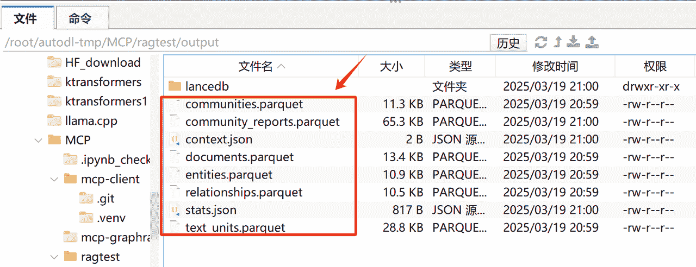

> 更多数据集介绍，详见：【6小时最强合集】GraphRAG从原理到实战技术精讲：https://www.bilibili.com/video/BV1uCifYLEQd/


```
!graphrag query --root ./ragtest --method local --query &quot;请帮我介绍下ID3算法&quot;
```

```
INFO: Vector Store Args: {
    &quot;default_vector_store&quot;: {
        &quot;type&quot;: &quot;lancedb&quot;,
        &quot;db_uri&quot;: &quot;/root/autodl-tmp/MCP/ragtest/output/lancedb&quot;,
        &quot;url&quot;: null,
        &quot;audience&quot;: null,
        &quot;container_name&quot;: &quot;==== REDACTED ====&quot;,
        &quot;database_name&quot;: null,
        &quot;overwrite&quot;: true
    }
}

SUCCESS: Local Search Response:
# ID3 Algorithm Overview

The ID3 (Iterative Dichotomiser 3) algorithm is a classic decision tree algorithm primarily used for classification tasks. It is known for its ability to handle discrete variables and is foundational in the field of machine learning. The algorithm employs information entropy as an evaluation metric and uses information gain to split datasets based on categorical features. However, one of the limitations of ID3 is its tendency to overfit, as it often prefers features with many categories [Data: Entities (0); Reports (1)].

## Key Features and Functionality

ID3 is designed to work with discrete variables, which means it cannot directly handle continuous variables or regression problems. If continuous variables are present in the training data, they must first be discretized. This process involves converting continuous data into discrete bins, which can then be used in the decision tree model. The algorithm&#x27;s growth process is similar to that of the CART (Classification and Regression Trees) model, with both aiming to reduce dataset impurity through iterative data splitting [Data: Sources (0)].

## Information Gain and Feature Selection

The ID3 algorithm uses information gain as a criterion for selecting the best feature to split the dataset at each node. Information gain measures the reduction in entropy or impurity achieved by partitioning the data based on a particular feature. For example, in a dataset with features like age, income, student status, and credit rating, the ID3 algorithm calculates the information gain for each feature and selects the one with the highest gain for splitting. In practice, the &#x27;Age&#x27; feature often provides significant information gain, making it a preferred choice for initial splits [Data: Sources (0); Relationships (4, 5, 10, 11)].

## Limitations and Improvements

One of the main drawbacks of the ID3 algorithm is its propensity to overfit, especially when dealing with features that have many categories. This is because ID3 tends to select features with more categories, which can lead to overly complex models that do not generalize well to new data. Additionally, ID3 lacks mechanisms to handle continuous variables directly, which limits its applicability in certain scenarios. These limitations have been addressed in its successor, the C4.5 algorithm, which introduces improvements such as handling continuous variables and incorporating pruning processes to reduce overfitting [Data: Reports (1); Entities (0, 1)].

In summary, the ID3 algorithm is a foundational tool in machine learning for classification tasks, known for its use of information entropy and information gain. While it has limitations, particularly in handling continuous variables and preventing overfitting, it laid the groundwork for more advanced decision tree algorithms like C4.5.
```

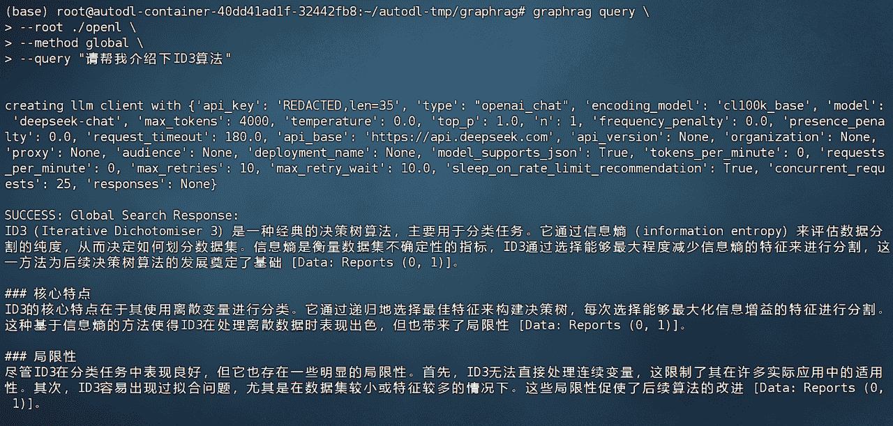

Jupyter中可以直接输入如下内容进行Query：

```
!graphrag query --root ./ragtest --method local --query &quot;请帮我介绍下ID3算法，请用中文回答。&quot;
```

```
INFO: Vector Store Args: {
    &quot;default_vector_store&quot;: {
        &quot;type&quot;: &quot;lancedb&quot;,
        &quot;db_uri&quot;: &quot;/root/autodl-tmp/MCP/ragtest/output/lancedb&quot;,
        &quot;url&quot;: null,
        &quot;audience&quot;: null,
        &quot;container_name&quot;: &quot;==== REDACTED ====&quot;,
        &quot;database_name&quot;: null,
        &quot;overwrite&quot;: true
    }
}

SUCCESS: Local Search Response:
### ID3算法简介

ID3算法是一种经典的决策树算法，主要用于分类问题。它专注于离散变量，通过信息熵作为评估指标，利用信息增益来基于分类特征对数据集进行划分。ID3算法的一个显著特点是它倾向于选择具有较多类别的特征进行划分，这可能导致过拟合的问题 [Data: Reports (1); Entities (0)]。

### 算法的基本原理

ID3算法的基本原理是通过计算信息增益来选择最佳的特征进行数据集的划分。信息增益是通过计算父节点和子节点的信息熵差值来获得的。信息熵用于衡量数据集的纯度，信息增益则表示在某一特征的基础上划分数据集后纯度的提升 [Data: Sources (0)]。

### 特征选择与数据集划分

在ID3算法中，特征选择是通过计算每个特征的信息增益来实现的。算法会选择信息增益最大的特征进行数据集的划分。例如，特征“年龄”在某些情况下可能提供最大的增益，因此会被优先选择用于划分数据集 [Data: Sources (0); Relationships (4)]。

### ID3的局限性

ID3算法的一个主要局限性是它无法处理连续变量。在处理连续变量时，通常需要先对其进行离散化。此外，ID3算法没有内置的机制来防止过拟合，这使得它在某些情况下可能不如其他算法（如C4.5）鲁棒 [Data: Sources (0); Reports (1)]。

### 总结

ID3算法作为一种基础的决策树算法，为后续算法（如C4.5）的发展奠定了基础。尽管存在一些局限性，ID3仍然是理解决策树模型的重要起点 [Data: Reports (1); Entities (0)].
```

### 3. GraphRAG API 初始化项目

```
from pathlib import Path
from pprint import pprint

import pandas as pd

import graphrag.api as api
from graphrag.config.load_config import load_config
from graphrag.index.typing.pipeline_run_result import PipelineRunResult
```

```
mkdir -p ./MLRAG/input
```

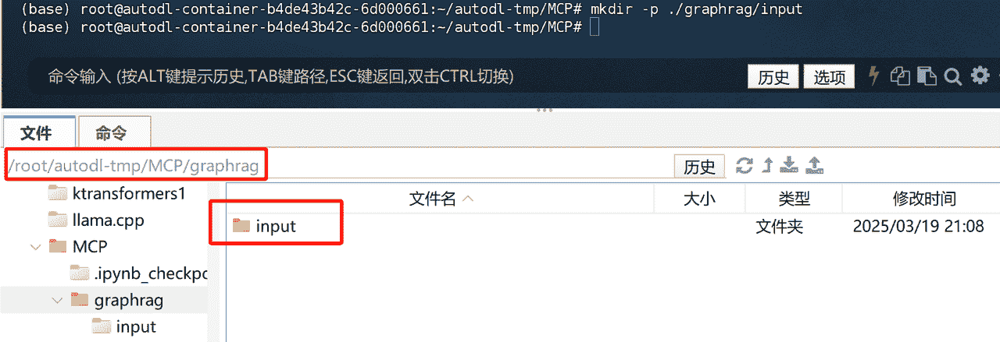

然后进行初始化

```
!graphrag init --root ./MLRAG
```

```
[2KInitializing project at [35m/root/autodl-tmp/OpenAI体验课/[0m[95mMLRAG[0m
⠋ GraphRAG Indexer 
```

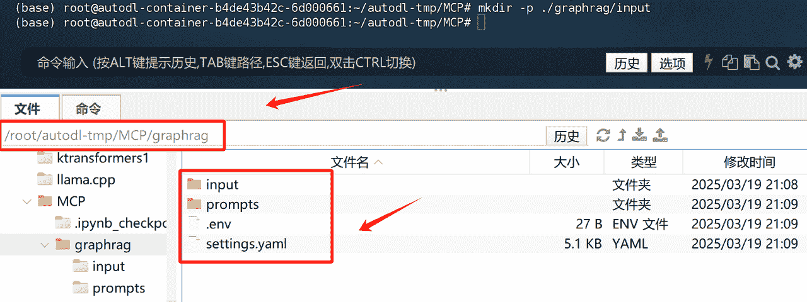

并修改配置文件（同上一部分）。

### 4. 借助API进行Indexing过程

```
PROJECT_DIRECTORY = &quot;./MLRAG&quot;
```

生成 `GraphRagConfig` 对象

```
graphrag_config = load_config(Path(PROJECT_DIRECTORY))
```

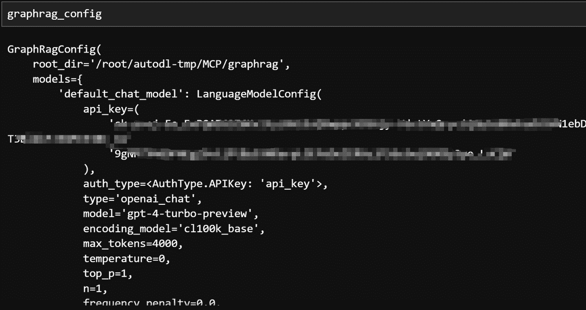

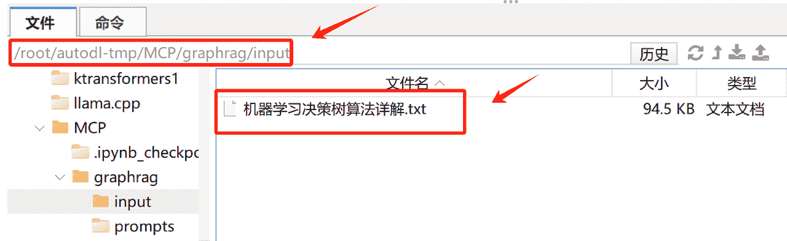

索引 API

索引是指摄取原始文本数据并构建知识图谱的过程。GraphRAG 目前支持纯文本（`.txt`）和 `.csv` 文件格式。

构建索引

```
index_result: list[PipelineRunResult] = await api.build_index(config=graphrag_config)
```

```
[2025-04-03T12:27:09Z WARN  lance::dataset::write::insert] No existing dataset at /root/autodl-tmp/OpenAI体验课/MLRAG/output/lancedb/default-community-full_content.lance, it will be created
[2025-04-03T12:27:12Z WARN  lance::dataset::write::insert] No existing dataset at /root/autodl-tmp/OpenAI体验课/MLRAG/output/lancedb/default-text_unit-text.lance, it will be created
[2025-04-03T12:27:16Z WARN  lance::dataset::write::insert] No existing dataset at /root/autodl-tmp/OpenAI体验课/MLRAG/output/lancedb/default-entity-description.lance, it will be created
```

`index_result` 是一个包含索引流水线各个工作流的列表，每个工作流代表一次索引构建过程。

```
for workflow_result in index_result:
    status = f&quot;error\n{workflow_result.errors}&quot; if workflow_result.errors else &quot;success&quot;
    print(f&quot;Workflow Name: {workflow_result.workflow}\tStatus: {status}&quot;)
```

```
Workflow Name: create_base_text_units        Status: success
Workflow Name: create_final_documents        Status: success
Workflow Name: extract_graph        Status: success
Workflow Name: finalize_graph        Status: success
Workflow Name: create_communities        Status: success
Workflow Name: create_final_text_units        Status: success
Workflow Name: create_community_reports        Status: success
Workflow Name: generate_text_embeddings        Status: success
```

在此循环中，遍历 `index_result` 列表，并打印每个工作流的名称及其执行状态。如果工作流中存在错误，则输出错误信息，否则输出 `success`。

### 5. 借助API进行Query过程

查询索引

在查询索引之前，必须先将多个索引文件加载到内存中，并传递给查询 API。

```
entities = pd.read_parquet(f&quot;{PROJECT_DIRECTORY}/output/entities.parquet&quot;)
communities = pd.read_parquet(f&quot;{PROJECT_DIRECTORY}/output/communities.parquet&quot;)
community_reports = pd.read_parquet(
    f&quot;{PROJECT_DIRECTORY}/output/community_reports.parquet&quot;
)
```

上述代码读取 `.parquet` 格式的索引数据，包括 实体（`entities`）、社群（`communities`） 以及 社群报告（`community_reports`）。

执行全局搜索

```
query = &quot;请帮我对比下ID3和C4.5决策树算法优劣势。并用中文进行回答。&quot;
```


```python
response, context = await api.global_search(
    config=graphrag_config,
    entities=entities,
    communities=communities,
    community_reports=community_reports,
    community_level=2,
    dynamic_community_selection=False,
    response_type="Multiple Paragraphs",
    query=query,
)
```

在这里，我们调用 `global_search` 方法，使用已加载的索引数据进行查询。

+   `community_level=2`：设定社群层级为 2 级。

+   `dynamic_community_selection=False`：禁用动态社群选择。

+   `response_type="Multiple Paragraphs"`：设置返回的查询结果为多段落格式。

+   `query=query`：查询问题为 "请帮我对比下ID3和C4.5决策树算法优劣势。并用中文进行回答。"。

### 解析查询结果

```python
print(response)
```

```
在决策树算法中，ID3和C4.5算法各有其特点和应用场景。以下是对这两种算法优劣势的对比分析：

### ID3算法

ID3算法是决策树算法的基础，主要特点是使用信息增益作为选择特征的标准来构建决策树，这使得算法简单直观，易于理解和实现。它适用于处理分类问题，特别是在特征都是离散值的情况下表现良好。然而，ID3算法也存在一些明显的劣势，包括无法直接处理连续属性和缺乏剪枝处理，这可能导致模型容易过拟合，影响模型的泛化能力 [Data: Reports (3)]。

### C4.5算法

C4.5算法在ID3的基础上进行了改进，引入了信息增益比来选择特征，这一改进不仅使得算法能够处理连续属性，还加入了剪枝策略，有效减少了过拟合的风险。因此，C4.5算法的模型具有更好的泛化能力。尽管C4.5算法的计算复杂度相对ID3算法有所增加，但其能够处理更广泛的数据类型和更复杂的分类问题，使其成为更加强大和灵活的决策树算法 [Data: Reports (3)]。

### 综合对比

总的来说，ID3算法以其简单直观的特性适用于特征全为离散值的分类问题，但在处理连续属性和防止过拟合方面存在局限。而C4.5算法通过引入信息增益比和剪枝策略，不仅克服了ID3算法的这些限制，还提高了模型的泛化能力，使其能够更有效地处理各种类型的数据和复杂的分类问题。因此，在选择决策树算法时，应根据具体的数据特征和需求来决定使用ID3算法还是C4.5算法。
```

`response` 变量是 `GraphRAG` 返回的正式查询结果。

```python
pprint(context)
```

```
{&#x27;reports&#x27;:     id                                              title  occurrence weight  \
0    2            CART and Its Impact on Machine Learning           1.000000   
1    7  Scikit-Learn Ecosystem and Its Integration wit...           1.000000   
2    3  Evolution of Decision Tree Algorithms: From ID...           0.888889   
3   18  Scikit-Learn: A Comprehensive Machine Learning...           0.888889   
4   11            CART and Its Impact on Machine Learning           0.666667   
5    6               Scikit-Learn Decision Tree Ecosystem           0.666667   
6   12  Advancements in Machine Learning: The Friedman...           0.555556   
7    0        Scikit-Learn and Machine Learning Community           0.444444   
8   16  Scikit-Learn&#x27;s Core Components for Machine Lea...           0.444444   
9    8  Scikit-Learn Ecosystem: A Comprehensive Machin...           0.444444   
10   4       Decision Tree Algorithms in Machine Learning           0.333333   
11   1  Decision Tree Parameter Strategies and Their I...           0.333333   
12  14  Scikit-Learn&#x27;s DecisionTreeRegressor and Its E...           0.333333   
13   5    Decision Tree Parameters and Their Interactions           0.333333   
14  19  Python Data Science Stack: Pandas, NumPy, and ...           0.222222   
15  17                      MSE and MAE in Decision Trees           0.222222   
16  10  Machine Learning Ecosystem: Aurélien Géron and...           0.111111   
17  13        Data Purity Metrics: Gini Index and Entropy           0.111111   
18   9      Machine Learning Model Optimization Community           0.111111   
19  15           Scikit-Learn Decision Tree Visualization           0.111111   

                                              content  rank  
0   # CART and Its Impact on Machine Learning\n\nT...   8.5  
1   # Scikit-Learn Ecosystem and Its Integration w...   8.5  
2   # Evolution of Decision Tree Algorithms: From ...   8.5  
3   # Scikit-Learn: A Comprehensive Machine Learni...   8.5  
4   # CART and Its Impact on Machine Learning\n\nT...   8.5  
5   # Scikit-Learn Decision Tree Ecosystem\n\nThis...   8.5  
6   # Advancements in Machine Learning: The Friedm...   8.5  
7   # Scikit-Learn and Machine Learning Community\...   8.5  
8   # Scikit-Learn&#x27;s Core Components for Machine L...   8.5  
9   # Scikit-Learn Ecosystem: A Comprehensive Mach...   8.5  
10  # Decision Tree Algorithms in Machine Learning...   7.5  
11  # Decision Tree Parameter Strategies and Their...   7.5  
12  # Scikit-Learn&#x27;s DecisionTreeRegressor and Its...   7.5  
13  # Decision Tree Parameters and Their Interacti...   7.5  
14  # Python Data Science Stack: Pandas, NumPy, an...   8.5  
15  # MSE and MAE in Decision Trees\n\nThis report...   7.5  
16  # Machine Learning Ecosystem: Aurélien Géron a...   8.5  
17  # Data Purity Metrics: Gini Index and Entropy\...   7.5  
18  # Machine Learning Model Optimization Communit...   7.5  
19  # Scikit-Learn Decision Tree Visualization\n\n...   7.0  }
```

`context` 变量包含关于查询过程的详细元数据，包括：

+   查询过程中检索到的数据信息

+   被用于构建上下文的文本片段

+   其他元数据

深入分析 `context` 对象可以获取更精细的信息，比如LLM 模型最终使用的文本数据来源。

### 6. 封装函数完成GraphRAG Query

```python
@function_tool
async def rag_ML(query: str) -&gt; str:
    &quot;&quot;&quot;
    输入ID3和C4.5决策树相关问题，可以获得精准答案。
    :param query: 机器学习领域ID3和C4.5决策树的相关问题
    :return: query问题对应的答案
    &quot;&quot;&quot;
    PROJECT_DIRECTORY = &quot;./MLRAG&quot;
    graphrag_config = load_config(Path(PROJECT_DIRECTORY))
    
    # 加载实体
    entities = pd.read_parquet(f&quot;{PROJECT_DIRECTORY}/output/entities.parquet&quot;)
    # 加载社区
    communities = pd.read_parquet(f&quot;{PROJECT_DIRECTORY}/output/communities.parquet&quot;)
    # 加载社区报告
    community_reports = pd.read_parquet(
        f&quot;{PROJECT_DIRECTORY}/output/community_reports.parquet&quot;
    )
    # 进行全局搜索
    response, context = await api.global_search(
        config=graphrag_config,
        entities=entities,
        communities=communities,
        community_reports=community_reports,
        community_level=2,
        dynamic_community_selection=False,
        response_type=&quot;Multiple Paragraphs&quot;,
        query=query,
    )
    
    return response
```

```python
query = &#x27;请帮我对比下ID3和C4.5决策树算法优劣势。并用中文进行回答。&#x27;
```

```python
await rag_ML(query)
```

```python
query
```

```
&#x27;请帮我对比下ID3和C4.5决策树算法优劣势。并用中文进行回答。&#x27;
```

```python
rag_ML(query)
```

```
&#x27;### ID3算法与C4.5算法的对比\n\n#### ID3算法概述\n\nID3算法是由Ross Quinlan开发的决策树算法的早期版本，它主要通过信息增益（Information Gain）作为选择属性的标准，专注于处理分类问题。ID3算法的主要优点在于其简单直观，易于理解和实现，使其成为决策树算法中的一个重要基石 [Data: Reports (1, 13)]。然而，ID3算法存在几个显著的限制，包括无法直接处理连续属性和缺失值，以及缺乏有效的过拟合预防措施，这些限制可能会影响算法的泛化能力和应用范围 [Data: Reports (1, 13)]。\n\n#### C4.5算法改进\n\nC4.5算法是在ID3的基础上进行改进的，同样由Ross Quinlan开发。C4.5算法的主要改进包括引入信息增益率（Gain Ratio）来选择属性，这一改进解决了ID3算法在属性选择时偏向于选择取值多的属性的问题。此外，C4.5算法能够处理连续属性和缺失值，并引入了剪枝技术来减少过拟合的风险，从而提高了模型的泛化能力 [Data: Reports (1, 13)]。C4.5算法的这些改进使得它更加健壮，适用于更广泛的数据集。然而，需要注意的是，C4.5算法的计算复杂度较高，尤其是在处理大型数据集时，这可能会成为其应用的一个限制 [Data: Reports (1, 13)]。\n\n#### 总结\n\n总的来说，C4.5算法在功能上对ID3算法进行了显著的改进，包括处理连续属性和缺失值的能力，以及引入剪枝策略来避免过拟合问题，这些改进显著提高了决策树模型的泛化能力。然而，这些改进也带来了更高的计算复杂度，特别是在处理大规模数据集时 [Data: Reports (1, 13)]。因此，在选择使用ID3算法还是C4.5算法时，需要根据具体的应用场景和数据集的特点来权衡算法的优势和潜在的限制。&#x27;
```

+   机器学习知识检索智能体

```python
RAG_agent = Agent(
    name=&quot;机器学习知识库问答智能体&quot;,  
    instructions=&quot;可以通过调用rag_ML工具，进行机器学习ID3、C4.5等知识点高精度检索&quot;,  
    tools=[rag_ML],
    model=deepseek_model
)
```

```python
RAG_result = await Runner.run(RAG_agent, &quot;请问ID3的建模流程是什么？&quot;)
```

```python
RAG_result.final_output
```

```
&#x27;ID3的建模流程主要包括以下步骤：\n\n1. **选择最优特征**：通过计算每个特征的信息增益，选择信息增益最大的特征作为当前节点的分割标准。信息增益越大，表明该特征对分类的贡献越大。\n\n2. **分割数据集**：根据选定的特征将数据集分割成多个子集，每个子集对应特征的一个取值。\n\n3. **递归构建子树**：对每个子集重复上述过程，选择新的最优特征进行分割，直到满足停止条件。\n\n4. **停止条件**：\n   - 所有特征都已使用完毕。\n   - 当前子集中的所有样本属于同一类别。\n   - 没有更多的样本可以分割。\n\n### ID3算法的特点与限制\n- **特点**：简单直观，适合处理离散特征。\n- **限制**：\n  - 无法直接处理连续特征，需要离散化。\n  - 缺乏剪枝机制，容易导致过拟合。\n\n这些限制促使了后续算法（如C4.5）的改进，以更好地适应复杂数据场景。&#x27;
```

## 四、Agents SDK搭建Agentic RAG（2）：联网+知识检索功能实现


+   读取全部所需变量

同时，需要在当前项目文件夹内创建一个`.env`文件，并写入如下变量：

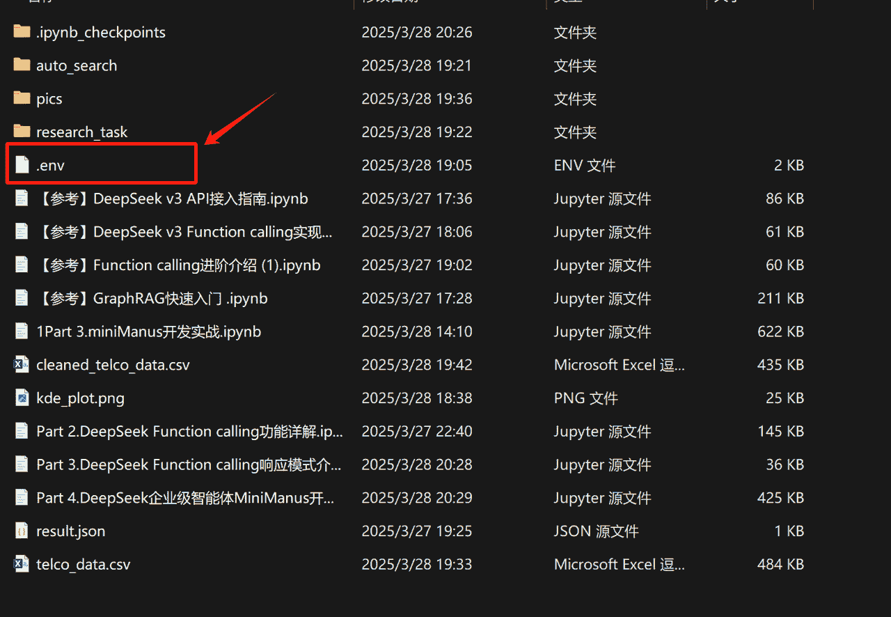

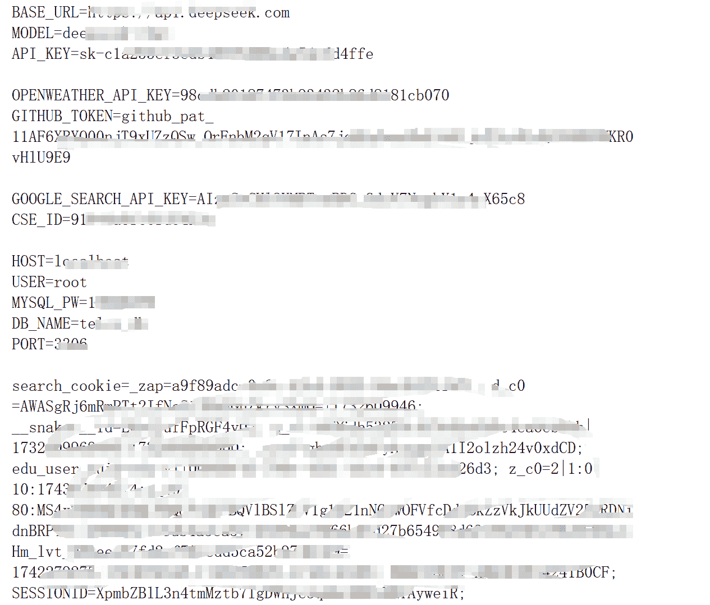

> .env文件需要写入如下内容：

+   `BASE_URL`：大模型请求端口；

+   `MODEL`：大模型名称；

+   `API_KEY`：大模型API-Key

+   `GITHUB_TOKEN`：GitHub Token，若使用GitHub搜索，则需要设置；

+   `GOOGLE_SEARCH_API_KEY`：谷歌搜索API-KEY；

+   `CSE_ID`：谷歌搜索可编程引擎ID；

+   `search_cookie`：网络爬虫所需本机cookie，需要注意的是，爬虫cookie失效很快，快的话几个小时就会失效，因此需要经常更新

+   `search_ueser_agent`：爬虫所需本机信息；

+   `search_with_broswer`：爬取网络信息时是否打开浏览器。

> 样例文件如下：

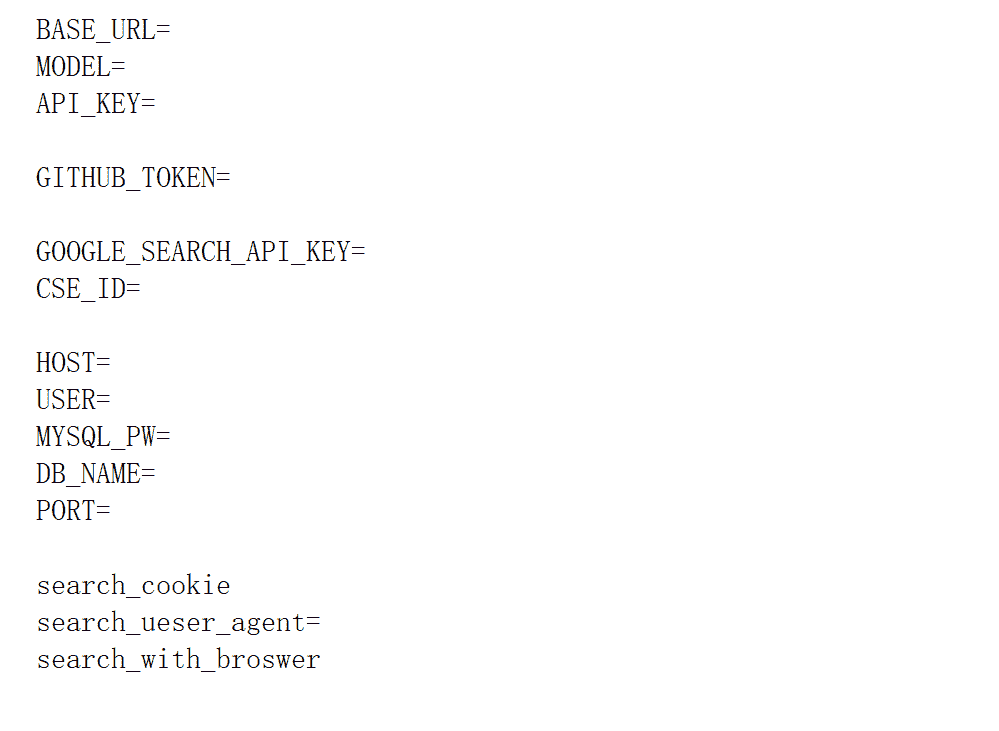

> 网盘下载地址，实际使用时将文件名改为`.env`，并填入对应变量名称即可：

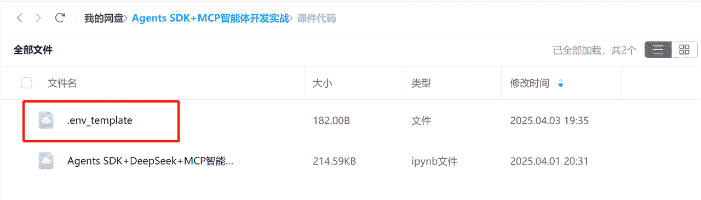


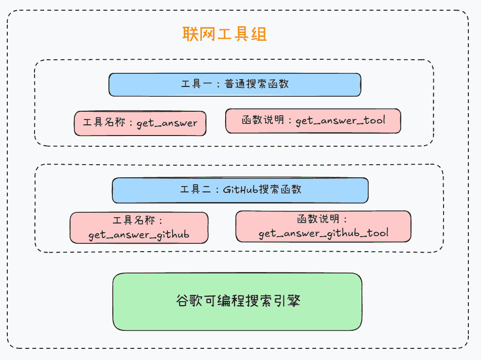

## 搜索测试

### 环境变量配置

```
os.environ['HTTP_PROXY'] = 'http://127.0.0.1:10080';
os.environ['HTTPS_PROXY'] = 'http://127.0.0.1:10080';
```

### API 密钥与配置

```
# 谷歌搜索服务器
google_search_key = os.getenv("GOOGLE_SEARCH_API_KEY")
cse_id = os.getenv("CSE_ID")
search_cookie = os.getenv("search_cookie")
search_ueser_agent = os.getenv("search_ueser_agent")
```

### google_search 函数定义

```
def google_search(query, num_results=10, site_url=None):

    api_key = os.getenv("GOOGLE_SEARCH_API_KEY")
    cse_id = os.getenv("CSE_ID")

    url = "https://www.googleapis.com/customsearch/v1"

    # API 请求参数
    if site_url == None:
        params = {
        'q': query,
        'key': api_key,
        'cx': cse_id,
        'num': num_results
        }
    else:
        params = {
        'q': query,
        'key': api_key,
        'cx': cse_id,
        'num': num_results,
        'siteSearch': site_url
        }

    # 发送请求
    response = requests.get(url, params=params)
    response.raise_for_status()

    # 解析响应
    search_results = response.json().get('items', [])

    # 提取所需信息
    results = [{
        'title': item['title'],
        'link': item['link'],
        'snippet': item['snippet']
    } for item in search_results]

    return results
```

### 调用示例

```
results = google_search(query="什么是MCP", num_results=5, site_url='https://www.zhihu.com/')
results
```

### 返回结果示例

```
[{'title': '如何评价Anthropic发布的Model Context Protocol (MCP) 协议？ - 知乎',
  'link': 'https://www.zhihu.com/question/5290049088',
  'snippet': 'Nov 27, 2024 ... 轻松愉快的SQL 数据分析，只不过是冰山一角. 协议. Claude (Anthropic) 最近出了个MCP (Model Context Protocol，模型上下文协议) 协议，搞得我朋友圈里\xa0...'},
 {'title': 'MCP是什么？ - 知乎',
  'link': 'https://www.zhihu.com/question/7762420288',
  'snippet': 'Dec 24, 2024 ... 虽然Cursor 已经能自动生成代码，但我们梦想中的AI 编程工具，应该是这样的：. 直接调用AI 查看本地数据库，获取关键信息；; 报错信息一键丢给搜索引擎，秒\xa0...'},
 {'title': 'MCP、function calling 这两者有什么区别？与AI Agent 是什么关系 ...',
  'link': 'https://www.zhihu.com/question/13800647198',
  'snippet': 'Mar 1, 2025 ... 为什么是MCP？ 看到这里你可能有一个问题，在23 年OpenAI 发布GPT function calling 的时候，不是也是可以实现类似的功能吗？我们之前博客介绍的AI Agent，\xa0...'},
 {'title': 'MCP是什么？ - AIQL 的回答- 知乎',
  'link': 'https://www.zhihu.com/question/7762420288/answer/63135932743',
  'snippet': 'Dec 24, 2024 ... 2024年11月底，Anthropic公司发布了全新的MCP（Model Context Protocol）协议，即模型上下文协议。该协议…'},
 {'title': 'AI领域的agent是什么意思？ - NLP自然语言处理的回答- 知乎',
  'link': 'https://www.zhihu.com/question/51195225/answer/131041571712',
  'snippet': 'Oct 1, 2016 ... 之前的时候，让大模型做外部工具调用基本上都是通过Function Calling的方式，最近随着大模型Agent工作流的兴起，有一个新的概念：MCP逐渐进入大家的视野，基于\xa0...'}]
```

### Windows 兼容文件名函数

```
def windows_compatible_name(s, max_length=255):
    """
    将字符串转化为符合Windows文件/文件夹命名规范的名称。

    参数:
    - s (str): 输入的字符串。
    - max_length (int): 输出字符串的最大长度，默认为255。

    返回:
    - str: 一个可以安全用作Windows文件/文件夹名称的字符串。
    """

    # Windows文件/文件夹名称中不允许的字符列表
    forbidden_chars = ['<', '>', ':', '"', '/', '\\', '|', '?', '*']

    # 使用下划线替换不允许的字符
    for char in forbidden_chars:
        s = s.replace(char, '_')

    # 删除尾部的空格或点
    s = s.rstrip(' .')

    # 检查是否存在以下不允许被用于文档名称的关键词，如果有的话则替换为下划线
    reserved_names = ["CON", "PRN", "AUX", "NUL", "COM1", "COM2", "COM3", "COM4", "COM5", "COM6", "COM7", "COM8", "COM9", 
                      "LPT1", "LPT2", "LPT3", "LPT4", "LPT5", "LPT6", "LPT7", "LPT8", "LPT9"]
    if s.upper() in reserved_names:
        s += '_'

    # 如果字符串过长，进行截断
    if len(s) > max_length:
        s = s[:max_length]

    return s
```

### get_search_text 函数定义

```
def get_search_text(q, url):
    cookie = os.getenv('search_cookie')
    user_agent = os.getenv('search_ueser_agent')

    code_ = False
    headers = {
        'authority': 'www.zhihu.com',
        'accept': 'text/html,application/xhtml+xml,application/xml;q=0.9,image/avif,image/webp,image/apng,*/*;q=0.8,application/signed-exchange;v=b3;q=0.7',
        'accept-language': 'zh-CN,zh;q=0.9,en;q=0.8',
        'cache-control': 'max-age=0',
        'cookie': cookie,
        'upgrade-insecure-requests': '1',
        'user-agent':user_agent,
    }

    # 普通问答地址
    if 'zhihu.com/question' in url:
        res = requests.get(url, headers=headers).text
        res_xpath = etree.HTML(res)
        title = res_xpath.xpath('//div/div[1]/div/h1/text()')[0]
        text_d = res_xpath.xpath('//div/div/div/div[2]/div/div[2]/div/div/div[2]/span[1]/div/div/span/p/text()')

    # 专栏地址
    elif 'zhuanlan' in url:
        headers['authority'] = 'zhaunlan.zhihu.com'
        res = requests.get(url, headers=headers).text
        res_xpath = etree.HTML(res)
        title = res_xpath.xpath('//div[1]/div/main/div/article/header/h1/text()')[0]
        text_d = res_xpath.xpath('//div/main/div/article/div[1]/div/div/div/p/text()')
        code_ = res_xpath.xpath('//div/main/div/article/div[1]/div/div/div//pre/code/text()')

    # 特定回答的问答网址
    elif 'answer' in url:
        res = requests.get(url, headers=headers).text
        res_xpath = etree.HTML(res)
        title = res_xpath.xpath('//div/div[1]/div/h1/text()')[0]
        text_d = res_xpath.xpath('//div[1]/div/div[3]/div/div/div/div[2]/span[1]/div/div/span/p/text()')

    if title == None:
        return None

    else:
        title = windows_compatible_name(title)

        # 创建问题答案正文
        text = ''
        for t in text_d:
            txt = str(t).replace('\n', ' ')
            text += txt

        # 如果有code，则将code追加到正文的追后面
        if code_:
            for c in code_:
                co = str(c).replace('\n', ' ')
                text += co

        encoding = tiktoken.encoding_for_model("gpt-3.5-turbo")
        json_data = [
            {
                "link": url,
                "title": title,
                "content": text,
                "tokens": len(encoding.encode(text))
            }
        ]

        # 自动创建目录，如果不存在的话
        dir_path = f'./auto_search/{q}'
        os.makedirs(dir_path, exist_ok=True)

        with open('./auto_search/%s/%s.json' % (q, title), 'w') as f:
            json.dump(json_data, f)

        return title
```

### 变量赋值与调用

```
url = 'https://www.zhihu.com/question/7762420288';
q = "什么是MCP";
```

```
get_search_text(q, url)
```

### 输出结果

```
'MCP是什么？'
```


```
def get_search_result(q):
    """
    当你无法回答某个问题时，调用该函数，能够获得答案
    :param q: 必选参数，询问的问题，字符串类型对象
    :return：某问题的答案，以字符串形式呈现
    """
    # 默认搜索返回5个答案
    results = google_search(query=q, num_results=5, site_url='https://zhihu.com/')

    # 创建对应问题的子文件夹
    folder_path = './auto_search/%s' % q
    if not os.path.exists(folder_path):
        os.makedirs(folder_path)

    # 单独提取links放在一个list中
    num_tokens = 0
    content = ''
    for item in results:
        url = item['link']
        title = get_search_text(q, url)
        with open('./auto_search/%s/%s.json' % (q, title), 'r') as f:
            jd = json.load(f)
        num_tokens += jd[0]['tokens']
        if num_tokens <= 12000:
            # print(jd[0]['content'])
            content += jd[0]['content']
        else:
            break
    return(content)
```

```
get_search_result(q)
```


# MCP（Model Context Protocol，模型上下文协议）介绍

## MCP 的优势

MCP的优势在于：一是开放标准利于服务商开发`API`，二是避免开发者重复造轮子，可利用现有`MCP`服务增强`Agent`。

`MCP`（`Model Context Protocol`，模型上下文协议），`2024年11月底`，由 `Anthropic` 推出的一种开放标准，旨在统一大型语言模型（`LLM`）与外部数据源和工具之间的通信协议。`MCP` 的主要目的在于解决当前 AI 模型因数据孤岛限制而无法充分发挥潜力的难题，`MCP` 使得 AI 应用能够安全地访问和操作本地及远程数据，为 AI 应用提供了连接万物的接口。

举个栗子，在过去，为了让大模型等 AI 应用使用我们的数据，要么复制粘贴，要么上传下载，非常麻烦。即使是最强大模型也会受到数据隔离的限制，形成信息孤岛，要做出更强大的模型，每个新数据源都需要自己重新定制实现，使真正互联的系统难以扩展，存在很多的局限性。现在，`MCP` 可以直接在 AI 与数据（包括本地数据和互联网数据）之间架起一座桥梁，通过 `MCP` 服务器和 `MCP` 客户端，大家只要都遵循这套协议，就能实现“万物互联”。有了`MCP`，可以和数据和文件系统、开发工具、`Web` 和浏览器自动化、生产力和通信、各种社区生态能力全部集成，实现强大的协作工作能力，它的价值远不可估量。这两种技术都旨在增强 AI 模型与外部数据的交互能力，但 `MCP` 不止可以增强 AI 模型，还可以是其他的应用系统。这样一个理想的“万物互联”生态系统看着很让人着迷。但是大家是不是担心通过 `MCP Server` 暴露出来的数据会泄露或被非法访问，这个头疼的问题 `MCP` 也考虑到了。`MCP` 通过标准化的数据访问接口，大大减少了直接接触敏感数据的环节，降低了数据泄露的风险。还有，`MCP` 内置了安全机制，确保只有经过验证的请求才能访问特定资源，相当于在数据安全又加上了一道防线。同时，`MCP`协议还支持多种加密算法，以确保数据在传输过程中的安全性。例如，`MCP` 服务器自己控制资源，不需要将 `API` 密钥等敏感信息提供给 `LLM` 提供商。这样一来，即使 `LLM` 提供商受到攻击，攻击者也无法获取到这些敏感信息。不过，`MCP` 这套协议/标准，需要大家一起来共建，这个生态才会繁荣，现在，只是测试阶段，一切才刚刚开始，当然，还会涌现出更多的问题。

## MCP 的基本工作流程

`MCP` 协议采用了一种独特的架构设计，它将 `LLM` 与资源之间的通信划分为三个主要部分：客户端、服务器和资源。客户端负责发送请求给 `MCP` 服务器，服务器则将这些请求转发给相应的资源。这种分层的设计使得 `MCP` 协议能够更好地控制访问权限，确保只有经过授权的用户才能访问特定的资源。以下是 `MCP` 的基本工作流程：`MCP` 遵循客户端-服务器架构（`client-server`），其中包含以下几个核心概念：`MCP client` 充当 `LLM` 和 `MCP server` 之间的桥梁，`MCP client` 的工作流程如下：`Claude Desktop` 和`Cursor`都支持了`MCP Server`接入能力，它们就是作为 `MCP client`来连接某个`MCP Server`感知和实现调用。`MCP server` 是 `MCP` 架构中的关键组件，它可以提供 3 种主要类型的功能：这些功能使 `MCP server` 能够为 AI 应用提供丰富的上下文信息和操作能力，从而增强 `LLM` 的实用性和灵活性。你可以在 `MCP Servers Repository` 和 `Awesome MCP Servers` 这两个 `repo` 中找到许多由社区实现的 `MCP server`。使用 `TypeScript` 编写的 `MCP server` 可以通过 `npx` 命令来运行，使用 `Python` 编写的 `MCP server` 可以通过 `uvx` 命令来运行。`MCP` 协议支持两种主要的通信机制：基于标准输入输出的本地通信和基于（ ）的远程通信。这两种机制都使用  格式进行消息传输，确保了通信的标准化和可扩展性。如果你还没有尝试过如何使用 `MCP` 的话，我们可以考虑用 `Cursor`(本人只尝试过 `Cursor`)，`Claude Desktop` 或者 `Cline` 来体验一下。当然，我们并不需要自己开发 `MCP Servers`，`MCP` 的好处就是通用、标准，所以开发者并不需要重复造轮子（但是学习可以重复造轮子）。首先推荐的是官方组织的一些 Server：。目前社区的 `MCP Server` 还是比较混乱，有很多缺少教程和文档，很多的代码功能也有问题，我们可以自行尝试一下  的一些例子，具体的配置和实战笔者就不细讲了，大家可以参考官方文档。`MCP`通过引入多样化的`MCP Server`能力，显著增强了AI工具的功能，例如我们常用的`Cursor`和`Claude`。以下是一些官方参考服务器，展示了`MCP`的核心功能和`SDK`的应用：数据与文件系统：文件系统：提供安全文件操作，带可配置的访问控制。：提供只读数据库访问，具备架构检查功能。：支持数据库交互和商业智能功能。`Google Drive`：实现`Google Drive`的文件访问和搜索功能。开发工具：`Git`：工具用于读取、搜索和操作`Git`仓库。`GitHub`：集成仓库管理、文件操作和`GitHub API`。：支持项目管理的`GitLab API`集成。`Sentry`：从获取并分析问题。网络与浏览器自动化：`Brave Search`：利用`Brave`的搜索`API`进行网络和本地搜索。`Fetch`：为`LLM`优化的网络内容获取和转换。：提供浏览器自动化和网页抓取功能。生产力和通信：：支持频道管理和消息功能。`Google Maps`：提供位置服务、路线和地点详情。`Memory`：基于知识图谱的持久记忆系统。`AI`与专业工具：：使用多种模型进行`AI`图像生成。`Sequential Thinking`：通过思维序列进行动态问题解决。：使用`Bedrock Agent Runtime`从`AWS`知识库检索。官方集成工具：这些`MCP`服务器由公司维护，用于其平台：`Axiom`：使用自然语言查询和分析日志、跟踪和事件数据。`Browserbase`：云端自动化浏览器交互。`Cloudflare`：在`Cloudflare`开发者平台上部署和管理资源。`E2B`：在安全的云沙箱中执行代码。`Neon`：与`Neon`无服务器`Postgres`平台交互。`Obsidian Markdown Notes`：读取和搜索`Obsidian`知识库中的`Markdown`笔记。`Qdrant`：使用`Qdrant`向量搜索引擎实现语义记忆。`Raygun`：访问崩溃报告和监控数据。`Search1API`：统一的`API`用于搜索、爬虫和网站地图。`Tinybird`：与`Tinybird`无服务器`ClickHouse`平台交互。集成工具：`Docker`：管理容器、镜像、卷和网络。`Kubernetes`：管理`pod`、部署和服务。`Linear`：项目管理和问题跟踪。`Snowflake`：与`Snowflake`数据库交互。`Spotify`：控制`Spotify`播放和管理播放列表。`Todoist`：任务管理集成。目前支持的部分工具列表（更多见）：

## 配置 MCP 客户端

以 `Claude Desktop` 为例，配置 `MCP` 客户端的步骤如下：添加所需的 `MCP` 服务器信息，例如：

```json
{
  "mcpServers": {
    "filesystem": {
      "command": "npx",
      "args": ["-y", "@modelcontextprotocol/server-filesystem", "/path/to/allowed/files"]
    },
    "git": {
      "command": "uvx",
      "args": ["mcp-server-git", "--repository", "path/to/git/repo"]
    }
  }
}
```

这里的`@modelcontextprotocol/server-filesystem`、`mcp-server-git`是对应的一些`MCP Server`，可以是开源找来的，也可以是你自己开发的。配置完后，在主界面对话题右下角就有个锤子出现了，有几个锤子就是配置几个，然后对话中如果涉及使用该工具的，`claude`就会自动调用`Cursor`工具中集成`mcp server`功能对开发增加效率非常明显，配置入口在：文件 -> 首选项 -> Cursor Settings -> Features -> MCP Server -> Add new MCP Server配置完后，你需要画图的地方给它提要求就行了，它会自动感知，按上下文生成`prompt`并调用工具生成图片：生成的图片质量还不错，符合开发需要的图片。

## MCP 的工作原理

那我们来介绍一下 `MCP` 的工作原理。首先我们看一下。总共分为了下面五个部分：整个 `MCP` 协议核心的在于 `Server`，因为 `Host` 和 `Client` 相信熟悉计算机网络的都不会陌生，非常好理解，但是 `Server` 如何理解呢？看看 `Cursor` 的 AI Agent 发展过程，我们会发现整个 AI 自动化的过程发展会是从 Chat 到 Composer 再进化到完整的 AI Agent。`AI Chat` 只是提供建议，如何将 AI 的 `response` 转化为行为和最终的结果，全部依靠人类，例如手动复制粘贴，或者进行某些修改。`AI Composer` 是可以自动修改代码，但是需要人类参与和确认，并且无法做到除了修改代码之外的其它操作。`AI Agent` 是一个完全的自动化程序，未来完全可以做到自动读取 `Figma` 的图片，自动生产代码，自动读取日志，自动调试代码，自动 `push` 代码到 `GitHub`。而 `MCP Server` 就是为了实现 AI Agent 的自动化而存在的，它是一个中间层，告诉 AI Agent 目前存在哪些服务，哪些 `API`，哪些数据源，AI Agent 可以根据 `Server` 提供的信息来决定是否调用某个服务，然后通过 `Function Calling` 来执行函数。我们先来看一个简单的例子，假设我们想让 AI Agent 完成自动搜索 `GitHub Repository`，接着搜索 `Issue`，然后再判断是否是一个已知的 `bug`，最后决定是否需要提交一个新的 `Issue` 的功能。那么我们就需要创建一个 `Github MCP Server`，这个 `Server` 需要提供查找 `Repository`、搜索 `Issues` 和创建 `Issue` 三种能力。我们直接来看看代码：

```typescript
const server = new Server(
  {
    name: "github-mcp-server",
    version: VERSION,
  },
  {
    capabilities: {
      tools: {},
    },
  }
);

server.setRequestHandler(ListToolsRequestSchema, async () => {
  return {
    tools: [
      {
        name: "search_repositories",
        description: "Search for GitHub repositories",
        inputSchema: zodToJsonSchema(repository.SearchRepositoriesSchema),
      },
      {
        name: "create_issue",
        description: "Create a new issue in a GitHub repository",
        inputSchema: zodToJsonSchema(issues.CreateIssueSchema),
      },
      {
        name: "search_issues",
        description: "Search for issues and pull requests across GitHub repositories",
        inputSchema: zodToJsonSchema(search.SearchIssuesSchema),
      }
    ],
  };
});

server.setRequestHandler(CallToolRequestSchema, async (request) => {
  try {
    if (!request.params.arguments) {
      throw new Error("Arguments are required");
    }

    switch (request.params.name) {
      case "search_repositories": {
        const args = repository.SearchRepositoriesSchema.parse(request.params.arguments);
        const results = await repository.searchRepositories(
          args.query,
          args.page,
          args.perPage
        );
        return {
          content: [{ type: "text", text: JSON.stringify(results, null, 2) }],
        };
      }

      case "create_issue": {
        const args = issues.CreateIssueSchema.parse(request.params.arguments);
        const { owner, repo, ...options } = args;
        const issue = await issues.createIssue(owner, repo, options);
        return {
          content: [{ type: "text", text: JSON.stringify(issue, null, 2) }],
        };
      }

      case "search_issues": {
        const args = search.SearchIssuesSchema.parse(request.params.arguments);
        const results = await search.searchIssues(args);
        return {
          content: [{ type: "text", text: JSON.stringify(results, null, 2) }],
        };
      }

      default:
        throw new Error(`Unknown tool: ${request.params.name}`);
    }
  } catch (error) {}
});

async function runServer() {
  const transport = new StdioServerTransport();
  await server.connect(transport);
  console.error("GitHub MCP Server running on stdio");
}

runServer().catch((error) => {
  console.error("Fatal error in main():", error);
  process.exit(1);
});
```

上面的代码中，我们通过  来告诉 `Client` 端我们提供了哪些能力，通过  字段来描述这个能力的作用，通过  来描述完成这个能力需要的输入参数。我们再来看看具体的实现代码：可以很清晰的看到，我们最终实现是通过了  的 `API` 来实现和 `Github` 交互的，我们通过  函数来调用 `GitHub` 的 `API`，最后返回结果。在调用 `Github` 官方的 `API` 之前，`MCP` 的主要工作是描述 `Server` 提供了哪些能力(给 `LLM` 提供)，需要哪些参数(参数具体的功能是什么)，最后返回的结果是什么。所以 `MCP Server` 并不是一个新颖的、高深的东西，它只是一个具有共识的协议。如果我们想要实现一个更强大的 AI Agent，例如我们想让 AI Agent 自动的根据本地错误日志，自动搜索相关的 `GitHub Repository`，然后搜索 `Issue`，最后将结果发送到 `Slack`。那么我们可能需要创建三个不同的 `MCP Server`，一个是 `Local Log Server`，用来查询本地日志；一个是 `GitHub Server`，用来搜索 `Issue`；还有一个是 `Slack Server`，用来发送消息。AI Agent 在用户输入  指令后，自行判断需要调用哪些 `MCP Server`，并决定调用顺序，最终根据不同 `MCP Server` 的返回结果来决定是否需要调用下一个 `Server`，以此来完成整个任务。

```typescript
export const SearchOptions = z.object({
  q: z.string(),
  order: z.enum(["asc", "desc"]).optional(),
  page: z.number().min(1).optional(),
  per_page: z.number().min(1).max(100).optional(),
});

export const SearchIssuesOptions = SearchOptions.extend({
  sort: z.enum([
    "comments",
    ...
  ]).optional(),
});

export async function searchUsers(params: z.infer<typeof SearchUsersSchema>) {
  return githubRequest(buildUrl("https://api.github.com/search/users", params));
}

export const SearchRepositoriesSchema = z.object({
  query: z.string().describe("Search query (see GitHub search syntax)"),
  page: z.number().optional().describe("Page number for pagination (default: 1)"),
  perPage: z.number().optional().describe("Number of results per page (default: 30, max: 100)"),
});

export async function searchRepositories(
  query: string,
  page: number = 1,
  perPage: number = 30
) {
  const url = new URL("https://api.github.com/search/repositories");
  url.searchParams.append("q", query);
  url.searchParams.append("page", page.toString());
  url.searchParams.append("per_page", perPage.toString());

  const response = await githubRequest(url.toString());
  return GitHubSearchResponseSchema.parse(response);
}
```

`MCP`(`Model Context Protocol`，模型上下文协议) 是一种新的开放标准协议，用来在大模型和数据源之间建立安全双向的链接。对照下面这个图，我们来理解下`MCP`。`MCP Host`是什么？`MCP Host`是、`IDE` 或其他 AI 工具，也就是大模型的应用。`MCP Server`是什么？实现 `MCP` 协议以供客户端访问提供特定功能或数据资源。怎么安全了？`MCP` 内置了安全机制，`MCP Server`自己控制资源，不用把  给 ，安全边界清清楚楚！什么叫做双向？大模型工具可以读数据也可以写数据。`MCP` 不仅可以访问本地资源（数据库、文件、服务），还能访问远程资源（例如  、），而且都用同一个协议！除了数据（文件、文档、数据库），`MCP` 服务器还能提供 `API` 集成。`MCP`的出现解决了一个大模型应用开发的难题，即数据获取问题。大模型往往作为“孤岛”运行，难以直接访问实时数据源（如企业内部数据库、实时文档、在线服务等）。开发者通常需要为每个应用场景定制专用的适配器或插件，这既耗时费力，又缺乏可扩展性。`MCP` 的发布正是为了解决这一痛点。通过定义一个标准化的协议，它允许开发者在无需重复开发的情况下快速连接模型与数据源，极大提升了模型的通用性和落地效率。如果`MCP`真解决了数据获取难题，那么将进一步降低大模型应用开发成本，将大模型应用推向新的高潮。`MCP` 提供了一种统一的协议接口，使得模型可以通过  访问任何实现了  的外部数据源（如 `API`、数据库、文档管理系统）。这种标准化方式降低了模型与多样化数据源之间的连接复杂度，显著节省开发时间。2）`MCP` 作为开放协议，允许任何开发者为其产品创建 `MCP` 服务器。这意味着整个生态将快速扩展，形成类似 `HTTP` 和 `REST API` 的网络效应，推动模型与应用场景的无缝融合。3）协议内置了严格的权限控制机制，数据源的所有者始终掌握访问权。模型在获取数据时需要经过明确授权，避免数据泄露和滥用问题。最近 `MCP` 这个关键词逐渐活跃在我所浏览的一些文章及评论区中。突然发现我对它仅有粗糙的理解，我决定深入学习并记录一下。在阅读这篇文章前，我也简单地浏览了现有介绍 `MCP` 的文章。我发现大部分文章停留在“翻译”  网站中的内容，或者花时间在绝大部分用户不关心的技术细节上（还有一些纯 AI 文）。因此，我将从使用者的角度出发，分享实用内容，并以一个示例展示 `MCP` 的开发过程与实际应用作为结尾。本篇旨在回答以下三个问题：当然，一篇文章远远不足以讲透 `MCP` 的所有概念，只能尽力萃取最重要的内容供大家阅读，欢迎讨论。 Update 2025/03/15 进一步补充了关于第五节原理的解释。`MCP` 起源于 2024 年 11 月 25 日  发布的文章：。`MCP` （`Model Context Protocol`，模型上下文协议）定义了应用程序和 AI 模型之间交换上下文信息的方式。这使得开发者能够（一个中间协议层），就像 `USB-C` 让不同设备能够通过相同的接口连接一样。`MCP` 的目标是创建一个通用标准，使 AI 应用程序的开发和集成变得更加简单和统一。所谓一图胜千言，我这里引用一些制作的非常精良的图片来帮助理解：可以看出，`MCP` 就是以更标准的方式让 `LLM Chat` 使用不同工具，更简单的可视化如下图所示，这样你应该更容易理解“中间协议层”的概念了。`Anthropic` 旨在实现 `LLM Tool Call` 的标准。我认为 `MCP` 的出现是 `prompt engineering` 发展的产物。更结构化的上下文信息对模型的 `performance` 提升是显著的。我们在构造 `prompt` 时，希望能提供一些更 `specific` 的信息（比如本地文件，数据库，一些网络实时信息等）给模型，这样模型更容易理解真实场景中的问题。？我们可能会人工从数据库中筛选或者使用工具检索可能需要的信息，手动的粘贴到 `prompt` 中。随着我们要解决的问题越来越复杂，把信息引入到 `prompt` 中会变得越来越困难。为了克服手工 `prompt` 的局限性，许多 `LLM` 平台（如 `OpenAI`、`Google`）引入了  功能。这一机制允许模型在需要时调用预定义的函数来获取数据或执行操作，显著提升了自动化水平。但是 `function call` 也有其局限性（我对于 `function call` vs `MCP` 的理解不一定成熟，欢迎大家补充），我认为重点在于 ，不同 `LLM` 平台的 `function call` `API` 实现差异较大。例如，`OpenAI` 的函数调用方式与 `Google` 的不兼容，开发者在切换模型时需要重写代码，增加了适配成本。除此之外，还有安全性，交互性等问题。，只不过我们希望将数据连接到模型的这个环节可以更智能更统一。`Anthropic` 基于这样的痛点设计了 `MCP`，充当 AI 模型的“万能转接头”，让 `LLM` 能轻松的获取数据或者调用工具。更具体的说 `MCP` 的优势在于：对于用户来说，我们并不关心 `MCP` 是如何实现的，通常我们只考虑如何更简单的用上这一特性。具体的使用方式参考官方文档：。这里不再赘述，配置成功后可以在 `Claude` 中测试： `Claude` 会请求你的权限后在本地新建一个文件。并且官方也提供了非常多现成的 `MCP Servers`，你只需要选择你希望接入的工具，然后接入即可。比如官方介绍的  工具，它允许 `Claude` 读取和写入文件，就像在本地文件系统中一样。这里首先引用官方给出的架构图。`MCP` 由三个核心组件构成：`Host`、`Client` 和 `Server`。让我们通过一个实际场景来理解这些组件如何协同工作：假设你正在使用 `Claude Desktop` (`Host`) 询问：”我桌面上有哪些文档？“整个流程是这样的：你的问题 → `Claude Desktop`(`Host`) → `Claude` 模型 → 需要文件信息 → `MCP Client` 连接 → 文件系统 `MCP Server` → 执行操作 → 返回结果 → `Claude` 生成回答 → 显示在 `Claude Desktop` 上。这种架构设计使得 `Claude` 可以在不同场景下灵活调用各种工具和数据源，而开发者只需专注于开发对应的 `MCP Server`，无需关心 `Host` 和 `Client` 的实现细节。在学习的过程中，我一直好奇一个问题：？好在 `Anthropic` 为我们提供了详细的：当用户提出一个问题时：为了探索这个问题让我们深入。显然这个调用过程可以分为两个步骤：先给出一个简单可视化帮助理解：先理解第一步这里以 `MCP` 官方提供的  为讲解示例，并简化了对应的代码（删除了一些不影响阅读逻辑的异常控制代码）。通过阅读代码，可以发现模型是通过 `prompt` 来确定当前有哪些工具。我们通过，供模型了解有哪些工具以及结合实时情况进行选择。参考代码中的注释：那 `tool` 的描述和代码中的  是从哪里来的呢？通过进一步分析 `MCP` 的 `Python SDK` 源代码可以发现：大部分情况下，当使用装饰器  来装饰函数时，对应的  和  等其实直接源自用户定义函数的函数名以及函数的  等。这里仅截取一小部分片段，想了解更多请参考。总结：。另一方面，`Anthropic` 肯定对 `Claude` 做了专门的训练（毕竟是自家协议，`Claude` 更能理解工具的 `prompt` 以及输出结构化的 `tool call` `json` 代码）其实工具的执行就比较简单和直接了。承接上一步，我们把 `system prompt`（指令与工具调用描述）和用户消息一起发送给模型，然后接收模型的回复。当模型分析用户请求后，它会决定是否需要调用工具：如果回复中包含结构化 `JSON` 格式的工具调用请求，则客户端会根据这个 `json` 代码执行对应的工具。具体的实现逻辑都在  中，，逻辑非常简单。如果模型执行了 `tool call`，则工具执行的结果  会和 `system prompt` 和用户消息一起给模型，请求模型生成最终回复。如果 `tool call` 的 `json` 代码存在问题或者模型产生了幻觉怎么办呢？通过阅读  发现，我们会 `skip` 掉无效的调用请求。执行相关的代码与注释如下：结合这部分原理分析：`MCP` (`Model Context Protocol`) 代表了 AI 与外部工具和数据交互的标准建立。通过本文，我们可以了解到：`MCP` 还处于发展初期，但其潜力巨大。更重要的是生态吧，基于统一标准下构筑的生态也会正向的促进整个领域的发展。以上内容已经覆盖了 `MCP` 的基本概念、价值和使用方法。对于技术实现感兴趣的读者，以下，帮助你更深入地理解 `MCP` 的工作原理。在了解 `MCP` 组件之后，很容易发现对绝大部分 AI 开发者来说，我们只需要关心 `Server` 的实现。因此，我这里准备通过一个最简单的示例来介绍如何实现一个 `MCP Server`。`MCP servers` 可以提供三种主要类型的功能：本教程将主要关注工具（`Tools`）。在开始之前，`Anthropic` 为我们提供了一个基于 `LLM` 的 `MCP Server` 的，总结如下：给出一个 `example prompt`:剩下的部分也很重要，但是偏重于方法论，实践性较弱，我这里就不展开了，推荐大家直接看。本节内容主要参考了官方文档：。你可以选择直接跳过这部分内容或者进行一个速读。这里我准备了一个简单的示例，使用 `Python` 实现一个 `MCP Server`，用来（你可以理解为一点用都没有，但是它足够简单，主要是为了难以配置环境的读者提供一个足够短的实践记录）。以下实践均运行在我的 `MacOS` 系统上。由于我使用的是官方推荐的配置：以下代码由 `Claude 3.7` 直接生成。当然，这主要是因为我的需求足够简单，当你需要实现一个复杂的 `MCP Server` 时，你可能需要多步的引导和 `Debug` 才能得到最终的代码。任务非常简单，只需要调用非常基本的  就可以完成。（官方没有这一步，但是我非常推荐大家这么做）之后进入到给出的链接中，你大概能按下图进行操作：如果成功，你应该能像我一样看到对应的输出（）～最后一步就是把我们写好的 `MCP` 接入到 `Claude Desktop` 中。流程如下：在配置文件中添加以下内容，记得替换  为你的实际用户名，以及其他路径为你的实际路径。配置好后重启 `Claude Desktop`，如果没问题就能看到对应的 `MCP Server` 了。接下来，我们通过一个简单的 `prompt` 进行实际测试：它可能会请求你的使用权限，如图一所示，你可以点击 看起来我们 `MCP Server` 已经正常工作了！`Debug` 是一个非常复杂的话题，这里直接推荐官方的教程：

## 打造一个 MCP 服务器

`MCP` 服务器，它能够：  
- 连接到我公司的 `PostgreSQL` 数据库  
- 将表格结构作为资源开放出来  
- 提供运行只读 `SQL` 查询的工具  
- 包含常见数据分析任务的引导

### 安装 uv

```shell
# 安装 uv
curl -LsSf https://astral.sh/uv/install.sh | sh

# 创建项目目录
uv init txt_counter
cd txt_counter

# 设置 Python 3.10+ 环境
echo "3.11" > .python-version

# 创建虚拟环境并激活
uv venv
source .venv/bin/activate

# Install dependencies
uv add "mcp[cli]" httpx

# Create our server file
touch txt_counter.py
```

`MCP` 服务器，它能够：  
- 功能：  
  - 统计当前桌面上的 `txt` 文件数量  
  - 获取对应文件的名字  
- 要求：  
  - 不需要给出 `prompt` 和 `resource` 相关代码。  
  - 你可以假设我的桌面路径为 `/Users/{username}/Desktop`

```shell
$ mcp dev txt_counter.py
Starting MCP inspector...
Proxy server listening on port 3000
MCP Inspector is up and running at http://localhost:5173
```

# 打开 `claude_desktop_config.json` (MacOS / Linux)  
# 如果你用的是 `cursor` 或者 `vim` 请更换对应的命令  
`code ~/Library/Application\\ Support/Claude/claude_desktop_config.json`

能推测我当前桌面上 `txt` 文件名的含义吗？最近，如果你经常使用 AI 编程的话，肯定听到过 `MCP` 这个概念？那到底什么是 `MCP` 呢？我今天试图给大家讲明白。先从专业角度讲，`MCP` 就是  (`Claude`) 主导发布的一个开放的、通用的、有共识的协议标准。 (`MCP`)`MCP` 遵循客户端 - 服务器架构，包含以下几个核心部分：`MCP` 的工作流程可以简单概括为以下几个步骤：举个例子，例如我们目前还不能通过某个 AI 应用来做到联网搜索、发送邮件、发布自己的博客等等，这些功能单个实现都不是很难，但是如果要全部集成到一个系统里面，就会变得遥不可及。如果你还没有具体的感受，我们可以思考一下日常开发中，想象一下在 `IDE` 中，我们可以通过 `IDE` 的 AI 来完成下面这些工作。举个通俗易懂的例子假设你正在使用一个 AI 编程助手来帮助你写代码。这个 AI 助手就是一个 `MCP` 主机。它需要访问一些外部资源，比如代码库、文档或者调试工具。`MCP` 服务器就像是一个中介，它连接了这些资源和 AI 助手。`MCP` 的优势举个生活化的例子：假设你是一个班长，每天要处理很多班级事务：查班级成绩表（`Excel` 文件存在电脑里），收集同学反馈（微信群里聊天记录），安排值日表（在线文档）。所以，`MCP` 厉害的地方在于，不用重复造轮子。过去每个软件（比如微信、`Excel`）都要单独给 AI 做接口，现在 `MCP` 统一了标准，就像所有电器都用 `USB-C` 充电口，AI 一个接口就能连接所有工具。而且，数据不用上传到云端，AI 直接在本地处理。比如你的成绩单只存在自己电脑里，AI 通过 `MCP` 读取分析，但数据不会外泄。`MCP` 会让 AI 更 “懂” 上下文，比如你让 AI “总结上周班会的重点”，它能自动调取会议录音、聊天记录、笔记文档，综合这些信息给你答案，而不是凭空编造。所以，`MCP` 为 AI 应用提供了一个强大的工具，使其能够更灵活、更安全地与外部世界交互。我看到一篇解读 `MCP` 非常详细和专业的文章，叫：，感兴趣的同学，可以去看看。博客文章地址：欢迎大家加入我的社群，一起，一起，一起用 ！最后，欢迎大家关注我的公众号：每天持续为大家分享 AI、技术、副业和互联网相关的干货，一起突破圈层，实现个体崛起。原文链接：


# 联网搜索外部函数和 GitHub 搜索外部函数

综上，联网搜索外部函数和 GitHub 搜索外部函数如下：

## 联网搜索外部函数

```python
@function_tool
def get_answer(q):
    """
    联网搜索函数，当用户提出的问题超出你的知识库范畴时，可以利用该函数在知乎上进行搜索，并返回相关答案。
    :param q: 必选参数，和用户问题相关的知乎搜索的关键词，字符串类型对象
    :return：某问题的答案，以字符串形式呈现
    """
    # 默认搜索返回5个答案
    print('正在接入谷歌搜索，查找和问题相关的答案...')
    results = google_search(query=q, num_results=5, site_url='https://zhihu.com/')

    # 判断是否需要自动打开浏览器
    if os.getenv("search_with_broswer") == '1':
        # Edge 浏览器的路径，需要找到你的浏览器地址，假设使用edge浏览器
        edge_path = "C:/Program Files (x86)/Microsoft/Edge/Application/msedge.exe"
        # 注册 Edge 浏览器
        webbrowser.register('edge', None, webbrowser.BackgroundBrowser(edge_path))

    # 创建对应问题的子文件夹
    folder_path = './auto_search/%s' % q
    if not os.path.exists(folder_path):
        os.makedirs(folder_path)

    # 单独提取links放在一个list中
    num_tokens = 0
    content = ''
    for item in results:
        url = item['link']
        print('正在检索：%s' % url)

        # 若打开浏览器，则停留3秒
        if os.getenv("search_with_broswer") == '1':
            webbrowser.get('edge').open(url)
            time.sleep(3)

        title = get_search_text(q, url)
        with open('./auto_search/%s/%s.json' % (q, title), 'r') as f:
            jd = json.load(f)
        num_tokens += jd[0]['tokens']
        if num_tokens <= 12000:
            # print(jd[0]['content'])
            content += jd[0]['content']
        else:
            break
    return(content)
```

> 这里额外设置一个`search_with_broswer`参数，用于控制是否在搜索的时候同步打开浏览器，以达到如下效果：

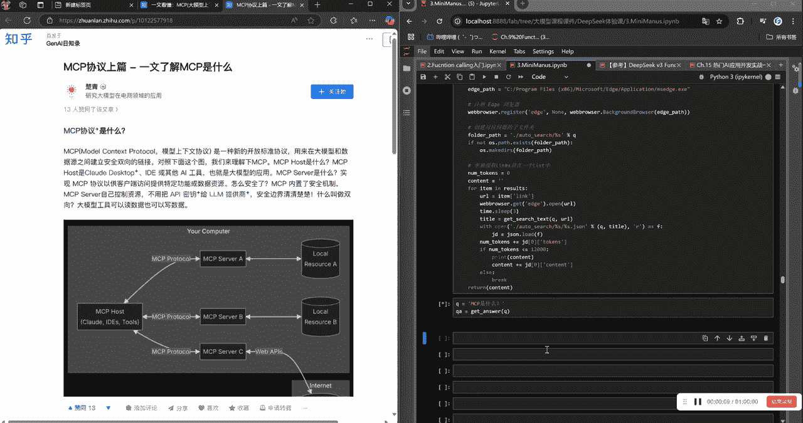

> 需要注意的是，无搜索的时候是否同步打开浏览器，都对搜索结果没有影响，只是为了增加一个可视化效果。

> `search_with_broswer`设置为`1`时代表打开浏览器，否则代表不打开浏览器。

```python
get_search_result(q="什么是MCP？")
```


# 前言

最近 MCP 这个关键词逐渐活跃在我所浏览的一些文章及评论区中。突然发现我对它仅有粗糙的理解，我决定深入学习并记录一下。在阅读这篇文章前，我也简单地浏览了现有介绍 MCP 的文章。我发现大部分文章停留在“翻译”（ ）网站中的内容，或者花时间在绝大部分用户不关心的技术细节上（还有一些纯 AI 文）。因此，我将从使用者的角度出发，分享实用内容，并以一个示例展示 MCP 的开发过程与实际应用作为结尾。

本篇旨在回答以下三个问题：当然，一篇文章远远不足以讲透 MCP 的所有概念，只能尽力萃取最重要的内容供大家阅读，欢迎讨论。

> Update 2025/03/15 进一步补充了关于第五节原理的解释。

# MCP（模型上下文协议）介绍

MCP 的优势在于：一是开放标准利于服务商开发 API，二是避免开发者重复造轮子，可利用现有 MCP 服务增强 Agent。MCP（Model Context Protocol，模型上下文协议），2024 年 11 月底，由 Anthropic 推出的一种开放标准，旨在统一大型语言模型（LLM）与外部数据源和工具之间的通信协议。MCP 的主要目的在于解决当前 AI 模型因数据孤岛限制而无法充分发挥潜力的难题，MCP 使得 AI 应用能够安全地访问和操作本地及远程数据，为 AI 应用提供了连接万物的接口。

MCP（Model Context Protocol，模型上下文协议）是一种新的开放标准协议，用来在大模型和数据源之间建立安全双向的链接。MCP Host 是 IDE 或其他 AI 工具，也就是大模型的应用。MCP Server 是实现 MCP 协议以供客户端访问提供特定功能或数据资源。MCP 内置了安全机制，MCP Server 自己控制资源，不用把敏感信息提供给 LLM 提供商，安全边界清清楚楚。什么叫做双向？大模型工具可以读数据也可以写数据。MCP 不仅可以访问本地资源（数据库、文件、服务），还能访问远程资源（例如 API、数据库），而且都用同一个协议！

MCP 起源于 2024 年 11 月 25 日（ ）发布的文章：（ ）。MCP（Model Context Protocol，模型上下文协议）定义了应用程序和 AI 模型之间交换上下文信息的方式。这使得开发者能够（一个中间协议层），就像 USB-C 让不同设备能够通过相同的接口连接一样。MCP 的目标是创建一个通用标准，使 AI 应用程序的开发和集成变得更加简单和统一。

举个栗子，在过去，为了让大模型等 AI 应用使用我们的数据，要么复制粘贴，要么上传下载，非常麻烦。即使是最强大模型也会受到数据隔离的限制，形成信息孤岛，要做出更强大的模型，每个新数据源都需要自己重新定制实现，使真正互联的系统难以扩展，存在很多的局限性。

现在，MCP 可以直接在 AI 与数据（包括本地数据和互联网数据）之间架起一座桥梁，通过 MCP 服务器和 MCP 客户端，大家只要都遵循这套协议，就能实现“万物互联”。有了 MCP，可以和数据和文件系统、开发工具、Web 和浏览器自动化、生产力和通信、各种社区生态能力全部集成，实现强大的协作工作能力，它的价值远不可估量。这两种技术都旨在增强 AI 模型与外部数据的交互能力，但 MCP 不止可以增强 AI 模型，还可以是其他的应用系统。这样一个理想的“万物互联”生态系统看着很让人着迷。

但是大家是不是担心通过 MCP Server 暴露出来的数据会泄露或被非法访问，这个头疼的问题 MCP 也考虑到了。MCP 通过标准化的数据访问接口，大大减少了直接接触敏感数据的环节，降低了数据泄露的风险。还有，MCP 内置了安全机制，确保只有经过验证的请求才能访问特定资源，相当于在数据安全又加上了一道防线。同时，MCP 协议还支持多种加密算法，以确保数据在传输过程中的安全性。例如，MCP 服务器自己控制资源，不需要将 API 密钥等敏感信息提供给 LLM 提供商。这样一来，即使 LLM 提供商受到攻击，攻击者也无法获取到这些敏感信息。

不过，MCP 这套协议/标准，需要大家一起来共建，这个生态才会繁荣，现在，只是测试阶段，一切才刚刚开始，当然，还会涌现出更多的问题。

MCP 的出现解决了一个大模型应用开发的难题，即数据获取问题。大模型往往作为“孤岛”运行，难以直接访问实时数据源（如企业内部数据库、实时文档、在线服务等）。开发者通常需要为每个应用场景定制专用的适配器或插件，这既耗时费力，又缺乏可扩展性。MCP 的发布正是为了解决这一痛点。通过定义一个标准化的协议，它允许开发者在无需重复开发的情况下快速连接模型与数据源，极大提升了模型的通用性和落地效率。如果 MCP 真解决了数据获取难题，那么将进一步降低大模型应用开发成本，将大模型应用推向新的高潮。MCP 提供了一种统一的协议接口，使得模型可以通过访问任何实现了的外部数据源（如 API、数据库、文档管理系统）。这种标准化方式降低了模型与多样化数据源之间的连接复杂度，显著节省开发时间。

2）MCP 作为开放协议，允许任何开发者为其产品创建 MCP 服务器。这意味着整个生态将快速扩展，形成类似 HTTP 和 REST API 的网络效应，推动模型与应用场景的无缝融合。3）协议内置了严格的权限控制机制，数据源的所有者始终掌握访问权。模型在获取数据时需要经过明确授权，避免数据泄露和滥用问题。

# MCP 与 Prompt Engineering / Function Calling

Anthropic 旨在实现 LLM Tool Call 的标准。我认为 MCP 的出现是 prompt engineering 发展的产物。更结构化的上下文信息对模型的 performance 提升是显著的。我们在构造 prompt 时，希望能提供一些更 specific 的信息（比如本地文件、数据库、一些网络实时信息等）给模型，这样模型更容易理解真实场景中的问题。？我们可能会人工从数据库中筛选或者使用工具检索可能需要的信息，手动的粘贴到 prompt 中。随着我们要解决的问题越来越复杂，把信息引入到 prompt 中会变得越来越困难。

为了克服手工 prompt 的局限性，许多 LLM 平台（如 OpenAI、Google）引入了（ ）功能。这一机制允许模型在需要时调用预定义的函数来获取数据或执行操作，显著提升了自动化水平。但是 function call 也有其局限性（我对于 function call vs MCP 的理解不一定成熟，欢迎大家补充），我认为重点在于（ ），不同 LLM 平台的 function call API 实现差异较大。例如，OpenAI 的函数调用方式与 Google 的不兼容，开发者在切换模型时需要重写代码，增加了适配成本。除此之外，还有安全性、交互性等问题。（ ），只不过我们希望将数据连接到模型的这个环节可以更智能更统一。

Anthropic 基于这样的痛点设计了 MCP，充当 AI 模型的“万能转接头”，让 LLM 能轻松的获取数据或者调用工具。更具体的说 MCP 的优势在于：对于用户来说，我们并不关心 MCP 是如何实现的，通常我们只考虑如何更简单的用上这一特性。具体的使用方式参考官方文档：（ ）。这里不再赘述，配置成功后可以在 Claude 中测试： Claude 会请求你的权限后在本地新建一个文件。并且官方也提供了非常多现成的 MCP Servers，你只需要选择你希望接入的工具，然后接入即可。比如官方介绍的（ ）工具，它允许 Claude 读取和写入文件，就像在本地文件系统中一样。

# MCP 的架构与工作流程

MCP 协议采用了一种独特的架构设计，它将 LLM 与资源之间的通信划分为三个主要部分：客户端、服务器和资源。客户端负责发送请求给 MCP 服务器，服务器则将这些请求转发给相应的资源。这种分层的设计使得 MCP 协议能够更好地控制访问权限，确保只有经过授权的用户才能访问特定的资源。

以下是 MCP 的基本工作流程：MCP 遵循客户端-服务器架构（client-server），其中包含以下几个核心概念：MCP client 充当 LLM 和 MCP server 之间的桥梁，MCP client 的工作流程如下：Claude Desktop 和 Cursor 都支持了 MCP Server 接入能力，它们就是作为 MCP client 来连接某个 MCP Server 感知和实现调用。

MCP server 是 MCP 架构中的关键组件，它可以提供 3 种主要类型的功能：这些功能使 MCP server 能够为 AI 应用提供丰富的上下文信息和操作能力，从而增强 LLM 的实用性和灵活性。你可以在 MCP Servers Repository 和 Awesome MCP Servers 这两个 repo 中找到许多由社区实现的 MCP server。使用 TypeScript 编写的 MCP server 可以通过 `npx` 命令来运行，使用 Python 编写的 MCP server 可以通过 `uvx` 命令来运行。

MCP 协议支持两种主要的通信机制：基于标准输入输出的本地通信和基于（ ）的远程通信。这两种机制都使用（ ）格式进行消息传输，确保了通信的标准化和可扩展性。

MCP 由三个核心组件构成：Host、Client 和 Server。让我们通过一个实际场景来理解这些组件如何协同工作：假设你正在使用 Claude Desktop (Host) 询问：“我桌面上有哪些文档？”整个流程是这样的：你的问题 → Claude Desktop(Host) → Claude 模型 → 需要文件信息 → MCP Client 连接 → 文件系统 MCP Server → 执行操作 → 返回结果 → Claude 生成回答 → 显示在 Claude Desktop 上。这种架构设计使得 Claude 可以在不同场景下灵活调用各种工具和数据源，而开发者只需专注于开发对应的 MCP Server，无需关心 Host 和 Client 的实现细节。

# MCP 客户端与服务器生态

如果你还没有尝试过如何使用 MCP 的话，我们可以考虑用 Cursor（本人只尝试过 Cursor）、Claude Desktop 或者 Cline 来体验一下。当然，我们并不需要自己开发 MCP Servers，MCP 的好处就是通用、标准，所以开发者并不需要重复造轮子（但是学习可以重复造轮子）。

首先推荐的是官方组织的一些 Server：。目前社区的 MCP Server 还是比较混乱，有很多缺少教程和文档，很多的代码功能也有问题，我们可以自行尝试一下（ ）的一些例子，具体的配置和实战笔者就不细讲了，大家可以参考官方文档。

MCP 通过引入多样化的 MCP Server 能力，显著增强了 AI 工具的功能，例如我们常用的 Cursor 和 Claude。以下是一些官方参考服务器，展示了 MCP 的核心功能和 SDK 的应用：

## 数据与文件系统

- 文件系统：提供安全文件操作，带可配置的访问控制。
- （ ）：提供只读数据库访问，具备架构检查功能。
- （ ）：支持数据库交互和商业智能功能。
- Google Drive：实现 Google Drive 的文件访问和搜索功能。

## 开发工具

- Git：工具用于读取、搜索和操作 Git 仓库。
- GitHub：集成仓库管理、文件操作和 GitHub API。
- （ ）：支持项目管理的 GitLab API 集成。
- Sentry：从获取并分析问题。

## 网络与浏览器自动化

- Brave Search：利用 Brave 的搜索 API 进行网络和本地搜索。
- Fetch：为 LLM 优化的网络内容获取和转换。
- （ ）：提供浏览器自动化和网页抓取功能。

## 生产力和通信

- （ ）：支持频道管理和消息功能。
- Google Maps：提供位置服务、路线和地点详情。
- Memory：基于知识图谱的持久记忆系统。

## AI 与专业工具

- （ ）：使用多种模型进行 AI 图像生成。
- Sequential Thinking：通过思维序列进行动态问题解决。
- （ ）：使用 Bedrock Agent Runtime 从 AWS 知识库检索。

## 官方集成工具

这些 MCP 服务器由公司维护，用于其平台：

- Axiom：使用自然语言查询和分析日志、跟踪和事件数据。
- Browserbase：云端自动化浏览器交互。
- Cloudflare：在 Cloudflare 开发者平台上部署和管理资源。
- E2B：在安全的云沙箱中执行代码。
- Neon：与 Neon 无服务器 Postgres 平台交互。
- Obsidian Markdown Notes：读取和搜索 Obsidian 知识库中的 Markdown 笔记。
- Qdrant：使用 Qdrant 向量搜索引擎实现语义记忆。
- Raygun：访问崩溃报告和监控数据。
- Search1API：统一的 API 用于搜索、爬虫和网站地图。
- Tinybird：与 Tinybird 无服务器 ClickHouse 平台交互。

## 集成工具

- Docker：管理容器、镜像、卷和网络。
- Kubernetes：管理 pod、部署和服务。
- Linear：项目管理和问题跟踪。
- Snowflake：与 Snowflake 数据库交互。
- Spotify：控制 Spotify 播放和管理播放列表。
- Todoist：任务管理集成。

目前支持的部分工具列表（更多见）：

# 配置 MCP 客户端（以 Claude Desktop 为例）

以 Claude Desktop 为例，配置 MCP 客户端的步骤如下：添加所需的 MCP 服务器信息，例如：

```json
{   "mcpServers": {     "filesystem": {       "command": "npx",       "args": ["-y", "@modelcontextprotocol/server-filesystem", "/path/to/allowed/files"]     },     "git": {       "command": "uvx",       "args": ["mcp-server-git", "--repository", "path/to/git/repo"]     }   } }
```

这里的 `@modelcontextprotocol/server-filesystem`、`mcp-server-git` 是对应的一些 MCP Server，可以是开源找来的，也可以是你自己开发的。

配置完后，在主界面对话题右下角就有个锤子出现了，有几个锤子就是配置几个，然后对话中如果涉及使用该工具的，claude 就会自动调用 Cursor 工具中集成 mcp server 功能对开发增加效率非常明显，配置入口在：`文件 -> 首选项 -> Cursor Settings -> Features -> MCP Server -> Add new MCP Server`。

配置完后，你需要画图的地方给它提要求就行了，它会自动感知，按上下文生成 prompt 并调用工具生成图片：生成的图片质量还不错，符合开发需要的图片。

# MCP 工作原理深度解析

那我们来介绍一下 MCP 的工作原理。首先我们看一下。总共分为了下面五个部分：整个 MCP 协议核心的在于 Server，因为 Host 和 Client 相信熟悉计算机网络的都不会陌生，非常好理解，但是 Server 如何理解呢？看看 Cursor 的 AI Agent 发展过程，我们会发现整个 AI 自动化的过程发展会是从 Chat 到 Composer 再进化到完整的 AI Agent。

- AI Chat 只是提供建议，如何将 AI 的 response 转化为行为和最终的结果，全部依靠人类，例如手动复制粘贴，或者进行某些修改。
- AI Composer 是可以自动修改代码，但是需要人类参与和确认，并且无法做到除了修改代码之外的其它操作。
- AI Agent 是一个完全的自动化程序，未来完全可以做到自动读取 Figma 的图片，自动生产代码，自动读取日志，自动调试代码，自动 push 代码到 GitHub。

而 MCP Server 就是为了实现 AI Agent 的自动化而存在的，它是一个中间层，告诉 AI Agent 目前存在哪些服务，哪些 API，哪些数据源，AI Agent 可以根据 Server 提供的信息来决定是否调用某个服务，然后通过 Function Calling 来执行函数。

我们先来看一个简单的例子，假设我们想让 AI Agent 完成自动搜索 GitHub Repository，接着搜索 Issue，然后再判断是否是一个已知的 bug，最后决定是否需要提交一个新的 Issue 的功能。那么我们就需要创建一个 Github MCP Server，这个 Server 需要提供查找 Repository、搜索 Issues 和创建 Issue 三种能力。

我们直接来看看代码：上面的代码中，我们通过（ ）来告诉 Client 端我们提供了哪些能力，通过（ ）字段来描述这个能力的作用，通过（ ）来描述完成这个能力需要的输入参数。

我们再来看看具体的实现代码：可以很清晰的看到，我们最终实现是通过（ ）的 API 来实现和 Github 交互的，我们通过（ ）函数来调用 GitHub 的 API，最后返回结果。

在调用 Github 官方的 API 之前，MCP 的主要工作是描述 Server 提供了哪些能力(给 LLM 提供)，需要哪些参数(参数具体的功能是什么)，最后返回的结果是什么。所以 MCP Server 并不是一个新颖的、高深的东西，它只是一个具有共识的协议。

如果我们想要实现一个更强大的 AI Agent，例如我们想让 AI Agent 自动的根据本地错误日志，自动搜索相关的 GitHub Repository，然后搜索 Issue，最后将结果发送到 Slack。那么我们可能需要创建三个不同的 MCP Server，一个是 Local Log Server，用来查询本地日志；一个是 GitHub Server，用来搜索 Issue；还有一个是 Slack Server，用来发送消息。AI Agent 在用户输入（ ）指令后，自行判断需要调用哪些 MCP Server，并决定调用顺序，最终根据不同 MCP Server 的返回结果来决定是否需要调用下一个 Server，以此来完成整个任务。

在学习的过程中，我一直好奇一个问题：？好在 Anthropic 为我们提供了详细的：当用户提出一个问题时：为了探索这个问题让我们深入。显然这个调用过程可以分为两个步骤：先给出一个简单可视化帮助理解：先理解第一步这里以 MCP 官方提供的  为讲解示例，并简化了对应的代码（删除了一些不影响阅读逻辑的异常控制代码）。通过阅读代码，可以发现模型是通过 prompt 来确定当前有哪些工具。我们通过，供模型了解有哪些工具以及结合实时情况进行选择。参考代码中的注释：那 tool 的描述和代码中的  是从哪里来的呢？通过进一步分析 MCP 的 Python SDK 源代码可以发现：大部分情况下，当使用装饰器  来装饰函数时，对应的  和  等其实直接源自用户定义函数的函数名以及函数的  等。这里仅截取一小部分片段，想了解更多请参考。

总结：。另一方面，Anthropic 肯定对 Claude 做了专门的训练（毕竟是自家协议，Claude 更能理解工具的 prompt 以及输出结构化的 tool call json 代码）其实工具的执行就比较简单和直接了。承接上一步，我们把 system prompt（指令与工具调用描述）和用户消息一起发送给模型，然后接收模型的回复。当模型分析用户请求后，它会决定是否需要调用工具：如果回复中包含结构化 JSON 格式的工具调用请求，则客户端会根据这个 json 代码执行对应的工具。具体的实现逻辑都在  中，，逻辑非常简单。如果模型执行了 tool call，则工具执行的结果  会和 system prompt 和用户消息一起给模型，请求模型生成最终回复。如果 tool call 的 json 代码存在问题或者模型产生了幻觉怎么办呢？通过阅读 发现，我们会 skip 掉无效的调用请求。执行相关的代码与注释如下：结合这部分原理分析：MCP (Model Context Protocol) 代表了 AI 与外部工具和数据交互的标准建立。通过本文，我们可以了解到：MCP 还处于发展初期，但其潜力巨大。更重要的是生态吧，基于统一标准下构筑的生态也会正向的促进整个领域的发展。

# 代码实现示例

下面是个人推荐的一些 MCP 的资源，大家可以参考一下。

## 配置示例

```json
{   "mcpServers": {     "filesystem": {       "command": "npx",       "args": ["-y", "@modelcontextprotocol/server-filesystem", "/path/to/allowed/files"]     },     "git": {       "command": "uvx",       "args": ["mcp-server-git", "--repository", "path/to/git/repo"]     }   } }
```

## TypeScript 服务器示例

```typescript
const server = new Server(
  {
    name: "github-mcp-server",
    version: VERSION,
  },
  {
    capabilities: {
      tools: {},
    },
  }
);
server.setRequestHandler(ListToolsRequestSchema, async () => {
  return {
    tools: [
      {
        name: "search_repositories",
        description: "Search for GitHub repositories",
        inputSchema: zodToJsonSchema(repository.SearchRepositoriesSchema),
      },
      {
        name: "create_issue",
        description: "Create a new issue in a GitHub repository",
        inputSchema: zodToJsonSchema(issues.CreateIssueSchema),
      },
      {
        name: "search_issues",
        description: "Search for issues and pull requests across GitHub repositories",
        inputSchema: zodToJsonSchema(search.SearchIssuesSchema),
      }
    ],
  };
});
server.setRequestHandler(CallToolRequestSchema, async (request) => {
  try {
    if (!request.params.arguments) {
      throw new Error("Arguments are required");
    }
    switch (request.params.name) {
      case "search_repositories": {
        const args = repository.SearchRepositoriesSchema.parse(request.params.arguments);
        const results = await repository.searchRepositories(
          args.query,
          args.page,
          args.perPage
        );
        return {
          content: [{ type: "text", text: JSON.stringify(results, null, 2) }],
        };
      }
      case "create_issue": {
        const args = issues.CreateIssueSchema.parse(request.params.arguments);
        const { owner, repo, ...options } = args;
        const issue = await issues.createIssue(owner, repo, options);
        return {
          content: [{ type: "text", text: JSON.stringify(issue, null, 2) }],
        };
      }
      case "search_issues": {
        const args = search.SearchIssuesSchema.parse(request.params.arguments);
        const results = await search.searchIssues(args);
        return {
          content: [{ type: "text", text: JSON.stringify(results, null, 2) }],
        };
      }
      default:
        throw new Error(`Unknown tool: ${request.params.name}`);
    }
  } catch (error) {}
});
async function runServer() {
  const transport = new StdioServerTransport();
  await server.connect(transport);
  console.error("GitHub MCP Server running on stdio");
}
runServer().catch((error) => {
  console.error("Fatal error in main():", error);
  process.exit(1);
});

export const SearchOptions = z.object({
  q: z.string(),
  order: z.enum(["asc", "desc"]).optional(),
  page: z.number().min(1).optional(),
  per_page: z.number().min(1).max(100).optional(),
});
export const SearchIssuesOptions = SearchOptions.extend({
  sort: z.enum(["comments", ...]).optional(),
});
export async function searchUsers(params: z.infer<typeof SearchUsersSchema>) {
  return githubRequest(buildUrl("https://api.github.com/search/users", params));
}
export const SearchRepositoriesSchema = z.object({
  query: z.string().describe("Search query (see GitHub search syntax)"),
  page: z.number().optional().describe("Page number for pagination (default: 1)"),
  perPage: z.number().optional().describe("Number of results per page (default: 30, max: 100)"),
});
export async function searchRepositories(
  query: string,
  page: number = 1,
  perPage: number = 30
) {
  const url = new URL("https://api.github.com/search/repositories");
  url.searchParams.append("q", query);
  url.searchParams.append("page", page.toString());
  url.searchParams.append("per_page", perPage.toString());
  const response = await githubRequest(url.toString());
  return GitHubSearchResponseSchema.parse(response);
}
```

# 手动搭建 MCP Server 教程

MCP servers 可以提供三种主要类型的功能：本教程将主要关注工具（Tools）。在开始之前，Anthropic 为我们提供了一个基于 LLM 的 MCP Server 的（ ），总结如下：给出一个 example prompt：

剩下的部分也很重要，但是偏重于方法论，实践性较弱，我这里就不展开了，推荐大家直接看。本节内容主要参考了官方文档：（ ）。你可以选择直接跳过这部分内容或者进行一个速读。

这里我准备了一个简单的示例，使用 Python 实现一个 MCP Server，用来（你可以理解为一点用都没有，但是它足够简单，主要是为了难以配置环境的读者提供一个足够短的实践记录）。以下实践均运行在我的 MacOS 系统上。

由于我使用的是官方推荐的配置：以下代码由 Claude 3.7 直接生成。当然，这主要是因为我的需求足够简单，当你需要实现一个复杂的 MCP Server 时，你可能需要多步的引导和 Debug 才能得到最终的代码。任务非常简单，只需要调用非常基本的（ ）就可以完成。（官方没有这一步，但是我非常推荐大家这么做）之后进入到给出的链接中，你大概能按下图进行操作：如果成功，你应该能像我一样看到对应的输出（ ）～

最后一步就是把我们写好的 MCP 接入到 Claude Desktop 中。流程如下：在配置文件中添加以下内容，记得替换（ ）为你的实际用户名，以及其他路径为你的实际路径。配置好后重启 Claude Desktop，如果没问题就能看到对应的 MCP Server 了。

接下来，我们通过一个简单的 prompt 进行实际测试：它可能会请求你的使用权限，如图一所示，你可以点击（ ）看起来我们 MCP Server 已经正常工作了！

Debug 是一个非常复杂的话题，这里直接推荐官方的教程：（ ）。

# 打造一个 MCP 服务器示例

打造一个 MCP 服务器，它能够：

- 连接到我公司的 PostgreSQL 数据库
- 将表格结构作为资源开放出来
- 提供运行只读 SQL 查询的工具
- 包含常见数据分析任务的引导

# 安装 uv

```bash
curl -LsSf https://astral.sh/uv/install.sh | sh
# 创建项目目录
uv init txt_counter
cd txt_counter
# 设置 Python 3.10+ 环境
echo "3.11" > .python-version
# 创建虚拟环境并激活
uv venv
source .venv/bin/activate
# Install dependencies
uv add "mcp[cli]" httpx
# Create our server file
touch txt_counter.py
```

```python
""" ... （这里是已经引入的 domain knowledge） """
```

打造一个 MCP 服务器，它能够：

- 功能：
  - 统计当前桌面上的 txt 文件数量
  - 获取对应文件的名字

要求：

- 不需要给出 prompt 和 resource 相关代码。
- 你可以假设我的桌面路径为 `/Users/{username}/Desktop`

```bash
$ mcp dev txt_counter.py
Starting MCP inspector...
Proxy server listening on port 3000
MCP Inspector is up and running at http://localhost:5173
```

# 打开 claude_desktop_config.json (MacOS / Linux)

# 如果你用的是 cursor 或者 vim 请更换对应的命令

```bash
code ~/Library/Application\\ Support/Claude/claude_desktop_config.json
```

能推测我当前桌面上 txt 文件名的含义吗？

# MCP 通俗解释与总结

最近，如果你经常使用 AI 编程的话，肯定听到过 MCP 这个概念？那到底什么是 MCP 呢？我今天试图给大家讲明白。先从专业角度讲，MCP 就是 (Claude) 主导发布的一个开放的、通用的、有共识的协议标准。

MCP 遵循客户端 - 服务器架构，包含以下几个核心部分：MCP 的工作流程可以简单概括为以下几个步骤：

举个例子，例如我们目前还不能通过某个 AI 应用来做到联网搜索、发送邮件、发布自己的博客等等，这些功能单个实现都不是很难，但是如果要全部集成到一个系统里面，就会变得遥不可及。如果你还没有具体的感受，我们可以思考一下日常开发中，想象一下在 IDE 中，我们可以通过 IDE 的 AI 来完成下面这些工作。

举个通俗易懂的例子，假设你正在使用一个 AI 编程助手来帮助你写代码。这个 AI 助手就是一个 MCP 主机。它需要访问一些外部资源，比如代码库、文档或者调试工具。MCP 服务器就像是一个中介，它连接了这些资源和 AI 助手。

MCP 的优势：举个生活化的例子：假设你是一个班长，每天要处理很多班级事务：查班级成绩表（Excel 文件存在电脑里），收集同学反馈（微信群里聊天记录），安排值日表（在线文档）。

所以，MCP 厉害的地方在于，不用重复造轮子。过去每个软件（比如微信、Excel）都要单独给 AI 做接口，现在 MCP 统一了标准，就像所有电器都用 USB-C 充电口，AI 一个接口就能连接所有工具。而且，数据不用上传到云端，AI 直接在本地处理。比如你的成绩单只存在自己电脑里，AI 通过 MCP 读取分析，但数据不会外泄。

MCP 会让 AI 更 “懂” 上下文，比如你让 AI “总结上周班会的重点”，它能自动调取会议录音、聊天记录、笔记文档，综合这些信息给你答案，而不是凭空编造。

所以，MCP 为 AI 应用提供了一个强大的工具，使其能够更灵活、更安全地与外部世界交互。

# 参考资源与结语

我看到一篇解读 MCP 非常详细和专业的文章，叫：（ ），感兴趣的同学，可以去看看。博客文章地址：（ ）。

欢迎大家加入我的社群，一起，一起，一起用（ ）！最后，欢迎大家关注我的公众号：每天持续为大家分享 AI、技术、副业和互联网相关的干货，一起突破圈层，实现个体崛起。原文链接：（ ）。


## 联网检索智能体`search_agent`创建流程

```
search_agent = Agent(
    name="联网搜索智能体",  
    instructions="可以执行联网搜索功能，当用户提出的问题超出你的知识范畴时，请先进行搜索，再进行回答。",  
    tools=[get_answer],
    model=deepseek_model
)
```

```
search_result = await Runner.run(search_agent, "请问什么是大模型MCP（模型上下文）技术。")
```

```
正在接入谷歌搜索，查找和问题相关的答案...
正在检索：https://zhuanlan.zhihu.com/p/27327515233
正在检索：https://zhuanlan.zhihu.com/p/19707405738
正在检索：https://www.zhihu.com/question/5191991346
正在检索：https://www.zhihu.com/question/5290049088
正在检索：https://www.zhihu.com/question/15094843349/answer/130690736046
```

```
search_result.final_output
```

```
'大模型MCP（Model Context Protocol，模型上下文协议）技术是由Anthropic提出的一种开放标准协议，旨在统一大型语言模型（LLM）与外部数据源和工具之间的通信方式。以下是关于MCP技术的详细介绍：

### 1. **MCP的核心目标**
   - **解决数据孤岛问题**：传统AI模型因数据隔离而难以充分发挥潜力，MCP通过标准化协议连接AI模型与外部数据源，实现数据的安全访问和操作。
   - **增强模型实用性**：MCP使得AI模型能够动态获取上下文信息，从而提升复杂任务的执行能力。

### 2. **MCP的工作原理**
   - **客户端-服务器架构**：
     - **MCP客户端**：作为LLM与MCP服务器之间的桥梁，负责发送请求和处理响应。
     - **MCP服务器**：提供数据访问和工具调用能力，支持多种功能（如文件操作、数据库查询等）。
   - **标准化通信协议**：MCP使用JSON-RPC格式进行消息传输，确保通信的标准化和可扩展性。

### 3. **MCP的主要功能**
   - **资源访问**：支持对本地和远程数据的安全访问，例如文件系统、数据库等。
   - **工具调用**：允许LLM通过MCP服务器调用外部工具（如Git、GitHub API等）。
   - **动态提示生成**：MCP服务器可以根据上下文生成动态提示词，优化与LLM的交互。

### 4. **MCP的优势**
   - **安全性**：通过标准化接口减少敏感数据的直接暴露，支持加密传输和权限控制。
   - **灵活性**：支持多种数据源和工具，开发者无需重复造轮子。
   - **生态共建**：MCP是一个开放标准，鼓励社区共同开发和扩展。

### 5. **实际应用场景**
   - **数据分析**：通过MCP连接SQLite数据库，LLM可以直接查询和分析数据。
   - **自动化工作流**：结合Git、Slack等工具，实现代码管理和团队协作的自动化。
   - **多模态扩展**：未来可能支持图像、音频等多模态数据的交互。

### 6. **示例**
   - **SQLite查询**：用户可以通过自然语言提问（如“查询平均价格”），MCP服务器将请求转换为SQL查询并返回结果。
   - **Git操作**：LLM可以通过MCP服务器自动执行代码提交、分支管理等操作。

### 7. **未来发展**
   - **社区生态**：目前已有多个开源MCP服务器实现，未来可能会进一步丰富。
   - **标准化推广**：MCP有望成为AI模型与外部系统交互的通用协议，类似于“AI的USB-C接口”。

MCP技术的推出为AI模型的实用性和安全性提供了新的解决方案，尤其是在需要与外部数据或工具集成的场景中表现突出。如果你对具体实现或应用感兴趣，可以参考官方文档或社区资源进一步探索。'
```

## 创建分诊智能体

```
triage_agent = Agent(
    name="Triage Agent",  
    instructions="""
    你是一个知识检索智能体，当用户提问机器学习ID3、C4.5相关问题时，请转交给RAG_result进行处理；
    而当用户提出的问题超出你当前知识范畴时，请转交给search_agent进行处理。其他问题请自主进行回答。
    """, 
    handoffs=[RAG_result, search_agent],
    model=deepseek_model
)
```

```
RAG_agent.handoffs.append(triage_agent)
search_agent.handoffs.append(triage_agent)
```

## 对话效果测试

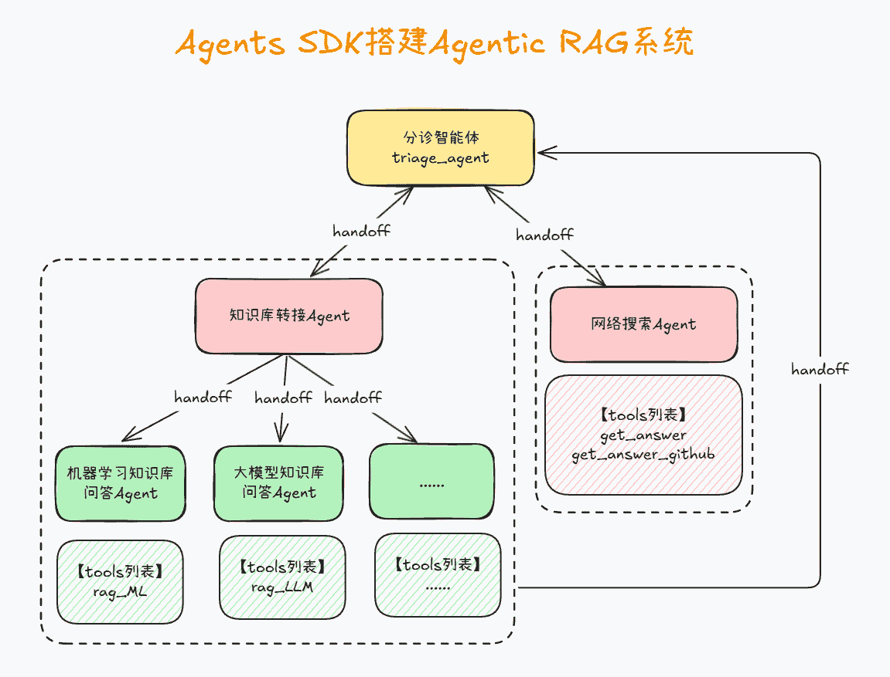

```
from agents import (
    Agent,
    HandoffOutputItem,
    ItemHelpers,
    MessageOutputItem,
    RunContextWrapper,
    Runner,
    ToolCallItem,
    ToolCallOutputItem,
    TResponseInputItem,
    function_tool,
    handoff,
    trace,
)
from agents.extensions.handoff_prompt import RECOMMENDED_PROMPT_PREFIX
```

```
async def chat_assistant():
    
    input_items = []
    current_agent = triage_agent
    
    while True:
        user_input = input("💬 请输入你的消息：")
        if user_input.lower() in ["exit", "quit"]:
            print("✅ 对话已结束")
            break

        input_items.append({"content": user_input, "role": "user"})
        result = await Runner.run(current_agent, input_items)

        for new_item in result.new_items:
            agent_name = new_item.agent.name
            if isinstance(new_item, MessageOutputItem):
                print(f"🧠 {agent_name}: {ItemHelpers.text_message_output(new_item)}")
            elif isinstance(new_item, HandoffOutputItem):
                print(f"🔀 Handed off from {new_item.source_agent.name} to {new_item.target_agent.name}")
            elif isinstance(new_item, ToolCallItem):
                print(f"🔧 {agent_name}: Calling a tool...")
            elif isinstance(new_item, ToolCallOutputItem):
                print(f"📦 {agent_name}: Tool call output: {new_item.output}")
            else:
                print(f"🤷 {agent_name}: Skipping item: {new_item.__class__.__name__}")

        input_items = result.to_input_list()
        current_agent = result.last_agent
```

```
await chat_assistant()
```

```
💬 请输入你的消息： 你好，请帮我介绍下RNN的基本原理


🧠 Triage Agent: 你好！RNN（Recurrent Neural Network，循环神经网络）是一种专门用于处理序列数据的神经网络模型。它的基本原理是通过引入“循环”结构，使得网络能够保留之前输入的信息，从而对序列数据中的时间依赖性进行建模。以下是RNN的基本原理介绍：

### 1. **循环结构**
RNN的核心特点是其循环结构。与传统的前馈神经网络不同，RNN的隐藏层不仅接收当前时刻的输入，还接收上一时刻的隐藏状态。这种设计使得网络能够记住之前的信息，并将其用于当前时刻的计算。

数学表示：
\[
h_t = f(W_{hx} x_t + W_{hh} h_{t-1} + b_h)
\]
其中：
- \( h_t \) 是当前时刻的隐藏状态。
- \( x_t \) 是当前时刻的输入。
- \( h_{t-1} \) 是上一时刻的隐藏状态。
- \( W_{hx} \) 和 \( W_{hh} \) 是权重矩阵。
- \( b_h \) 是偏置项。
- \( f \) 是激活函数（如tanh或ReLU）。

### 2. **序列处理**
RNN可以处理任意长度的序列数据。对于输入序列 \( x_1, x_2, \ldots, x_T \)，RNN会逐步处理每个时刻的输入，并更新隐藏状态。最终的输出可以基于隐藏状态生成，例如：
\[
y_t = g(W_{yh} h_t + b_y)
\]
其中 \( g \) 是输出层的激活函数（如softmax用于分类任务）。

### 3. **时间依赖性**
由于RNN的隐藏状态传递了之前时刻的信息，因此它能够捕捉序列中的时间依赖性。例如，在自然语言处理中，RNN可以利用前面的单词信息来预测下一个单词。

### 4. **RNN的变体**
标准的RNN存在梯度消失或梯度爆炸的问题，难以捕捉长距离依赖关系。因此，研究者提出了多种改进模型，例如：
- **LSTM（Long Short-Term Memory）**：通过引入门控机制（输入门、遗忘门、输出门）来更好地控制信息的流动。
- **GRU（Gated Recurrent Unit）**：简化版的LSTM，只有更新门和重置门，计算效率更高。

### 5. **应用场景**
RNN广泛应用于以下领域：
- 自然语言处理（NLP）：如语言建模、机器翻译、文本生成。
- 时间序列预测：如股票价格预测、天气预测。
- 语音识别：将语音信号转换为文本。

### 6. **局限性**
- **梯度问题**：标准RNN在训练时容易出现梯度消失或梯度爆炸。
- **计算效率**：由于序列是按顺序处理的，RNN难以并行化，训练速度较慢。

如果你对RNN的某个具体方面（如LSTM或GRU）感兴趣，可以进一步探讨！


💬 请输入你的消息： 那你知道决策树ID3的建模流程么？


🧠 Triage Agent: 决策树ID3（Iterative Dichotomiser 3）是一种经典的分类算法，主要用于构建决策树模型。其核心思想是通过信息增益来选择最优的特征进行节点分裂，从而递归地构建决策树。以下是ID3算法的建模流程：

---

### **1. 数据准备**
- 输入数据为带有类别标签的训练集，每个样本由多个特征（属性）和一个类别标签组成。
- 所有特征应为离散值（ID3不支持连续值特征，需离散化处理）。

---

### **2. 计算信息熵（Entropy）**
信息熵用于衡量数据的不确定性。对于类别标签 \( C \) 的熵定义为：
\[
\text{Entropy}(S) = -\sum_{i=1}^{k} p_i \log_2 p_i
\]
其中：
- \( S \) 是当前数据集。
- \( p_i \) 是类别 \( i \) 在数据集中的比例。
- \( k \) 是类别的总数。

熵越小，数据的不确定性越低。

---

### **3. 计算信息增益（Information Gain）**
信息增益衡量某个特征对分类任务的贡献。对于特征 \( A \)，其信息增益定义为：
\[
\text{Gain}(S, A) = \text{Entropy}(S) - \sum_{v \in \text{Values}(A)} \frac{|S_v|}{|S|} \text{Entropy}(S_v)
\]
其中：
- \( \text{Values}(A) \) 是特征 \( A \) 的所有可能取值。
- \( S_v \) 是特征 \( A \) 取值为 \( v \) 的子集。
- \( \frac{|S_v|}{|S|} \) 是子集 \( S_v \) 的权重。

信息增益越大，说明用特征 \( A \) 分裂后数据的不确定性降低得越多。

---

### **4. 选择最优特征**
- 遍历所有特征，计算每个特征的信息增益。
- 选择信息增益最大的特征作为当前节点的分裂特征。

---

### **5. 递归构建子树**
- 对选定的特征 \( A \) 的每个取值 \( v \)：
  - 创建分支，对应 \( A = v \) 的子数据集 \( S_v \)。
  - 如果 \( S_v \) 中所有样本属于同一类别，则标记为叶子节点。
  - 否则，对 \( S_v \) 递归调用ID3算法，继续选择最优特征分裂。

---

### **6. 终止条件**
递归过程在以下情况终止：
1. 当前节点的所有样本属于同一类别。
2. 没有剩余特征可用于分裂（此时将节点标记为多数类）。
3. 子数据集为空（将节点标记为父节点的多数类）。

---

### **7. 输出决策树**
最终生成一棵树结构，每个内部节点表示一个特征的分裂，每个叶子节点表示一个类别标签。

---

### **ID3的特点**
- **优点**：
  - 简单直观，生成的树易于解释。
  - 适合处理离散特征。
- **缺点**：
  - 不支持连续值特征。
  - 倾向于选择取值较多的特征（可能过拟合）。
  - 没有剪枝机制，容易过拟合。

---

如果需要进一步了解ID3的具体实现或与其他算法（如C4.5、CART）的比较，可以继续探讨！


💬 请输入你的消息： quit


✅ 对话已结束
```
