# 从零到一MCP服务器开发实战

> 来源：[https://kq4b3vgg5b.feishu.cn/docx/BTerdE875oPRXIxUZ4Gco5eTnof](https://kq4b3vgg5b.feishu.cn/docx/BTerdE875oPRXIxUZ4Gco5eTnof)

## 课程说明：

+   体验课内容节选自《2025大模型Agent智能体开发实战》(春季班)完整版付费课程

体验课时间有限，若想深度学习大模型技术，欢迎大家报名由我主讲的《2025大模型Agent智能体开发实战》(春季班)

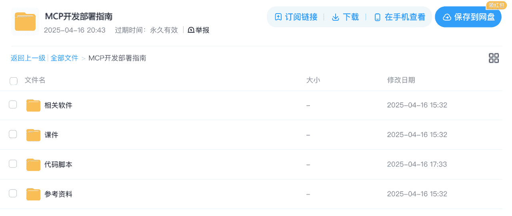


此外，公开课全套学习资料，已上传至网盘

（链接: https://pan.baidu.com/s/1MW4sNic6Sd_1BJ9ZV1Hu4g 提取码: 7fwn  ）

需要更系统深入学习大模型可扫码⬆️添加助教咨询喔～

---

## 一、MCP技术入门介绍

### 1.智能体开发核心技术—MCP

#### 1.1 Function calling技术回顾

如何快速开发一款智能体应用，最关键的技术难点就在于如何让大模型高效稳定的接入一些外部工具。而在MCP技术诞生之前，最主流的方法，是借助Function calling技术来打通大模型和外部工具之间的联系，换而言之，也就是借助Function calling，来让大模型灵活的调用外部工具。

例如一个典型的Function calling示例，我们希望让大模型能够调用一些天气API查询即时天气，此时我们就需要创建一个查询天气的外部函数，负责调用天气API来查询天气，同时将外部函数的说明传递给大模型，使其能够根据用户意图，在必要的时候向外部函数发起调用请求。


> Function calling最早由OpenAI与2023年6月13号正式提出，该项技术的名字也由此命名：https://openai.com/index/function-calling-and-other-api-updates/

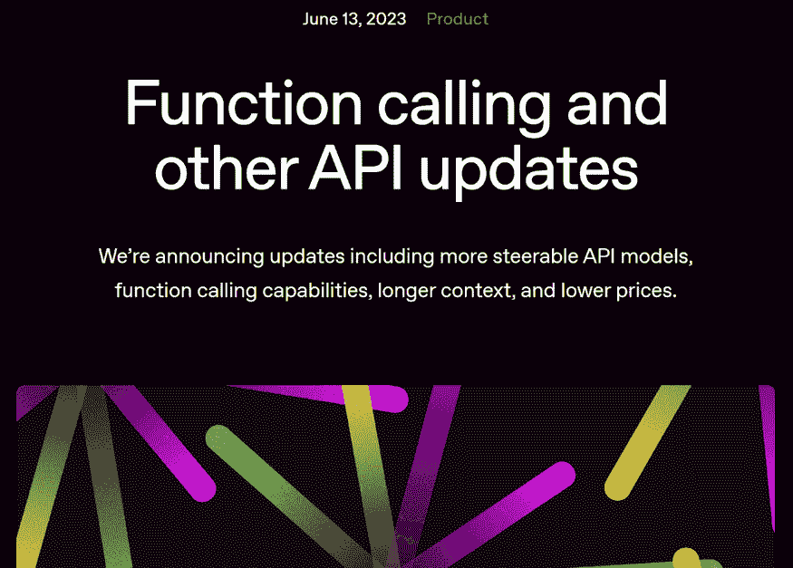

> 此外，Function calling也被称作tool use、tool call等技术。

毫无疑问，Function calling的诞生意义重大，这项技术目前也成为大模型调用外部工具的基本技术范式，哪怕是MCP盛行的今天，底层仍然是Function calling执行流程。

#### 1.2 Function calling公开课介绍

而对于大模型开发者来说，无论是采用何种Agent开发框架或MCP技术，掌握Function calling的实现流程和底层原理至关重要，具体Function calling实现原理可以参考公开课《智能体从何而来？深度详解大模型调用工具底层原理》：https://www.bilibili.com/video/BV1w6dBYxELA/，而关于DeepSeek模型Function calling实现流程，可以参考公开课《DeepSeek智能体开发实战，从零手搓Mini Manus！》：https://www.bilibili.com/video/BV1L3ZDYDEnE/。

#### 1.3 Function calling能力从何而来

不过为了更好的学习本期公开课，需要重点强调的是关于大模型的Function calling的能力如何而来。我们都知道，对于当前大模型来说，有些模型有Function calling能力，如DeepSeek-V3模型，而有些模型没有，如DeepSeek-R1模型：

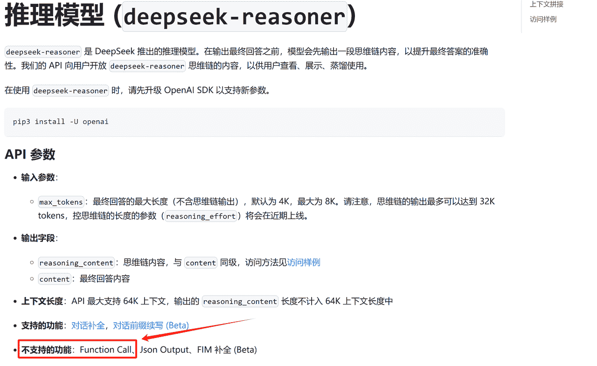

甚至对于DeepSeek-V3-0324模型来说，还支持工具的并联、串联调用甚至是自动debug：

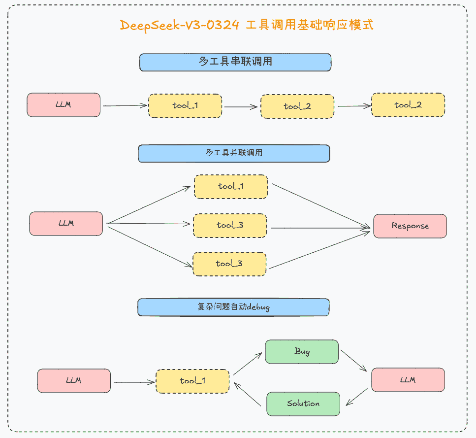

> 具体代码实现流程可参考公开课《DeepSeek智能体开发实战，从零手搓Mini Manus！》：https://www.bilibili.com/video/BV1L3ZDYDEnE/。

那模型是如何具备Function calling能力的呢？答案是通过模型训练。对于DeepSeek-V3模型来说，由于在训练阶段（指令微调阶段）就带入了大量的类似如下的工具调用对话数据进行训练，因此能够识别外部工具并发起对外部工具调用的请求。而类似的，R1模型的训练过程没有工具调用数据，因此就不具备Function calling能力。

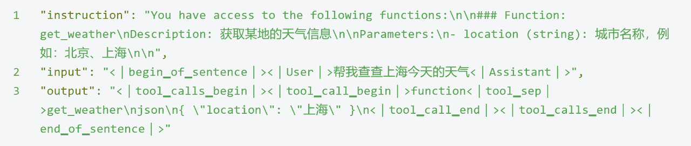

> 更多关于Function calling原理，可以参考公开课《智能体从何而来？深度详解大模型调用工具底层原理》：https://www.bilibili.com/video/BV1w6dBYxELA/，

而Function calling的能力，是大模型顺利开启MCP功能的基础。

#### 1.4 MCP技术本质：Function calling的更高层实现

而近一段时间大火的MCP技术，其实就可以将其理解为Function calling技术的更高层封装和实现。传统的Function calling技术要求围绕不同的外部工具API单独创建一个外部函数，类似一把锁单独配一把钥匙，而一个智能体又往往涉及到多个外部工具设计，因此开发工作量很大。


而MCP技术，全称为Model Context Protocol，模型上下文协议，是一种开发者共同遵守的协议，在这个协议框架下，大家围绕某个API开发的外部工具就能够共用，从而大幅减少重复造轮子的时间。


#### 1.5 MCP技术带来的智能体开发效率革命

举个例子，在我们开设的《大模型原理与实战课程》：https://whakv.xetslk.com/s/3p66pN系列课程中，2023年的第一期课程里曾经讲解过一个Agent实战项目，

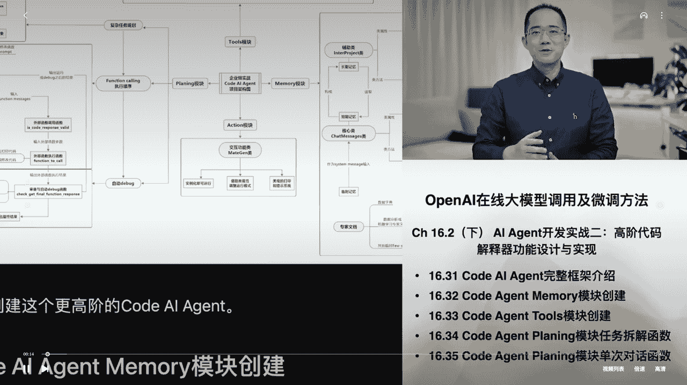


其中涉及关于大模型对话长短期记忆存储和管理相关功能实现时，光是编写消息类（Messages）对象的各种操作方法以及围绕本地文件夹的各类操作，如创建、删除、写入文档、清空对话、统计文本长度等，就写了300多行代码：

而现在，借助MCP技术，采用别人已经开发好的Filesystem工具，仅需几行代码，导入工具配置即可实现完全相同的功能。由此Agent开发效率大幅提高，而这就是MCP技术搭建起来的协作体系的力量。

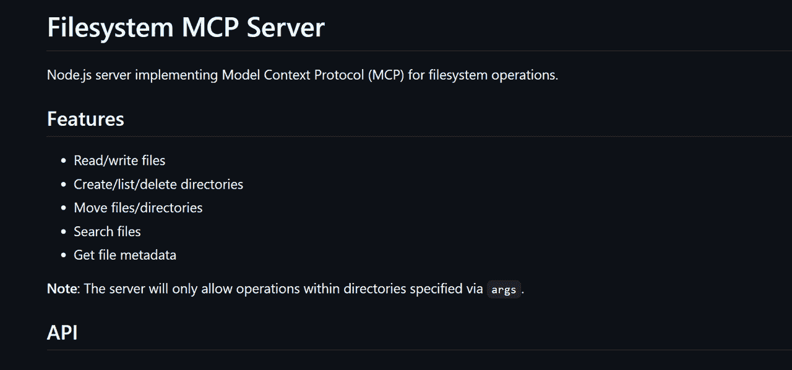

### 2. MCP服务器接入示例

而在MCP技术大爆发的今天，接入一个MCP工具也是非常简单，以下是一个将高德地图导航MCP（服务器）接入Cherry Studio（客户端）的示例：

> 我们可以暂时把MCP服务器视作MCP工具。

我们能看到，现在如果想要接入一个MCP工具，我们只需要在支持MCP功能的客户端中写入相关配置即可。例如我们只需要在Cherry Studio的MCP配置文档中写入如下字段：

```
    &quot;amap-maps&quot;: {
      &quot;isActive&quot;: true,
      &quot;command&quot;: &quot;npx&quot;,
      &quot;args&quot;: [
        &quot;-y&quot;,
        &quot;@amap/amap-maps-mcp-server&quot;
      ],
      &quot;env&quot;: {
        &quot;AMAP_MAPS_API_KEY&quot;: &quot;YOUR_API_KRY&quot;
      },
      &quot;name&quot;: &quot;amap-maps&quot;
    }
```

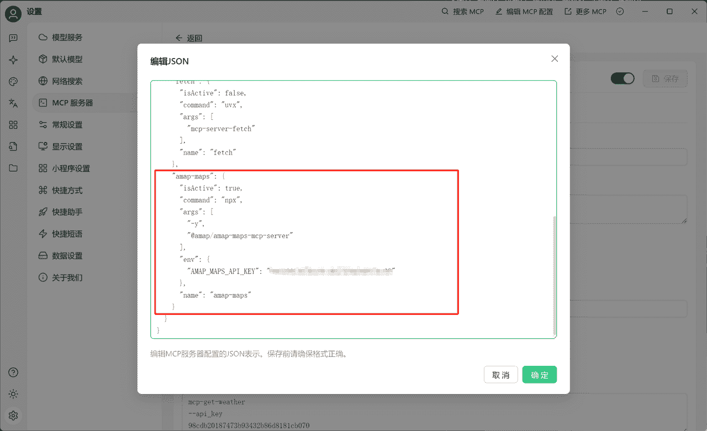

即可让大模型自动关联高德MCP工具（服务器），而一个高德MCP服务器的API有几十种之多：

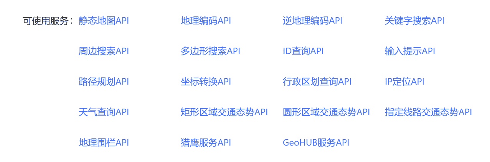

可以说是覆盖了出行生活的方方面面。而当一个大模型接入高德MCP服务器后，就能瞬间化身出行规划智能体。

> 更多客户端接入服务器方法，详见公开课《零门槛接入MCP！Cursor、阿里云百炼、Open-WebUI、Cherry Studio接入10大最热门MCP工具》：https://www.bilibili.com/video/BV1dCo7YdEgK/

而要知道的是，如果没有MCP工具，我们需要单独围绕这些API将其封装为一个个外部函数，再据此创建一个出行规划智能体，其工作量可想而知。

### 3. MCP工具标准接入流程

在上述示例中，我们不难发现，一个MCP服务器标准接入流程是通过写入一个配置文件来完成的。而在支持MCP功能的客户端（如Cherry Studio）中写入MCP工具的配置，其本质就是先将指定的MCP工具下载到本地，然后在有需要的时候对其进行调用。例如高德MCP配置文件如下：

```
    &quot;amap-maps&quot;: {
      &quot;isActive&quot;: true,
      &quot;command&quot;: &quot;npx&quot;,
      &quot;args&quot;: [
        &quot;-y&quot;,
        &quot;@amap/amap-maps-mcp-server&quot;
      ],
      &quot;env&quot;: {
        &quot;AMAP_MAPS_API_KEY&quot;: &quot;YOUR_API_KRY&quot;
      },
      &quot;name&quot;: &quot;amap-maps&quot;
    }
```

代表的含义就是我们需要先使用如下命令：

```
npx -y @amap/amap-maps-mcp-server
```

对这个库@amap/amap-maps-mcp-server进行下载，然后在本地运行，当有必要的时候调用这个库里面的函数执行相关功能。

而这个@amap/amap-maps-mcp-server库是一个托管在https://www.npmjs.com/上的库，

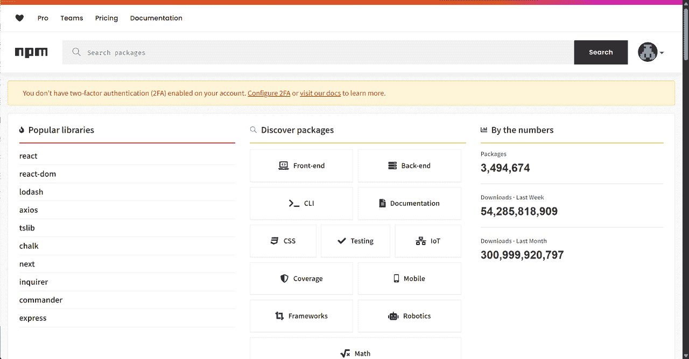

可以使用npx命令进行下载。搜索库名即可看到这个库的完整代码，https://www.npmjs.com/package/@amap/amap-maps-mcp-server：

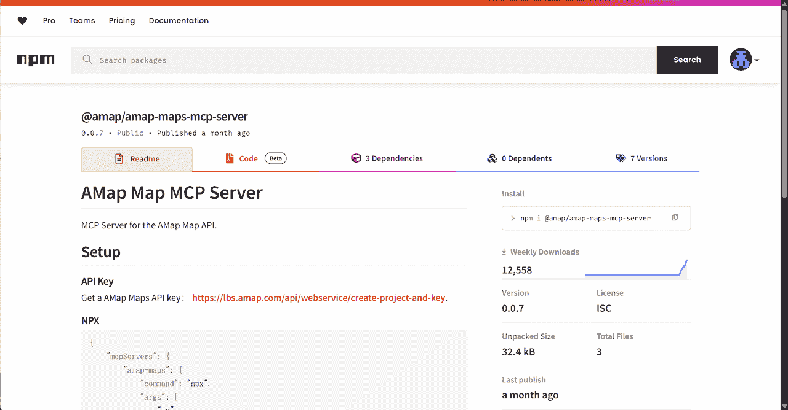

而这种通过配置文件来进行MCP工具下载的方式，最早由Claude（MCP技术的提出者）提出并被广泛接纳。

### 4. MCP服务器与客户端

#### 4.1 MCP服务器（server）与客户端（client）概念介绍

在上面的示例中，Cherry Studio是一个支持MCP功能的客户端，而接入的高德MCP是一个MCP服务器，这里的客户端和服务器又是什么意思呢？

这其实是MCP技术体系中对于大模型和外部工具的另一种划分方式，也就是说在MCP技术体系中，会将外部工具运行脚本称作服务器，而接入这些外部工具的大模型运行环境称作客户端。


一个客户端可以接入多个不同类型的服务器的，但要求是都可以遵循MCP通信协议。简单理解就是MCP服务器的输出内容是一种标准格式的内容，只能被MCP客户端所识别。在客户端和服务器都遵循MCP协议的时候，客户端就能够像Function calling中大模型调用外部工具一样，调用MCP服务器里面的工具。


#### 4.2 MCP服务器集合

暂时抛开底层原理不谈，在MCP技术爆发的这几个月，市面上已经诞生了成百上千的MCP服务器，甚至还出现了大量的MCP服务器集合网站：

+   MCP官方服务器合集：https://github.com/modelcontextprotocol/servers

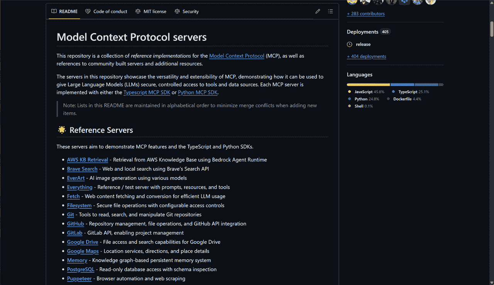

+   MCP Github热门导航：https://github.com/punkpeye/awesome-mcp-servers


+   Smithery：https://smithery.ai/

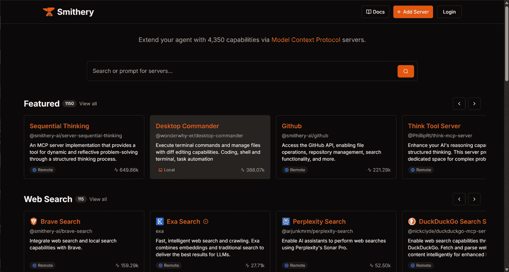

+   MCP导航：https://mcp.so/


在实际进行智能体开发过程中，我们可以参考这些网站上的MCP工具，并有选择的对其进行调用。但需要注意的是，无论这些网站的组织形式多么花样百出，但实际上当我们本地调用MCP工具的时候，都是通过uvx或者npx将对应的库下载到本地，然后再进行运行。

### 5. MCP与Function calling技术对比介绍

此外，我们还需要补充一点的是关于Function calling和MCP技术的关系。通过在MCP运行过程的抓包可知，MCP底层实际上仍然是借助大模型原生的Function calling来完成外部工具调用，只不过进行了更高层的封装。

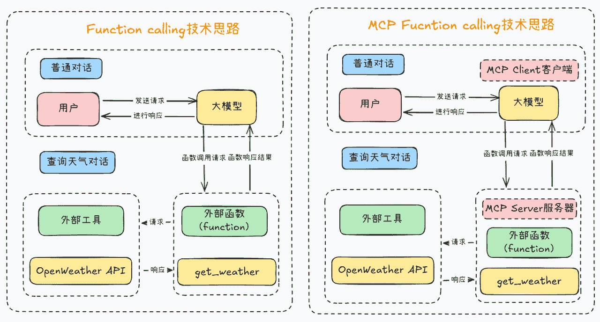

实际上MCP客户端对MCP服务器上的工具调用流程如下：

+   Step 1. 建立和服务器的通信；

+   Step 2. 查询服务器上总共有多少个外部工具；

+   Step 3. 将外部工具组成列表，带入到当前对话中；

+   Step 4. 借助Function calling进行外部工具调用。

也就是说，如果模型本身不支持Function calling，那么是无法顺利开启MCP功能的。

不过这里也有例外，那就是Open-WebUI和cline作为MCP客户端时，可以使用不具备Function calling功能的DeepSeek-R1模型进行MCP工具调用，这是为何呢？

原因非常简单，那就是这些客户端内置了一些提示词模板，借助提示让大模型输出类似Function call message（调用外部工具的信息）的内容，然后开启Function calling，从而能够调用MCP工具。举个例子，对于cline来说会通过一段非常长的提示词，引导模型输出Function call message：

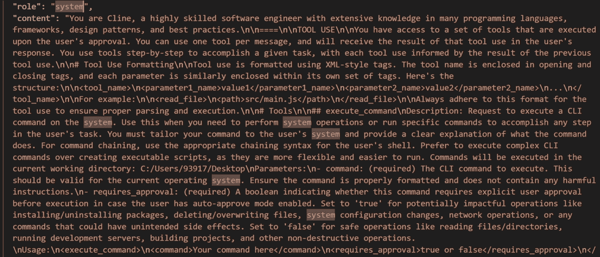

> cline项目官网：https://github.com/cline/cline

我们可以将其精简为如下形式：

```
system_message = (
    &quot;You are a helpful assistant with access to these tools:\n\n&quot;
    f&quot;{tools_description}\n&quot;
    &quot;Choose the appropriate tool based on the user&#x27;s question. &quot;
    &quot;If no tool is needed, reply directly.\n\n&quot;
    &quot;IMPORTANT: When you need to use a tool, you must ONLY respond with &quot;
    &quot;the exact JSON object format below, nothing else:\n&quot;
    &quot;{\n&quot;
    &#x27;    &quot;tool&quot;: &quot;tool-name&quot;,\n&#x27;
    &#x27;    &quot;arguments&quot;: {\n&#x27;
    &#x27;        &quot;argument-name&quot;: &quot;value&quot;\n&#x27;
    &quot;    }\n&quot;
    &quot;}\n\n&quot;
    &quot;After receiving a tool&#x27;s response:\n&quot;
    &quot;1. Transform the raw data into a natural, conversational response\n&quot;
    &quot;2. Keep responses concise but informative\n&quot;
    &quot;3. Focus on the most relevant information\n&quot;
    &quot;4. Use appropriate context from the user&#x27;s question\n&quot;
    &quot;5. Avoid simply repeating the raw data\n\n&quot;
    &quot;Please use only the tools that are explicitly defined above.&quot;
)
```

翻译如下：

```
你是一个乐于助人的助手，可以使用以下工具：

```
{tools_description}
```

请根据用户的问题选择合适的工具。  
如果不需要使用工具，请直接回复。

重要提示：如果需要使用工具，**你必须仅以以下精确的 JSON 对象格式进行回复，不要添加其他内容**：

```json
{
    &quot;tool&quot;: &quot;工具名称&quot;,
    &quot;arguments&quot;: {
        &quot;参数名称&quot;: &quot;参数值&quot;
    }
}
```

在收到工具返回的结果后：

1. 将原始数据转化为自然、对话式的回答  
2. 保持回答简洁但富有信息量  
3. 聚焦于最相关的信息  
4. 使用用户问题中的相关上下文  
5. 避免直接照搬原始数据

请**只使用上述明确定义的工具**。
```

在这些提示词引导下，一些不具备Function calling的大模型，也能顺利使用MCP工具。不过需要注意的是，借助提示词开启的MCP功能，毕竟不如模型原生能力稳定，因此如果希望搭建企业级应用的Agent，最好还是使用具备Function calling功能的大模型。

### 6. MCP技术生态

最后需要介绍当前MCP完整的技术生态。MCP技术发展至今，已经不再是简单的“协议”，而是一个包含了协议、开发工具和现成的已经开发好的MCP工具所共同组成的完整技术生态。

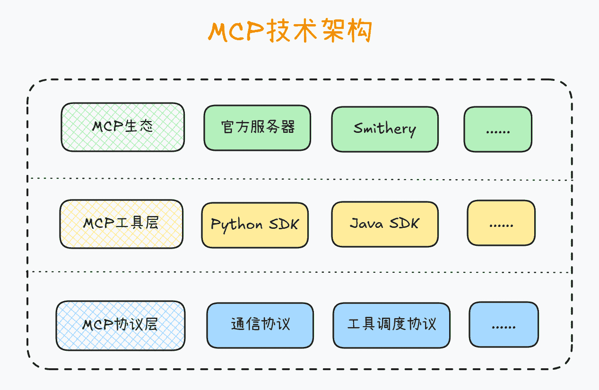

其中：

+   **MCP协议：**指的是“虚”的规范，例如大模型和工具调度规范、服务器客户端的通信规范等，遵循这些协议的对象就是MCP服务器或客户端；

+   **MCP开发工具：**包含多种语言的SDK，也就是开发工具包，开发人员能够使用这些SDK快速完成MCP的服务器和客户端开发；

+   **MCP服务器生态：**开源的MCP服务器，是基于MCP协议的庞大的技术生态，智能体开发人员可以直接使用开源的MCP工具来加快开发进程。

+   公开课代码领取


## 二、从零到一进行MCP项目开发

在基本了解MCP技术概念之后，接下来为大家详细介绍如何从零到一完成MCP项目开发。根据此前的介绍不难发现，MCP项目开发会涉及两个方面，分别是MCP客户端开发和服务器开发，本节公开课我们将重点介绍MCP服务器开发，同时为大家提供一个通用的客户端模板。

### 1. MCP服务器开发流程介绍

MCP服务器通用开发流程如下：

+   Step 1.创建功能函数，并在代码环境中完成测试；

+   Step 2.创建MCP服务器项目，完成服务器项目开发；

+   **Step 3.借助MCP官方工具Ins**pector进行MCP服务器debug；

+   Step 4.借助MCP客户端，进行本地通信测试

+   **Step 5.【可选】将MCP服务器发布到np**m或者pypi平台，供其他开发人员使用；

+   Step 6.【可选】将MCP服务器项目离线拷贝并在其他服务器上运行。

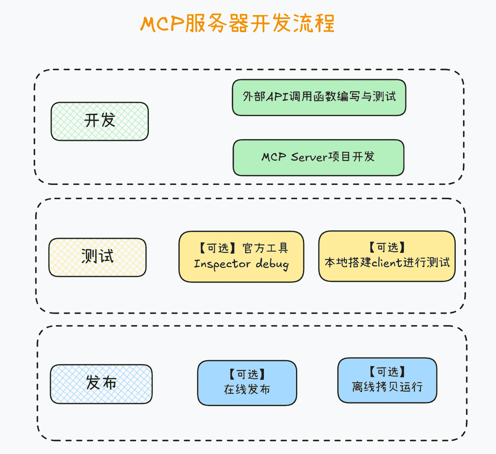

接下来我们将详细介绍这6个环节的实现方法。

### 2. MCP Server核心功能开发

#### 2.1 Mini DeepResearch项目介绍

**   在规划MCP服务器项目开发的时候，我**们首先需要确定当前MCP服务器的核心功能。我们这里尝试创建一个此前公开课介绍的Mini DeepResearch项目的MCP服务器，即一个集成了Mini DeepResearch功能的MCP服务器，能够围绕用户给出的主题进行深度搜索，并给出最终结果。接下来我们将把Mini DeepResearch封装为MCP服务器，一方面详细介绍MCP Server开发流程，同时也介绍如何将一个Multi-Agent封装为MCP server并带入到其他应用场景中。

+   项目效果演示

项目效果类似于ChatGPT DeepResearch功能，具体项目演示效果如下：

此时输入：你好，我想了解下MCP（Model Context Protocol）这项技术

输出：

```
# MCP（模型上下文协议）技术深入解析报告

本文旨在对 MCP（Model Protocol Context，模型上下文协议）技术进行全面而深入的解析。从其技术背景、发展历程、核心架构，到应用领域和未来发展趋势，本文将以详细的说明和实例分析，帮助读者对 MCP 技术有一个透彻的认识。

---

## 1. 引言

随着人工智能（AI）的迅速发展和大型语言模型（LLM）的普及，传统的依赖静态训练数据的模式逐渐暴露出局限性。AI 模型在面对复杂、动态的应用场景时，亟需一种能够实时链接外部数据源和工具的技术方案。MCP，即模型上下文协议，正是在这种背景下应运而生。MCP 提供了标准化的接口，使 AI 模型可以安全、便捷地与外部系统进行数据交互和功能调用。本文将详细探讨 MCP 的技术架构、核心优势、实际应用案例及未来展望。

---

## 2. MCP 技术的起源与发展

MCP 技术最初由 Anthropic 公司提出，作为一种开放标准协议，其目标在于解决 AI 模型信息获取受限以及定制接口开发成本高昂的问题。传统的大型语言模型仅仅依靠之前的训练数据进行问答或生成内容，而一旦遇到应用场景中新产生的数据或需求，就会陷入信息更新滞后的尴尬。MCP 协议通过提供一种标准化的通信方法，实现了 AI 模型与外部数据源和工具的无缝衔接。

### 2.1 背景介绍

- **AI 发展带来的新要求**：随着算法和算力的提升，AI 模型在自然语言处理、图像识别、医学影像分析等领域展现了卓越的能力。然而，这些模型的训练数据相对静态，难以实时反映现实世界中大量动态变化的信息。MCP 的设计初衷就是为了解决这类静态数据与动态应用之间的脱节问题。
- **传统接口的局限性**：在传统应用中，开发者通常需要为每个外部数据源或工具编写专门的接口，造成了开发周期长、接口碎片化的问题。MCP 的出现使得各类数据源可以通过统一入口被 AI 模型调用，大幅降低了开发者的集成成本。

### 2.2 发展历程

自提出以来，MCP 迅速引起各界关注。从最初的标准构架到目前支持 STDIO 与 HTTP+SSE 两种数据传输方式，MCP 正在不断完善自身的协议规范，支持更多样化的数据交互模式。学术界和工业界纷纷开展针对 MCP 的研究和应用，力求更好地与现有系统集成，从而推动 AI 模型的应用边界不断拓宽。

---

## 3. MCP 的技术原理与架构

MCP 协议采用客户端-服务器模型，由三大核心组件构成：MCP 主机、MCP 客户端以及 MCP 服务器。这一模型确保 AI 模型能够通过标准化接口与外部工具或数据源进行高效交互。

### 3.1 核心组件

- **MCP 主机**：通常指运行在桌面版工具、集成开发环境（IDE）或 AI 辅助应用中的主程序，负责发起与外部系统的连接请求。
- **MCP 客户端**：位于主机程序内部，和 MCP 服务器保持 1:1 的连接关系，执行协议层面的消息传递和响应处理。
- **MCP 服务器**：独立的轻量级程序，通过标准化的 MCP 接口，连接各种本地或远程的数据源与外部服务，并按照协议要求提供相应的功能。

### 3.2 协议通信机制

MCP 协议采用 JSON-RPC 2.0 格式定义消息传输，确保通信内容具有清晰的请求与响应逻辑。主要包含以下两种传输方式：

- **STDIO 传输**：利用标准输入输出流完成数据传输，具有低延迟的优点，适用于高效通信需求的场景。
- **HTTP+SSE 传输**：通过 HTTP 协议结合服务器发送事件（Server-Sent Events），实现实时数据流和长连接通信，适合于跨网络环境的数据同步和更新。

这种灵活的通信机制不仅满足了高性能应用的要求，也为开发者允许实现定制的传输方式提供了可能性，但前提是必须保留 MCP 指定的消息格式和生命周期管理要求。

### 3.3 消息交换和生命周期管理

MCP 协议采用明确的消息帧格式，对请求、响应、通知等多种消息模式进行了详细定义。整个通信生命周期包括：

1. **初始化阶段**：客户端与服务器之间建立连接，并进行身份认证和功能协商。
2. **消息交换阶段**：在连接保持期间，双方通过请求-响应模型或推送通知模式进行数据传输和指令交互。
3. **终止阶段**：当通信任务完成或出现异常时，客户端或服务器终止连接，并进行资源回收。

这种设计确保了通信的稳定性和可靠性，极大地降低了系统集成的复杂性。

---

## 4. MCP 的关键优势与应用场景

### 4.1 关键优势

- **统一标准**：MCP 提供了开放、统一的通信接口，解决了传统 API 接口碎片化的问题，使得不同系统之间的集成更加简单高效。
- **动态数据交互**：借助 MCP，AI 模型可以在运行过程中动态获取外部数据，而不再局限于预先训练数据的内容，这大大提升了模型的实用性和智能化水平。
- **安全性与用户控制**：MCP 的设计强调用户对数据交互的控制权，通过标准化和严格的认证机制，在一定程度上保障了数据安全和隐私保护。
- **扩展性强**：惠及多种传输方式和应用场景，不论是本地数据访问还是远程服务调用，都能够灵活适配。

### 4.2 应用场景

#### 4.2.1 软件开发与调试

在软件开发领域，集成了 MCP 的编码工具能够自动读取和修改代码库，利用实时数据进行静态检查和代码优化，从而提升开发效率。例如，IDE 通常会集成 MCP 客户端，实现自动化错误提示和修正建议。

#### 4.2.2 数据科学与安全审计

数据科学家可以通过 MCP 安全地查询内部数据库或者调用大数据平台接口，无需暴露底层敏感凭据。同时，MCP 协议支持安全审计机制，减少了安全审计项，从而降低系统维护成本。

#### 4.2.3 医疗与健康管理

在医疗领域，医疗系统通过 MCP 协议整合患者生理数据、影像信息及实验室检测结果，生成更为精确的诊断报告。这种跨系统的数据整合，显著提升了医疗决策的准确性和效率。

#### 4.2.4 云平台与多集群管理

部分云平台，如华为云的多云容器平台，已经开始借助 MCP 实现跨云和多集群的统一管理。通过 MCP，企业可以实现应用在多集群间的动态部署和弹性伸缩，有效解决多云环境下应用管理和资源调度的挑战。

---

## 5. 案例分析与技术比较

### 5.1 实际应用案例

以某三甲医院的医疗信息系统为例，通过引入 MCP，医院大大缩短了医疗影像系统与电子病历对接的周期。以前需要数月时间完成的数据对接，如今可在短短几天内实现，既提高了医疗服务效率，也降低了系统的集成成本。

### 5.2 与传统 API 的比较

传统 API 接口往往需要针对每个数据源进行单独开发和维护，存在定制成本高、适配性差等问题。相比之下，MCP 的标准化接口能够快速对接各种外部工具和数据源，极大地提升了 AI 模型在实际场景中的响应速度和准确性。

---

## 6. MCP 技术的发展趋势与面临的挑战

### 6.1 发展趋势

随着技术不断演进，MCP 正在向更高的集成化和智能化方向发展。未来的发展趋势主要包括：

- **标准的不断完善**：随着越来越多的开发者和企业参与，MCP 的协议规范将进一步细化，涵盖更多应用场景。
- **跨平台的广泛应用**：MCP 的统一标准不仅适用于桌面工具和云平台，还将扩展到移动设备、物联网设备等各类终端中。
- **多智能体协作**：未来的 AI 应用将越来越依赖多个模型之间的协同工作，MCP 将为这些多智能体系统提供高效的上下文传递和状态同步能力。
- **安全性与隐私保护进一步加强**：在数据安全和用户隐私方面，MCP 将引入更多先进的加密和认证技术，以满足日益严格的安全需求。

### 6.2 面临的挑战

尽管 MCP 技术具备诸多优势，但在推广和应用过程中仍面临一些挑战：

- **技术普及和标准统一**：作为新兴技术，MCP 需要更多的行业参与者和开发者支持，才能形成统一的标准生态。
- **兼容性与扩展性平衡**：在设计上，如何在保证标准化的同时，又能灵活应对不同应用的特殊需求，是 MCP 需要解决的问题。
- **安全性保障**：在跨平台、跨系统数据交互过程中，如何确保数据不被泄露并严格控制访问权限，是技术实现中的重点和难点。

---

## 7. 总结与展望

MCP（模型上下文协议）作为一种前沿的开放标准协议，通过标准化的接口，实现了 AI 模型与外部数据源和工具之间高效、安全的交互。本文从 MCP 的起源、技术架构、优势、应用案例及未来发展趋势等多个方面进行了详细阐述，展示了其在软件开发、医疗信息系统、云平台管理等领域的潜在价值。

可以预见，在 AI 应用不断深入和场景日益复杂的背景下，MCP 有望成为连接静态模型与动态数据的重要桥梁，推动人工智能迈向更加智能和高效的未来。面对未来，行业内各方需要进一步协同合作，完善标准、提升安全防护，并不断扩展协议的应用领域，共同探索 MCP 技术的最佳实践和发展路径。

---

## 参考文献与进一步阅读

1. [模型上下文协议（Wikipedia）](https://zh.wikipedia.org/wiki/%E6%A8%A1%E5%9E%8B%E4%B8%8A%E4%B8%8B%E6%96%87%E5%8D%8F%E8%AE%AE)
2. [Model Context Protocol 官方文档](https://modelcontextprotocol.info/zh-cn/docs/introduction/)
3. [有关 MCP 在 AI 集成中的应用探讨](https://blog.eimoon.com/p/mcp-introduction/?utm_source=openai)

---

*注：本文主要聚焦于 MCP 作为一项开放标准协议的技术体系，不同领域中同样缩写为 MCP 的其他技术（如多芯片封装、微通道板）则属于截然不同的技术体系，读者在查阅相关文献时需注意区分。*
```

+   课件领取

Mini DeepResearch公开课资料见本节公开课网盘：

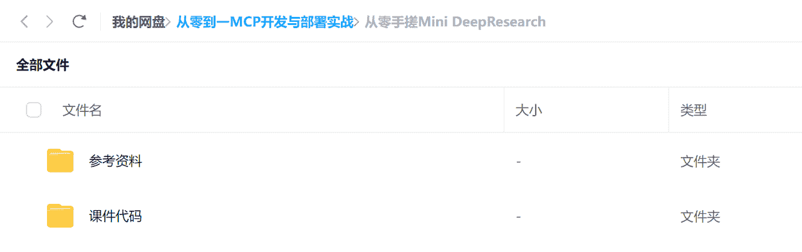

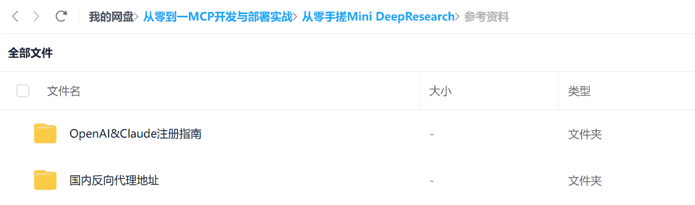


+   Mini DeepResearch技术栈

Mini DeepResearch以OpenAI模型及开源Agents SDK框架为主进行的开发，实际运行过程中需要输入OpenAI API-KEY。OpenAI API-KEY获取方法详见课件中的参考资料《OpenAI注册指南》部分，此外也可以直接在某宝上购买官方API-KEY。此外，项目中自带国内反向代理地址，无需额外网络门槛即可使用。

> 需要注意的是，必须要使用OpenAI官方API-KEY才能运行项目，中转API-KEY无法运行。

+   Mini DeepResearch命令行快速上手使用

在课件中下载MiniDeepResearch.zip压缩包并解压缩，然后即可在主目录下运行该项目：

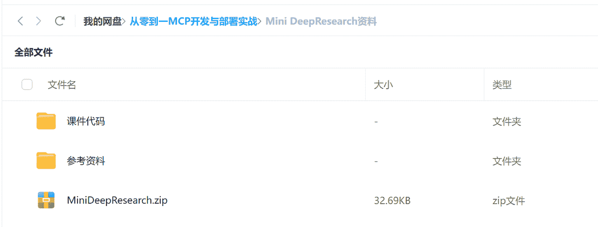

需要提前安装openai库和agents库

```
pip install openai openai-agents
```

并且在三个_agent.py文件中写入国内反向代理地址和OpenAI官方API-KEY，然后输入如下命令即可运行：

```
python -m ChatBot.main
```

#### 2.2 Mini DeepResearch项目架构介绍

接下来让我们快速回顾这个Multi-Agent系统核心代码结构。Mini DeepResearch主要由三个Agent构成：

| Agent | 功能 |
| --- | --- |
| planner_agent | 生成研究关键词和搜索策略 |
| search_agent | 负责执行网络搜索 + 总结内容（使用工具） |
| writer_agent | 汇总所有搜索结果，编写报告 |

并且实际运行过程中，三个Agent组成一个线性的workflow进行运行：

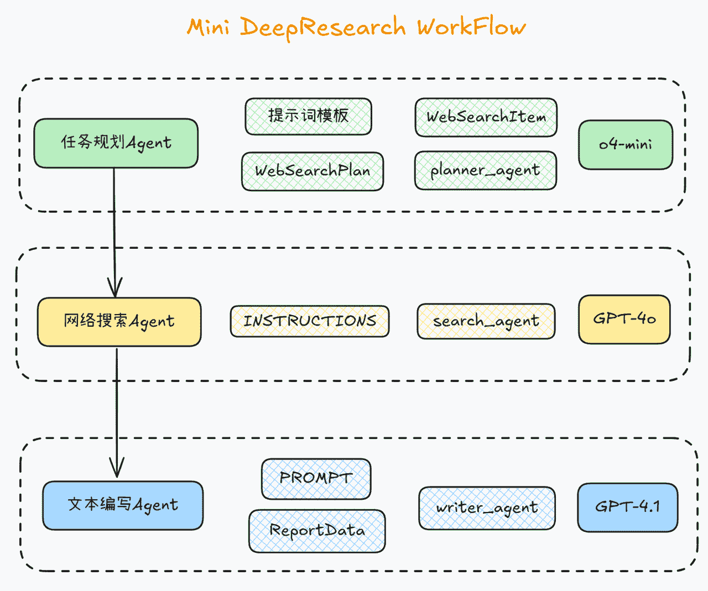

这其实是一个相对简单的Multi-Agent系统，并且在最新GPT-4.1和o4-mini模型加持下，以及搭配开源的Agents-SDK框架和GPT模型原生的网络搜索功能，能够非常高效稳定的实现类DeepResearch功能。

接下来我们逐个介绍这三个Agent代码实现。以下代码均在Jupyter中完成测试，代码课件详见：

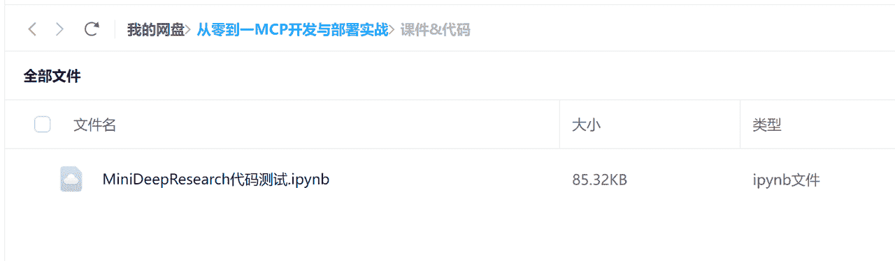

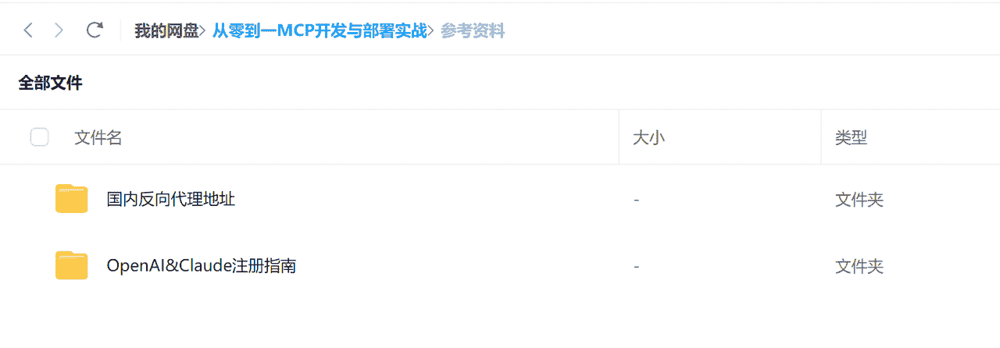


#### 2.3 planner_agent功能实现

+   基础依赖库安装

```
pip install openai openai-agents
```

+   基础代码测试

这里首先需要设置基础Agents-SDK开发环境并进行简单测试，测试代码如下：

```
from openai import AsyncOpenAI
from agents import OpenAIChatCompletionsModel,Agent,Runner,set_default_openai_client, set_tracing_disabled
from agents.model_settings import ModelSettings
from pydantic import BaseModel
from agents import Agent, WebSearchTool
from agents.model_settings import ModelSettings
import os
from dotenv import load_dotenv
load_dotenv(override=True)

external_client = AsyncOpenAI(
    base_url = os.getenv(&quot;BASE_URL&quot;),
    api_key = os.getenv(&quot;API_KEY&quot;), 
)
set_default_openai_client(external_client)
set_tracing_disabled(True)
agent = Agent(name=&quot;Assistant&quot;, instructions=&quot;你是一名助人为乐的助手。&quot;)
result = await Runner.run(agent, &quot;请写一首关于编程中递归的俳句。&quot;) 
print(result.final_output)
```

这里需要在base_url中填写国内反向代理地址，需要在api_key中填写OpenAI的API-KEY。实际运行结果如下：

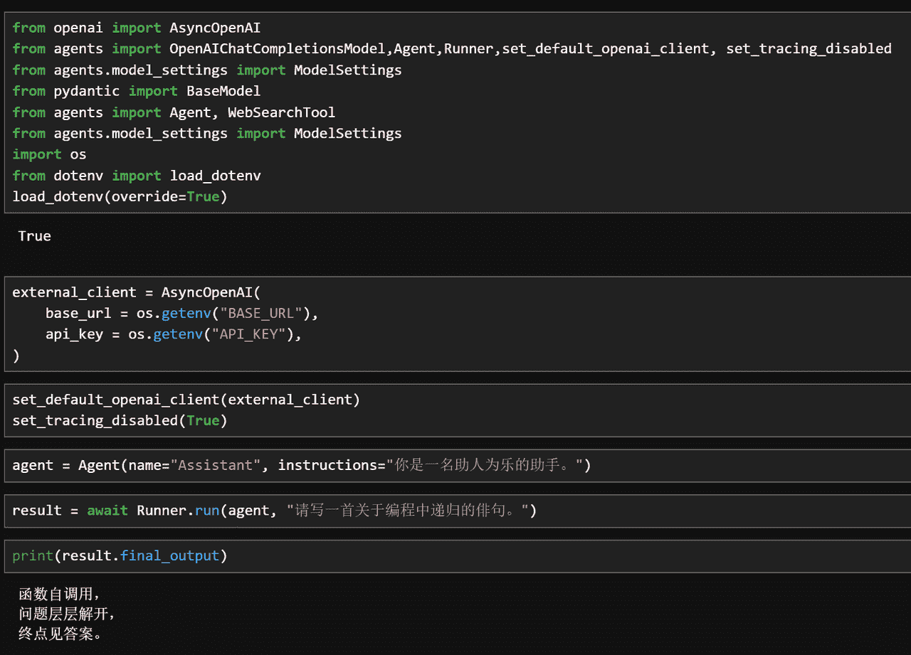

+   planner_agent代码详解与功能介绍

接下来创建planner_agent，具体代码如下：

```
PROMPT = (
    &quot;You are a helpful research assistant. Given a query, come up with a set of web searches &quot;
    &quot;to perform to best answer the query. Output between 10 and 20 terms to query for.&quot;
)


class WebSearchItem(BaseModel):
    reason: str
    &quot;Your reasoning for why this search is important to the query.&quot;

    query: str
    &quot;The search term to use for the web search.&quot;


class WebSearchPlan(BaseModel):
    searches: list[WebSearchItem]
    &quot;&quot;&quot;A list of web searches to perform to best answer the query.&quot;&quot;&quot;


planner_agent = Agent(
    name=&quot;PlannerAgent&quot;,
    instructions=PROMPT,
    model=&quot;o4-mini&quot;,
    output_type=WebSearchPlan,
)
```

其中Planner Agent 的职责是接收一个研究主题，生成一份“搜索计划（WebSearchPlan）”，告诉系统应该搜索哪些子问题/关键词以及搜索这些关键词的理由。具体代码解释如下：

```
from pydantic import BaseModel
```

导入 Pydantic，用于定义结构化数据模型**。它是整个 Agents **SDK 中用于类型校验 + 数据结构定义的核心库。

```
from agents import Agent
```

导入 SDK 的核心类 Agent，我们后面会实例化一个具体的 Agent 实体 planner_agent。

```
PROMPT = (
    &quot;You are a helpful research assistant. Given a query, come up with a set of web searches &quot;
    &quot;to perform to best answer the query. Output between 20 and 30 terms to query for.&quot;
)
```

定义这个 Agent 的提示词（Prompt），告诉 LLM：

+   你是一个研究助手；

+   收到一个主题后，请生成 20 到 30 条搜索建议；

+   每条建议应当包括 **搜索关键词 + 搜索原因**。

接下来是两个重要的数据结构定义：

```
class WebSearchItem(BaseModel):
    reason: str
    &quot;Your reasoning for why this search is important to the query.&quot;

    query: str
    &quot;The search term to use for the web search.&quot;
```

这是一个“单个搜索建议”的结构，包含两个字段：

| 字段 | 说明 |
| --- | --- |
| reason | 你为什么要搜索这个关键词？（用于解释搜索动机） |
| query | 你要搜索的关键词本身 |

```
class WebSearchPlan(BaseModel):
    searches: list[WebSearchItem]
    &quot;&quot;&quot;A list of web searches to perform to best answer the query.&quot;&quot;&quot;
```

这是“搜索计划”的整体结构，包含一个列表 searches，每项是上面的 WebSearchItem。

其中模型输出结构化的关键在这：

```
output_type=WebSearchPlan,
```

它告诉 planner_agent **“你必须输出一份结构化的 WebSearchPlan 对象，里面包含多个 WebSearchItem。”**这样可以约束模型输出格式，也便于下一步自动解析内容。

实际运行效果如下：

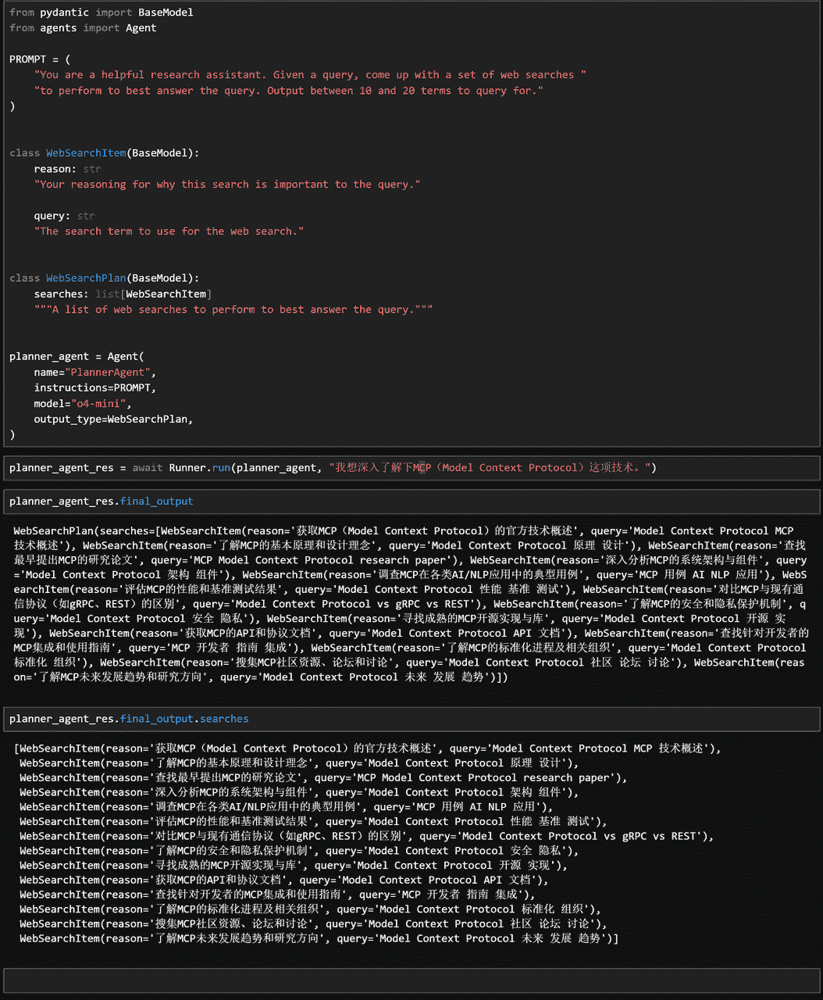

输出了14个搜索关键词和对应的搜索原因。

#### 2.4 search_agent功能实现

接下来是负责实际执行搜索工作的search_agent，代码如下：

```
from agents import Agent, WebSearchTool
from agents.model_settings import ModelSettings

INSTRUCTIONS = (
    &quot;You are a research assistant. Given a search term, you search the web for that term and &quot;
    &quot;produce a concise summary of the results. The summary must 2-3 paragraphs and less than 300 &quot;
    &quot;words. Capture the main points. Write succinctly, no need to have complete sentences or good &quot;
    &quot;grammar. This will be consumed by someone synthesizing a report, so its vital you capture the &quot;
    &quot;essence and ignore any fluff. Do not include any additional commentary other than the summary &quot;
    &quot;itself.&quot;
)

search_agent = Agent(
    name=&quot;Search agent&quot;,
    instructions=INSTRUCTIONS,
    tools=[WebSearchTool()],
    model_settings=ModelSettings(tool_choice=&quot;required&quot;),
)
```

search_agent 的作用是接收一个**搜索关键词**，调用 Web 搜索工具，然后根据搜索结果生成一**份简洁的摘要（2-3 段**，<300词），不带评论，只保留信息本身。也就是说，这是整个系统中真正“去网上查资料”的角色。具体代码解释如下：

```
from agents import Agent, WebSearchTool
from agents.model_settings import ModelSettings
```

其中：

+   Agent：导入 SDK 的智能体基类；

+   WebSearchTool**：一个由 A**gents SDK 内置的网页搜索工具，调用它可以模拟 “上网搜索” 的效果；

+   ModelSettings：可以配置一些模型使用时的行为，比如是否必须使用工具。

然后是重点提示词 INSTRUCTIONS

```
INSTRUCTIONS = (
    &quot;You are a research assistant. Given a search term, you search the web for that term and&quot;
    &quot;produce a concise summary of the results. The summary must 2-3 paragraphs and less than 300&quot;
    &quot;words. Capture the main points. Write succinctly, no need to have complete sentences or good&quot;
    &quot;grammar. This will be consumed by someone synthesizing a report, so its vital you capture the&quot;
    &quot;essence and ignore any fluff. Do not include any additional commentary other than the summary&quot;
    &quot;itself.&quot;
)
```

这是模型的行为提示，翻译一下这段内容的精髓：

| 指令含义 | 说明 |
| --- | --- |
| 你是一个研究助手 | 模拟一个能查资料的人 |
| 给你关键词后上网搜索 | 关键词来自 planner_agent |
| 写出 2-3 段简洁总结 | 每次搜索结果必须压缩成 300 字以内的摘要 |
| 用要点式语言、可以语法不完整 | 不要求像论文，重点是信息密度高 |
| 不要添加自己的评论 | 不能主观判断，只提取信息 |
| 最终目的是为后续写报告的人准备素材 | 所以格式自由，内容集中就行 |

接下来创建创建 Agent 对象

```
search_agent = Agent(
    name=&quot;Search agent&quot;,
    instructions=INSTRUCTIONS,
    tools=[WebSearchTool()],
    model_settings=ModelSettings(tool_choice=&quot;required&quot;),
)
```

其中name="Search agent"是Agent 名称，用于日志和上下文显示。而instructions=INSTRUCTIONS告诉大语言模型它要怎么完成任务。tools=[WebSearchTool()]设置它可以使用的工具。在这个 case 中，它只能用 WebSearchTool，这是 SDK 内置的网页搜索工具。而model_settings=ModelSettings(tool_choice="required")则表示：强制要求模型一定要调用工具（WebSearchTool）来完成任务。不允许模型“凭空回答”或“胡编搜索内容”，这有助于提升真实性。

总结流程如下：

```
关键词（来自 planner_agent） → search_agent →
     🔍 使用 WebSearchTool 搜索
     ✂️ 根据结果生成 2-3 段摘要
     📦 返回给 writer_agent 写整合报告
```

带入planner_agent的一个搜索条目后运行效果如下：

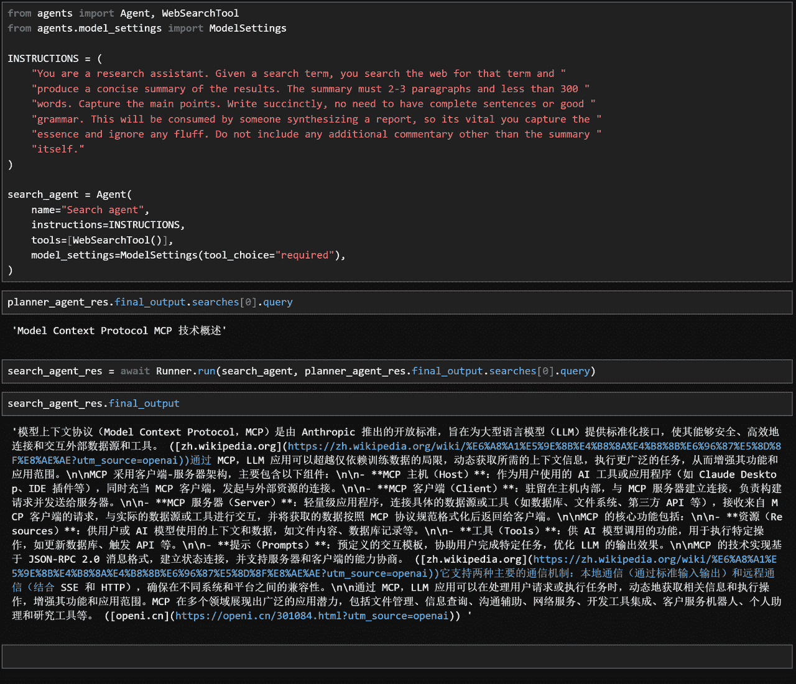

#### 2.5 writer_agent功能实现

最后则是writer_agent的功能介绍，其核心代码如下：

```
from pydantic import BaseModel
from agents import Agent

PROMPT_TEMP = (
    &quot;You are a senior researcher tasked with writing a cohesive report for a research query. &quot;
    &quot;You will be provided with the original query, and some initial research done by a research &quot;
    &quot;assistant.\n&quot;
    &quot;You should first come up with an outline for the report that describes the structure and &quot;
    &quot;flow of the report. Then, generate the report and return that as your final output.\n&quot;
    &quot;The final output should be in markdown format, and it should be lengthy and detailed. Aim &quot;
    &quot;for 10-20 pages of content, at least 1500 words.&quot;
    &quot;最终结果请用中文输出。&quot;
)


class ReportData(BaseModel):
    short_summary: str
    &quot;&quot;&quot;A short 2-3 sentence summary of the findings.&quot;&quot;&quot;

    markdown_report: str
    &quot;&quot;&quot;The final report&quot;&quot;&quot;

    follow_up_questions: list[str]
    &quot;&quot;&quot;Suggested topics to research further&quot;&quot;&quot;


writer_agent = Agent(
    name=&quot;WriterAgent&quot;,
    instructions=PROMPT_TEMP,
    model=&quot;o4-mini&quot;,
    output_type=ReportData,
)
```

Writer Agent这是 **整个研究系统的“输出终结者”**，负责把之前所有搜索到的信息，综合成一份完整、结构化、可阅读的长篇报告。该 Agent 的任务是：

+   收到研究主题和之前的所有搜索摘要；

+   **先写一个大纲（outline）**；

+   然后根据大纲写出一份 详细的 Markdown 格式报告；

+   同时生成一个简短总结和一些后续可以研究的问题。

具体代码解释如下：

```
# Agent used to synthesize a final report from the individual summaries.
from pydantic import BaseModel
from agents import Agent
```

+   和前两个 Agent 一样，我们导入了：

+   BaseModel：用于定义结构化输出；

+   Agent：Agent SDK 中的核心类。

然后是提示词定义（Prompt）

```
PROMPT = (
    &quot;You are a senior researcher tasked with writing a cohesive report for a research query. &quot;
    &quot;You will be provided with the original query, and some initial research done by a research &quot;
    &quot;assistant.\n&quot;
    &quot;You should first come up with an outline for the report that describes the structure and &quot;
    &quot;flow of the report. Then, generate the report and return that as your final output.\n&quot;
    &quot;The final output should be in markdown format, and it should be lengthy and detailed. Aim &quot;
    &quot;for 15-20 pages of content, at least 3000 words.&quot;
    &quot;最终结果请用中文输出。&quot;
)
```

提示词要点：

| 行为 | 说明 |
| --- | --- |
| 角色设定 | 你是一个资深研究员（senior researcher） |
| 输入 | 会拿到：研究主题 + 搜索摘要 |
| 第一步 | 写出报告结构（outline） |
| 第二步 | 写出 Markdown 报告正文 |
| 要求 | 长、详细、有逻辑（10-20页，1500+词） |
| 输出格式 | Markdown 格式（如 # 一级标题, - 列表 等） |
| 语言风格 | 精炼、学术、结构清晰 |

这个 prompt 是整个系统中最“生成型”的一个 prompt。紧接着是输出数据结构定义，定义一个 ReportData 类，用来约束模型的输出结构：

```
class ReportData(BaseModel):
    short_summary: str
    &quot;&quot;&quot;A short 2-3 sentence summary of the findings.&quot;&quot;&quot;

    markdown_report: str
    &quot;&quot;&quot;The final report&quot;&quot;&quot;

    follow_up_questions: list[str]
    &quot;&quot;&quot;Suggested topics to research further&quot;&quot;&quot;
```

具体含义如下：

| 字段名 | 类型 | 说明 |
| --- | --- | --- |
| short_summary | str | 对研究结果的简要总结（2~3 句话） |
| markdown_report | str | 报告正文，Markdown 格式，内容详实 |
| follow_up_questions | list[str] | 建议后续可以进一步研究的问题列表 |

注意：这个结构就是通过 output_type=ReportData 来告诉 SDK 要求模型输出这个结构，否则 SDK 会报错或解析失败。

紧接着创建 Agent 实例

```
writer_agent = Agent(
    name=&quot;WriterAgent&quot;,
    instructions=PROMPT,
    model=&quot;gpt-4.1&quot;,
    output_type=ReportData,
)
```

| 参数 | 含义 |
| --- | --- |
| name | Agent 名 |
| instructions | 提示词指令 |
| model | 使用的模型（这里是 &quot;gpt-4.1&quot;，可以替换为 gpt-4o 等） |
| output_type | 指定输出为 ReportData 类型，支持结构化结果 |

整体流程总结如下：

```
1. 用户输入研究主题 → planner_agent → 搜索关键词列表
2. 每个关键词 → search_agent → 搜索摘要
3. 所有摘要集合 + 原始主题 → writer_agent →
     📌 输出：
     - short_summary
     - markdown_report（正文）
     - follow_up_questions（可继续研究的问题）
```

最终返回的是一个完整结构化的 ReportData 对象。

带入其中第一个条目搜索结果后可以编写文本如下：

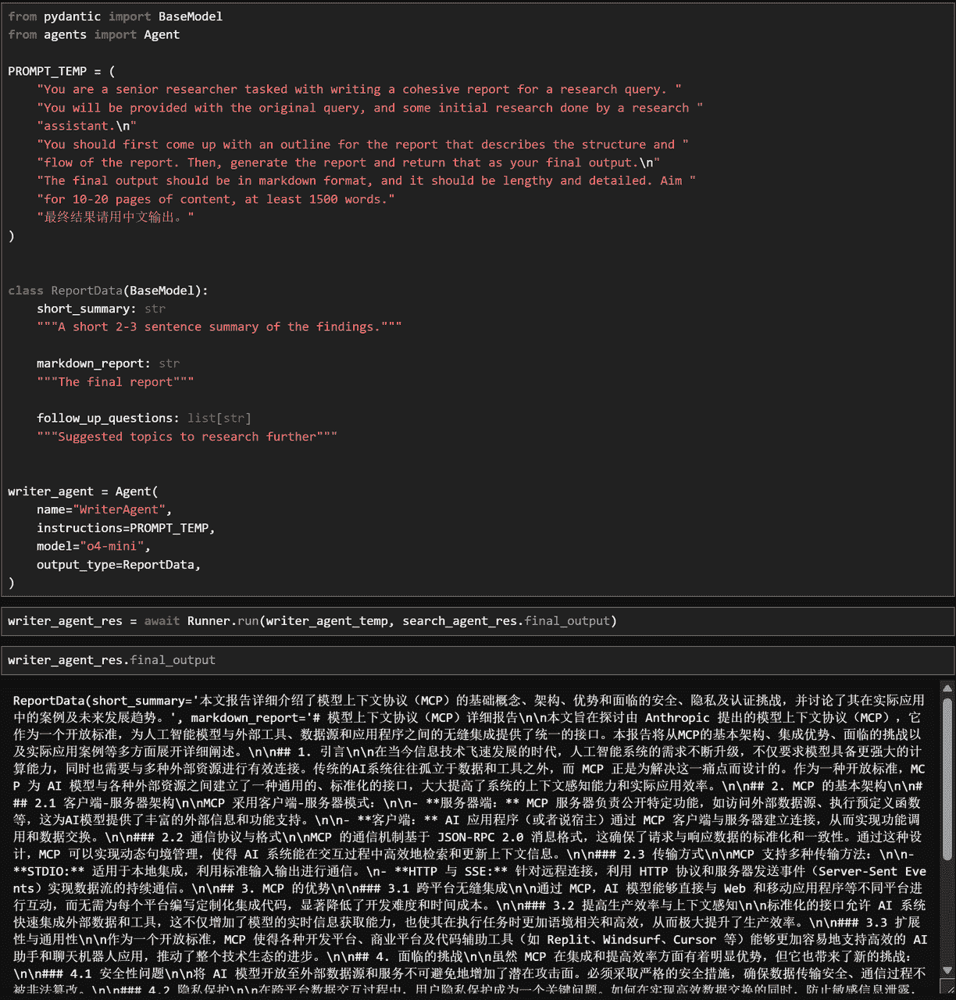

需要注意的是，实际执行过程中，需要带入全部搜索条目的短文本后再编写最终的长文本。

#### 2.6 MCP服务器主函数编写

在实现了这一系列Agents的基础功能之后，我们来编写当前MCP服务器的主函数。其实MCP服务器的主函数和Function calling运行过程中的外部函数类似，基本要求如下：

1.  能实现稳定的输入和输出。对于当前Mini DeepResearch服务器来说，输入就是用户的问题，而输出就是最终的调研报告；

1.  需要编写明确的函数说明，包括函数功能、函数参数和函数输出等。这些内容都是MCP客户端去识别外部工具的关键。

1.  推荐可以使用MCP SDK进行服务器开发。

这里我们创建一个deepresearch函数组，这个函数组用于调用上面的Agents来执行完整的规划、搜索和文档编写工作，该函数组完整代码如下：

```
import asyncio
import os
import time
from typing import List

async def _plan_searches(query: str) -&gt; WebSearchPlan:
    &quot;&quot;&quot;
    用于进行某个搜索主题的搜索规划
    &quot;&quot;&quot;
    result = await Runner.run(
        planner_agent,
        f&quot;Query: {query}&quot;,
    )
    return result.final_output_as(WebSearchPlan)

async def _perform_searches(search_plan: WebSearchPlan) -&gt; List[str]:
    &quot;&quot;&quot;
    用于实际执行搜索，并组成搜索条目列表
    &quot;&quot;&quot;
    tasks = [asyncio.create_task(_search(item)) for item in search_plan.searches]
    results = []
    for task in asyncio.as_completed(tasks):
        result = await task
        if result is not None:
            results.append(result)
    return results

async def _search(item: WebSearchItem) -&gt; str | None:
    &quot;&quot;&quot;
    实际负责进行搜索，并完成每个搜索条目的短文本编写
    &quot;&quot;&quot;
    try:
        result = await Runner.run(
            search_agent,
            input=f&quot;Search term: {item.query}\nReason for searching: {item.reason}&quot;
        )
        return str(result.final_output)
    except Exception:
        return None
    
async def _write_report(query: str, search_results: List[str]) -&gt; ReportData:
    &quot;&quot;&quot;
    根据搜索的段文档，编写长文本
    &quot;&quot;&quot;
    result = await Runner.run(
        writer_agent,
        input=f&quot;Original query: {query}\nSummarized search results: {search_results}&quot;,
    )
    return result.final_output_as(ReportData)


async def deepresearch(query: str) -&gt; ReportData:
    &quot;&quot;&quot;
    主函数，输入一个研究主题，自动完成搜索规划、搜索、写报告。
    返回最终的 ReportData 对象，就是一个markdown格式的完整的研究报告文档
    &quot;&quot;&quot;
    search_plan = await _plan_searches(query)
    search_results = await _perform_searches(search_plan)
    report = await _write_report(query, search_results)
    return report
```

编写完成后可以输入如下代码进行测试：

```
import nest_asyncio
nest_asyncio.apply()

report = await deepresearch(&quot;人工智能在教育领域的应用&quot;)

from rich.markdown import Markdown
display(Markdown(report.markdown_report))
```

具体运行结果如下所示：

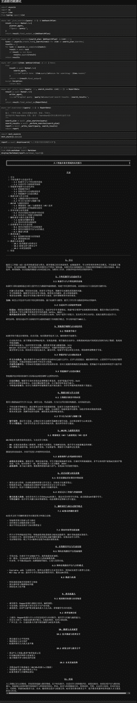

+   课件领取

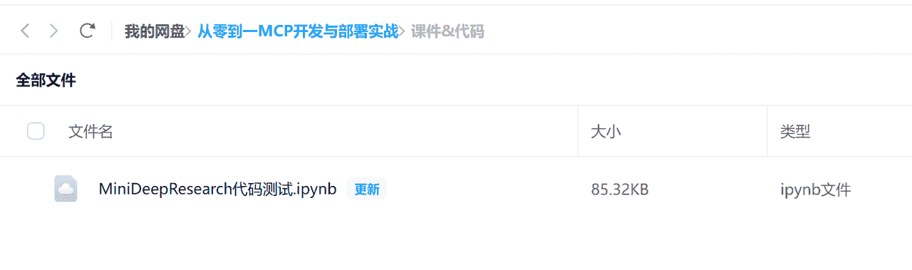


### 3. MCP Server项目开发

在完成了代码功能测试后，接下来我们需要创建一个完整的MCP Server项目来实现该功能。对于一个完整的MCP项目来说，要有完整的项目代码结构、以及符合MCP服务器基本调用规范。具体项目创建流程如下：

#### Step 1. 借助uv创建Python项目

**  MCP开发要求借助uv**进行虚拟环境创建和依赖管理。uv 是一个Python 依赖管理工具，类似于 p**ip ****和 c****o****nda，****但它更****快、更高效，并且可**以更好地管理 Python 虚拟环境和依赖项。它的核心目标是替代 pip、venv 和 pip-tools，提供更好的性能和更低的管理开销。

**uv**** 的特点**：

1.  **速度更快**：相比 pip，uv 采用 Rust 编写，性能更优。

1.  **支持 PEP 582**：无需 virtualenv，可以直接使用 __pypackages__ 进行管理。

1.  **兼容 ****pip**：支持 requirements.txt 和 pyproject.toml 依赖管理。

1.  **替代 ****venv**：提供 uv venv 进行虚拟环境管理，比 venv 更轻量。

1.  **跨平台**：支持 Windows、macOS 和 Linux。

以Ubuntu系统为例，首先使用pip安装uv：

```
pip install uv
```

> 此外，也可以直接使用curl安装uv

```
curl -LsSf https://astral.sh/uv/install.sh | sh
```

然后按照如下流程创建项目主目录：

```
# cd /root/autodl-tmp/MCP

# 创建项目目录
uv init mcp-server-deepresearch
cd mcp-server-deepresearch
```

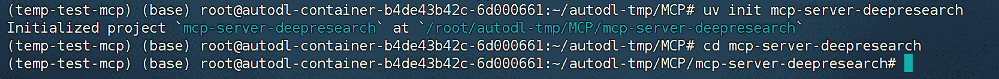

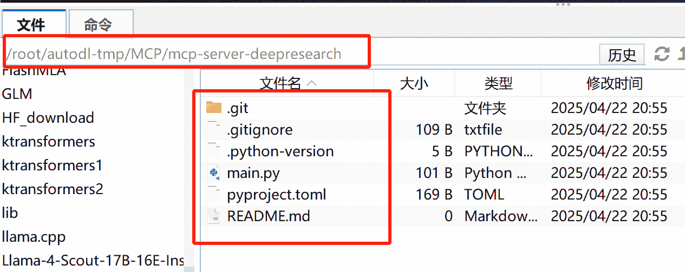

然后输入如下命令创建虚拟环境：

```
# 创建虚拟环境
uv venv

# 激活虚拟环境
source .venv/bin/activate
```

此时就构建了一个基础项目结构：

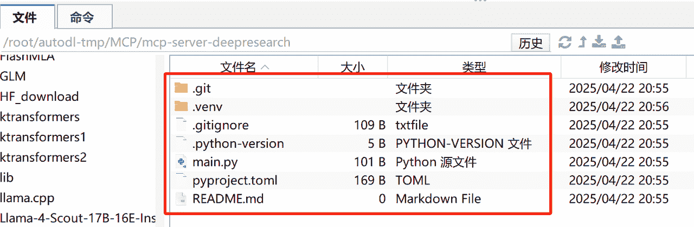

各文件解释如下：

| 文件/文件夹 | 作用 |
| --- | --- |
| .git/ | Git 版本控制目录 |
| .venv/ | 虚拟环境 |
| .gitignore | Git 忽略规则 |
| .python-version | Python版本声明 |
| main.py | 主程序入口 |
| pyproject.toml | 项目配置文件 |
| README.md | 项目说明文档 |

#### Step 2. 添加项目依赖

接下来继续使用uv工具，为我们的项目添加基础依赖。根据此前的代码解释不难看出，当前项目主要需要用到openai和openai-agents这两个库，我们可以使用如下命令安装相关依赖，并同时安装mcp sdk：

```
# 安装 MCP SDK
uv add mcp openai openai-agents asyncio typing pydantic
```

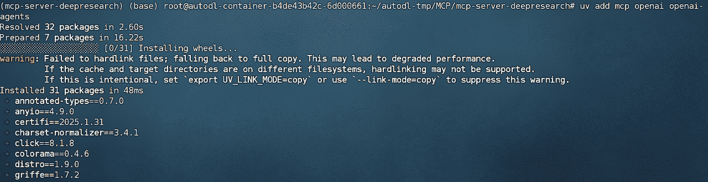

注意，对于uv管理库来说，相关依赖会安装到.venv文件中，并不会和系统库产生冲突。

#### Step 3.编写项目源码

接下来在主目录下创建/src/mcp_server_deepresearch作为代码主目录

```
mkdir -p ./src/mcp_server_deepresearch
cd ./src/mcp_server_deepresearch
```

然后创建server.py脚本，作为整个DeepResearch MCP服务器的核心脚本，

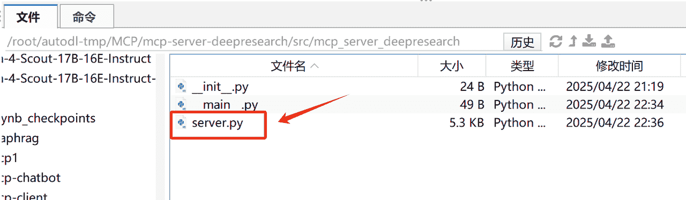

并写入代码如下：

```
import asyncio
import argparse
from typing import List
from mcp.server.fastmcp import FastMCP
from openai import AsyncOpenAI
from pydantic import BaseModel
from agents import OpenAIChatCompletionsModel,Agent,Runner,set_default_openai_client, set_tracing_disabled,WebSearchTool
from agents.model_settings import ModelSettings

# 初始化 MCP 服务器
mcp = FastMCP(&quot;DeepResearch&quot;)
USER_AGENT = &quot;deepresearch-app/1.0&quot;
API_KEY = None

# 创建planner_agent
PROMPT = (
    &quot;You are a helpful research assistant. Given a query, come up with a set of web searches &quot;
    &quot;to perform to best answer the query. Output between 10 and 20 terms to query for.&quot;
)


class WebSearchItem(BaseModel):
    reason: str
    &quot;Your reasoning for why this search is important to the query.&quot;

    query: str
    &quot;The search term to use for the web search.&quot;


class WebSearchPlan(BaseModel):
    searches: list[WebSearchItem]
    &quot;&quot;&quot;A list of web searches to perform to best answer the query.&quot;&quot;&quot;


planner_agent = Agent(
    name=&quot;PlannerAgent&quot;,
    instructions=PROMPT,
    model=&quot;o3-mini&quot;,
    output_type=WebSearchPlan,
)

# 创建search_agent
INSTRUCTIONS = (
    &quot;You are a research assistant. Given a search term, you search the web for that term and &quot;
    &quot;produce a concise summary of the results. The summary must 2-3 paragraphs and less than 300 &quot;
    &quot;words. Capture the main points. Write succinctly, no need to have complete sentences or good &quot;
    &quot;grammar. This will be consumed by someone synthesizing a report, so its vital you capture the &quot;
    &quot;essence and ignore any fluff. Do not include any additional commentary other than the summary &quot;
    &quot;itself.&quot;
)

search_agent = Agent(
    name=&quot;Search agent&quot;,
    instructions=INSTRUCTIONS,
    tools=[WebSearchTool()],
    model_settings=ModelSettings(tool_choice=&quot;required&quot;),
)

# 创建writer_agent
PROMPT_TEMP = (
    &quot;You are a senior researcher tasked with writing a cohesive report for a research query. &quot;
    &quot;You will be provided with the original query, and some initial research done by a research &quot;
    &quot;assistant.\n&quot;
    &quot;You should first come up with an outline for the report that describes the structure and &quot;
    &quot;flow of the report. Then, generate the report and return that as your final output.\n&quot;
    &quot;The final output should be in markdown format, and it should be lengthy and detailed. Aim &quot;
    &quot;for 10-20 pages of content, at least 1500 words.&quot;
    &quot;最终结果请用中文输出。&quot;
)


class ReportData(BaseModel):
    short_summary: str
    &quot;&quot;&quot;A short 2-3 sentence summary of the findings.&quot;&quot;&quot;

    markdown_report: str
    &quot;&quot;&quot;The final report&quot;&quot;&quot;

    follow_up_questions: list[str]
    &quot;&quot;&quot;Suggested topics to research further&quot;&quot;&quot;


writer_agent = Agent(
    name=&quot;WriterAgent&quot;,
    instructions=PROMPT_TEMP,
    model=&quot;o3-mini&quot;,
    output_type=ReportData,
)

# 辅助函数组
async def _plan_searches(query: str) -&gt; WebSearchPlan:
    &quot;&quot;&quot;
    用于进行某个搜索主题的搜索规划
    &quot;&quot;&quot;
    result = await Runner.run(
        planner_agent,
        f&quot;Query: {query}&quot;,
    )
    return result.final_output_as(WebSearchPlan)

async def _perform_searches(search_plan: WebSearchPlan) -&gt; List[str]:
    &quot;&quot;&quot;
    用于实际执行搜索，并组成搜索条目列表
    &quot;&quot;&quot;
    tasks = [asyncio.create_task(_search(item)) for item in search_plan.searches]
    results = []
    for task in asyncio.as_completed(tasks):
        result = await task
        if result is not None:
            results.append(result)
    return results

async def _search(item: WebSearchItem) -&gt; str | None:
    &quot;&quot;&quot;
    实际负责进行搜索，并完成每个搜索条目的短文本编写
    &quot;&quot;&quot;
    try:
        result = await Runner.run(
            search_agent,
            input=f&quot;Search term: {item.query}\nReason for searching: {item.reason}&quot;
        )
        return str(result.final_output)
    except Exception:
        return None
    
async def _write_report(query: str, search_results: List[str]) -&gt; ReportData:
    &quot;&quot;&quot;
    根据搜索的段文档，编写长文本
    &quot;&quot;&quot;
    result = await Runner.run(
        writer_agent,
        input=f&quot;Original query: {query}\nSummarized search results: {search_results}&quot;,
    )
    return result.final_output_as(ReportData)

# MCP服务器主函数
@mcp.tool()
async def deepresearch(query: str) -&gt; ReportData:
    &quot;&quot;&quot;
    当用户明确表示需要围绕某个主题进行深入研究时，请调本函数。
    本函数能够围绕用户输入的问题进行联网搜索和深入研究，并创建一篇内容完整的markdown格式的研究报告。
    输入参数query:用户提出的研究主题，以字符串形式表示；
    函数返回结果为一个markdown格式的完整的研究报告文档。
    &quot;&quot;&quot;
    search_plan = await _plan_searches(query)
    search_results = await _perform_searches(search_plan)
    report = await _write_report(query, search_results)
    return report

def main():
    parser = argparse.ArgumentParser(description=&quot;DeepResearch Server&quot;)
    parser.add_argument(&quot;--openai_api_key&quot;, type=str, required=True, help=&quot;你的 OpenAI API Key&quot;)
    args = parser.parse_args()

    # 初始化 external_client 和设置
    external_client = AsyncOpenAI(
        base_url = &quot;https://ai.devtool.tech/proxy/v1&quot;,
        api_key = args.openai_api_key,
    )
    set_default_openai_client(external_client)
    set_tracing_disabled(True)
    
    mcp.run(transport=&#x27;stdio&#x27;)

if __name__ == &quot;__main__&quot;:
    main()
```

其中主要内容均为此前介绍的三个Agent和调度函数组的内容，而整个MCP服务器开发核心采用了fastmcp库进行高效开发：

```
from mcp.server.fastmcp import FastMCP
```

借助fastmcp，我们仅需在脚本初始化一个MCP服务器对象，

```
mcp = FastMCP(&quot;DeepResearch&quot;)
```

然后使用装饰器为其添加一些函数

```
# MCP服务器主函数
@mcp.tool()
async def deepresearch(query: str) -&gt; ReportData:
```

然后即可创建一个自定义功能的MCP服务器。我们也可以简单的将MCP服务器理解为嵌套在功能函数外层的一个对象。而在实际运行的时候，我们仅需在主函数的尾部加上：

```
mcp.run(transport=&#x27;stdio&#x27;)
```

即可完成MCP服务器进程的开启。

不难看出借助MCP高级SDK开发MCP服务器的流程实际上非常简单，整个代码编写过程主要还是需要写清楚功能函数的执行逻辑。

> 更多MCP SDK详见官网介绍：https://github.com/modelcontextprotocol/python-sdk

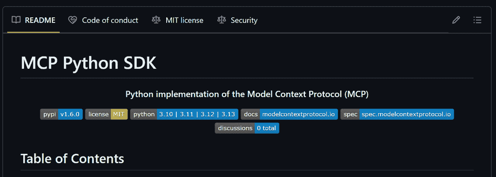

而parser相关代码则是规定在调用该脚本时需要通过参数输入来设置OpenAI的API-KEY。具体解释如下：

```
def main():
```

+   定义一个名为 main 的函数，作为程序的主入口函数。

```
    parser = argparse.ArgumentParser(description=&quot;DeepResearch Server&quot;)
```

+   使用 argparse 模块来创建一个命令行参数解析器 parser。

+   description="DeepResearch Server" 是该程序的描述，用于命令行中帮助信息的展示。

```
    parser.add_argument(&quot;--openai_api_key&quot;, type=str, required=True, help=&quot;你的 OpenAI API Key&quot;)
```

+   定义了一个命令行参数 --openai**_api_****key，类型为字符串，必须****提**供（required=True）。

+   help="你的 OpenAI API Key" 表示当用户运行 python script.py --help 时，会看到这段提示。

✅ 示例调用：

```
python script.py --openai_api_key sk-xxxxx
```

```
    args = parser.parse_args()
```

+   从命令行读取并解析用户输入的参数，将其保存到 args 变量中。

+   现在可以通过 args.openai_api_key 访问用户输入的 API key。

```
    external_client = AsyncOpenAI(
        base_url = &quot;https://ai.devtool.tech/proxy/v1&quot;,
        api_key = args.openai_api_key,
    )
```

+   创建一个 OpenAI 的异步客户端实例 exter**nal_**client，这个客户端使用了一个代理接口 https://ai.devtool.tech/proxy/v1。

+   使用了用户提供的 openai_api_key 作为身份验证。

```
    set_default_openai_client(external_client)
```

+   将刚刚创建的 external_client 设置为全局默认的 OpenAI 客户端，后续代码调用模型接口时将自动使用这个客户端。

+   通常用于封装库内部（比如 Agent 框架）统一使用这个客户端。

```
    set_tracing_disabled(True)
```

+   禁用“追踪（Tracing）”功能，可能用于避免记录日志或追踪操作。具体是否影响功能取决于你使用的 SDK 或 Agent 框架。

```
    mcp.run(transport=&#x27;stdio&#x27;)
```

+   启动 MCP（Model Context Prot**ocol**）服务器，采用 stdio 作为传输方式。

+   stdio 传输方式通常用于与终端交互或被其他进程通过标准输入/输出调用（类似 CLI 工具或嵌套调用）。

这段 main 函数的逻辑是：

1.  从命令行中获取用户输入的 OpenAI API Key。

1.  构造一个通过代理地址访问 OpenAI 的异步客户端。

1.  设置这个客户端为默认客户端，禁用 tracing。

1.  以 stdio 模式启动 MCP Server

整个项目的脚本文件可以在网盘中领取：

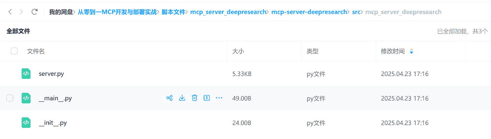


### 4. 借助MCP Inspector进行功能测试

在完成了项目的源码开发后，接下来就可以使用MCP官方提供的Inspector工具进行功能测试了。

+   Inspector项目地址：https://github.com/modelcontextprotocol/inspector

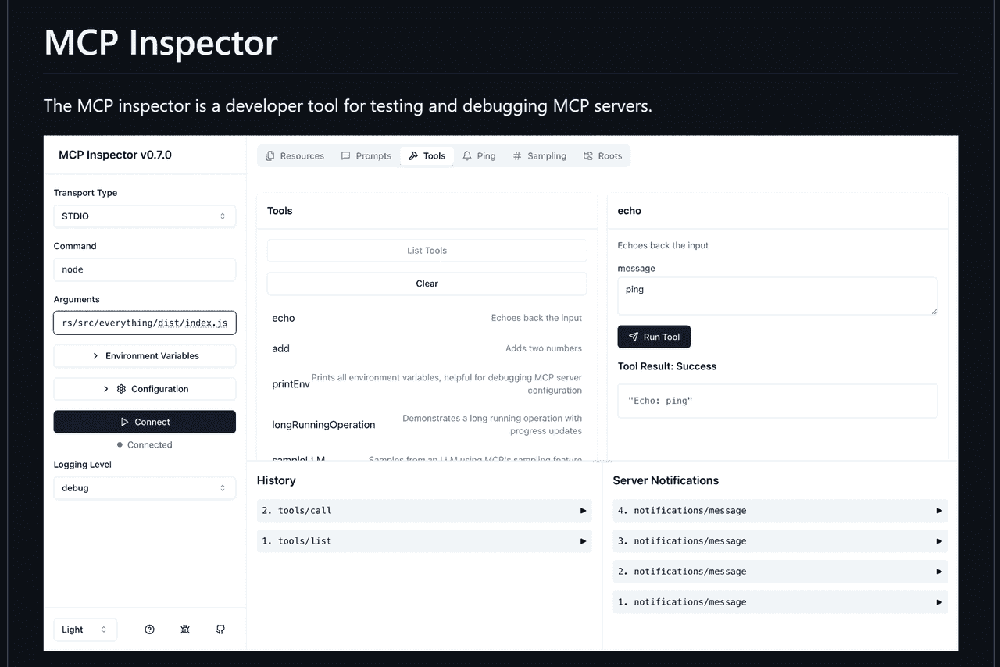

这里需要注意的是，由于当前MCP服务器脚本是使用MCP SDK进行的开发，并且MCP服务器的核心功能是为MCP客户端提供服务，因此如果不采用官方提供的Inspector进行debug，就需要自己手写一个MCP client并尝试与MCP server进行通信，才能进行debug。

换而言之就是官方提供的Inspector实际上是一个通用的MCP Client，能够测试MCP server实际运行效果。具体debug流程如下：

+   Step 1.运行MCP服务器脚本

```
# 回到项目主目录
# cd /root/autodl-tmp/MCP/mcp-server-deepresearch

# 运行Inspector
npx -y @modelcontextprotocol/inspector uv run ./src/mcp_server_deepresearch/server.py --openai_api_key YOUR_KEY
```

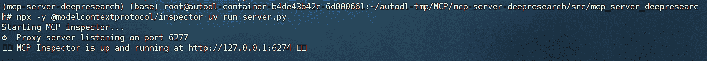

> 注意此处要输入OpenAI-API-KEY

启动完成后能够看到，此时服务器端口号为6277，而Inspector端口号为6274，如果是在本地运行，则可以直接在浏览器中输入localhost:6274进入Inspector页面，而如果是在AutoDL上运行，则需要使用SSH隧道工具，将两个端口号都映射到本地：

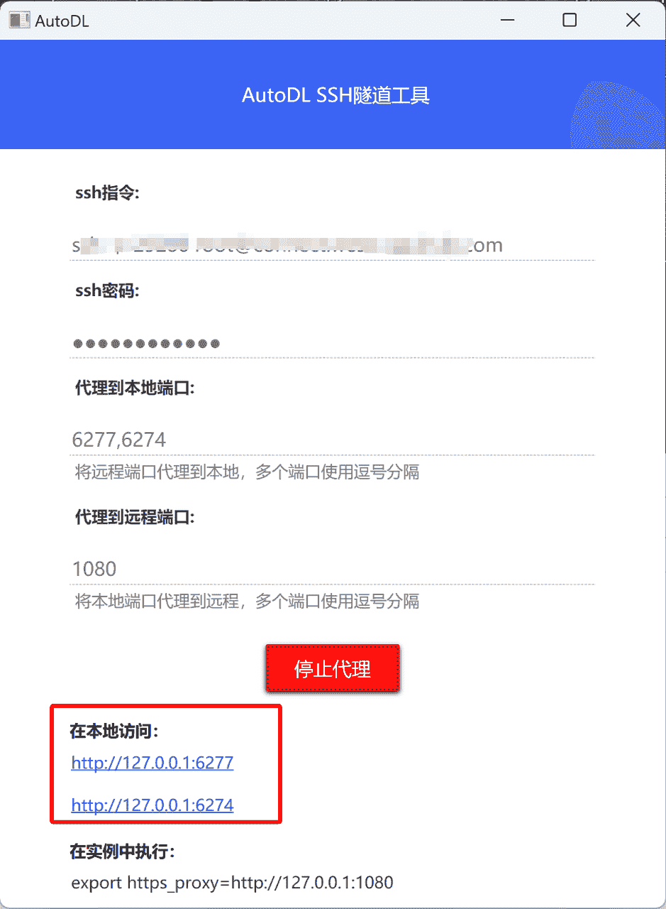

然后再在localhost:6274进入Inspector页面。

+   Step 2.设置Inspector相应时间

首次进入Inspector页面时需要设置响应时间，由于当前外部工具运行时间较长，Inspector默认只给出10秒响应窗口，超时未响应则会报错，因此这里需要在Configuration中进行响应时间设置：

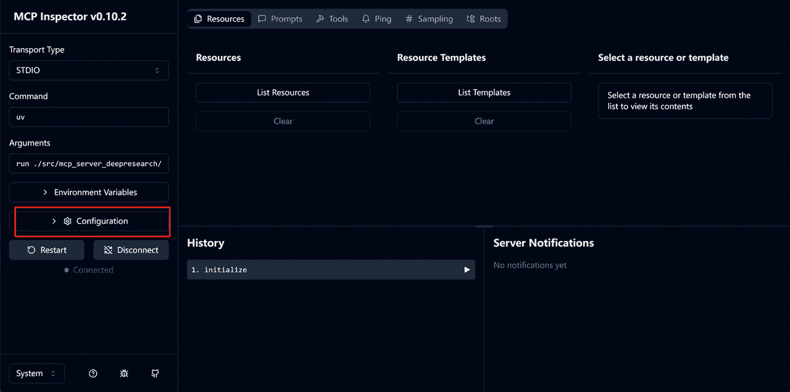

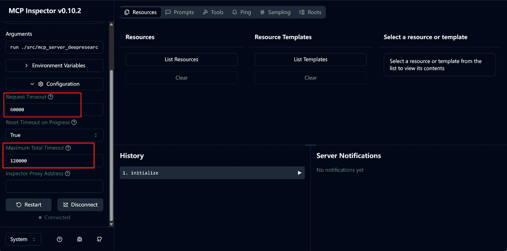

然后点击Connect即可连接MCP Server。

> 超时响应报错示例：

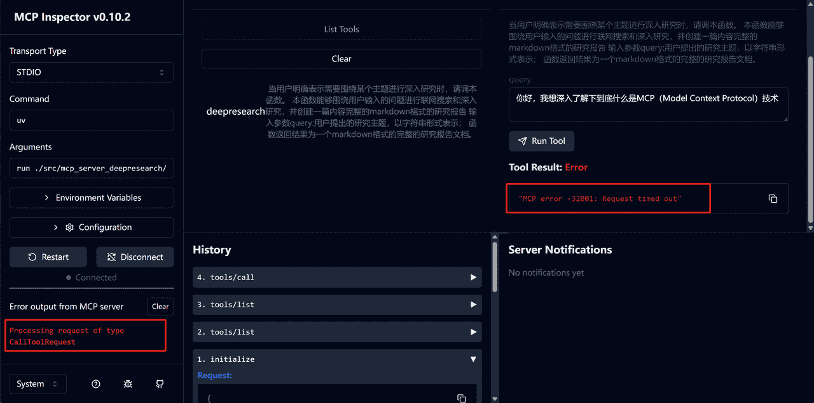

+   Step 4.在线运行

当连接上MCP Server之后，接下来点击Tools、再点击List Tools，选择deepresearch工具，并在右侧输入问题，例如你好，我想深入了解下到底什么是MCP（Model Context Protocol）技术，接下来MCP服务器会开始进行运行：

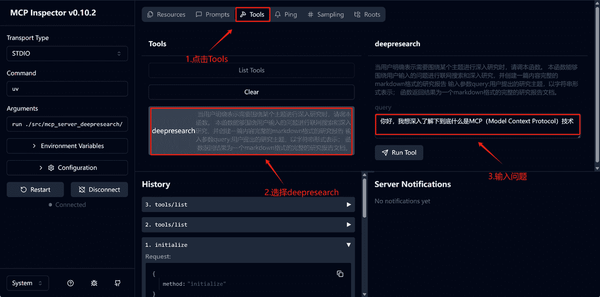

运行后即可得到完整调研报告结果：

由此即完成了完整的MCP Server脚本debug。接下来即可考虑将项目进行部署上线了。

## 三、MCP服务器部署流程

对于MCP服务器来说，一般有两种部署方式，分别是在线发布和离线拷贝运行。

+   **MCP服务器在线发布**

+           所谓在线发布，指的是我们可以将开发好的MCP服务器打包上传到pypi平台或者npm平台进行云平台托管，一旦上传成功，后续用户即可使用uvx或者npx进行下载和使用。我们在3. MCP工具标准接入流程一节中所介绍的各主流MCP客户端接入MCP工具的标准流程，实际上就是实时下载MCP工具，然后在本地进行运行。而各大MCP工具平台，如Smithery，本质上也是在pipy平台或者npm平台上托管的库基础上进行的进一步维护。

+   pipy：https://pypi.org/

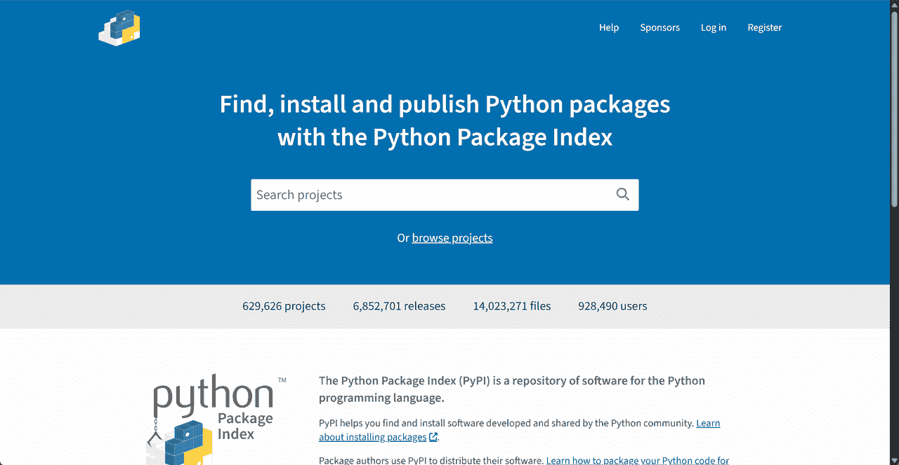

+   npm：https://www.npmjs.com/

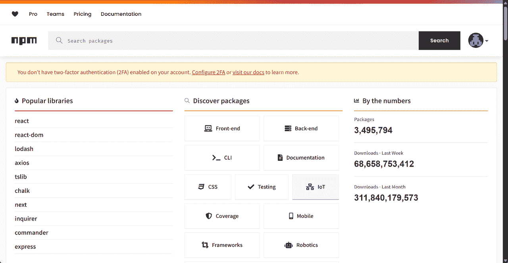

+   **MCP服务器离线拷贝运行**

+    而所谓的离线部署运行，就好理解的多，指的是将打包好的库直接拷贝到服务器上或者给他人进行使用，没有在云平台托管的这个环节，适合非公开MCP服务器进行部署。

接下来围绕我们创建的DeepResearch MCP服务器，详细介绍这两种部署方法。

### 1. DeepResearch项目完善

尽管此前我们已经完成了DeepResearch项目的核心脚本debug，但其仍然不算是一个结构完整的项目。核心脚本的调用关系并不明确，同时项目说明也不够完善。因此这里我们首先需要先完善项目的主体内容，再考虑进行部署或上线发布。

#### 1.1 src layout项目结构

其实在此之前，我们将代码都放在src内的某个文件夹里，这种项目结构也被称作src layout项目结构，这是一种非常通用、同时也便于代码维护的项目结构，基本示意图如下：

```
your-project/
├── src/               ← ✅ 所有业务代码都集中在这里
│   └── your_package/  ← Python 包的实际内容（含 __init__.py）
├── dist/              ← 构建后的分发包（如 wheel）
├── .venv/             ← 虚拟环境（本地依赖隔离）
├── .git/              ← Git 管理
├── pyproject.toml     ← 项目配置
├── README.md          ← 说明文件
├── .python-version    ← Python版本声明
├── .gitignore         ← Git 忽略规则
└── uv.lock            ← uv 的依赖锁文件
```

接下来我们还需要在src/mcp_server_deepresearch中创建两个py脚本，其一是__init__.py，使当前文件夹可以作为Python的一个库进行导入，需要在__init__.py写入如下代码：

```
from .server import main
```

同时再创建一个__main__.py，用于实际执行主函数调用流程：

```
from mcp_server_deepresearch import main

main()
```

最终src/mcp_server_deepresearch中代码文件如下所示：

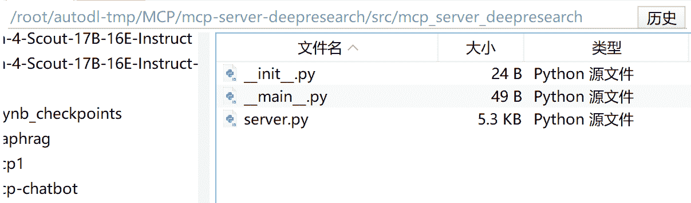

整个项目的脚本文件可以在网盘中领取：

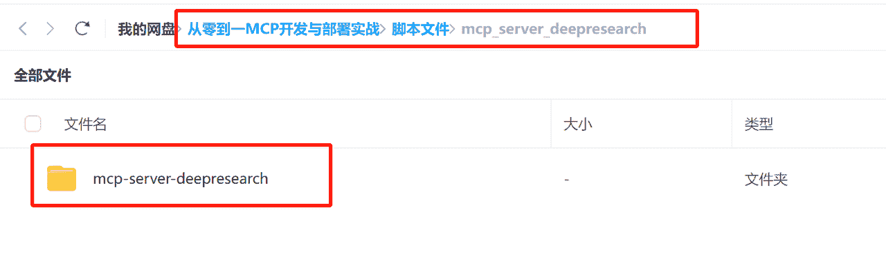


#### 1.2 修改pyproject.toml

创建完基本项目结构后，让我们回到当前项目主目录下，删除main.py（如果有的话），然后修改项目配置文件pyproject.toml:

```
[build-system]
requires = [&quot;setuptools&gt;=61.0&quot;, &quot;wheel&quot;]
build-backend = &quot;setuptools.build_meta&quot;

[project]
name = &quot;mcp-server-deepresearch&quot;
version = &quot;0.1.2&quot;
description = &quot;实现类deepresearch功能的MCP工具&quot;
readme = &quot;README.md&quot;
requires-python = &quot;&gt;=3.10&quot;
dependencies = [
    &quot;asyncio&gt;=3.4.3&quot;,
    &quot;mcp&gt;=1.6.0&quot;,
    &quot;openai&gt;=1.75.0&quot;,
    &quot;openai-agents&gt;=0.0.12&quot;,
    &quot;pydantic&gt;=2.11.3&quot;,
    &quot;typing&gt;=3.10.0.0&quot;,
]

[project.scripts]
mcp-server-deepresearch = &quot;mcp_server_deepresearch:main&quot;

[tool.setuptools]
package-dir = {&quot;&quot; = &quot;src&quot;}

[tool.setuptools.packages.find]
where = [&quot;src&quot;]
```

具体配置解释如下：

[build-system] 段

```
[build-system]
requires = [&quot;setuptools&gt;=61.0&quot;, &quot;wheel&quot;]
build-backend = &quot;setuptools.build_meta&quot;
```

告诉 Python 构建工具（如 pip, uv, build）：

+   要使用 setuptools 来构建项目

+   同时依赖 wheel，因为你要构建 .whl 包

[project] 段

```
[project]
name = &quot;mcp-server-deepresearch&quot;
version = &quot;0.1.2&quot;
description = &quot;实现类deepresearch功能的MCP工具&quot;
readme = &quot;README.md&quot;
requires-python = &quot;&gt;=3.10&quot;
dependencies = [
    &quot;asyncio&gt;=3.4.3&quot;,
    &quot;mcp&gt;=1.6.0&quot;,
    &quot;openai&gt;=1.75.0&quot;,
    &quot;openai-agents&gt;=0.0.12&quot;,
    &quot;pydantic&gt;=2.11.3&quot;,
    &quot;typing&gt;=3.10.0.0&quot;,
]
```

定义项目的**元数据**，包括：

+   项目名称、版本、描述

+   Python 最低版本要求

+   自动安装的依赖项（相当于 requirements.txt）

[project.scripts]：命令行入口

```
[project.scripts]
mcp-server-deepresearch = &quot;mcp_server_deepresearch:main&quot;
```

定义一个**可执行命令行脚本**，等价于在终端中直接运行：

```
mcp-server-deepresearch --openai_api_key=...
```

它会自动调用你包内的：

```
mcp_server_deepresearch/main.py 里的 main() 函数
```

也支持：

```
mcp_server_deepresearch/__init__.py 中的 main() 函数
```

只要是 main() 函数即可。

```
[tool.setuptools]
package-dir = {&quot;&quot; = &quot;src&quot;}

[tool.setuptools.packages.find]
where = [&quot;src&quot;]
```

明确告诉 setuptools：

+   你的项目源代码都在 src/ 目录下

+   请去 src/ 中查找 Python 包（即包含 __init__.py 的目录）

| 区块 | 作用 | 评价 |
| --- | --- | --- |
| [build-system] | 告诉构建工具如何构建项目 | ✅ 非常规范 |
| [project] | 定义项目基本信息和依赖 | ✅ 可以删掉 asyncio 和 typing |
| [project.scripts] | 定义命令行工具 | ✅ 可直接用 mcp-server-deepresearch 命令运行 |
| [tool.setuptools] | 指定源码位置 | ✅ 与 src layout 完美配合 |

然后对整个项目进行打包。首先需要安装打包（和上传）工具：

```
uv pip install build twine
```

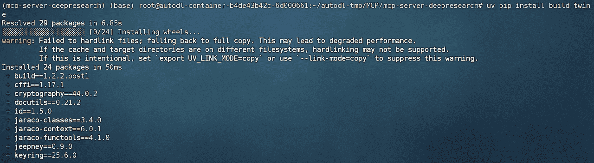

然后使用如下命令进行打包：

```
# 回到项目主目录
# cd /root/autodl-tmp/MCP/mcp-server-deepresearch

# 打包
python -m build
```

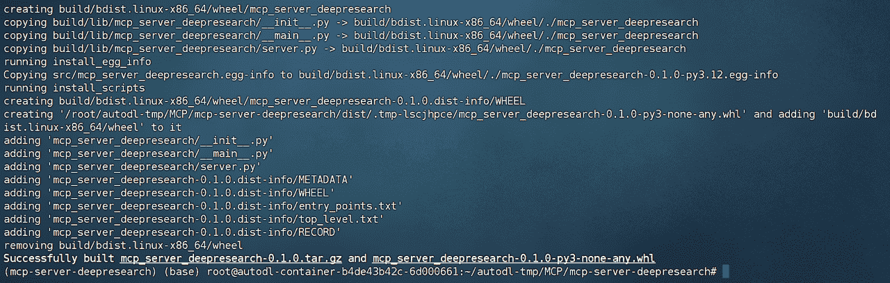

打包完成后会在主目录下新增一个dist文件夹：

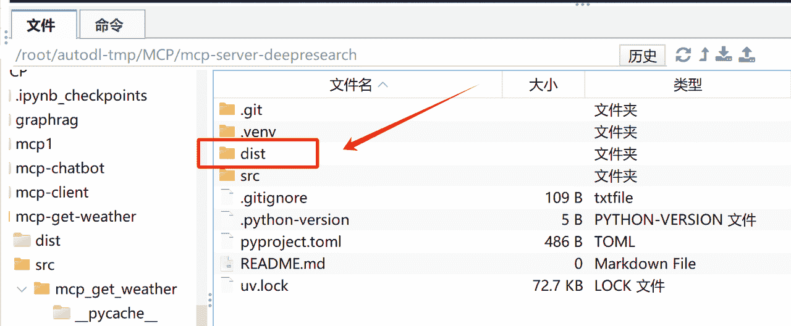

以及在src目录下会创建一个.egg-info文件夹，


这两个文件夹内容解释如下：

+   dist/ 文件夹：**打包产物目录**，会在 包含如下文件：

| 文件类型 | 说明 |
| --- | --- |
| .whl 文件 | Python wheel 格式的二进制分发包，最常用 |
| .tar.gz 文件 | 源代码包（source distribution） |

而在离线部署时候，别人安装时只要 pip install xxx.whl 就可以了（无需源码），同时上传到 PyPI、内网 PyPI、AI 模型平台等地方部署。

+   <proj**ect-na**me>.egg-info/ 文件夹：元数据文件夹，这个是 setuptools 在构建或打包时生成的一个“项目元信息目录”。比如会看到这样的结构：

```
mcp_server_deepresearch.egg-info/
├── PKG-INFO
├── SOURCES.txt
├── top_level.txt
├── dependency_links.txt
├── requires.txt
```

PKG-INFO：你项目的基本信息（名称、版本、作者、依赖等），requires.txt：列出依赖项，SOURCES.txt：列出所有打包进 .whl 的文件，top_level.txt：顶层包名（比如 mcp_server_deepresearch）。

### 2. 项目离线拷贝

接下来继续介绍离线拷贝流程。假设我们现在需要从服务器A上把项目拷贝到服务器B上，最简单的方法首先是在服务器A上进行项目压缩：

```
# 回到主目录 
# cd /root/autodl-tmp/MCP/mcp-server-deepresearch
tar --exclude=&#x27;.venv&#x27; -czvf mcp-server-deepresearch.tar.gz *
```

压缩后会创建一个名为mcp-server-deepresearch.tar.gz的文件：


将其下载后即可上传到服务器B上，例如将其上传到B服务器的/root/autodl-tmp/MCP/MCP-Test路径下：


然后即可使用如下命令进行解压缩：

```
tar -xzvf mcp-server-deepresearch.tar.gz
```


然后即可激活虚拟环境并相关依赖：

```
# 创建虚拟环境
uv venv

# 激活虚拟环境
source .venv/bin/activate

# 使用uv（推荐）或pip安装
uv pip install .
```


然后即可运行Inspector进行测试：

```
# 运行Inspector
npx -y @modelcontextprotocol/inspector uv run ./src/mcp_server_deepresearch/server.py --openai_api_key YOUR_KEY
```


完整项目压缩包在网盘中领取：


### 3. 项目发布到pipy平台

除了离线拷贝之外，我们也可以把自己开发完成的MCP Server发布到一些托管平台上方便其他人下载使用，如果是js开发的MCP Server可以发布在npm平台上，而如果是Python项目，则可以发布在pypi上。我们这里以pypi发布流程为例进行演示。首先需要先在pypi：https://pypi.org/上进行账号注册，然后获取API-KEY作为身份验证，


然后需要再次确认打包完成，并开启上传

```
# 回到项目主目录
# cd /root/autodl-tmp/MCP/mcp-server-deepresearch

# 若此前打包完成，则无需再次打包
# python -m build

# 上传到pypi平台
python -m twine upload dist/*
```


上传完成后即可在pypi中搜索到包的信息：


然后即可在本地测试调用。

这里以Cherry studio为例，尝试调用我们刚刚发布的DeepResearch包。点击添加服务器：


然后输入MCP服务器名称（随意填写），然后使用uvx进行下载，同时是stdio通信标准，并在参数中输入以下三行：

```
mcp-server-deepresearch
--openai_api_key
YOUR_API_KEY
```


然后点击右上方保存，即可开启验证并自动开启这项MCP工具。紧接着在对话过程中选择deepresearch工具，只要对话中明确表达了希望围绕某个问题进行深入研究，模型就会自动调用该MCP工具进行深度调研：


实际演示效果如下：

> 注，如果是离线拷贝的项目希望使用cherry studio进行调用，仅需在配置中写入：

```
/path/to/your/mcp-server-deepresearch
--openai_api_key
YOUR_API_KEY
```

> 也就是第一行改为离线项目的本地存储地址即可。

> 此外，若是在Cursor中调用，则可以写入如下配置：

```
{
  &quot;mcpServers&quot;: {
    &quot;deepresearch&quot;: {
      &quot;command&quot;: &quot;uvx&quot;,
      &quot;args&quot;: [
        &quot;mcp-server-deepresearch&quot;,
        &quot;--openai_api_key&quot;,
        &quot;OPENAI_API_KEY&quot;
      ]
    }
}
```

## 四、基于SSE传输方式的MCP服务器创建流程

以上MCP服务器都是stdio传输方式，而除此之外，目前MCP服务器还支持SSE传输和基于HTTP的流式传输。这两种传输方式也有非常广泛的实际用途，接下来详细介绍如何构建基于SSE和HTTP流式传输的MCP服务器。

### 1. stdio、SSE与基于HTTP的流式传输形式对比

#### 1.1 MCP通信协议介绍

**     ** MC**P（Model Context** Protocol）是一种为了统一大规模模型和工具间通信而设计的协议，它定义了消息格式和通信方式。MCP 协议支持多种传输机制，其中包括 stdio、Server-Sent Events（SSE） 和 Streamable HTTP。每种通信方法在不同的应用场景中具有不同的优劣势，适用于不同的需求。

#### 1.2 Stdio 传输（Standard Input/Output）

stdio 传输方式是最简单的通信方式，通常在本地工具之间进行消息传递时使用。它利用标准输入输出（stdin/stdout）作为数据传输通道，适用于本地进程间的交互。

+   **工作方式**：客户端和服务器通过标准输入输出流（stdin/stdout）进行通信。客户端向服务器发送命令和数据，服务器执行并通过标准输出返回结果。

+   **应用场景**：适用于本地开发、命令行工具、调试环境，或者模型和工具服务在同一进程内运行的情况。

#### 1.3 Server-Sent Events（SSE）

SSE 是基于 HTTP 协议的流式传输机制，它允许服务器通过 HTTP 单向推送事件到客户端。SSE 适用于客户端需要接收服务器推送的场景，通常用于实时数据更新。

+   **工作方式**：客户端通过 HTTP GET 请求建立与服务器的连接，服务器以流式方式持续向客户端发送数据，客户端通过解析流数据来获取实时信息。

+   **应用场景**：适用于需要服务器主动推送数据的场景，如实时聊天、天气预报、新闻更新等。

#### 1.4 **Streamable HTTP**

+   MCP更新公告：https://modelcontextprotocol.io/development/updates


+   Streamable HTTP协议内容：https://github.com/modelcontextprotocol/modelcontextprotocol/blob/main/docs/specification/2025-03-26/basic/transports.mdx#streamable-http


Streamable HTTP 是 MCP 协议中新引入的一种传输方式，它基于 HTTP 协议支持双向流式传输。与传统的 HTTP 请求响应模型不同，Streamable HTTP 允许服务器在一个长连接中实时向客户端推送数据，并且可以支持多个请求和响应的流式传输。

不过需要注意的是，MCP只提供了Streamable HTTP协议层的支持，也就是规范了MCP客户端在使用Streamable HTTP通信时的通信规则，而并没有提供相关的SDK客户端。开发者在开发Streamable HTTP机制下的客户端和服务器时，可以使用比如Python httpx库进行开发。

+   **工作方式**：客户端通过 HTTP POST 向服务器发送请求，并可以接收流式响应（如 JSON-RPC 响应或 SSE 流）。当请求数据较多或需要多次交互时，服务器可以通过长连接和分批推送的方式进行数据传输。

+   **应用场景**：适用于需要支持高并发、低延迟通信的分布式系统，尤其是跨服务或跨网络的应用。适合高并发的场景，如实时流媒体、在线游戏、金融交易系统等。

#### 1.1.4 **MCP 传输方式优劣势对比**

| 特性 | **Stdio** | **SSE** | **Streamable HTTP** |
| --- | --- | --- | --- |
| **通信方向** | 双向（但仅限本地） | 单向（服务器到客户端） | 双向（适用于复杂交互） |
| **使用场景** | 本地进程间通信 | 实时数据推送，浏览器支持 | 跨服务、分布式系统、大规模并发支持 |
| **支持并发连接数** | 低 | 中等 | 高（适合大规模并发） |
| **适应性** | 局限于本地环境 | 支持浏览器，但单向通信 | 高灵活性，支持流式数据与请求批处理 |
| **实现难度** | 简单，适合本地调试 | 简单，但浏览器兼容性和长连接限制 | 复杂，需处理长连接和流管理 |
| **适合的业务类型** | 本地命令行工具，调试环境 | 实时推送，新闻、股票等实时更新 | 高并发、分布式系统，实时交互系统 |

三种传输方式总结如下：

+   **Stdio**** 传输**：适合本地进程之间的简单通信，适合命令行工具或调试阶段，但不支持分布式。

+   **SSE**** 传输**：适合实时推送和客户端/浏览器的单向通知，但无法满足双向复杂交互需求。

+   **Streamable HTTP**** 传输**：最灵活、最强大的选项，适用于大规模并发、高度交互的分布式应用系统，虽然实现较复杂，但能够处理更复杂的场景。

### 2. 基于SSE传输的MCP服务器创建流程

需要注意的是，目前MCP SDK只提供了stdio和SSE两种传输方式的开发库，而暂时还没有提供基于流式HTTP传输的开发工具。因此在进行MCP开发过程中，实现stdio和SSE传输方式较为简单，但要实现流式传输的HTTP流程则会非常复杂。

这里我们先介绍相对简单的SSE传输方式的实现方法。当我们使用MCP Python SDK开发MCP服务器时，只需要在此处进行设置：

```
mcp.run(transport=&#x27;sse&#x27;)
```

即可让MCP服务器开启SSE模式，非常简单。这里我们以创建一个查询天气MCP服务器为例进行演示。

+   创建项目主目录

```
cd /root/autodl-tmp/MCP
mkdir ./MCP-sse-test
cd ./MCP-sse-test
```

+   创建基础项目结构

```
uv init mcp-get-weather
cd mcp-get-weather

# 创建虚拟环境
uv venv

# 激活虚拟环境
source .venv/bin/activate

uv add mcp httpx
```


然后删除主目录下的main.py文件，并创建代码文件夹：

```
mkdir -p ./src/mcp_get_weather
cd ./src/mcp_get_weather
```

+   创建服务器核心代码

在src/mcp_get_weather中创建三个代码文件：


其中server.py主要负责进行天气查询，代码如下：

```
import json
import httpx
import argparse  
from typing import Any
from mcp.server.fastmcp import FastMCP

# 初始化 MCP 服务器
mcp = FastMCP(&quot;WeatherServer&quot;)

# OpenWeather API 配置
OPENWEATHER_API_BASE = &quot;https://api.openweathermap.org/data/2.5/weather&quot;
API_KEY = None  
USER_AGENT = &quot;weather-app/1.0&quot;

async def fetch_weather(city: str) -&gt; dict[str, Any] | None:
    &quot;&quot;&quot;
    从 OpenWeather API 获取天气信息。
    &quot;&quot;&quot;
    if API_KEY is None:
        return {&quot;error&quot;: &quot;API_KEY 未设置，请提供有效的 OpenWeather API Key。&quot;}

    params = {
        &quot;q&quot;: city,
        &quot;appid&quot;: API_KEY,
        &quot;units&quot;: &quot;metric&quot;,
        &quot;lang&quot;: &quot;zh_cn&quot;
    }
    headers = {&quot;User-Agent&quot;: USER_AGENT}

    async with httpx.AsyncClient() as client:
        try:
            response = await client.get(OPENWEATHER_API_BASE, params=params, headers=headers, timeout=30.0)
            response.raise_for_status()
            return response.json()
        except httpx.HTTPStatusError as e:
            return {&quot;error&quot;: f&quot;HTTP 错误: {e.response.status_code}&quot;}
        except Exception as e:
            return {&quot;error&quot;: f&quot;请求失败: {str(e)}&quot;}

def format_weather(data: dict[str, Any] | str) -&gt; str:
    &quot;&quot;&quot;
    将天气数据格式化为易读文本。
    &quot;&quot;&quot;
    if isinstance(data, str):
        try:
            data = json.loads(data)
        except Exception as e:
            return f&quot;无法解析天气数据: {e}&quot;

    if &quot;error&quot; in data:
        return f&quot;⚠️ {data[&#x27;error&#x27;]}&quot;

    city = data.get(&quot;name&quot;, &quot;未知&quot;)
    country = data.get(&quot;sys&quot;, {}).get(&quot;country&quot;, &quot;未知&quot;)
    temp = data.get(&quot;main&quot;, {}).get(&quot;temp&quot;, &quot;N/A&quot;)
    humidity = data.get(&quot;main&quot;, {}).get(&quot;humidity&quot;, &quot;N/A&quot;)
    wind_speed = data.get(&quot;wind&quot;, {}).get(&quot;speed&quot;, &quot;N/A&quot;)
    weather_list = data.get(&quot;weather&quot;, [{}])
    description = weather_list[0].get(&quot;description&quot;, &quot;未知&quot;)

    return (
        f&quot;🌍 {city}, {country}\n&quot;
        f&quot;🌡 温度: {temp}°C\n&quot;
        f&quot;💧 湿度: {humidity}%\n&quot;
        f&quot;🌬 风速: {wind_speed} m/s\n&quot;
        f&quot;🌤 天气: {description}\n&quot;
    )

@mcp.tool()
async def query_weather(city: str) -&gt; str:
    &quot;&quot;&quot;
    输入指定城市的英文名称，返回今日天气查询结果。
    &quot;&quot;&quot;
    data = await fetch_weather(city)
    return format_weather(data)

def main():
    parser = argparse.ArgumentParser(description=&quot;Weather Server&quot;)
    parser.add_argument(&quot;--api_key&quot;, type=str, required=True, help=&quot;你的 OpenWeather API Key&quot;)
    args = parser.parse_args()
    global API_KEY
    API_KEY = args.api_key
    mcp.run(transport=&#x27;sse&#x27;)

if __name__ == &quot;__main__&quot;:
    main()
```

其仍然是采用了fastmcp进行创建，而在mcp.run中设置了使用sse方式进行传输。

```
mcp.run(transport=&#x27;sse&#x27;)
```

此外需要在__init__.py中写入

```
from .server import main
```

而在__main__.py中写入：

```
from mcp_get_weather import main

main()
```

同时回到主目录，修改项目配置文件pyproject.toml：

```
[build-system]
requires = [&quot;setuptools&gt;=61.0&quot;, &quot;wheel&quot;]
build-backend = &quot;setuptools.build_meta&quot;

[project]
name = &quot;mcp-get-weather&quot;
version = &quot;0.1.5&quot;
description = &quot;输入OpenWeather-API-KEY，获取天气信息。&quot;
readme = &quot;README.md&quot;
requires-python = &quot;&gt;=3.9&quot;
dependencies = [
    &quot;httpx&gt;=0.28.1&quot;,
    &quot;mcp&gt;=1.6.0&quot;,
    &quot;openai&gt;=1.75.0&quot;,
    &quot;python-dotenv&gt;=1.1.0&quot;,
]

[project.scripts]
mcp-get-weather = &quot;mcp_get_weather:main&quot;

[tool.setuptools]
package-dir = {&quot;&quot; = &quot;src&quot;}

[tool.setuptools.packages.find]
where = [&quot;src&quot;]
```

至此即完成了整个项目的代码编写工作。完整项目代码可在网盘中领取：


### 3. 基于SSE的MCP服务器测试与发布流程

#### 3.1 SSE MCP服务器测试流程

同样，接下来可以使用Inspector进行服务器性能测试，但有所不同的是，我们需要先开启MCP服务器，然后再开启Inspector：

> 在stdio模式下是开启Inspector时同步开启MCP Server

+   开启SSE MCP服务器：

```
# 回到项目主目录
# cd /root/autodl-tmp/MCP/MCP-sse-test/mcp-get-weather

uv run ./src/mcp_get_weather/server.py --api_key YOUR_KEY
```


+   开启Inspector

```
# 回到项目主目录
# cd /root/autodl-tmp/MCP/MCP-sse-test/mcp-get-weather

npx -y @modelcontextprotocol/inspector uv run ./src/mcp_get_weather/server.py --api_key YOUR_KEY
```


+   进行测试

+   同样，如果是使用AutoDL，则先需要使用隧道工具将端口映射到本地进行运行：


然后打开Inspector，并选择SSE模式，选择默认运行地址：http://localhost:8000/sse，然后点击connect：


然后输入地名进行测试：


完整测试流程如下：

#### 3.2 SSE MCP服务器发布与调用流程

测试完成后，即可上线发布。这里仍然考虑发布到pypi平台，并使用cherry studio进行本地调用测试。

+   打包上传：

```
# 回到项目主目录
# cd /root/autodl-tmp/MCP/MCP-sse-test/mcp-get-weather

uv pip install build twine
python -m build
python -m twine upload dist/*
```


+   查看发布的库：https://pypi.org/search/?q=mcp-get-weather


+   本地安装：

```
pip install mcp-get-weather
```


+   开启服务：uv run mcp-get-weather


然后即可打开浏览器输入http://localhost:8000/sse测试连接情况


> 注意，这里在服务器上开启服务然后本地连接也可以，和stdio不同，SSE模式下的MCP服务器并不需要本地运行。

+   使用Cherry studio进行连接

然后即可使用Cherry studio连接SSE模式下的MCP服务器，这里只需要输入服务器地址即可：


具体演示效果如下

至此我们就完成了两个服务器、同时也是两种类型的服务器的开发与部署流程。

## 五、基于HTTP流式传输的MCP服务器创建流程

最后一部分，让我们来介绍基于HTTP流式传输的MCP服务器创建流程。需要注意的是，尽管HTTP流式传输是理论上性能最好的传输方式，但开发和应用的门槛都很大，不仅目前MCP SDK没有HTTP流式传输开发工具，而且目前主流的MCP客户端，如Cherry Studio和Cursor等，对于HTTP流式传输的MCP服务器调用支持都很差，因此目前对于MCP来说，HTTP流式传输功能还处于初级阶段。

### 1. HTTP流式传输协议

上面谈到，目前MCP的各官方SDK并没有提供HTTP流式传输的MCP开发工具，因此HTTP流式传输的MCP服务器尚且停留在“协议阶段”，也就是说MCP提供了HTTP的传输协议，但没有提供对应能完成相关功能开发的SDK，开发者如果需要创建HTTP流式传输的MCP服务器，则需要先研究MCP HTTP流式传输协议，然后手动创建满足该协议的MCP Server。整体来看研发难度较大。

为此，我们首先需要深入研究MCP提出的HTTP流式传输基本协议。整个协议内容较多，这里需要重点关注以下几分材料：

#### 1.1 Streamable HTTP协议简介

+   文档连接：https://github.com/modelcontextprotocol/modelcontextprotocol/blob/main/docs/specification/2025-03-26/basic/transports.mdx#streamable-http


其中详细说明了HTTP流式传输的基本协议，也可以通过如下流程进行说明：


#### 1.2 HTTP进程生命周期

+   文档地址：https://github.com/modelcontextprotocol/modelcontextprotocol/blob/main/docs/specification/2025-03-26/basic/lifecycle.mdx


其中详细介绍了从开始会话到结束的完整服务器生命周期进程，也可以用下图进行展示：


#### 1.3 HTTP服务器外部工具调用识别与调用流程

+   文档地址：https://github.com/modelcontextprotocol/modelcontextprotocol/blob/main/docs/specification/2025-03-26/server/tools.mdx


其中详细说明了HTTP流式传输服务器与客户端之间的通信流程，以及外部工具信息同步格式与流程等，也可以用下图进行说明：


#### 1.4 HTTP流式传输MCP服务器与客户端通信流程

下面按 客户端首次启动 ➜ 成功连到服务器 ➜ 等待用户提问 这一完整过程，把 MCP Streamable HTTP 的请求–响应顺序用时间线列出来，帮助你完全掌握每一步在干什么。

+   启动时： 3 步握手（无用户输入）

| 时刻 | HTTP | JSON-RPC method | 作用 | 服务器典型响应 |
| --- | --- | --- | --- | --- |
| **①** | **POST /mcp** | initialize | 协商协议版本 &amp; 能力 | result.protocolVersion = 2024-11-05``result.capabilities.tools.listChanged = true |
| **②** | **POST /mcp** | notifications/initialized | **告诉服务器“我已就绪”（通知** ⇒ 服务器只回 204 No Content） | HTTP 204 无包体 |
| **③** | **POST /mcp** | tools/list | 向服务器要工具清单 | result.tools 数组 + nextCursor |

+   当用户第一次提问时（模型判断要用工具）

| 时刻 | HTTP | JSON-RPC method | 内容要点 |
| --- | --- | --- | --- |
| **④** | **POST /mcp** | tools/call | params.name = get_weather``params.arguments.city 或 location |
| **⑤** | **流式响应** | stream / result | 服务器逐行推送：• 进度 stream• 成功 result.content[] |

客户端在收到 **⑤** 的最终 result 后，把文本回填到 LLM，LLM 再输出给终端——你就看到天气结果啦。

+   **详细顺序（带状态码）**

1.  **POST /mcp → 200** initialize

1.  **POST /mcp → 204** notifications/initialized

1.  **POST /mcp → 200** tools/list

1.  ——等待用户——

1.  POST /mcp → 200/stream tools/call （服务器保持连接，逐行推流）

+   JSON 一行 {"stream": "正在查询…"}…

+   JSON 一行 {"result": { "content":[…] }} → 服务器随后关闭流

> 如果有多次工具调用，步骤 ④ – ⑤ 会重复，每次 id 自增。

完整流程总结如下：

| 场景 | 服务器应当… |
| --- | --- |
| **客户端重新连接** | 再走 ①②③，每轮 initialize 会话独立 |
| **需要分页工具** | 在 ③ 返回 nextCursor ≠ null，客户端会继续 tools/list |
| **通知工具列表变更** | 主动 notifications/tools/list_changed，客户端再发 tools/list 拉新列表 |

> **JSON-RPC** 是一种用 JSON 编写的、结构化的远程调用协议。其基本格式结构如下：

| 类型 | 字段 | 说明 |
| --- | --- | --- |
| 请求 | jsonrpc | 固定为 &quot;2.0&quot; |
|  | id | 请求编号，用于对应请求与响应 |
|  | method | 要调用的方法名（比如 &quot;tools/call&quot;） |
|  | params | 方法参数（可以是对象或数组） |
| 响应 | jsonrpc | 也要写 &quot;2.0&quot; |
|  | id | 与请求的 ID 一致 |
|  | result | 成功返回值（只需 result） |
|  | error | 如果出错则返回 error 对象 |

### 2. HTTP流式传输MCP服务器开发流程

+   创建项目文件：

```
cd /root/autodl-tmp/MCP/MCP-sse-test
uv init mcp-weather-http
cd mcp-weather-http

# 创建虚拟环境
uv venv

# 激活虚拟环境
source .venv/bin/activate

uv add mcp httpx fastapi
```


```
mkdir -p ./src/mcp_weather_http
cd ./src/mcp_weather_http
```

然后创建server.py


并写入如下代码：

```
&quot;&quot;&quot;weather_http_server_v8.py – MCP Streamable HTTP (Cherry‑Studio verified)
==========================================================================
• initialize  → protocolVersion + capabilities(streaming + tools.listChanged)
                + friendly instructions
• notifications/initialized → ignored (204)
• tools/list  → single-page tool registry (get_weather)
• tools/call  → execute get_weather, stream JSON (content[])
• GET → 405 (no SSE stream implemented)
&quot;&quot;&quot;

from __future__ import annotations

import argparse
import asyncio
import json
from typing import Any, AsyncIterator

import httpx
from fastapi import FastAPI, Request, Response, status
from fastapi.responses import StreamingResponse

# ---------------------------------------------------------------------------
# Server constants
# ---------------------------------------------------------------------------
SERVER_NAME = &quot;WeatherServer&quot;
SERVER_VERSION = &quot;1.0.0&quot;
PROTOCOL_VERSION = &quot;2024-11-05&quot;  # Cherry Studio current

# ---------------------------------------------------------------------------
# Weather helpers
# ---------------------------------------------------------------------------
OPENWEATHER_URL = &quot;https://api.openweathermap.org/data/2.5/weather&quot;
API_KEY: str | None = None
USER_AGENT = &quot;weather-app/1.0&quot;


async def fetch_weather(city: str) -&gt; dict[str, Any]:
    if not API_KEY:
        return {&quot;error&quot;: &quot;API_KEY 未设置，请提供有效的 OpenWeather API Key。&quot;}
    params = {&quot;q&quot;: city, &quot;appid&quot;: API_KEY, &quot;units&quot;: &quot;metric&quot;, &quot;lang&quot;: &quot;zh_cn&quot;}
    headers = {&quot;User-Agent&quot;: USER_AGENT}
    async with httpx.AsyncClient(timeout=30.0) as client:
        try:
            r = await client.get(OPENWEATHER_URL, params=params, headers=headers)
            r.raise_for_status()
            return r.json()
        except httpx.HTTPStatusError as exc:
            return {&quot;error&quot;: f&quot;HTTP 错误: {exc.response.status_code}&quot;}
        except Exception as exc:  # noqa: BLE001
            return {&quot;error&quot;: f&quot;请求失败: {exc}&quot;}


def format_weather(data: dict[str, Any]) -&gt; str:
    if &quot;error&quot; in data:
        return data[&quot;error&quot;]
    city = data.get(&quot;name&quot;, &quot;未知&quot;)
    country = data.get(&quot;sys&quot;, {}).get(&quot;country&quot;, &quot;未知&quot;)
    temp = data.get(&quot;main&quot;, {}).get(&quot;temp&quot;, &quot;N/A&quot;)
    humidity = data.get(&quot;main&quot;, {}).get(&quot;humidity&quot;, &quot;N/A&quot;)
    wind = data.get(&quot;wind&quot;, {}).get(&quot;speed&quot;, &quot;N/A&quot;)
    desc = data.get(&quot;weather&quot;, [{}])[0].get(&quot;description&quot;, &quot;未知&quot;)
    return (
        f&quot;🌍 {city}, {country}\n&quot;
        f&quot;🌡 温度: {temp}°C\n&quot;
        f&quot;💧 湿度: {humidity}%\n&quot;
        f&quot;🌬 风速: {wind} m/s\n&quot;
        f&quot;🌤 天气: {desc}&quot;
    )


async def stream_weather(city: str, req_id: int | str) -&gt; AsyncIterator[bytes]:
    # progress chunk
    yield json.dumps({&quot;jsonrpc&quot;: &quot;2.0&quot;, &quot;id&quot;: req_id, &quot;stream&quot;: f&quot;查询 {city} 天气中…&quot;}).encode() + b&quot;\n&quot;

    await asyncio.sleep(0.3)
    data = await fetch_weather(city)

    if &quot;error&quot; in data:
        yield json.dumps({&quot;jsonrpc&quot;: &quot;2.0&quot;, &quot;id&quot;: req_id, &quot;error&quot;: {&quot;code&quot;: -32000, &quot;message&quot;: data[&quot;error&quot;]}}).encode() + b&quot;\n&quot;
        return

    yield json.dumps({
        &quot;jsonrpc&quot;: &quot;2.0&quot;, &quot;id&quot;: req_id,
        &quot;result&quot;: {
            &quot;content&quot;: [
                {&quot;type&quot;: &quot;text&quot;, &quot;text&quot;: format_weather(data)}
            ],
            &quot;isError&quot;: False
        }
    }).encode() + b&quot;\n&quot;

# ---------------------------------------------------------------------------
# FastAPI app
# ---------------------------------------------------------------------------
app = FastAPI(title=&quot;WeatherServer HTTP-Stream v8&quot;)

TOOLS_REGISTRY = {
    &quot;tools&quot;: [
        {
            &quot;name&quot;: &quot;get_weather&quot;,
            &quot;description&quot;: &quot;用于进行天气信息查询的函数，输入城市英文名称，即可获得当前城市天气信息。&quot;,
            &quot;inputSchema&quot;: {
                &quot;type&quot;: &quot;object&quot;,
                &quot;properties&quot;: {
                    &quot;city&quot;: {
                        &quot;type&quot;: &quot;string&quot;,
                        &quot;description&quot;: &quot;City name, e.g. &#x27;Hangzhou&#x27;&quot;
                    }
                },
                &quot;required&quot;: [&quot;city&quot;]
            }
        }
    ],
    &quot;nextCursor&quot;: None
}


@app.get(&quot;/mcp&quot;)
async def mcp_initialize_via_get():
    #  GET 请求也执行了 initialize 方法
    return {
        &quot;jsonrpc&quot;: &quot;2.0&quot;,
        &quot;id&quot;: 0,
        &quot;result&quot;: {
            &quot;protocolVersion&quot;: PROTOCOL_VERSION,
            &quot;capabilities&quot;: {
                &quot;streaming&quot;: True,
                &quot;tools&quot;: {&quot;listChanged&quot;: True}
            },
            &quot;serverInfo&quot;: {
                &quot;name&quot;: SERVER_NAME,
                &quot;version&quot;: SERVER_VERSION
            },
            &quot;instructions&quot;: &quot;Use the get_weather tool to fetch weather by city name.&quot;
        }
    }

@app.post(&quot;/mcp&quot;)
async def mcp_endpoint(request: Request):
    try:
        body = await request.json()
        # ✅ 打印客户端请求内容
        print(&quot;💡 收到请求:&quot;, json.dumps(body, ensure_ascii=False, indent=2))
    except Exception:
        return {&quot;jsonrpc&quot;: &quot;2.0&quot;, &quot;id&quot;: None, &quot;error&quot;: {&quot;code&quot;: -32700, &quot;message&quot;: &quot;Parse error&quot;}}

    req_id = body.get(&quot;id&quot;, 1)
    method = body.get(&quot;method&quot;)
    
    # ✅ 打印当前方法类型
    print(f&quot;🔧 方法: {method}&quot;)
    
    # 0) Ignore initialized notification (no response required)
    if method == &quot;notifications/initialized&quot;:
        return Response(status_code=status.HTTP_204_NO_CONTENT)

    # 1) Activation probe (no method)
    if method is None:
        return {&quot;jsonrpc&quot;: &quot;2.0&quot;, &quot;id&quot;: req_id, &quot;result&quot;: {&quot;status&quot;: &quot;MCP server online.&quot;}}

    # 2) initialize
    if method == &quot;initialize&quot;:
        return {
            &quot;jsonrpc&quot;: &quot;2.0&quot;, &quot;id&quot;: req_id,
            &quot;result&quot;: {
                &quot;protocolVersion&quot;: PROTOCOL_VERSION,
                &quot;capabilities&quot;: {
                    &quot;streaming&quot;: True,
                    &quot;tools&quot;: {&quot;listChanged&quot;: True}
                },
                &quot;serverInfo&quot;: {&quot;name&quot;: SERVER_NAME, &quot;version&quot;: SERVER_VERSION},
                &quot;instructions&quot;: &quot;Use the get_weather tool to fetch weather by city name.&quot;
            }
        }

    # 3) tools/list
    if method == &quot;tools/list&quot;:
        print(json.dumps(TOOLS_REGISTRY, indent=2, ensure_ascii=False))
        return {&quot;jsonrpc&quot;: &quot;2.0&quot;, &quot;id&quot;: req_id, &quot;result&quot;: TOOLS_REGISTRY}

    # 4) tools/call
    if method == &quot;tools/call&quot;:
        params = body.get(&quot;params&quot;, {})
        tool_name = params.get(&quot;name&quot;)
        args = params.get(&quot;arguments&quot;, {})

        if tool_name != &quot;get_weather&quot;:
            return {&quot;jsonrpc&quot;: &quot;2.0&quot;, &quot;id&quot;: req_id, &quot;error&quot;: {&quot;code&quot;: -32602, &quot;message&quot;: &quot;Unknown tool&quot;}}

        city = args.get(&quot;city&quot;)
        if not city:
            return {&quot;jsonrpc&quot;: &quot;2.0&quot;, &quot;id&quot;: req_id, &quot;error&quot;: {&quot;code&quot;: -32602, &quot;message&quot;: &quot;Missing city&quot;}}

        return StreamingResponse(stream_weather(city, req_id), media_type=&quot;application/json&quot;)

    # 5) unknown method
    return {&quot;jsonrpc&quot;: &quot;2.0&quot;, &quot;id&quot;: req_id, &quot;error&quot;: {&quot;code&quot;: -32601, &quot;message&quot;: &quot;Method not found&quot;}}

# ---------------------------------------------------------------------------
# Runner
# ---------------------------------------------------------------------------

def main() -&gt; None:
    parser = argparse.ArgumentParser(description=&quot;Weather MCP HTTP-Stream v8&quot;)
    parser.add_argument(&quot;--api_key&quot;, required=True)
    parser.add_argument(&quot;--host&quot;, default=&quot;127.0.0.1&quot;)
    parser.add_argument(&quot;--port&quot;, type=int, default=8000)
    args = parser.parse_args()

    global API_KEY
    API_KEY = args.api_key

    import uvicorn
    uvicorn.run(app, host=args.host, port=args.port, log_level=&quot;info&quot;)


if __name__ == &quot;__main__&quot;:
    main()
```

代码解释如下：总体结构说明

```
📦 weather_http_server_v8.py
├── 常量定义（协议版本 + OpenWeather 配置）
├── 工具方法（fetch_weather、format_weather、stream_weather）
├── FastAPI 路由
│   ├── GET /mcp  → 可选支持
│   └── POST /mcp → 支持所有 JSON-RPC 调用
└── main()        → 启动 uvicorn 服务器
```

1️⃣ 头部信息（元数据 + 模块引入）

```
&quot;&quot;&quot;weather_http_server_v8.py – MCP Streamable HTTP (Cherry‑Studio verified)
• initialize → 声明 streaming + tools.listChanged 能力
• tools/list → 提供 get_weather 工具
• tools/call → 调用后 stream JSON 数据
• GET → 405 或简单返回信息（支持 Cherry 探测）
&quot;&quot;&quot;
```

✔ 简洁明了地说明这个服务符合 Cherry Studio 所支持的 MCP HTTP 协议子集。

2️⃣ 常量定义

```
SERVER_NAME = &quot;WeatherServer&quot;
SERVER_VERSION = &quot;1.0.0&quot;
PROTOCOL_VERSION = &quot;2024-11-05&quot;  # MCP 规定版本号

OPENWEATHER_URL = &quot;https://api.openweathermap.org/data/2.5/weather&quot;
API_KEY: str | None = None  # 启动时注入
USER_AGENT = &quot;weather-app/1.0&quot;
```

✔ 提前定义版本号、天气接口、全局变量等。

3️⃣ 天气处理逻辑

```
async def fetch_weather(city: str) -&gt; dict[str, Any]:
```

+   向 OpenWeather API 请求天气数据

+   自动处理错误（比如 key 不对、超时）

```
def format_weather(data: dict[str, Any]) -&gt; str:
```

+   把原始 JSON 格式化成可读文本 🌤️

```
async def stream_weather(city: str, req_id: int | str) -&gt; AsyncIterator[bytes]:
```

+   生成器流式返回天气内容（符合 MCP 协议的逐行 JSON）

示例输出：

```
{&quot;jsonrpc&quot;: &quot;2.0&quot;, &quot;id&quot;: 1, &quot;stream&quot;: &quot;查询 Hangzhou 天气中…&quot;}
{&quot;jsonrpc&quot;: &quot;2.0&quot;, &quot;id&quot;: 1, &quot;result&quot;: { &quot;content&quot;: [{&quot;type&quot;:&quot;text&quot;,&quot;text&quot;:&quot;🌡 温度: 22°C&quot;}] }}
```

4️⃣ MCP 工具注册表

```
TOOLS_REGISTRY = {
  &quot;tools&quot;: [
    {
      &quot;name&quot;: &quot;get_weather&quot;,
      &quot;description&quot;: &quot;...&quot;,
      &quot;inputSchema&quot;: {
        &quot;type&quot;: &quot;object&quot;,
        &quot;properties&quot;: {
          &quot;city&quot;: {
            &quot;type&quot;: &quot;string&quot;,
            &quot;description&quot;: &quot;City name, e.g. &#x27;Hangzhou&#x27;&quot;
          }
        },
        &quot;required&quot;: [&quot;city&quot;]
      }
    }
  ],
  &quot;nextCursor&quot;: None
}
```

✔ 符合 MCP 2025-03-26 文档对 tools/list 的格式要求。

5️⃣ 核心路由逻辑（FastAPI）

✔ /mcp [GET]

```
@app.get(&quot;/mcp&quot;)
```

+   Cherry Studio 在探测时会发 GET 请求

+   我们这里返回一个 initialize 风格的响应

✔ /mcp [POST]

```
@app.post(&quot;/mcp&quot;)
async def mcp_endpoint(request: Request):
```

整个 MCP 协议的核心路由！

| JSON-RPC 方法 | 说明 |
| --- | --- |
| initialize | 返回协议版本、能力列表 |
| notifications/initialized | 无需响应（204） |
| tools/list | 返回工具清单 |
| tools/call | 开始天气查询（流式） |
| 未知 method | 返回 -32601 错误 |

6️⃣main() 启动逻辑

```
def main():
    parser.add_argument(&quot;--api_key&quot;, required=True)
    uvicorn.run(app, host=..., port=...)
```

✔ 从命令行传入 OpenWeather 的 API Key 并启动服务。

```
uv run ./server.py --api_key 你的key
```

### 3. HTTP流式传输MCP服务器开启与测试

在创建完server.py后，我们可以开启服务并进行测试。需要注意的是，Inspector并不支持流式传输的MCP服务器测试，我们只能基于对HTTP流式传输的协议理解，创建一个测试流程。

+   开启HTTP流式传输服务器

```
# 回到项目主目录
# cd /root/autodl-tmp/MCP/MCP-sse-test/mcp-weather-http
uv run ./src/mcp_weather_http/server.py --api_key YOUR_API_KEY
```


接下来我们通过 **4 个 ****curl**** 命令**来模拟 MCP 客户端与服务器的标准通信流程。

+   ① initialize 请求（能力协商）

```
curl -X POST http://localhost:8000/mcp \
  -H &quot;Content-Type: application/json&quot; \
  -d &#x27;{
        &quot;jsonrpc&quot;: &quot;2.0&quot;,
        &quot;id&quot;: 1,
        &quot;method&quot;: &quot;initialize&quot;,
        &quot;params&quot;: {
          &quot;protocolVersion&quot;: &quot;2024-11-05&quot;
        }
      }&#x27;
```

期望响应：返回服务器支持的协议版本、功能：


+   ② notifications/initialized 通知（确认上线）

```
curl -X POST http://localhost:8000/mcp \
  -H &quot;Content-Type: application/json&quot; \
  -d &#x27;{
        &quot;jsonrpc&quot;: &quot;2.0&quot;,
        &quot;method&quot;: &quot;notifications/initialized&quot;
      }&#x27;
```

📥 期望响应：204 No Content（因为是通知类型）：


+   ③ tools/list 请求（获取工具注册表）

```
curl -X POST http://localhost:8000/mcp \
  -H &quot;Content-Type: application/json&quot; \
  -d &#x27;{
        &quot;jsonrpc&quot;: &quot;2.0&quot;,
        &quot;id&quot;: 2,
        &quot;method&quot;: &quot;tools/list&quot;,
        &quot;params&quot;: {}
      }&#x27;
```

📥 期望响应：返回工具清单， get_weather 工具的结构体和 schema：


+   ④ tools/call 请求（调用实际工具，流式返回）

```
curl -N -X POST http://localhost:8000/mcp \
  -H &quot;Content-Type: application/json&quot; \
  -d &#x27;{
        &quot;jsonrpc&quot;: &quot;2.0&quot;,
        &quot;id&quot;: 3,
        &quot;method&quot;: &quot;tools/call&quot;,
        &quot;params&quot;: {
          &quot;name&quot;: &quot;get_weather&quot;,
          &quot;arguments&quot;: {
            &quot;city&quot;: &quot;Hangzhou&quot;
          }
        }
      }&#x27;
```

📥 期望响应（逐行输出）：


脚本完整代码：


### 4. HTTP流式传输MCP服务器Cherry Studio调用测试

在基本测试完HTTP流式传输MCP服务器基本功能后，接下来即可接入MCP进行测试。需要注意的是，目前Cherry Studio版本更新迭代较快，部分情况下尚无法稳定支持HTTP流式传输MCP服务器的调用，因此以下流程不一定能顺利完成。若以下流程无法顺利完成，可以看下一节自定义MCP HTTP流式传输客户端进行调用测试。

+   工具名称：weather-http

+   URL：http://localhost:8000/mcp

+   请求头：Content-Type=application/json


具体演示效果如下：

### 5. 自定义MCP客户端Client接入HTTP流式传输MCP服务器

截止目前，主流的MCP客户端都无法很好的完成HTTP流式MCP服务器的接入，因此这里为大家介绍如何从零编写MCP客户端，并按照标准流程接入HTTP流式MCP服务器。

#### 5.1 编写client.py脚本

```
# 回到代码文件夹
cd /root/autodl-tmp/MCP/MCP-sse-test/mcp-weather-http/src/mcp_weather_http
```

创建client.py：


然后写入如下代码：

```
&quot;&quot;&quot;mcp_http_client.py – Async MCP client (Streamable HTTP)
===========================================================
• 完全移除 stdio 传输，改用 Streamable HTTP (POST + optional SSE)
• 支持 initialize → notifications/initialized → tools/list → tools/call
• 自动处理 line‑delimited JSON stream (application/json 或 text/event-stream)
• 保留交互式 chat_loop，兼容 OpenAI Function Calling
&quot;&quot;&quot;

from __future__ import annotations

import asyncio
import json
import logging
import os
from contextlib import AsyncExitStack
from typing import Any, Dict, List, Optional

import httpx
from dotenv import load_dotenv
from openai import OpenAI

################################################################################
# 通用配置加载
################################################################################

class Configuration:
    def __init__(self) -&gt; None:
        load_dotenv()
        self.api_key = os.getenv(&quot;LLM_API_KEY&quot;)
        self.base_url = os.getenv(&quot;BASE_URL&quot;)
        self.model = os.getenv(&quot;MODEL&quot;, &quot;gpt-4o&quot;)
        if not self.api_key:
            raise ValueError(&quot;❌ 未找到 LLM_API_KEY，请在 .env 文件中配置&quot;)

    @staticmethod
    def load_config(path: str) -&gt; Dict[str, Any]:
        with open(path, &quot;r&quot;, encoding=&quot;utf-8&quot;) as f:
            return json.load(f)

################################################################################
# HTTP‑based MCP Server wrapper
################################################################################

class HTTPMCPServer:
    &quot;&quot;&quot;与单个 MCP Streamable HTTP 服务器通信&quot;&quot;&quot;

    def __init__(self, name: str, endpoint: str) -&gt; None:
        self.name = name
        self.endpoint = endpoint.rstrip(&quot;/&quot;)  # e.g. http://localhost:8000/mcp
        self.session: Optional[httpx.AsyncClient] = None
        self.protocol_version: str = &quot;2024-11-05&quot;

    async def initialize(self) -&gt; None:
        self.session = httpx.AsyncClient(timeout=httpx.Timeout(30.0))
        # 1) initialize
        init_req = {
            &quot;jsonrpc&quot;: &quot;2.0&quot;,
            &quot;id&quot;: 0,
            &quot;method&quot;: &quot;initialize&quot;,
            &quot;params&quot;: {
                &quot;protocolVersion&quot;: self.protocol_version,
                &quot;capabilities&quot;: {},
                &quot;clientInfo&quot;: {&quot;name&quot;: &quot;HTTP-MCP-Demo&quot;, &quot;version&quot;: &quot;0.1&quot;},
            },
        }
        r = await self._post_json(init_req)
        if &quot;error&quot; in r:
            raise RuntimeError(f&quot;Initialize error: {r[&#x27;error&#x27;]}&quot;)
        # 2) send initialized notification (no response expected)
        await self._post_json({&quot;jsonrpc&quot;: &quot;2.0&quot;, &quot;method&quot;: &quot;notifications/initialized&quot;})

    async def list_tools(self) -&gt; List[Dict[str, Any]]:
        req = {&quot;jsonrpc&quot;: &quot;2.0&quot;, &quot;id&quot;: 1, &quot;method&quot;: &quot;tools/list&quot;, &quot;params&quot;: {}}
        res = await self._post_json(req)
        return res[&quot;result&quot;][&quot;tools&quot;]

    async def call_tool_stream(self, tool_name: str, arguments: Dict[str, Any]) -&gt; str:
        &quot;&quot;&quot;调用工具并将流式结果拼接为完整文本&quot;&quot;&quot;
        req = {
            &quot;jsonrpc&quot;: &quot;2.0&quot;,
            &quot;id&quot;: 3,
            &quot;method&quot;: &quot;tools/call&quot;,
            &quot;params&quot;: {&quot;name&quot;: tool_name, &quot;arguments&quot;: arguments},
        }
        assert self.session is not None
        async with self.session.stream(
            &quot;POST&quot;, self.endpoint, json=req, headers={&quot;Accept&quot;: &quot;application/json&quot;}
        ) as resp:
            if resp.status_code != 200:
                raise RuntimeError(f&quot;HTTP {resp.status_code}&quot;)
            collected_text: List[str] = []
            async for line in resp.aiter_lines():
                if not line:
                    continue
                chunk = json.loads(line)
                if &quot;stream&quot; in chunk:
                    continue  # 中间进度
                if &quot;error&quot; in chunk:
                    raise RuntimeError(chunk[&quot;error&quot;][&quot;message&quot;])
                if &quot;result&quot; in chunk:
                    # 根据协议，文本在 result.content[0].text
                    for item in chunk[&quot;result&quot;][&quot;content&quot;]:
                        if item[&quot;type&quot;] == &quot;text&quot;:
                            collected_text.append(item[&quot;text&quot;])
            return &quot;\n&quot;.join(collected_text)

    async def _post_json(self, payload: Dict[str, Any]) -&gt; Dict[str, Any]:
        assert self.session is not None
        r = await self.session.post(self.endpoint, json=payload, headers={&quot;Accept&quot;: &quot;application/json&quot;})
        if r.status_code == 204 or not r.content:
            return {}          # ← 通知无响应体
        r.raise_for_status()
        return r.json()

    async def close(self) -&gt; None:
        if self.session:
            await self.session.aclose()
            self.session = None

################################################################################
# LLM 封装（OpenAI Function‑Calling）
################################################################################

class LLMClient:
    def __init__(self, api_key: str, base_url: Optional[str], model: str) -&gt; None:
        self.client = OpenAI(api_key=api_key, base_url=base_url)
        self.model = model

    def chat(self, messages: List[Dict[str, Any]], tools: Optional[List[Dict[str, Any]]]):
        return self.client.chat.completions.create(model=self.model, messages=messages, tools=tools)

################################################################################
# 多服务器 MCP + LLM Function Calling
################################################################################

class MultiHTTPMCPClient:
    def __init__(self, servers_conf: Dict[str, Any], api_key: str, base_url: Optional[str], model: str) -&gt; None:
        self.servers: Dict[str, HTTPMCPServer] = {
            name: HTTPMCPServer(name, cfg[&quot;endpoint&quot;]) for name, cfg in servers_conf.items()
        }
        self.llm = LLMClient(api_key, base_url, model)
        self.all_tools: List[Dict[str, Any]] = []  # 转为 OAI FC 的 tools 数组

    async def start(self):
        for srv in self.servers.values():
            await srv.initialize()
            tools = await srv.list_tools()
            for t in tools:
                # 重命名以区分不同服务器
                full_name = f&quot;{srv.name}_{t[&#x27;name&#x27;]}&quot;
                self.all_tools.append({
                    &quot;type&quot;: &quot;function&quot;,
                    &quot;function&quot;: {
                        &quot;name&quot;: full_name,
                        &quot;description&quot;: t[&quot;description&quot;],
                        &quot;parameters&quot;: t[&quot;inputSchema&quot;],
                    },
                })
        logging.info(&quot;已连接服务器并汇总工具：%s&quot;, [t[&quot;function&quot;][&quot;name&quot;] for t in self.all_tools])

    async def call_local_tool(self, full_name: str, args: Dict[str, Any]) -&gt; str:
        srv_name, tool_name = full_name.split(&quot;_&quot;, 1)
        srv = self.servers[srv_name]
        # 兼容 city/location
        city = args.get(&quot;city&quot;) or args.get(&quot;location&quot;)
        if not city:
            raise ValueError(&quot;Missing city/location&quot;)
        return await srv.call_tool_stream(tool_name, {&quot;city&quot;: city})

    async def chat_loop(self):
        print(&quot;🤖 HTTP MCP + Function Calling 客户端已启动，输入 quit 退出&quot;)
        messages: List[Dict[str, Any]] = []
        while True:
            user = input(&quot;你: &quot;).strip()
            if user.lower() == &quot;quit&quot;:
                break
            messages.append({&quot;role&quot;: &quot;user&quot;, &quot;content&quot;: user})
            # 1st LLM call
            resp = self.llm.chat(messages, self.all_tools)
            choice = resp.choices[0]
            if choice.finish_reason == &quot;tool_calls&quot;:
                tc = choice.message.tool_calls[0]
                tool_name = tc.function.name
                tool_args = json.loads(tc.function.arguments)
                print(f&quot;[调用工具] {tool_name} → {tool_args}&quot;)
                tool_resp = await self.call_local_tool(tool_name, tool_args)
                messages.append(choice.message.model_dump())
                messages.append({&quot;role&quot;: &quot;tool&quot;, &quot;content&quot;: tool_resp, &quot;tool_call_id&quot;: tc.id})
                resp2 = self.llm.chat(messages, self.all_tools)
                print(&quot;AI:&quot;, resp2.choices[0].message.content)
                messages.append(resp2.choices[0].message.model_dump())
            else:
                print(&quot;AI:&quot;, choice.message.content)
                messages.append(choice.message.model_dump())

    async def close(self):
        for s in self.servers.values():
            await s.close()

################################################################################
# main entry
################################################################################

async def main():
    logging.basicConfig(level=logging.INFO, format=&quot;%(asctime)s - %(levelname)s - %(message)s&quot;)
    conf = Configuration()
    servers_conf = conf.load_config(&quot;./src/mcp_weather_http/servers_config.json&quot;).get(&quot;mcpServers&quot;, {})
    client = MultiHTTPMCPClient(servers_conf, conf.api_key, conf.base_url, conf.model)
    try:
        await client.start()
        await client.chat_loop()
    finally:
        await client.close()

if __name__ == &quot;__main__&quot;:
    asyncio.run(main())
```

具体代码解释如下：模块结构概览

```
mcp_http_client.py
├── Configuration         # 读取 API Key 和服务器配置
├── HTTPMCPServer         # 单个 HTTP-MCP 服务器的连接逻辑
├── LLMClient             # OpenAI Function Calling 包装器
├── MultiHTTPMCPClient    # 多服务器协调 + 聊天交互循环
└── main()                # 启动入口
```

1️⃣ Configuration：环境变量和 JSON 配置加载器

```
class Configuration:
    def __init__(self):
        load_dotenv()
        self.api_key = os.getenv(&quot;LLM_API_KEY&quot;)
        self.base_url = os.getenv(&quot;BASE_URL&quot;)
        self.model = os.getenv(&quot;MODEL&quot;, &quot;gpt-4o&quot;)
```

✔ 支持从 .env 中加载 API key，并读取 servers_config.json 来配置 MCP 服务器：

```
{
  &quot;mcpServers&quot;: {
    &quot;weather&quot;: {
      &quot;endpoint&quot;: &quot;http://localhost:8000/mcp&quot;
    }
  }
}
```

2️⃣ HTTPMCPServer：与单个 MCP 服务器交互

这是每个 MCP 工具服务器的**小助手**，支持四个核心操作：

✔ 初始化 handshake（初始化 → 初始化通知）

```
await self._post_json({
  &quot;method&quot;: &quot;initialize&quot;,
  &quot;params&quot;: {&quot;protocolVersion&quot;: &quot;2024-11-05&quot;, ...}
})
await self._post_json({
  &quot;method&quot;: &quot;notifications/initialized&quot;
})
```

服务器返回支持的功能后，客户端表示“准备好了”。

✔ 获取工具列表

```
await self._post_json({
  &quot;method&quot;: &quot;tools/list&quot;,
  &quot;params&quot;: {}
})
```

返回所有支持的工具定义，包括 name、description、inputSchema。

✔ 工具调用（流式读取）

```
async def call_tool_stream(...)
```

使用 httpx.stream(...) 开始调用，逐行 aiter_lines() 读取服务器响应。

+   跳过 "stream" 字段

+   捕获 "result" → 拼接成文本

+   抛出 "error" → 报错提示

例如天气服务会逐行返回：

```
{&quot;stream&quot;: &quot;正在查询&quot;}
{&quot;result&quot;: {&quot;content&quot;: [{&quot;type&quot;:&quot;text&quot;, &quot;text&quot;:&quot;🌤 杭州&quot;}]}}
```

✔ _post_json 方法

自动处理：

+   204 No Content → 返回空 {}，用于通知类方法

+   非 200 → 报错提示

+   返回 JSON 内容体

3️⃣ LLMClient：OpenAI 对话接口（支持 tools 参数）

```
def chat(self, messages, tools):
    return self.client.chat.completions.create(...)
```

传入历史消息 + tools，自动处理工具调用的交互。

4️⃣ MultiHTTPMCPClient：协调多个服务器 + 交互流程

✔ start() 初始化阶段

```
await server.initialize()
tools = await server.list_tools()
```

+   汇总所有 MCP 工具，转为 OpenAI 的 Function Calling 格式

+   工具名改成 weather_get_weather 这样的组合

✔ chat_loop()：交互主循环

```
你: 请告诉我杭州的天气
🤖 AI → 推理 → 返回 tool_call
🔁 调用 MCP 工具 → 获取流式响应
📩 把结果送回 LLM → 输出最终结果
```

+   支持多轮对话

+   自动识别是否需要调用工具

+   自动处理工具参数解析和调用逻辑

client亮点总结：

| 特性 | 说明 |
| --- | --- |
| ✅ 完全异步 | 使用 asyncio + httpx.AsyncClient 保证性能 |
| ✅ 支持流式工具调用 | 与流式 HTTP 工具无缝配合 |
| ✅ 支持多服务器 | 可以一次连多个 MCP 服务，拼接统一工具列表 |
| ✅ 支持 LLM Function Calling | 与 gpt-4-turbo、gpt-4o 等模型深度集成 |
| ✅ 支持容错和错误处理 | 连接失败、调用错误都有明确提示 |


#### 5.2 创建.env和servers_config.json文件

然后在src文件夹内创建.env文件，并写入如下内容：


+   BASE_URL=“大模型请求地址”

+   MODEL=“模型名称”

+   LLM_API_KEY=“API-KEY”

然后创建servers_config.json，用于记录HTTP流式传输服务器地址，例如：

```
{
  &quot;mcpServers&quot;: {
    &quot;weather&quot;: {
      &quot;endpoint&quot;: &quot;http://127.0.0.1:8000/mcp&quot;
    }
  }
}
```

#### 5.3 借助自定义client接入流式HTTP MCP服务器

+   开启流式HTTP MCP服务器

```
uv run ./src/mcp_weather_http/server.py --api_key YOUR_API_KRI
```


+   运行client.py脚本

```
# 回到项目主目录
# cd /root/autodl-tmp/MCP/MCP-sse-test/mcp-weather-http

uv run ./src/mcp_weather_http/client.py
```

+   尝试进行问答

+   你好，好久不见

+   请问北京今天天气如何？


+   观察HTTP流式传输服务器端运行效果


---