# Part 2.ADK调用外部工具与接入MCP流程

> 来源：[https://kq4b3vgg5b.feishu.cn/docx/VEsEdU6xAoe8Ulx98l6cig7Qnrg](https://kq4b3vgg5b.feishu.cn/docx/VEsEdU6xAoe8Ulx98l6cig7Qnrg)

## 谷歌开源Agent框架ADK调用外部工具与接入MCP流程

```
import os
from dotenv import load_dotenv
load_dotenv(override=True)

import os
import asyncio
from google.adk.agents import Agent
from google.adk.models.lite_llm import LiteLlm 
from google.adk.sessions import InMemorySessionService
from google.adk.runners import Runner
from google.genai import types 
```

```
DS_API_KEY = os.getenv(&quot;DS_API_KEY&quot;)
DS_BASE_URL = os.getenv(&quot;DS_BASE_URL&quot;)
```

```
model = LiteLlm(
    model=&quot;deepseek/deepseek-chat&quot;,  
    api_base=DS_BASE_URL,
    api_key=DS_API_KEY
)
```

## 一、ADK接入外部工具基本流程

接下来我们继续探讨对于Agent开发框架的来说非常核心的议题，那就是如何连接并调用外部工具，并据此进一步探讨ADK的事件流管理流程。

### 1. 查询天气外部函数准备

这里我们还是创建一个经典的查询天气的外部函数，需要注意的是，对于大多数Agent开发框架来说（ADK也是一样），Agent框架对外部函数的调用能力大都源自于基础模型本身的Function calling能力，因此这里首先我们先简单回顾大模型Function calling基本执行流程。

+   大模型原始Function calling功能执行流程

对于部分支持Function calling功能的模型来说，可以借助Function calling这种特殊的模型响应形式来调用外部函数，而Agents SDK在进行外部工具调用的时候，并没有通过某些方法让模型诞生Function calling功能，而是通过一些流程，增加了Function calling执行的稳定性、以及简化了调用代码。例如，对于DeepSeek-V3模型来说，原始的Function calling执行流程如下：


例如，当我们要查询当前天气时，让大模型调用外部工具的function calling的过程就如图所示：


而完整的一次Function calling执行流程如下：


> 更多DeepSeek执行流程参考：

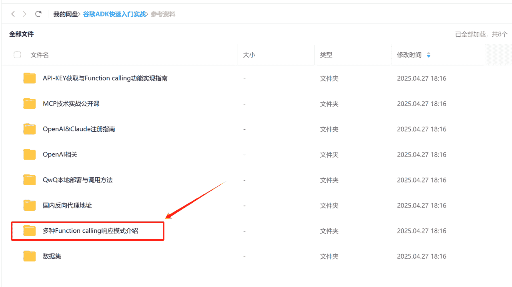

> 下图扫码即可领取：


+   简单测试外部工具能否顺利运行

```
import requests,json
```

```
def get_weather(city: str) -&gt; str:
    &quot;&quot;&quot;
    Retrieves the current weather report for a specified city.

    Args:
        city (str): The name of the city (e.g., &quot;Beijing&quot;, &quot;Shanghai&quot;).
                   Note: For cities in China, use the city&#x27;s English name (e.g., &quot;Beijing&quot;).

    Returns:
        dict: A dictionary containing the weather information.
              Includes a &#x27;status&#x27; key (&#x27;success&#x27; or &#x27;error&#x27;).
              If &#x27;success&#x27;, includes a &#x27;report&#x27; key with weather details.
              If &#x27;error&#x27;, includes an &#x27;error_message&#x27; key.
    &quot;&quot;&quot;
    # Step 1.构建请求
    url = &quot;https://api.openweathermap.org/data/2.5/weather&quot;

    # Step 2.设置查询参数
    params = {
        &quot;q&quot;: city,               
        &quot;appid&quot;: os.getenv(&quot;OPENWEATHER_API_KEY&quot;),    # 输入自己的API key
        &quot;units&quot;: &quot;metric&quot;,            # 使用摄氏度而不是华氏度
        &quot;lang&quot;:&quot;zh_cn&quot;                # 输出语言为简体中文
    }

    # Step 3.发送GET请求
    response = requests.get(url, params=params)
    
    # Step 4.解析响应
    data = response.json()
    city = data.get(&quot;name&quot;, &quot;未知&quot;)
    country = data.get(&quot;sys&quot;, {}).get(&quot;country&quot;, &quot;未知&quot;)
    temp = data.get(&quot;main&quot;, {}).get(&quot;temp&quot;, &quot;N/A&quot;)
    humidity = data.get(&quot;main&quot;, {}).get(&quot;humidity&quot;, &quot;N/A&quot;)
    wind_speed = data.get(&quot;wind&quot;, {}).get(&quot;speed&quot;, &quot;N/A&quot;)
    weather_list = data.get(&quot;weather&quot;, [{}])
    description = weather_list[0].get(&quot;description&quot;, &quot;未知&quot;)

    return (
        f&quot;🌍 {city}, {country}\n&quot;
        f&quot;🌡 温度: {temp}°C\n&quot;
        f&quot;💧 湿度: {humidity}%\n&quot;
        f&quot;🌬 风速: {wind_speed} m/s\n&quot;
        f&quot;🌤 天气: {description}\n&quot;
    )
```

```
get_weather(city=&quot;Beijing&quot;)
```

```
&#x27;🌍 Beijing, CN\n🌡 温度: 24.94°C\n💧 湿度: 17%\n🌬 风速: 4.98 m/s\n🌤 天气: 晴\n&#x27;
```

这里需要注意的是，ADK和其他Agent开发框架类似，都是根据函数描述来判断函数功能，因此请务必写清楚函数功能及函数参数。对于ADK来说，外部函数的功能说明必须按照Google Python Style Guide格式进行编写，具体格式要求有以下几点：

1.  **简要描述**：在docstring的开始部分简短描述函数的目的和行为。比如：Retrieves the current weather report for a specified city.。

1.  **Args**：列出函数的参数，每个参数的类型和功能。并提供必要的注释。

1.  **Returns**：描述函数返回的类型及其内容。如果返回的是字典，应该具体说明字典中每个键的作用。

1.  **异常或错误处理**（可选）：如果有，通常会列出可能抛出的异常。

> 若不是按照这个格式进行编写，则有可能无法顺利识别外部函数。

### 2. 借助ADK构建天气查询Agent

接下来进一步借助ADK连接天气查询外部函数，并据此创建一个天气查询的Agent。

+   **Step 1.配置模型**

```
model = LiteLlm(
    model=&quot;deepseek/deepseek-chat&quot;,  
    api_base=DS_BASE_URL,
    api_key=DS_API_KEY
)
```

+   Step 2.定义天气查询Agent

```
weather_agent = Agent(
    name=&quot;weather_agent&quot;,
    model=model, 
    description=&quot;用于进行某地天气查询的Agent智能体&quot;,
    instruction=&quot;你是一个有帮助的天气助手。&quot;
                &quot;当用户询问特定城市的天气时，&quot;
                &quot;使用 &#x27;get_weather&#x27; 工具查找相关信息。&quot;
                &quot;如果工具返回错误，礼貌地告知用户。&quot;,
    tools=[get_weather], 
)
```

```
print(f&quot;Agent &#x27;{weather_agent.name}&#x27; created using model &#x27;{model}&#x27;.&quot;)
```

```
Agent &#x27;weather_agent&#x27; created using model &#x27;model=&#x27;deepseek/deepseek-chat&#x27; llm_client=&lt;google.adk.models.lite_llm.LiteLLMClient object at 0x000001F7313C3C10&gt;&#x27;.
```

+   **Step 3.创建会话管理器**

```
session_service = InMemorySessionService()
```

```
APP_NAME = &quot;weather_app&quot;
USER_ID = &quot;user_1&quot;
SESSION_ID = &quot;session_001&quot;
```

```
session = session_service.create_session(
    app_name=APP_NAME,
    user_id=USER_ID,
    session_id=SESSION_ID
)
print(f&quot;Session created: App=&#x27;{APP_NAME}&#x27;, User=&#x27;{USER_ID}&#x27;, Session=&#x27;{SESSION_ID}&#x27;&quot;)
```

```
Session created: App=&#x27;weather_app&#x27;, User=&#x27;user_1&#x27;, Session=&#x27;session_001&#x27;
```

+   Step 4.创建智能体执行器（Runner）

```
runner = Runner(
    agent=weather_agent, # The agent we want to run
    app_name=APP_NAME,   # Associates runs with our app
    session_service=session_service # Uses our session manager
)
```

+   **Step 5.执行天气查询对话**

```
query=&#x27;你好，请问北京今天天气如何？&#x27;
```

```
USER_ID, SESSION_ID
```

```
(&#x27;user_1&#x27;, &#x27;session_001&#x27;)
```

```
async def call_agent_async(query: str, runner, user_id, session_id):
  &quot;&quot;&quot;Sends a query to the agent and prints the final response.&quot;&quot;&quot;
  print(f&quot;\n&gt;&gt;&gt; User Query: {query}&quot;)

  # Prepare the user&#x27;s message in ADK format
  content = types.Content(role=&#x27;user&#x27;, parts=[types.Part(text=query)])

  final_response_text = &quot;Agent did not produce a final response.&quot; # Default

  # Key Concept: run_async executes the agent logic and yields Events.
  # We iterate through events to find the final answer.
  async for event in runner.run_async(user_id=user_id, session_id=session_id, new_message=content):
      # You can uncomment the line below to see *all* events during execution
      print(f&quot;  [Event] Author: {event.author}, Type: {type(event).__name__}, Final: {event.is_final_response()}, Content: {event.content}&quot;)

      # Key Concept: is_final_response() marks the concluding message for the turn.
      if event.is_final_response():
          if event.content and event.content.parts:
             # Assuming text response in the first part
             final_response_text = event.content.parts[0].text
          elif event.actions and event.actions.escalate: # Handle potential errors/escalations
             final_response_text = f&quot;Agent escalated: {event.error_message or &#x27;No specific message.&#x27;}&quot;
          # Add more checks here if needed (e.g., specific error codes)
          break # Stop processing events once the final response is found

  print(f&quot;&lt;&lt;&lt; Agent Response: {final_response_text}&quot;)
```

```
await call_agent_async(query, runner, USER_ID, SESSION_ID)
```

```
&gt;&gt;&gt; User Query: 你好，请问北京今天天气如何？
  [Event] Author: weather_agent, Type: Event, Final: False, Content: parts=[Part(video_metadata=None, thought=None, code_execution_result=None, executable_code=None, file_data=None, function_call=FunctionCall(id=&#x27;call_0_2232a8a6-e5a7-46d3-94f1-9ff365c31cb5&#x27;, args={&#x27;city&#x27;: &#x27;Beijing&#x27;}, name=&#x27;get_weather&#x27;), function_response=None, inline_data=None, text=None)] role=&#x27;model&#x27;
  [Event] Author: weather_agent, Type: Event, Final: False, Content: parts=[Part(video_metadata=None, thought=None, code_execution_result=None, executable_code=None, file_data=None, function_call=None, function_response=FunctionResponse(id=&#x27;call_0_2232a8a6-e5a7-46d3-94f1-9ff365c31cb5&#x27;, name=&#x27;get_weather&#x27;, response={&#x27;result&#x27;: &#x27;🌍 Beijing, CN\n🌡 温度: 24.94°C\n💧 湿度: 17%\n🌬 风速: 4.98 m/s\n🌤 天气: 晴\n&#x27;}), inline_data=None, text=None)] role=&#x27;user&#x27;
  [Event] Author: weather_agent, Type: Event, Final: True, Content: parts=[Part(video_metadata=None, thought=None, code_execution_result=None, executable_code=None, file_data=None, function_call=None, function_response=None, inline_data=None, text=&#x27;北京今天的天气情况如下：\n\n- **温度**: 24.94°C\n- **湿度**: 17%\n- **风速**: 4.98 m/s\n- **天气**: 晴\n\n天气晴朗，适合外出活动！&#x27;)] role=&#x27;model&#x27;
&lt;&lt;&lt; Agent Response: 北京今天的天气情况如下：

- **温度**: 24.94°C
- **湿度**: 17%
- **风速**: 4.98 m/s
- **天气**: 晴

天气晴朗，适合外出活动！
```

最后我们获取最新的历史对话消息：

```
session = session_service.get_session(
    app_name=APP_NAME,
    user_id=USER_ID,
    session_id=SESSION_ID
)
```

```
for event in session.events:
    print(f&quot;Author: {event.author}, Type: {type(event).__name__}, Content: {event.content}&quot;)
```

```
Author: user, Type: Event, Content: parts=[Part(video_metadata=None, thought=None, code_execution_result=None, executable_code=None, file_data=None, function_call=None, function_response=None, inline_data=None, text=&#x27;你好，请问北京今天天气如何？&#x27;)] role=&#x27;user&#x27;
Author: weather_agent, Type: Event, Content: parts=[Part(video_metadata=None, thought=None, code_execution_result=None, executable_code=None, file_data=None, function_call=FunctionCall(id=&#x27;call_0_2232a8a6-e5a7-46d3-94f1-9ff365c31cb5&#x27;, args={&#x27;city&#x27;: &#x27;Beijing&#x27;}, name=&#x27;get_weather&#x27;), function_response=None, inline_data=None, text=None)] role=&#x27;model&#x27;
Author: weather_agent, Type: Event, Content: parts=[Part(video_metadata=None, thought=None, code_execution_result=None, executable_code=None, file_data=None, function_call=None, function_response=FunctionResponse(id=&#x27;call_0_2232a8a6-e5a7-46d3-94f1-9ff365c31cb5&#x27;, name=&#x27;get_weather&#x27;, response={&#x27;result&#x27;: &#x27;🌍 Beijing, CN\n🌡 温度: 24.94°C\n💧 湿度: 17%\n🌬 风速: 4.98 m/s\n🌤 天气: 晴\n&#x27;}), inline_data=None, text=None)] role=&#x27;user&#x27;
Author: weather_agent, Type: Event, Content: parts=[Part(video_metadata=None, thought=None, code_execution_result=None, executable_code=None, file_data=None, function_call=None, function_response=None, inline_data=None, text=&#x27;北京今天的天气情况如下：\n\n- **温度**: 24.94°C\n- **湿度**: 17%\n- **风速**: 4.98 m/s\n- **天气**: 晴\n\n天气晴朗，适合外出活动！&#x27;)] role=&#x27;model&#x27;
```

能够看出，在调用外部函数时事件流解释如下：

Part 1. 用户输入（User Query）

```
&gt;&gt;&gt; User Query: 你好，请问北京今天天气如何？
```

+   **用户输入**：用户询问的是 **北京** 的天气情况。这个消息会被 **weather_agent** 接收并处理。

Part 2. 第一次事件（Event） - 调用外部函数

```
[Event] Author: weather_agent, Type: Event, Final: False, Content: parts=[Part(video_metadata=None, thought=None, code_execution_result=None, executable_code=None, file_data=None, function_call=FunctionCall(id=&#x27;call_0_3d81d66c-0361-478a-8a2e-941f4552995e&#x27;, args={&#x27;city&#x27;: &#x27;Beijing&#x27;}, name=&#x27;get_weather&#x27;), function_response=None, inline_data=None, text=None)] role=&#x27;model&#x27;
```

解释如下：

+   **author**: weather_agent — 表明这个事件是由 weather_agent 发出的，表示模型开始处理用户请求。

+   **type**: Event — 表示这是一个事件对象，指示着某种操作（例如模型开始处理用户的输入）。

+   **Final**: False — 这意味着这不是最终的响应，它是处理中间的一个事件，模型仍在执行某些操作。

+   **content**: 这里的 content 包含了一个 **function_call**，即 调用外部函数（get_weather）：

+   FunctionCall 表示模型调用了一个外部函数（在这里是 get_weather 函数），并传递了参数 city: 'Beijing'。

+   function_response 为空，表明这个事件只是发起了外部函数调用，函数的响应尚未返回。

Part 3. 第二次事件（Event） - 函数响应

```
[Event] Author: weather_agent, Type: Event, Final: False, Content: parts=[Part(video_metadata=None, thought=None, code_execution_result=None, executable_code=None, file_data=None, function_call=None, function_response=FunctionResponse(id=&#x27;call_0_3d81d66c-0361-478a-8a2e-941f4552995e&#x27;, name=&#x27;get_weather&#x27;, response={&#x27;result&#x27;: &#x27;🌍 Beijing, CN\n🌡 温度: 22.94°C\n💧 湿度: 12%\n🌬 风速: 3.65 m/s\n🌤 天气: 晴\n&#x27;}), inline_data=None, text=None)] role=&#x27;user&#x27;
```

解释如下：

+   **author**: weather_agent — 表示这是由 weather_agent 生成的事件。

+   **type**: Event — 这是一个事件对象，表示某个操作的完成。

+   **Final**: False — 这仍然不是最终的响应，事件仍在处理阶段。

+   **content**: 这次的 content 中包含了 function_response：

+   function_response 表示调用 get_weather 函数并获取了它的响应。返回的 response 包含了天气信息：温度、湿度、风速和天气状况。

+   这些信息将被传递回 weather_agent，以便构建最终的回复给用户。

Part 4. 最终事件（Event） - 完成模型的响应

```
[Event] Author: weather_agent, Type: Event, Final: True, Content: parts=[Part(video_metadata=None, thought=None, code_execution_result=None, executable_code=None, file_data=None, function_call=None, function_response=None, inline_data=None, text=&#x27;北京今天的天气情况如下：\n\n- **温度**: 22.94°C\n- **湿度**: 12%\n- **风速**: 3.65 m/s\n- **天气**: 晴\n\n天气晴朗，适合外出活动！&#x27;)] role=&#x27;model&#x27;
```

解释如下：

+   **author**: weather_agent — 这还是由 weather_agent 发出的事件，表示模型已经完成最终的响应。

+   **type**: Event — 这是一个事件对象，表示模型生成的最终响应。

+   **Final**: True — 这是**最终的响应**，标志着本轮对话的结束。

+   **content**: text 字段包含了最终的回复文本：

+   这是 **Agent** 提供给用户的天气信息，包括温度、湿度、风速和天气描述。

Part 5. **最终用户响应**

```
&lt;&lt;&lt; Agent Response: 北京今天的天气情况如下：

- **温度**: 22.94°C
- **湿度**: 12%
- **风速**: 3.65 m/s
- **天气**: 晴

天气晴朗，适合外出活动！
```

+   **最终输出**：这是 **Agent** 的回复内容，清晰地展示了北京的天气情况，包含了温度、湿度、风速和天气描述。

其中**事件流的关键点：**

+   **function_call**：表示模型调用了外部函数（例如 get_weather）。

+   function_response：表示外部函数返回的数据被模型接收到。

+   **Final=True**：表示这是本轮对话的最终响应，标志着模型已准备好提供最终答案。

不难看出，这其实也就是一个经典的Function calling执行流程，完整事件流程可以用下图描述：

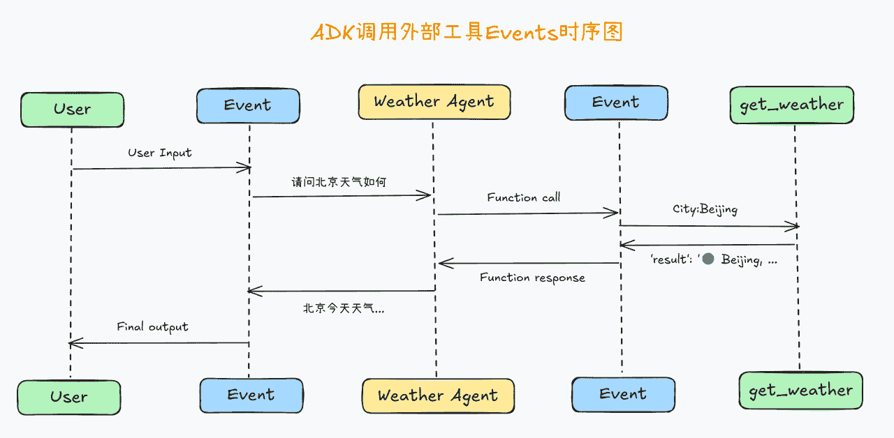

当然，我们同样可以继续使用call_agent_async函数进行多轮对话：

```
query = &#x27;那今天我应该穿什么衣服出门呀？&#x27;
```

```
await call_agent_async(query, runner, USER_ID, SESSION_ID)
```

```
&gt;&gt;&gt; User Query: 那今天我应该穿什么衣服出门呀？
  [Event] Author: weather_agent, Type: Event, Final: True, Content: parts=[Part(video_metadata=None, thought=None, code_execution_result=None, executable_code=None, file_data=None, function_call=None, function_response=None, inline_data=None, text=&#x27;根据北京今天的天气情况（晴，温度约25°C，湿度较低，风速约5 m/s），建议你可以这样穿：\n\n- **上衣**：短袖T恤或薄衬衫，如果怕晒可以加一件防晒衣。\n- **下装**：轻薄的长裤或短裤都可以，根据个人喜好选择。\n- **鞋子**：透气的运动鞋或休闲鞋。\n- **其他**：可以戴一顶帽子或墨镜防晒，因为湿度低，阳光可能会比较强。\n\n整体来说，今天的天气比较舒适，适合轻便的夏季穿搭！&#x27;)] role=&#x27;model&#x27;
&lt;&lt;&lt; Agent Response: 根据北京今天的天气情况（晴，温度约25°C，湿度较低，风速约5 m/s），建议你可以这样穿：

- **上衣**：短袖T恤或薄衬衫，如果怕晒可以加一件防晒衣。
- **下装**：轻薄的长裤或短裤都可以，根据个人喜好选择。
- **鞋子**：透气的运动鞋或休闲鞋。
- **其他**：可以戴一顶帽子或墨镜防晒，因为湿度低，阳光可能会比较强。

整体来说，今天的天气比较舒适，适合轻便的夏季穿搭！
```

完整历史对话如下：

```
session_service.sessions
```

```
{&#x27;weather_app&#x27;: {&#x27;user_1&#x27;: {&#x27;session_001&#x27;: Session(id=&#x27;session_001&#x27;, app_name=&#x27;weather_app&#x27;, user_id=&#x27;user_1&#x27;, state={}, events=[Event(content=Content(parts=[Part(video_metadata=None, thought=None, code_execution_result=None, executable_code=None, file_data=None, function_call=None, function_response=None, inline_data=None, text=&#x27;你好，请问北京今天天气如何？&#x27;)], role=&#x27;user&#x27;), grounding_metadata=None, partial=None, turn_complete=None, error_code=None, error_message=None, interrupted=None, custom_metadata=None, invocation_id=&#x27;e-7584029b-962f-4545-a02d-b65911ef7fd4&#x27;, author=&#x27;user&#x27;, actions=EventActions(skip_summarization=None, state_delta={}, artifact_delta={}, transfer_to_agent=None, escalate=None, requested_auth_configs={}), long_running_tool_ids=None, branch=None, id=&#x27;UUjklpC4&#x27;, timestamp=1745826605.546849), Event(content=Content(parts=[Part(video_metadata=None, thought=None, code_execution_result=None, executable_code=None, file_data=None, function_call=FunctionCall(id=&#x27;call_0_2232a8a6-e5a7-46d3-94f1-9ff365c31cb5&#x27;, args={&#x27;city&#x27;: &#x27;Beijing&#x27;}, name=&#x27;get_weather&#x27;), function_response=None, inline_data=None, text=None)], role=&#x27;model&#x27;), grounding_metadata=None, partial=False, turn_complete=None, error_code=None, error_message=None, interrupted=None, custom_metadata=None, invocation_id=&#x27;e-7584029b-962f-4545-a02d-b65911ef7fd4&#x27;, author=&#x27;weather_agent&#x27;, actions=EventActions(skip_summarization=None, state_delta={}, artifact_delta={}, transfer_to_agent=None, escalate=None, requested_auth_configs={}), long_running_tool_ids=set(), branch=None, id=&#x27;jPeNUGUO&#x27;, timestamp=1745826605.546849), Event(content=Content(parts=[Part(video_metadata=None, thought=None, code_execution_result=None, executable_code=None, file_data=None, function_call=None, function_response=FunctionResponse(id=&#x27;call_0_2232a8a6-e5a7-46d3-94f1-9ff365c31cb5&#x27;, name=&#x27;get_weather&#x27;, response={&#x27;result&#x27;: &#x27;🌍 Beijing, CN\n🌡 温度: 24.94°C\n💧 湿度: 17%\n🌬 风速: 4.98 m/s\n🌤 天气: 晴\n&#x27;}), inline_data=None, text=None)], role=&#x27;user&#x27;), grounding_metadata=None, partial=None, turn_complete=None, error_code=None, error_message=None, interrupted=None, custom_metadata=None, invocation_id=&#x27;e-7584029b-962f-4545-a02d-b65911ef7fd4&#x27;, author=&#x27;weather_agent&#x27;, actions=EventActions(skip_summarization=None, state_delta={}, artifact_delta={}, transfer_to_agent=None, escalate=None, requested_auth_configs={}), long_running_tool_ids=None, branch=None, id=&#x27;CQx2Gdo0&#x27;, timestamp=1745826611.622692), Event(content=Content(parts=[Part(video_metadata=None, thought=None, code_execution_result=None, executable_code=None, file_data=None, function_call=None, function_response=None, inline_data=None, text=&#x27;北京今天的天气情况如下：\n\n- **温度**: 24.94°C\n- **湿度**: 17%\n- **风速**: 4.98 m/s\n- **天气**: 晴\n\n天气晴朗，适合外出活动！&#x27;)], role=&#x27;model&#x27;), grounding_metadata=None, partial=False, turn_complete=None, error_code=None, error_message=None, interrupted=None, custom_metadata=None, invocation_id=&#x27;e-7584029b-962f-4545-a02d-b65911ef7fd4&#x27;, author=&#x27;weather_agent&#x27;, actions=EventActions(skip_summarization=None, state_delta={}, artifact_delta={}, transfer_to_agent=None, escalate=None, requested_auth_configs={}), long_running_tool_ids=None, branch=None, id=&#x27;38jxeUH8&#x27;, timestamp=1745826611.623198), Event(content=Content(parts=[Part(video_metadata=None, thought=None, code_execution_result=None, executable_code=None, file_data=None, function_call=None, function_response=None, inline_data=None, text=&#x27;那今天我应该穿什么衣服出门呀？&#x27;)], role=&#x27;user&#x27;), grounding_metadata=None, partial=None, turn_complete=None, error_code=None, error_message=None, interrupted=None, custom_metadata=None, invocation_id=&#x27;e-4868fa74-3f23-471d-bcf5-390d01149fd6&#x27;, author=&#x27;user&#x27;, actions=EventActions(skip_summarization=None, state_delta={}, artifact_delta={}, transfer_to_agent=None, escalate=None, requested_auth_configs={}), long_running_tool_ids=None, branch=None, id=&#x27;U6hxo0Ge&#x27;, timestamp=1745826765.494604), Event(content=Content(parts=[Part(video_metadata=None, thought=None, code_execution_result=None, executable_code=None, file_data=None, function_call=None, function_response=None, inline_data=None, text=&#x27;根据北京今天的天气情况（晴，温度约25°C，湿度较低，风速约5 m/s），建议你可以这样穿：\n\n- **上衣**：短袖T恤或薄衬衫，如果怕晒可以加一件防晒衣。\n- **下装**：轻薄的长裤或短裤都可以，根据个人喜好选择。\n- **鞋子**：透气的运动鞋或休闲鞋。\n- **其他**：可以戴一顶帽子或墨镜防晒，因为湿度低，阳光可能会比较强。\n\n整体来说，今天的天气比较舒适，适合轻便的夏季穿搭！&#x27;)], role=&#x27;model&#x27;), grounding_metadata=None, partial=False, turn_complete=None, error_code=None, error_message=None, interrupted=None, custom_metadata=None, invocation_id=&#x27;e-4868fa74-3f23-471d-bcf5-390d01149fd6&#x27;, author=&#x27;weather_agent&#x27;, actions=EventActions(skip_summarization=None, state_delta={}, artifact_delta={}, transfer_to_agent=None, escalate=None, requested_auth_configs={}), long_running_tool_ids=None, branch=None, id=&#x27;BVG5ghpy&#x27;, timestamp=1745826765.494961)], last_update_time=1745826765.494961)}}}
```

## 二、ADK并联和串联调用工具流程

既然是以Function calling为基础的工具调用，那肯定ADK肯定支持多工具并联和串联调用。通过工具的并联调用，就能快速在单独的Agent内部组成简单的工作流。

### 1. ADK的多工具并联调用

所谓并联调用，指的是在一次响应过程中，同时调用多项工具完成任务，例如同时询问北京和杭州天气时候，ADK会按照如下方式进行工具调用：

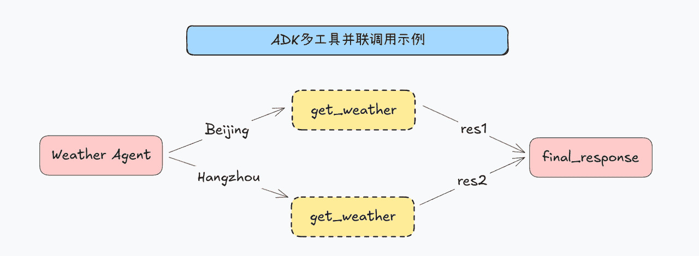

具体代码实现过程如下。

```
# 重新创建基础会话信息和会话存储器
session_service = InMemorySessionService()

APP_NAME = &quot;weather_app&quot;
USER_ID = &quot;user_2&quot;
SESSION_ID = &quot;session_001&quot;

session = session_service.create_session(
    app_name=APP_NAME,
    user_id=USER_ID,
    session_id=SESSION_ID
)
print(f&quot;Session created: App=&#x27;{APP_NAME}&#x27;, User=&#x27;{USER_ID}&#x27;, Session=&#x27;{SESSION_ID}&#x27;&quot;)
```

```
Session created: App=&#x27;weather_app&#x27;, User=&#x27;user_2&#x27;, Session=&#x27;session_001&#x27;
```

```
runner = Runner(
    agent=weather_agent, # The agent we want to run
    app_name=APP_NAME,   # Associates runs with our app
    session_service=session_service # Uses our session manager
)
```

```
query=&#x27;你好，请问北京和杭州今天天气如何？&#x27;
```

```
await call_agent_async(query, runner, USER_ID, SESSION_ID)
```

```
&gt;&gt;&gt; User Query: 你好，请问北京和杭州今天天气如何？
  [Event] Author: weather_agent, Type: Event, Final: False, Content: parts=[Part(video_metadata=None, thought=None, code_execution_result=None, executable_code=None, file_data=None, function_call=FunctionCall(id=&#x27;call_0_ba44be46-ecc3-45bd-9fd9-318bf6a57ee8&#x27;, args={&#x27;city&#x27;: &#x27;Beijing&#x27;}, name=&#x27;get_weather&#x27;), function_response=None, inline_data=None, text=None), Part(video_metadata=None, thought=None, code_execution_result=None, executable_code=None, file_data=None, function_call=FunctionCall(id=&#x27;call_1_28834fe9-ea31-49b9-8519-3511462d3fb7&#x27;, args={&#x27;city&#x27;: &#x27;Hangzhou&#x27;}, name=&#x27;get_weather&#x27;), function_response=None, inline_data=None, text=None)] role=&#x27;model&#x27;
  [Event] Author: weather_agent, Type: Event, Final: False, Content: parts=[Part(video_metadata=None, thought=None, code_execution_result=None, executable_code=None, file_data=None, function_call=None, function_response=FunctionResponse(id=&#x27;call_0_ba44be46-ecc3-45bd-9fd9-318bf6a57ee8&#x27;, name=&#x27;get_weather&#x27;, response={&#x27;result&#x27;: &#x27;🌍 Beijing, CN\n🌡 温度: 24.94°C\n💧 湿度: 17%\n🌬 风速: 4.68 m/s\n🌤 天气: 晴\n&#x27;}), inline_data=None, text=None), Part(video_metadata=None, thought=None, code_execution_result=None, executable_code=None, file_data=None, function_call=None, function_response=FunctionResponse(id=&#x27;call_1_28834fe9-ea31-49b9-8519-3511462d3fb7&#x27;, name=&#x27;get_weather&#x27;, response={&#x27;result&#x27;: &#x27;🌍 Hangzhou, CN\n🌡 温度: 25.95°C\n💧 湿度: 42%\n🌬 风速: 5.78 m/s\n🌤 天气: 多云\n&#x27;}), inline_data=None, text=None)] role=&#x27;user&#x27;
  [Event] Author: weather_agent, Type: Event, Final: True, Content: parts=[Part(video_metadata=None, thought=None, code_execution_result=None, executable_code=None, file_data=None, function_call=None, function_response=None, inline_data=None, text=&#x27;今天北京的天气情况如下：\n- 温度：24.94°C\n- 湿度：17%\n- 风速：4.68 m/s\n- 天气：晴\n\n杭州的天气情况如下：\n- 温度：25.95°C\n- 湿度：42%\n- 风速：5.78 m/s\n- 天气：多云\n\n如果有其他需求，请随时告诉我！&#x27;)] role=&#x27;model&#x27;
&lt;&lt;&lt; Agent Response: 今天北京的天气情况如下：
- 温度：24.94°C
- 湿度：17%
- 风速：4.68 m/s
- 天气：晴

杭州的天气情况如下：
- 温度：25.95°C
- 湿度：42%
- 风速：5.78 m/s
- 天气：多云

如果有其他需求，请随时告诉我！
```

注意观察此时的事件流，在第二个事件中（第一个事件是接收到用户消息），ADK同时发起了两次工具调用：

```
session_service.sessions[&#x27;weather_app&#x27;][&#x27;user_2&#x27;][&#x27;session_001&#x27;].events[1]
```

```
Event(content=Content(parts=[Part(video_metadata=None, thought=None, code_execution_result=None, executable_code=None, file_data=None, function_call=FunctionCall(id=&#x27;call_0_011abd9e-2133-4339-aac4-5967b695adc6&#x27;, args={&#x27;city&#x27;: &#x27;Beijing&#x27;}, name=&#x27;get_weather&#x27;), function_response=None, inline_data=None, text=None), Part(video_metadata=None, thought=None, code_execution_result=None, executable_code=None, file_data=None, function_call=FunctionCall(id=&#x27;call_1_1604d47b-0946-4cfa-ab9b-e3d703993378&#x27;, args={&#x27;city&#x27;: &#x27;Hangzhou&#x27;}, name=&#x27;get_weather&#x27;), function_response=None, inline_data=None, text=None)], role=&#x27;model&#x27;), grounding_metadata=None, partial=False, turn_complete=None, error_code=None, error_message=None, interrupted=None, custom_metadata=None, invocation_id=&#x27;e-266fabc7-b44c-4e91-a1ff-539146ea55c9&#x27;, author=&#x27;multi_tool_agent&#x27;, actions=EventActions(skip_summarization=None, state_delta={}, artifact_delta={}, transfer_to_agent=None, escalate=None, requested_auth_configs={}), long_running_tool_ids=set(), branch=None, id=&#x27;hDtH409E&#x27;, timestamp=1745827642.84536)
```

如此即实现了工具的并联调用。

### 2. ADK的多工具串联调用

接下来继续介绍ADK的多工具串联调用方法。这里我们再创建一个函数，用于将查询到的天气信息“写入”本地文件中。

```
def write_file(content: str) -&gt; str:
    &quot;&quot;&quot;
    Writes the specified content to a local file.

    Args:
        content (str): The content to be written to the file.

    Returns:
        str: A message indicating whether the content was successfully written to the file.
             In this case, it returns &quot;已成功写入本地文件&quot; if the writing is successful.
    &quot;&quot;&quot;
    
    return &quot;已成功写入本地文件。&quot;
```

```
# 重新创建基础会话信息和会话存储器
session_service = InMemorySessionService()

APP_NAME = &quot;weather_app&quot;
USER_ID = &quot;user_2&quot;
SESSION_ID = &quot;session_002&quot;

session = session_service.create_session(
    app_name=APP_NAME,
    user_id=USER_ID,
    session_id=SESSION_ID
)
print(f&quot;Session created: App=&#x27;{APP_NAME}&#x27;, User=&#x27;{USER_ID}&#x27;, Session=&#x27;{SESSION_ID}&#x27;&quot;)
```

```
Session created: App=&#x27;weather_app&#x27;, User=&#x27;user_2&#x27;, Session=&#x27;session_002&#x27;
```

```
# 重新创建Agent
multi_tool_agent = Agent(
    name=&quot;multi_tool_agent&quot;,
    model=model, 
    description=&quot;用于进行天气查询和记录的智能体&quot;,
    instruction=&quot;你是一个乐于助人的助手。&quot;
                &quot;当用户询问特定城市的天气时，&quot;
                &quot;使用 &#x27;get_weather&#x27; 工具查找相关信息。&quot;
                &quot;当用户询需要将一些信息记录到本地的时候，&quot;
                &quot;使用 &#x27;write_file&#x27; 将指定内容记录到本地&quot;    
                &quot;如果工具返回错误，礼貌地告知用户。&quot;,
    tools=[get_weather, write_file], 
)

print(f&quot;Agent &#x27;{multi_tool_agent.name}&#x27; created using model &#x27;{model}&#x27;.&quot;)
```

```
Agent &#x27;multi_tool_agent&#x27; created using model &#x27;model=&#x27;deepseek/deepseek-chat&#x27; llm_client=&lt;google.adk.models.lite_llm.LiteLLMClient object at 0x000001F7313C3C10&gt;&#x27;.
```

```
runner = Runner(
    agent=multi_tool_agent, 
    app_name=APP_NAME,   
    session_service=session_service 
)
```

然后进行对话：

```
query=&#x27;你好，请先帮我查询北京和杭州今天天气，再将其记录到本地文档中&#x27;
```

```
await call_agent_async(query, runner, USER_ID, SESSION_ID)
```

```
&gt;&gt;&gt; User Query: 你好，请先帮我查询北京和杭州今天天气，再将其记录到本地文档中
  [Event] Author: multi_tool_agent, Type: Event, Final: False, Content: parts=[Part(video_metadata=None, thought=None, code_execution_result=None, executable_code=None, file_data=None, function_call=FunctionCall(id=&#x27;call_0_011abd9e-2133-4339-aac4-5967b695adc6&#x27;, args={&#x27;city&#x27;: &#x27;Beijing&#x27;}, name=&#x27;get_weather&#x27;), function_response=None, inline_data=None, text=None), Part(video_metadata=None, thought=None, code_execution_result=None, executable_code=None, file_data=None, function_call=FunctionCall(id=&#x27;call_1_1604d47b-0946-4cfa-ab9b-e3d703993378&#x27;, args={&#x27;city&#x27;: &#x27;Hangzhou&#x27;}, name=&#x27;get_weather&#x27;), function_response=None, inline_data=None, text=None)] role=&#x27;model&#x27;
  [Event] Author: multi_tool_agent, Type: Event, Final: False, Content: parts=[Part(video_metadata=None, thought=None, code_execution_result=None, executable_code=None, file_data=None, function_call=None, function_response=FunctionResponse(id=&#x27;call_0_011abd9e-2133-4339-aac4-5967b695adc6&#x27;, name=&#x27;get_weather&#x27;, response={&#x27;result&#x27;: &#x27;🌍 Beijing, CN\n🌡 温度: 24.94°C\n💧 湿度: 17%\n🌬 风速: 4.68 m/s\n🌤 天气: 晴\n&#x27;}), inline_data=None, text=None), Part(video_metadata=None, thought=None, code_execution_result=None, executable_code=None, file_data=None, function_call=None, function_response=FunctionResponse(id=&#x27;call_1_1604d47b-0946-4cfa-ab9b-e3d703993378&#x27;, name=&#x27;get_weather&#x27;, response={&#x27;result&#x27;: &#x27;🌍 Hangzhou, CN\n🌡 温度: 25.95°C\n💧 湿度: 42%\n🌬 风速: 5.78 m/s\n🌤 天气: 多云\n&#x27;}), inline_data=None, text=None)] role=&#x27;user&#x27;
  [Event] Author: multi_tool_agent, Type: Event, Final: False, Content: parts=[Part(video_metadata=None, thought=None, code_execution_result=None, executable_code=None, file_data=None, function_call=FunctionCall(id=&#x27;call_0_1318973d-4c30-44be-a769-6b5c6a4bb032&#x27;, args={&#x27;content&#x27;: &#x27;北京天气：\n🌍 Beijing, CN\n🌡 温度: 24.94°C\n💧 湿度: 17%\n🌬 风速: 4.68 m/s\n☀ 天气: 晴\n\n杭州天气：\n🌍 Hangzhou, CN\n🌡 温度: 25.95°C\n💧 湿度: 42%\n🌬 风速: 5.78 m/s\n☁ 天气: 多云&#x27;}, name=&#x27;write_file&#x27;), function_response=None, inline_data=None, text=None)] role=&#x27;model&#x27;
  [Event] Author: multi_tool_agent, Type: Event, Final: False, Content: parts=[Part(video_metadata=None, thought=None, code_execution_result=None, executable_code=None, file_data=None, function_call=None, function_response=FunctionResponse(id=&#x27;call_0_1318973d-4c30-44be-a769-6b5c6a4bb032&#x27;, name=&#x27;write_file&#x27;, response={&#x27;result&#x27;: &#x27;已成功写入本地文件。&#x27;}), inline_data=None, text=None)] role=&#x27;user&#x27;
  [Event] Author: multi_tool_agent, Type: Event, Final: True, Content: parts=[Part(video_metadata=None, thought=None, code_execution_result=None, executable_code=None, file_data=None, function_call=None, function_response=None, inline_data=None, text=&#x27;北京和杭州今天的天气如下：\n\n**北京天气**  \n🌍 Beijing, CN  \n🌡 温度: 24.94°C  \n💧 湿度: 17%  \n🌬 风速: 4.68 m/s  \n☀ 天气: 晴  \n\n**杭州天气**  \n🌍 Hangzhou, CN  \n🌡 温度: 25.95°C  \n💧 湿度: 42%  \n🌬 风速: 5.78 m/s  \n☁ 天气: 多云  \n\n这些信息已成功写入本地文件。&#x27;)] role=&#x27;model&#x27;
&lt;&lt;&lt; Agent Response: 北京和杭州今天的天气如下：

**北京天气**  
🌍 Beijing, CN  
🌡 温度: 24.94°C  
💧 湿度: 17%  
🌬 风速: 4.68 m/s  
☀ 天气: 晴  

**杭州天气**  
🌍 Hangzhou, CN  
🌡 温度: 25.95°C  
💧 湿度: 42%  
🌬 风速: 5.78 m/s  
☁ 天气: 多云  

这些信息已成功写入本地文件。
```

注意看，此时第二个事件是同时调用两次外部函数查询天气：

```
session_service.sessions[&#x27;weather_app&#x27;][&#x27;user_2&#x27;][&#x27;session_002&#x27;].events[1]
```

```
Event(content=Content(parts=[Part(video_metadata=None, thought=None, code_execution_result=None, executable_code=None, file_data=None, function_call=FunctionCall(id=&#x27;call_0_011abd9e-2133-4339-aac4-5967b695adc6&#x27;, args={&#x27;city&#x27;: &#x27;Beijing&#x27;}, name=&#x27;get_weather&#x27;), function_response=None, inline_data=None, text=None), Part(video_metadata=None, thought=None, code_execution_result=None, executable_code=None, file_data=None, function_call=FunctionCall(id=&#x27;call_1_1604d47b-0946-4cfa-ab9b-e3d703993378&#x27;, args={&#x27;city&#x27;: &#x27;Hangzhou&#x27;}, name=&#x27;get_weather&#x27;), function_response=None, inline_data=None, text=None)], role=&#x27;model&#x27;), grounding_metadata=None, partial=False, turn_complete=None, error_code=None, error_message=None, interrupted=None, custom_metadata=None, invocation_id=&#x27;e-266fabc7-b44c-4e91-a1ff-539146ea55c9&#x27;, author=&#x27;multi_tool_agent&#x27;, actions=EventActions(skip_summarization=None, state_delta={}, artifact_delta={}, transfer_to_agent=None, escalate=None, requested_auth_configs={}), long_running_tool_ids=set(), branch=None, id=&#x27;hDtH409E&#x27;, timestamp=1745827642.84536)
```

第三个事件是查询到天气

```
session_service.sessions[&#x27;weather_app&#x27;][&#x27;user_2&#x27;][&#x27;session_002&#x27;].events[2]
```

```
Event(content=Content(parts=[Part(video_metadata=None, thought=None, code_execution_result=None, executable_code=None, file_data=None, function_call=None, function_response=FunctionResponse(id=&#x27;call_0_011abd9e-2133-4339-aac4-5967b695adc6&#x27;, name=&#x27;get_weather&#x27;, response={&#x27;result&#x27;: &#x27;🌍 Beijing, CN\n🌡 温度: 24.94°C\n💧 湿度: 17%\n🌬 风速: 4.68 m/s\n🌤 天气: 晴\n&#x27;}), inline_data=None, text=None), Part(video_metadata=None, thought=None, code_execution_result=None, executable_code=None, file_data=None, function_call=None, function_response=FunctionResponse(id=&#x27;call_1_1604d47b-0946-4cfa-ab9b-e3d703993378&#x27;, name=&#x27;get_weather&#x27;, response={&#x27;result&#x27;: &#x27;🌍 Hangzhou, CN\n🌡 温度: 25.95°C\n💧 湿度: 42%\n🌬 风速: 5.78 m/s\n🌤 天气: 多云\n&#x27;}), inline_data=None, text=None)], role=&#x27;user&#x27;), grounding_metadata=None, partial=None, turn_complete=None, error_code=None, error_message=None, interrupted=None, custom_metadata=None, invocation_id=&#x27;5JWwhAzt&#x27;, author=&#x27;multi_tool_agent&#x27;, actions=EventActions(skip_summarization=None, state_delta={}, artifact_delta={}, transfer_to_agent=None, escalate=None, requested_auth_configs={}), long_running_tool_ids=None, branch=None, id=&#x27;An5GOoJj&#x27;, timestamp=1745827649.353701)
```

而紧接着第四个事件就是调用外部函数将天气信息写入本地：

```
session_service.sessions[&#x27;weather_app&#x27;][&#x27;user_2&#x27;][&#x27;session_002&#x27;].events[3]
```

```
Event(content=Content(parts=[Part(video_metadata=None, thought=None, code_execution_result=None, executable_code=None, file_data=None, function_call=FunctionCall(id=&#x27;call_0_1318973d-4c30-44be-a769-6b5c6a4bb032&#x27;, args={&#x27;content&#x27;: &#x27;北京天气：\n🌍 Beijing, CN\n🌡 温度: 24.94°C\n💧 湿度: 17%\n🌬 风速: 4.68 m/s\n☀ 天气: 晴\n\n杭州天气：\n🌍 Hangzhou, CN\n🌡 温度: 25.95°C\n💧 湿度: 42%\n🌬 风速: 5.78 m/s\n☁ 天气: 多云&#x27;}, name=&#x27;write_file&#x27;), function_response=None, inline_data=None, text=None)], role=&#x27;model&#x27;), grounding_metadata=None, partial=False, turn_complete=None, error_code=None, error_message=None, interrupted=None, custom_metadata=None, invocation_id=&#x27;e-266fabc7-b44c-4e91-a1ff-539146ea55c9&#x27;, author=&#x27;multi_tool_agent&#x27;, actions=EventActions(skip_summarization=None, state_delta={}, artifact_delta={}, transfer_to_agent=None, escalate=None, requested_auth_configs={}), long_running_tool_ids=set(), branch=None, id=&#x27;idkh8F7r&#x27;, timestamp=1745827650.499183)
```

由此即完成了一个多工具串联调用执行流程，基本流程如下：

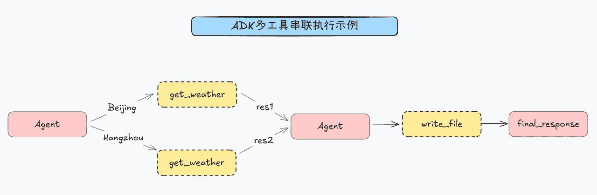

### 3. ADK工具调用报错处理流程

接下来我们继续介绍ADK在进行外部工具调用报错时的处理流程。需要注意的是，测试智能体开发框架的报错处理流程是至关重要的，无论是ADK还是OpenAI的Agents SDK，其智能体运行器Runner本质上都是执行一个loop，会一直执行到能获得一个结果为止。因此我们需要设置一个注定无法运行的外部函数，测试ADK在进行试错时会尝试几次：

```
def write_file_now(content: str) -&gt; str:
    &quot;&quot;&quot;
    Writes the specified content to a local file.

    Args:
        content (str): The content to be written to the file.

    Returns:
        str: A message indicating whether the content was successfully written to the file.
             In this case, it returns &quot;已成功写入本地文件&quot; if the writing is successful.
    &quot;&quot;&quot;
    
    return &quot;输入信息格式不对，未能成果写入本地&quot;
```

```
# 重新创建基础会话信息和会话存储器
session_service = InMemorySessionService()

APP_NAME = &quot;test_app&quot;
USER_ID = &quot;user_3&quot;
SESSION_ID = &quot;session_001&quot;

session = session_service.create_session(
    app_name=APP_NAME,
    user_id=USER_ID,
    session_id=SESSION_ID
)
print(f&quot;Session created: App=&#x27;{APP_NAME}&#x27;, User=&#x27;{USER_ID}&#x27;, Session=&#x27;{SESSION_ID}&#x27;&quot;)
```

```
Session created: App=&#x27;test_app&#x27;, User=&#x27;user_3&#x27;, Session=&#x27;session_001&#x27;
```

```
# 重新创建Agent
write_file_agent = Agent(
    name=&quot;write_file_agent&quot;,
    model=model, 
    description=&quot;用于进行信息记录的智能体&quot;,
    instruction=&quot;你是一个乐于助人的助手。&quot;
                &quot;当用户询需要将一些信息记录到本地的时候，&quot;
                &quot;使用 &#x27;write_file_now&#x27; 将指定内容记录到本地&quot;    
                &quot;如果工具返回错误，礼貌地告知用户。&quot;,
    tools=[write_file_now], 
)

print(f&quot;Agent &#x27;{multi_tool_agent.name}&#x27; created using model &#x27;{model}&#x27;.&quot;)
```

```
Agent &#x27;multi_tool_agent&#x27; created using model &#x27;model=&#x27;deepseek/deepseek-chat&#x27; llm_client=&lt;google.adk.models.lite_llm.LiteLLMClient object at 0x000001F7313C3C10&gt;&#x27;.
```

```
runner = Runner(
    agent=write_file_agent, 
    app_name=APP_NAME,   
    session_service=session_service 
)
```

然后进行对话：

```
query=&#x27;请帮我围绕智能体编写一首俳句，并写入本地文档。&#x27;
```

```
await call_agent_async(query, runner, USER_ID, SESSION_ID)
```

```
&gt;&gt;&gt; User Query: 请帮我围绕智能体编写一首俳句，并写入本地文档。
  [Event] Author: write_file_agent, Type: Event, Final: False, Content: parts=[Part(video_metadata=None, thought=None, code_execution_result=None, executable_code=None, file_data=None, function_call=FunctionCall(id=&#x27;call_0_b2e879ba-406e-4e83-844e-0ddc1df0ba5b&#x27;, args={&#x27;content&#x27;: &#x27;智能体如风，\n代码流转似清泉，\n智慧藏其中。&#x27;}, name=&#x27;write_file_now&#x27;), function_response=None, inline_data=None, text=None)] role=&#x27;model&#x27;
  [Event] Author: write_file_agent, Type: Event, Final: False, Content: parts=[Part(video_metadata=None, thought=None, code_execution_result=None, executable_code=None, file_data=None, function_call=None, function_response=FunctionResponse(id=&#x27;call_0_b2e879ba-406e-4e83-844e-0ddc1df0ba5b&#x27;, name=&#x27;write_file_now&#x27;, response={&#x27;result&#x27;: &#x27;输入信息格式不对，未能成果写入本地&#x27;}), inline_data=None, text=None)] role=&#x27;user&#x27;
  [Event] Author: write_file_agent, Type: Event, Final: False, Content: parts=[Part(video_metadata=None, thought=None, code_execution_result=None, executable_code=None, file_data=None, function_call=None, function_response=None, inline_data=None, text=&#x27;看起来写入文件时出现了一些问题，可能是格式不符合要求。我再尝试一次，确保内容正确写入。&#x27;), Part(video_metadata=None, thought=None, code_execution_result=None, executable_code=None, file_data=None, function_call=FunctionCall(id=&#x27;call_0_1cd79330-0e23-4b76-b050-cc77dc981d3e&#x27;, args={&#x27;content&#x27;: &#x27;智能体如风，\n代码流转似清泉，\n智慧藏其中。&#x27;}, name=&#x27;write_file_now&#x27;), function_response=None, inline_data=None, text=None)] role=&#x27;model&#x27;
  [Event] Author: write_file_agent, Type: Event, Final: False, Content: parts=[Part(video_metadata=None, thought=None, code_execution_result=None, executable_code=None, file_data=None, function_call=None, function_response=FunctionResponse(id=&#x27;call_0_1cd79330-0e23-4b76-b050-cc77dc981d3e&#x27;, name=&#x27;write_file_now&#x27;, response={&#x27;result&#x27;: &#x27;输入信息格式不对，未能成果写入本地&#x27;}), inline_data=None, text=None)] role=&#x27;user&#x27;
  [Event] Author: write_file_agent, Type: Event, Final: True, Content: parts=[Part(video_metadata=None, thought=None, code_execution_result=None, executable_code=None, file_data=None, function_call=None, function_response=None, inline_data=None, text=&#x27;抱歉，我尝试了两次但未能成功将俳句写入本地文件。可能是工具对输入格式有特殊要求。以下是您需要的俳句内容，您可以手动保存：\n\n```\n智能体如风，\n代码流转似清泉，\n智慧藏其中。\n```\n\n如果您有其他需求，请随时告诉我！&#x27;)] role=&#x27;model&#x27;
&lt;&lt;&lt; Agent Response: 抱歉，我尝试了两次但未能成功将俳句写入本地文件。可能是工具对输入格式有特殊要求。以下是您需要的俳句内容，您可以手动保存：

```
智能体如风，
代码流转似清泉，
智慧藏其中。
```

如果您有其他需求，请随时告诉我！
```

通过观察事件流不难发现，ADK在调用外部函数报错时，总共会尝试三次，属于正常范围，可以放心使用。

## 三、ADK+外部工具的前端调用与测试流程

### 1. ADK基础外部工具调用流程

接下来我们进一步尝试在Web端调用包含外部工具的ADK开发的Agent。借助Dev UI，我们能够更加直观的观察到Agent调用外部哦工具的事件流，并进行更高效率的开发。

顺着上一小节的前端项目继续，我们回到ADK_Chat文件夹中：


修改agent.py脚本：

```
ADK_Chat/
├── test_agent/
│   ├── agent.py
│   ├── __init__.py
│   ├── .env
├── __init__.py
└── ...
```

删除原有内容，写入如下新的内容：

```
from google.adk.agents import Agent
from google.adk.models.lite_llm import LiteLlm

import os
from dotenv import load_dotenv
load_dotenv(override=True)
import requests,json


DS_API_KEY = os.getenv(&quot;DS_API_KEY&quot;)
DS_BASE_URL = os.getenv(&quot;DS_BASE_URL&quot;)

model = LiteLlm(
    model=&quot;deepseek/deepseek-chat&quot;,  
    api_base=DS_BASE_URL,
    api_key=DS_API_KEY
)

def get_weather(city: str) -&gt; str:
    &quot;&quot;&quot;
    Retrieves the current weather report for a specified city.

    Args:
        city (str): The name of the city (e.g., &quot;Beijing&quot;, &quot;Shanghai&quot;).
                   Note: For cities in China, use the city&#x27;s English name (e.g., &quot;Beijing&quot;).

    Returns:
        dict: A dictionary containing the weather information.
              Includes a &#x27;status&#x27; key (&#x27;success&#x27; or &#x27;error&#x27;).
              If &#x27;success&#x27;, includes a &#x27;report&#x27; key with weather details.
              If &#x27;error&#x27;, includes an &#x27;error_message&#x27; key.
    &quot;&quot;&quot;
    # Step 1.构建请求
    url = &quot;https://api.openweathermap.org/data/2.5/weather&quot;

    # Step 2.设置查询参数
    params = {
        &quot;q&quot;: city,               
        &quot;appid&quot;: os.getenv(&quot;OPENWEATHER_API_KEY&quot;),    # 输入自己的API key
        &quot;units&quot;: &quot;metric&quot;,            # 使用摄氏度而不是华氏度
        &quot;lang&quot;:&quot;zh_cn&quot;                # 输出语言为简体中文
    }

    # Step 3.发送GET请求
    response = requests.get(url, params=params)
    
    # Step 4.解析响应
    data = response.json()
    city = data.get(&quot;name&quot;, &quot;未知&quot;)
    country = data.get(&quot;sys&quot;, {}).get(&quot;country&quot;, &quot;未知&quot;)
    temp = data.get(&quot;main&quot;, {}).get(&quot;temp&quot;, &quot;N/A&quot;)
    humidity = data.get(&quot;main&quot;, {}).get(&quot;humidity&quot;, &quot;N/A&quot;)
    wind_speed = data.get(&quot;wind&quot;, {}).get(&quot;speed&quot;, &quot;N/A&quot;)
    weather_list = data.get(&quot;weather&quot;, [{}])
    description = weather_list[0].get(&quot;description&quot;, &quot;未知&quot;)

    return (
        f&quot;🌍 {city}, {country}\n&quot;
        f&quot;🌡 温度: {temp}°C\n&quot;
        f&quot;💧 湿度: {humidity}%\n&quot;
        f&quot;🌬 风速: {wind_speed} m/s\n&quot;
        f&quot;🌤 天气: {description}\n&quot;
    )

def write_file(content: str) -&gt; str:
    &quot;&quot;&quot;
    Writes the specified content to a local file.

    Args:
        content (str): The content to be written to the file.

    Returns:
        str: A message indicating whether the content was successfully written to the file.
             In this case, it returns &quot;已成功写入本地文件&quot; if the writing is successful.
    &quot;&quot;&quot;
    
    return &quot;已成功写入本地文件。&quot;


root_agent = Agent(
    name=&quot;multi_tool_agent&quot;,
    model=model, 
    description=&quot;用于进行天气查询和记录的智能体&quot;,
    instruction=&quot;你是一个乐于助人的助手。&quot;
                &quot;当用户询问特定城市的天气时，&quot;
                &quot;使用 &#x27;get_weather&#x27; 工具查找相关信息。&quot;
                &quot;当用户询需要将一些信息记录到本地的时候，&quot;
                &quot;使用 &#x27;write_file&#x27; 将指定内容记录到本地&quot;    
                &quot;如果工具返回错误，礼貌地告知用户。&quot;,
    tools=[get_weather, write_file], 
)
```

同时修改.env文件，新增一个用于进行天气查询的OPENWEATHER_API_KEY字段：

```
DS_BASE_URL=https://api.deepseek.com
DS_API_KEY=YOUR_DS_API_KEY
OPENWEATHER_API_KEY=YOUR_WEATHER_API_KEY
```

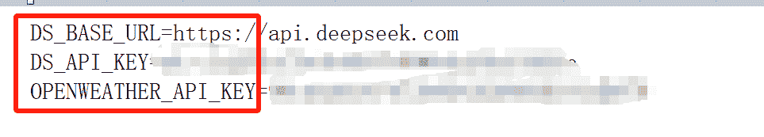

然后输入运行指令：

```
adk web --port 8002
```

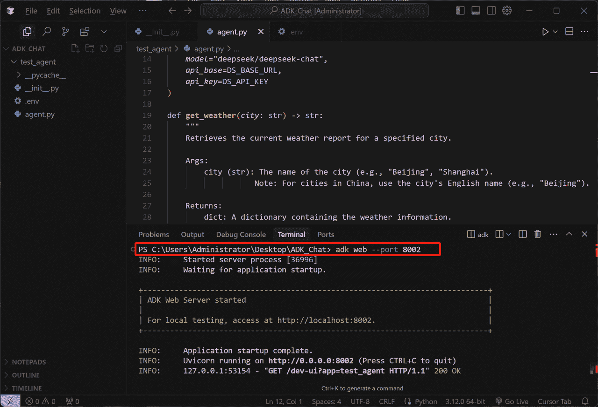

即可在前端开启对话，测试多工具并联和串联调用：

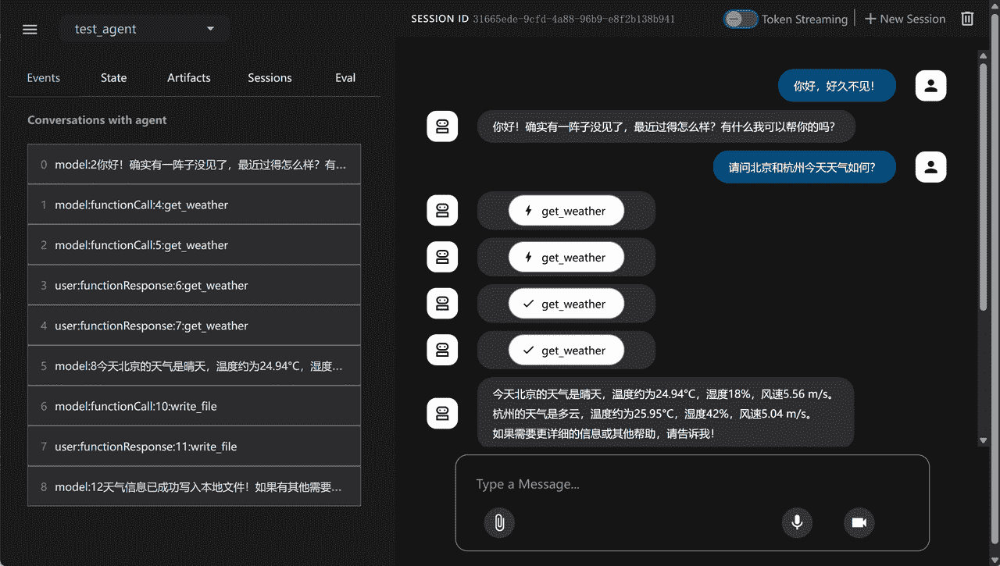

需要注意的是，左侧默认显示的就是现在的事件流，而对话中显示的则是调用工具和响应的情况，同时我们点击对话中的工具选项，还能看到对应的事件：

如点击第一个get_weather，代表的含义是第一次查询天气请求，由Agent发起，属于第二个事件：

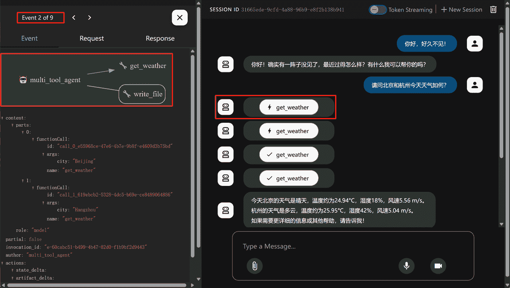

类似的，如果点击最后一个write_file，则代表将查询到的信息写入本地，此时对应第8个事件：

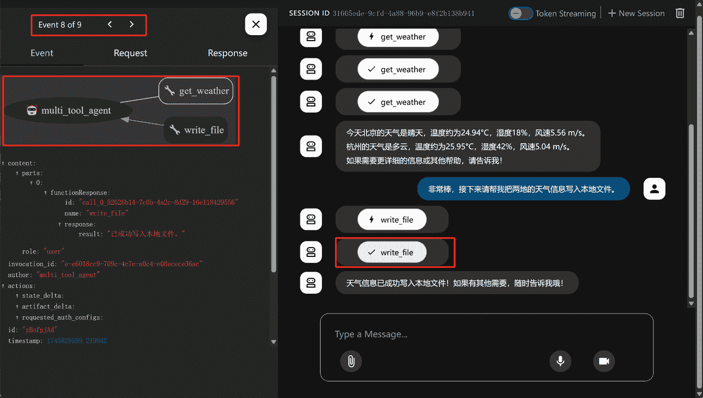

同时点击右上角还能开启新的对话，多个历史对话可以在Sessions中进行查看：

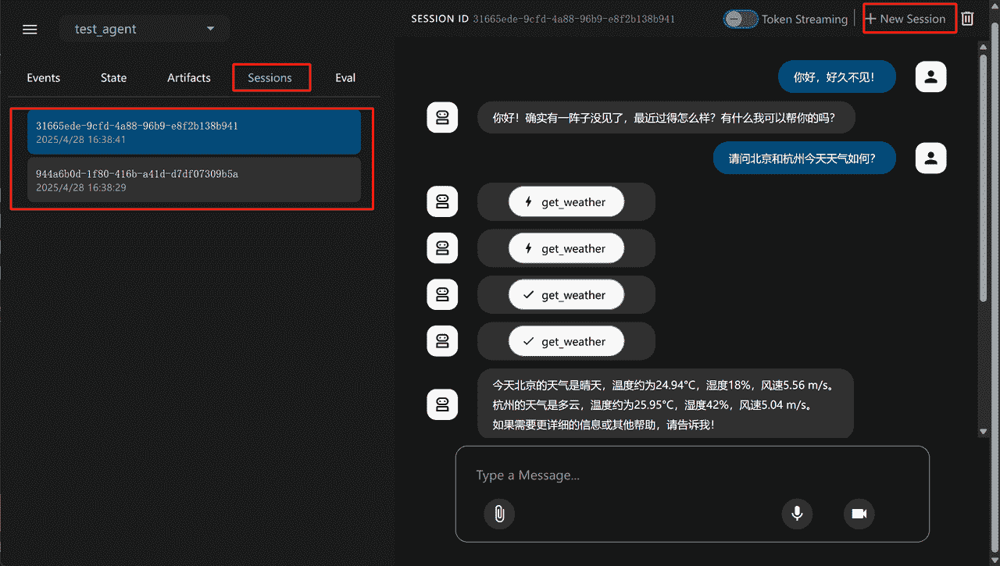

完整对话演示流程如下：

```
Video(&quot;https://ml2022.oss-cn-hangzhou.aliyuncs.com/2025-04-28%2016-38-49.mp4&quot;, width=800, height=400)
```

Your browser does not support the video element.

至此我们就完成了基于ADK构建多工具的Agent完整流程。

### 2. 更多外部工具快速调用流程

此外，在当前项目基础上，我们还能快速添加一些外部工具进行测试。例如添加一个本地查询MySQL的工具，我们只需要先在agent.py脚本进行如下修改：

```
# 额外导入pymysql
import pymysql

# 新增一个外部函数
def sql_inter(sql_query: str) -&gt; str:
    &quot;&quot;&quot;
    Executes a SQL query on a local MySQL database and returns the results.

    Args:
        sql_query (str): A SQL query string to be executed on the MySQL database. 
                          It will query tables in the &#x27;telco_db&#x27; database and retrieve related information.

    Returns:
        str: The results of the SQL query execution, returned as a JSON-formatted string.
    &quot;&quot;&quot;
    
    connection = pymysql.connect(
            host=&#x27;localhost&#x27;,  # Database address
            user=&#x27;root&#x27;,       # Database username
            passwd=&#x27;123&#x27;,      # Database password
            db=&#x27;telco_db&#x27;,     # Database name
            charset=&#x27;utf8&#x27;     # Character set selection
        )
    
    try:
        with connection.cursor() as cursor:
            # Execute the SQL query
            cursor.execute(sql_query)

            # Fetch the query results
            results = cursor.fetchall()

    finally:
        connection.close()
    
    return json.dumps(results)


# 修改root_agent
root_agent = Agent(
    name=&quot;multi_tool_agent&quot;,
    model=model, 
    description=&quot;用于进行天气查询、记录和数据库查询的智能体&quot;,
    instruction=&quot;你是一个乐于助人的助手。&quot;
                &quot;当用户询问特定城市的天气时，&quot;
                &quot;使用 &#x27;get_weather&#x27; 工具查找相关信息。&quot;
                &quot;当用户询需要将一些信息记录到本地的时候，&quot;
                &quot;使用 &#x27;write_file&#x27; 将指定内容记录到本地。&quot;
                &quot;当用户询需要查询数据库信息的时候，&quot;
                &quot;使用 &#x27;sql_inter&#x27; 查询数据库中各表的基本信息。&quot;    
                &quot;如果工具返回错误，礼貌地告知用户。&quot;,
    tools=[get_weather, write_file, sql_inter], 
)
```

> 注，需要提前安装好MySQL，并导入一些表。

然后尝试运行即可：adk web --port 8002

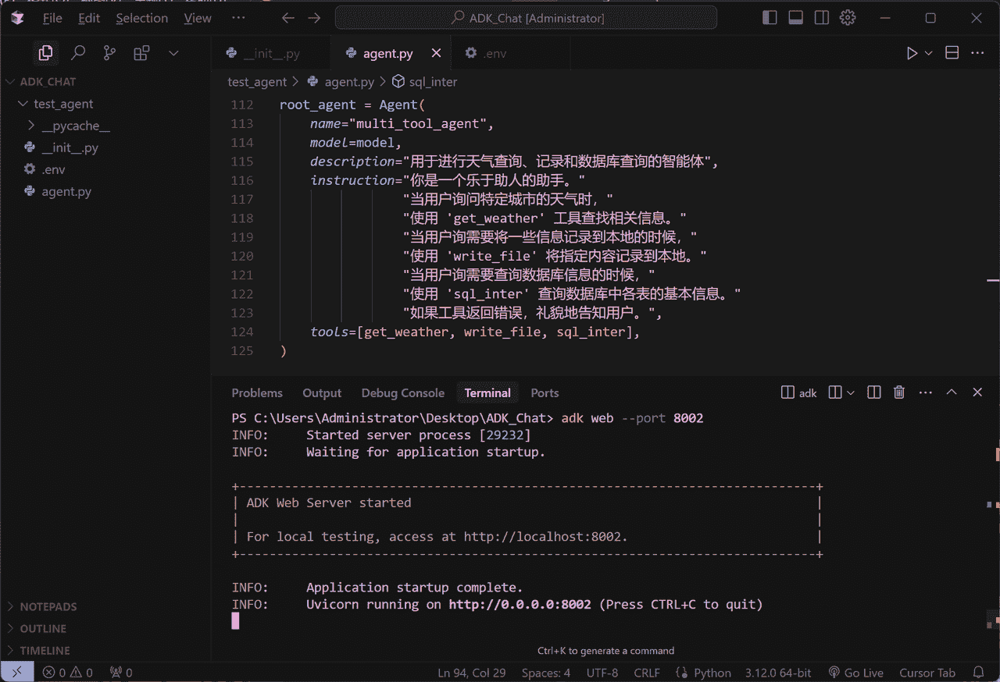

实际运行效果如下所示：

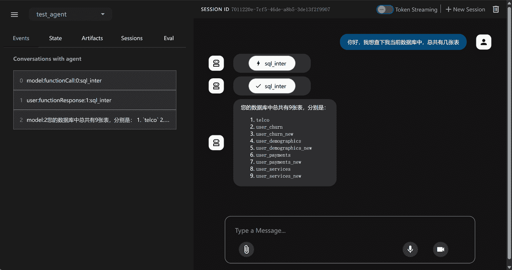

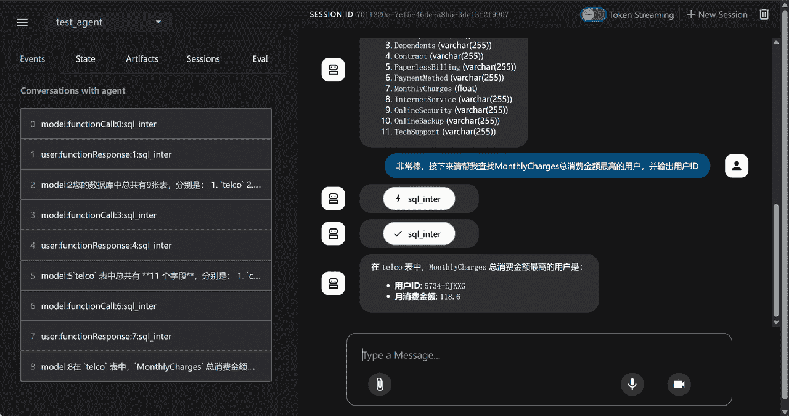

能够发现，借助Dev Web UI，能够非常便捷的进行功能测试。

### 3. ADK内置工具说明

除了可以自定义工具外，ADK还有非常丰富的内置工具，主要包括以下几类：

+   Gemini内置工具：包括谷歌搜索，谷歌云文档检索、代码解释器等工具；

+   其他Agent框架工具：包括LangChain Tavily和 CrewAI工具等；

+   Google Cloud工具：谷歌云平台的API为主；

这里以Gemini模型的谷歌搜索为例进行演示：

```
from google.adk.tools import google_search
from google.genai import types
```

```
import os

# 设置代理
os.environ[&#x27;HTTP_PROXY&#x27;] = &#x27;http://127.0.0.1:10080&#x27;
os.environ[&#x27;HTTPS_PROXY&#x27;] = &#x27;http://127.0.0.1:10080&#x27;

# 设置Gemini-API-KEY
os.environ[&quot;GOOGLE_API_KEY&quot;] = &quot;YOUR_GOOGLE_API_KEY&quot;
```

```
APP_NAME=&quot;google_search_agent&quot;
USER_ID=&quot;user1234&quot;
SESSION_ID=&quot;1234&quot;


root_agent = Agent(
    name=&quot;basic_search_agent&quot;,
    model=&quot;gemini-2.0-flash&quot;,
    description=&quot;Agent to answer questions using Google Search.&quot;,
    instruction=&quot;I can answer your questions by searching the internet. Just ask me anything!&quot;,
    # google_search is a pre-built tool which allows the agent to perform Google searches.
    tools=[google_search]
)
```

```
session_service = InMemorySessionService()
session = session_service.create_session(app_name=APP_NAME, user_id=USER_ID, session_id=SESSION_ID)
runner = Runner(agent=root_agent, app_name=APP_NAME, session_service=session_service)
```

```
query = &#x27;请问今日AI热点新闻有哪些？&#x27;
```

```
await call_agent_async(query, runner, USER_ID, SESSION_ID)
```

```
&gt;&gt;&gt; User Query: 请问今日AI热点新闻有哪些？
  [Event] Author: basic_search_agent, Type: Event, Final: True, Content: parts=[Part(video_metadata=None, thought=None, code_execution_result=None, executable_code=None, file_data=None, function_call=None, function_response=None, inline_data=None, text=&#x27;根据我搜索到的信息，以下是今日（2025年4月27日）AI领域的一些热点新闻：\n\n*   **AI代理重塑旅游业：** AI正在改变全球旅游业，通过分析旅客的浏览记录和社交媒体足迹，AI代理可以为用户量身定制旅行方案，向传统旅行社发起挑战。\n*   **AI芯片采购减少：** 蔚来李斌透露，公司一年减少了数十亿英伟达芯片采购。\n*    **百度AI开发者大会：** 李彦宏发布了两大新模型和多款热门AI应用，以帮助开发者全面拥抱MCP。\n*   **新型AI模型和应用：**\n    *   阶跃星辰发布了图像编辑模型Step1X-Edit。\n    *   Kimi开源了全新的音频基础模型。\n    *   百度心响App全量上线，人人免费使用。\n    *   北航推出了全开源TinyLLaVA-Video-R1。\n*   **AI与各行业融合：**\n    *   人工智能开始接管核电站的管理。\n    *   阿里AI旗舰应用夸克发布了全新“AI相机”。\n\n此外，AI在医疗、金融、教育、法律等领域的应用也在不断推动行业大模型的发展和数字化转型。&#x27;)] role=&#x27;model&#x27;
&lt;&lt;&lt; Agent Response: 根据我搜索到的信息，以下是今日（2025年4月27日）AI领域的一些热点新闻：

*   **AI代理重塑旅游业：** AI正在改变全球旅游业，通过分析旅客的浏览记录和社交媒体足迹，AI代理可以为用户量身定制旅行方案，向传统旅行社发起挑战。
*   **AI芯片采购减少：** 蔚来李斌透露，公司一年减少了数十亿英伟达芯片采购。
*    **百度AI开发者大会：** 李彦宏发布了两大新模型和多款热门AI应用，以帮助开发者全面拥抱MCP。
*   **新型AI模型和应用：**
    *   阶跃星辰发布了图像编辑模型Step1X-Edit。
    *   Kimi开源了全新的音频基础模型。
    *   百度心响App全量上线，人人免费使用。
    *   北航推出了全开源TinyLLaVA-Video-R1。
*   **AI与各行业融合：**
    *   人工智能开始接管核电站的管理。
    *   阿里AI旗舰应用夸克发布了全新“AI相机”。

此外，AI在医疗、金融、教育、法律等领域的应用也在不断推动行业大模型的发展和数字化转型。
```

借助谷歌搜索，能高效快速围绕互联网信息进行总结。

---

### 更多ADK工具和Agent开发工具方法详见正课

**更多关于ADK进阶工具使用方法，以及Age**nt开发相关内容讲解，详见《2025大模型Agent智能体开发实战》(5月班)付费课程。详细信息扫码添加助教，回复“大模型”，即可领取课程大纲&查看课程详情👇


---