# Part 3.谷歌开源Agent框架ADK接入MCP实战

> 来源：[https://kq4b3vgg5b.feishu.cn/docx/F8tQdGbZUo7lgDxsBYYcMwT3neU](https://kq4b3vgg5b.feishu.cn/docx/F8tQdGbZUo7lgDxsBYYcMwT3neU)

## 一、模型上下文协议（MCP）基础概念回顾

### 1. 谷歌ADK与MCP兼容情况

模型上下文协议 (MCP) 是一项开放标准，旨在规范 Gemini 和 Claude 等大型语言模型 (LLM) 与外部应用程序、数据源和工具的通信方式。MCP 可以理解为一种通用的连接机制，简化了 LLM 获取上下文、执行操作以及与各种系统交互的方式。

**  **     ** MCP **遵循客户端**-服务器架构，定义数据（**资源）、交互式**模板（提**示）和可操作功能（工具）如何由MCP 服务器公开并由MCP 客户端（可以是 LLM 主机应用程序或 AI 代理）使用。

而对于新一代Agent框架来说，都从底层代码功能方面支持MCP工具调用，而对于ADK来说更是允许以工具形式接入MCP，同时也允许将Agent包装为一个MCP server：

1.  在 ADK 中使用现有的 MCP 服务器： ADK 代理充当 MCP 客户端，利用外部 MCP 服务器提供的工具。

1.  通过 MCP 服务器公开 ADK 工具：构建一个包装 ADK 工具的 MCP 服务器，使任何 MCP 客户端都可以访问它们。

### 2. MCP系列公开课合集

在此前我已经开设过一些列公开课来介绍MCP工具，相关基础内容大家可以参考如下公开课：

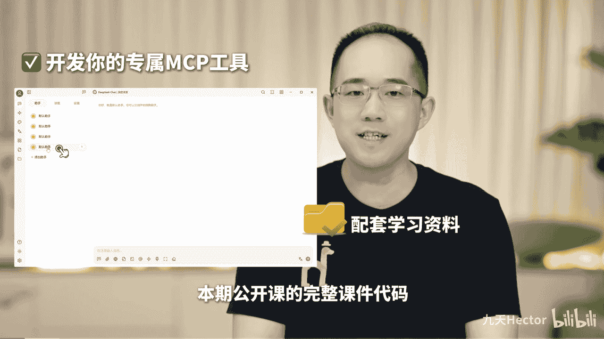

+   MCP技术开发入门：https://www.bilibili.com/video/BV1NLXCYTEbj/

+   MCP企业级智能体开发实战：https://www.bilibili.com/video/BV1n1ZuYjEzf/

+   不写一行代码，零门槛接入MCP：https://www.bilibili.com/video/BV1dCo7YdEgK/

+   7分钟开发&发布专属MCP！：https://www.bilibili.com/video/BV1VHL6zsE5F/

### 3. ADK接入MCP基本环境要求

在正式编写代码前，请确保已进行以下设置：

+   **完成ADK基础设置：**已完成ADK和LiteLlm的安装。

+   **安装/更新 Python：** MCP 需要 Python 3.9 或更高版本。

+   **安装 Node.js 和 npx：**许多社区 MCP 服务器以 Node.js 软件包的形式分发，并使用 运行npx。如果您尚未安装 Node.js（包含 npx），请先安装。详情请参阅https://nodejs.org/en。

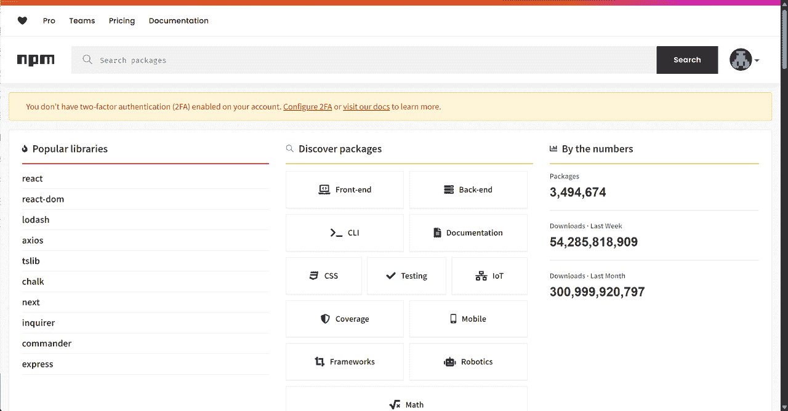

+   **安装pypi：**除了npm外，很多用Python编写的MCP库也托管在pypi上，并使用uvx进行安装，因此建议也提前安装好pypi库；

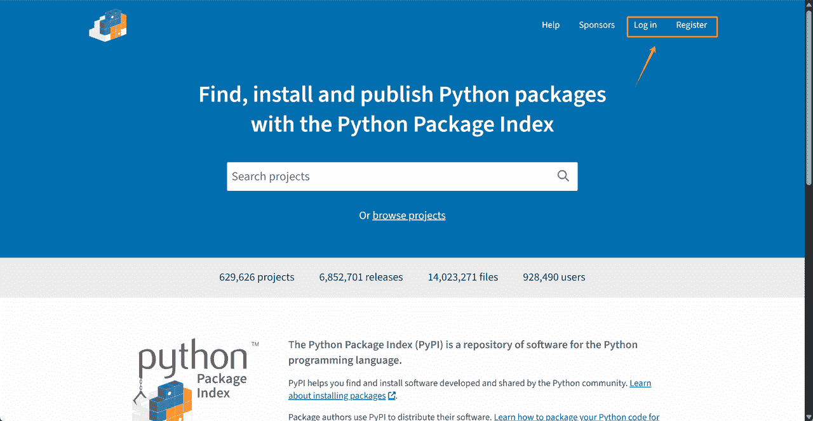

可以使用如下命令进行验证：

```
npx -v
node -v
```

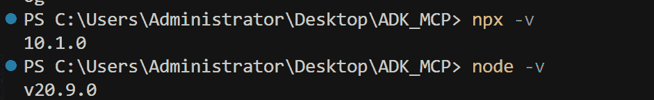

### 4. 公开课代码领取


## 二、使用 MCP 服务器和 ADK 代理（ADK 作为 MCP 客户端）

### 1. 基础概念介绍

MCP技术体系中，会将外部工具运行脚本称作服务器，而接入这些外部工具的大模型运行环境称作客户端。


一个客户端可以接入多个不同类型的服务器的，但要求是都可以遵循MCP通信协议。简单理解就是MCP服务器的输出内容是一种标准格式的内容，只能被MCP客户端所识别。在客户端和服务器都遵循MCP协议的时候，客户端就能够像Function calling中大模型调用外部工具一样，调用MCP服务器里面的工具。


而本节将率先介绍如何将ADK作为客户端，接入MCP工具。其中核心会用到MCPToolset类，该类是ADK连接到 MCP 服务器的桥梁。实际执行过程中我们的 ADK 代理将执行以下操作MCPToolset：

1.  **连接：**与 MCP 服务器进程建立连接。该服务器可以是通过标准输入/输出 ( StdioServerParameters) 进行通信的本地服务器，也可以是使用服务器发送事件 ( SseServerParams) 的远程服务器。

1.  **发现：**查询 MCP 服务器以获取可用工具（list_toolsMCP 方法）。

1.  **适应：**将 MCP 工具模式转换为 ADK 兼容BaseTool实例。

1.  **公开：**将这些适配的工具呈现给 ADK Agent。

1.  **代理调用：**当Agent决定使用其中一个工具时，MCPToolset将调用（call_toolMCP 方法）转发到 MCP 服务器并返回结果。

1.  **管理连接：**处理与 MCP 服务器进程的连接的生命周期，通常需要明确清理的周期（如进程结束后清理）。

### 2.FilesystemMCP服务器基础功能介绍

Filesystem服务器是一个最基础同时也是最常用的MCP服务器，同时也是官方推荐的服务器，服务器项目地址：https://github.com/modelcontextprotocol/servers/tree/main/src/filesystem

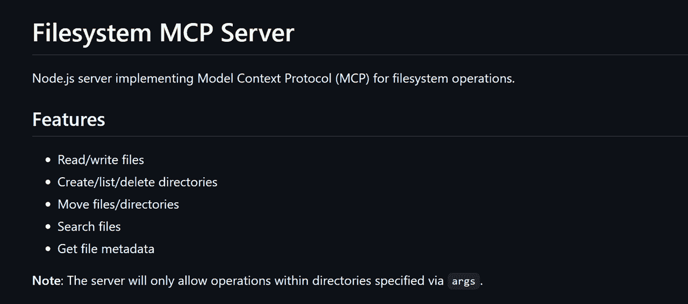

借助Filesystem，我们可以高效便捷操作本地文件夹。

同时Filesystem也是一个js项目，源码托管在npm平台上：（https://www.npmjs.com/package/@modelcontextprotocol/server-filesystem）

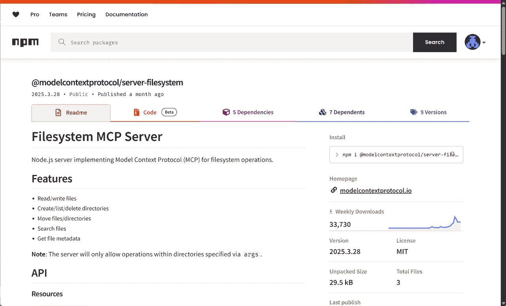

而如果是使用cursor或者Cherry studio接入该MCP，可以直接使用如下配置：

```
{
  &quot;mcpServers&quot;: {
    &quot;filesystem&quot;: {
      &quot;command&quot;: &quot;npx&quot;,
      &quot;args&quot;: [
        &quot;-y&quot;,
        &quot;@modelcontextprotocol/server-filesystem&quot;,
        &quot;/path/to/other/allowed/dir&quot;
      ]
    }
  }
}
```

即使用npx进行安装，并且需要在参数位上输入指定文件夹路径。例如在Cherry studio中，我们可以这样使用Filesystem：

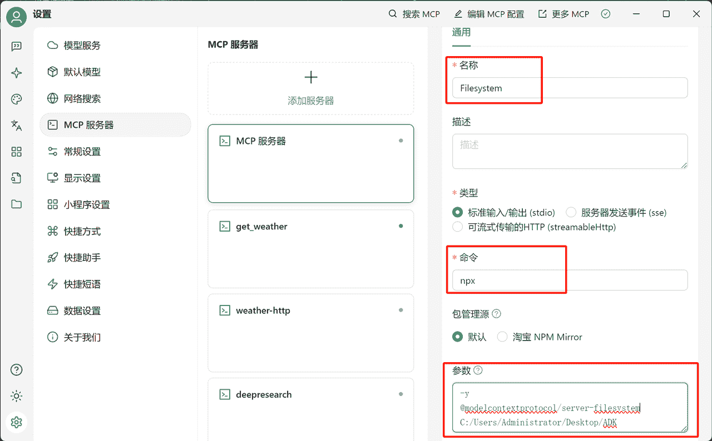

实际使用效果如下所示：

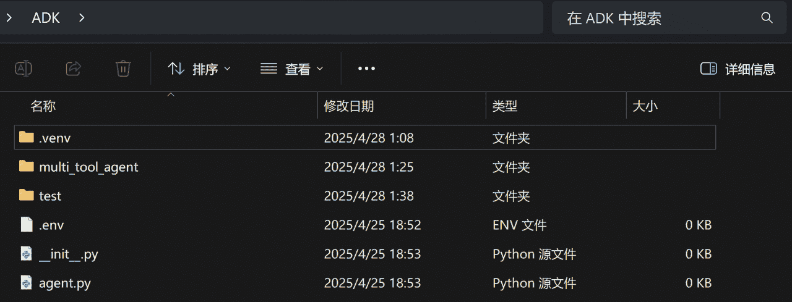

### 3. 将Filesystem MCP接入谷歌ADK

接下来尝试在代码环境中，使用ADK调用Filesystem MCP，这里我们还是选择在Linux环境下使用uv工具进行库的管理

首先使用pip安装uv：

```
pip install uv
```

> 此外，也可以直接使用curl安装uv

```
curl -LsSf https://astral.sh/uv/install.sh | sh
```

然后按照如下流程创建项目主目录：

```
# cd /root/autodl-tmp/MCP

# 创建项目目录
uv init temp-test-mcp
cd temp-test-mcp
```

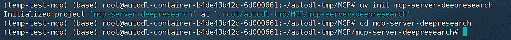

然后输入如下命令创建虚拟环境：

```
# 创建虚拟环境
uv venv

# 激活虚拟环境
source .venv/bin/activate
```

同时再创建一个.env文件用于保存关键变量，此时就构建了一个基础项目结构：

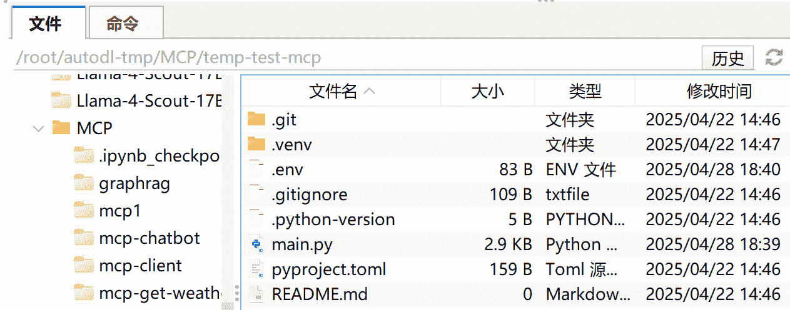

各文件解释如下：

| 文件/文件夹 | 作用 |
| --- | --- |
| .git/ | Git 版本控制目录 |
| .venv/ | 虚拟环境 |
| .gitignore | Git 忽略规则 |
| .python-version | Python版本声明 |
| main.py | 主程序入口 |
| pyproject.toml | 项目配置文件 |
| README.md | 项目说明文档 |

然后添加项目依赖

```
uv add google-adk litellm==1.67.2
```

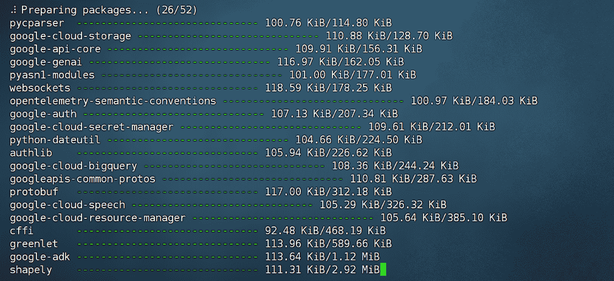

然后打开.env，写入deepseek模型调用请求地址和API-KEY：

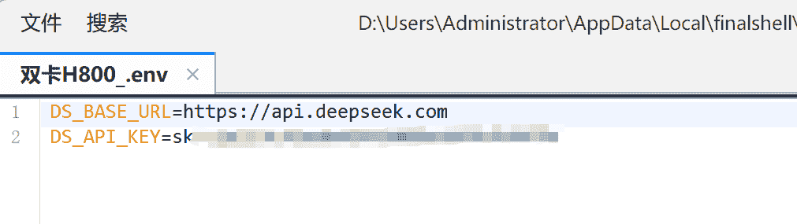

然后打开main.py，写入主函数内容：

```
# 导入基础库
import asyncio
import os
from dotenv import load_dotenv
from google.genai import types
from google.adk.agents import Agent
from google.adk.models.lite_llm import LiteLlm 
from google.adk.agents.llm_agent import LlmAgent
from google.adk.runners import Runner
from google.adk.sessions import InMemorySessionService
from google.adk.tools.mcp_tool.mcp_toolset import MCPToolset, SseServerParams, StdioServerParameters

DS_API_KEY = os.getenv(&quot;DS_API_KEY&quot;)
DS_BASE_URL = os.getenv(&quot;DS_BASE_URL&quot;)

model = LiteLlm(
    model=&quot;deepseek/deepseek-chat&quot;,  
    api_base=DS_BASE_URL,
    api_key=DS_API_KEY
)


# --- Step 1: 创建导入MCP工具函数 ---
async def get_tools_async():
  &quot;&quot;&quot;Gets tools from the File System MCP Server.&quot;&quot;&quot;
  print(&quot;Attempting to connect to MCP Filesystem server...&quot;)
  tools, exit_stack = await MCPToolset.from_server(
      # 这里采用Studio通信方式进行调用
      connection_params=StdioServerParameters(
          command=&#x27;npx&#x27;, # Command to run the server
          args=[&quot;-y&quot;,    # Arguments for the command
                &quot;@modelcontextprotocol/server-filesystem&quot;,
                # 这里需要指定一个绝对路径
                &quot;/root/autodl-tmp/MCP/temp-test-mcp&quot;],
      )
  )
  print(&quot;MCP Toolset created successfully.&quot;)
  # MCP需要维护一个与本地MCP服务器的连接。
  # exit_stack管理这个连接的清理。
  return tools, exit_stack

# --- Step 2: 创建ADK Agent ---
async def get_agent_async():
  &quot;&quot;&quot;Creates an ADK Agent equipped with tools from the MCP Server.&quot;&quot;&quot;
  tools, exit_stack = await get_tools_async()
  print(f&quot;Fetched {len(tools)} tools from MCP server.&quot;)
  root_agent = Agent(
      model=model,
      name=&#x27;filesystem_assistant&#x27;,
      instruction=&#x27;Help user interact with the local filesystem using available tools.&#x27;,
      tools=tools, # 将MCP工具加载到Agent中
  )
  return root_agent, exit_stack

# --- Step 3: 执行主逻辑 ---
async def async_main():
  # 创建会话管理器
  session_service = InMemorySessionService()

  session = session_service.create_session(
      state={}, app_name=&#x27;mcp_filesystem_app&#x27;, user_id=&#x27;user_fs&#x27;
  )

  # 用户输入
  query = &quot;请帮我查找目前文件夹里都有哪些文件？&quot;
  print(f&quot;User Query: &#x27;{query}&#x27;&quot;)
  content = types.Content(role=&#x27;user&#x27;, parts=[types.Part(text=query)])

  root_agent, exit_stack = await get_agent_async()

  runner = Runner(
      app_name=&#x27;mcp_filesystem_app&#x27;,
      agent=root_agent,
      session_service=session_service,
  )

  print(&quot;Running agent...&quot;)
  events_async = runner.run_async(
      session_id=session.id, user_id=session.user_id, new_message=content
  )

  async for event in events_async:
    print(f&quot;Event received: {event}&quot;)

  # 运行完成后，关闭MCP服务器连接
  print(&quot;Closing MCP server connection...&quot;)
  await exit_stack.aclose()
  print(&quot;Cleanup complete.&quot;)

if __name__ == &#x27;__main__&#x27;:
  try:
    asyncio.run(async_main())
  except Exception as e:
    print(f&quot;An error occurred: {e}&quot;)
```

然后尝试进行调用：

```
uv run main.py
```

并观察输出结果：即MCP 服务器启动（通过 npx）、ADK 代理事件（包括对 list_directory 的 FunctionCall 和 FunctionResponse），以及基于文件列表的最终代理文本响应。请确保 exit_stack.aclose() 在最后运行。

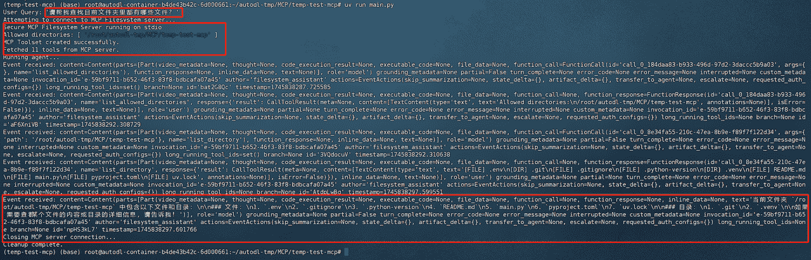

### 4.优化后的信息展示形式

尽管目前可以运行，但整体来看并不美观，接下来对代码形式进行优化，方便在命令行中进行调用和对话：

```
# 导入基础库
import asyncio
import os
from dotenv import load_dotenv
from google.genai import types
from google.adk.agents import Agent
from google.adk.models.lite_llm import LiteLlm 
from google.adk.agents.llm_agent import LlmAgent
from google.adk.runners import Runner
from google.adk.sessions import InMemorySessionService
from google.adk.tools.mcp_tool.mcp_toolset import MCPToolset, SseServerParams, StdioServerParameters

DS_API_KEY = os.getenv(&quot;DS_API_KEY&quot;)
DS_BASE_URL = os.getenv(&quot;DS_BASE_URL&quot;)

model = LiteLlm(
    model=&quot;deepseek/deepseek-chat&quot;,  
    api_base=DS_BASE_URL,
    api_key=DS_API_KEY
)


# --- Step 1: 创建导入MCP工具函数 ---
async def get_tools_async():
  &quot;&quot;&quot;Gets tools from the File System MCP Server.&quot;&quot;&quot;
  print(&quot;Attempting to connect to MCP Filesystem server...&quot;)
  tools, exit_stack = await MCPToolset.from_server(
      # 这里采用Studio通信方式进行调用
      connection_params=StdioServerParameters(
          command=&#x27;npx&#x27;, # Command to run the server
          args=[&quot;-y&quot;,    # Arguments for the command
                &quot;@modelcontextprotocol/server-filesystem&quot;,
                # 这里需要指定一个绝对路径
                &quot;/root/autodl-tmp/MCP/temp-test-mcp&quot;],
      )
  )
  print(&quot;MCP Toolset created successfully.&quot;)
  # MCP需要维护一个与本地MCP服务器的连接。
  # exit_stack管理这个连接的清理。
  return tools, exit_stack

# --- Step 2: 创建ADK Agent ---
async def get_agent_async():
  &quot;&quot;&quot;Creates an ADK Agent equipped with tools from the MCP Server.&quot;&quot;&quot;
  tools, exit_stack = await get_tools_async()
  print(f&quot;Fetched {len(tools)} tools from MCP server.&quot;)
  root_agent = Agent(
      model=model,
      name=&#x27;filesystem_assistant&#x27;,
      instruction=&#x27;Help user interact with the local filesystem using available tools.&#x27;,
      tools=tools, # 将MCP工具加载到Agent中
  )
  return root_agent, exit_stack

# 多轮对话函数
async def chat_loop(root_agent, exit_stack, runner, user_id, session_id) -&gt; None:    
    print(&quot;\n🤖 ADK+MCP对话已启动！输入 &#x27;quit&#x27; 退出。&quot;)
    
    while True:
        query = input(&quot;\n你: &quot;).strip()
        if query.lower() == &quot;quit&quot;:
            break
        try:
            print(f&quot;\n&gt;&gt;&gt; User Query: {query}&quot;)
            # Prepare the user&#x27;s message in ADK format
            content = types.Content(role=&#x27;user&#x27;, parts=[types.Part(text=query)])
            final_response_text = &quot;Agent did not produce a final response.&quot; # Default

            # Key Concept: run_async executes the agent logic and yields Events.
            # We iterate through events to find the final answer.
            async for event in runner.run_async(user_id=user_id, session_id=session_id, new_message=content):
            # You can uncomment the line below to see *all* events during execution
                print(f&quot;  [Event] Author: {event.author}, Type: {type(event).__name__}, Final: {event.is_final_response()}, Content: {event.content}&quot;)

                # Key Concept: is_final_response() marks the concluding message for the turn.
                if event.is_final_response():
                    if event.content and event.content.parts:
                       # Assuming text response in the first part
                       final_response_text = event.content.parts[0].text
                    elif event.actions and event.actions.escalate: # Handle potential errors/escalations
                       final_response_text = f&quot;Agent escalated: {event.error_message or &#x27;No specific message.&#x27;}&quot;
                    # Add more checks here if needed (e.g., specific error codes)
                    break # Stop processing events once the final response is found

            print(f&quot;&lt;&lt;&lt; Agent Response: {final_response_text}&quot;)
        except Exception as e:
            print(f&quot;\n⚠️  调用过程出错: {e}&quot;)


# --- Step 3: 执行主逻辑 ---
async def async_main():
  # 进行多轮对话
  root_agent, exit_stack = await get_agent_async()
  # 创建会话管理器
  session_service = InMemorySessionService()
  
  app_name=&#x27;mcp_filesystem_app&#x27;
  user_id = &quot;user_1&quot;
  session_id = &quot;session_001&quot;

  session = session_service.create_session(
      app_name=app_name,
      user_id=user_id,
      session_id=session_id
  )
    
  runner = Runner(
      app_name=app_name,
      agent=root_agent,
      session_service=session_service,
  )
  await chat_loop(root_agent, exit_stack, runner, user_id, session_id)

  # 运行完成后，关闭MCP服务器连接
  print(&quot;Closing MCP server connection...&quot;)
  await exit_stack.aclose()
  print(&quot;Cleanup complete.&quot;)

if __name__ == &#x27;__main__&#x27;:
  try:
    asyncio.run(async_main())
  except Exception as e:
    print(f&quot;An error occurred: {e}&quot;)
```

实际对话效果如下：

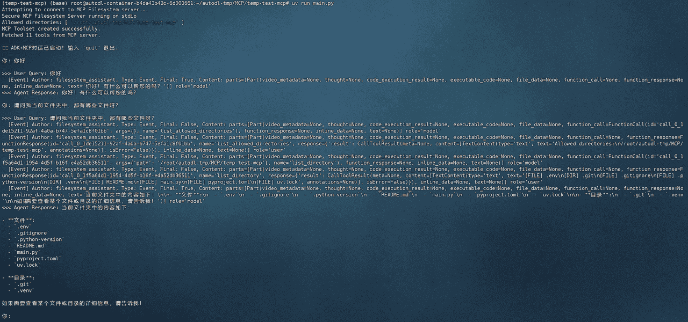

此时不仅能进行多轮对话，而且还能顺利打印事件流。具体代码解释如下：

#### 导入基础库

```
import asyncio
import os
from dotenv import load_dotenv
from google.genai import types
from google.adk.agents import Agent
from google.adk.models.lite_llm import LiteLlm
from google.adk.agents.llm_agent import LlmAgent
from google.adk.runners import Runner
from google.adk.sessions import InMemorySessionService
from google.adk.tools.mcp_tool.mcp_toolset import MCPToolset, SseServerParams, StdioServerParameters
```

这些库包括：

+   **asyncio**：用于处理异步操作，尤其适用于并发的 I/O 操作。

+   **os**：用于读取环境变量。

+   **dotenv**：加载 .env 文件中的环境变量。

+   **google.genai** 和 **google.adk**：这些是 Google 的 ADK 库和工具，用于构建和管理 AI 代理。

+   **MCPToolset**：用于管理与本地 MCP 服务器的交互。

#### 环境变量

```
DS_API_KEY = os.getenv(&quot;DS_API_KEY&quot;)
DS_BASE_URL = os.getenv(&quot;DS_BASE_URL&quot;)
```

+   通过 os.getenv 从环境中获取 API 密钥（DS_API_KEY）和基础 URL（DS_BASE_URL），这两个是与 DeepSeek 模型 API 交互所需要的。

#### 创建模型实例

```
model = LiteLlm(
    model=&quot;deepseek/deepseek-chat&quot;,  
    api_base=DS_BASE_URL,
    api_key=DS_API_KEY
)
```

+   **LiteLlm**：创建一个 LiteLlm 实例，这个模型将用来生成响应。它是基于 deepseek-chat 模型构建的，并且使用上面获取的 API 密钥和基础 URL 进行初始化。

#### Step 1: 创建导入 MCP 工具函数

```
async def get_tools_async():
  &quot;&quot;&quot;Gets tools from the File System MCP Server.&quot;&quot;&quot;
  print(&quot;Attempting to connect to MCP Filesystem server...&quot;)
  tools, exit_stack = await MCPToolset.from_server(
      connection_params=StdioServerParameters(
          command=&#x27;npx&#x27;,
          args=[&quot;-y&quot;, &quot;@modelcontextprotocol/server-filesystem&quot;, &quot;/root/autodl-tmp/MCP/temp-test-mcp&quot;],
      )
  )
  print(&quot;MCP Toolset created successfully.&quot;)
  return tools, exit_stack
```

+   **get_tools_async**：异步函数，通过 MCPToolset.from_server 从本地 MCP 文件系统服务器获取工具。这里使用 StdioServerParameters 来调用本地的 MCP 文件系统服务器，并指定路径 /root/autodl-tmp/MCP/temp-test-mcp。

+   exit_stack 用于确保连接关闭时进行清理。

#### Step 2: 创建 ADK Agent

```
async def get_agent_async():
  &quot;&quot;&quot;Creates an ADK Agent equipped with tools from the MCP Server.&quot;&quot;&quot;
  tools, exit_stack = await get_tools_async()
  print(f&quot;Fetched {len(tools)} tools from MCP server.&quot;)
  root_agent = Agent(
      model=model,
      name=&#x27;filesystem_assistant&#x27;,
      instruction=&#x27;Help user interact with the local filesystem using available tools.&#x27;,
      tools=tools, 
  )
  return root_agent, exit_stack
```

+   **get_agent_async**：创建一个 ADK 代理（Agent），并为它加载从 MCP 文件系统服务器获取到的工具。代理的模型是 deepseek-chat，并且它的任务是帮助用户与本地文件系统交互。

#### 多轮对话函数

```
async def chat_loop(root_agent, exit_stack, runner, user_id, session_id) -&gt; None:    
    print(&quot;\n🤖 ADK+MCP对话已启动！输入 &#x27;quit&#x27; 退出。&quot;)
    
    while True:
        query = input(&quot;\n你: &quot;).strip()
        if query.lower() == &quot;quit&quot;:
            break
        try:
            print(f&quot;\n&gt;&gt;&gt; User Query: {query}&quot;)
            content = types.Content(role=&#x27;user&#x27;, parts=[types.Part(text=query)])
            final_response_text = &quot;Agent did not produce a final response.&quot;

            async for event in runner.run_async(user_id=user_id, session_id=session_id, new_message=content):
                print(f&quot;  [Event] Author: {event.author}, Type: {type(event).__name__}, Final: {event.is_final_response()}, Content: {event.content}&quot;)

                if event.is_final_response():
                    if event.content and event.content.parts:
                       final_response_text = event.content.parts[0].text
                    elif event.actions and event.actions.escalate:
                       final_response_text = f&quot;Agent escalated: {event.error_message or &#x27;No specific message.&#x27;}&quot;
                    break 

            print(f&quot;&lt;&lt;&lt; Agent Response: {final_response_text}&quot;)
        except Exception as e:
            print(f&quot;\n⚠️  调用过程出错: {e}&quot;)
```

+   **chat_loop**：这是一个交互式的对话循环函数，模拟多轮对话。用户输入的查询会被传递给代理，代理生成的响应会被输出。通过 runner.run_async 执行代理的逻辑，并迭代事件，直到获得最终的响应。

+   is_final_response()：用于判断当前事件是否为最终响应，一旦获得最终响应就停止继续处理。

#### Step 3: 执行主逻辑

```
async def async_main():
  root_agent, exit_stack = await get_agent_async()
  session_service = InMemorySessionService()
  
  app_name=&#x27;mcp_filesystem_app&#x27;
  user_id = &quot;user_1&quot;
  session_id = &quot;session_001&quot;

  session = session_service.create_session(
      app_name=app_name,
      user_id=user_id,
      session_id=session_id
  )
    
  runner = Runner(
      app_name=app_name,
      agent=root_agent,
      session_service=session_service,
  )
  await chat_loop(root_agent, exit_stack, runner, user_id, session_id)

  print(&quot;Closing MCP server connection...&quot;)
  await exit_stack.aclose()
  print(&quot;Cleanup complete.&quot;)
```

+   **async_main**：主逻辑函数，首先通过 get_agent_async 获取一个代理，并创建一个会话（session_service.create_session）。然后，通过 Runner 启动代理并运行多轮对话（chat_loop）。

+   在对话完成后，关闭 MCP 服务器连接并进行清理工作。

## 二、使用 ADK 工具搭建 MCP 服务器（MCP 服务器暴露 ADK）

接下来我们继续尝试将一个ADK Agent封装为MCP服务器，方便其他应用程序使用。接下来我们将使用 model-context-protocol 库创建一个标准的 Python MCP 服务器应用程序。并在此服务器中试下你如下功能：

1.  创建一个联网搜索的 ADK 工具；

1.  实现 MCP 服务器的 @app.list_tools 处理程序来宣传 ADK 工具，并使用 adk_to_mcp_tool_type 将 ADK 工具定义转换为 MCP 模式；

1.  实现 MCP 服务器的 @app.call_tool 处理程序以接收来自 MCP 客户端的请求，识别请求是否针对您包装的 ADK 工具，执行 ADK 工具的 .run_async() 方法，并将结果格式化为符合 MCP 的响应；

还是类似的，我们采用uv进行库的管理，我们仍然还在相同的项目文件内进行操作，需要使用如下命令安装必要的虚拟环境：

```
uv add mcp bs4 lxml
```

然后创建server.py脚本，

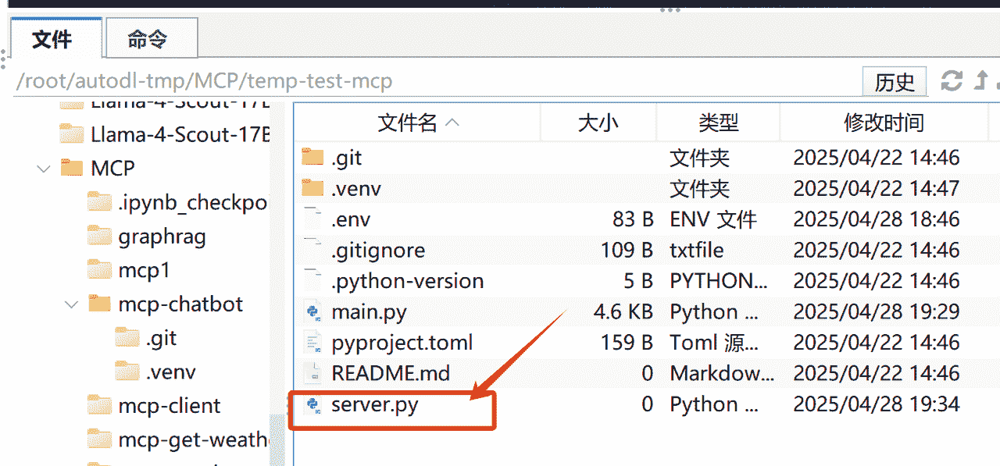

并写入如下内容：

```
# server.py
import asyncio
import json
from dotenv import load_dotenv
import os

# MCP Server Imports
from mcp import types as mcp_types # Use alias to avoid conflict with genai.types
from mcp.server.lowlevel import Server, NotificationOptions
from mcp.server.models import InitializationOptions
import mcp.server.stdio

# ADK Tool Imports
from google.adk.tools.function_tool import FunctionTool
from google.adk.tools.load_web_page import load_web_page # Example ADK tool
# ADK &lt;-&gt; MCP Conversion Utility
from google.adk.tools.mcp_tool.conversion_utils import adk_to_mcp_tool_type

# --- Load Environment Variables (If ADK tools need them) ---
load_dotenv()
# set proxy
os.environ[&#x27;HTTP_PROXY&#x27;] = &#x27;http://127.0.0.1:10080&#x27;
os.environ[&#x27;HTTPS_PROXY&#x27;] = &#x27;http://127.0.0.1:10080&#x27;

# --- Prepare the ADK Tool ---
# Instantiate the ADK tool you want to expose
print(&quot;Initializing ADK load_web_page tool...&quot;)
adk_web_tool = FunctionTool(load_web_page)
print(f&quot;ADK tool &#x27;{adk_web_tool.name}&#x27; initialized.&quot;)
# --- End ADK Tool Prep ---

# --- MCP Server Setup ---
print(&quot;Creating MCP Server instance...&quot;)
# Create a named MCP Server instance
app = Server(&quot;adk-web-tool-mcp-server&quot;)

# Implement the MCP server&#x27;s @app.list_tools handler
@app.list_tools()
async def list_tools() -&gt; list[mcp_types.Tool]:
  &quot;&quot;&quot;MCP handler to list available tools.&quot;&quot;&quot;
  print(&quot;MCP Server: Received list_tools request.&quot;)
  # Convert the ADK tool&#x27;s definition to MCP format
  mcp_tool_schema = adk_to_mcp_tool_type(adk_web_tool)
  print(f&quot;MCP Server: Advertising tool: {mcp_tool_schema.name}&quot;)
  return [mcp_tool_schema]

# Implement the MCP server&#x27;s @app.call_tool handler
@app.call_tool()
async def call_tool(
    name: str, arguments: dict
) -&gt; list[mcp_types.TextContent | mcp_types.ImageContent | mcp_types.EmbeddedResource]:
  &quot;&quot;&quot;MCP handler to execute a tool call.&quot;&quot;&quot;
  print(f&quot;MCP Server: Received call_tool request for &#x27;{name}&#x27; with args: {arguments}&quot;)

  # Check if the requested tool name matches our wrapped ADK tool
  if name == adk_web_tool.name:
    try:
      # Execute the ADK tool&#x27;s run_async method
      # Note: tool_context is None as we are not within a full ADK Runner invocation
      adk_response = await adk_web_tool.run_async(
          args=arguments,
          tool_context=None, # No ADK context available here
      )
      print(f&quot;MCP Server: ADK tool &#x27;{name}&#x27; executed successfully.&quot;)
      # Format the ADK tool&#x27;s response (often a dict) into MCP format.
      # Here, we serialize the response dictionary as a JSON string within TextContent.
      # Adjust formatting based on the specific ADK tool&#x27;s output and client needs.
      response_text = json.dumps(adk_response, indent=2)
      return [mcp_types.TextContent(type=&quot;text&quot;, text=response_text)]

    except Exception as e:
      print(f&quot;MCP Server: Error executing ADK tool &#x27;{name}&#x27;: {e}&quot;)
      # Return an error message in MCP format
      # Creating a proper MCP error response might be more robust
      error_text = json.dumps({&quot;error&quot;: f&quot;Failed to execute tool &#x27;{name}&#x27;: {str(e)}&quot;})
      return [mcp_types.TextContent(type=&quot;text&quot;, text=error_text)]
  else:
      # Handle calls to unknown tools
      print(f&quot;MCP Server: Tool &#x27;{name}&#x27; not found.&quot;)
      error_text = json.dumps({&quot;error&quot;: f&quot;Tool &#x27;{name}&#x27; not implemented.&quot;})
      # Returning error as TextContent for simplicity
      return [mcp_types.TextContent(type=&quot;text&quot;, text=error_text)]

# --- MCP Server Runner ---
async def run_server():
  &quot;&quot;&quot;Runs the MCP server over standard input/output.&quot;&quot;&quot;
  # Use the stdio_server context manager from the MCP library
  async with mcp.server.stdio.stdio_server() as (read_stream, write_stream):
    print(&quot;MCP Server starting handshake...&quot;)
    await app.run(
        read_stream,
        write_stream,
        InitializationOptions(
            server_name=app.name, # Use the server name defined above
            server_version=&quot;0.1.0&quot;,
            capabilities=app.get_capabilities(
                # Define server capabilities - consult MCP docs for options
                notification_options=NotificationOptions(),
                experimental_capabilities={},
            ),
        ),
    )
    print(&quot;MCP Server run loop finished.&quot;)

if __name__ == &quot;__main__&quot;:
  print(&quot;Launching MCP Server exposing ADK tools...&quot;)
  try:
    asyncio.run(run_server())
  except KeyboardInterrupt:
    print(&quot;\nMCP Server stopped by user.&quot;)
  except Exception as e:
    print(f&quot;MCP Server encountered an error: {e}&quot;)
  finally:
    print(&quot;MCP Server process exiting.&quot;)
# --- End MCP Server ---
```

编写完成后进行测试，这里按照此前的示例，我们使用文件系统 MCP 服务器”中的说明创建 MCP 客户端并进行如下修改，使其能接入现在的MCP服务器：

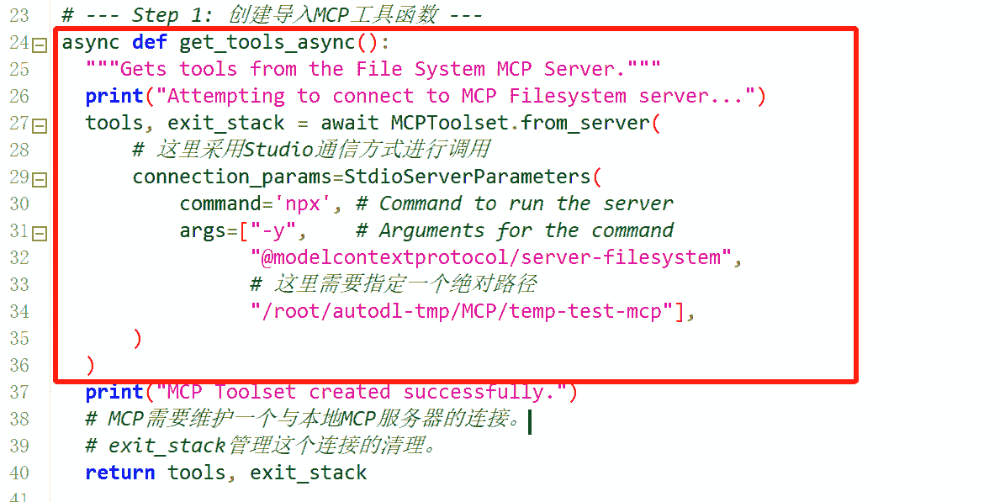

```
# ...
async def get_tools_async():
  &quot;&quot;&quot;Gets tools from the File System MCP Server.&quot;&quot;&quot;
  print(&quot;Attempting to connect to MCP Filesystem server...&quot;)
  tools, exit_stack = await MCPToolset.from_server(
      # Use StdioServerParameters for local process communication
      connection_params=StdioServerParameters(
          command=&#x27;python3&#x27;, # Command to run the server
          args=[
                &quot;/root/autodl-tmp/MCP/temp-test-mcp/server.py&quot;],
      )
  )
# ...
```

修改后如图所示：

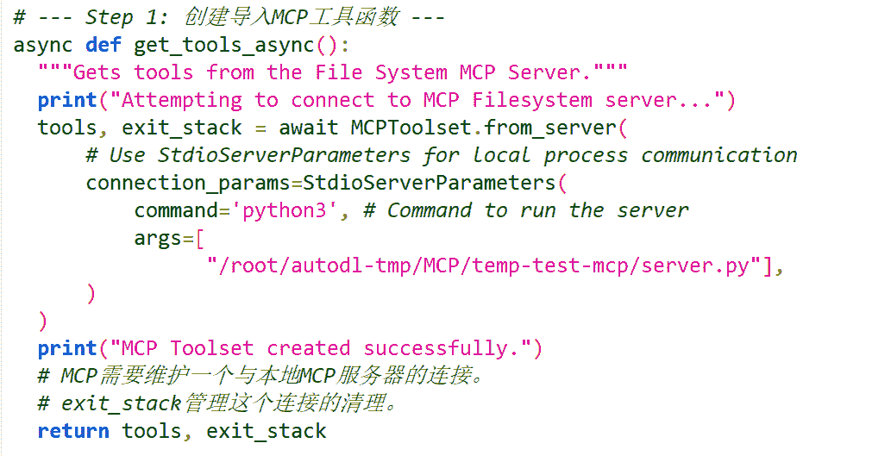

同时需要将模型改为谷歌gemini模型：

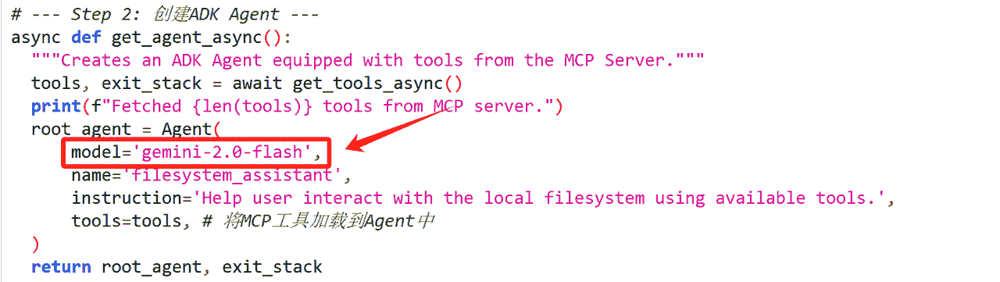

并在.env中输入gemini模型的API-KEY

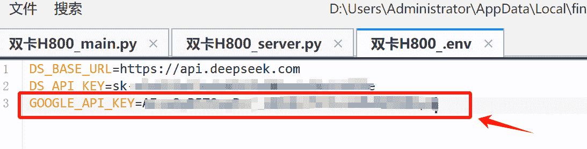

其他不变，直接输入命令启动服务：

```
uv run main.py
```

测试效果如下：

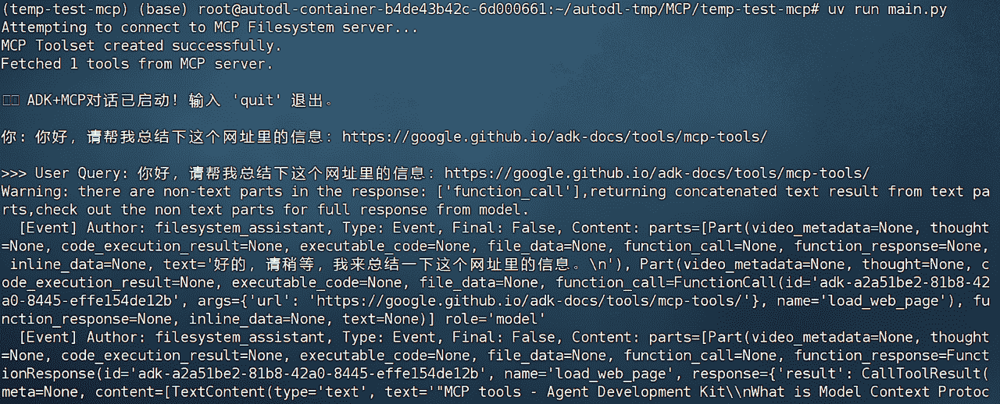

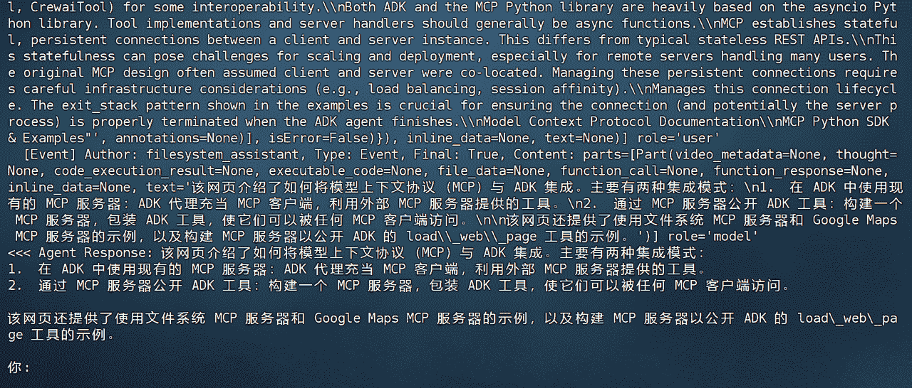

## 三、借助 adk web dev UI 调用MCP

当然我们还可以使用 MCP web工具调用agent，并同时调用MCP工具。和此前一样，我们需要在当前主目录下创建一个web UI项目文件夹：

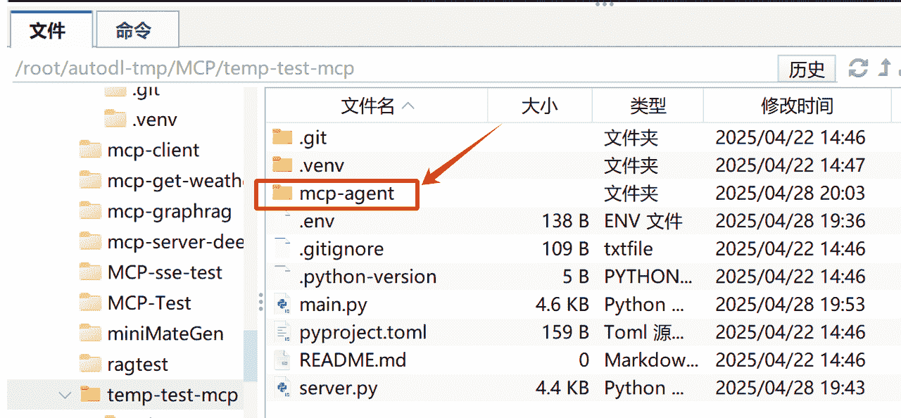

然后复制主目录下的.env到mcp-agent文件夹内，并再创建_init_.py文件和agent.py文件，并在中写入：

```
from . import agent
```

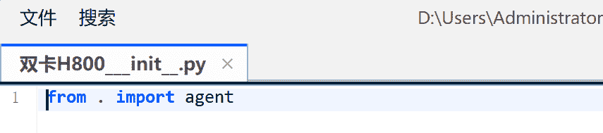

同时在agent.py中写入如下内容：

```
# 导入基础库
import asyncio
import os
from dotenv import load_dotenv
from google.genai import types
from google.adk.agents import Agent
from google.adk.models.lite_llm import LiteLlm 
from google.adk.agents.llm_agent import LlmAgent
from google.adk.runners import Runner
from google.adk.sessions import InMemorySessionService
from google.adk.tools.mcp_tool.mcp_toolset import MCPToolset, SseServerParams, StdioServerParameters

DS_API_KEY = os.getenv(&quot;DS_API_KEY&quot;)
DS_BASE_URL = os.getenv(&quot;DS_BASE_URL&quot;)

model = LiteLlm(
    model=&quot;deepseek/deepseek-chat&quot;,  
    api_base=DS_BASE_URL,
    api_key=DS_API_KEY
)
os.environ[&#x27;HTTP_PROXY&#x27;] = &#x27;http://127.0.0.1:10080&#x27;
os.environ[&#x27;HTTPS_PROXY&#x27;] = &#x27;http://127.0.0.1:10080&#x27;

# --- Step 1: 创建导入MCP工具函数 ---
async def get_tools_async():
  &quot;&quot;&quot;Gets tools from the File System MCP Server.&quot;&quot;&quot;
  print(&quot;Attempting to connect to MCP Filesystem server...&quot;)
  tools, exit_stack = await MCPToolset.from_server(
      # Use StdioServerParameters for local process communication
      connection_params=StdioServerParameters(
          command=&#x27;python3&#x27;, # Command to run the server
          args=[
                &quot;/root/autodl-tmp/MCP/temp-test-mcp/server.py&quot;],
      )
  )
  print(&quot;MCP Toolset created successfully.&quot;)
  # MCP需要维护一个与本地MCP服务器的连接。
  # exit_stack管理这个连接的清理。
  return tools, exit_stack

# --- Step 2: 创建ADK Agent ---
async def create_agent():
  &quot;&quot;&quot;Gets tools from MCP Server.&quot;&quot;&quot;
  tools, exit_stack = await get_tools_async()

  agent = LlmAgent(
      model=&#x27;gemini-2.0-flash&#x27;, 
      name=&#x27;filesystem_assistant&#x27;,
      instruction=&#x27;Help user interact with the local filesystem using available tools.&#x27;,
      tools=tools, 
  )
  return agent, exit_stack


root_agent = create_agent()
```

然后在命令行输入：

```
adk web --port 8003
```

其中端口号可以自定义，最终运行效果如下：

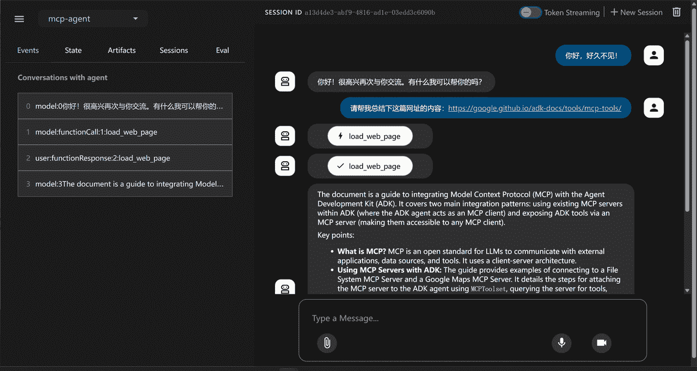

---

+   体验课内容节选自[《2025大模型Agent智能体开发实战》(5月班)](https://whakv.xetslk.com/s/pxKHG)完整版付费课程

体验课时间有限，若想深度学习大模型技术，欢迎大家报名由我主讲的《2025大模型Agent智能体开发实战》(5月班)


《2025大模型Agent智能体开发实战》(5月班)

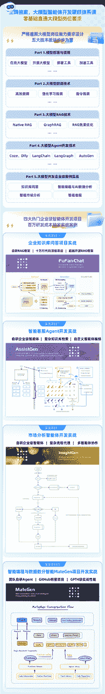

同时，5月班重磅新增DeepSeek+Agents SDK+谷歌ADK+MCP技术应用与智能体开发相关实战内容，并计划新增Qwen-3模型实战教学：


### 部分课程成果演示

+   Dify+DeepSeek搭建智能客服

+   可视化数据分析Multi-Agent

+   Ollama 自动化并发请求测试与动态资源监控

+   Neo4j并行多线程导入百万级文本方法与实践

+   MateGen Pro 项目功能演示

+   智能客服项目展示

此外，若是对大模型底层原理感兴趣，也欢迎报名由我和菜菜老师共同主讲的《2025大模型原理与实战课程》(5月班)


**两门大模型课程5月班目前上新特惠中，立减2000起，合购还有更多**优惠哦~详细信息扫码添加助教，回复“大模型”，即可领取课程大纲&查看课程详情👇

