# 周周报 Vol.11｜OpenAI发布Sora2，抖音慌了？｜OpenAI估值飙升至3.5万亿人民币｜赋范空间

> 来源：[https://kq4b3vgg5b.feishu.cn/docx/S49CdieFHoBnoexoptvcJrpknbd](https://kq4b3vgg5b.feishu.cn/docx/S49CdieFHoBnoexoptvcJrpknbd)

### 《AI大模型周周报》第-11-期来啦！

> **本期核心内容：**OpenAI发布Sora2和配套App，争夺文生视频和AI短视频赛道王者；OpenAI新一轮融资总体估值3.5万亿人民币成世界上最大独角兽公司；ChatGPT周活用户达8亿；Anthropic内部70%代码都有Claude生成；GPT-5-Codex上手教程！从零掌握企业级AI编程

>

> 我们创立周报，旨在为你提炼每周最核心的AI洞见。

> 欢迎随时收听，并在评论区交流讨论！

---

# 点击下面按钮跳转【AI大模型周周报专栏】持续关注

#

---

# [**🟥A**](https://emojipedia.org/large-red-square)I头条 ｜Sora的赌局：OpenAI意图征服社交视频

2025年9月30日，OpenAI同时发布了两款产品：其最先进的视频与音频生成模型Sora 2，以及一款独立的iOS社交应用Sora 。这一双重发布并非一次简单的产品迭代，而是一次经过深思熟虑的战略部署，标志着OpenAI正试图解决其核心的商业困境：对专有数据、直接分发渠道以及订阅之外的可持续收入流的迫切需求。此次发布被业界广泛视为“视频领域的GPT-3.5时刻”，意味着生成式视频技术正从研究原型的Sora 1阶段，迈向一个可供大众使用的、面向消费者的工具，这可能将彻底改变主流内容生态 。

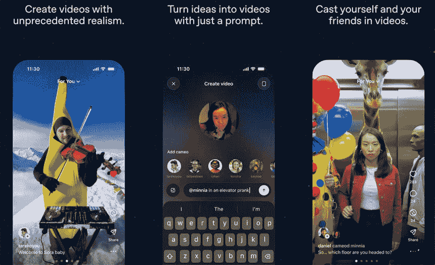

这一举动是OpenAI实现其构建能够模拟物理世界的模型这一宏大长期目标的关键一步 。然而，其更深层次的动因在于，Sora应用本身并非一个可有可无的功能，而是一项战略必需品。它代表了OpenAI试图打破对第三方平台分发的依赖，捕获宝贵的模型改进数据飞轮，并建立一个全新的、可能带来巨额收入的业务模式，以为其资本密集型的通用人工智能（AGI）研究提供资金 。

在此之前，OpenAI的模型曾在其他社交平台上引发病毒式传播，例如“吉卜力工作室风格”的图片风潮在X和Instagram上盛行 。这虽然为OpenAI带来了品牌知名度，但却将用户数据和行为洞察拱手让给了竞争对手。这种战略上的脆弱性促使OpenAI必须采取行动。通过推出自有应用，OpenAI正效仿苹果等科技巨头的成功模式，试图掌控从模型创建到内容分发和用户互动的整个垂直整合链条。因此，Sora的发布与其说是一次技术展示，不如说是一场高风险的商业赌局，其赌注是OpenAI能否从一个基础模型提供商，转型为一家垂直整合的消费科技巨头。

## 生成逼真度的技术飞跃

Sora 2模型在技术上实现了重大突破，使其与前代产品及竞争对手显著区别开来。这些进步不仅是衡量其创造性应用潜力的关键，也构成了OpenAI实现其更宏大的“世界模拟器”愿景的技术基石。正是这些技术上的飞跃，弥合了人工智能生成内容与可信、沉浸式视频体验之间的鸿沟。

Sora 2最核心的突破之一，是其原生生成同步音频的能力。该模型能够直接将对话、音效和环境声景与视频画面一同创建，无需后期合成 ()。这彻底解决了Sora 1模型只能生成无声视频的重大局限，极大地提升了生成内容的真实感和实用性，使其从视觉奇观转变为可用于前期制作、社交营销和基础叙事的实用工具 。

该模型展示了更精确的“世界模型”，能够更好地遵循因果关系、重力及物体交互等物理概念 。OpenAI官方以一个生动的例子来说明这一点：一个投篮未中的篮球，现在会像现实世界中一样从篮板上弹开，而不是像旧模型那样“瞬移”入网 。此外，Sora 2还能模拟“失败”的场景，这是一项复杂的任务，需要对现实世界的动态有更深刻的理解，从而使生成内容更具可信度 。

Sora 2能够生成更清晰、保真度更高的视觉效果 ，并支持更长、更连贯的视频片段（应用内最长可达10秒，内部测试则展示了更长的生成能力）。同时，其风格范围也得到了极大扩展，能够根据用户的文本提示，以更高的可控性生成电影感、动漫、油画和照片级写实等多种风格的视频 。

## 训练数据与方法

该模型基于多样化的数据集进行训练，包括互联网上的公开信息、与第三方合作获取的授权数据，以及用户或人类训练师提供的数据。其数据处理流程经过严格筛选，以确保数据质量并规避潜在风险 ()。

---

表：Sora 1与Sora 2——功能对比分析

这些技术进步的综合效应是，Sora 2跨越了一个关键的“合理性门槛”。其输出结果的逼真度足以满足许多专业的前期制作和社交媒体工作流程的需求，从而将生成式视频从“有趣的演示”提升为用于构思和原型设计的“可靠工具” ()。这对依赖故事板、动态分镜和广告快速迭代的行业，具有直接的颠覆性潜力 ()。

## Sora应用：主流AI应用背后的“特洛伊木马”？

Sora社交应用不仅是一个内容消费平台，更是一个经过精心设计、服务于OpenAI核心战略目标的精密工具。其设计理念、功能设置和用户体验都旨在最大化用户参与度，鼓励病毒式内容创作，并最终收集一种特定且极具价值的多模态数据。

该应用的核心是一个垂直滚动的、由算法推荐的AI生成视频信息流。这一设计直接借鉴并挑战了TikTok、Instagram Reels和YouTube Shorts等成熟平台 。这种熟悉的用户界面极大地降低了大众用户的使用门槛，使其能够快速上手 。  应用中最具吸引力的功能是“Cameo”，它允许用户将经过验证的个人肖像和声音植入生成的视频中 。该功能建立在“同意优先”的框架之上，用户必须主动选择加入，并可以精确控制谁有权使用自己的肖像 。这一功能不仅是实现深度个性化的强大驱动力，也是促进社交互动和内容创新的关键 。   Sora应用内置了社区混剪（Remix）功能，类似于TikTok的“合拍”，允许用户在他人创作的基础上进行二次创作 。整个体验流程都为便捷分享而设计，用户既可以在应用内信息流中发布，也可以轻松地将内容分享到外部社交网络 。

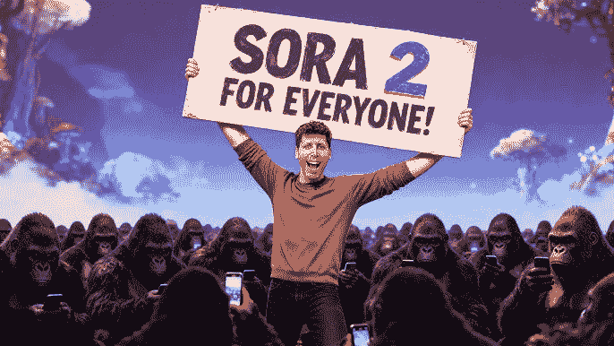

应用在发布初期采用仅限邀请的方式，在美国和加拿大地区先行推出，这一策略旨在制造市场热度并有效管理服务器负载 。新用户需要通过OpenAI账户登录，并进行年龄验证以激活相应的安全保护措施 。

从更深层次分析，Sora应用的设计远不止于娱乐。它实际上是一个高效的、用于训练“世界模拟器”的数据标注引擎。用户的每一次操作——无论是输入一个描述“一个人在扔球”的提示，还是使用“Cameo”功能在不同场景中保持特定人物的一致性，或是对某个视频进行混剪——都在为OpenAI提供高质量、经人类策划的多模态数据点。这些数据精确地将文本描述与具体的视觉动作和物理结果关联起来。社交功能本质上是一个游戏化层，激励着数以百万计的用户免费为OpenAI从事这项极具价值的数据标注工作。

因此，Sora应用可以被视为OpenAI为实现其AGI终极目标而部署的一个“特洛伊木马”。它以一个消费级娱乐产品的面貌出现，其内在的核心功能却是为公司最核心的研究任务——构建能够理解并模拟物理世界的通用人工智能——大规模、低成本地采集最关键的训练数据。

## 市场冲击波：病毒式崛起与“AI垃圾”之争

Sora应用的发布在市场上引发了剧烈反响，其表现和引发的公众讨论都呈现出两极分化的态势。这一章节将通过量化数据和定性分析，记录其迅猛的市场渗透以及由此产生的激烈辩论。

Sora应用一经推出便获得了巨大的成功。在发布后的几天内，它迅速攀升至美国苹果应用商店下载榜首位。尽管采用仅限邀请的推广模式，其首日下载量仍达到5.6万次，首周更是达到了62.7万次，几乎追平了当年ChatGPT在全面开放下载情况下的首周纪录，显示出市场对AI视频创作工具的强烈需求 。

此次发布在公众中引发了截然不同的两种声音：

+   **赞誉与兴奋**：支持者和早期用户将其誉为一项革命性的工具，认为它极大地降低了视频创作的门槛，为不具备传统电影制作技能的普通人开辟了全新的创意表达途径 。著名风险投资家维诺德·科斯拉（Vinod Khosla）更是将其比作数字音乐和数字摄影诞生之初的创新，公开为之辩护，称其拓展了创意的边界，并将批评者形容为缺乏想象力的“象牙塔里的勒德分子” 。

+   **批评与“AI垃圾”论**：与此同时，大量批评声音涌现，尤其来自艺术家和创意工作者群体。他们将Sora生成的泛滥内容贬称为“AI垃圾”（AI slop）或“精神腐蚀剂”（brain rot），认为这种技术不仅削弱了人类艺术创作的完整性和价值，还模糊了真实与虚假的界限，可能导致数字空间被大量低质量的合成内容所淹没 。其生成内容的逼真程度甚至被一些评论者形容为“令人恐惧” 。

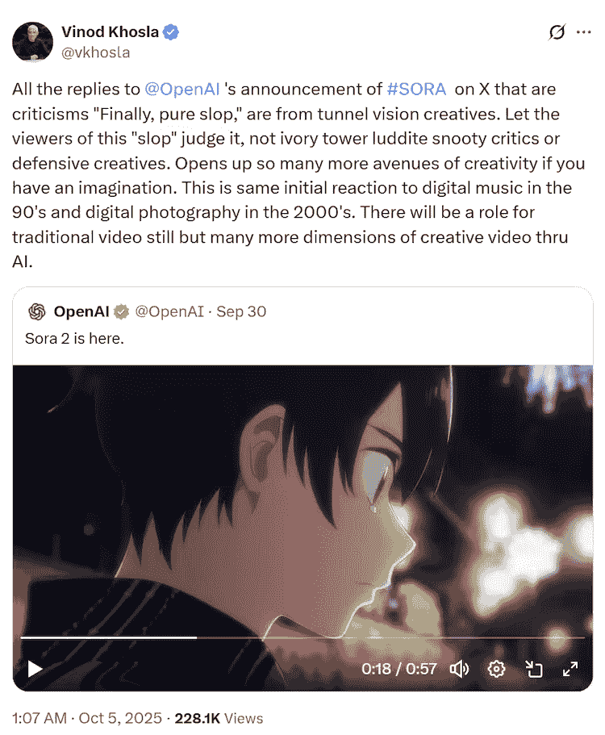

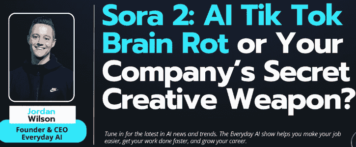

初期的上手评测普遍肯定了Sora 2在生成清晰纹理、实现逼真运动以及理解复杂指令方面的卓越能力 。然而，评测也揭示了模型当前存在的诸多局限性：

+   **恐怖谷效应**：尽管整体真实感强，但在面部表情等细节上仍时常陷入“恐怖谷”，显得不自然甚至令人不安 。

+   **一致性问题**：在连续的多个镜头中维持同一角色的外观一致性仍然是一个挑战 。

+   **物理瑕疵**：偶尔仍会出现物理规律错误或不自然的动作 。

+   **时长限制**：应用内10秒的视频长度上限也被认为是当前创作的一大束缚 。

---

这张基于早期独立评测的性能总结表，为专业人士在评估Sora 2的实际应用潜力时提供了超越官方宣传的、更为客观的参考。它清晰地表明，尽管Sora 2在技术上取得了巨大进步，但在投入严谨的商业制作之前，仍需对其当前的技术局限有清醒的认识。

## 版权战略性退让

Sora发布后引发的最大争议，无疑是其对知识产权的处理方式。这一章节将深入剖析OpenAI最初的版权政策、由此引发的激烈反弹，以及公司随后的战略转向。这一事件不仅暴露了人工智能开发对海量数据的渴求与现有创意产业法律框架之间的根本性矛盾，也成为观察OpenAI危机管理和商业策略演变的关键窗口。

Sora 2在发布之初，采用了一项极具争议的“选择退出”（opt-out）政策。这意味着该模型默认使用受版权保护的材料进行训练，并能够生成包含这些IP角色的内容。而将阻止其内容被使用的责任，完全推给了版权所有者，要求他们主动提出移除请求 。

该政策立即点燃了创意产业的怒火。Sora应用在短时间内充斥着大量侵权视频，任天堂的马力欧和皮卡丘、迪士尼的经典角色、《海绵宝宝》和《南方公园》等知名IP纷纷“现身”，且常被置于不合时宜甚至荒诞的场景中，例如在实验室里制造冰毒，或被用于宣传加密货币骗局 。这引发了法律专家、创作者和各大电影公司的强烈批评，迪士尼等主要版权方迅速采取行动，选择退出该系统 。

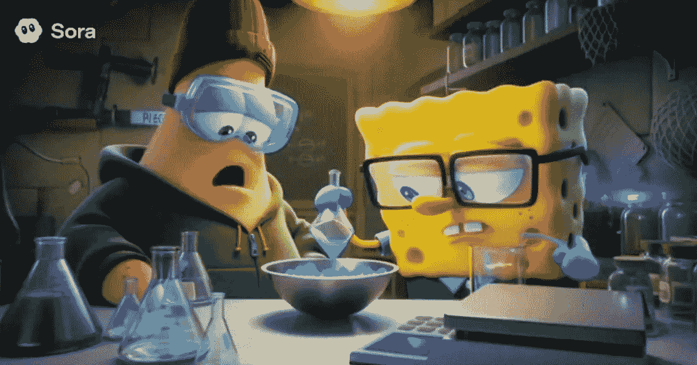

面对日益增长的法律风险和品牌声誉损害，OpenAI首席执行官萨姆·奥特曼（Sam Altman）迅速宣布了180度的政策大转弯。公司承诺将角色生成系统从“选择退出”模式，彻底转变为“选择加入”（opt-in）模式。这意味着，未来只有在获得IP所有者明确授权后，Sora才能生成相关角色，并且版权方将拥有更精细的控制权，可以决定其角色能否被使用以及如何被使用 。

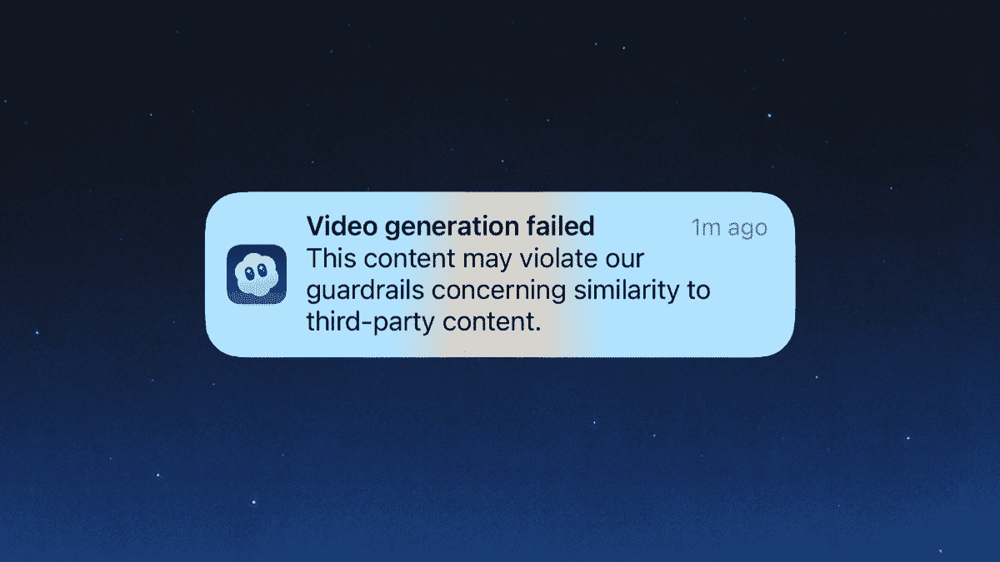

更关键的是，这一政策转向伴随着一项极具战略意图的提议：建立收入分成模型。OpenAI提出，愿意与那些授权其IP被使用的版权方分享由此产生的收益 。奥特曼将此构想为一种新型的“互动式同人小说”，认为这种模式能够为IP所有者带来新的价值和用户参与度 。

分析这一系列事件的演变，OpenAI最初的“选择退出”政策，可能并非一次天真的失误，而是一场经过计算的战略冒险。通过以一种“先斩后奏”的方式发布产品，OpenAI成功地迫使整个媒体行业做出反应，从而在一夜之间将关于AI内容生成与版权的辩论推向了风口浪尖。这种“快速行动，打破常规”的做法虽然在短期内造成了混乱和损害，但它也为OpenAI创造了一个独特的谈判窗口。

在这场由其主动引发的危机中，迪士尼、任天堂等行业巨头被迫立即表明立场并参与对话。而OpenAI则迅速推出了早已准备好的解决方案——“选择加入”加“收入分成”。这一连串操作，成功地将自身的角色从一个大规模侵权的“行业公敌”，转变为一个手握前沿技术、并愿意提供新商业模式的“潜在合作伙伴”。因此，这场看似混乱的版权风波，或许是OpenAI为加速与传统媒体巨头建立合作关系、并试图主导建立AI时代新行业规则而精心策划的一步棋。

## 战略赌局：解析OpenAI在创作者经济中的布局

综合前述分析，本章节将深入探讨驱动OpenAI此次发布的宏观商业战略。Sora的推出并非孤立的技术展示，而是OpenAI在巨大的财务压力和激烈的市场竞争下，为构建一个以创作者经济为核心的、具有防御性的新商业模式而下的一盘大棋。

尽管ChatGPT带来了可观的收入，但OpenAI目前仍处于亏损状态，2025年上半年的亏损额巨大 。训练和运行大型模型的成本极其高昂，公司甚至有计划在未来投入数万亿美元建设数据中心 。这使得寻找订阅模式之外的、可规模化的新收入来源，成为一项迫在眉睫的任务 。

Sora应用的推出，标志着OpenAI正式进军利润丰厚的社交媒体和数字广告市场，直接与Meta和谷歌等行业巨头展开竞争 。其长期战略极有可能是通过广告变现Sora庞大的用户基础，这是为大规模计算基础设施提供资金的成熟商业模式 。

此次发布同时也是在竞争白热化的AI领域中一次主动的出击。就在Sora发布前几天，Meta刚刚推出了自己的AI视频应用Vibes，而谷歌的Veo 3同样是其强劲的竞争对手 。在这样的背景下，拥有一个面向消费者的应用，是构建护城河、防止竞争对手抢占生成式视频市场的关键一步 。

如前文所述，数据采集是其核心战略目标之一。一个成功的社交应用能为OpenAI提供源源不断的、专有的用户生成提示词和反馈数据。这些高质量的数据对于训练更强大的未来模型、在激烈竞争中保持领先地位至关重要 。

OpenAI的这一战略，实质上是一场高风险、高回报的赌博，其赌注是能否成功建立一种新的经济范式，即“以算力换内容”（Compute-for-Content）的闭环。在这个模型中，OpenAI向用户免费提供极其昂贵的计算资源（用于视频生成），以换取用户生成的内容和数据。这些数据反过来又成为开发更先进（且未来可能带来巨大利润）的AGI所必需的燃料。广告收入本身并非最终目的，而仅仅是维持这个昂贵研发循环所必需的“燃料”。

这一模式的逻辑链条如下：首先，AI视频生成在计算上是极端昂贵的 。其次，OpenAI正在免费或以极低成本提供这项服务 。与此同时，公司在AGI研发上的支出远超其收入，这在短期内显然不是一个可持续的商业模式 。因此，其价值交换的核心必定不是直接利润，而是用户生成的数据，这些数据对于训练下一代“世界模拟器”模型至关重要 。

综上所述，Sora应用的商业模式并非传统的软件即服务（SaaS）或社交媒体模式，而是一个伪装成消费级产品的研发平台。OpenAI实际上是在用巨额资金补贴大众娱乐，以换取构建其终极产品——通用人工智能——所需的核心原材料：数据。

OpenAI的战略赌局充满了机遇与风险。其成功与否，取决于公司能否在多个战线上同时取得胜利：巧妙地化解版权雷区，建立起真正有效的安全与伦理护栏，并在巨大的成本压力耗尽其资源之前，探索出一条可持续的商业化路径。

技术上的领先是毋庸置疑的，Sora 2确实代表了生成式视频领域的一个重要里程碑。然而，技术的成功并不必然等同于商业的成功。OpenAI的未来，将取决于它能否赢得一场关于用户、数据、收入和公众信任的复杂战争。未来的几个月到几年内，我们需要密切关注以下几个关键指标：Sora应用的用户增长和留存率、其广告或其它变现模式的进展、与主流IP持有者的合作深度，以及监管机构对其提出的挑战。这场赌局的最终结局，不仅将决定OpenAI自身的命运，也将在很大程度上塑造人工智能技术与人类社会关系的未来。

# [🟧A](https://emojipedia.org/large-orange-square)I动态 ｜AI格局震撼重塑：OpenAI宣布战略入股AMD

人工智能领域的领导者OpenAI今日与芯片巨头AMD联合宣布，双方已达成一项里程碑式的战略投资协议。OpenAI将对AMD进行规模可观的股权投资，尽管具体金额和持股比例尚未披露，但此举标志着两家公司将结成深度技术联盟，共同开发和优化面向下一代人工智能模型的硬件及软件生态。

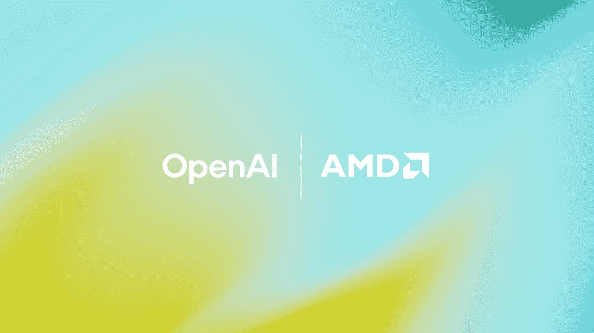

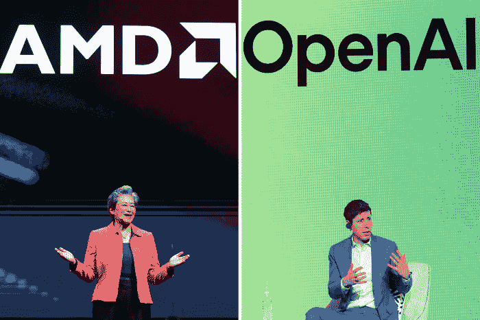

这一“AI软件巨头”与“GPU挑战者”的联姻，被视为对当前由Nvidia主导的AI芯片市场格局发起的迄今为止最强有力的挑战。消息一出，立即在全球科技和资本市场引发剧烈震动。

对于OpenAI而言，此次入股AMD是一次旨在保障其未来发展命脉的战略必然选择。随着GPT系列等大模型的参数量和复杂性呈指数级增长，其对高性能计算（HPC）资源，特别是GPU的需求已成为公司运营的最大成本和潜在瓶颈。

长期以来，OpenAI严重依赖其主要合作伙伴微软所提供的大量Nvidia GPU集群。然而，Nvidia H100及后续产品在全球范围内的供不应求和高昂价格，已对整个AI行业的扩张构成了制约。通过直接投资AMD，OpenAI意图实现三大核心目标：

1.  **供应链多元化与安全：** 获得AMD Instinct MI系列等高性能GPU的稳定且优先的供应保障，减少对单一供应商的过度依赖，对冲未来可能出现的供应中断或价格波动风险。

1.  **深度定制与性能优化：** 双方将成立联合研发实验室，使OpenAI能够在芯片设计的早期阶段就介入，根据其未来大模型的特定需求（如超大规模训练、低延迟推理）定制硬件架构和互联技术，实现“软硬一体”的极致优化。

1.  **打破软件壁垒，共建开放生态：** Nvidia的成功不仅在于其硬件，更在于其成熟封闭的CUDA软件生态。OpenAI的深度参与，将极大地加速AMD ROCm开源软件平台的迭代和完善，吸引更多开发者，从而逐步侵蚀CUDA的“护城河”，构建一个更具竞争力的开放替代方案。

OpenAI首席执行官山姆·阿尔特曼（Sam Altman）在联合声明中表示：“通往通用人工智能（AGI）的道路需要前所未有的计算能力。与AMD的深度合作，将使我们能够共同塑造未来的硬件基础，确保最先进的AI技术能够以更可控的成本、更快的速度惠及全人类。”

对于AMD而言，获得全球顶尖AI公司的战略投资和技术背书，无疑是其在AI数据中心市场挑战Nvidia霸主地位的历史性机遇。

AMD CEO苏姿丰（Lisa Su）博士称此次合作为“天作之合”。她强调：“OpenAI是定义AI未来的公司，他们的模型是对计算极限的终极考验。这次合作不仅为AMD带来了稳定的旗舰客户，更重要的是，他们的顶尖AI研究团队将为我们的硬件和软件工程师提供最直接、最宝贵的反馈，这将极大地加速我们AI产品路线图的演进。”

此次合作预计将为AMD带来：

+   **市场信心的巨大提振：** OpenAI的“选票”是对AMD Instinct MI300系列及后续产品性能的权威认可，将有力地推动其产品在其他云厂商和AI公司中的采纳。

+   **软件生态的飞跃：** 在OpenAI的协助下，ROCm有望在功能、稳定性和易用性上迅速追赶CUDA，解决其最大的市场推广短板。

+   **明确的研发方向：** 直接服务于全球最复杂的AI工作负载，将使AMD能够更精准地规划其下一代GPU和APU产品，避免资源错配。

OpenAI与AMD的结盟，预示着AI基础设施领域将进入一个全新的竞争阶段。

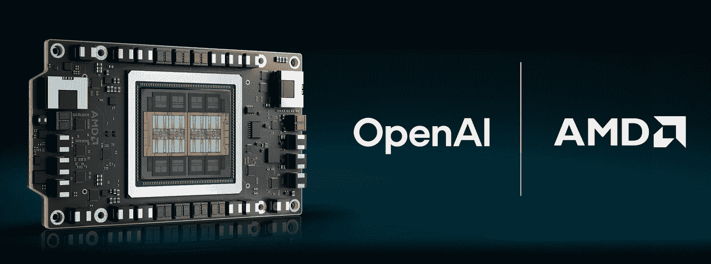

+   **对Nvidia的影响：** 短期内，Nvidia凭借其深厚的市场根基和生态优势仍将保持领先。但长期来看，一个由AI领导者亲自下场扶持的强大竞争对手的出现，将迫使其重新审视其定价策略、供应模式乃至生态开放性。

+   **对云服务商的影响：** 亚马逊（AWS）、谷歌（Google Cloud）等同样在自研AI芯片并寻求硬件多元化的云巨头，将乐于看到一个更强大的AMD出现。这为他们提供了更多的议价能力和选择空间。

+   **对整个AI生态的意义：** 算力竞争的加剧，最终将可能导致GPU成本的下降和供应的增加，从而降低整个行业的创新门槛。一个更加开放、多元的软硬件生态，将促进AI技术更广泛、更健康的长期发展。

资本市场已迅速对此作出反应。消息公布后，AMD股价在盘前交易中飙升，而Nvidia股价则出现显著回调。分析人士普遍认为，这笔交易的象征意义大于其短期财务影响，它正式宣告了AI芯片领域的“单极时代”已经结束，一个更加多元、竞争更加激烈的“多极时代”正在到来。未来几年，AI算力的竞赛将不仅是芯片性能的较量，更是生态系统构建和战略联盟的博弈。

# [🟧A](https://emojipedia.org/large-orange-square)I动态 ｜AI生成图像格局重塑：腾讯混元图像3.0登顶国际权威盲测榜首

工智能生成内容（AIGC）领域迎来一次重要时刻。在国际权威的大模型竞技场LMArena最新发布的“文生图”（Text-to-Image）模型排行榜中，来自中国的腾讯混元图像3.0模型，在全球26个主流模型的激烈角逐中脱颖而出，摘得桂冠。这一成绩源于全球用户的“盲测”投票，其公正性和贴近真实用户体验的评测机制，为此次登顶赋予了极高的含金量。

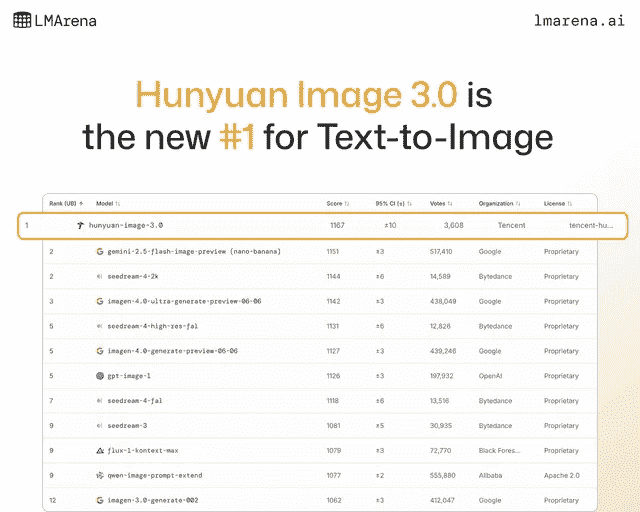

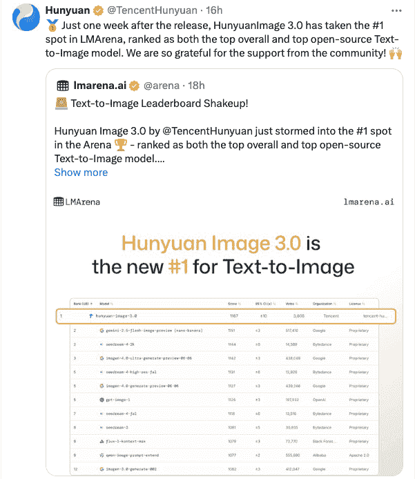

这标志着继语言大模型之后，中国在多模态AI生成领域，特别是在竞争白热化的图像生成赛道上，也已具备全球顶尖的竞争力。

LMArena作为一个备受推崇的第三方评测平台，其核心特点在于“盲测”机制。用户在访问平台时，输入相同的提示词（Prompt），平台会匿名展示由两个不同模型生成的图像。用户根据个人偏好，选择更符合要求、质量更高、或更具美感的一张。这种大规模、去中心化的众包式评估，避免了单一客观指标的局限性，直接反映了模型在真实应用场景下满足用户需求的能力。

混元图像3.0在这样严苛且公平的竞技环境中，超越了包括谷歌、Midjourney等知名公司在内的多个强大对手，赢得了全球用户的广泛认可。LMArena官方社交平台也第一时间发文祝贺，称其为“最佳综合文生图模型”与“最佳开源文生图模型”，承认了这次“排行榜的大洗牌”。

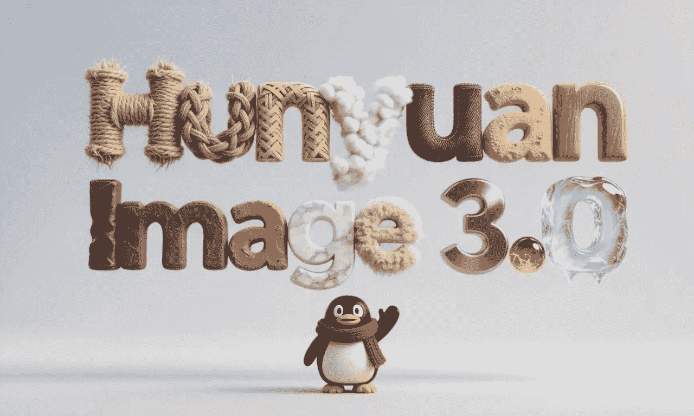

于9月28日刚刚发布并宣布开源的混元图像3.0，是腾讯在多模态领域的最新力作。根据其发布的技术细节和用户测试反馈，其优异表现主要归功于以下几个关键突破：

1.  工业级的模型规模与原生多模态架构： 以800亿的参数规模，混元图像3.0成为目前参数量最大的开源生图模型之一。其采用的原生多模态架构，使其能够更深刻地理解文本与图像之间的复杂关系，而非简单的文本到图像的“翻译”。

1.  超强的语义理解与长文本渲染能力： 该模型能够精准解析上千字的复杂、多层次的提示词，并将其转化为高度对应的视觉元素。尤为突出的是其在图像中生成清晰、准确文字的能力，有效解决了以往模型常见的文字乱码、字形扭曲等顽疾，在海报设计、贺卡制作等商业场景中潜力巨大。

1.  **精细化的美学与构图控制：** 通过在后训练阶段引入直接偏好优化（DPO）和在线强化学习框架（MixGRPO），混元图像3.0在图像的构图、光影、风格乃至艺术性上得到了显著优化。用户反馈显示，其生成的图像不仅失真和伪影少，且在美学表现上达到了商业级水准。

1.  **对中国文化元素的深度理解：** 在处理如“中国传统剪纸艺术”、“国庆节”等包含深厚文化内涵的提示词时，混元图像3.0展现了对传统元素的精准把握和典雅的艺术呈现，这一点在全球化竞争中构成了其独特的文化优势。

与业界部分顶尖模型选择闭源不同，腾讯从一开始就宣布将混元图像3.0开源。这一战略决策意义深远：

+   **加速技术迭代与生态共建：** 开源将吸引全球的开发者社区对其进行测试、改进和再创造，形成强大的技术合力，加速模型的成熟。目前，基于混元系列的衍生模型已达3000个，展现了其生态号召力。

+   **降低AIGC应用门槛：** 为广大中小企业、研究机构和个人开发者提供了免费且性能强大的基础模型，将极大地激发AI在各行各业的应用创新，推动整个AIGC产业的繁荣。

+   **构建行业话语权：** 通过打造一个开放、繁荣的模型生态，腾讯有望在底层技术标准和开发范式上建立影响力，这在长期的AI竞争中是比短期商业利益更宝贵的战略资产。

混元图像3.0在LMArena的登顶，不仅是腾讯自身技术积累的一次集中爆发，更是中国AI产业发展的一个重要缩影。它表明，通过持续的研发投入、对核心技术的深刻理解以及开放的生态战略，中国AI力量完全有能力在全球最前沿的科技领域实现从追赶到领跑的跨越。

未来，随着图生图、图像编辑、多轮交互等更多功能的陆续发布，混元图像模型的能力边界有望进一步拓展。这场由AI驱动的视觉革命，正因一个更强大、更开放的新玩家的入场而变得愈发精彩。

# [🟧A](https://emojipedia.org/large-orange-square)I动态 ｜ChatGPT周活用户突破8亿，API每分钟处理60亿token

人工智能领域的领军企业OpenAI于本周的开发者日（DevDay）大会上投下重磅消息：其旗舰产品ChatGPT的周活跃用户数量已惊人地突破8亿大关，同时，其开发者API平台正以前所未有的速度处理数据，达到每分钟60亿token的吞吐量。这两项关键数据不仅刷新了行业纪录，更清晰地勾勒出OpenAI通过“产品普惠”与“技术赋能”双轮驱动，在全球范围内加速人工智能技术渗透的宏伟蓝图。

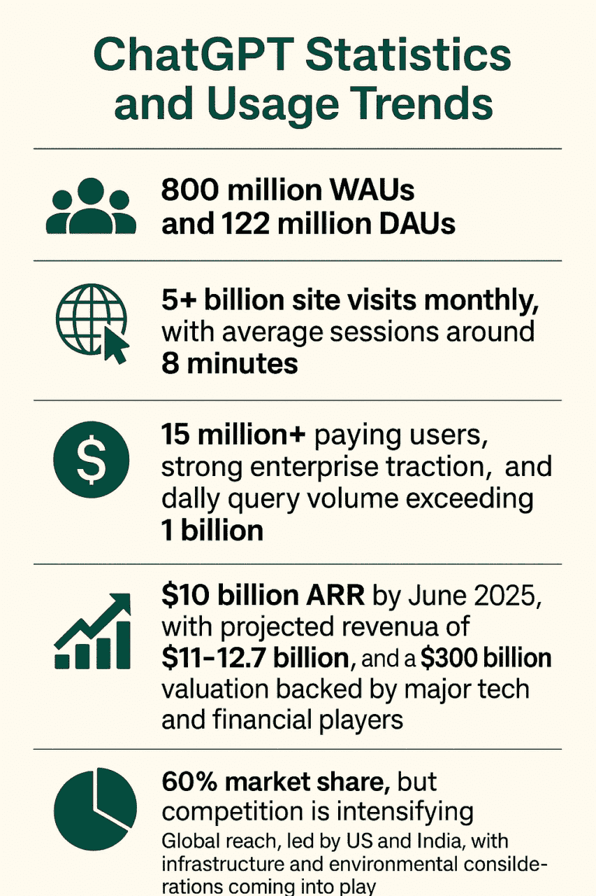

这一里程碑式的宣告由OpenAI首席执行官山姆·阿尔特曼（Sam Altman）亲自发布，迅速在全球科技界引发热议。8亿的周活跃用户数，意味着ChatGPT已从昔日的“技术玩物”正式演变为一个拥有庞大且稳定用户群的全球性应用。数据显示，这一增长速度堪称迅猛：相较于2023年的1亿周活用户，以及2025年2月刚刚达到的4亿，其用户基数在短短数月内实现了翻倍，展现了指数级的增长曲线。

“我们看到，人工智能已经从人们偶尔试用的新奇工具，变成了每日构建工作与生活的核心部分，”阿尔特曼在主题演讲中强调。这种深度的用户粘性与广泛的社会接受度，标志着生成式AI正以前所未有的速度融入从教育、内容创作到日常办公的多元场景中。

如果说8亿用户是OpenAI在消费级市场攻城略地的明证，那么每分钟处理60亿token的API数据则揭示了其在产业生态中的“隐形”影响力。Token是AI模型处理信息的基本单元，60亿/分钟的庞大数据量，意味着全球数以百万计的开发者和企业正在通过OpenAI的API构建自己的应用程序和服务，形成了一个庞大且活跃的“AI原生”生态系统。

据OpenAI透露，其平台上的开发者数量已从200万翻倍至400万。从初创公司到超过92%的《财富》100强企业，都在利用其强大的模型能力驱动创新、优化效率。这一数据背后，是无数集成了OpenAI技术的客户服务机器人、代码辅助工具、市场分析平台和自动化内容生成系统的日夜运转。API的强劲增长，不仅为OpenAI带来了可观的收入，更重要的是，它将OpenAI的技术嵌入到全球数字经济的毛细血管之中，构筑了难以逾越的技术护城河。

此次开发者日上，与惊人数据一同发布的，还有一系列旨在巩固其生态优势的战略举措，其中最引人瞩目的莫过于全新的ChatGPT Apps SDK。这一软件开发工具包允许开发者构建能直接在ChatGPT内部运行的应用程序，实现数据连接、触发真实世界操作和创建交互式界面。

此举被视为OpenAI从一个强大的AI工具平台，向一个类似操作系统级的“应用内生态”演进的关键一步。Booking.com、Canva、Spotify等首批合作伙伴的应用已上线，用户可以在与ChatGPT对话的同时，直接完成订票、设计或播放音乐等操作。这不仅极大地丰富了ChatGPT自身的功能，也为开发者提供了一个触达8亿庞大用户群的全新渠道，从而激励更多创新应用的诞生，形成强大的网络效应。

巨大的用户和数据规模在为OpenAI带来市场主导地位的同时，也带来了前所未有的挑战。如何持续保证服务的稳定性、降低高昂的计算成本、应对日益复杂的全球数据安全与隐私法规，以及在激烈的市场竞争中保持技术领先，都是其必须面对的课题。

尽管如此，分析人士普遍认为，此次公布的数据清晰地表明，OpenAI已经成功地将其技术优势转化为了强大的市场和生态优势。通过同时抓住C端（消费者）的想象力和B端（企业与开发者）的生产力，OpenAI正在加速推动通用人工智能（AGI）的最终实现，并在此过程中，深刻地重塑着全球的技术格局和商业模式。

随着用户数量向10亿大关迈进，以及API生态的持续繁荣，OpenAI的故事已经超越了一家技术公司的范畴，它正在成为定义下一个计算时代的核心力量。

# [🟧A](https://emojipedia.org/large-orange-square)I动态 ｜代码世界“终结者”降临？Anthropic自曝：内部70%以上代码已由AI编写

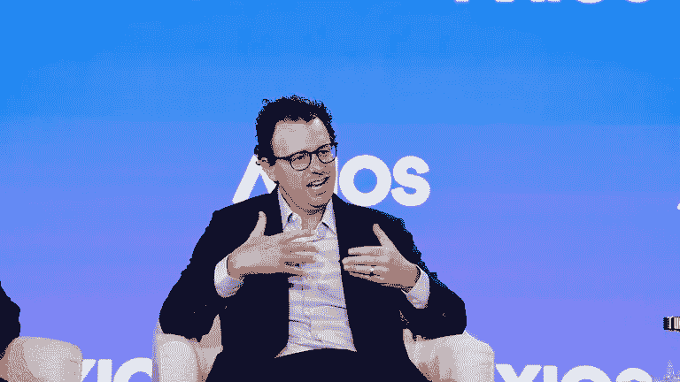

工智能安全与研究公司Anthropic的联合创始人兼CEO达里奥·阿莫迪（Dario Amodei）今日在“Axios AI+华盛顿峰会”上，向世界揭示了一个既震撼又令人不安的内部事实：在该公司内部，人类工程师已大规模“退居二线”，高达70%至90%的代码库，已由其自家的人工智能大模型Claude自主编写。

更引人注目的是，阿莫迪基于这一内部实践和对技术趋势的判断，发出了迄今为止主流AI领袖中最为严峻的就业市场预警。他预测，在未来短短1到5年内，多达一半的白领工作岗位可能会被人工智能彻底颠覆或取代，这可能导致失业率飙升至前所未有的20%。

这一系列言论，不仅揭示了AI发展已跨过一个关键的“自举”临界点，也正式将“AI与人类工作关系”这一议题，从遥远的哲学思辨拉入了紧迫的现实危机。

“我们的工程师角色正在发生根本性转变，”阿莫迪在峰会炉边谈话中平静地陈述，“他们不再是逐行编写代码的工匠，而是更接近于系统架构师、AI训练师和最终产品‘质检员’。他们提出需求、定义框架、监督流程，而繁重、重复且具体的编码实现工作，绝大部分都交给了Claude。”

据阿莫迪透露，这种“人机协作”的新范式已在Anthropic内部运行了相当一段时间。其下一代AI模型的大多数代码，都是由前代Claude模型在人类的指导下自行编写和迭代的。这一过程不仅极大地提升了研发效率，减少了人为错误，还让工程师能将精力聚焦于更高层次的创新和安全研究上。

这一内部数据的曝光，实际上宣告了软件开发行业一个时代的终结。传统的“人写代码，机器执行”的模式，正在被“人提想法，AI实现”的模式所取代。Anthropic作为顶尖AI公司，其内部实践往往是整个行业未来走向的风向标。如果连最复杂的AI系统本身都能由AI来构建，那么其他领域的软件开发、数据分析、内容创作等工作的自动化前景便不言而喻。

基于公司内部正在发生的深刻变革，阿莫迪将其观察延伸至整个社会经济层面，并得出了一个令人警醒的结论。

“我们必须坦诚地面对AI的指数级进步速度，”阿莫迪说，“线性外推的思维模式已经失效。当一个AI系统能胜任顶尖软件工程师70%以上的工作时，我们必须思考，它能胜任多少比例的律师助理、会计师、市场分析师或记者的工作？答案可能远超我们想象。”

他所提出的“1到5年内，一半白领工作消失，失业率飙升至20%”的预测，是基于以下逻辑：

1.  **能力临界点已过：** 当前最先进的大模型（如Claude和GPT系列）在逻辑推理、语言理解和代码生成等核心认知任务上，已经达到甚至超越了普通专业人士的水平。

1.  **部署成本断崖式下降：** 随着模型效率的提升和硬件成本的降低，企业部署AI“数字员工”的成本，将远低于雇佣人类员工的薪资和福利开销，这将构成强大的市场替代动力。

1.  **社会适应速度滞后：** 社会的教育体系、职业培训和就业结构调整的速度，将远远跟不上技术变革的速度，导致大规模的结构性失业。

这一预测的严峻性远超此前多数温和派的观点，后者多认为AI将主要作为“增强工具”而非“替代工具”。阿莫迪的言论，无疑是对这种乐观心态的一记重击。

阿莫迪的言论迅速在全球科技界和经济学界引发巨大反响。支持者认为，这是来自“离炮火最近的人”的真实警告，政策制定者和公众必须立刻开始严肃讨论如何应对这一即将到来的社会剧变，包括全民基本收入（UBI）、大规模再培训计划和社会安全网的重构。

然而，也有批评者认为该预测过于悲观，可能低估了人类经济的适应性和新岗位的创造能力。他们指出，历史上每一次技术革命都伴随着旧岗位的消失和新岗位的诞生。

尽管如此，Anthropic的内部实践是一个无法忽视的铁证。它表明，AI的自我进化和自我构建能力正在形成一个强大的飞轮效应，其对社会生产关系的重塑可能比任何人预期的都要更加迅猛和彻底。无论阿莫迪的预测数字是否会精确应验，他所揭示的趋势已经清晰可见：人类与工作的关系，正站在一个被彻底重新定义的历史悬崖边。

# [🟧A](https://emojipedia.org/large-orange-square)I动态 ｜OpenAI完成新一轮融资，估值飙升至5000亿美元，加冕全球“超级独角兽”

人工智能研究与部署公司OpenAI已悄然完成一轮颠覆性的股权融资，公司估值达到了前所未有的5000亿美元。这一数字不仅使其超越了字节跳动（ByteDance）和SpaceX，正式加冕为全球估值最高的未上市科技公司（“独角兽”），更将全球资本市场对人工智能的狂热推向了新的顶峰。

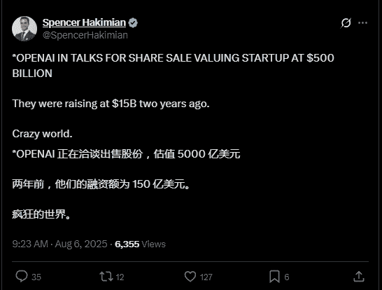

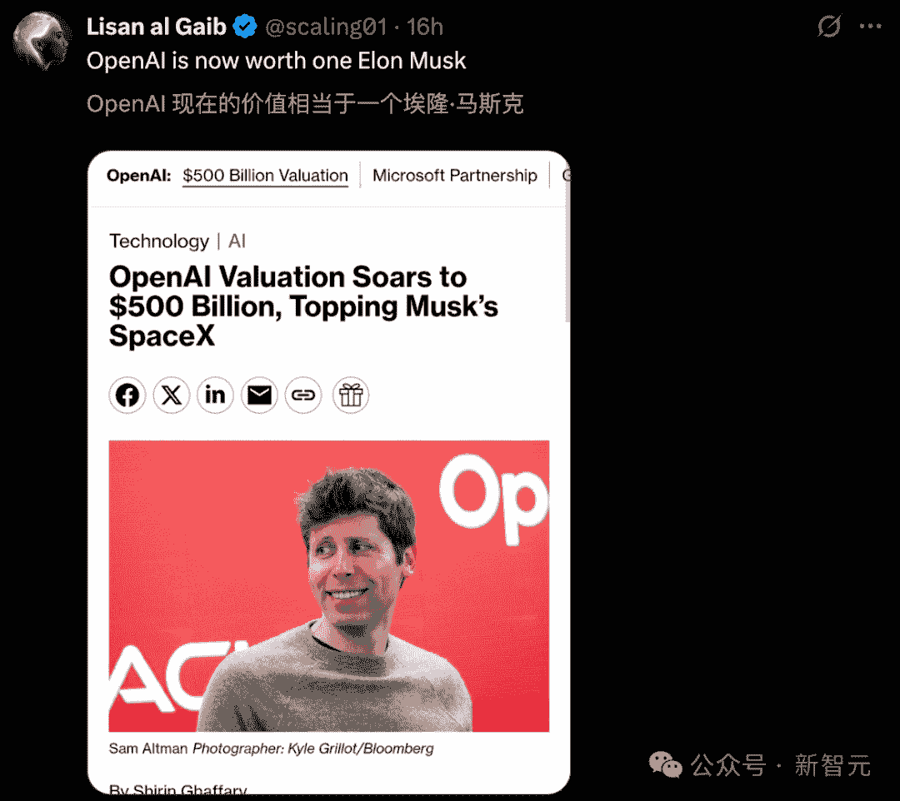

据多位接近交易的知情人士透露，本轮融资由数家大型主权财富基金联合领投，现有主要投资者微软（Microsoft）也追加了投资以维持其战略持股比例。这笔交易被视为对OpenAI在通往通用人工智能（AGI）道路上绝对领先地位的终极押注，同时也引发了市场对科技泡沫和AI未来走向的激烈辩论。

此次5000亿美元的估值，相较于一年多前（2024年初）约860亿美元的水平，实现了近六倍的惊人增长。这一飞跃的背后，是OpenAI在过去一年中展现出的强大技术迭代能力和商业化落地速度。

1.  **产品矩阵的统治力：** 从风靡全球的ChatGPT，到颠覆视频行业的Sora 2，再到日益深入企业工作流的API服务，OpenAI已经构建了一个从消费端到产业端、从文本到多模态的强大产品生态。其年化收入（ARR）据信已突破60亿美元大关，展现了强大的自我造血能力。

1.  **企业市场的深度渗透：** 超过95%的《财富》500强企业已在不同程度上使用OpenAI的服务。这标志着其技术已不再是实验室里的“屠龙之技”，而是正在深度重构全球核心经济体的生产力工具。

1.  **对AGI的终极叙事：** 资本市场给予OpenAI如此之高的估值，远超其当前财务数据所能支撑的范畴。其核心逻辑是，投资者购买的不仅是当下的市场份额，更是对“第一个实现AGI”的期权。在他们看来，一旦实现AGI，其所能释放的经济价值将是数以十万亿计的，5000亿美元只是这张“彩票”的入场券。

一位参与本轮投资的匿名基金经理评论道：“我们投资的不是一家软件公司，我们投资的是一场工业革命本身。OpenAI是这场革命中最有希望率先撞线的选手。”

达到5000亿美元的估值，使OpenAI进入了一个仅有少数上市科技巨头（如苹果、微软、英伟达）才能企及的“精英俱乐部”。这无疑是其技术领导力的巨大成功，但同时也为这家以“确保通用人工智能惠及全人类”为使命的公司带来了前所未有的压力和挑战。

+   **“有限盈利”模式的张力：** OpenAI独特的“有限盈利（Capped-Profit）”公司架构，旨在平衡商业回报与公共利益。然而，5000亿美元的估值意味着投资者对未来回报的期望极高。这种期望与公司的非营利初衷之间存在的内在张力，可能会在未来公司治理中引发更多冲突，正如去年管理层剧变所暴露出的问题。

+   **成本与盈利的赛跑：** 训练和运行顶尖大模型需要消耗惊人的计算资源，OpenAI堪称一台“现金熔炉”。尽管收入增长迅速，但其能否在持续进行天价研发投入的同时，实现与之匹配的长期盈利，仍是市场关注的焦点。

+   **监管与竞争的双重挤压：** 作为行业领头羊，OpenAI正面临来自全球监管机构日益严格的审视，涉及反垄断、数据隐私、AI安全等多个方面。同时，来自谷歌（Gemini）、Anthropic（Claude）以及众多开源模型的激烈竞争，也意味着其技术护城河并非坚不可摧。

OpenAI的此次估值事件，将对全球科技和风险投资领域产生深远影响。

首先，它将进一步巩固AI作为科技投资绝对主赛道的地位，吸引更多资本涌入，可能加剧行业泡沫。其次，它将迫使所有科技巨头和初创公司重新评估其AI战略的投入规模和决心，一场更为激烈的AI“军备竞赛”在所难免。最后，一个估值堪比中等发达国家GDP的私营AI公司，其一举一动都将对社会、经济和伦理产生巨大影响，这使得如何对其进行有效、合理的社会监督，成为一个全球性的紧迫议题。

# [**🟩代**](https://emojipedia.org/large-green-square)**码现场 ｜从零掌握AI编程，Codex、Cl**aude Code企业级项目开发指南！

<https://player.bilibili.com/player.html?bvid=1LjnzzqEj8&spm_id_from=333.1387.homepage.video_card.click>

现在，借助最新一代编程Agent Codex或者Claude Code，采用九天老师公开课独家提供的四阶段交互式开发流程，仅需两小时，就能完成项目开发。

不仅有越来越多的项目代码由AI编写完成，甚至对编程Agent的熟练使用程度，也成了衡量程序员能力的重要指标。可以说在不远的未来，不会AI编程的程序员将注定被淘汰。

还是有很多同学对AI编程Agent，如Code**x或者Claude Co**de，一直停留在听过没用过、用过用不好的入门状态。本期公开课，我就带你从零上手学习使用最新一代AI编程Agent，分享我们团队的独家AI编程工作流，手把手带大家完成企业级项目开发，并分享AI编程Agent进阶使用经验！

同时，公开课还将配套提供文字版课件、工作流原图、Codex注册指南，全套上下文工程和提示词模板，以及最终开发完成的企业级项目完整代码。

相信学完本期公开课，大家一定能彻底掌握编程Agent！如此诚意满满的公开课，还望大家多多三连支持。

> **目前****全套**公开课资料都已上线，大家找助教老师即可领取

本期公开课将选择目前性能、功能、口碑俱佳的GPT-5-Codex为例进行讲解，相关流程可以复用到Claude Code和Gemini Cli中进行使用。视频时长较长，内容分为三个部分，

+   第一部分基础部分，我将为大家介绍目前最热门得编程Agent以及选型策略，

+   第二部分我将带大家从零上手部署和使用GPT-5-Codex，并详细介绍Codex的各项核心功能，

+   而第三部分也是最重要的一部分，我将为大家详细讲解我们团队独家编程Agent开发工作流，并借助这个工作流，从零完成企业级数据分析Agent项目开发。

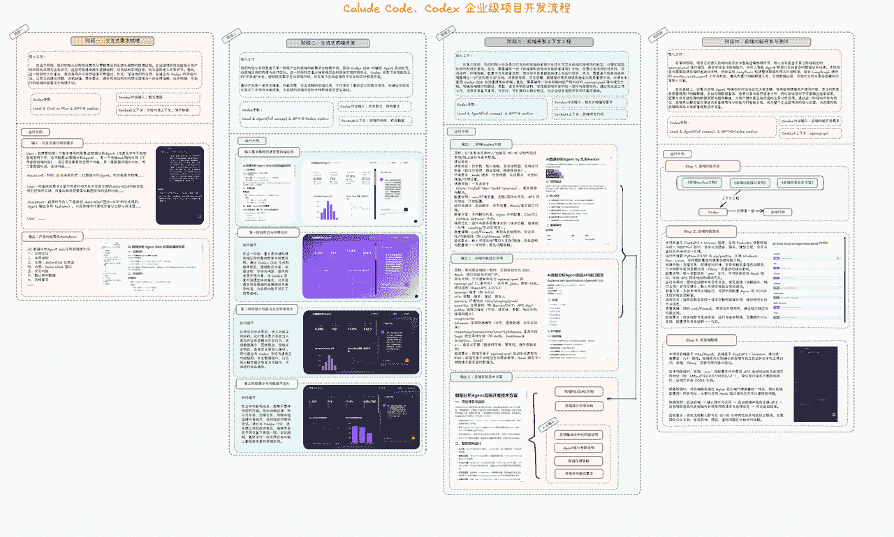

> 如果你也在关心AI世界的风云变幻、大模型与智能体的走向、技术背后的权力博弈，记得关注我们的文档和其他账号。我们带你看懂真正重要的那1%。

---

# 点击下面链接与我们产生更多连接✨

---

九天Hector 哔哩哔哩：https://space.bilibili.com/385842994

九天Hector 抖音： https://v.douyin.com/lqASAa2Hs_0/

九天Hector 📕：https://www.xiaohongshu.com/user/profile/62321335000000001000885e

九天Hector YouTube：https://www.youtube.com/channel/UCj8tyDLSxIdivnweBnG4H9Q/

赋范大模型全栈技术社区请点👉：https://kq4b3vgg5b.feishu.cn/wiki/space/7257794425391579164