# 周周报 Vol.10｜OpenAI发布ChatGPT Pulse预览版能主动满足用户需求｜阿里巴巴豪掷3800亿加入AI Infra竞争｜赋范空间

> 来源：[https://kq4b3vgg5b.feishu.cn/docx/Gwffdc0KOoSatpxH4iMcOspPnkg](https://kq4b3vgg5b.feishu.cn/docx/Gwffdc0KOoSatpxH4iMcOspPnkg)

> 本期核心内容：**Op**enAI发布ChatGPT Pulse预览版能主动满足用户需求！美团发布高校推理模型；阿里巴巴豪掷3800亿加入AI Infra竞争；Kimi发布Ok Computer智能体

> 我们创立周报，旨在为你提炼每周最核心的AI洞见。

> 欢迎随时收听，并在评论区交流讨论！

---

## 点击下面按钮跳转【AI大模型周周报专栏】持续关注

---

## [**🟥A**](https://emojipedia.org/large-red-square) I头条 ｜OpenAI发布ChatGPT Pulse预览版：从被动问答到主动服务的革命性转变

人工智能领域的领军企业OpenAI于9月26日正式发布了一项名为“ChatGPT Pulse”的预览版新功能，标志着其旗舰产品ChatGPT正从一个被动的问答工具，向一个主动的、深度个性化的AI助手发生根本性转变。该功能旨在让ChatGPT能够预见并主动满足用户的需求，每日为用户提供定制化的信息摘要。

据OpenAI官方介绍，ChatGPT Pulse的核心能力在于其“异步研究”（asynchronous research）机制。系统会在后台（例如用户夜间休息时）自动、综合地分析用户的聊天记录、历史反馈以及已连接的第三方应用数据，通过持续学习来理解用户的偏好、目标和当前情境。基于这种深度理解，ChatGPT会在第二天主动生成一系列高度个人化的信息更新。

这些更新以清爽的“视觉卡片”（visual cards）形式呈现，方便用户在移动设备上快速浏览或点击深入了解。目前，ChatGPT Pulse功能已开始面向付费的Pro用户逐步推送，且初期仅限于iOS和Android的移动客户端。符合资格的用户只需将ChatGPT应用程序更新至最新版本即可开始体验。

### 个性化服务的具体应用场景

OpenAI详细阐述了Pulse功能将如何融入用户的日常生活与工作中，其提供的个性化更新内容包罗万象，例如：

+   追踪兴趣动态：主动跟进用户在聊天中经常讨论的话题，并提供最新的进展和相关新闻。

+   生活方式建议：根据用户的饮食习惯或健康目标，推送“今晚的快速健康晚餐点子”或“为准备铁-人三项的下一步训练计划”。

+   情境化旅行助手：结合用户即将到来的旅行计划，主动提供目的地（如伦敦）的实用贴士、天气预报或当地越野跑路线建议。

+   目标与日程管理：提醒用户为亲友购买生日礼物，或为即将到来的会议起草议程草案。

### 深度集成与隐私保护

为了进一步提升建议的精准度和相关性，ChatGPT Pulse支持与用户的谷歌日历（Google Calendar）及Gmail进行连接。当用户授权连接后，ChatGPT便能获取额外的上下文信息，例如，根据日历中的旅行安排推荐餐厅，或根据会议主题提供背景资料。

OpenAI特别强调，所有第三方应用的集成功能均默认关闭，用户拥有完全的自主权，可以随时在应用的设置菜单中开启或关闭数据连接。此外，公司重申了其对用户隐私和数据安全的承诺。Pulse生成的所有主题和内容都将通过严格的安全审查机制，以过滤和避免显示任何可能违反其使用政策的有害或不当内容。

此次ChatGPT Pulse的发布，被视为AI助手发展史上的一个重要里程碑。它预示着AI正从一个“有问才有答”的工具，演变为一个能够理解用户、预测需求并主动提供价值的“数字伙伴”，这将极大地改变用户与信息交互的方式，并为个性化服务的未来开辟了全新的想象空间。

## [🟧A](https://emojipedia.org/large-orange-square) I动态 ｜美团发布高效推理模型LongCat-Flash-Thinking，剑指开源模型推理能力新高峰

在人工智能大模型领域竞争日趋白热化的背景下，本地生活服务巨头美团于近日正式发布其最新的高效推理大模型——LongCat-Flash-Thinking。该模型在保持“龙猫”系列一贯的高速响应能力的同时，专注于逻辑、数学、代码及智能体等复杂推理任务，并宣称在多项基准测试中达到了全球开源模型的最先进水平（SOTA）。

此次发布距离其前代模型LongCat-Flash-Chat开源尚不足一月，凸显了美团在AI领域的迅猛发展势头和强大的工程执行力。结合近期已进入公测阶段的生活服务智能体“小美”，美团正加速将其AI能力与核心业务场景进行深度融合。

据美团官方技术文档介绍，LongCat-Flash-Thinking延续了其前代5600亿（560B）总参数的混合专家（Mixture-of-Experts, MoE）架构。该架构的优势在于，模型在处理任务时无需调用全部参数，而是根据上下文动态激活一部分“专家”网络（平均激活约270亿参数），从而在保证强大性能的同时，极大地提升了计算效率和推理速度。

而此次“Thinking”版本的核心升级，在于通过创新的领域并行训练方案与大规模强化学习，显著增强了模型的深度推理能力。该模型在国内首次将“深度思考+工具调用”与“非形式化+形式化”推理能力相结合，使其在处理高复杂度任务时表现出色。评测数据显示，在AIME25等智能体基准测试中，LongCat-Flash-Thinking能够在保证高准确率的前提下，比其他模型节省约64.5%的Token消耗，展现了卓越的效率。

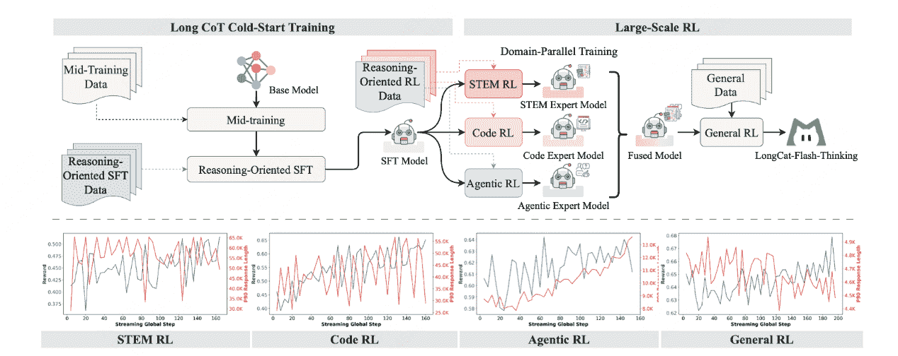

LongCat系列模型的快速迭代，正为美团的AI原生应用提供强大的技术底座。约两周前，美团开启了其首款生活服务AI智能体“小美”的公开测试。该应用搭载了LongCat-Flash-Chat大模型，旨在实现“一句话搞定本地生活大小事”。

“小美”App深度整合了美团外卖、餐厅推荐、订座导航等核心业务，用户可以通过自然语言交互完成复杂的服务组合。例如，用户可以说“帮我预订一家适合家庭聚餐的餐厅，并规划好过去的路线”，智能体便能自主理解需求、调用相应工具并完成一系列操作。LongCat-Flash-Thinking的发布，预示着未来“小美”等智能体将具备更强的逻辑分析和任务规划能力，从而处理更复杂的消费场景，提升用户体验。

业界分析认为，美团在AI大模型领域的持续发力，是其在本地生活服务下半场竞争中构筑技术壁垒的关键一步。通过开源高性能大模型，美团不仅能吸引全球开发者共建生态，还能将最前沿的AI技术迅速应用于骑手智能调度、商家经营决策支持、自动化客服等内部运营场景，实现全面的降本增效。

尽管市场上有声音将LongCat-Flash-Thinking的推理能力与行业顶尖的闭源模型（如传闻中的GPT系列下一代模型）相提并论，但美团官方更强调其在开源领域的领先地位。通过将多年积累的丰富本地生活数据与前沿AI技术相结合，美团正试图将竞争从传统的流量和补贴战，转向以技术驱动的服务效率和体验之争。

目前，LongCat-Flash-Thinking模型已在HuggingFace、GitHub等平台全面开源，并提供在线体验，此举将进一步推动大模型推理技术的发展和应用落地。

## [🟧A](https://emojipedia.org/large-orange-square) I动态 ｜阿里巴巴豪掷3800亿加码AI基建，CEO吴泳铭预言十年能耗增十倍

在9月24日于杭州举行的2025年度云栖大会上，阿里巴巴集团CEO兼阿里云智能集团董事长吴泳铭发表了震撼行业的声明。他透露，阿里巴巴正积极推进一项总额高达3800亿元人民币的AI基础设施建设项目，并明确表示未来计划追加更大规模的投入，以应对生成式人工智能（GenAI）带来的算力需求爆炸式增长。

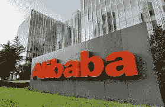

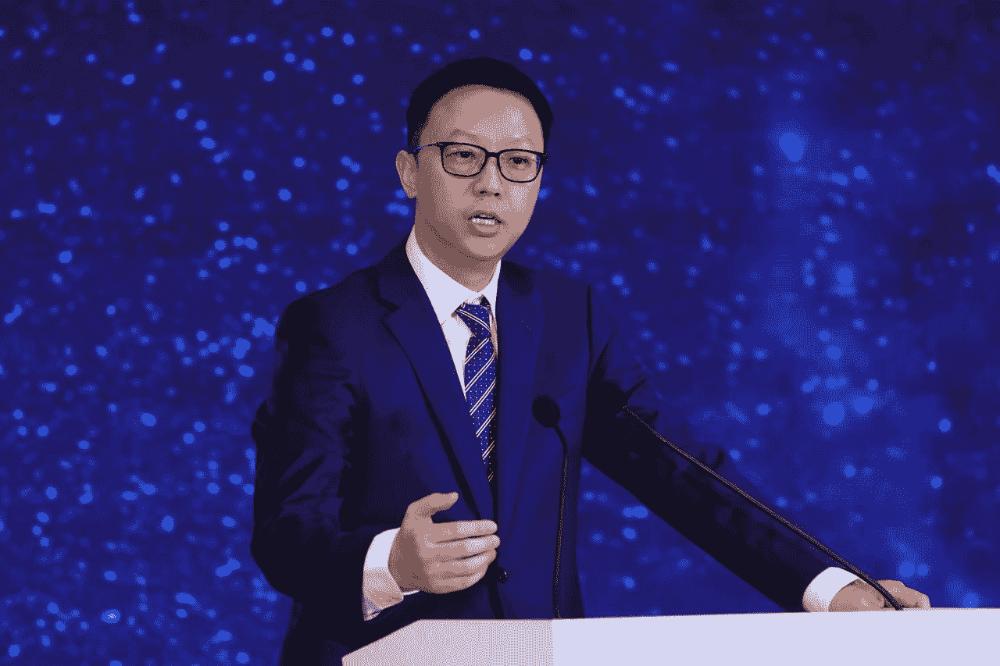

吴泳铭在主旨演讲中强调，AI驱动的算力竞赛已成为全球云计算市场的核心战场。他做出一个大胆预测：对比被普遍视为“GenAI元年”的2022年，预计到2032年，阿里云全球数据中心的总能耗规模将提升惊人的10倍。这一预测不仅揭示了AI对能源的巨大需求，也标志着数据中心建设将进入一个新的数量级。

此番巨额投资计划的公布，被视为中国云计算巨头对全球AI军备竞赛的强力回应。就在此前不久，甲骨文（Oracle）等北美云服务商已相继宣布大幅提升其在AI领域的资本开支，以采购NVIDIA等公司的先进芯片，并加速建设为大模型训练与推理优化的超级数据中心。阿里巴巴的迅速跟进，表明国内头部厂商不甘落后，决心在底层算力上与国际对手一较高下。

市场分析人士指出，阿里巴巴此次的战略布局具有双重意义。首先，这是对其“AI驱动，公共云优先”核心战略的坚定执行。通过构建超大规模的AI基础设施，阿里云不仅能满足其内部（如淘宝、钉钉等）大模型应用的算力需求，更能以公共云服务的形式，向千行百业输出强大的AI能力，巩固其在中国乃至亚洲市场的领先地位。

其次，吴泳铭关于“十年十倍”的能耗预测，也向整个行业发出了一个明确信号：未来的竞争不仅是资本和技术的竞争，更是能源效率和绿色计算能力的竞争。如何以更可持续的方式满足指数级增长的算力需求，将成为所有云厂商必须面对的核心挑战。

随着国内外科技巨头纷纷将重心和资本投向AI基础设施，一场围绕算力、模型和应用生态的全球性竞赛正愈演愈烈。阿里巴巴此次在云栖大会上的重磅宣告，无疑为这场竞赛的未来走向，增添了浓重的一笔。

## [🟧A](https://emojipedia.org/large-orange-square) I动态 ｜传OpenAI携手Apple供应商立讯精密布局AI硬件，意图打造全栈生态

人工智能领域的领导者OpenAI似乎正将其雄心从软件领域大举扩展至物理世界。近日，据知名科技媒体The Information报道，有关OpenAI正与中国制造巨头立讯精密（Luxshare Precision）就联合开发AI硬件产品进行深入洽谈的传闻愈演愈烈，引发科技界和资本市场的高度关注。

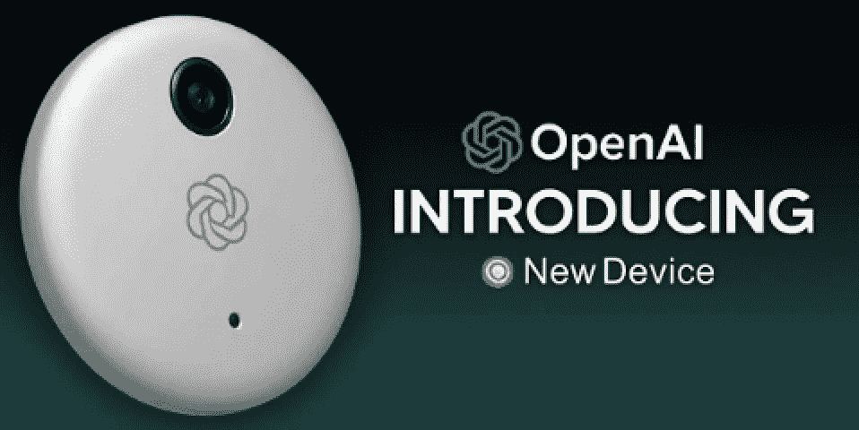

报道援引知情人士消息称，OpenAI正在探索一系列面向消费者的端侧AI硬件产品，产品形态极为多样化，不仅包括无显示屏的智能音箱、类似AI Pin的可穿戴徽章，还涵盖了智能眼镜和新一代数字录音笔等。这一系列的产品布局清晰地表明，OpenAI的目标可能远不止于软件授权，而是致力于成为一家能够定义下一代人机交互入口的、全面的AI硬件制造商。

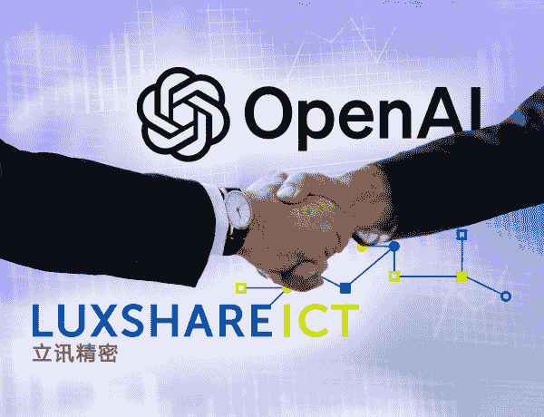

业界普遍认为，OpenAI此举背后存在两大核心战略动机。

其一，拓展营收来源，支撑高昂的AI发展成本并拔高估值。 根据OpenAI最新发布的官方数据，截至2025年7月，其旗舰产品ChatGPT的周活跃用户已突破7亿大关，用户基础庞大。然而，公司当前的收入模式仍高度依赖于面向开发者和企业的API许可及面向个人用户的ChatGPT Plus等订阅服务。面对训练和运行尖端大模型所需的天文数字般的资本支出，单一的软件收入模式显得日益脆弱。通过切入硬件赛道，OpenAI不仅能开辟新的、更直接面向消费者的收入来源，更有可能借此构建“软硬一体”的生态故事，从而在未来的融资活动中获得更高的估值。

其二，夺取AI时代的核心流量入口。 市场已形成广泛共识，未来的AI应用需要以功能强大的智能硬件为载体，这些设备将成为用户与人工智能交互的主要渠道。从智能手机时代的经验来看，掌握了硬件入口就等于掌握了应用分发和生态系统的话语权。若OpenAI能成功打造出深受市场欢迎的AI原生硬件，便能将其业界领先的大模型能力与用户体验深度绑定，摆脱对苹果、谷歌等现有硬件平台的依赖，从而实现从模型到应用再到终端的全产业链掌控。

值得注意的是，OpenAI的“硬件梦”由来已久，且并非一帆风顺。公司创始人兼CEO萨姆·奥特曼早在2020年就以个人名义投资了由前苹果资深员工创立的硬件初创公司Humane。

Humane于2023年底高调推出了其首款产品——无屏幕可穿戴设备AI Pin，其设计理念旨在部分取代智能手机，提供一种全新的、由AI驱动的交互体验。然而，这款备受期待的产品在上市后却遭遇了严峻的市场挫败。用户普遍反映其存在发热严重、响应延迟高、功能有限且续航能力差等诸多缺陷。

市场口碑的崩塌最终导致了商业上的失败。根据中国电子企业协会发布的消息及后续报道证实，Humane公司已于2025年2月将其部分资产以1.16亿美元的价格出售给PC巨头惠普（HP），并随后宣布将逐步关停AI Pin的相关业务。Humane从万众瞩目到黯然落幕的经历，为所有试图进入AI硬件领域的公司，包括OpenAI自己，提供了宝贵的、甚至是惨痛的“前车之鉴”。它深刻地揭示了硬件开发的复杂性远超软件，不仅需要顶尖的AI技术，更需要对供应链管理、工业设计、硬件工程以及用户体验有深刻的理解和把控。

对于OpenAI而言，与立讯精密这样的顶级制造商合作，无疑是解决其在硬件制造经验上短板的明智之举。然而，如何避免重蹈Humane的覆辙，设计出真正满足用户需求、技术成熟且体验流畅的AI原生硬件，将是其从软件巨头向生态霸主转型的关键一役。市场正拭目以待，看OpenAI能否将自己的软件魔法成功注入到冰冷的硬件之中。

## [🟧A](https://emojipedia.org/large-orange-square) I动态 ｜OpenAI发布全新基准GDPval：重新定义AI的“经济价值”评估标准

**旧金山，2025年9月27日** – 人工智能研究的领导者OpenAI于今日凌晨发布了一项具有里程碑意义的全新评估基准——GDPval。该基准旨在解决当前行业面临的一个核心挑战：如何准确衡量人工智能在能够创造真实经济价值的任务上的实际表现。此举标志着AI评估体系正从传统的学术和理论测试，向更注重实用性和商业影响力的方向进行重大转变。

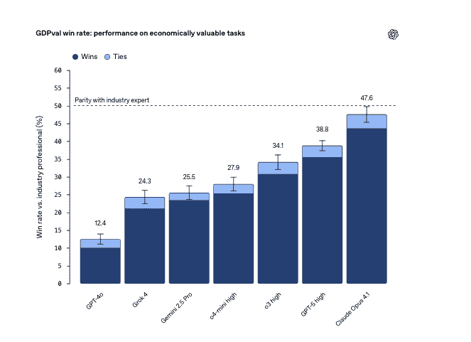

OpenAI在一篇详细的官方博客文章中指出，尽管现有的AI基准（如MMLU、HumanEval等）在评估模型的通识知识、推理和编码能力方面发挥了重要作用，但它们往往与企业和个人在日常工作中面临的、能够直接转化为经济效益的任务存在脱节。为了弥合这一差距，GDPval应运而生。

GDPval (Gross Domestic Product value)是一个精心构建的任务集合，其核心特点是任务本身与现实世界中的商业和生产力活动高度相关。这些任务被设计为普通人愿意付费寻求解决方案的真实场景。据OpenAI介绍，GDPval涵盖了六个核心经济领域：

1. 市场营销（Marketing）： 例如，为特定产品撰写能提升转化率的社交媒体广告文案。

1. 销售（Sales）： 例如，根据客户画像和历史邮件起草一封高回复率的销售拓展邮件。

1. 客户支持（Customer Support）： 例如，分析客户投诉并生成一个既能解决问题又能安抚情绪的回复。

1. 数据分析（Data Analysis）： 例如，解读一份销售数据报告，并用自然语言总结出核心洞察与建议。

1. 软件工程（Software Engineering）： 例如，根据产品需求文档编写一个可直接部署的小功能模块。

1. 管理咨询（Management Consulting）： 例如，针对一个商业案例撰写一份包含SWOT分析的初步诊断报告。

GDPval的评估方法引入了更严格的人类偏好反馈机制。评估者不再仅仅判断答案的正确与否，而是从“是否愿意为这个结果付费”以及“愿意付多少钱”的角度进行打分，从而量化AI输出的经济价值。

在发布公告的同时，OpenAI公布了使用GDPval对当前主流大模型进行的首轮评估结果。报告显示，尽管包括GPT-4o在内的前沿模型在许多任务上表现出色，但在不同领域的表现存在显著差异。特别是在需要深度行业知识和复杂商业逻辑的管理咨询及高级销售任务中，所有模型的表现仍有巨大的提升空间。这表明，AI要真正成为各行各业的“专家级”生产力工具，仍需在特定领域的认知深度上持续演进。

GDPval的推出，被视为对AI发展方向的一次重要校准。它向整个行业传递了一个明确的信号：未来AI模型的竞争，将不再仅仅是参数规模和跑分上的“能力竞赛”，而是更加注重实际应用和商业落地的“价值竞赛”。

分析人士认为，这一新基准将促使AI开发者将更多资源投入到提升模型在垂直领域的专业能力上，而非泛泛的通识问答。对于企业用户而言，GDPval提供了一个更可靠的工具，用于评估和选择最适合自身业务需求的AI模型。长远来看，这有望加速AI技术从实验室走向工厂、办公室和市场的进程，真正赋能实体经济的增长。

OpenAI已宣布将向部分研究机构和合作伙伴开放GDPval的测试集，并计划在未来逐步扩大其覆盖的行业范围，以期建立一个更加全面、公正的AI经济价值评估生态。

## [🟧A](https://emojipedia.org/large-orange-square) I动态 ｜Sam Altman发布长文，AI或成基本人权

OpenAI联合创始人兼CEO萨姆·奥特曼（Sam Altman）于近日发布了一篇题为《充裕智能》（Abundant Intelligence）的纲领性博文，首次系统性地阐述了OpenAI对于未来人工智能基础设施的宏大愿景，并提出了极具前瞻性甚至争议性的观点：随着AI能力的飞跃，获取人工智能服务最终可能被视为一项基本人权。

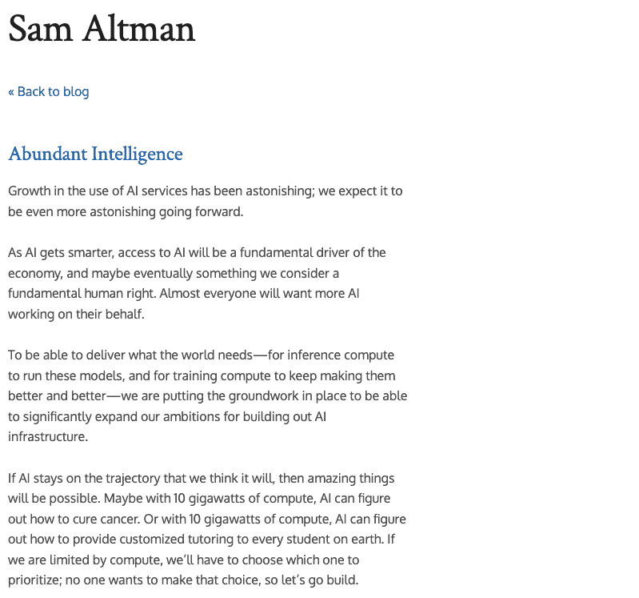

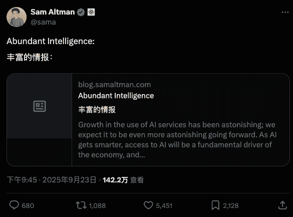

这篇博文迅速在科技界和政策研究领域引发了广泛讨论。它不仅揭示了OpenAI对未来算力和能源需求的深刻思考，也将其公司的使命提升到了一个新的哲学高度。

奥特曼在文章开篇即指出，当前全球对AI服务的需求增长速度“令人惊叹”，但这仅仅是序幕，“未来将更加惊人”。他认为，随着人工智能系统变得越来越智能、能力越来越强，它们将从辅助工具转变为驱动社会生产力提升的核心引擎。

他写道：“我们相信，获取智能（access to intelligence）的成本将持续降低，其应用将无处不在。这将从根本上重塑经济形态，智能本身将成为经济活动的基本驱动力。” 奥特曼将未来的“智能”比作历史上的电力或互联网，认为它将成为所有行业和社会进步不可或缺的基础资源。一个社会所能调用的智能总量，将直接决定其繁荣程度。

为了实现这一“充裕智能”的未来，奥特曼强调了构建前所未有规模的AI基础设施的必要性。这呼应了近期科技行业巨头（如阿里巴巴、甲骨文等）纷纷宣布巨额投资AI算力建设的趋势。奥特曼的愿景则更为激进，他认为当前全球的建设计划仍远远不足以满足未来十年AI模型对计算资源的需求。

他在文中暗示，实现这一目标需要全球范围内的协作，涵盖芯片制造、数据中心建设以及至关重要的能源供应。他认为，廉价、清洁、充裕的能源，特别是核聚变等前沿能源技术的突破，将是支撑“充裕智能”时代到来的关键。

在博文的结尾部分，奥特曼提出了其最大胆的论断。他认为，当AI足够先进，能够帮助人类解决贫困、疾病和环境等重大挑战时，确保每个人都能公平地获取和使用这项技术，就变得至关重要。

他写道：“如果一个社会拥有能够极大改善人类福祉的充裕智能，那么确保每个人都能从中受益，就不仅是经济问题，更是一个道德问题。我们甚至可以设想，在未来，获取一定基线的AI能力，最终可能被视为一项基本人权。”

这一观点立即引发了热议。支持者认为，这为解决全球不平等问题提供了新的思路，并为AI的发展设定了崇高的道德目标。而批评者则担忧，将AI定义为“人权”可能过于理想化，并可能引发关于资源分配、监管和技术滥用的复杂问题。

总体而言，奥特曼的《充裕智能》不仅是OpenAI未来十年发展路线图的宣言，更是一篇试图定义人与AI未来关系的哲学檄文。它将推动全球政策制定者、企业家和公众，更深入地思考如何在技术奇点临近的时代，构建一个更加公平和繁荣的未来。

# [🟧A](https://emojipedia.org/large-orange-square)I动态 ｜Kimi发布多模态Agent模型“OK Computer”，剑指复杂任务自动化，可一键生成网站与交互式报表

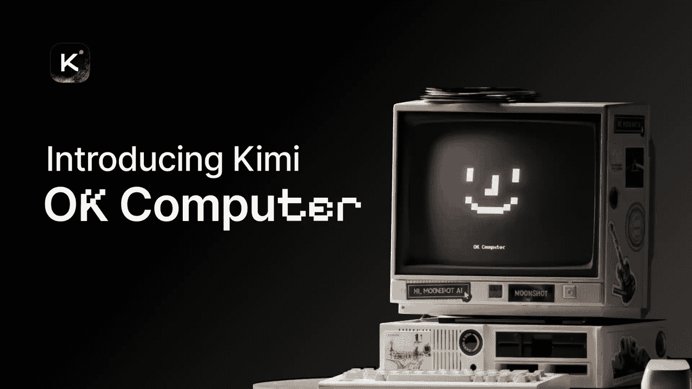

国内通用人工智能领域的独角兽公司月之暗面于9月27日上午正式发布其全新的多模态Agent模型——“OK Computer”。该模型被定位为Kimi智能助手的“超级进化体”，旨在将AI的能力从语言理解和生成，扩展到能够自主执行复杂、多步骤的数字任务，进一步解放人类的生产力。

据官方介绍，“OK Computer”依托于公司下一代基石模型Kimi K2的强大能力，具备了前所未有的工具调用、代码解释和多模态生成能力。月之暗面CEO杨植麟在发布会上表示：“我们相信下一代AI的核心是‘动作’（Action），而不仅仅是‘对话’（Chat）。OK Computer的目标，就是让AI成为能够独立完成复杂工作的可靠数字员工。”

此次发布的“OK Computer”展示了三项令人瞩目的核心功能，标志着其从传统AI助手到高阶智能体（Agent）的跨越：

1. **自动化网站搭建：** 用户只需通过自然语言描述期望的网站风格、内容模块和核心功能（例如“帮我创建一个展示我的摄影作品集的个人网站，风格要简约，需要包含作品展示、个人简介和联系方式三个页面”），“OK Computer”便能自主理解需求，生成完整的前后端代码，并将其部署上线，交付一个可访问的网站成品。

2. **一键生成`PPT`演示文稿：** 基于用户提供的文档、主题或大纲，“OK Computer”能够自动设计幻灯片版式、提炼核心要点、生成讲稿，并智能配图，最终输出一份结构完整、视觉精美的`PPTX`格式文件。这极大地缩减了用户在信息整理和格式排版上耗费的时间。

3. **百万行数据处理与交互式报表生成：** 此次发布的最大亮点之一是其强大的数据分析能力。“OK Computer”能够直接处理高达100万行的表格数据（如Excel或CSV文件），并根据用户的分析指令（例如“分析这份销售数据，找出Q3增长最快的产品类别，并按区域生成销售额对比图”），自动编写和执行分析脚本，最终生成一个可交互的`BI`仪表板（`Dashboard`）。用户可以在仪表板上进行筛选、钻取和多维度探索，实现了从原始数据到商业洞察的端到端自动化。

“OK Computer”的强大能力来源于其底层的Kimi K2大模型。月之暗面透露，K2模型在长文本处理能力上再次取得突破，并显著增强了代码生成与逻辑推理能力。这使得Kimi不仅能“读懂”用户的复杂指令，更能将其拆解为一系列可执行的子任务，并稳定、可靠地调用各种数字工具（如代码解释器、`API`接口等）来完成这些任务。

Kimi“OK Computer”的发布，被视为对国内乃至全球AI Agent赛道的一次有力冲击。在此之前，已有众多科技公司布局智能体产品，但多集中于特定领域的自动化流程。而Kimi此次展示的跨领域、高复杂度的任务完成能力，无疑将行业标准推向了新的高度。

分析人士认为，随着“OK Computer”这类产品的成熟，未来的工作模式将被深刻改变。许多以往需要专业技能和大量时间的数字工作，如编程、数据分析和设计，将可以交由AI Agent高效完成。这将推动个人和企业将更多精力聚焦于创新、战略和决策等更高附加值的活动上。

目前，月之暗面已宣布将“OK Computer”的部分功能以`API`的形式向开发者和企业合作伙伴开放，并计划在Kimi `App`中逐步向用户推送新功能，AI Agent的商业化落地进程有望进一步加速。

# [🟧A](https://emojipedia.org/large-orange-square)I动态 ｜OpenAI获英伟达千万美元投资，与甲骨文、软银联手扩建“星际之门”数据中心

人工智能领域的军备竞赛正以前所未有的速度和规模升级。AI芯片巨头英伟达（NVIDIA）与模型研发的领导者OpenAI于近日共同宣布，英伟达将向OpenAI追加一千万美元的新一轮战略投资。几乎在同一时间，OpenAI迅速公布了这笔资金的核心用途：将与云计算巨头甲骨文（Oracle）及全球科技投资集团软银（SoftBank）达成三方战略合作，共同建设五座全新的超级数据中心。

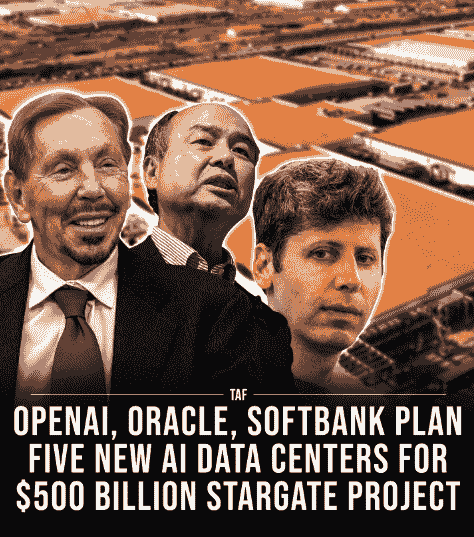

这一系列动作被视为对OpenAI创始人萨姆·奥特曼（Sam Altman）此前披露的“星际之门”（Stargate）超级计算机计划的重大提速和规模升级。

据OpenAI官方声明，此次新建的五座数据中心将全部作为“星际之门”项目的基础设施，专门用于训练和运行远超当前世代的、下一代乃至未来几代AI大模型。更引人注目的是，此次扩建将使“星际之门”项目的总规划电力容量提升至近7吉瓦（GW）。

7吉瓦是一个惊人的数字，大致相当于七座大型核反应堆的输出功率。这清晰地表明，OpenAI正在为实现其“充裕智能”（Abundant Intelligence）的宏大愿景，构建全球规模最大、算力最强的AI基础设施。如此庞大的能源消耗也凸显了AI发展对全球能源格局带来的深远影响和挑战。OpenAI在声明中强调，新数据中心将致力于采用最先进的节能技术和清洁能源解决方案，但未透露具体细节。

此次合作汇集了AI生态链上的三大关键角色：

+ **OpenAI：** 作为全球领先的AI研究机构，提供模型算法、应用场景和庞大的算力需求。

+ **甲骨文（Oracle）：** 凭借其强大的`OCI`（Oracle Cloud Infrastructure）云服务和在建设大规模、高性能数据中心方面的丰富经验，将为项目提供关键的云基础设施支持和工程专业知识。

+ **软银（SoftBank）：** 作为全球性的科技投资者，将为这个耗资巨大的项目提供重要的资本支持和全球资源协调。

分析人士认为，这一联盟的形成，是应对AI基础设施建设中资本、技术和供应链三重挑战的最优解。它确保了“星际之门”这一可能耗资千亿美元级别的项目，能够在资金、技术选型和建设速度上获得有力保障。

OpenAI在公告中明确表示，与甲骨文及软银的合作将使“星际之门”计划得以“提前完成”，尽管其未披露具体的、修订后的时间表。此前，该计划预计将持续多年，并逐步投入运营。此次的加速，预示着OpenAI希望尽快获得压倒性的算力优势，以在与其他AI竞争对手（如谷歌、Anthropic等）的竞赛中占据更有利的位置。

英伟达的最新投资虽然在金额上看似不大，但其战略象征意义重大，表明了芯片供应商与模型开发者之间日益紧密的共生关系。随着AI模型向着万亿乃至更高参数规模迈进，算力基础设施的竞争已然成为决定未来AI格局的核心战场。此次Open-AI的雷霆行动，无疑为这场全球性的科技竞赛按下了快进键。

# [**🟩代**](https://emojipedia.org/large-green-square)码现场 ｜带你从零开始彻底学懂Dify

> 如何**最快速**上手开发企业级Agent智能体？毫无疑问，使用低代码开发工具`Dify`，肯定是最佳选择。

> 相比`LangChain`&`LangGraph`这类需要编程来完成Agent开发的工具来说，`Dify`通过点击和拖拉拽，即可在画布上搭建高性能Agent工作流，上手门槛几乎为零。

> 而类比同类型低代码开发工具如`Coze`，`Dify`**工具的专业性更强，能够**完整支持Agent开发、测试、部署、运维全链路各项功能实现，更加适合进行企业级的Agent项目开发。

<https://player.bilibili.com/player.html?bvid=13unhzgETL&spm_id_from=333.337.search-card.all.click>

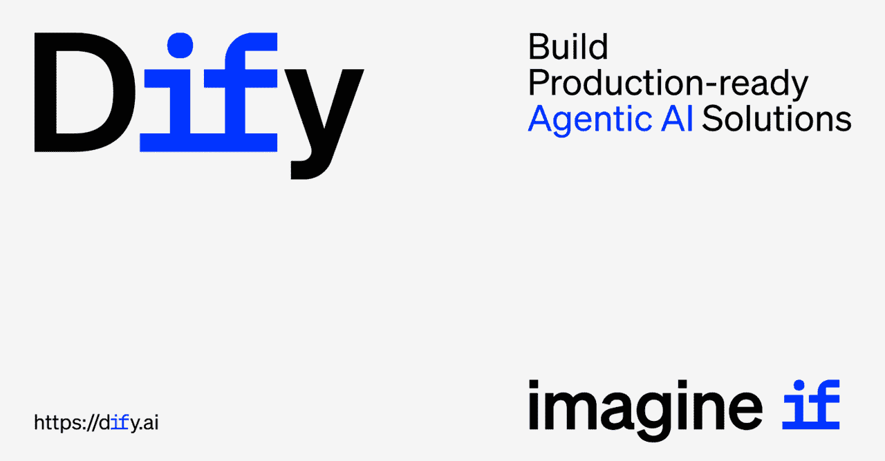

本期公开课，完整6小时硬核干货教程，带你从零开始彻底学懂`Dify`。

公开课将从零开始，为大家快速介绍以`Dify`为核心的低代码Agent开发工具生态，以及`Dify`本地部署与接入流程。

同时重点介绍`Dify`内置的5大类AI应用的开发流程，这5大类应用分别是，聊天助手类应用、文本生成类应用、Agent智能体类应用、工作流类应用、以及ChatFlow类的应用，这5大类应用各自有不同的适用场景，完整掌握这些应用的开发流程，就掌握了`Dify`的最核心功能。

同**时，公**开课中我还将为大家介绍时下最热门的、包括`MinerU`和`Nano Banana`在内的`Dify`各类插件使用方法，并最终，手把手带大家完成18项高价值Agent开发，从零完成包括AI数据分析Agent、科研助手、多模态知识库问答应用、`DeepResearch` Agent、`SEO`文章编写Agent、文生图多模态Agent等多项热门领域的企业级Agent开发，带大家一站式彻底掌握`Dify`。

> 公开课还将赠送精选的50套实用`Dify`工作流模板，开箱即用。

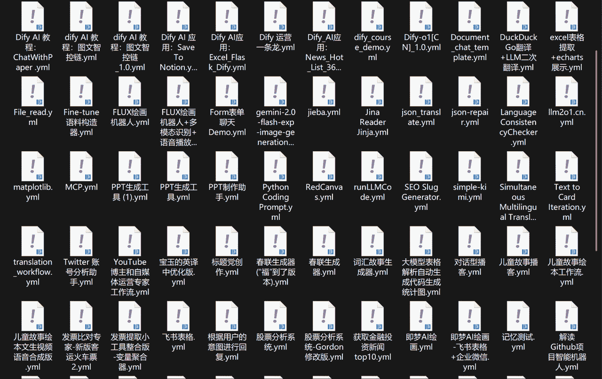

如此诚意满满的公开课，还望大家多多支持。公开课6小时12个章节5万多字的课件，外加`Dify`安装包、工作流文件、测试数据和提示词等，都已经上线至赋范大模型技术社区，大家点击下方链接即可领取。

> 视频相关课件

> ⭐️ [`Dify`（README）](https://kq4b3vgg5b.feishu.cn/wiki/DadOwgA4fia7yekCbclcZ9HCnyb?from=from_copylink)

> 如果你也在关心AI世界的风云变幻、大模型与智能体的走向、技术背后的权力博弈，记得关注我们的文档和其他账号。我们带你看懂真正重要的那1%。

---

# 点击下面链接与我们产生更多连接✨

---

九天Hector 哔哩哔哩：https://space.bilibili.com/385842994

九天Hector 抖音： https://v.douyin.com/lqASAa2Hs_0/

九天Hector 📕：https://www.xiaohongshu.com/user/profile/62321335000000001000885e

九天Hector YouTube：https://www.youtube.com/channel/UCj8tyDLSxIdivnweBnG4H9Q/

赋范大模型全栈技术社区请点👉：https://kq4b3vgg5b.feishu.cn/wiki/space/7257794425391579164
