# 周周报 Vol.09｜英伟达豪掷五十亿美元成为英特尔大股东｜DeepSeek登上《Nature》封面｜ 赋范空间

> 来源：[https://kq4b3vgg5b.feishu.cn/docx/DMD1dEva2oTlezxOFsjc1O51nbb](https://kq4b3vgg5b.feishu.cn/docx/DMD1dEva2oTlezxOFsjc1O51nbb)

## 《AI大模型周周报》第-9-期来啦！

> 本期核心内容：英伟达成为英特尔最大股东！谷歌即将发布Gemini3；Deepseek科研成果登上《Nature》封面；GPT-5-Codex发布

> 我们创立周报，旨在为你提炼每周最核心的AI洞见。

> 欢迎随时收听，并在评论区交流讨论！

---

## 点击下面按钮跳转【AI大模型周周报专栏】持续关注


## [🟥A](https://emojipedia.org/large-red-square)I头条 ｜匿名模型“Oceanstone”现身LM Arena，业界分析指向谷歌下一代AI旗舰Gemini 3

在全球人工智能技术竞赛持续白热化的背景下，一个代号为“Oceanstone”的神秘大型语言模型，近日悄然现身于业界权威的第三方评测平台“大型语言模型竞技场”（LM Arena）。此次未经任何官方声明的部署，迅速在开发者与研究者社区中引发了高度关注与深入分析。综合多方证据，尤其是谷歌自身代码库中泄露的关键信息，业界普遍认为，“Oceanstone”极有可能是谷歌下一代旗舰AI模型Gemini 3的早期测试版本。

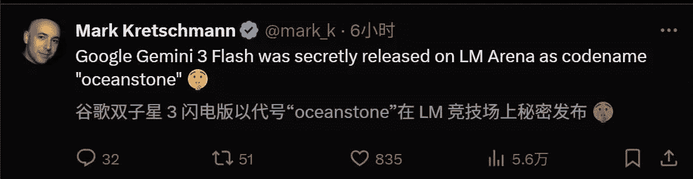

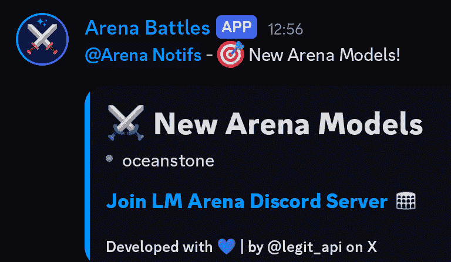

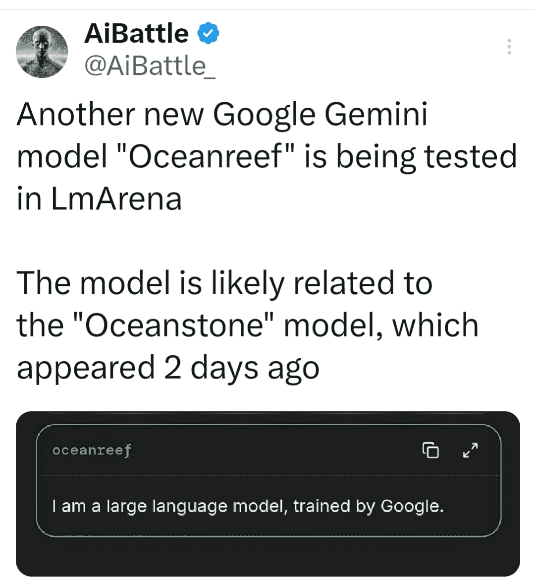

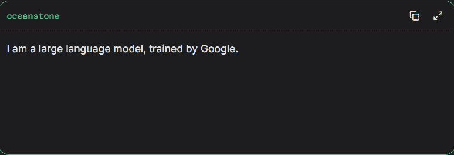

这一事件被视为谷歌在正式发布前，为进行技术调试、收集真实世界性能数据并与主要对手进行匿名性能对标而采取的一次精心策划的战略行动。

传统的AI模型评估多依赖于静态基准测试，但其分数有时无法完全反映模型在处理真实、多样化用户查询时的泛化能力。LM Arena平台通过建立一套以人类偏好为核心的动态评估体系，有效地弥补了这一不足。

该平台采用匿名、随机的“A/B”测试机制，向用户同时展示两个匿名模型的输出，用户根据回答质量进行选择。这种盲测设计消除了品牌偏见，确保了评估的客观性。随后，平台运用源自竞技体育的Elo评级系统，根据海量的成对比较结果，为每个模型动态计算并更新性能得分，形成一个公信力日益增强的排行榜。

将Oceanstone与谷歌联系起来的关键依据，在于谷歌已有利用该平台进行秘密测试的先例。此前，一个代号为nano-banana的模型在LM Arena出现，后被谷歌官方确认为其发布的Gemini 1.5 Flash模型。这一先例表明，在正式发布前利用代号进行匿名公开测试，已成为谷歌评估和微调新模型的一种既定策略。此举不仅能收集宝贵的真实世界性能数据，更能使其在受控环境之外，直接评估未发布模型与OpenAI的GPT-4o、Anthropic的Claude 3 Opus等主要竞品的相对优劣。

对Oceanstone身份的猜测并非空穴来风。最具决定性的证据来源于谷歌的公开代码库。据科技媒体报道，在Oceanstone出现前，已有开发者在谷歌Gemini命令行工具（CLI）的代码中，发现了一个对`gemini-beta-3.0-pro`的明确引用。这一发现直接证实了Gemini 3.0系列的存在，并表明其“Pro”版本已进入内部测试阶段。

该代码泄露为解读Oceanstone的身份提供了关键背景，使社区的分析有了明确的目标。基于此，一条清晰的逻辑链条得以构建：谷歌已成功开发Gemini 3.0 Pro的内部版本，并延续其在Gemini 1.5 Flash上验证过的匿名测试策略，以“Oceanstone”的代号将其部署至LM Arena，为预计在2025年晚些时候的正式发布进行最后阶段的数据收集与性能评估。

尽管指向Gemini 3 Pro的证据有力，但Oceanstone在社区测试中呈现的性能不一致性，也催生了其他可能性。部分用户反馈，该模型在处理特定复杂指令时表现卓越，性能体感接近现有的Gemini 1.5 Pro。然而，另一些用户则指出，其在某些任务上的表现未达预期，不完全符合旗舰“Pro”模型应有的全面压制性优势。

这种性能上的不一致引出了两种备选假说：

1. Gemini 3 “Flash”模型：有观点认为，Oceanstone可能是Gemini 3系列的轻量级Flash版本。这可以解释其性能为何没有全面超越现有顶尖模型，同时也符合谷歌在Gemini 1.5系列中建立的Pro与Flash双版本产品策略。

2. `Gemma`模型：另一种可能是，该模型属于谷歌的`Gemma`开源模型家族。在LM Arena上测试新一代高性能开源模型，以维持与Meta的`Llama`系列在开源社区的竞争力，同样符合谷歌的整体战略。

此外，性能波动也可能反映了模型架构的复杂性。若Oceanstone采用了更先进的动态专家混合`MoE`架构，模型会根据任务类型调用不同的专家子网络。如果其路由机制或部分专家网络尚在优化中，则在不同任务上表现出显著的性能差异是符合技术逻辑的。

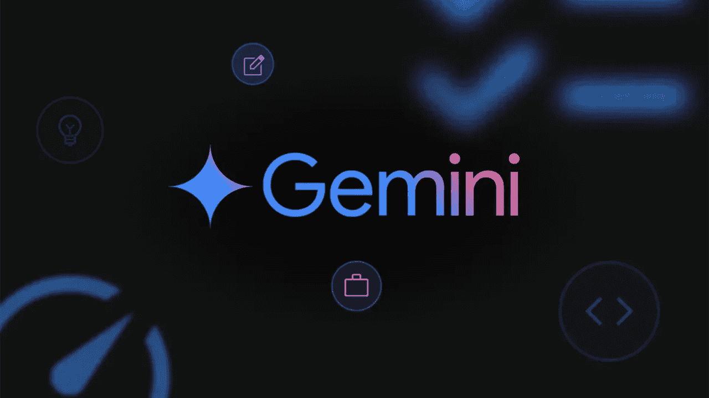

在当前由OpenAI、Anthropic和Meta等巨头主导，同时面临Mistral等创新公司挑战的AI市场中，匿名测试是一种审慎的“风险管理”策略。它允许谷歌在不受公众与媒体密切关注的情况下，进行实战演练，识别内部测试中难以发现的边缘案例，从而为产品的最终优化和市场定位提供数据驱动的决策依据。

回顾从Gemini 1.0的原生多模态设计，到Gemini 1.5 Pro的百万级令牌上下文窗口与`MoE`架构，市场对Gemini 3的性能抱有极高期望。基于行业传闻，Gemini 3可能采用总参数量达万亿级别的动态`MoE`架构，通过一个复杂的路由系统根据任务动态激活部分网络。此外，在长上下文处理、多步骤推理能力以及对实时视频流等更复杂多模态数据的理解上，预计也将实现重大突破。

综合来看，尽管谷歌官方尚未确认，但匿名模型Oceanstone是Gemini 3系列早期测试版本的可能性极高。从其遵循的测试策略、关键的代码泄露证据，到此举在当前竞争格局下的战略合理性，多方面信息均指向同一结论。


## [🟧A](https://emojipedia.org/large-orange-square)I动态 ｜重磅地震：英伟达斥资50亿美元入股英特尔，昔日对手化身战略盟友

球科技和半导体行业今日迎来历史性时刻。图形处理器巨头英伟达与CPU的传统霸主英特尔联合宣布，双方已达成一项颠覆性的战略投资协议。英伟达将以每股23.28美元的价格，斥资50亿美元现金入股英特尔，旨在共同开发面向个人电脑和数据中心的下一代人工智能芯片。

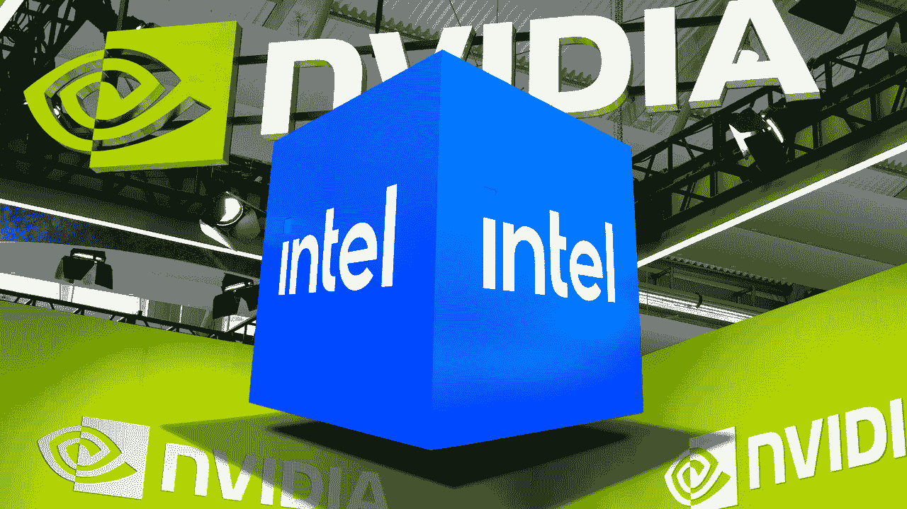

这一消息无异于在业界投下了一枚核弹。长久以来，英伟达和英特尔在多个领域存在直接竞争，此次从对手到盟友的转变，标志着双方为应对日益激烈的市场竞争和AI时代的算力需求，选择了一条前所未有的合作道路。

在随后举行的新闻发布会上，英伟达创始人兼CEO黄仁勋的发言直白而有力，他表示：“我们很高兴投资了英特尔，这项投资的回报将非常可观。我们将成为英特尔CPU非常大的客户。”

此番言论不仅确认了投资的财务性质，更暗示了双方未来将在产品采购和技术生态上进行深度捆绑。英特尔CEO帕特·基辛格也表示，这项合作是对英特尔IDM 2.0战略及其晶圆代工服务的巨大信任票。“英伟达是AI计算的先驱，而英特尔在CPU架构和大规模制造上拥有深厚积累。我们的结合将创造出无与伦比的产品，推动整个行业的创新。”

根据协议，两家公司将组建一个联合研发中心，专注于设计高度集成的芯片解决方案，旨在将英伟达领先的GPU和AI加速器技术与英特尔的`x86` CPU核心及先进制程工艺进行深度融合。此举被视为直接挑战当前的市场格局，尤其是在高性能计算和AI服务器领域。

市场分析人士指出，这一联盟的形成有多重动因：对英伟达而言，可以获得除台积电之外的另一个顶级尖端晶圆代工厂，实现供应链的多元化并确保产能安全；对英特尔而言，则获得了最强大的外部客户和合作伙伴，为其晶圆代工业务注入了强心剂，并能联合英伟达共同抵御来自AMD和`ARM`架构处理器的双重压力。

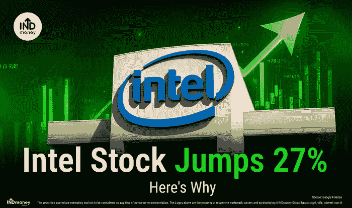

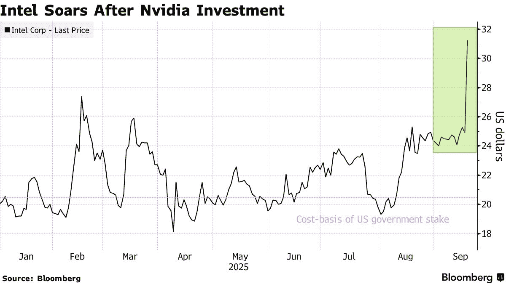

这是对英特尔IDM 2.0战略最强有力的背书。获得行业领导者英伟达的资金和订单承诺，将极大提振市场对其晶圆代工服务的信心，吸引更多潜在客户。 黄仁勋“成为大客户”的承诺，意味着英特尔的服务器CPU业务将获得一个稳定且巨大的出海口，能有效对抗AMD EPYC处理器的市场份额侵蚀。 与英伟达在芯片层面进行联合开发，有助于英特尔学习和吸收顶尖的AI芯片设计理念，推出CPU+GPU高度协同的异构计算产品，补齐自身在独立GPU上的短板。

摆脱对台积电的单一依赖是英伟达的长期目标。投资英特尔意味着获得了一个位于美国本土的、拥有尖端技术的代工伙伴，不仅分散了地缘政治风险，也获得了更强的议价能力。通过与`x86`架构的鼻祖深度捆绑，英伟达的`CUDA`生态系统能更底层地融入PC和数据中心，形成“Intel CPU + NVIDIA GPU”的黄金组合，进一步挤压竞争对手的生存空间。 投资一家被市场低估的巨头，本身可能带来可观的财务回报。更重要的是，用50亿美元的资金撬动了整个产业格局，确保了自身未来十年的领导地位，是一笔极具战略眼光的投资。

这是对AMD最沉重的打击。过去几年，AMD凭借产品优势和台积电的先进工艺，在CPU和GPU市场两面夹击英特尔和英伟达。如今，这两大巨头联手，意味着AMD将同时在两个战场上遭遇“最强CPU”和“最强GPU”的联合绞杀。AMD的一大优势是其CPU和GPU业务都在自己手中，可以进行更好的协同设计。但现在英特尔和英伟达的合作深度可能超越AMD的内部整合。此外，英特尔代工能力的崛起，也将挑战AMD所依赖的台积电的地位。 AMD必须加速其产品迭代，并可能需要寻找新的战略合作伙伴，以应对这个全新的、极其强大的竞争联合体。

英伟达是台积电前三大客户之一，其订单的部分转移将直接影响台积电的营收。这是对其市场主导地位的一次直接挑战。 一个由英伟达扶持的英特尔晶圆代工服务将成为台积电在尖端制程领域最可怕的竞争者。这打破了台积电一家独大的局面，将迫使其在技术、价格和服务上做出更积极的应对。 面对来自美国本土“Intel CPU + NVIDIA GPU”组合的压力，台积电可能会进一步加快其在美国、日本和欧洲的建厂步伐，以巩固与全球客户的关系，对冲风险。

## [🟧A](https://emojipedia.org/large-orange-square)I动态 ｜DeepSeek AI成果登上《自然》封面

DeepSeek迎来重要里程碑。其关于DeepSeek-R1推理模型的研究论文登上了9月17日出版的国际顶尖期刊《自然》（Nature）的封面。该论文由梁文锋担任通讯作者，详细阐述了一项全新突破：仅通过强化学习成功激发了大语言模型的先进推理能力。

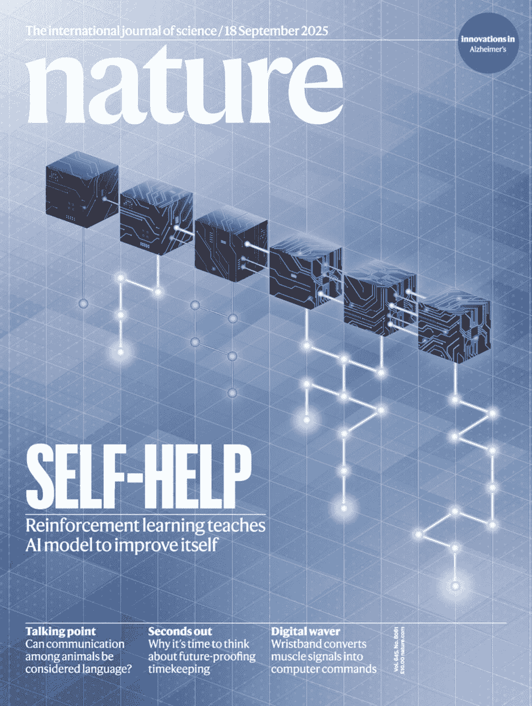

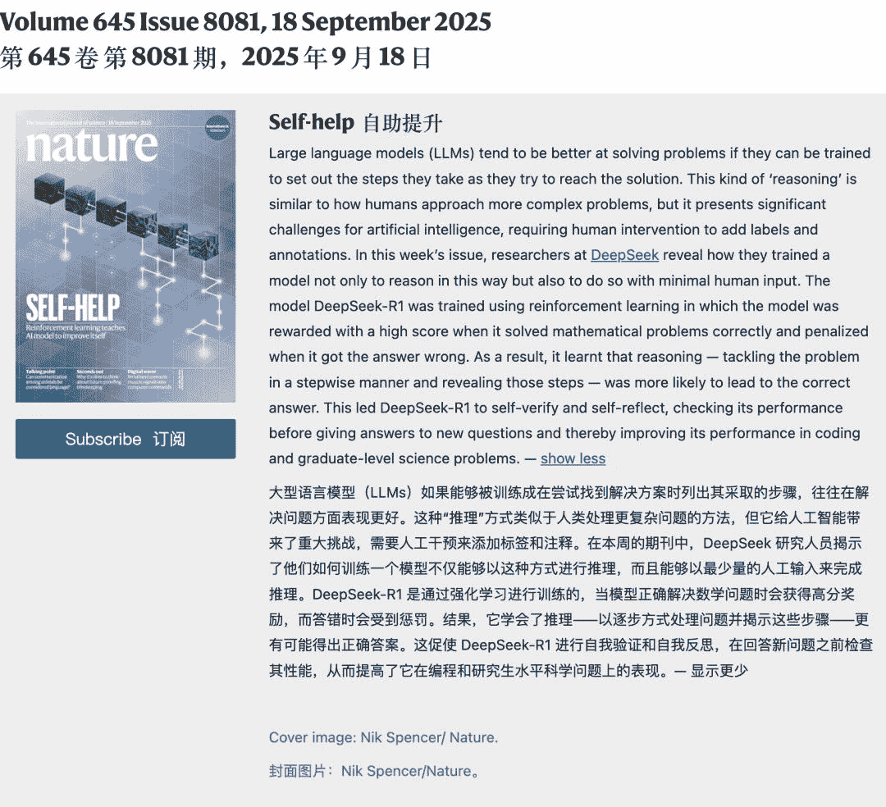

此次发表标志着中国大模型研究成果首次登上《自然》封面，同时也是全球首个经过完整且严格同行评审、并发表于权威期刊的主流大语言模型研究，代表着中国AI技术获得了国际科学界的最高认可。

《自然》在其社论中高度评价了这一事件的意义，评论道：“几乎所有主流的大型模型都未经独立的同行评审，这一空白终于由DeepSeek填补了。”

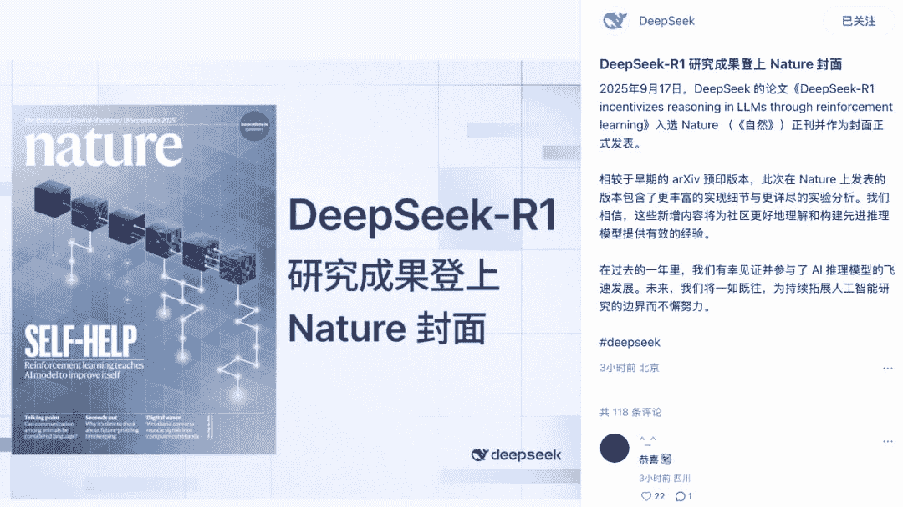

自全球大模型浪潮兴起以来，人工智能领域充斥着各种技术报告和性能榜单，但普遍缺乏一个正式的科学认证机制。尽管像OpenAI和谷歌这样的行业巨头屡获突破，但其核心技术通常以技术报告的形式发布，未经独立的同行评审。

DeepSeek的路径为行业树立了开放性的新标杆。其关于DeepSeek-R1模型的研究论文于今年早些时候首次发布在预印本服务器`arXiv`上。从2月14日投稿给《自然》至今，论文经历了长达六个月、由八位外部专家参与的全面同行评审过程。审稿人不仅严谨地评估了模型的性能，还对其数据来源、训练方法和安全协议等进行了细致的审查。

这一过程被誉为是推动AI领域走向更高透明度和可复现性的可喜一步。著名开源社区`Hugging Face`的机器学习工程师、同时也是该论文的审稿人之一的Lewis Tunstall强调了其重要性：“这是一个备受欢迎的先例。如果行业缺乏这种公开分享大部分研发过程的规范，我们将很难评估这些系统的潜在风险。”

最终发表的这篇长达64页的论文相较于预印本初稿有重大更新。论文首次披露了`R1`的训练成本，提供了更详尽的技术细节，并正面回应了早期关于蒸馏”proprietary models的指控。论文还给出了减轻数据污染的详细流程，并对模型进行了全面的安全性评估。

论文中最引人注目的发现之一是该模型极低的训练成本。`R1-Zero`和`R1`模型分别使用了512张`H800` GPU训练了198小时和80小时。以每GPU小时2美元的租赁价格计算，`R1`的总训练成本约为29.4万美元。这一数字与同类推理模型动辄数百万美元的训练预算形成了鲜明对比。

论文也直面了`R1`发布之初所引发的“蒸馏”争议。`OpenAI`此前声称有证据表明`DeepSeek`使用了其专有模型进行训练。`DeepSeek`对此澄清，其所有训练数据均源自公共互联网。虽然数据中可能无意中包含了由`GPT-4`等模型生成的内容，但公司坚称没有进行任何刻意或系统性的蒸馏过程——即利用更强大模型的输出来训练另一个模型。

随着`R1`的成功，外界的目光已转向其继任者`R2`。关于其发布的猜测持续不断，一些分析师认为其研发进程可能受到了高性能计算资源限制的影响。

今年八月，`DeepSeek`发布了`DeepSeek-V3.1`，并将其描述为“迈向智能体`Agents`时代的第一步”，这是一个重要的进展。新模型采用了混合推理架构，提升了效率，并增强了工具使用和执行智能体任务的能力。

由于`R1`模型构建于`V3`架构之上，`V3.1`的发布引发了外界对`R2`即将问世的猜测。更具战略意义的是，`DeepSeek`宣布`V3.1`采用了`UE8M0` `FP8`参数精度，这是一种专为下一代国产AI芯片设计的格式。此举标志着公司在利用和支持中国本土计算硬件生态系统方面做出了明确的战略转向，这一动向已在国内科技市场引发了积极反响。

## [🟧A](https://emojipedia.org/large-orange-square)I动态 ｜阿里深夜投下重磅炸弹：通义DeepResearch全面开源，性能登顶剑指OpenAI

阿里巴巴于昨夜毫无征兆地放出重磅消息，正式宣布旗下首个深度研究智能体模型——通义`DeepResearch`——全面开源。此举不仅包含了模型本身，更将其背后的核心框架、全套解决方案以及关键技术报告一并公之于众，在人工智能领域投下了一颗深水炸弹。

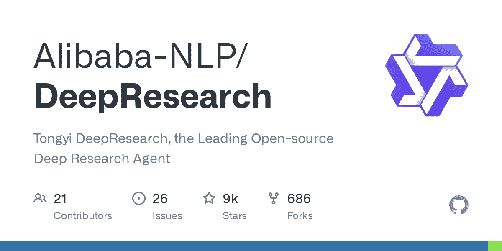

据阿里方面公布的数据，通义`DeepResearch`在多项业界权威的深度研究任务基准测试中，性能已达到世界顶尖`SOTA`水平，在部分关键指标上甚至超越了`OpenAI`及明星创业公司`DeepSeek`的旗舰模型。尤为引人注目的是，取得这一成就的模型，其总参数量仅为30B，且在推理时仅需激活其中的3B参数，展现了惊人的效率与实力。

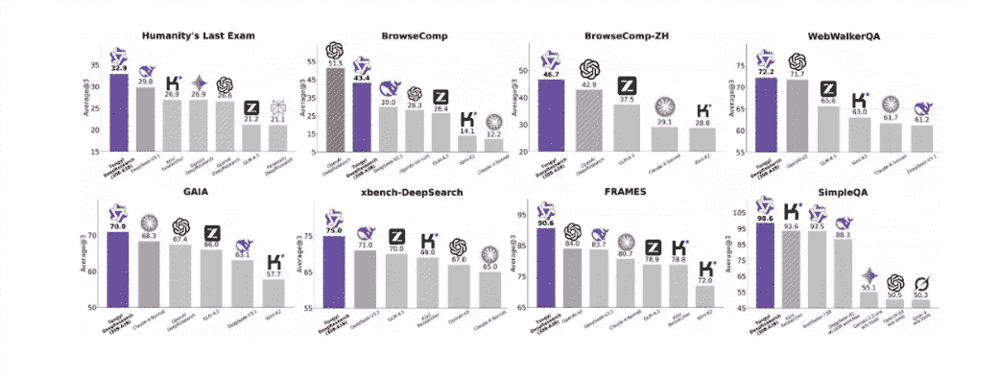

这一开源行动被业界普遍视为阿里在AI Agent领域展现肌肉、争夺开发者生态的关键一步，势必将加剧全球大模型开源社区的竞争。

本次开源的核心是通义`DeepResearch-30B-A3B`模型。其技术亮点主要体现在以下几个方面：

1. 高效的“专家混合”（`MoE`）架构：该模型采用了先进的`MoE`架构，总参数量约305亿。与传统模型在每次计算时都动用全部参数不同，`MoE`架构允许模型在处理每个输入时，仅激活一小部分“专家”网络。通义`DeepResearch`每次推理仅激活约30-33亿参数，这意味着它能在保持强大性能的同时，大幅降低计算资源消耗，提高了推理速度和部署效率。

2. 创新的`WebWeaver`智能体框架：为了让模型真正具备“做研究”的能力，阿里通义实验室专门研发了名为`WebWeaver`的双智能体框架。该框架模拟了人类专家的研究过程，包含两个核心角色：

+   规划器：负责制定研究计划，通过迭代式地进行网络搜索、筛选信源、优化报告结构，动态构建研究路径。

+   内容生成器：根据规划器制定的蓝图，精准地从海量信息中提取、整合、交叉验证，并最终分层、有条理地生成深度研究报告。

3. 先进的训练与推理范式：模型训练采用了`SFT`与`RLHF`相结合的多阶段方法。值得一提的是，阿里引入了自研的`GRPO`（Generalized Reinforcement Learning from Preference Optimization）增强学习流程，以更高效地对齐模型行为。在推理端，`DeepResearch`支持两种模式：标准的`ReAct`模式用于评估模型核心能力，以及一种基于`IterResearch`的“重”模式，该模式通过一种测试时扩展策略，能够最大限度地发挥模型性能。

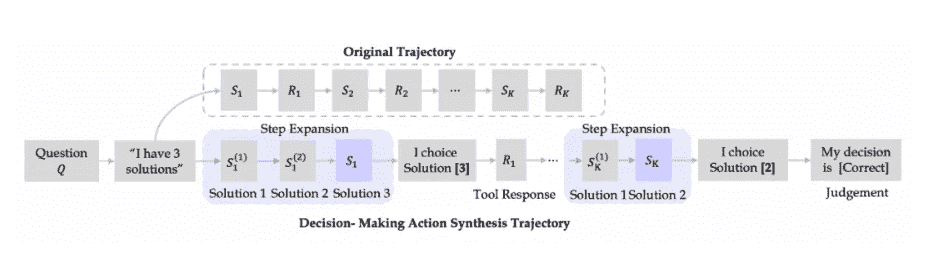

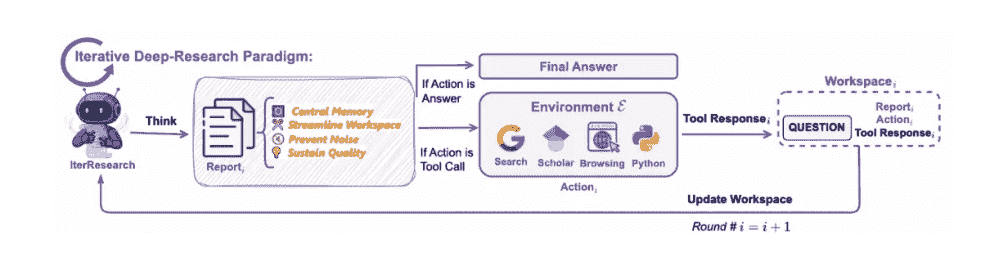

“登顶”、“碾压”等词汇的背后，需要有坚实的数据支撑。尽管阿里官方尚未发布一份包含所有竞品对比的完整技术报告，但其开源项目及相关研究人员公布的数据已经揭示了通义`DeepResearch`的强悍实力。


在备受关注的Humanity's Last Exam (HLE) 基准测试中——该测试旨在评估模型在复杂、开放式问题上的研究与推理能力——通义DeepResearch取得了32.9分的惊人成绩。根据一位参与该项目的核心研究员发布的数据，这一分数显著超过了OpenAI-26.6分和Google-26.9分的同类研究模型，成为首个在该项测试中突破30分大关的AI模型。

此外，在其他几项衡量网页浏览、信息检索和整合能力的基准上，DeepResearch同样表现出色：

+   BrowseComp: 45.3分

+   xbench-DeepSearch: 75.0分

这些数据有力地证明了通义DeepResearch在处理长周期、深度信息探寻任务上的领先地位，尤其是在需要模型进行自主规划、多步推理和信息综合的复杂场景下。

此次阿里选择将通义DeepResearch的模型、WebWeaver框架及全套解决方案彻底开源，并遵循Apache 2.0这一宽松的开源协议，其战略意图十分明显。

对于学术界和开发者而言，这意味着他们首次能够免费、无限制地接触到一个与OpenAI等顶级闭源模型性能相当，甚至在某些方面更优的深度研究智能体。开发者可以在Github、Hugging Face以及阿里的魔搭社区（ModelScope）上直接下载模型和全部代码，进行二次开发、部署私有化服务，或在此基础上构建更强大的垂直领域研究应用。

此举无疑将极大地推动AI研究智能体技术的普及和创新。以往，这类前沿技术主要掌握在少数几家科技巨头手中，高昂的API调用费用和技术壁垒限制了其应用范围。阿里的开源行动，将大大降低中小企业和个人开发者探索AI Agent能力的门槛，催生一个更加繁荣和多元化的应用生态。

# [🟧A](https://emojipedia.org/large-orange-square)I动态 ｜GPT-5-Codex横空出世：开发者社区沸腾，告别Claude与Cursor的时刻已至？

人工智能领域的领导者OpenAI于今日凌晨，通过其官方博客正式发布了一款颠覆性的新模型——GPT-5-Codex。这并非通用GPT-5模型的简单微调，而是专为软件开发全流程深度优化的编码智能体版本。

发布仅数小时，全球范围内的开发者、科技博主和AI爱好者便涌入平台进行实测。从X上的代码片段分享，到Reddit社区`r/programming`的深度评测长文，再到专业开发者在Hacker News上的激烈讨论，初步形成的共识惊人地一致：GPT-5-Codex的诞生，可能意味着一个新时代的开启，开发者们或许真的可以“告别Claude Code，放下Cursor，直接拥抱Codex了”。

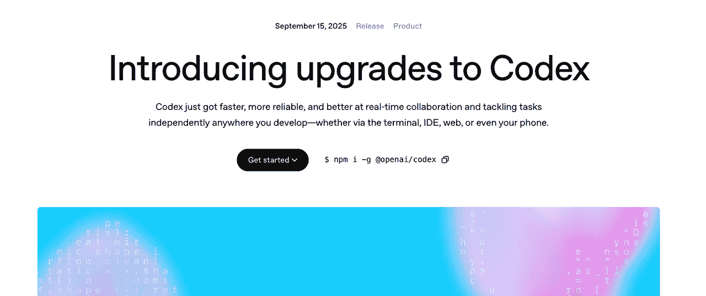

与前代产品和市面上的竞争者相比，GPT-5-Codex最大的跃迁在于其从一个代码生成器进化为了一个工程理解与执行智能体。根据OpenAI发布的技术文档和全球网友的实测反馈，其核心亮点体现在以下几个层面：

1.  跨文件、全仓库的深度理解能力：此前的AI编码工具，大多受限于单文件或有限的上下文窗口。而GPT-5-Codex能够“阅读”并理解整个代码仓库。当开发者提出一个需求，例如“在用户认证模块中增加一个新的双因素认证流程”，它不再是零散地修改几个文件，而是能自主分析项目结构，识别出需要修改的所有相关文件，并生成一套完整、协调的实现方案。

2.  “自省式”调试与测试流程：GPT-5-Codex在编写代码后，会自主编写单元测试和集成测试来验证其生成的代码是否符合要求。更令人印象深刻的是，当测试失败时，它能阅读错误日志，理解失败原因，并自动进行多轮的代码修改与再测试，直到所有测试通过。这个自省式的闭环工作流，将AI的角色从一个需要人类监督的“实习生”，提升到了一个可以独立负责模块的初级工程师。

3.  与开发环境的无缝融合：OpenAI此次同步推出了全新的VS Code扩展插件。与Cursor等AI-First编辑器不同，GPT-5-Codex选择赋能开发者最熟悉的环境。其插件深度整合了终端（Terminal）、文件系统和调试器（Debugger）。开发者可以直接在注释中用自然语言下达指令，如

```
// @Codex: refactor this function to improve performance and add comments
```

或者在终端中输入

```
codex "run the backend server and perform a health check"
```

AI不再是一个悬浮的聊天窗口，而是化为了IDE本身的一部分。

在与现有顶尖工具的对比中，GPT-5-Codex展现了压倒性的优势。

+   对决 Claude 3.5 Sonnet (Code)：以代码生成的精准度和长上下文理解能力著称的Claude，在面对GPT-5-Codex时显得力不从心。在多个社区进行的复杂算法实现和遗留代码库重构测试中，Claude Code虽然能提供不错的思路，但在代码的完整性和细节处理上频繁出错。而GPT-5-Codex凭借其全仓库视野，能够处理那些深埋在项目角落的依赖和自定义配置，生成可以直接运行的“生产级”代码。一位Reddit用户总结道：“Claude给你的是一个需要修改的精美草稿，而Codex给你的是一份可以直接合并（Merge）的Pull Request。”

+   对决 Cursor：作为AI原生编辑器的先驱，Cursor以其流畅的“AI辅助编码”体验赢得了大量用户。然而，其优势在于将AI能力“整合”进编辑器。GPT-5-Codex的策略则是让AI“成为”编辑器的一部分。由于能够直接操作IDE的底层功能，GPT-5-Codex可以完成更复杂的任务，例如自动配置项目的CI/CD流水线、根据`docker-compose.yml`文件一键启动整个开发环境等。Cursor提供的便利功能，在GPT-5-Codex强大的智能体能力面前，显得像是“手动挡”与“自动驾驶”的区别。

# [🟧A](https://emojipedia.org/large-orange-square)I动态 ｜谷歌下一代旗舰模型Gemini 3.0 Ultra意外泄露，或预示AI竞赛将迎新拐点

近日，有开发者在谷歌官方的开源代码库中发现了一个关键信息，强烈暗示其下一代旗舰AI大模型——Gemini 3.0 Ultra——已在内部准备之中，或即将进入测试阶段。

这一发现源于谷歌官方在软件托管平台GitHub上的`google-gemini/gemini-cli`项目。根据代码提交记录，一次于欧洲中部夏令时间9月12日推送的主分支更新中，明确出现了`gemini-3.0-ultra`这一模型标识符。该项目是一个用于帮助开发者与Gemini模型进行交互的命令行工具，在代码中添加新型号的引用，通常是为即将发布或内部测试的产品提供支持的准备工作。

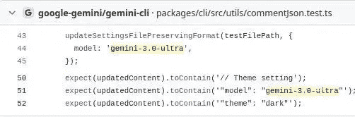

尽管该代码提交在被外界广泛注意到后不久便被谷歌方面修改或移除，但这一短暂的“泄露”已被众多AI开发者和技术观察家记录下来。这一事件迅速在技术社区引发热议，被普遍解读为Gemini 3.0时代即将来临的明确信号。

分析人士指出，这次泄露至少揭示了三个重要信息：

1.  确认“3.0”代际升级：从Gemini 1.0到1.5的升级，主要体现在长文本处理等特定能力的巨大突破上。而直接命名为“3.0”，则通常意味着模型在底层架构、训练方法或核心能力上将有一次根本性的飞跃，而非简单的增量更新。外界猜测，这可能涉及更高级的多模态融合、更强大的逻辑推理能力，甚至是迈向通用人工智能（AGI）的全新路径探索。

2.  延续“Ultra”顶级定位：与前代产品线一致，“Ultra”后缀代表了谷歌在该系列模型中性能最强、能力最全面的顶级版本。Gemini 3.0 Ultra的出现，表明谷歌将继续在AI性能的巅峰展开竞争，直接对标OpenAI的下一代GPT模型以及其他头部AI公司的旗舰产品。

3.  发布窗口临近：在软件开发流程中，当一个产品的标识符被加入到面向公众的工具代码中时，往往意味着该产品已经脱离了纯粹的早期研究阶段，进入了更广泛的内部测试或准备小范围预览的阶段。结合谷歌通常在秋季举行新品发布会的习惯，外界普遍猜测，Gemini 3.0的首次亮相可能就在未来几个月内。

截至发稿，谷歌官方未对此事发表任何评论。然而，这次意外的“代码泄露”已成功点燃了市场的期待。在AI竞赛日趋白热化的今天，Gemini 3.0 Ultra的出现不仅关乎谷歌自身的AI战略布局，更可能为整个人工智能行业的发展设定新的基准和方向。所有人的目光，都已聚焦于谷歌的下一步行动。

# [🟧A](https://emojipedia.org/large-orange-square)I动态 ｜谷歌与Coinbase联手发布AP2协议，开启“AI智能体经济”新时代

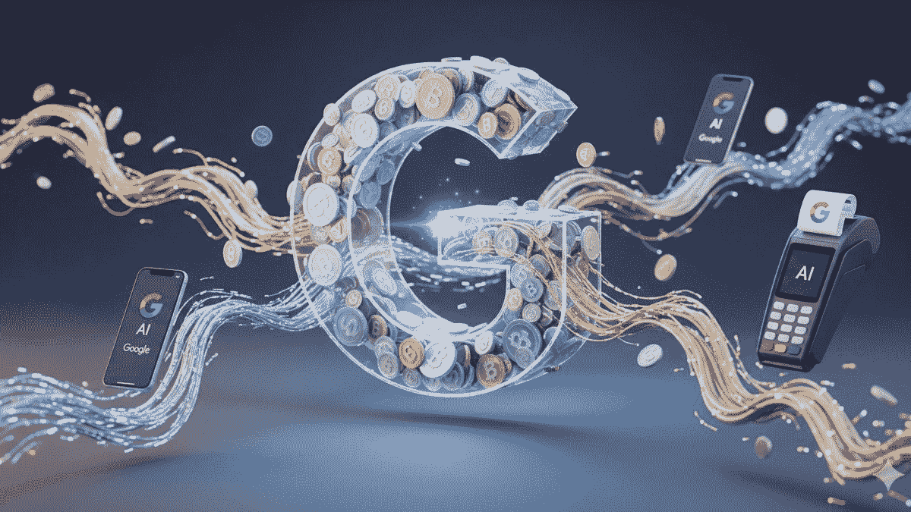

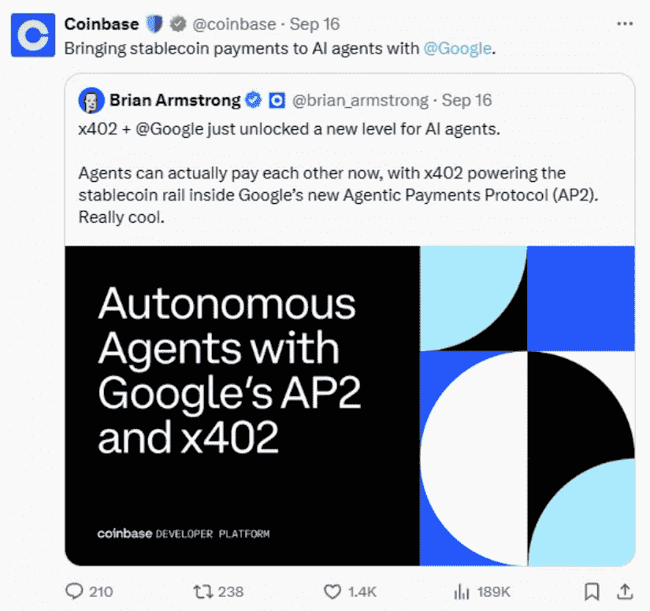

科技巨头谷歌与数字资产领域的领导者Coinbase于今日联合发布了一项具有里程碑意义的协议——“智能体支付协议”（Agentic Payments Protocol, 简称AP2）。该协议旨在为自主运行的AI智能体创建一个安全、标准化的金融交易框架，使它们能够首次实现自主的价值交换。

这一协议被视为构建未来“智能体经济”的关键基础设施。通过与Coinbase合作推出的x402稳定币支付轨道，AP2协议将允许不同开发者、不同平台下的AI智能体，不仅能相互通信与协作，还能直接完成支付和结算。

从“对话”到“交易”：智能体能力的革命性跃迁

此前，谷歌云推出的Agent2Agent（A2A）协议已经解决了AI智能体之间的跨平台通信问题，让它们能够像人一样协同完成复杂任务。然而，这些交互主要局限于信息层面。

AP2协议的发布，则是在此基础上增加了关键的“价值层”。它赋予了AI智能体经济实体的属性，使其能够参与到真实的商业活动中。

Coinbase作为该协议的独家加密支付合作伙伴，提供了基于稳定币的x402支付轨道。该方案具备交易速度快、成本极低且可编程的特性，尤其适合AI智能体之间可能发生的高频、小额（微支付）交易场景。


根据官方发布的技术文档，结合x402支付轨道，AP2协议将首先为AI智能体解锁三项核心经济能力：

1.  服务收费：一个提供特定服务（如数据分析、代码生成、图像渲染）的AI智能体，可以为自己的工作成果设定价格，并自动向调用其服务的其他智能体或用户收费。

2.  任务外包与支付：一个复杂的“总管”智能体，可以将任务分解，并“雇佣”其他具备专业能力的智能体来完成，事后自动支付报酬，形成一个动态的、自动化的任务协作网络。

3.  代理用户支付：AI智能体可以获得用户授权，在预设规则下自动处理各类微支付，例如按流量为API调用付费、订阅实时数据源，或在去中心化应用中进行交互，极大地提升自动化效率。

产业影响：通往M2M经济的基石

谷歌AI部门负责人表示：“如果说A2A协议是为智能体打造了神经系统，那么AP2协议就是为它们注入了血液。一个能够自主进行价值创造和交换的智能体网络，将催生出我们今天难以想象的新应用和商业模式。”

Coinbase的首席技术官则评论道：“我们正在为未来的数字原生经济建设金融轨道。AI智能体是这个经济体中的新公民，而AP2和x402稳定币将成为它们之间通用的、可信的货币。”

分析人士认为，谷歌与Coinbase的此次合作意义深远。它不仅是大型科技公司与加密原生企业深度融合的典范，更重要的是，它为即将到来的智能体时代铺设了最关键的金融基础设施。尽管该协议的普及仍面临安全、监管和技术标准统一等多重挑战，但它无疑已为我们描绘出一个清晰的未来：一个由无数AI智能体组成的，能够7x24小时不间断进行自主创造、协作和交易的全新经济形态。

# [🟧A](https://emojipedia.org/large-orange-square)I动态 ｜谷歌发布Chrome重大更新：Gemini AI深度集成，浏览器化身“智能网络代理”

谷歌今日通过其官方博客宣布，将对其全球市场份额领先的Chrome浏览器进行一次根本性的版本升级。本次更新的核心是将谷歌自家的Gemini系列人工智能模型深度集成到浏览器的核心功能中，旨在将Chrome从一个传统的网页内容查看器，转变为一个具备情境感知、能够主动协助并执行复杂任务的“智能网络代理”。


这一举措被视为自浏览器诞生以来最重大的变革之一，标志着谷歌正式将AI战火从搜索引擎延伸至用户接入互联网的最前端入口，以应对日益激烈的市场竞争。

根据谷歌发布的博文和技术预览，新的AI功能将分阶段向用户推送，主要涵盖以下几个层面：

1.  情境感知与主动协助 新的Chrome将能够理解用户当前浏览内容的深层意图。例如，当用户正在浏览多个旅游目的地的酒店和机票页面时，浏览器侧边栏可能会自动激活一个AI助手，整合所有已打开标签页的信息，提供一个动态的价格、时间和行程对比视图，并主动推荐相关攻略或签证信息，而无需用户手动输入查询指令。

2.  “网页即应用”的交互革命 最引人瞩目的功能是赋予了浏览器执行多步骤任务的能力。用户将可以通过自然语言向Chrome下达指令，例如“帮我在这家餐厅预订一个今晚7点两人位的晚餐”，AI将能自动在当前网页上定位并操作日期、时间和人数的选项控件，直至完成整个预订流程。这标志着浏览器从“读取”网页向“操作”网页的革命性转变。

3.  跨模态内容摘要与深度理解 基于Gemini强大的多模态能力，Chrome将能够即时总结网页内容，不仅限于文章，还包括长视频（例如YouTube）的要点、播客的文字稿摘要，或是一系列复杂产品评论的情感分析。用户无需消费全部内容，即可快速获取核心信息。

谷歌强调，此次集成采用了混合AI架构。对于需要保护隐私和快速响应的任务，如文本润色或简单的页面元素识别，将主要依赖于在本地设备上运行的Gemini Nano模型。而对于需要强大推理和执行能力的主动协助及多步骤任务，则会通过安全的云端连接调用Gemini Pro模型。

分析人士指出，谷歌此举是对AI原生搜索（如Perplexity）和AI原生浏览器（如Arc）等新兴挑战者的直接回应。随着用户习惯从“搜索链接”转向“寻求答案”，传统搜索引擎的入口地位受到威胁。通过将强大的AI能力直接内置于市场占有率超过60%的Chrome浏览器中，谷歌旨在将AI交互的核心体验锁定在自己的生态系统内，绕过“搜索框”，直接在浏览行为中满足用户需求。

此举无疑将加剧与微软的竞争，后者早已将其Copilot AI深度集成于Edge浏览器中。“AI浏览器战争”将成为科技巨头争夺未来互联网主导权的新战场。

# [🟧A](https://emojipedia.org/large-orange-square)I动态 ｜Luma AI发布革命性视频模型Ray3，首次引入HDR与“逻辑推理”能力

人工智能视频生成领域的领跑者Luma AI于今日发布了其最新一代视频模型——Ray3。该模型实现了两项业界瞩目的重大突破：首次支持高动态范围（HDR）视频的生成，并引入了先进的“推理”能力，旨在产出逻辑更连贯、物理世界更一致的视频内容。

此次发布标志着AI视频生成技术正从追求“形似”向“神似”的更高阶段演进，其目标直指专业影视制作与高端内容创作领域。

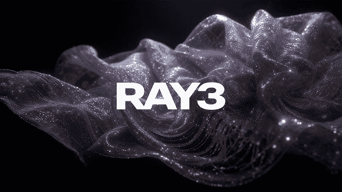

Ray3模型的最大亮点是其原生支持HDR视频生成的能力。相比于传统的标准动态范围（SDR）视频，HDR能够提供更宽广的色彩范围、更丰富的明暗细节以及更高的对比度。这意味着Ray3生成的视频在光影表现上将拥有前所未有的真实感和层次感——从刺眼的阳光反射到深邃的阴影细节，都能得到精准呈现。

Luma AI的首席技术官在发布会上表示：“我们的目标是打破AI生成内容的“塑料感”，为创作者提供一个能媲美专业摄影设备的工具。支持HDR是实现这一目标的关键一步，它让AI视频首次拥有了“电影感”的光影质量。”

这一功能对于电影制作人、广告创意人以及视觉特效（VFX）艺术家具有极大的吸引力，使AI生成素材能够更好地融入专业级的工作流程中。

除了画质的提升，Ray3在模型的智能性上迈出了一大步，Luma AI将其定义为“推理视频模型”（Reasoning Video Model）。这表明模型不再仅仅是根据文本提示（Prompt）生成孤立的图像序列，而是能够理解并执行包含复杂逻辑关系和物理常识的指令。

据介绍，Ray3的“推理”能力体现在：

1.  对象持久性与交互逻辑：模型能更好地理解物体的持久存在性（例如，一个物体被短暂遮挡后再次出现），并能生成更符合逻辑的角色与环境交互。

2.  物理世界一致性：对于重力、光线反射、流体动态等基础物理规律的模拟更加准确，减少了以往模型中常见的“反物理”现象。

3.  复杂指令遵循：能够理解并执行包含多个步骤、具有因果关系的连续性指令，从而生成叙事性更强的短片。

在AI视频生成的激烈竞争中，OpenAI的Sora以其生成视频的时长和连贯性著称，而Runway和Pika Labs则在工具的易用性和可控性上不断创新。Luma AI此次发布的Ray3，通过HDR画质和“逻辑推理”能力这两大差异化优势，精准地切入了“专业级”和“高智能”的细分赛道，旨在建立新的技术壁垒。

分析人士认为，Ray3的问世，预示着AI视频行业的竞争焦点正从“能否生成”转向“生成得有多好、多聪明”。随着技术的不断成熟，AI生成视频不仅将成为独立创作者的强大工具，更有可能深度重塑传统影视工业的生产管线。

Luma AI宣布，Ray3模型将从今日起向部分专业用户和合作伙伴开放内测，并计划在未来几个月内逐步向更广泛的用户群体开放。


# [🟩代](https://emojipedia.org/large-green-square)码现场 ｜如何通过微调提升Agent性能？


> 随着‘金九银十’招聘季的到来，大模型技术岗位的竞争也进入白热化阶段。

> **我将从面试官的角度**，为大家深度讲解面试热点问题。按照惯例每个问题我都为大家额外准备了满分回答模版以及参考学习资料。

> 本期的核心问题是：“如何通过微调提升Agent性能？”

<https://player.bilibili.com/player.html?bvid=1ChhyzZEDv&spm_id_from=333.1387.upload.video_card.click>

Agent开发作为大模型最热门的技术应用方向，不仅要求开发人员熟练掌握各类Agent开发工具，同时在某些场景下，例如基座模型无法很好的识别特定领域的工具、Agent性能不稳定时，需要开发人员围绕基座模型进行Agent性能方面的微调，目前顶尖的智能体，如Claude Code、ChatGPT Agent等，无一不是单独围绕基座模型进行了单独微调，才能让基座模型更加熟练的调用Agent内置工具，最终Agent性能才能有进一步突破。

> 其他相应面试热点问题也一并整理好了，点击链接即可跳转

> [大模型高频面试真题满分答案丨赋范空间](https://kq4b3vgg5b.feishu.cn/wiki/Pk0Hw1lcjinIzbkkbqScr1NOnRf)

当代Agent开发流程中，为了获得更好的Agent性能，**往往都需要在**实**际开发之前，**先对基座模型的工具调用能力和复杂问题拆解能力进行微调，这就是所谓的大模型Agent性能微调。

这是一项价值极高但同时又非常前沿的一项的技术，所以我们还帮你准备了更深层次的大模型Agent性能微调相关教程完整6小时硬核干货技术教学，带你从零开始系统学习大模型Agent性能微调技术体系，并且手把手带大家构造特定领域的Age**nt性能微调数据集**，可**用于同时强化模型**的多工具并行调用能力以及多步调用工具能力这两方面能力，提供完整的独家Agent性能微调数据集构造脚本，同时，我将带大家上手实操最新一代可控推理过程的最强混合推理大模型GPT-OSS的模型部署、调用、微调全部流程，并且详细讲解模型微调后Agent性能评估完整流程，并分享Agent微调实战经验，帮助大家一站式彻底掌握大模型Agent性能微调技术。

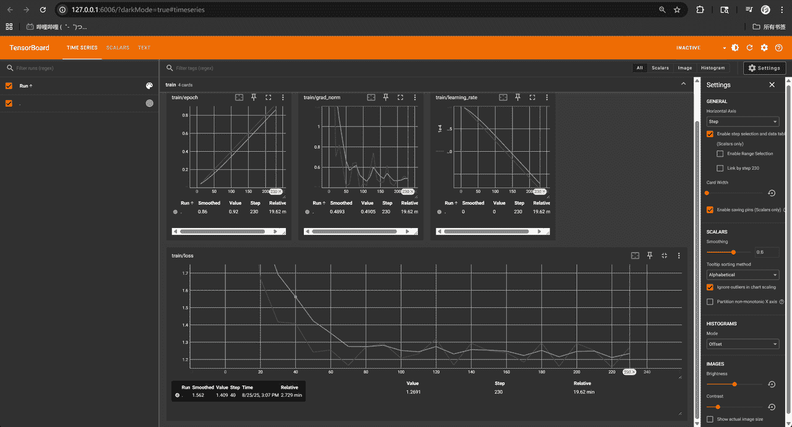

<https://player.bilibili.com/player.html?bvid=159arzgEqY&spm_id_from=333.1387.upload.video_card.click>

> 视频相关课件

> ⭐️ [GPT-OSS高效微调实战（上）丨高效](https://kq4b3vgg5b.feishu.cn/docx/F1Mtdi4qtoM5AIxVdROc9Ai4noh?from=from_copylink)微调入门、环境准备、微调数据集专题...

> ⭐️ 高效微调提升模型Agent性能基本原理丨GPT-OSS高效微调实战

> ⭐️ Unsloth快速上手指南丨中文微调链实战过程

> ⭐️ GPT-OSS Agent性能微调全流程

# 🙋加入我们


> 我们团队的**大模型岗位秋招**也已经同步开启

> 大家**扫描左边的二维码**

> 即可联系HR咨询岗位情况

> 如果你也在关心AI世界的风云变幻、大模型与智能体的走向、技术背后的权力博弈，记得关注我们的文档和其他账号。我们带你看懂真正重要的那1%。

---

## 点击下面链接与我们产生更多连接✨

---

九天Hector 哔哩哔哩：https://space.bilibili.com/385842994

九天Hector 抖音： https://v.douyin.com/lqASAa2Hs_0/

九天Hector 📕：https://www.xiaohongshu.com/user/profile/62321335000000001000885e

九天Hector YouTube：https://www.youtube.com/channel/UCj8tyDLSxIdivnweBnG4H9Q/

赋范大模型全栈技术社区请点👉：https://kq4b3vgg5b.feishu.cn/wiki/space/7257794425391579164
