# 周周报 Vol.08｜OpenAI千亿美元合同捧出世界新首富！｜字节发布国产Nnano Banana｜ 赋范空间

> 来源：[https://kq4b3vgg5b.feishu.cn/docx/XcSWdBa38osZtDxdv2Vca2b9nJc](https://kq4b3vgg5b.feishu.cn/docx/XcSWdBa38osZtDxdv2Vca2b9nJc)

### 《AI大模型周周报》第8期来啦！

> 本期核心内容：【多模态RAG上手实操教程】；OpenAI千亿美元订单烧出新世界首富；英伟达全新GPU发布性能逆天；苹果新耳机内置大模型；字节跳动发布Seedream 4.0强过谷歌。

> 我们创立周报，旨在为你提炼每周最核心的AI洞见。

> 欢迎随时收听，并在评论区交流讨论！

---

# 点击下面按钮跳转【AI大模型周周报专栏】持续关注

#

---

# [**🟥A**](https://emojipedia.org/large-red-square)**I**头条 ｜OpenAI的千亿豪赌：剑指2000亿美元年收，五年狂烧1150亿自建算力，甲骨文老板因此登顶世界首富？

一场围绕人工智能的豪赌正以前所未有的规模展开。近日，AI领域的领军者OpenAI向其股东披露了一项惊人的计划：预计在未来五年内，将投入高达1150亿美元用于自建数据中心和算力基础设施。与此同时，该公司大胆预测，到2030年，其年营收将飙升至2000亿美元。

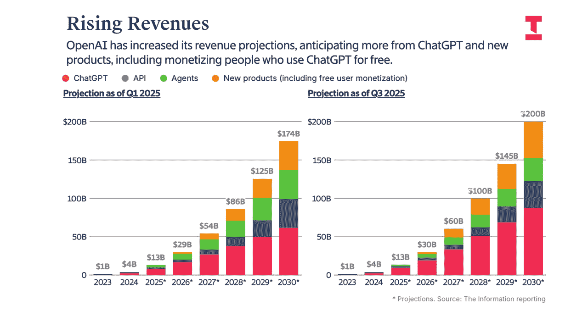

这一系列激进的财务预测和庞大的资本支出计划，不仅震撼了科技和投资界，更意外地将甲骨文Oracle公司创始人拉里·埃里森短暂推上了世界首富的宝座。

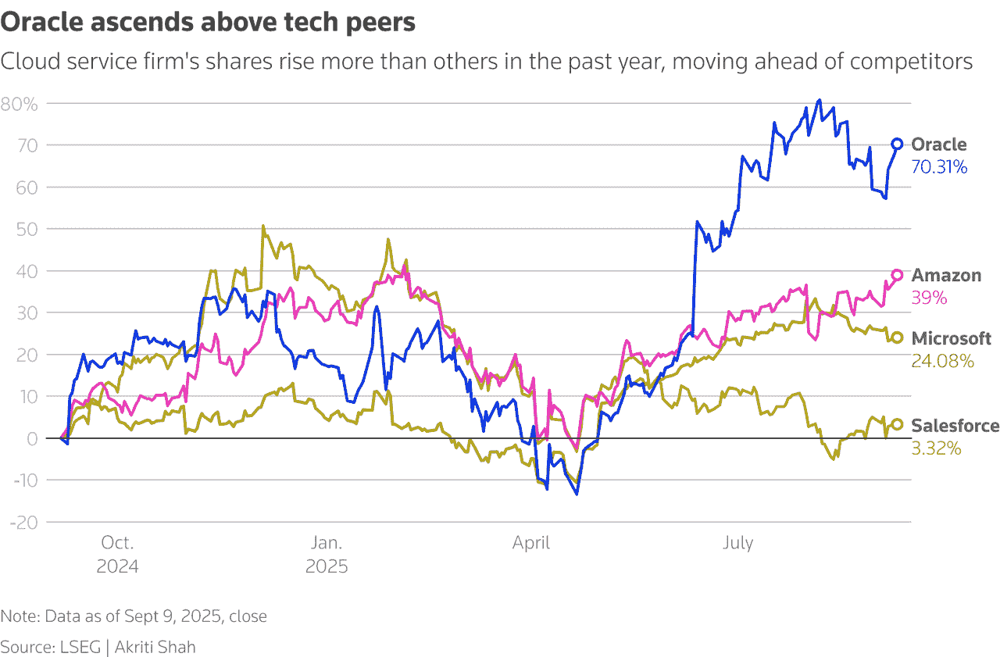

根据OpenAI向股东通报的最新数据，公司今年的预期总营收将达到130亿美元，是去年的3.5倍，显示出其商业化步伐的迅猛。然而，这仅仅是其宏大蓝图的开端。OpenAI预计，五年后的2030年，年营收将触及2000亿美元大关，这一数字接近谷歌去年净利润的两倍。

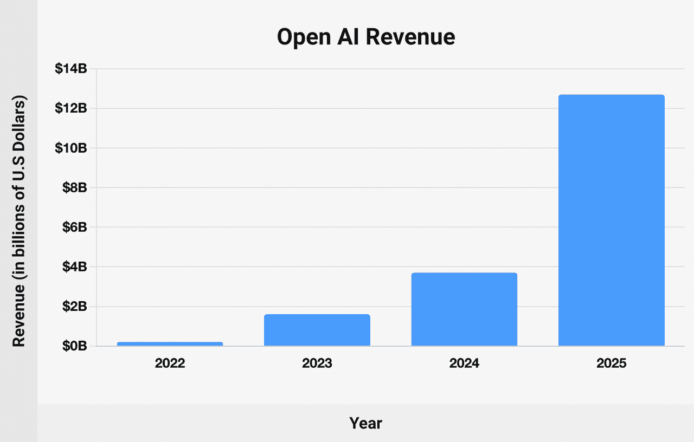

在这份雄心勃勃的营收预测中，核心产品ChatGPT的贡献比重被显著提高。预计到2025年，ChatGPT作为绝对的收入主体，将贡献近100亿美元。而到2030年，仅此一项业务的年收入预计就将达到近900亿美元。

为了实现这一目标，OpenAI承认将探索新的盈利模式，其中包括可能涉足电商导购抽佣或其他形式的广告。

然而，在通往2000亿美元的道路上，OpenAI也进行了战略调整。值得注意的是，公司下调了对其API和备受期待的Agent智能体相关业务的收入预期。其中，Agent相关收入的预期被下调了约260亿美元。

对此，OpenAI解释称，这并非不看好Agent的未来，而是计划将这些高级能力逐步整合进ChatGPT本体中，从而减少作为独立产品的销售。这一战略转移的核心逻辑是，将公司庞大但依旧有限的算力资源，集中投入到最关键的“刀刃”——ChatGPT上，以最大化其核心产品的竞争力。

OpenAI对算力的极度渴求，直接促成了一份与甲骨文的巨额合同，并戏剧性地改写了全球财富榜的格局。

为了支撑其模型的训练和推理需求，OpenAI与甲骨文签订了一份历史性的云计算服务合同。尽管合同细节未被完全披露，但其庞大规模足以撼动市场。受此重大利好消息刺激，甲骨文股价在近日一度飙升超过40%，市值暴涨。

这股涨势直接将持有甲骨文大量股份的拉里·埃里森的个人财富推至顶峰。根据彭博亿万富翁指数的实时数据，埃里森的净资产一度超越埃隆·马斯克，短暂登顶成为新的世界首富。尽管排名可能随时变动，但这一事件已充分证明了AI军备竞赛对科技产业格局的巨大影响力。

公司预测，仅2025年的现金流出就将超过80亿美元，比年初预估多出约15亿美元。而在2025至2029年间，累计的现金消耗将达到惊人的1150亿美元。

这笔巨款的主要流向是服务器及相关基础设施的投入，预计在本年代后期将接近1000亿美元。具体到计算费用：

+   **推理计算费用：** 2025至2030年累计将超过1500亿美元，比年初的“微小差异”预估累计多出约110亿美元。

+   **训练计算费用：** 2025年将超过90亿美元，2026年飙升至约190亿美元，并预计在2030年前将持续增加。由于模型训练存在大量试错，这部分的准确成本仍充满不确定性。

OpenAI坦言，他们真正在燃烧的，绝非仅仅是银行账户里的数字，更是“核电站的反应堆”——意指支撑AI运算所需的海量电力和能源。

面对OpenAI如此激进的扩张计划和看似天马行空的财务目标，市场反应呈现两极分化。有人认为这是在为资本市场“画大饼”，其高昂的成本和不确定的回报路径蕴含巨大风险。

然而，资本市场的主流情绪似乎更为乐观。软银（SoftBank）、Thrive Capital、Dragoneer等知名投资方正以高达5000亿美元的估值，积极加仓OpenAI。这一估值是半年前的近两倍，已经接近谷歌市值的五分之一。

支持者认为，OpenAI正试图通过构建无与伦比的算力壁垒，来巩固其在通用人工智能领域的领先地位。一旦成功，其潜在的市场规模和盈利能力将是颠覆性的，足以支撑其当前的巨额投入和高企的估值。

这场围绕AI未来的千亿豪赌已经拉开序幕。OpenAI是能够通过极致的投入和专注，最终撬动2000亿美元的营收未来，还是会在这场史无前例的“烧钱”大战中迷失，全世界都在拭目以待。

# [🟧A](https://emojipedia.org/large-orange-square)I动态 ｜英伟达发布革命性GPU Rubin CPX：攻克百万级Token长上下文，开启AI应用新纪元

人工智能算力的领导者英伟达于本周二9月9日的AI基础设施峰会上，再次投下重磅炸弹，正式发布了一款专为处理超长上下文推理任务而设计的革命性GPU——Rubin CPX（Rubin Context GPUs）。该产品的核心目标，是攻克当前大语言模型面临的最大瓶颈之一：超过100万Token的长上下文处理能力，为软件开发、长视频生成和复杂科学研究等前沿AI应用开启了全新的可能性。

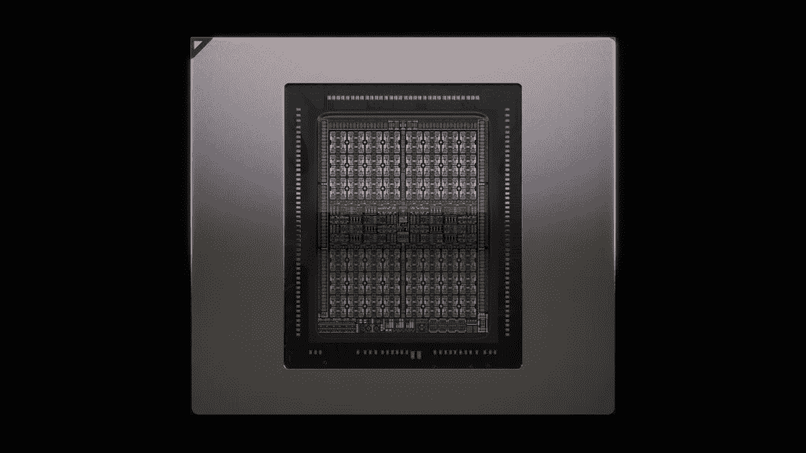

长期以来，上下文长度一直是限制AI模型能力的关键枷锁。它决定了模型在一次处理中能够记住和理解多少信息。当任务序列过长，例如分析一个完整的软件代码库、或生成一部连贯的长视频时，现有GPU架构往往难以胜任，导致模型出现遗忘、逻辑断裂等问题。

而Rubin CPX的发布，正是为了彻底打破这一壁垒。

对于开发者和各行业用户而言，Rubin CPX的问世意味着AI应用的性能和智能水平将实现质的飞跃。

在**软件开发领域**，一个真正高效的AI编程助手必须具备对整个代码库（Codebase）进行推理和理解的能力。它需要通盘掌握数万行、乃至数百万行代码之间的复杂依赖关系、函数调用链和整体架构，才能提供精准的代码生成、Bug修复和架构优化建议。过去，受限于上下文长度，AI模型只能管中窥豹，一次分析几个文件或代码片段。而英伟达表示，随着Rubin CPX的推出，AI系统将能轻松处理仓库级的代码结构，成为真正意义上的资深架构师和全天候编程伙伴。

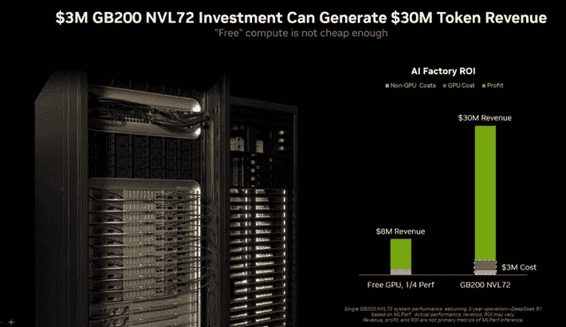

同样地，在**内容创作和视频生成领域**，这一突破也意义非凡。要生成一部情节连贯、人物关系稳定、细节前后呼应的长视频，模型必须在长达数百万Token的序列中保持持续的记忆和连贯性。Rubin CPX的强大长上下文处理能力，将使得一键生成电影、制作长篇动画或进行复杂视频剪辑的梦想离现实更近一步。

此外，在科学研究、金融分析和法律文档审查等需要处理海量文本的应用中，无论是解读一篇包含数千引用的学术论文，还是分析一份长达数百页的财报或法律合同，Rubin CPX都将提供前所未有的效率和深度。

虽然英伟达在峰会上未透露Rubin CPX架构的全部技术细节，但明确指出其设计核心是为长上下文推理而优化。行业专家分析，这可能意味着该GPU在内存带宽、片上缓存以及专门用于处理注意力机制的计算单元上进行了重大革新。

传统的GPU在处理超长序列时，注意力机制的计算量和内存占用会呈指数级增长，成为性能瓶颈。Rubin CPX很可能采用了新的硬件加速单元或内存管理技术，以线性、高效的方式处理这些复杂计算，从而在百万级Token的长度下依然保持流畅的推理速度。

Rubin CPX的发布，不仅是英伟达产品线的一次重要补充，更是对其在AI芯片领域绝对领导地位的再次宣示。在竞争对手如AMD、英特尔以及众多初创公司奋力追赶之际，英伟达通过精准预判并解决行业核心痛点，进一步加固了自身的护城河。

更重要的是，这款产品的问世将极大推动AI技术在各行各业的深度应用。过去许多因技术限制而停留在概念阶段的长上下文任务，如今都能迎刃而解。从企业级的知识管理系统，到个人化的AI助理，再到专业领域的科研工具，一个更强大、更具记忆力、更懂“全局”的AI时代，正随着Rubin CPX的到来而加速前进。

# [🟧A](https://emojipedia.org/large-orange-square)I动态 ｜苹果发布AirPods Pro 3：内置本地大模型，实现颠覆性无感实时翻译

在科技界万众瞩目的秋季新品发布会上，苹果公司于9月10日正式推出了其备受期待的第三代AirPods Pro。与此前市场预测的常规音频升级不同，AirPods Pro 3带来了一项颠覆性的功能：通过内置在耳机中的本地大型语言模型，实现无需联网、近乎零延迟的实时翻译。

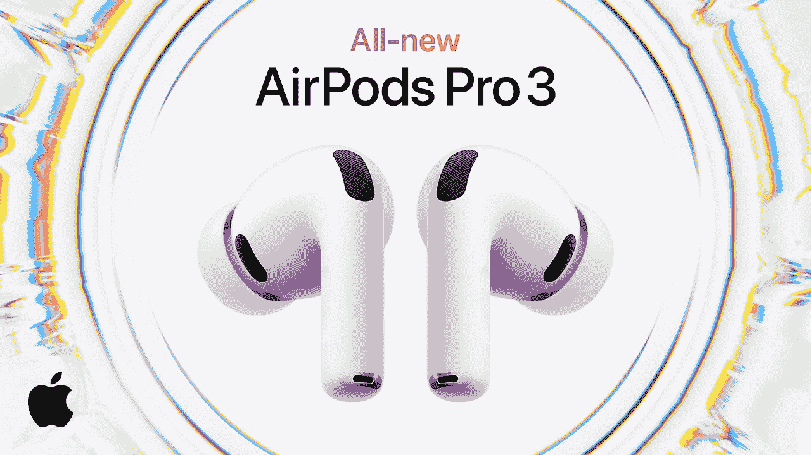

这一功能不仅重新定义了无线耳机的应用边界，更标志着苹果在将强大的端侧AI能力融入个人设备方面，迈出了革命性的一步。

发布会上，苹果CEO蒂姆·库克将AirPods Pro 3形容为“你口袋中的私人同声传译员”。其核心突破在于，苹果成功地将一个经过高度优化的专有大型语言模型，直接部署到了耳机内部搭载的全新H3芯片上。

这意味着翻译过程完全在本地完成，彻底摆脱了对云端服务器和网络连接的依赖。用户所体验到的，将是前所未有的无感翻译：

+   **实时与低延迟：** 对话几乎在发生的同时就被翻译和传送。由于数据无需上传云端再下载，传统翻译应用中常见的网络延迟被彻底消除，使得跨语言交流如母语对话般流畅自然。

+   **隐私保护：** 所有对话内容均在本地处理，不离开个人设备。这完美契合了苹果长期以来对用户隐私保护的承诺，解决了用户对于个人谈话被上传至服务器的担忧。

+   **离线可用：** 无论用户身处网络信号不佳的偏远地区，还是在没有Wi-Fi的国际航班上，实时翻译功能都能随时待命，确保沟通无障碍。

在发布会的现场演示中，两位分别使用英语和西班牙语的苹果高管，仅佩戴着AirPods Pro 3，便进行了一场流畅、自然的实时对话。一方话音刚落，另一方耳中几乎立刻响起精准的翻译，其速度和准确性赢得了全场的热烈掌声。

实现这一创举的背后，是苹果在硬件和软件层面多年的技术积累。

全新的**H3芯片**专为在功耗极其敏感的小型设备上运行复杂的AI模型而设计。它集成了高效的神经引擎，能够在保持AirPods Pro系列一贯的续航能力的同时，为大型语言模型提供强大的算力支持。

**而在软件层**面，苹果的AI团队对模型进行了极致的量化和剪枝，在不显著牺牲翻译精度的前提下，将庞大的模型体积压缩至可以装入耳机的微小存储空间中。此外，苹果还利用其在Core ML框架上的优势，实现了软硬件的深度协同，最大化了本地AI的运行效率。

AirPods Pro 3的发布，预示着个人音频设备市场将迎来一次深刻的范式转移。耳机不再仅仅是用来听音乐、播客或接打电话的配件，而是演变成为了一个强大的个人沟通和信息处理中枢。

# [**🟧A**](https://emojipedia.org/large-orange-square)**I动态 ｜百度发布文心大模型X1.1：主攻“深**度思考”，事实性与指令遵循能力大幅提升

中国AI巨头百度于2025年9月11日上午正式发布并上线了其最新的旗舰级语言模型——文心大模型X1.1深度思考模型。作为今年4月发布的文心X1的重大升级版，X1.1将技术焦点对准了当前大模型应用中最关键的“深度思考”能力，在事实性、指令遵循以及智能体与工具调用三大核心维度上实现了显著突破。

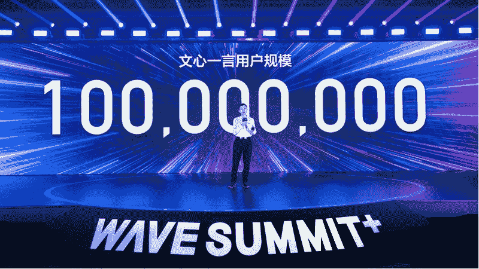

此次发布采取了“即发即用”的模式，从即刻起，所有公众用户均可通过文心一言App等官方渠道免费体验新模型的强大能力。同时，该模型也通过百度智能云千帆平台，向广大企业客户和开发者全面开放，旨在加速AI在产业应用中的落地和深化。

据百度官方披露的数据，此次升级带来了综合性能的显著跃迁。相较于前代旗舰模型X1，X1.1在关键指标上表现出色：

+   **事实性提升34.8%：** 这意味着模型在回答知识性问题、生成报告或提供信息时，能够更精准地依据事实，大幅减少了“幻觉”和虚构内容的产生，使其在专业领域的应用中更加可靠。

+   **指令遵循提升12.5%：** 新模型能更准确地理解和执行用户下达的复杂、多步骤或带有严格限制条件的指令，确保任务执行不偏离、不遗漏，精准满足用户意图。

+   智能体（Agent）提升9.6%： 模型在作为智能体核心时的能力得到增强，尤其体现在能更灵活、更智能地调度和调用外部工具（如搜索引擎、计算器、数据库）与系统资源，以完成超越自身知识边界的复杂任务。

这三大能力的协同提升，标志着文心大模型正从一个“知识渊博的对话者”，进化为一个“能深度思考并精准执行的行动者”。

在发布会的演示环节中，文心X1.1展现了其处理复杂内容创作任务的强大实力。当面对一个限定条件繁多（例如，要求结合最新市场数据、采用特定分析框架、并以正式报告格式撰写一篇关于新能源汽车市场的分析）的创作任务时，X1.1表现得游刃有余。

模型首先能够“抽丝剥茧”，准确识别出指令中的**每一个关键约束。随后**，在创作过程中，它能主动调用联网搜索工具，获取最新的行业新闻和销售数据作为事实依据。最终，它不仅精准地完成了内容的归纳总结，还严格遵循了指定的格式要求，生成了一篇逻辑严密、信息可靠的专业报告。

这一过程清晰地展示了X1.1的核心优势：它不再是简单的文本生成，而是模拟了人类专家解决问题时的完整思考链条——理解、规划、调用工具、整合信息、最终生成。

分析人士认为，文心大模型X1.1的发布，是百度推动大模型在产业中规模化应用的关键一步。此前，事实性和指令遵循能力的不足，一直是制约大模型在金融、法律、科研、教育等严肃场景中深度应用的主要障碍。

通过大幅提升这些“可靠性”相关的指标，百度旨在降低企业用户的使用门槛和信任成本。当模型提供的信息更可信、执行的任务更精准时，企业才能放心地将其集成到核心业务流程中，从简单的客服、营销，走向更复杂的决策支持、代码开发和智能研发。

百度集团副总裁、深度学习技术及应用国家工程研究中心副主任吴甜表示：“大模型的价值最终体现在解决实际问题的能力上。X1.1的升级，是我们对‘深度思考’这一核心命题的回答，我们希望为用户和客户提供一个不仅能言善辩，更能真抓实干的强大AI生产力工具。”

# [🟧A](https://emojipedia.org/large-orange-square)I动态 ｜国产NanoBanana来了！字节跳动正式发布Seedream 4.0

2025年9月9日，字节跳动正式发布其最新的豆包・图像创作模型 Seedream 4.0，并宣布在豆包App、即梦AI等旗下产品中全量上线，供用户免费体验。此举在全球人工智能生成内容的激烈竞赛中投下了一颗重磅炸弹。几乎在同时，谷歌旗下代号为“Nano Banana”的图像模型凭借其强大的图像编辑和角色一致性能力，正风靡全球社交网络。

在此背景下，Seedream 4.0 的发布被业界迅速贴上了“国产Nano Banana”的标签。这一定位充满了期待，也提出了一个核心问题：字节跳动的这款最新力作，究竟是简单的追赶与模仿，还是真正具备了与世界顶级模型同台竞技的实力？

Seedream 4.0 最大的技术飞跃在于其底层架构的革新，标志着图像创作正从单一的“文生图”模式，向一个集生成、编辑、多图参考于一体的“多模态交互”新阶段演进。字节跳动将其定位为一个“会思考的多模态创意引擎”，旨在构建下一代创意基础设施。

其核心能力体现在四个方面：

1.  **统一架构的范式转移**：Seedream 4.0 将生成与编辑能力整合在统一框架内，打破了传统创作流程中“生成”与“编辑”的壁垒。用户可在同一对话界面中完成从灵感萌发到精细编辑的全过程，实现了无缝衔接的“创编一体化”工作流。同时，模型推理效率大幅优化，最高支持4K商业级图像输出，生成一张2K高清图像仅需数秒。

1.  **组图生成与高度一致性**：为解决AI图像生成中长期存在的“形象漂移”痛点，Seedream 4.0 推出的“多图输出”功能可一次性生成多张在角色、画风、服饰上保持高度统一的图像，为连环画、故事分镜、表情包等叙事性内容创作打开了大门。

1.  **“读懂你心”的深度意图理解**：模型展现出强大的逻辑推理和世界知识，能理解用户的深层、甚至模糊的意图。例如，模型能准确理解在一张瘦猫图片旁画的几个箭头意味着“让猫变胖”，并成功生成了更圆润的猫咪图像，实现了从“指令式”到“交互式”的转变。

1.  **像素级精准操控**：模型提供了强大的“增删改替”功能。无论是为肖像添加耳机、墨镜，还是移除照片背景中的路人，亦或是为人物更换复杂的发型，Seedream 4.0 都能实现精准且自然的像素级操控，效果媲美专业修图软件。

在一系列与谷歌 Nano Banana 的硬碰硬实测中，Seedream 4.0 证明了其“国产最强”的成色。

+   **创意生成与技术编辑**：在OOTD生成、漫画分镜创作、一键换衣、老照片修复等多个任务中，两者表现旗鼓相当。Seedream 4.0 在画面色彩与清晰度上略有优势，而 Nano Banana 则以其一贯的稳定性著称。双方在核心的图像生成与编辑能力上均达到了业界领先水平。

+   **关键差异化——中文排版**：真正的差距在处理特定文化元素时显现。当被要求将时尚杂志封面上的英文标题替换为手写风格的中文“时尚芭莎”时，Seedream 4.0 完美地完成了任务，字体风格与设计协调一致。相比之下，Nano Banana 在此任务中则彻底失败，生成了难以辨认的乱码。

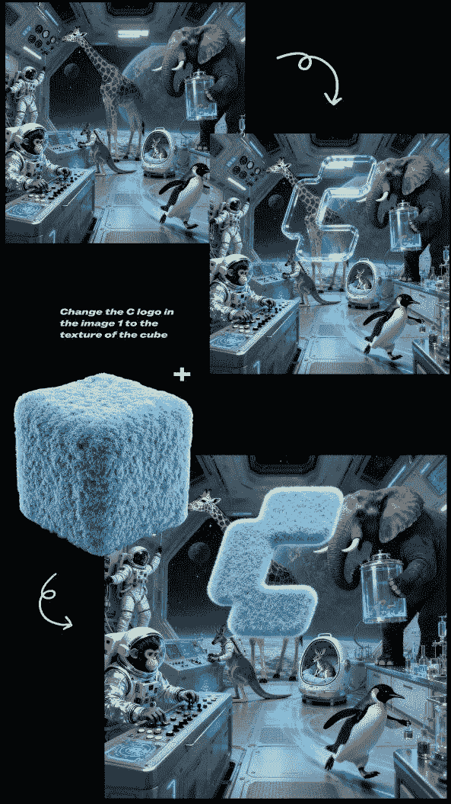

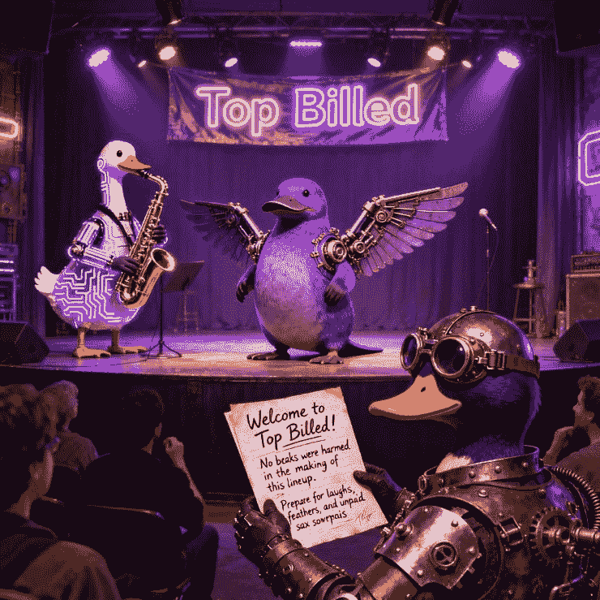

这一决定性优势的背后，是字节跳动依托抖音、今日头条等平台积累的海量高质量中文图文内容所构建的“数据金矿”。这种由数据壁垒决定的本土化优势，是国际竞争对手短期内难以逾越的。

Seedream 4.0 的发布，其意义远超技术本身，是字节跳动 AIGC 战略版图中的关键落子。

首先，它将成为赋能字节内容生态的“飞轮”。通过集成到剪映等国民级应用中，Seedream 4.0 强大的图像生成与编辑能力将极大地降低高质量内容的创作门槛，激发更大规模的内容创作浪潮，从而巩固其核心内容平台的护城河。

其次，在商业模式上，字节跳动采取了典型的“C端免费，B端变现”打法。通过在豆包等App中提供免费使用，快速抢占用户心智并积累数据；同时，通过“火山引擎”向企业客户提供付费API服务，覆盖广告、电商、游戏等行业，实现商业变现。

最终，字节跳动的目标是成为 AIGC 时代的“Adobe”，构建下一代创意生产的基础设施。通过将 Seedream 4.0 的能力集成到AI Bot开发平台扣子Coze中，字节鼓励开发者基于其底层模型构建无数专用的 AI 智能体，从而打造一个繁荣且高度依赖其技术的开发者生态。

# [**🟧A**](https://emojipedia.org/large-orange-square)**I动态 ｜Meta发布REFRAG框架：LLM长上下文**处理迎30倍提速，RAG应用瓶颈被攻克

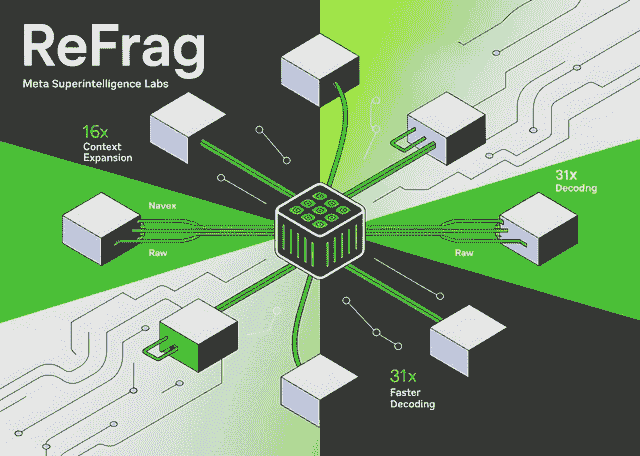

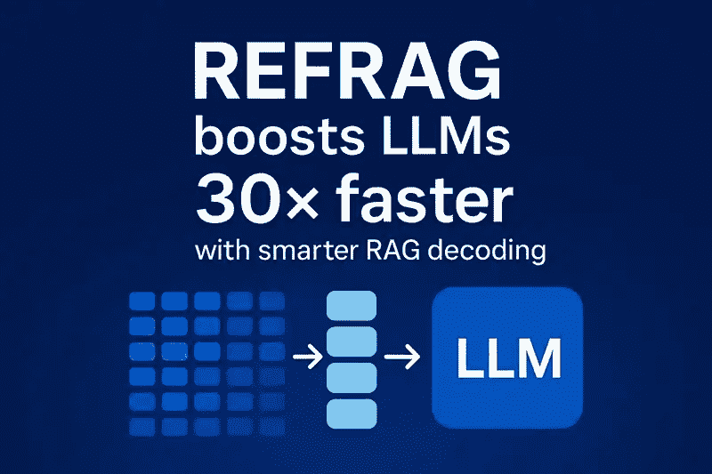

全球科技巨头Meta旗下专注于前沿研究的“Meta Superintelligence Labs”今日联合发布了一项名为REFRAG的高效解码框架。该研究旨在从根本上解决大型语言模型在处理长上下文输入时面临的严重效率瓶颈，尤其是在检索增强生成RAG等关键应用场景下，有望将处理速度提升高达30倍。

这一技术突破意味着，未来AI应用在处理海量文档、进行复杂知识问答或执行长篇内容摘要时，将能够以更低的延迟和更高的效率运行，为大模型在企业级知识管理、智能客服和深度研究等领域的规模化落地扫清了关键障碍。

随着模型能力的增强，LLM的上下文窗口已从几千Token扩展到数十万乃至上百万Token。然而，窗口的扩大也带来了一个棘手的副作用：推理速度的急剧下降。

在处理长篇输入时，LLM需要耗费大量的计算资源来处理所谓的“注意力机制”，其中大部分算力被消耗在对输入文本的初始处理阶段，这一过程被称为“预填充”。尤其是在RAG应用中，模型需要将检索到的大量相关文档片段作为上下文进行阅读和理解，这一步骤的耗时往往占到了整个响应过程的绝大部分，成为用户体验和系统效率的瓶颈。

Meta提出的REFRAG框架，其核心思想是“重构”而非“重新计算”。研究团队发现，在典型的RAG或其他长上下文任务中，用户后续的追问或指令，往往只与原始长上下文中的一小部分关键信息相关。

传统的解码方式是，每当有新的用户输入，模型都需要将新输入与全部的旧上下文拼接起来，再进行一次完整的、耗时的预填充计算。

而REFRAG框架则另辟蹊径。它通过一个轻量级的算法，智能地识别出长上下文中与当前任务最相关的关键片段（Key Fragments）。然后，它将这些片段“提取”并“重新排列”，与用户的最新提问组合成一个更短、但信息含金量极高的“新上下文”。模型只需要对这个精简后的上下文进行预填充计算，从而极大地减少了不必要的计算开销。

**该框架主要包含两个关键阶段：**

1.  **片段化：** 在初始阶段，将冗长的上下文分解成多个有意义的语义块或片段。

1.  **选择性重构：** 当接收到新的用户查询时，快速定位并选择最相关的片段，然后将它们与查询整合成一个紧凑的新输入，再送入LLM进行处理。

根据Meta Superintelligence Labs公布的实验数据，REFRAG框架在多个基准测试中表现出色。在处理包含大量检索文档的RAG任务时，该框架成功将预填充阶段的延迟降低了多达30倍，同时几乎没有牺牲最终的生成质量和答案准确性。

这意味着，过去需要等待数十秒甚至数分钟才能得到响应的长文档问答应用，现在可能在几秒钟内就能完成。这一效率上的飞跃，对于需要实时交互的应用场景至关重要。

# [**🟩代**](https://emojipedia.org/large-green-square)码现场 ｜多模态RAG系统开发实战

> 在大模型知识库问答系统开发过程中，**有一项非常复杂但又无法**绕过的需求，那就是多模态的PDF文档检索。一旦知识库文档中包含了图片、表格、公式等多模态信息，知识库检索系统开发的难度就会指数级提升。

**要完成一个完整的多模态PDF文档检索，**往往需要经历五个阶段，分别是PDF结构解析、多模态信息提取、Markdown文本转化、文档切分和混合检索。

> **PDF结****构解析  ➡️  多模态**信息提取  ➡️  MD文本转化  ➡️  文档切分➡️  混合检索

其中每个阶段都会涉及多项技术，并且在实际搭建多模态RAG系统的过程中，还需要结合不同的文档类型，如学术论文、课程教材、CAD工程图纸、公司财报等等进行单独优化，因此多模态RAG检索可以说是当下最复杂的RAG系统了。

本期公开课，我就带你零基础上手，啃下这块硬骨头。公开课历时两个多月时间研发，带你从零到一搭建企业级多模态RAG知识检索系统！

并且从零开始，系统掌握基于多模态文档的RAG技术体系，上手学习使用时下最热门OCR和VLM大模型，手动实现表格、图片、公式等多模态内容识别，最终完成PDF到Markdown的高精度解析与转化。

同时上手使用时下流行的MinerU等PDF转Markdown的集成解决方案工具，并且公开课中还将详细介绍LangChain&LangGraph中多模态RAG系统开发相关API的调用方法。

在课程的最后，还将带大家手动实操两项企业级多模态RAG系统开发实战案例。

<https://player.bilibili.com/player.html?bvid=1CDHQzdEfg>

# 🙋加入我们

> 我们团队的**大模型岗位秋招**也已经同步开启

> 大家**扫描左边的二维码**

> 即可联系HR咨询岗位情况

> 如果你也在关心AI世界的风云变幻、大模型与智能体的走向、技术背后的权力博弈，记得关注我们的文档和其他账号。我们带你看懂真正重要的那1%。

---

# 点击下面链接与我们产生更多连接✨

---

九天Hector 哔哩哔哩：https://space.bilibili.com/385842994

九天Hector 抖音： https://v.douyin.com/lqASAa2Hs_0/

九天Hector 📕：https://www.xiaohongshu.com/user/profile/62321335000000001000885e

九天Hector YouTube：https://www.youtube.com/channel/UCj8tyDLSxIdivnweBnG4H9Q/

赋范大模型全栈技术社区请点👉：https://kq4b3vgg5b.feishu.cn/wiki/space/7257794425391579164