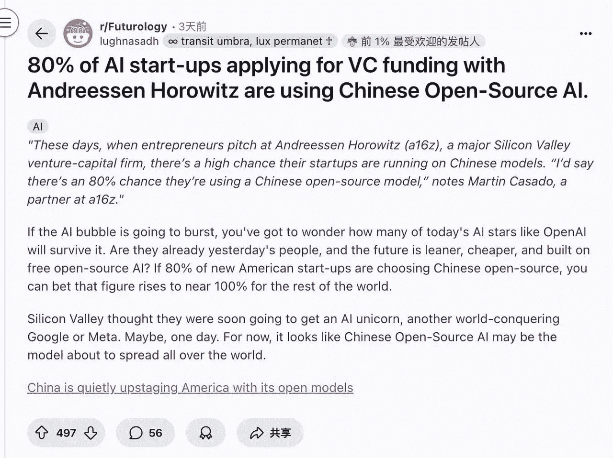
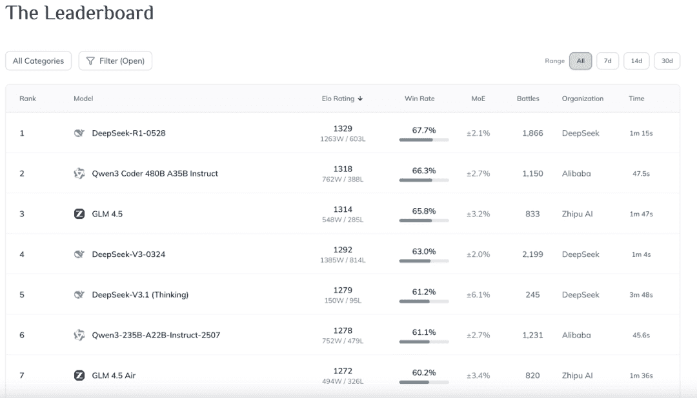
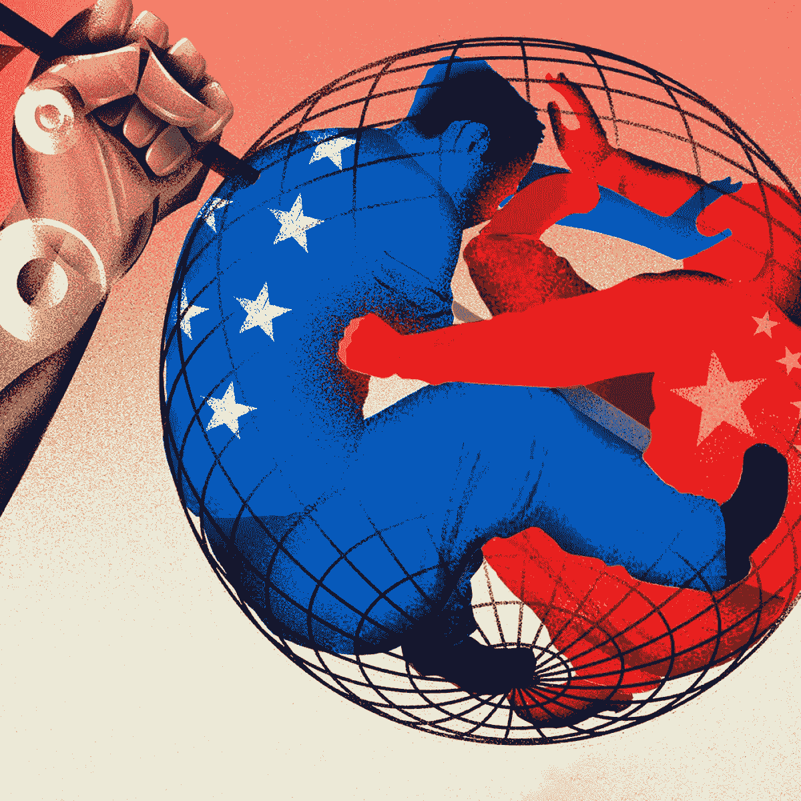
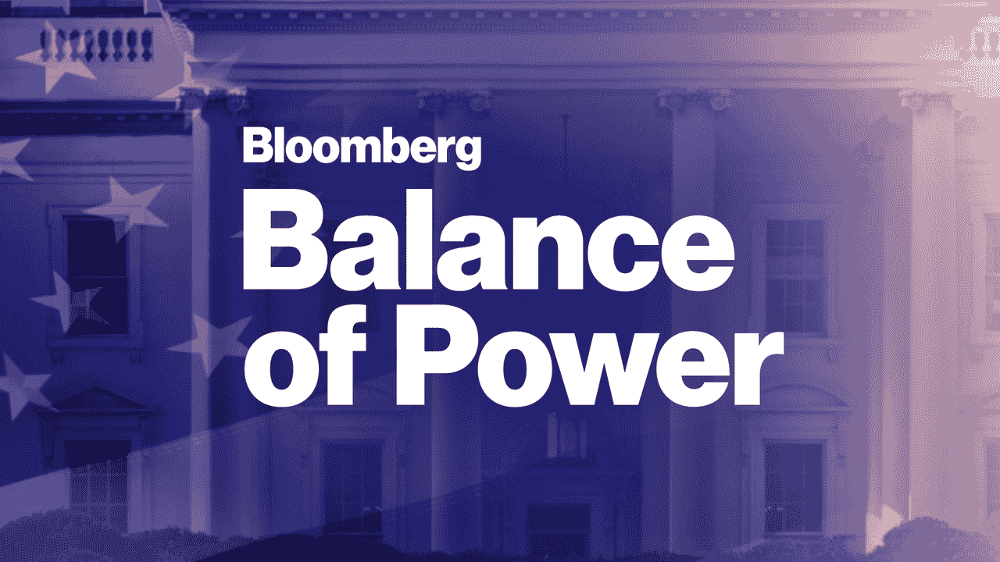
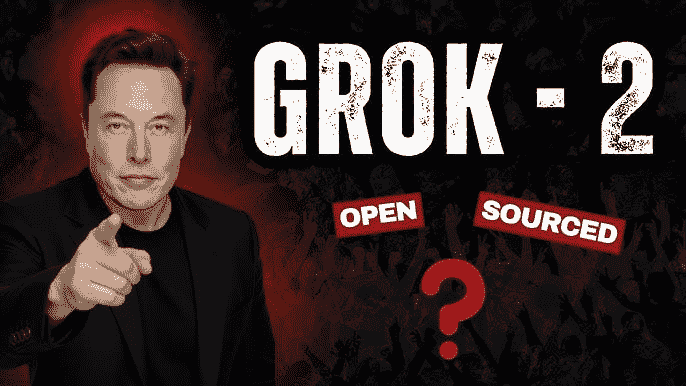
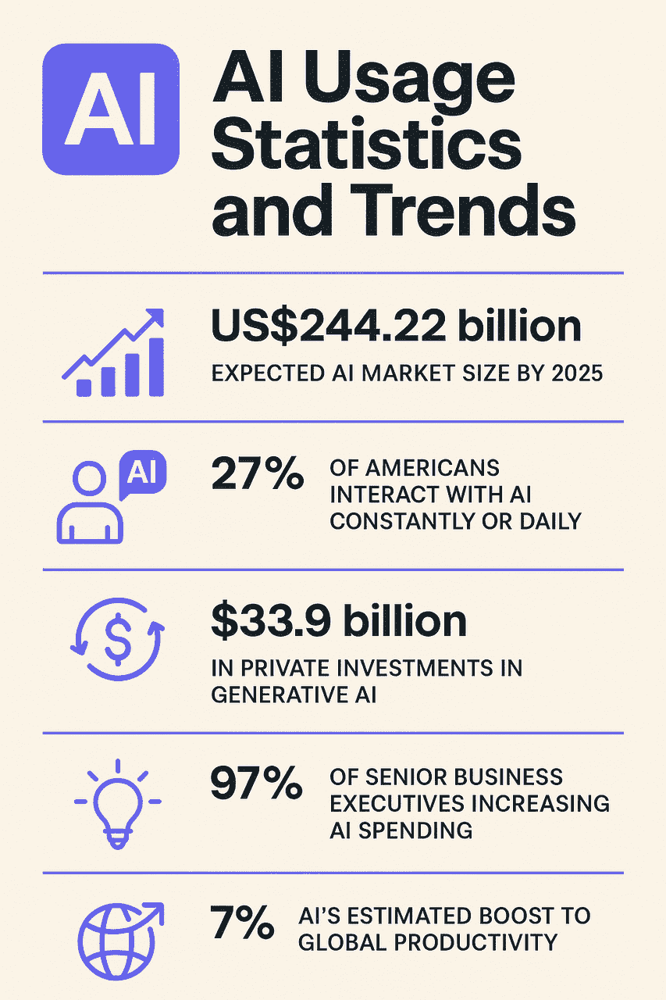
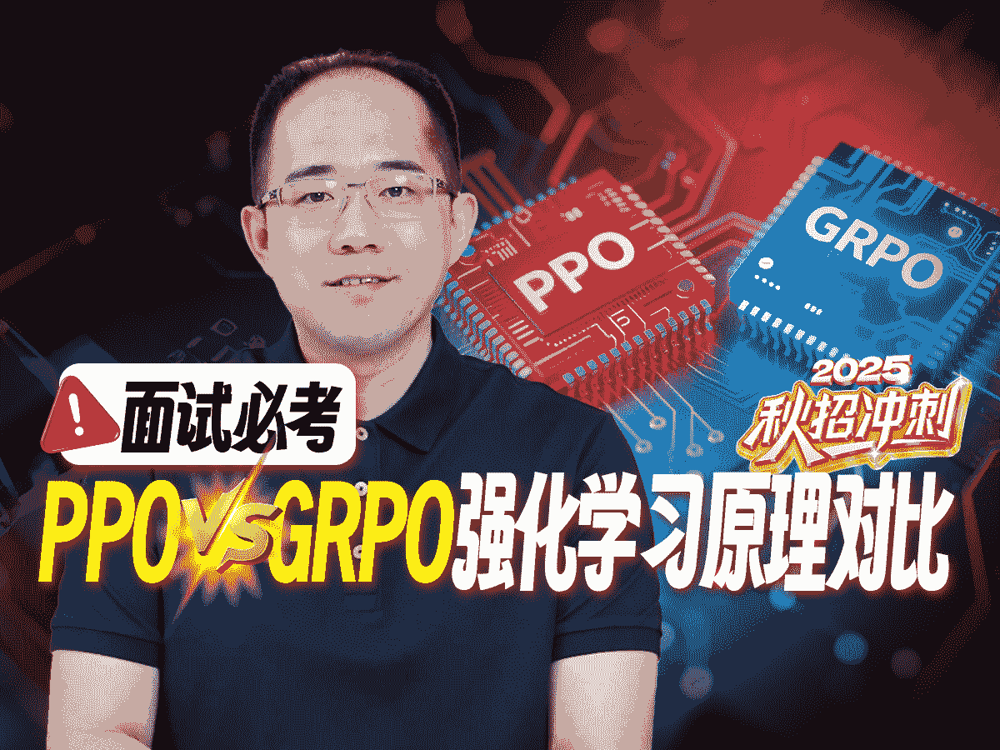

# 周周报 Vol.06｜国务院发表关于“人工智能+”行动的意见｜谷歌发布Nano Banana｜ 赋范空间

> 来源：[https://kq4b3vgg5b.feishu.cn/docx/NAAydCyU0ouogpxi3mbc4AKhnsd](https://kq4b3vgg5b.feishu.cn/docx/NAAydCyU0ouogpxi3mbc4AKhnsd)

### 《AI大模型周周报》第6期来啦！

> 本期焦点：国务院发表“人工智能+”的指导意见，到2027年智能终端与智能体将超70%；Google新一代图片生成模型发布，AI届PS真的来了；80%美国AI初创公司以来中国开源大模型套壳；彭博社指出：中美AI竞赛激烈程度远超想象，已进入“全面对抗”阶段。

> 我们创立周报，旨在为你提炼每周最核心的AI洞见。

> 欢迎随时收听，并在评论区交流讨论！

---

# 点击下面按钮跳转【AI大模型周周报专栏】持续关注

#

---

# [**🟥A**](https://emojipedia.org/large-red-square)**I头条 ｜ 从****“+AI”到“AI+”：**国务院发表关于“人工智能+”行动的意见，万亿产业迎来“聚变”时刻

> 2025年8月26日，北京。一份名为《关于深入实施“人工智能+”行动的意见》的文件由国务院正式发布，在中国科技界与产业界引发了强烈震动。这不仅仅是一份常规的政策文件，更是一份清晰的行动纲领。它标志着中国的AI战略，正从探索性的“+AI”时代，全面转向以AI驱动产业变革、重塑经济结构的“AI+”时代。一场由人工智能定义的产业聚变，正式拉开序幕。

国务院于今日正式印发《关于深入实施“人工智能+”行动的意见》，标志着国家人工智能战略的一次决定性转向。这份纲领性文件清晰地表明，中国的战略重心正从参与全球前沿基础模型的“军备竞赛”，全面转向一项由国家主导的、旨在通过AI应用实现广泛经济社会融合、并构建自主技术主权的宏伟任务。

> **点击链接查看详细文章👉国**务院关于深入实施“人工智能+”行动的意见_科技_中国政府网

该行动计划实质上接替了2017年发布的奠基性《新一代人工智能发展规划》，为中国未来十年乃至2035年的人工智能发展描绘了新蓝图。其核心建立在两大支柱之上：一是通过设定极具雄心的渗透率目标（到2027年智能终端与智能体超70%，2030年超90%），实现AI技术的大规模普及；二是通过构建从芯片、框架到数据的自主可控AI技术栈，巩固技术主权。

对于AI产业而言，这预示着一场由国家力量推动的巨大变革，其焦点将从纯粹的模型能力比拼，全面转向应用落地、生态构建和全栈工程化实现。

“人工智能+”行动计划的发布时机，深刻反映了其地缘政治的必要性。该计划被广泛解读为对美国主导的先进半导体出口管制的一种战略应对。它在某种程度上承认了在依赖受限硬件的前沿模型训练上进行正面竞争的挑战，转而将重心放在中国拥有明显优势的领域：庞大的国内市场、完整的产业链条和极其丰富的应用场景。

正如国际分析机构所指出的，硬件瓶颈已成为现实。与其在对手拥有“最先进GPU的战场上消耗资源，我国的策略是务实地将竞争引入自己擅长的“地面战”——通过广阔的产业应用和生态系统建设来发挥规模优势，深度融入经济血脉。

从“互联网+”到“人工智能+”的命名演进，也揭示了发展范式的跃迁。清华大学智能产业研究院院长张亚勤分析指出，这代表着一次从“信息连接”到“知识创造”的质变，目标远不止于经济的数字化，而是要实现彻底的智能化，构建“智能经济和智能社会新形态”。

意见》部署了“8项基础支撑能力”，共同构成了中国AI技术主权的蓝图，其核心可分为三层：

1.  **算力层：基石与挑战** 《意见》明确支持AI芯片攻坚、软件生态培育及超大规模智算集群建设。这实质上是将构建NVIDIA生态系统的替代方案上升为国家行动。尽管华为昇腾等国产芯片已取得进展，但在性能和软件生态（如CANN vs. CUDA）的成熟度上仍存在差距。国产算力层的成功与否，是整个“人工智能+”计划中最大的变量和挑战。

1.  **框架与模型层：双轨并行** 政策鼓励模型架构创新，并积极扶持百度的飞桨（PaddlePaddle）和华为的MindSpore等国内框架。中国的战略呈现出双轨并行的特点：一方面积极参与全球开源社区以确保兼容性，另一方面则构建平行的国内生态作为战略后备。

1.  **数据层：质量优先** 《意见》强调打造“开放共享的高质量科学数据集”，直面了中国AI发展中“数据虽多，但高质量、可用于训练的数据匮乏”的核心瓶颈。由国家主导建设高质量科研和工业数据集，有望极大加速专用模型的发展。

新蓝图中最引人注目的，是对应用方向的重新定义：

+   从通用大模型到“AI for Science”: 《意见》将“加速‘从0到1’重大科学发现”置于优先地位，要求技术研发从通用聊天能力转向具备深厚领域知识、能处理复杂科学数据的专用大模型，旨在解决材料科学、药物研发等领域的关键难题。

+   **“智能终端”与“智能体”的普及**: 文件为“新一代智能终端”（手机、PC、汽车等）和“智能体”（Agentic AI）设定了到2030年超90%的普及率目标。这预示着对端侧AI推理技术和能够主动规划并执行复杂任务的代理式AI的巨大需求，决策层判断AI下一阶段的价值创造点在于其自主行动和解决问题的能力。

《意见》呼吁发展“长期资本、耐心资本”，预示着风险投资和国家基金将从追逐“又一个通用聊天机器人”，转向支持国产AI芯片、AI for Science、垂直行业解决方案以及“智能原生企业”等硬科技领域。同时，一个由“人工智能应用服务商”构成的庞大中间层市场有望崛起，催生出更加多元化的产业生态。

# [🟧A](https://emojipedia.org/large-orange-square)i动态 ｜ “Nano Banana”席卷AI图像界，谷歌发布Gemini 2.5 Flash Image引发行业震动

谷歌（Google）于当地时间8月26日正式发布了其最新、最先进的图像生成与编辑模型——Gemini 2.5 Flash

Image。该模型此前以Nano Banana的代号在业界引发广泛关注和热议，凭借其卓越的性能，在发布之初便登顶AI图像编辑模型排行榜，预示着AI图像处理领域的新一轮技术革飞跃。

在正式亮相前，“纳米香蕉”已在大型模型竞技场平台LMArena上以匿名“盲测”的形式惊艳四座。在超过250万次的投票中，其强大的功能和精准的图像生成与编辑能力获得了用户的高度评价。如今，随着谷歌揭开其神秘面纱，Gemini 2.5 Flash Image的强劲实力得到了全面展示。

**核心亮点功能：**

+   **革命性的自然语言编辑：** 用户仅需通过简单的自然语言指令，即可对图像进行高精度的修改。无论是调整画面元素、改变颜色光影，还是进行更复杂的合成操作，Gemini 2.5 Flash Image都能精准理解并执行，其操作速度据称比传统的Photoshop流程快上10倍。

+   **卓越的人物与风格一致性：** 该模型在保持图像中人物面部特征、表情以及整体艺术风格的一致性方面取得了重大突破。这意味着用户可以在多张图片，甚至是一系列连续的创作中，维持核心元素的统一性，极大地提升了AI在商业广告、创意设计等领域的实用价值。

+   **强大的多图融合与编辑能力：** Gemini 2.5 Flash Image能够轻松融合多张图片，并根据指令进行无缝编辑，创造出全新的、富有想象力的视觉作品。

**市场反响与行业影响：**

Gemini 2.5 Flash Image的发布在科技圈和设计界引发了强烈反响。多家科技媒体和业内专家认为，其技术水平已经超越了包括Adobe Firefly系列及OpenAI的GPT-4o在内的同类顶尖模型，为AI图像生成和编辑树立了新的行业标杆。

与此同时，关于“P图师是否会失业”的讨论也再次甚嚣尘上。分析人士指出，虽然Gemini 2.5 Flash Image等强大AI工具的出现，无疑将对传统图像处理工作流产生冲击，但其更可能扮演的是“创意增效器”的角色，将设计师从繁琐重复的机械性操作中解放出来，从而更专注于核心创意与构思。

尽管该模型在文字渲染和解剖学细节等方面仍存在生成式AI的普遍性问题，但其整体表现出的高水准预示着AI辅助创意时代的加速到来。目前，谷歌方面尚未公布Gemini 2.5 Flash Image的全面开放使用计划，但其在LMArena上的初步测试已足以证明其巨大的潜力和应用前景。

# [🟧A](https://emojipedia.org/large-orange-square)i动态 ｜80%美国AI初创依赖中国开源模型，全球顶级榜单前列已无美国身影

据美国知名科技媒体《The Information》深度报道，以及多方数据显示，高达80%的美国人工智能（AI）初创公司在底层技术上严重依赖来自中国的开源模型。更令人震惊的是，在全球权威的AI开源社区Hugging Face的顶级模型排行榜上，排名前16位的模型已全被中国团队或公司包揽，引发了美国创投界，尤其是顶尖风投公司a16z（Andreessen Horowitz）投资人的高度警惕与深刻反思。

这篇报道指出，长期以来，美国被视为全球AI技术的领导者，以OpenAI、Google等巨头引领行业发展。然而，在更为开放和协作的开源领域，中国力量正以惊人的速度崛起并占据主导地位。来自阿里巴巴、零一万物（01.AI）、智谱AI（Zhipu AI）、元象（GenAI）等中国科技公司的开源大模型，凭借其卓越的性能、较低的部署成本和对特定应用场景的优化，已成为全球开发者，特别是资金相对有限的初创公司的首选。

报道援引了知名风险投资公司a16z合伙人Connie Chan的观察。她在一个行业内部讨论中表示，当她与所投资的AI初创公司创始人交流时，惊讶地发现，绝大多数团队都在使用来自中国的开源模型作为其应用服务的基础架构。这一现象，她形容为“一个令人震惊的、需要被正视的现实”，并指出这可能对美国在AI领域的长期竞争力构成潜在挑战。

Hugging Face作为全球最大的AI模型和数据集托管平台，其开源大模型排行榜（Open LLM Leaderboard）被视为行业风向标。截至2025年8月，该榜单前列被来自中国的模型“屠榜”的现象已持续数月。这些模型不仅在综合性能评分上超越了众多国际竞争对手，还在多语言处理、代码生成、图像理解等多个维度展现了世界一流水平。

# [🟧A](https://emojipedia.org/large-orange-square)i动态 ｜彭博社最新报告：中美AI竞赛激烈程度远超想象，已进入“全面对抗”阶段

彭博社（Bloomberg）今日发布其最新的全球人工智能（AI）年度战略报告。该报告指出，美国与中国在人工智能领域的竞争正进一步加剧，其范围已覆盖从底层硬件到上层应用的全产业链，标志着两国科技竞争进入了一个新的、更为复杂的阶段。

这份报告整合了供应链数据、风险投资分析、学术出版物以及对行业高管与政策顾问的访谈。报告的核心观点修正了业界此前的普遍看法。报告认为，当前竞争格局已不再是美国主导基础研究、中国聚焦应用推广的简单分工，而是演变为在技术栈的每一个层面展开的直接竞争。

**报告指出的关键领域与分析：**

1.  **半导体领域：** 报告分析，美国针对先进AI训练芯片的出口管制政策，在短期内限制了中国的技术获取能力。作为应对，中国已将资源大规模投入国内半导体产业的自主研发与生产，并积极探索替代性技术路径以优化现有算力。报告评估，美国的管制策略正在推动中国构建一套独立的半导体供应链体系。

1.  **开源模型生态：** 报告观察到，源自中国的开源大语言模型在全球开发者社区中的影响力显著提升，在主流平台（如Hugging Face）上的排名和使用率均呈上升趋势。这一发展改变了全球AI软件生态的既有格局，对美国在该领域的传统优势地位构成了挑战。

1.  **人才与科研：** 基于对专业网络平台数据的分析，报告确认美国依然是全球顶尖AI人才的首选工作地。但报告同时指出，近年选择回国或留在中国发展的华人AI专家数量呈明显增长趋势。此外，中国本土培养的AI领域博士研究生数量已经超过美国，显示出其人才储备基础正在增强。

1.  **数据与应用：** 报告强调，中国的国家数据法规及庞大的国内市场，为训练面向特定行业（如自动驾驶、城市管理、医疗健康）的专业AI模型提供了有利条件。这使得相关AI应用得以在海量真实世界数据上进行快速优化，从而在特定领域形成了强大的应用能力和市场竞争力。

彭博社在报告的总结部分提出，中美在AI领域的深度竞争可能导致全球技术生态出现向两个不同技术标准和治理体系演化的趋势。报告认为，这种技术生态的分化将对全球产业链和国际合作产生深远影响。报告建议，两国决策者需正视这一现实，并在关键的全球性议题上探索必要的沟通与协调机制。

# [🟧A](https://emojipedia.org/large-orange-square)i动态 ｜马斯克旗下xAI正式开源Grok-2

特斯拉及xAI公司创始人伊隆·马斯克（Elon Musk）今日通过其社交平台X（前身为Twitter）宣布，旗下人工智能公司xAI的最新大型语言模型Grok-2已正式向全球开源，此举标志着AI领域的开源运动迎来了又一里程碑事件，也为本已激烈的AI技术竞赛再添一把火。

马斯克在声明中强调，此举旨在“加速创新、促进透明度，并为全人类创造一个更安全的人工智能未来”。他重申了其一贯的立场，即人工智能技术应普惠大众，而非被少数科技巨头所垄断。

此次开源的版本包含了Grok-2模型的基础权重和网络架构，允许开发者和研究人员免费下载、修改并用于商业和非商业用途，具体遵循Apache 2.0开源许可协议。这一开放的许可模式，将极大地推动全球范围内的AI应用开发与学术研究。

Grok-2的开源决定，被广泛视为马斯克对其竞争对手，特别是OpenAI的一次直接挑战。马斯克曾是OpenAI的联合创始人之一，但后来因理念分歧而离开，并多次公开批评其从非营利组织向营利公司的转型，认为其背离了“为全人类福祉服务”的初衷。通过开源Grok-2，马斯克正以实际行动践行其“开放AI”的理念。

# [🟧A](https://emojipedia.org/large-orange-square)i动态 ｜“To P”革命悄然来临：报告称九成职场人正自费购买AI服务提升效率

最新发布的《2025年全球职场AI应用趋势》报告指出，高达90%的办公室职员（“打工人”）正在使用个人资金订阅或购买AI工具和服务，以提升其工作效率与质量。这种“为自己打工、为效率付费”的现象，被行业观察家称为“To P”（To Person/Professional）革命的开端，预示着企业软件市场正从传统的To B（To Business）和To C（To Consumer）模式，向一个更加个人化、由终端用户驱动的新时代转变。

报告显示，在这股浪潮中，一个典型的画像是：普通员工每月自愿花费约20美元（约合145元人民币）订阅如ChatGPT Plus、Claude Pro、Midjourney或各类AI辅助写作、数据分析和编程工具。他们普遍反馈，这笔“小额投资”带来了“翻倍”的效率回报，能够帮助他们快速完成报告撰写、数据整理、代码纠错、邮件草拟和创意构思等日常工作，从而在激烈的职场竞争中获得优势。

这一趋势被视为传统企业“影子IT”（Shadow IT）现象的全面升级。过去，员工可能会私自使用未经公司批准的软件或云服务。

这背后反映了几个关键变化：

1.  **企业AI部署滞后：** 许多公司在全员部署AI工具方面行动迟缓，复杂的采购流程、数据安全顾虑以及高昂的成本，使得企业级AI解决方案难以迅速普及到每一位员工。

1.  **个人效率焦虑：** 面对AI技术带来的颠覆性影响，员工普遍存在“技能焦虑”和“效率焦虑”，担心不使用AI就会被同事甚至时代所淘汰。

1.  **消费级AI工具的易用性：** 得益于OpenAI、Anthropic等公司的努力，AI工具的交互体验已极为友好，无需专业技术背景即可轻松上手，极大地降低了个人使用的门槛。

行业专家指出，企业管理者不应简单地禁止这种行为，而应积极引导。明智的做法是，一方面加速企业级AI战略的制定与部署，另一方面，可以考虑设立“AI津贴”、提供“推荐工具白名单”或与主流AI服务商洽谈企业折扣，将这股自下而上的变革力量，转化为推动整个组织创新与效率提升的合力。

# 秋招季马上就要到了！

> 随着**‘金九银十’**招**聘季的到来，大模型技术岗位**的竞争将进入白热化阶段。在过去的半年，我们团队面试了上百名大模型技术人，九天老师帮大家从面试官的角度，为你深度讲解100道大模型面试热点问题。

<https://player.bilibili.com/player.html?bvid=12bYszLEY5&spm_id_from=333.1387.collection.video_card.click&vd_source=d1e7cd29b47b1fc5934596d5c14189cc>

# 🙋加入我们

> 我们团队的**大模型岗位秋招**也已经同步开启

> 大家**扫描左边的二维码**

> 即可联系HR咨询岗位情况

> 如果你也在关心AI世界的风云变幻、大模型与智能体的走向、技术背后的权力博弈，记得关注我们的文档和其他账号。我们带你看懂真正重要的那1%。

---

# 点击下面链接与我们产生更多连接✨

---

九天Hector 哔哩哔哩：https://space.bilibili.com/385842994

九天Hector 抖音： https://v.douyin.com/lqASAa2Hs_0/

九天Hector 📕：https://www.xiaohongshu.com/user/profile/62321335000000001000885e

九天Hector YouTube：https://www.youtube.com/channel/UCj8tyDLSxIdivnweBnG4H9Q/

赋范大模型全栈技术社区请点👉：https://kq4b3vgg5b.feishu.cn/wiki/space/7257794425391579164