# 周周报 Vol.04 ｜字节Coze开源｜阿里发布Qwen3 Coder，媲美Claude4｜ 赋范空间

> 来源：[https://kq4b3vgg5b.feishu.cn/docx/AVw0dRPjfoYeeZxOpu7cuZNBn1e](https://kq4b3vgg5b.feishu.cn/docx/AVw0dRPjfoYeeZxOpu7cuZNBn1e)

### 《AI大模型周周报》第4期来啦！

> 本期焦点：国内外大厂竞相布局AI代码赛道——字节Coze的开源、阿里发布Qwen3 Coder，相关的模型实际测评和使用方法我们也为你准备好了～

> 另外还有赋范空间开课五周年庆典，18+实战自研项目代码等你来拿

>

> 我们创立周报，旨在为你提炼每周最核心的AI洞见。欢迎随时收听，并在评论区交流讨论！

---

# 点击下面按钮跳转【AI大模型周周报专栏】持续关注

#

---

# [💝开](https://emojipedia.org/heart-with-ribbon)课五周年｜🎉巅峰庆典·盛大开启 👑

> 开课5周年钜献·福利多多

> 🎁「18+自研项目」限时领取！

> 🎁「10场干货&答疑直播」扫码参与！

> 🔥 金牌讲师团答疑，学习/就业/项目落地面对面解决！

>

> ✅参与即赠【50W年薪岗技能图谱】

> ✨5 大模块 · 22 章节 · 971 知识点

> ✨百名大厂学员回访总结，纳米级拆解能力模型

> ✅【全网独家】18+自研/二开项目全公开

> ✨ AI数分智能体/通用MCP客户端……

> ✨已落地项目大放送，全套代码打包带走！

> ✅【5周年10场特别直播】

> ✨ MCP / 谷歌ADK / RAG……5大热门主题精讲！

> ✨联合创始人+技术总监级别现场技术答疑！

> ✅【40+小时体系课程包】限时免费学

> ✨ MCP、微调、RAG……主流实战技术一网打尽！

> ✨0基础掌握企业级实战能力！

> ……

> 📍 还有五周年专属福利，仅直播间可见！

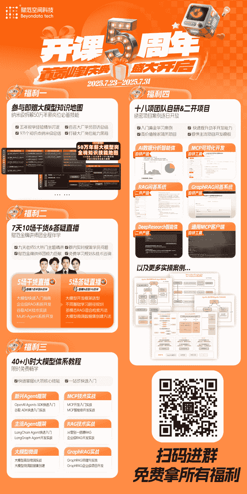

> 《大模型Agent开发实战》正课五周年庆专属【特价席位】开放中🔥

> 🧧5年仅此一次，历史最低价，名额有限，先到先得！

> 💬扫码私聊助教老师，发送关键词【5周年】，立即了解详情

---

# **🔶AI头条｜重磅突发！字节跳动Coze突然开源，百万**开发者Agent平台All in本地化

> 人工智能领域再迎重磅玩家，字节跳动旗下拥有百万级开发者的零代码/低代码Agent开发平台Coze，在毫无预告的情况下，于今日突然宣布开源。此举意味着开发者现在可以完全离线部署这一强大的智能体构建工具，为数据隐私和企业级定制化提供了前所未有的保障。

> 开源项目在GitHub上发布后，短短数小时内便吸引了数千个Star，迅速成为全球开发者社区的焦点。

#### 核心功能全面开放，主打企业级与私有化部署

根据其开源的GitHub项目coze-studio显示，本次开源版本几乎囊括了原版Coze平台中所有与Agent开发相关的核心功能。开发者可以体验到：

+   **可视化工作流编排：** 通过拖拉拽的方式设计和组织复杂的智能体工作流程，无需编写繁琐的代码。

+   **完整的插件系统：** 内置了多款插件和开发模板，允许开发者快速扩展智能体的能力边界。

+   **一键部署与后端服务：** 开源版自带完整的后端服务，开发者完成智能体构建后可一键部署，并生成API，方便在飞书、微信公众号、企业内部应用中直接调用。

+   **框架兼容性：** 支持与LangChain、LangGraph等主流开发框架集成，将Coze发布的智能体作为外部工具调用，实现更复杂的多智能体协作。

与在线版本相比，开源版主要移除了语音交互和部分在线版的权限管理功能。但其核心价值在于“完全离线部署”。这对于数据安全和隐私要求极高的金融、医疗和政务等行业的企业来说，无疑是一个巨大的福音。

#### Apache 2.0协议：赋予开发者最大自由

**最引人注目的是，Coze开**源项目遵循极其宽松的Apache 2.0许可证。这意味着开发者不仅可以自由地对源代码进行任意修改和分发，还可以在其基础上进行商业化的二次开发，甚至搭建闭源的SaaS服务，而无需担心法律风险。这一策略与前段时间开源的DeepSeek大模型类似，旨在最大限度地激发社区的创造力和商业潜力。

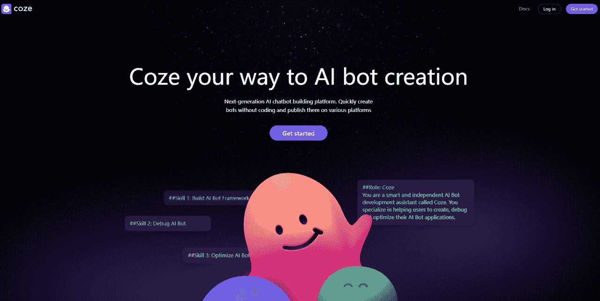

#### 工业级架构，从GPTs竞争者到企业级框架

Coze并非一个简单的玩具项目。它脱胎于字节内部经过大规模验证的“扣子”平台，其技术架构堪称“豪华”：

+   **后端：** 采用Go语言开发，以其出色的高并发处理能力和系统稳定性著称。

+   **前端：** 使用主流的React + TypeScript技术栈。

+   **架构：** 基于微服务架构设计，将系统按功能拆分为独立模块，便于维护、扩展和二次开发。

回顾其发展历程，Coze最初的定位是对标OpenAI的GPTs，旨在通过低门槛吸引海量开发者创建各类聊天机器人。然而，随着大模型技术进入深水区，简单的Agent应用已无法满足市场需求。Coze团队也随之进行战略转型，增加了工作流编排、提示词工程优化、智能体评估等专业功能，使其从一个“低门槛”的入门工具，演进为一个“高上限”的专业级Agent开发框架。

有评论认为，相较于Dify等同类开源平台，Coze在功能的丰富性和灵活性上更具优势，尤其适合进行复杂的企业级Agent开发。

#### 低门槛部署，开启全民Agent开发时代

除了核心的coze studio开发环境，Coze本次还一并开源了cozeloop项目，这是一个类似LangSmith的Agent运维与可观测性平台，为企业提供了从开发到运维的全链路解决方案。

**部署coze stud**io的硬件门槛相当亲民，最低仅需2核CPU和4GB内存即可运行，并全面支持Windows、MacOS和Linux系统。整个部署过程依赖于Docker，开发者只需完成简单的模型配置（如接入DeepSeek、Kimi或本地模型），然后通过docker-compose命令即可一键启动，整个过程通常在数分钟内完成。

Coze的突然开源，不仅为市场提供了一个可完全私有化、高性能、高扩展性的工业级Agent底层框架，更可能将大模型应用的开发门槛降至新低，激发新一轮的AI应用创新浪潮。业界普遍认为，这是字节跳动在AI基础设施领域布局的一着妙棋，旨在通过开源构建生态，争夺下一代AI应用开发入口的话语权。

#### 针对Coze九天老师也做了相关的深度测评，一个视频9分钟带你了解⬇️

> 开源版完整包含画布工作流搭建+菜单式Agent开发+内置海量插件+一键部署上线全部功能，低代码开发框架性能超越Dify！

<https://player.bilibili.com/player.html?bvid=1LL8hzBEZr>

# **🔶AI头条｜阿**里升级AI军备竞赛：发布Qwen3-Coder，直指GPT-4与Claude的“智能体”王座

> 科技巨头之间的AI军备竞赛已进入白热化阶段，而最新的战火由阿里巴巴点燃。近日，阿里云通义团队正式宣布，其“迄今最具代理能力的代码模型”——Qwen3-Coder系列，全面开源 。这一举动不仅是技术实力的展示，更预示着软件开发范式的又一次深刻变革。与模型一同发布的，还有一款名为Qwen Code的命令行工具，它将成为开发者驾驭这头代码巨兽的“指挥棒” 。

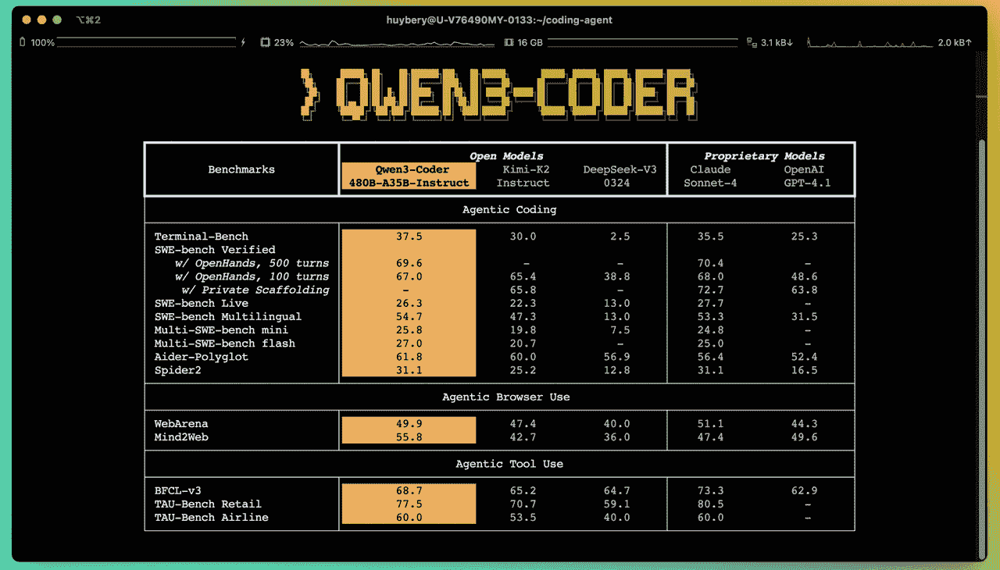

阿里巴巴此次展示的不仅是单一模型的突破，更是一个层次分明、迭代迅速的庞大模型家族。其背后所展现的工程实力和战略布局，揭示了其在AI领域的深远抱负。

### 旗舰之作：Qwen3-Coder-480B-A35B-Instruct

本次发布的旗舰模型Qwen3-Coder-480B-A35B-Instruct，其命名本身就透露出惊人的技术规格。这是一个拥有4800亿总参数的混合专家模型，但在处理每个token时，仅激活其中的350亿参数 。MoE架构是近年来超大模型寻求效率突破的关键技术，它将模型划分为多个专门的“专家”子网络，每次推理时只调用与任务最相关的少数几个专家，从而在保持巨大模型容量的同时，大幅降低了实际运算成本，实现了性能与效率的平衡 。

该模型最引人注目的特性之一是其庞大的上下文窗口。它原生支持高达256,000个token的上下文长度，并通过Yarn等外推技术，可扩展至惊人的100万token 。这意味着模型可以一次性“阅读”并理解整个大型代码库，而不仅仅是单个文件。这一能力对于执行需要全局视野的复杂软件工程任务，如大规模代码重构或跨文件依赖分析，至关重要，是实现真正有效的智能体编程的基础 。这种“一眼看穿整个项目”的能力，是其区别于许多前辈模型的关键优势。

回顾Qwen模型家族的发展历程，其演进速度令人惊叹。从2023年最初的Qwen模型，到Qwen2、Qwen2.5，再到如今的Qwen3，重要的版本更新几乎每隔数月就会发生 。伴随而来的是训练数据量的爆炸式增长，从早期的约3万亿token，激增至Qwen3家族所使用的近36万亿token 。这种“阿里速度”不仅体现了其雄厚的资本和技术投入，也反映了其在AI竞赛中不甘人后、力争上游的决心。

为了更直观地展现Qwen3-Coder在当前市场中的位置，下表将其与业界主要的开源及闭源模型进行了关键技术指标的对比。

这张表格清晰地揭示了AI代码模型领域的“军备竞赛”现状。阿里巴巴通过Qwen3-Coder的“480B”这一惊人数字，成功地在参数竞赛中占据了制高点，这本身就是一种强大的市场营销手段。然而，其背后“35B激活”的MoE架构才是其能够兼顾性能与实用性的关键。

在AI领域，基准测试Benchmark是衡量模型能力的通用语言，也是各大厂商证明自身技术实力的主要战场。阿里巴巴为其Qwen3-Coder模型公布了一系列令人印象深刻的成绩，宣称其在多个权威榜单上达到了开源模型的顶尖水平。

根据官方发布的信息，Qwen3-Coder在SWE-Bench Verified、LiveCodeBench以及CodeForces ELO等高难度代码能力评测中表现卓越，超越了众多竞争对手 。SWE-Bench尤其值得关注，因为它评估的是模型解决真实世界软件工程问题的能力，而非简单的算法题。此外，阿里还大胆地将其模型与顶级的闭源模型直接对标，声称Qwen3-Coder“可与Claude Sonnet 4相媲美”，而其前代Qwen2.5-Coder-32B的代码能力“与GPT-4o相当” 。这些声明无疑是在向整个行业宣告，开源模型与闭源模型之间的能力鸿沟正在被迅速填平。

#### 针对Qwen3 Coder九天老师也做了相关的深度测评，一个视频9分钟带你了解⬇️

> 详解Qwen3 Coder模型性能与Code Agent上手使用方法！

<https://player.bilibili.com/player.html?bvid=1rY8wzYEuf>

# [🔷A](https://emojipedia.org/large-blue-diamond)I动态｜科技圈重磅：GPT-5发布在即，内测猛料流出？GPT-6疑已投入训练，奥特曼豪言“百万GPU”见未来

> 全球科技界正屏息以待，人工智能领域的领军者OpenAI似乎正准备投下一枚重磅炸弹。综合多家科技媒体报道及网络流出信息，备受瞩目的下一代语言模型GPT-5或将在未来数周内正式发布。与此同时，更令人震惊的消息指出，更为强大的GPT-6也可能已经开始了早期训练，而OpenAI首席执行官am Altman更是公开透露了其对未来算力的大胆设想——百万级别的GPU集群。

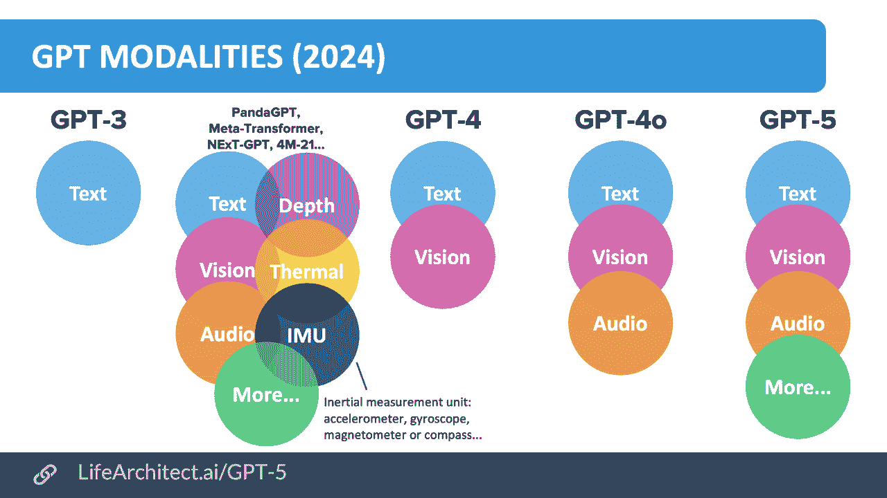

### GPT-5进入发布倒计时？内测细节揭示强大新功能

种种迹象表明，GPT-5的发布已经箭在弦上。据多家外媒报道，一个名为“gpt-5-reasoning-alpha-2025-07-13”的模型在近期的第三方开源代码库中被意外曝光，暗示其内部测试已进入关键阶段。泄露的信息显示，GPT-5可能在以下几个方面实现重大突破：

+   **一体化多模态能力：** 与前代模型需要切换不同模式来处理文本、图像和语音不同，GPT-5有望成为一个统一的多模态模型。这意味着用户将能够在一个连贯的交互中，同时输入和处理包括文本、代码、图像乃至音频在内的多种信息，实现真正无缝的“全能”AI体验。

+   **持久记忆与个性化：** GPT-5或将具备跨会话的持久记忆能力，能够学习并记住用户的偏好、工作风格和项目背景。这将使其提供的回应更具个性化和相关性，向成为真正的“个人助理”迈出重要一步。

+   **高级推理与代理能力：** 正如其alpha版本名称中的“reasoning”所示，GPT-5将在逻辑推理和复杂问题解决方面得到显著增强。此外，泄露信息还暗示其将内置代理功能，使其能更自主地与外部软件和API交互，自动执行多步骤任务。

尽管OpenAI官方对此三缄其口，但首席执行官山姆·奥特曼在早些时候曾表示，新模型将在“数月内”而非“数周内”发布，这与当前夏季末发布的传闻时间线基本吻合。

### GPT-6已在路上？奥特曼的“百万GPU”豪言

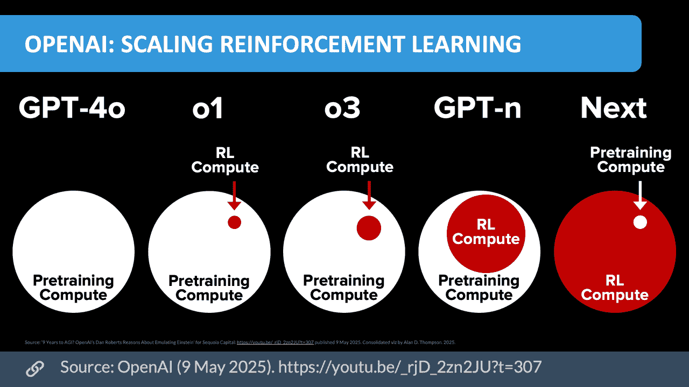

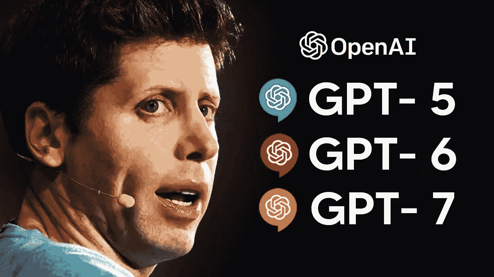

就在业界纷纷猜测GPT-5的具体发布日期时，更具前瞻性的消息已开始流传。有报道称，GPT-6的训练可能已经秘密启动。这一猜测并非空穴来风，其背后是OpenAI在计算能力上的惊人扩张。

山姆·奥特曼近日在社交媒体上公开表示，OpenAI有望在2025年底前拥有“远超100万个GPU”。他还以半开玩笑的口吻称，团队接下来的任务是“想办法再将这个数字提升100倍”。这一言论被广泛解读为OpenAI正在为训练远超GPT-5规模的下一代模型储备算力。

拥有百万级别的GPU集群，意味着OpenAI将能够进行规模空前、复杂度更高的模型训练，这对于实现通用人工智能AGI的目标至关重要。尽管奥特曼并未直接确认GPT-6的训练，但其对算力的极致追求，无疑为这一传言增添了极大的可信度。

# [🔷A](https://emojipedia.org/large-blue-diamond)I动态｜苹果发布AI蓝图，押注隐私和端侧算力以重新定义科技竞赛

> 苹果公司近日发布了一份详尽的技术报告，此举不仅是技术成果的展示，更是一份宣告其人工智能战略的宣言。这份名为《Apple Intelligence基础语言模型：2025年技术报告》的文件，详细阐述了在今年全球开发者大会WWDC25上首次亮相的各项AI功能背后的核心技术 。这标志着苹果正式将其在人工智能领域的底牌公之于众。

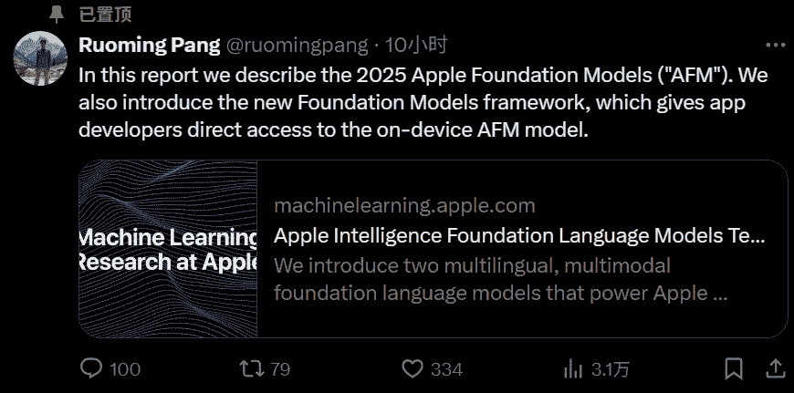

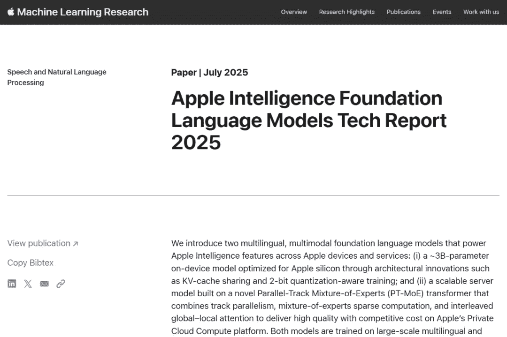

> 报告链接：https://machinelearning.apple.com/research/apple-foundation-models-tech-report-2025

苹果的战略核心是一个独特的双模型系统：一个紧凑的、约30亿参数的端侧模型，专为在设备上高效运行而设计；以及一个更强大的、基于服务器的模型，运行在一种名为“私有云计算”的新型基础设施之上 。此举并非简单地追赶OpenAI和谷歌等竞争对手，而是一场经过深思熟虑的豪赌，旨在围绕其核心价值观——用户隐私、软硬件深度整合及生态系统控制力——重塑整个人工智能领域的竞争格局 。

## 苹果亮出AI底牌

这份技术报告的发布，是苹果在WWDC25上对iOS 26、macOS Tahoe及其他平台更新做出宏大承诺后，向外界提供的期待已久的技术“证据” ()。报告由Hanzhi Zhou及其他393位研究人员共同撰写，彰显了苹果内部为此付出的巨大努力 。它详细介绍了驱动“Apple Intelligence”众多功能的两大基础模型，这些功能涵盖了写作工具、图像生成（Image Playground）、智能通知和视觉搜索等多个方面 。

苹果选择在其机器学习研究门户网站和学术预印本网站arXiv上同时发布这份报告 ()，是一次精心策划的战略沟通。长期以来，市场上充斥着苹果是“AI落后者”的论调，其竞争对手则不断占据新闻头条 ()。单纯的新闻稿和主题演讲很容易被视为市场营销辞令。为了有力地反驳“落后者”的标签，苹果需要展示其可信的、深厚的技术实力。

通过发布一份详尽的、堪比学术论文的报告，苹果赋予了其AI战略一种科学上的合法性与透明度，这是任何营销活动都无法企及的。这是一种“战略性透明”，旨在重建开发者和技术专家对其的信心，而这些人的支持对于苹果生态系统的成功至关重要。这无异于苹果在向世界宣告：“我们并非落后，我们只是选择了不同的道路，而这就是我们的技术证明。”

## 解构苹果的AI引擎

苹果的AI架构是其战略的基石，每一项技术创新都服务于端侧效率和隐私保护的宏大目标。其核心是一个互补的双模型系统：端侧模型负责处理低延迟、需要个人情境感知的任务，而服务器模型则通过私有云计算处理更复杂的请求。

为了在iPhone等内存和功耗受限的设备上运行强大的AI，苹果工程师引入了多项突破性创新：

+   **KV缓存共享**：这是一种新颖的模型架构，它将模型分为两个区块，并通过共享关键值缓存，成功将KV缓存的内存占用减少了37.5% ()。这对于在内存有限的移动设备上流畅运行AI至关重要。

+   **量化感知训练**：模型在训练阶段就被设计为能够适应极端的压缩。通过采用先进的2-bit量化等技术，苹果在大幅缩小模型体积的同时，最大限度地减少了性能损失 。

对于需要更强算力的任务，苹果设计了一款同样注重效率的服务器模型：

+   **并行轨道转换器**：与传统的单序列堆叠层模型不同，这种新架构将模型分割成多个更小的“轨道”并行处理，显著提升了效率和可扩展性 。

+   **混合专家模型**：服务器模型采用了MoE架构。这意味着当收到一个特定提示时，只有相关的“专家”模块会被激活，而其他模块则保持休眠。这使得庞大的模型在响应速度和效率上远超同等规模的单一整体模型 。

两大模型均具备理解文本和图像的多模态能力 。这得益于一个先进的视觉编码器，它采用ViTDet作为骨干网络，并结合了一种名为“寄存器-窗口”的新机制，能够更有效地整合图像的局部细节和全局背景信息 。

这些技术选择的背后，是苹果独特的“协同设计”理念。AI模型与Apple Silicon芯片之间存在着密不可分的联系。这些创新并非为了在真空中创造最强大的模型，而是为了在苹果硬件生态系统的特定约束下，实现最高效的模型。KV缓存共享、积极的量化策略以及对神经网络引擎的深度利用，都并非通用的AI技术进步，而是针对iPhone或Mac物理限制的精准解决方案 。这表明，苹果的AI战略并非孤立的软件项目，而是一项深度垂直整合的战略，其在定制芯片领域长达十年的投资如今正转化为强大的竞争优势，创造了竞争对手在移动设备上难以企及的每瓦性能。

## 正面交锋：苹果AI与竞争对手的较量

在性能方面，苹果正试图发起一场双线作战：一方面在传统基准测试中证明自己“足够好”，另一方面则试图重新定义“好”的标准。

根据报告公布的数据，苹果的端侧模型在MMLU等多项基准测试中，表现与Qwen-2.5-3B和Gemma-3-4B等同类规模的开源模型相当，甚至在某些方面有所超越 。其服务器模型则与LLaMA 4 Scout等模型实力相当，但在绝对性能上仍落后于GPT-4o等规模更大的前沿模型 。值得注意的是，得益于多语言训练数据占比从8%大幅提升至30%，苹果模型在非英语地区的人工评估中表现出色 。

然而，苹果深知，如果仅在这些传统指标上竞争，可能会使其陷入“落后者”的被动叙事中。因此，苹果采取了更具颠覆性的策略。公司同期发表的研究论文，如《思想的幻觉》，直指竞争对手的模型虽然在基准测试中得分很高，但面对真正复杂或包含无关信息的问题时，会表现出“脆弱性”，其能力更接近于“复杂的模式匹配”而非“真正的逻辑推理” 。这些研究表明，来自OpenAI、谷歌等公司的模型在处理高复杂度任务时会遭遇“准确率完全崩溃”的现象，暴露出其设计的“关键缺陷” 。

这揭示了苹果的深层战略意图：它试图改变行业对性能的定义。通过揭示竞争对手模型的脆弱性，苹果正在构建一种新的叙事——即一个略低的MMLU分数是无关紧要的，如果模型在用户的日常生活中更可靠、更私密、更具情境感知能力。这是一种经典的战略转向，从在对手的强项上竞争，转为在自己的优势领域制定规则。

# [🔷A](https://emojipedia.org/large-blue-diamond)I动态｜孙正义投下震撼弹：2025年部署10亿AI代理，“程序员黄昏”或将降临？

软银集团创始人孙正义近日在一次公开活动中以前瞻性而又引人深思的言论，为全球科技行业投下了一颗重磅炸弹。他宣布，软银计划在2025年内部署高达10亿个AI Agen，并直言“人类程序员的时代正在我们集团内部走向终结”。此番表态迅速在全球范围内引发了对人工智能技术发展、其对就业市场的冲击，尤其是对软件工程师这一“金领”职业未来的激烈讨论。

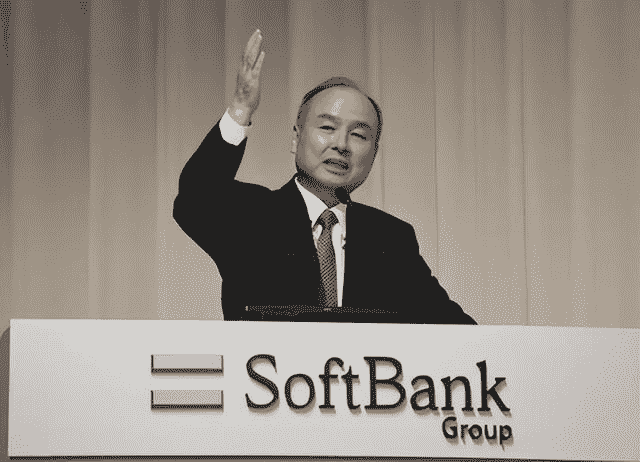

孙正义的这一宏伟计划，是在与OpenAI首席执行官Sam Altman的对谈中透露的。他设想的AI代理是能够自主思考和行动的智能实体，将渗透到集团运营的方方面面，形成一个庞大的、不知疲倦的“数字劳动力”。他甚至估算，大约1000个AI代理能够替代一名人类员工的工作，因为它们可以24小时不间断地处理复杂的任务，并相互协作。

“我们正在努力让AI代理完全接管编码和编程工作，这一转变已经开始。”孙正义的这番话语，无疑为当前已经因AI代码生成工具而备受压力的程序员群体增添了更深的忧虑。他认为，随着AI技术的指数级发展，传统的编程工作将被更高效、成本更低的AI系统所取代。

这一预测并非空穴来风。近年来，以ChatGPT、Copilot为代表的AI编程助手已经深度融入软件开发流程。谷歌CEO桑达尔·皮查伊也曾表示，公司内部已有25%的代码是在AI的辅助下生成的。然而，AI对程序员工作效率的实际影响，目前仍存在争议。非营利研究机构METR最近的一项研究发现，有经验的程序员在使用AI工具时，完成任务的时间反而增加了19%，因为他们需要花费大量时间来审查和修正AI生成的输出。

尽管如此，行业领袖们普遍认为，AI对软件开发领域的影响是不可逆转的。OpenAI的奥尔特曼预测，AI将逐步取代软件工程师的部分职能，未来的重点将是掌握和运用AI工具的能力，而非传统的编码技能。Salesforce的CEO马克·贝尼奥夫也曾暗示，公司正在重新考虑2025年招聘软件工程师的计划。

这一趋势引发的关注已不仅仅局限于程序员群体。整个社会都在密切关注AI技术对“白领”工作岗位的广泛替代效应。从金融分析、客户服务到内容创作，AI的渗透正在加速，迫使各行各业重新评估未来的人才需求和技能构成。

分析人士指出，孙正义的“10亿AI代理”计划，更像是一个未来趋势的激进预演。短期内，AI更可能扮演“副驾驶”或“增强器”的角色，帮助人类员工提高效率和创造力。然而，从长远来看，随着AI能力的不断进化和“自主性”的增强，人与AI的协作关系可能会发生根本性转变，部分岗位的消亡或许难以避免。

面对这一可能到来的“程序员黄昏”，科技从业者和教育体系正面临前所未有的挑战。未来的软件工程师可能不再是代码的编写者，而是AI系统的设计师、训练师和监督者，需要具备更强的系统性思维、问题定义能力和人机协作能力。这场由AI掀起的行业变革，才刚刚拉开序幕。

# [🔷A](https://emojipedia.org/large-blue-diamond)I动态｜腾讯发布首个全栈AI IDE CodeBuddy：剑指“一人开发团队”，开启内测

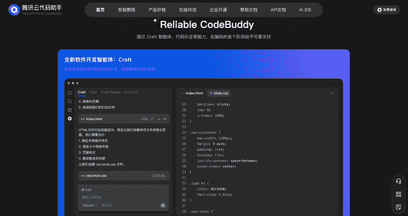

科技巨头腾讯在AI开发领域投下重磅炸弹，于近日正式发布其**首个全栈AI集成开发环境（**IDE）—— CodeBuddy IDE。该产品目前已开放内测申请，标志着腾讯将其AI能力从辅助编程插件全面升级为一体化的开发工作台，旨在打通从产品构想到最终部署的全流程，赋能开发者实现“一人即团队”的高效开发模式。

CodeBuddy IDE的核心定位是成为业界首个实现“产品-设计-研发-部署”全链路AI化的开发平台。相较于市面上已有的AI代码辅助工具，如GitHub Copilot等，CodeBuddy IDE的雄心不止于代码生成。它致力于将产品经理、UI/UX设计师、前后端工程师乃至运维工程师的角色集于一身，通过与AI的自然语言对话，让开发者甚至非技术人员也能“丝滑”地完成整个软件的生命周期管理。

在此次升级为独立IDE之前，CodeBuddy作为一款AI编程插件，已在腾讯内部得到广泛应用和验证。据腾讯透露，该插件在公司内部的普及率超过90%，并有高达43%的代码是由AI辅助生成的。然而，传统IDE的插件形态限制了其提供更完整、无缝体验的能力。为了打破工具间的壁垒，为AI时代的开发者提供一个真正的一体化工作台，独立的CodeBuddy IDE应运而生。

CodeBuddy IDE的核心亮点功能包括：

+   **全流程一体化**： 用户可以在单一平台内，通过对话式交互完成产品需求梳理、用户界面（UI）设计、前后端代码编写、数据库配置直至云端部署的全部环节，极大地降低了开发流程的复杂性。

+   **多模型强力驱动**： CodeBuddy IDE集成了业界顶尖的多种大型语言模型。其国际版支持包括GPT、Gemini和Claude在内的模型，而国内版则无缝接入了腾讯自家的混元大模型以及深求（DeepSeek）等优秀国产模型，为用户提供了强大且灵活的AI算力支持。

+   **“对话即开发”的新范式**： 凭借强大的自然语言理解能力，CodeBuddy IDE将复杂的编程任务转化为简单的对话。开发者只需用自然语言描述需求，AI即可自动生成代码、创建界面、配置服务，颠覆传统的编码体验。

腾讯云开发者产品总经理刘毅在发布会上表示：“AI时代，开发者需要的是一个全新的、一体化的工作台。我们希望通过CodeBuddy IDE，让一个IDE就能流畅地完成所有开发任务。”

此次发布也揭示了腾讯在AI Agent领域的长远布局。腾讯将AI智能体的进化类比于自动驾驶的五个层级，并认为当前行业正处于L3阶段。CodeBuddy IDE的推出，正是腾讯向着L4级别迈出的坚实一步，其最终目标是在2027年实现由多个AI代理分工协作、构成完整AI开发团队的L5级别。

CodeBuddy IDE的问世，不仅为全球开发者带来了一个创新的选择，也加剧了AI编程工具市场的竞争。它将与微软的GitHub Copilot、亚马逊的CodeWhisperer等产品在不同维度上展开竞争。凭借其独特的“全栈一体化”理念，CodeBuddy IDE有望在重塑软件开发流程、降低技术门槛方面扮演关键角色，引领新一轮的开发效率革命。目前，感兴趣的开发者可前往其官网申请参与内测。

# [🔷A](https://emojipedia.org/large-blue-diamond)I动态｜微软震撼发布 GitHub Spark：一键生成全栈应用，彻底改变软件开发

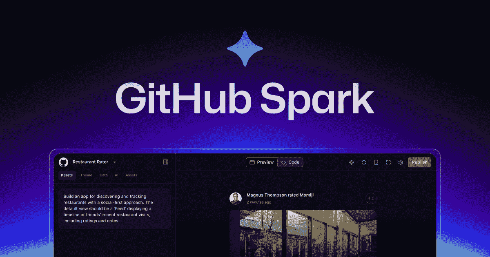

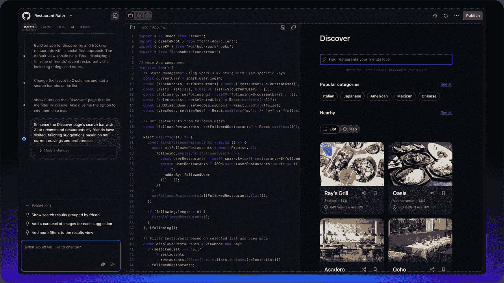

** **

**2025年7月24日，**微软投下重磅炸弹，通过其子公司 GitHub 发布了一款名为 GitHub Spark 的革命性工具。该工具旨在通过自然语言描述，一键生成功能齐全的全栈应用程序，从而颠覆传统的软件开发流程。这一举措标志着人工智能在软件工程领域的应用达到了新的高度，有望极大降低开发门槛，并为开发者社区带来前所未有的效率。

GitHub Spark 目前已面向 GitHub Copilot Pro+ 订阅用户开放公共预览。它集成了先进的AI大语言模型（如 Anthropic 的 Claude Sonnet 4），能够深刻理解用户的意图，并将简单的文本描述转化为包含前端用户界面、后端逻辑、数据库连接乃至AI功能在内的完整应用程序。

**从想法到部署，只需一键**

GitHub Spark 的核心亮点在于其极致的易用性和自动化能力。开发者甚至非技术人员，现在只需用通俗易懂的语言描述他们想要构建的应用，例如“创建一个可以根据心情推荐电影的网站”或“构建一个用于跟踪个人读书进度的应用”，Spark 便能实时生成一个可交互的原型。

该工具的主要特性包括：

+   **自然语言驱动开发：** 用户无需编写任何代码，仅通过对话式的自然语言输入，即可创建和迭代应用程序。

+   **一键式部署：** 当用户对生成的应用感到满意时，只需点击“发布”，Spark便会自动处理所有复杂的部署流程，包括安全托管、用户认证和基础设施配置，将应用直接发布上线。

+   **全栈能力：** Spark 生成的不仅仅是静态页面，而是涵盖了从前端UI到后端服务和数据库的完整技术栈，并能无缝集成AI功能。

+   **无缝集成GitHub生态：** 每个通过 Spark 创建的应用都会自动生成一个专属的 GitHub 代码仓库。该仓库预配置了CI/CD工作流、Dependabot安全警报和版本控制，为后续的专业开发和扩展提供了坚实的基础。

+   **多种迭代方式：** 用户不仅可以通过自然语言继续优化应用，还可以使用可视化的点击控件进行调整，或者直接在 Spark 编辑器中深入代码，利用 GitHub Copilot 的代码补全功能进行精细化修改。

**重新定义开发效率和可及性**

微软和 GitHub 相信，Spark 将成为连接创意与现实的桥梁。对于经验丰富的开发者而言，它可以作为快速原型设计的利器，将数周的工作量缩短至几分钟。对于初创公司和产品经理，它能够以极低的成本快速验证商业想法。而对于编程初学者和非技术背景的用户，Spark 则打开了一扇通往应用创造世界的大门。

“我们的目标是让软件开发变得像描述一个想法一样简单，”GitHub 的一位发言人表示。“通过 GitHub Spark，我们正在消除从概念到可部署软件之间的所有障碍。这不仅是为了提高生产力，更是为了将创造力赋予每一个人。”

**市场反响与未来展望**

GitHub Spark 的发布在科技界和开发者社区引起了巨大反响。许多早期试用者对其生成应用的完整性和部署的速度表示惊叹。分析人士认为，这标志着软件开发行业的一个重要拐点，AI 不再仅仅是辅助编码的工具，而是成为了能够独立构建和部署复杂系统的“开发者”。

尽管目前 Spark 处于预览阶段，但它所展示的潜力预示着一个全新的开发范式即将到来。随着技术的不断成熟，未来普通用户或许都能通过简单的语言交互，定制和创建满足其个性化需求的软件应用，真正实现“软件开发民主化”。微软此举，无疑将进一步巩固其在AI和云开发领域的领导地位。

# [**🟩代**](https://emojipedia.org/large-green-square)码现场｜🔥 从洞察到实战，抓住你的AI时代新机遇！

上面每一条激动人心的快讯，都在宣告一个事实：AI技术正以前所未有的速度重塑开发范式与职业边界。无论是企业级Agent的爆发，还是AI驱动的全栈开发，都对从业者的能力模型提出了全新的要求。

与其被动追赶，不如主动引领！我们深知技术人的渴望与焦虑，为此，我们精心准备了一份【AI前沿技术与实战项目大礼包】，旨在帮助您从看懂新闻，到亲手实现，真正将前沿技术转化为您的核心竞争力。

🎁 五周年庆典福利·限时免费领取！🎁

✅ 1.【独家】《50万年薪大模型岗知识技能地图》

百名大厂学员回访总结，纳米级拆解企业真正需要的能力模型。从底层原理到顶层架构，5大板块、971个知识点/资源包，助你精准规划学习路径，告别迷茫！

✅ 2.【实战】企业级AI数据分析智能体开发项目（全套源码）

体验顶级Multi-Agent架构！一个智能体，完美融合RAG、NL2SQL与Python代码解释器。它能先查询文档理解业务，再进行深度数据分析，最后“一键”生成图文并茂的专业报告。这，就是未来！

✅ 3.【独家二开】deepseek-fullstack-langgraph-quickstart项目

原版gemini-fullstack-langgraph-quickstart虽好，但国内使用门槛高。我们技术团队深入源码，成功接入DeepSeek模型，并将全部提示词汉化优化，为您献上这款开箱即用的强大DeepResearch应用！

✅ 4.【独家二开】LangChain-ChatChat企业级RAG项目（修复增强版）

LangChain-ChatChat因疏于维护已问题频出？我们出手了！技术团队修复了大量BUG，成功适配DeepSeek模型，并完成Windows系统兼容。现在，它是一个功能稳定、页面美观、能直接用于企业环境的RAG系统！

✅ 5.【体系化实战课】从Agent到RAG，核心技术一网打尽！

+   Agent智能体开发实战

+   大模型RAG & GraphRAG技术实战

+   大模型微调（Fine-tuning）快速入门

+   大模型MCP技术实战

✅ 6.【特别直播】金牌讲师团面对面答疑！

MCP、谷歌ADK、RAG……5大热门主题深度精讲！联合创始人与技术总监级别大咖亲临直播间，为您解决学习、就业、项目落地中的一切难题！

> 以上所有硬核资料与课程，全部限时免费开放！

这是您系统掌握AI核心技术、亲手搭建企业级应用、直面行业顶尖专家的绝佳机会！

> 👇 立即扫码，锁定您的专属福利与直播席位！👇

> 如果你也在关心AI世界的风云变幻、大模型与智能体的走向、技术背后的权力博弈，记得关注我们的文档和其他账号。我们带你看懂真正重要的那1%。

---

# 点击下面链接与我们产生更多连接✨

---

九天Hector 哔哩哔哩：https://space.bilibili.com/385842994

九天Hector 抖音： https://v.douyin.com/lqASAa2Hs_0/

九天Hector 小红书：https://www.xiaohongshu.com/user/profile/62321335000000001000885e

九天Hector YouTube：https://www.youtube.com/channel/UCj8tyDLSxIdivnweBnG4H9Q/

赋范大模型全栈技术社区请点👉：https://kq4b3vgg5b.feishu.cn/wiki/space/7257794425391579164