#  周周报 Vol.03 ｜Kimi K2发布｜14亿年薪AI抢人大战持续｜ 赋范空间

> 来源：[https://kq4b3vgg5b.feishu.cn/docx/CLcjddB3ooTcUCxE6gPcYVDWnlb](https://kq4b3vgg5b.feishu.cn/docx/CLcjddB3ooTcUCxE6gPcYVDWnlb)

### 《AI大模型周周报》第三期来啦！

> 本期我们主要关注OpenAI重磅发布 ChatGPT Agent；国产AI六小龙——月之暗面的Kimi k2模型的发布；Meta用14亿元年薪挖角苹果AI团队主管；OpenAI无限期推迟开源新模型

> 我们创立周报，旨在为你提炼每周最核心的AI洞见。欢迎随时收听，并在评论区交流讨论！

---

# 点击下面按钮跳转【AI大模型周周报专栏】持续关注

#

---

## 开启自主AI新纪元：OpenAI重磅发布ChatGPT Agent，引爆全球智能体竞赛

> **2025年7月18日** **- 人工智能领域的游戏规则**正在被彻底改写。OpenAI于本周（2025年7月17日至18日）正式向其付费用户群体推出了革命性产品——ChatGPT Agent。这并非一次简单的功能升级，而是一次深刻的范式革命，标志着AI正从一个被动的“对话者”和“副驾驶”，进化为一个能够理解目标、自主规划并执行复杂任务的“行动者”。

> 此次发布被业界视为OpenAI迈向更强大通用人工智能路线图上的关键里程碑，它不仅在技术上展示了惊人的能力，更在全球范围内点燃了一场关于AI智能体未来形态、商业模式和战略布局的激烈竞赛。

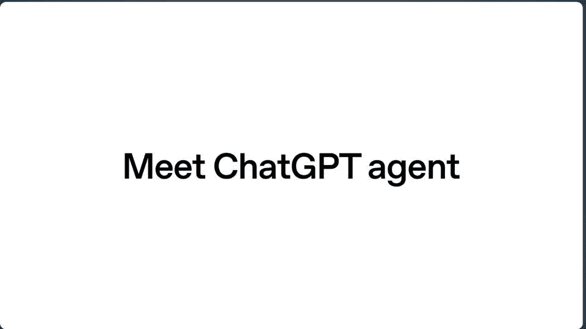

[2025-07-18 04-11-53.mp4](https://internal-api-drive-stream.feishu.cn/space/api/box/stream/download/all/PDhZbFjnEoPfPGx9ttTcRnUunlh)

#### 从“回答”到“行动”——解构革命性智能体

ChatGPT Agent的核心定位是一个统一的智能体系统。它巧妙地融合了OpenAI此前两项前沿研究的精髓：一个擅长通过图形界面与网站交互的Operator，以及一个精于深度信息整合与报告生成的Deep Research。这种结合，让AI同时拥有了能干的双手和聪明的大脑。

为实现这一目标，OpenAI为Agent构建了一个专属的执行环境——一个沙盒化的“虚拟计算机”。这是一个至关重要的架构创新，它为AI提供了一个持久化的工作空间。在这个环境中，Agent可以自由地使用多种工具，如可视化浏览器进行网页交互、代码终端进行数据分析和文件生成甚至包括PowerPoint和Excel，以及通过API连接器与Gmail、Google Drive等外部应用无缝集成。最关键的是，这个环境能跨工具保持状态，意味着Agent在执行多步骤任务时不会“失忆”，从而为其高度的自主性奠定了坚实的技术基础。

尽管能力强大，但OpenAI将“人在环路”（Human-in-the-Loop）作为核心设计原则。在执行发送邮件、确认购买等任何关键操作前，Agent必须征求用户许可。用户可以随时中断任务、手动接管，确保最终控制权始终掌握在人类手中。

#### 性能震撼业界，但并非完美无瑕

为了证明其技术领先地位，OpenAI公布了一系列令人瞩目的**基准测试结果，旨在同时彰明其智商与情商。在被誉为“人类知识最后考卷”的HLE (Humanity's Last Exam)**基准测试中，ChatGPT Agent取得了41.6%的惊人准确率，创造了新的世界纪录。在最难的数学基准FrontierMath上，其准确率也达到了27.4%。

在模拟真实世界工作的**DSBench**上，其表现被评价为显著超越人类水平。在评估电子表格操作能力的SpreadsheetBench上，其45.5%的得分虽不及人类（71.3%），但已将微软的Copilot in Excel（20.0%）远远甩在身后。这些精心挑选的基准，是OpenAI在市场认知战中的战略武器，旨在传递一个明确信号：OpenAI不仅拥有最聪明的AI，也掌握了最能干的AI。

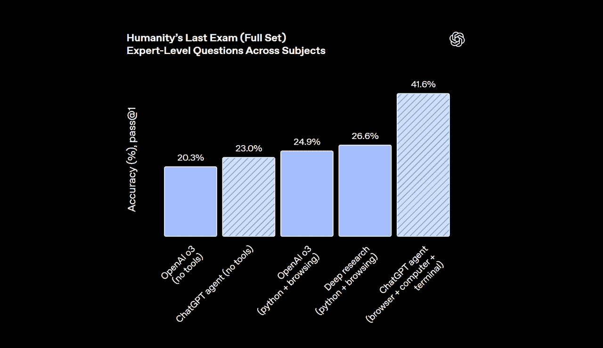

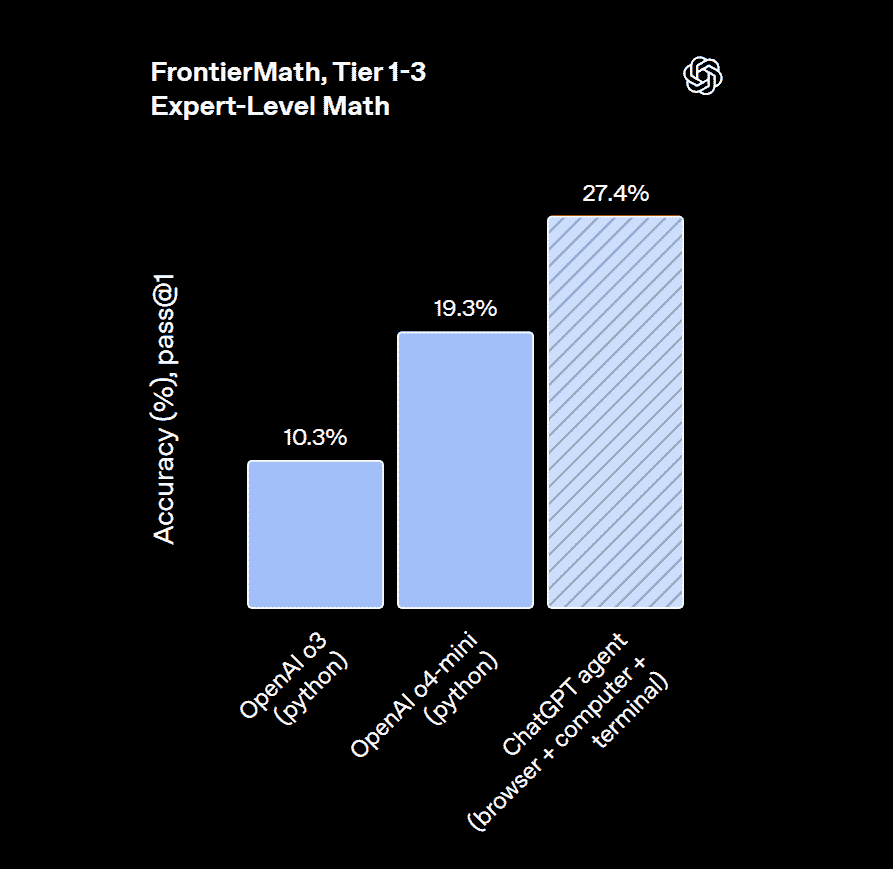

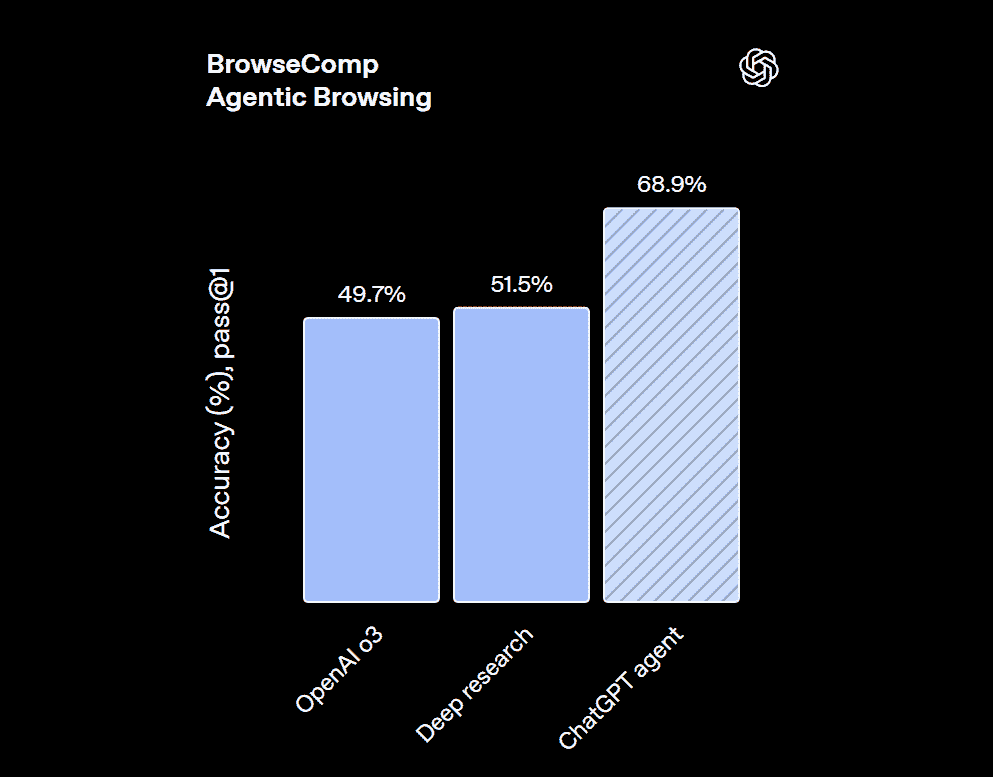

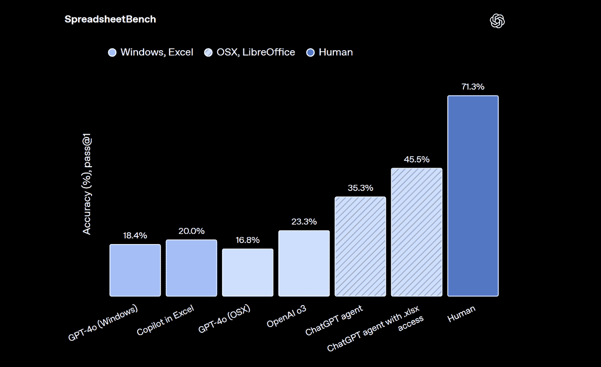

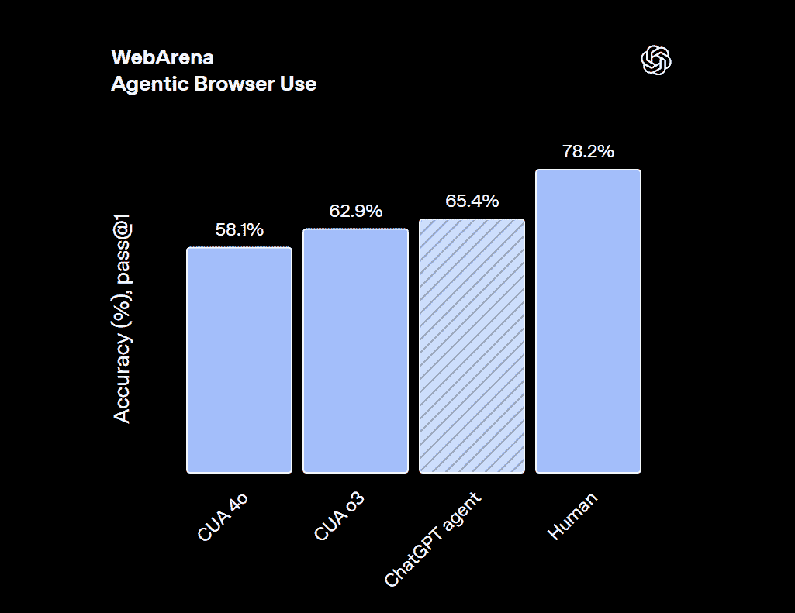

然而，OpenAI也坦诚其局限性。CEO Sam Altman警示用户，应将该产品视为前沿的实验性工具，不应用于高风险场景。其面临着如提示注入等新型安全威胁，并且在处理复杂开放式任务时仍可能失败或产生幻觉，可靠性仍是未来迭代的关键挑战。

#### 群雄逐鹿——方智能体的路线之争

ChatGPT Agent的发布，正式拉开了全球智能体赛道的序幕，而其中最引人注目的，是中美两国在技术路径上的根本分歧。

**C**hatGPT Agent代表了单体全能路线：倾尽资源打造一个极其强大的中央推理模型，并为其配备一个功能全面的工具箱。这是基于其算力与数据优势的技术自信的体现。

而由获腾讯投资的中国初创公司生数科技开发的Manus AI，则代表了多智能体协作路线。它设有一个中央“协调者”，负责调度多个专业化的子智能体，并能灵活调用多个不同的大模型。这种差异并非偶然，而是地缘政治、资源禀赋和市场战略共同作用的结果。在面临尖端算力限制的背景下，中国的多智能体架构是一种更为务实和灵活的选择。

与此同时，其他科技巨头也在加速布局：Google的Project Astra追求与Google生态深度融合的“环境智能”；Anthropic的Claude则明确聚焦企业级市场，以可靠性和安全性为核心卖点。

#### 市场颠覆与未来轨迹

**ChatGPT **Agent最深远的影响，或许在于它扮演了市场教育的催化剂角色。它将“AI智能体”这一专业概念，通过全球最流行的AI应用，推送给了数以亿计的用户。这迫使企业高管的讨论焦点从“我们如何使用聊天机器人？”提升到“我们如何实现整个工作流的自动化？”。一个预计到2031年市场规模将达151亿美元的庞大市场正在被激活。

社交媒体上，“AGI的感觉”与“知识工作者的末日”等讨论交织在一起，反映了公众对这一新技术的敬畏与忧虑。为了应对未来企业内部可能出现的智能体蔓延问题，业界已经开始构想名为“智能体AI网格”的新型架构，旨在让来自不同供应商的多个智能体在一个统一、安全的框架下协同工作。

#### 针对ChatGPT Agent九天老师也做了相关的深度测评，一个视频7分钟带你了解⬇️

<https://player.bilibili.com/player.html?bvid=1ypggzCEBB&spm_id_from=333.1387.upload.video_card.click>

# 【AI动态】月之暗面发布Kimi K2：一场重塑全球AI格局的战略反击

> **北京，2025年7月16日** – 在经历了半年的市场沉寂后，中国人工智能独角兽公司月之暗面（Moonshot AI）于上周深夜“突袭”发布了其最新大语言模型Kimi K2，此举被视为对当前AI市场格局的一次决定性反击，并可能对全球技术竞争产生深远影响。

> 这并非一次常规的产品迭代。Kimi K2是一款拥有惊人万亿参数的开源混合专家（MoE）模型，其在关键性能指标上，特别是自动化编程能力，已超越了包括OpenAI的GPT-4.1在内的全球顶尖模型。分析人士认为，Kimi K2的问世，标志着中国AI力量进入了一个全新的成熟阶段，其核心是模型架构的创新、成本效益的颠覆以及向“AI智能体（Agent）”能力的战略倾斜。

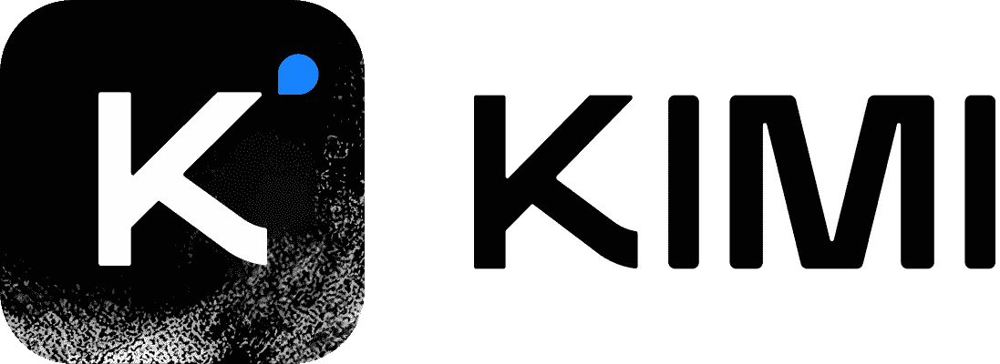

## 背水一战：DeepSeek引发的市场“地震”

Kimi K2的诞生，源于一场严峻的生存危机。2025年初，竞争对手深度求索（DeepSeek）以其高性能、低成本的开源模型颠覆了市场，其应用月活跃用户（MAU）飙升至1.8亿。相比之下，曾是明星产品的Kimi用户增长陷入停滞，MAU徘徊在2000万水平，面临着巨大的市场份额流失压力。

面对困境，月之暗面果断采取了“从烧钱到铸剑”的战略转移。公司暂停了大规模市场营销投入，将资源全力集中于核心技术研发。这段外界看来“没了声音”的时期，正是Kimi K2的秘密孕育期。月之暗面清醒地认识到，在新的竞争范式下，唯有推出在技术上具有压倒性优势的产品，才能扭转战局。

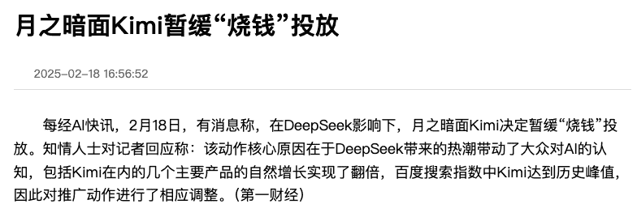

## 技术泰坦：智能体时代的性能王者

Kimi K2的强大，首先体现在其技术架构上。它采用了务实且高效的“战略性模仿与针对性创新”策略。模型在底层继承了经过市场验证的DeepSeek-V3架构，以规避训练万亿级模型的巨大风险。在此基础上，团队进行了外科手术式的精准创新，包括增加专家数量以提升智能，并优化注意力头数以降低长序列任务的计算成本，最终目标是成为“智能体编码领域的领导者”。

这一战略取得了惊人的成功。在被誉为“AI智能体奥运会”的SWE-bench（智能体编码）测试中，Kimi K2取得了65.8%的准确率，不仅碾压了DeepSeek-V3（38.8%），更超越了闭源的行业标杆GPT-4.1（54.6%）。这标志着一个开源模型首次在如此复杂的任务上战胜了最强的闭源对手。

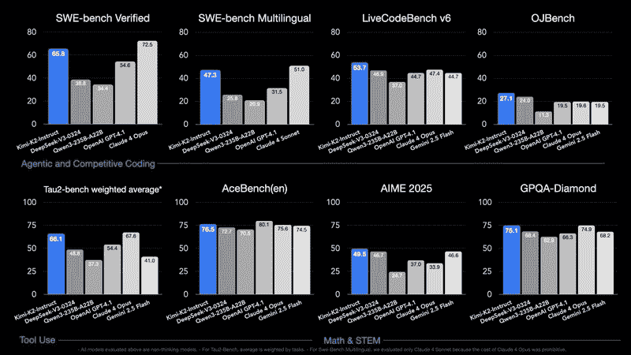

## 顶尖AI的普惠化与经济颠覆

对于消费者而言，Kimi K2的价值在于“顶尖体验的普惠化”。用户可以通过Kimi的应用程序免费使用这一世界级模型，完成从创意写作到复杂任务规划（如制定旅行计划、分析数据）等一系列超越传统聊天机器人的功能。

而其对企业市场的冲击则更具颠覆性。月之暗面将Kimi K2的API（应用程序接口）定价设定在极具竞争力的水平，其成本仅约为Anthropic的Claude 3.5 Sonnet的四分之一到六分之一。结合其开源特性，这意味着企业能以前所未有的低成本，将最先进的“数字劳动力”集成到自身业务流程中，用于自动化软件工程、复杂数据分析和企业流程改造，从而实现生产力的飞跃。

## 中国AI技术

Kimi K2的发布，被视为中国AI开发者生态的一个分水岭事件。它为本土开发者提供了一个强大的、世界级的、不再依赖西方技术的基座，极大地降低了创新门槛，有望在中国催生新一轮的AI应用创新浪潮。

在全球科技竞争的大背景下，此举更具战略意义。它证明了前沿AI创新已不再是硅谷的专利，并有力地推动了中国在“AI+”国家战略下的技术自主进程。分析认为，Kimi K2的出现正在加速全球AI生态的“分叉”，催生一个平行的、日益自给自足的中国AI技术栈的形成。这不仅是中国拥有了一款强大的模型，更是拥有了构建一个完整的、能在全球舞台上竞争的AI产业的独立基石。

---

# 【AI动态】14亿年薪“挖角”引爆科技巨头对决：扎克伯格豪赌未来，苹果陷入危机

> **硅谷，2025年7月15日** – 近期，Meta Platforms以一份价值超两亿美元的多年期天价薪酬包，成功从竞争对手苹果公司挖走其AI基础模型团队负责人庞若鸣（Ruoming Pang）。这一事件不仅标志着硅谷AI人才争夺战进入白热化阶段，更深刻揭示了Meta与苹果在人工智能时代截然不同的战略选择与文化困境。

> 这场高调的人才收购，是Meta首席执行官马克·扎克伯格不计成本追赶AI浪潮的激进策略的缩影，同时也暴露了苹果公司在其引以为傲的创新文化和严格的内部体系下，所面临的严峻挑战。

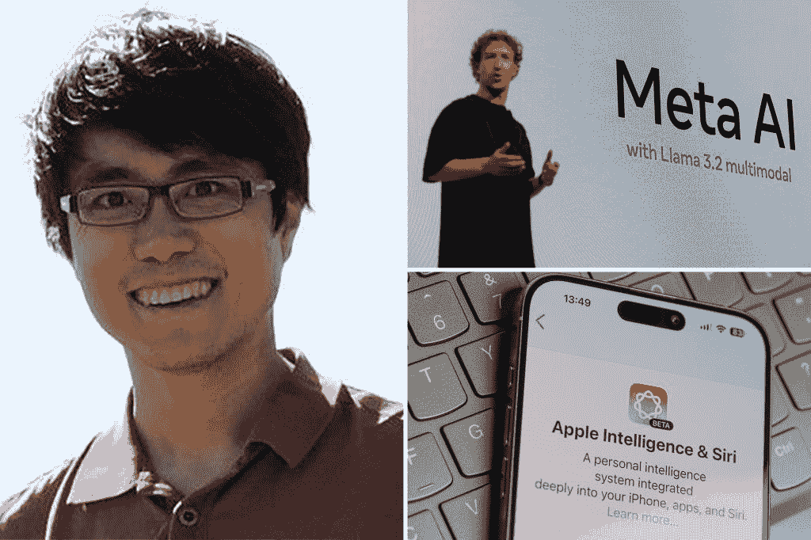

## “黄金手铐”与苹果的审慎退缩

庞若鸣并非普通高管。作为一名在谷歌和苹果拥有深厚履历的华人工程师，他所领导的团队是“Apple Intelligence”计划的核心，其专长在于设计苹果极为看重的设备端高效AI模型。然而，这一技能对正在大力发展智能眼镜和VR头显等硬件的Meta同样具有致命吸引力。

据分析，Meta开出的并非“2亿美元年薪”，而是一个与公司长期表现深度绑定的多年期总薪酬包，主要由基本工资、高额签约奖金和大量限制性股票构成。这种设计如同一副精密的“黄金手铐”，旨在将庞若鸣的个人利益与Meta的长期战略捆绑，确保其在未来数年内为公司全力以赴。

面对Meta的重金攻势，坐拥数千亿现金储备的苹果却出人意料地选择了“不匹配报价”。分析人士指出，此举并非出于财务限制，而是根植于其深层的企业文化。Meta的报价已严重冲击苹果内部森严的薪酬等级体系，在苹果决策者看来，维护内部秩序的公平性，比不计代价留住一位战略级人才更为重要。这种僵化使其在灵活、激进的AI人才市场中处于天然劣势。

## Meta的超级智能赌局

在AI竞赛中处于追赶位置的Meta，正通过一场史无前例的“收购式招聘”豪赌未来。因对内部进展感到失望，扎克伯格亲自下令，系统性地从OpenAI、谷歌DeepMind、苹果等所有主要对手处挖角顶级人才。

今年7月1日成立的“Meta超级智能实验室”（MSL）便是这一战略的旗舰。Meta不仅任命年仅27岁的Scale AI公司CEO Alexandr Wang为首席AI官，更将公司的目标从通用人工智能（AGI）升级为“超级智能”（Superintelligence）——创造远超人类智慧的系统。这一宏大叙事旨在为巨额的人才支出提供合法性，并吸引顶尖人才加入。

然而，金钱并非万能。Meta正面临“传教士 vs. 雇佣兵”的文化困境。大量报道指出，许多顶尖人才因担忧Meta的高压文化、工作与生活失衡以及价值观问题而望而却步。有离职员工将Meta文化形容为“恐惧的文化”。因此，Meta支付的超高薪酬，不仅是为技能付费，更像是在支付一种“文化税”，以弥补其在文化吸引力上的赤字。

## 苹果AI的十字路口

庞若鸣的离职只是苹果AI核心人才流失的冰山一角。公司内部AI/ML部门被员工形容为“AIMLess”（无目标），士气低落，尤其是在公司高层考虑使用OpenAI或Anthropic的第三方模型来驱动新版Siri的传闻之后，内部团队普遍感到不被信任。

苹果赖以成功的封闭生态、完美主义和隐私保护原则，在AI时代正转变为其发展的束缚。AI开发所需的快速迭代、开放测试和海量数据处理，与苹果的文化基因格格不入。这使得苹果陷入了一个战略悖论：其品牌基石正在阻碍其在最重要的技术赛道上进行有效竞争。

面对市值大幅蒸发和投资者的压力，苹果正站在一个艰难的十字路口，面临三个选择：

1.  **战略合作**：租用谷歌或OpenAI的模型，快速弥补短板，但可能牺牲核心技术控制权。

1.  **大规模收购**：打破传统，直接收购一家成熟的AI公司，如Anthropic。

1.  **内部彻底改革**：最艰难的道路，要求苹果进行一次痛苦的文化和战略重塑。

## 中国AI人才市场未来展望：挑战与机遇并存

硅谷的这场“金元战争”正对全球人才市场产生深远影响，尤其对中国的AI发展构成了独特的挑战与机遇。

硅谷爆炸性的薪酬增长，无疑加剧了中国科技公司面临的“人才流失”风险，迫使本土企业提高薪酬以留住核心人才。一个有趣的现象是，当前在中国本土从头部公司（如BAT）挖走一名顶尖AI工程师的成本，有时甚至高于在硅谷招聘同级别的人才。这表明中国本土的顶尖人才竞争已极度激烈，并高度集中。

全球AI人才市场可能将加速形成以美国和中国为核心的两个相对独立的生态系统。中国将继续发挥其在数据规模、应用场景和国家战略支持方面的优势，专注于推动AI在工业、医疗、金融等垂直领域的深度应用和创新。

---

# 【AI动态】Grok“虚拟伴侣”引爆争议，虚拟形象是技术风口还是伦理旋涡？

近日，埃隆·马斯克旗下xAI公司的人工智能聊天机器人Grok推出的“虚拟伴侣”（Companions）功能，再次将“虚拟形象”这一议题推向了风口浪尖。这一新功能允许用户与具备鲜明个性的AI角色互动，首批上线的动漫风格女孩“Ani”和粗俗的红熊猫“Bad Rudi”因其大胆甚至出格的内容，引发了社会各界的广泛争议，也折射出虚拟形象技术发展道路上的机遇与挑战。

根据相关报道，Grok的“虚拟伴侣”功能旨在提供更具个性化和情感连接的交互体验。例如，角色“Ani”会使用较为轻浮的语言与用户交流，而“Bad Rudi”则充满了暴力和反叛言论。这一举动被认为是马斯克延续其“反主流”和“言论自由”理念的又一尝试。

然而，这种“创新”很快引来了批评。美国国家性剥削防治中心等机构指出，这些角色的内容涉及露骨的性暗示和暴力诱导，可能对用户，特别是未成年人产生不良影响。技术层面，用户也反馈角色存在问答延迟、声音不一致等问题。目前，xAI公司尚未对相关争议和技术漏洞做出正式回应。

---

# 【AI动态】Perplexity推出自家浏览器，挑战传统搜索格局

近期，人工智能初创公司Perplexity AI正式推出了其首款AI驱动的网页浏览器“Comet”，直接对标谷歌Chrome和微软Edge等传统浏览器，意图在浏览器市场占据一席之地。

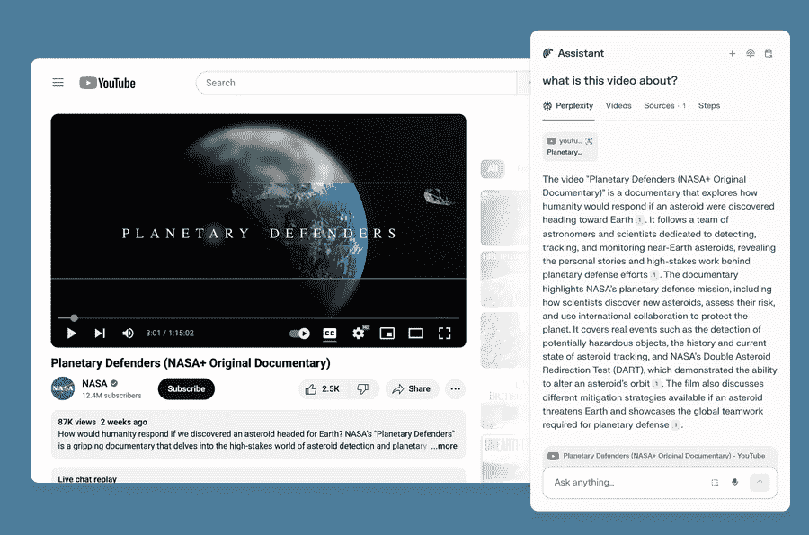

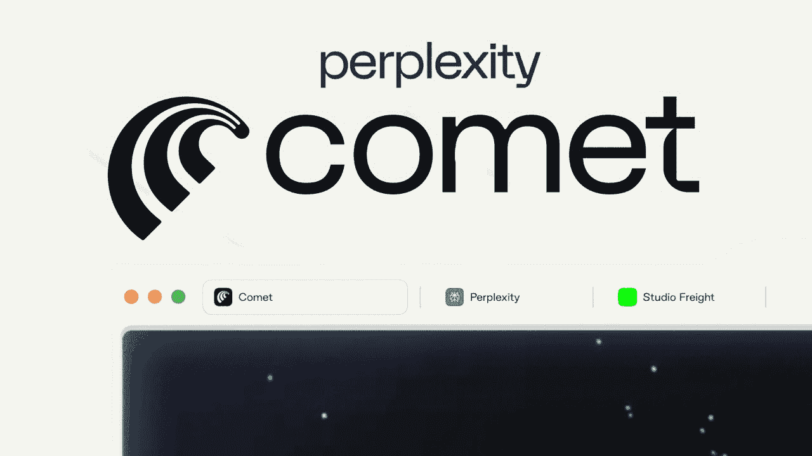

Perplexity的“Comet”浏览器旨在将整个浏览过程转变为无缝的交互体验，将复杂的工作流程简化为流畅的对话。用户可以直接向Comet下达指令，例如根据浏览内容预订会议或发送电子邮件。其核心特性是深度集成了Perplexity自家的AI搜索引擎，并提供了一个侧边栏AI助手，能够理解和分析当前网页内容，无论是总结文章、回答关于YouTube视频的问题，还是分析Google文档中的文本，都无需切换标签页或复制粘贴。

与Chrome等传统浏览器采用的标签页界面不同，Comet引入了“工作区”的概念，让用户能够更快捷地访问所需信息。此外，Comet基于Chromium构建，兼容现有的Chrome扩展程序，并支持一键导入书签和设置，极大地降低了用户的迁移成本。

目前，Comet浏览器首先向每月支付200美元的Perplexity Max订阅用户开放，并为免费用户提供了候补名单。Perplexity表示，未来计划将Comet推广给更多用户，并扩展到其他平台。此举被视为对传统搜索引擎和浏览器市场的一次重要挑战，也反映出AI技术与日常工具软件加速融合的趋势。

---

# **【AI动态】埃隆·马斯克宣布开发**TruthGPT，追求“最大程度的真理”

特斯拉、SpaceX和X的首席执行官埃隆·马斯克宣布，他正在开发一款名为“TruthGPT”的人工智能，其目标是“一个最大程度追求真理、试图理解宇宙本质的AI”。

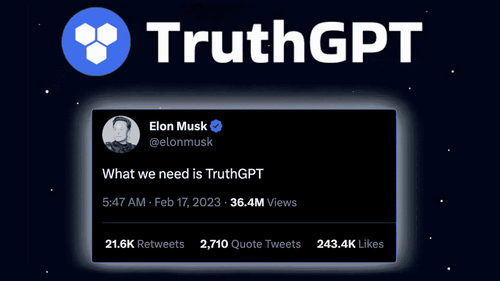

马斯克表示，他担心当前的人工智能，如OpenAI的ChatGPT，被训练得过于“政治正确”，这可能导致它们说出不真实的话。他认为，创建一个致力于追求真理的AI，是通往AI安全的最佳途径。他推断，一个真正理解宇宙的AI，不太可能毁灭人类，因为人类是宇宙中有趣的一部分。

TruthGPT被定位为与OpenAI和谷歌等巨头竞争的“第三个选项”，旨在提供一个不受偏见影响、将探寻真理置于首位的AI聊天机器人。马斯克希望通过TruthGPT，为用户提供一个更加真实、可靠的信息来源，并推动整个AI行业向着更负责任的方向发展。尽管TruthGPT的具体细节和发布时间尚未公布，但这一消息已经引发了业界的广泛关注和讨论。

---

# **【AI动态】AI算力竞赛白热化：Meta、**Anthropic及OpenAI布局未来

随着AI技术的飞速发展，各大科技巨头正在进行一场前所未有的算力竞赛。Meta、Anthropic和OpenAI等公司都在为2026年及以后的AI发展，进行大规模的GPU算力布局和电力消耗规划。

Meta首席执行官马克·扎克伯格宣布，计划投入数百亿美元建设能够支持通用人工智能（AGI）的超级计算基础设施。其核心项目之一是名为“Prometheus”的数据中心集群，计划于2026年上线，功率将达到1吉瓦（GW），这将使其成为全球领先的AI基础设施。此外，Meta还有一个更长期的项目“Hyperion”，计划在未来几年内将规模扩展至5吉瓦。

与此同时，微软、谷歌、亚马逊等云服务巨头也在为AI投入巨额资金。据预测，到2025年，微软将在AI服务器上投入约560亿美元，谷歌约为440亿美元，亚马逊约为480亿美元，而Meta的投入预计为350亿美元。这些巨大的投资反映了训练和运行先进AI模型所需的庞大计算资源。

这场竞赛不仅是关于拥有多少GPU，更是关于如何高效地利用这些资源，以及如何解决随之而来的巨大电力消耗问题。预计到2027年，全球AI用电量将达到60吉瓦，这将对全球能源供应构成重大挑战。

---

# 【AI动态】OpenAI无限期延迟开源模型发布，引发业界关注

在开源社区的热切期待中，OpenAI宣布无限期推迟其备受瞩目的开源AI模型的发布。公司首席执行官萨姆·奥尔特曼表示，需要更多时间进行额外的安全测试和高风险领域的审查。

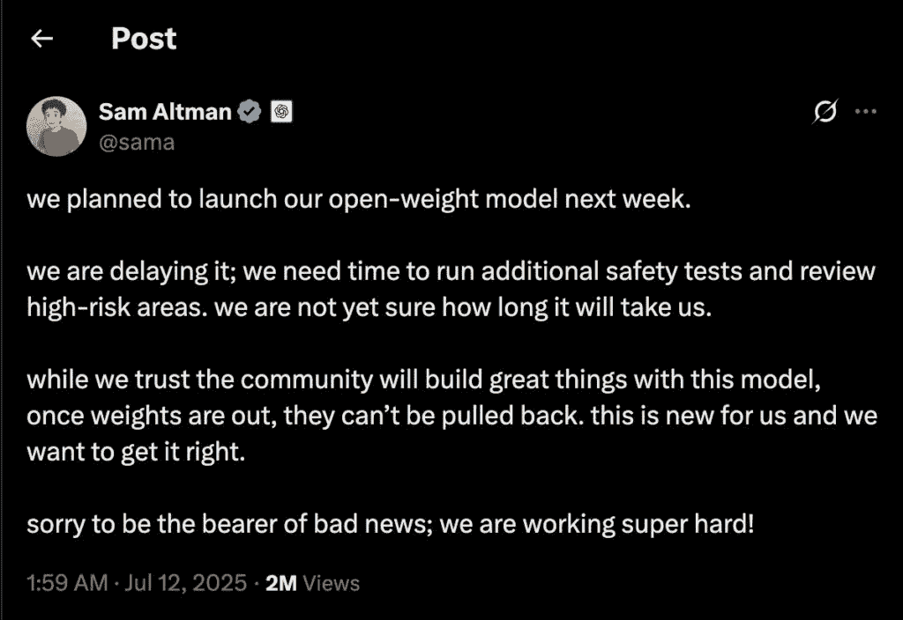

这款被寄予厚望的开源模型，据称其推理能力可与驱动GPT-4o的o系列模型相媲美，并旨在超越所有现有的开源模型。然而，OpenAI表示，其对于开源模型的标准非常高，在确保模型在各个方面都达到引以为傲的水平之前，不会贸然发布。

奥尔特曼在社交媒体上解释说：“一旦模型的权重（weights）被发布出去，就无法收回。这对我们来说是新事物，我们希望把它做好。” 这一决定凸显了OpenAI在推动技术进步与确保AI安全之间的谨慎权衡。

然而，OpenAI的延迟也可能为其竞争对手提供了机会。在开源AI领域，来自中国的DeepSeek等公司已经取得了显著进展，谷歌DeepMind、Anthropic以及埃隆·马斯克的xAI也都在大力投入研发自己的下一代开源模型。此次延迟意味着开发者将需要更长的时间才能用上OpenAI多年来的首个开源模型，也为这场愈演愈烈的AI开源竞赛增添了更多变数。

# 【技术深潜】GraphRAG——融合知识图谱与LLM的增强检索架构

对**于每一位曾将标准RAG（Retri**eval-Augmented Generation）系统推向极限的工程师而言，其核心瓶颈已然清晰：向量搜索擅长寻找“相似”的文本片段，却无法真正理解和推理片段之间的“关系”。这导致RAG在面对需要跨文档、多步骤才能解答的复杂问题时，往往力不从心，输出的答案要么不完整，要么缺乏可信的推理路径。

**然而，一股架构演进的****浪潮正在兴起。从**微软、谷歌云到AWS，全球顶尖的技术巨头正不约而同地将目光投向GraphRAG。这并非偶然，而是市场需求驱动的必然趋势。在金融风控、药物研发、供应链优化等高价值场景中，成功的关键恰恰在于洞察数据背后隐藏的复杂关系网络。Klarna通过GraphRAG驱动的AI助理淘汰1200个SaaS系统，就是这一趋势最强有力的证明。

**GraphRAG的核心****价值在于，它**为AI**系统提供了一**个可供推理的“世界模型”——知识图谱。这使得AI的能力从“事实检索”跃升至“关系推理”，生成的答案不仅更精确、更深入，其推理路径也变得完全可追溯、可审计。这正是将生成式AI从“玩具”变为企业级生产力工具所缺失的关键一环。

本文将摒弃空泛的战略讨论，深入技术腹地，为你全面解构GraphRAG的核心工作流、关键架构组件、主流实现方案及其工程挑战。无论你是希望评估其技术可行性，还是准备动手构建自己的GraphRAG应用，这篇解析都将为你提供所需的硬核知识。

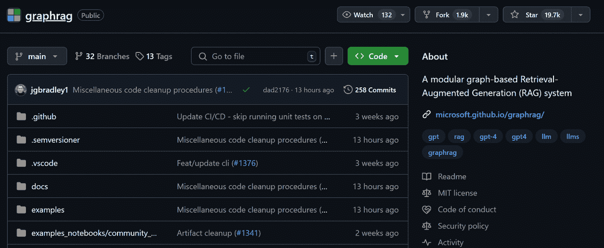

> 项目地址：https://github.com/microsoft/graphrag/

## 背景：标准向量RAG的技术局限

要理解GraphRAG的必要性，首先需要审视标准RAG的内在局限。标准RAG主要依赖于对文本语料库进行分块，然后通过向量相似性搜索来检索与用户查询最相关的文本块。这种方法在处理需要跨文档、跨数据点进行综合分析的复杂查询时，会遇到以下几个核心技术瓶颈：

+   **上下文孤岛与关系丢失:** 文本分块的本质决定了每个数据块都是一个独立的单元。这种处理方式破坏了原始文档或数据源之间固有的语义和实体联系。例如，一个文档块提到“公司A收购了公司B”，另一个文档块提到“公司B是产品C的制造商”，标准RAG很难将这两个孤立的信息点连接起来，以回答“公司A通过其收购间接控制了哪些产品”这类多跳（Multi-hop）问题。

+   **信息稀疏与噪声问题:** 文本块大小的设定是一个难以权衡的工程问题。过小的分块可能导致关键上下文信息的丢失，使得检索到的内容不完整。而过大的分块则容易引入与查询不相关的噪声信息，稀释了有效信号，从而降低最终生成答案的质量。

+   **缺乏可解释性与持久化记忆:** 向量相似性搜索在本质上是一个基于嵌入空间距离的统计匹配过程，其检索逻辑不透明，难以对生成结果的来源进行精确追溯和审计。此外，每次查询都是一次独立的检索，系统无法在多次交互中积累和复用已建立的知识连接，缺乏持久化的记忆机制。

## 技术生态与主流实现

GraphRAG的市场正在快速发展，主要由云服务商和数据库公司推动。

+   **微软:** 微软推出了一个名为 GraphRAG 的开源Python库。其核心流程包括：利用LLM进行实体与关系抽取，然后使用Leiden社区发现算法对图进行层次化聚类，并为每个社区生成摘要。这支持两种查询模式：用于宏观问题回答的全局搜索，以及通过遍历邻近节点进行深度推理的局部搜索。该项目旨在推动一个开放标准，并与Azure AI Search等服务集成。

+   **谷歌云:** 谷歌的参考架构利用其原生云产品栈，通常组合使用Vertex AI（提供LLM和嵌入模型）、Spanner Graph（作为可扩展的图数据库）以及开源框架如LangChain。在这一架构中，LangChain的LLMGraphTransformer等工具可用于从文档中构建图谱，并将其持久化存储在Spanner中。

+   **亚马逊云:** AWS采取了双轨策略。一是通过Amazon Bedrock Knowledge Bases提供全托管的GraphRAG能力，将图谱构建和维护等复杂流程自动化。二是为需要更高灵活性的开发者提供自管理方案，该方案通常将Amazon Neptune（托管图数据库）与AWS GraphRAG Python工具包、LangChain或LlamaIndex等开源工具结合使用。

+   **核心数据库技术:** Neo4j、Memgraph、FalkorDB等高性能图数据库是GraphRAG架构的底层基石，为知识的持久化存储和高效的图遍历查询提供了必要的性能保障。

## 典型技术应用场景

GraphRAG的优势在数据本身具有强网络结构的领域中最为突出。

+   **金融欺诈检测:** 通过构建账户、用户、设备和交易之间的关系图谱，可以高效识别传统规则系统难以发现的复杂洗钱环或欺诈团伙。多跳查询能力对于追踪资金流动路径至关重要。

+   **生命科学与药物研发:** 研究人员可以构建一个连接药物、靶点蛋白、基因、疾病和临床试验数据的知识图谱。通过GraphRAG，可以提出复杂的查询，例如“查找所有与靶点X相互作用、并与疾病Y相关的已知化合物”，从而加速研究进程。

+   **企业知识管理:** 将企业内部分散的文档、项目、团队和领域专家模型化为一个知识图谱。GraphRAG不仅能找到相关文档，还能揭示“谁是这个项目的专家”、“这个技术决策影响了哪些其他产品”，将隐性知识显性化。

+   **供应链分析:** 将供应商、制造商、物流节点和分销商模型化为一个动态图谱。当某个环节出现中断时，可以通过图遍历快速分析其连锁影响，并识别备选方案，提升供应链的韧性。

## GraphRAG与AI智能体的未来

GraphRAG不仅是当前问答系统的改进，更是构建更高级AI系统的基础。

+   **作为AI智能体的长期记忆:** 当前的AI智能体（Agent）大多依赖LLM有限的上下文窗口作为其短暂的工作记忆，这种记忆是无状态且易失的。知识图谱可以作为一个结构化的、持久化的外部记忆系统。智能体可以通过GraphRAG机制查询这个“世界模型”来进行复杂任务规划，并通过交互结果更新图谱，实现从经验中学习。

+   **实现复杂多跳推理:** 图遍历的计算过程在功能上等同于人类的逻辑推理链条。它使得AI能够综合多个离散信息点，回答需要多步推导才能得出结论的复杂问题，这是标准RAG无法实现的。

+   **为LLM提供知识锚定:** **LLM的**幻觉问题是其在关键任务中应用的主要障碍。GraphRAG通过强制LLM的生成过程基于一个可验证的知识图谱，为模型提供了知识锚定，显著提升了输出的准确性和可信度。同时，图中的路径为每个答案提供了清晰的审计线索，实现了真正的可解释性。

### 从看懂到会用，只差一场直播的距离！

> 读完本文，你或许对GraphRAG的强大潜力心潮澎湃，但同时也可能对其复杂的实现细节感到一丝困惑：

+   GraphRAG的API和核心参数到底该怎么用？

+   如何将它与LangChain、Neo4j这些主流技术栈丝滑地结合起来？

+   最关键的，如何从零开始，真正搭建一个看得见、摸得着的应用？

> 别担心，所有答案，我们都为你准备好了。

> **为了帮助**你彻底打通从理论**到实践的“最后一公里”，九天**老师将带来一场纯粹的GraphRAG技术实战直播。在这场直播中，你将不再是旁观者，而是亲历者，老师将手把手带你：

+   **玩转核心API：** 深度掌握GraphRAG官方库的调用方法、核心参数，并实现全局与局部搜索。

+   **打通技术全栈：** 学习如何将GraphRAG与LangChain无缝集成，并利用图数据库Neo4j实现知识图谱的持久化存储与可视化分析。

+   **落地真实项目：** 跟随老师的脚步，从零到一，亲手搭建一个从后端API到交互式前端的完整GraphRAG问答系统。

立即扫描右方二维码，加入学习交流群

**领取学习课件+项目源码，**让GraphRAG成为你真正的技术利器

# **【代码现场】****最热门智能体开发技术栈，最低零代码开发企业级Agent！LangC**hain&LangGraph+MCP技术实战，双向MCP接入与封装双向开发实践！

LangGraph+MCP，前者是LangChain技术生态中最通用的Agent框架，而后者则是能够一键接入千万种实用工具的智能体开发利器。二者强强联合，就是目前智能体开发最佳技术栈没有之一。

九天老师将带你带你从零开始，学习LangGraph+MCP完整技术实践。

**S**tep1:实操在LangGraph中接入包括自定义MCP、开源MCP和在线MCP等三类MCP工具的完整流程。

Step2:同时借助时下热门MCP工具，动手搭建三项高价值智能体

1、是浏览器自动化智能体，借助Filesystem MCP和FireCrawl MCP，实现全自动网络爬虫和信息本地保存

2、创建出行规划智能体，借助最新的12306 MCP和高德MCP，搭建一站式全国出行规划助手

3、借助自定义的MCP工具，创建拥有NL2SQL、Python代码解释器等功能在内的AI数据分析智能体。

**Step3:不写一行代码，就通过我们团队独家研发**的工具，快速搭建和测试自己的MCP智能体

通过这些实操案例，带大家快速积累LangGraph+MCP的实战开发经验。

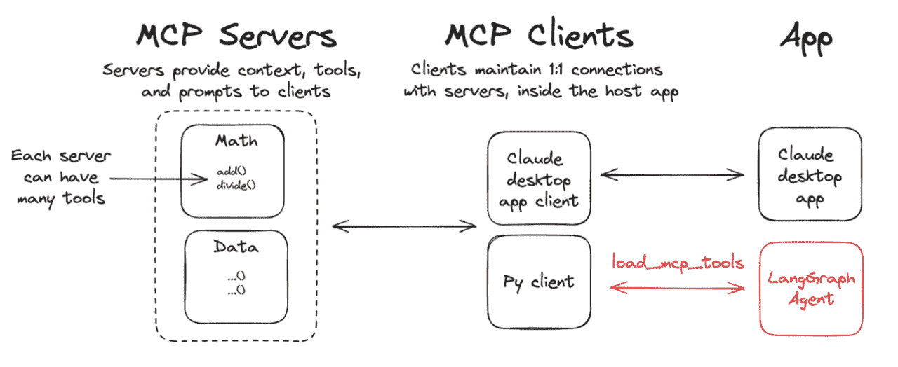

> 立即点击下方链接，观看完整视频，立即解锁这套智能体开发的教程和资源包！ 👇

<https://player.bilibili.com/player.html?bvid=1bzMdzkERM&spm_id_from=333.1387.homepage.video_card.click>

# **【代码现场】**大模型幻觉克星，DeepResearch开发实战！从零手搓DeepResearch，实操三类主流开发范式，谷歌开源DeepResearch国内适配开发与本地部署

幻觉，是大模型技术落地应用最大障碍之一，相信大家都曾遇到过大模型无中生有胡乱编造事实的情况，而要解决这一问题，DeepResearch就是最佳技术方案。

如果你想：

+   亲手从零开始，构建属于你自己的 DeepResearch 智能体

+   深入了解并实践三种主流的 DeepResearch 架构，包括如何实现多智能体协同工作和自我反思式查询

+   掌握谷歌最热门的 **gemini-fullstack-**langgraph-quickstart 项目，并获取我们团队独家修改的源码

所有这些问题的答案，以及完整的代码、项目模板和2小时的硬核技术教学，都在视频里。

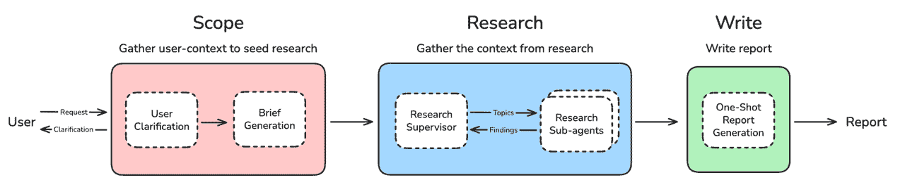

> 立即点击下方链接，观看完整视频，亲手终结大模型的幻觉问题！ 👇

<https://player.bilibili.com/player.html?bvid=1SZubzBEVt&vd_source=a24c7d9e1eecb37ae5aa737b142f51f6>

> 如果你也在关心AI世界的风云变幻、大模型与智能体的走向、技术背后的权力博弈，记得关注我们的文档和其他账号。我们带你看懂真正重要的那1%。

---

# 点击下面链接与我们产生更多连接✨

---

九天Hector 哔哩哔哩：https://space.bilibili.com/385842994

九天Hector 抖音： https://v.douyin.com/lqASAa2Hs_0/

九天Hector 小红书：https://www.xiaohongshu.com/user/profile/62321335000000001000885e

九天Hector YouTube：https://www.youtube.com/channel/UCj8tyDLSxIdivnweBnG4H9Q/

赋范大模型全栈技术社区请点👉：https://kq4b3vgg5b.feishu.cn/wiki/space/7257794425391579164