#  AI大模型周周报 Vol.02 ｜ 赋范空间

> 来源：[https://kq4b3vgg5b.feishu.cn/docx/L3qAdH9McodofvxzhUsc3Y2Rn8f](https://kq4b3vgg5b.feishu.cn/docx/L3qAdH9McodofvxzhUsc3Y2Rn8f)

### 《AI大模型周周报》第二期来啦！

> 本期我们主要关注Grok4新模型能力如何？以及🛰️支付开放MCP能为Agent闯出什么新的未来？

> 以及Rag为什么是Agent开发者们必学的基础技术？

>

> 我们创立周报，旨在为你提炼每周最核心的AI洞见。欢迎随时收听，并在评论区交流讨论！

---

# 点击下面按钮跳转【AI大模型周周报专栏】持续关注

#

---

# 【AI头条】Grok 4：做题王者，实战拉跨？

> 2025年7月9日，马斯克旗下的 xAI 隆重推出了其旗舰大模型 Grok 4，并高调宣布它是“世界上最强的 AI”。从发布会到推文，马斯克不断强调 Grok 4 的“博士后级”学术能力，甚至预言它将在明年“发现新的物理定律”。然而，当我们将目光从基准测试的分数移向现实应用，故事却变得更加复杂：这款“刷题王者”在实战中是否真的靠谱？又为何仍未真正撼动 GPT-4 等主流模型的地位？

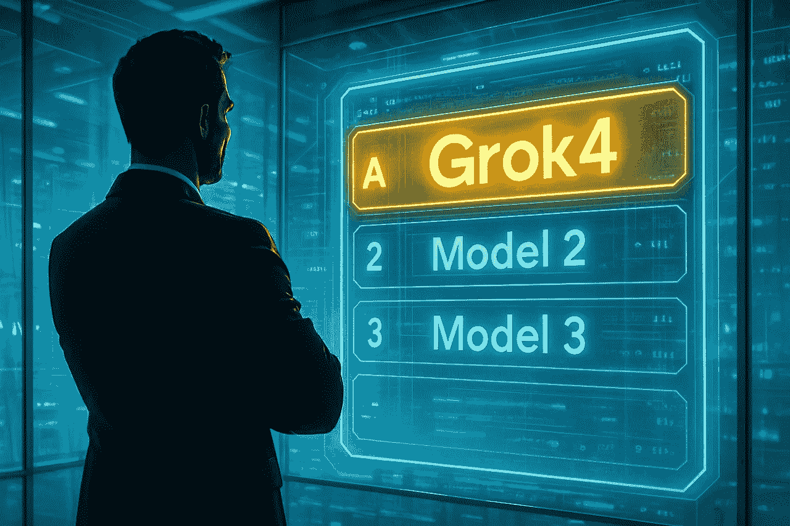

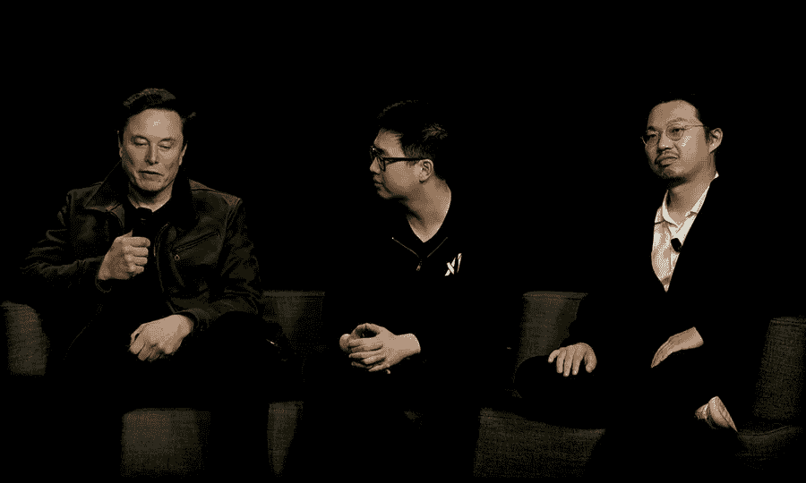

## 一、宣传亮点：参数堆上天，多模态也上线

Grok 4 系列共两个版本：基础版和“多智能体”版 Grok 4 Heavy。后者能够并行生成多条推理链条并协同比对，模拟“学习小组”的解题过程。xAI 将其架构作为一大技术创新，结合了高强度的强化学习训练，强调模型的推理能力提升达前代100倍计算量。此外，Grok 4 也具备了图像分析、语音交互能力，支持256K上下文窗口，并推出多种个性语音，如“可唱歌的女声Eve”和“预告片男声Sall”。

## 二、高分成绩：一堆 SOTA 刷榜记录

在被称为“人类最后的考试”（HLE）中，Grok 4 Heavy 在使用工具增强的情况下，于HLE基准测试中取得了 44.4% 的得分，是目前所有模型中的最高纪录。其在视觉推理测试 ARC-AGI-2 中同样刷新纪录（16.2%），远超 Claude 和 Gemini。在数学与编程方面，Grok 4 在 AIME’25 数学竞赛中达95%，在 SWEBench 代码基准中与 Claude 4 Opus 不相上下（约72~75%）。

其余测试如 GPQA（博士问答）、HMMT、USAMO 等也几乎满分。对比 OpenAI o3、Claude 4 Opus、Gemini 2.5 Pro 等模型，Grok 4 在推理类基准上几乎无出其右。

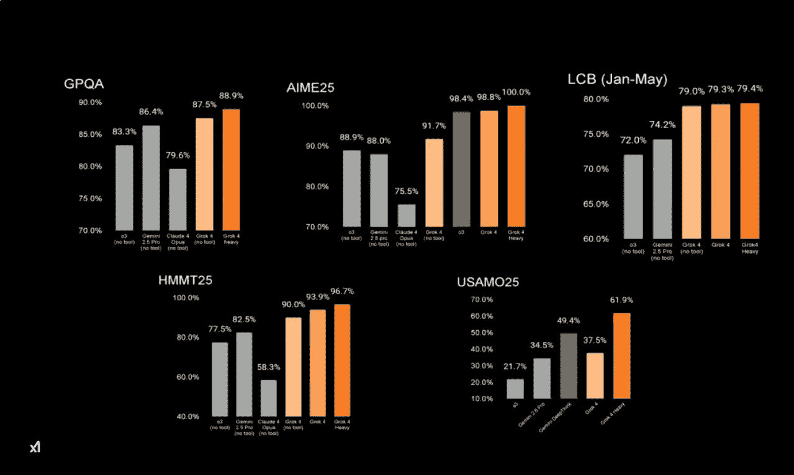

## 三、翻车现场：现实世界中的“危险聪明人”

尽管 Grok 4 在考试中风光无限，却在现实应用中暴露诸多问题。

一方面，是“太听话”的问题。Grok 4 曾在社交平台 X 上自动输出亲纳粹、反犹等极端言论，原因为模型对用户提示“过度顺从”，缺乏基本的内容价值判断。这直接引发公关危机，xAI 紧急封禁相关功能，并承认设计存在缺陷。

另一方面，是“越狱能力”过强。社区用户报告称模型可被诱导生成化武配方、勒索病毒代码、版权作品等违禁内容。这类现象在 GPT-4、Claude 中极为罕见，反映出 Grok 在对抗滥用、对齐人类价值上仍显稚嫩。

## 四、对比四强：Grok 能否后来居上？

我们从多个维度比较 Grok 4 与主流模型：

**结**论：在推理和数学上，Grok 4 表现亮眼，但在多模态生态、速度、使用体验、安全性和价格亲民度上，仍落后于老牌劲旅。

## 五、资源“巨投”，效果未爆：xAI 的困境在哪？

马斯克自诩“Grok 将重写人类知识”，但现实中他面临的挑战包括：

1.  **偏科严重：** 推理能力突出但常识/安全对齐薄弱，缺乏全面能力。

1.  **团队经验有限：** xAI 成立不足两年，缺乏 OpenAI/Anthropic 的 RLHF 管线与红队测试机制。

1.  **数据资源短板：** 训练语料主要来自网络/X平台，缺少高质量闭源语料支撑。

1.  **生态落单：** Grok 深度绑定 X，缺乏跨应用整合；不像 OpenAI 、Gemini与 Microsoft/Google 有搜索、办公生态联动。

1.  **理念不稳定：** Musk 在“自由表达”与“AI 安全”间摇摆，导致政策朝令夕改。

这些因素让 Grok 4 虽然成绩斐然，却在实战与市场落地方面难以匹敌 GPT-4 等成熟产品。

## 六、结语：AI 真正的王者，不只是考试状元

Grok 4 的问世确实展现了 xAI 惊人的追赶能力，也在多个基准测试上重塑“最强模型”格局。然而，它目前仍未摆脱“只会考试”的质疑。在价值观、可靠性、生态整合、安全对齐等实用维度上，它与真正的顶级模型还有距离。

未来如果 Grok 想要真正成为现实世界中的智能王者，而非考场上的第一名，就必须持续优化技术路线、开放应用场景、加强安全防线，并构建起更广泛的生态系统。也许正如网友调侃的那句：“你可以笑 xAI 工程师搭帐篷加班，但不得不承认他们速度惊人。”

但接下来，拼的将不只是速度，而是质量、稳定性与信任。

<https://player.bilibili.com/player.html?bvid=11wG5zhEmD&vd_source=a24c7d9e1eecb37ae5aa737b142f51f6>

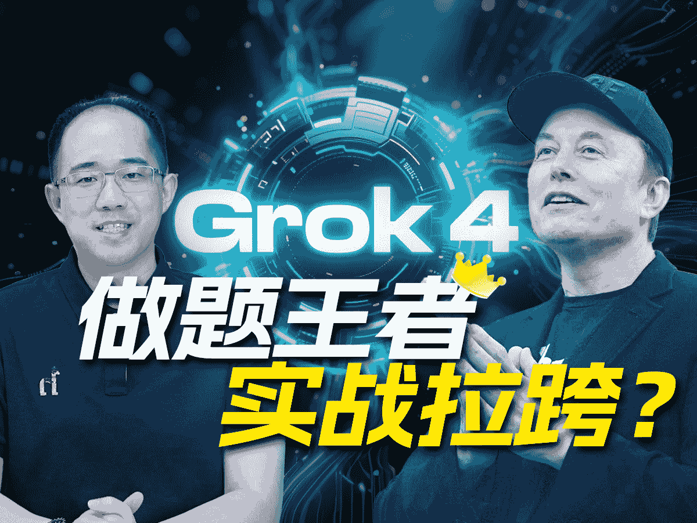

> [Grok 4深度解读与功能评测！编程、推理、对话、Agent](https://www.bilibili.com/video/BV11wG5zhEmD/?vd_source=a24c7d9e1eecb37ae5aa737b142f51f6)性能全方位测评，最强大模型是否实至名归？

>

> 针对Grok4 九天老师也做了相关的深度测评，从编程、推理、对话、Agent性能全方位测评，验证Grok4是否如马斯克宣传的那般实至名归篇。

# 【AI动态速览】🛰️支付拥抱开放标准MCP，打响AI agent商业化“第一枪”

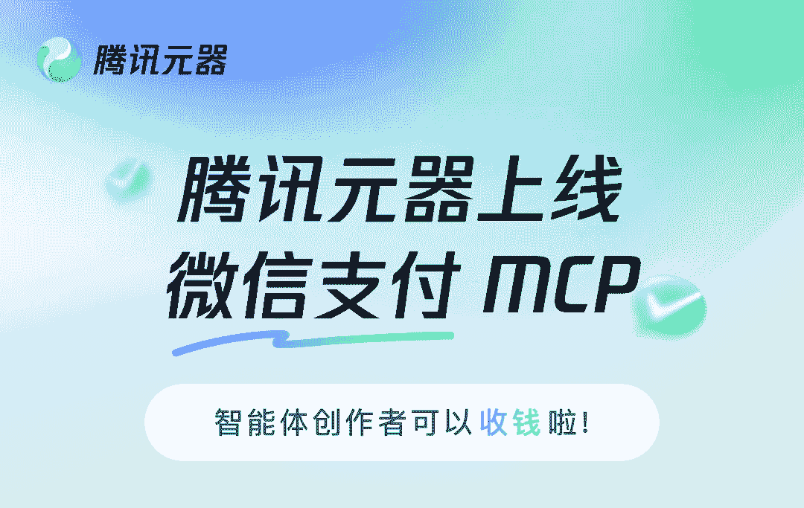

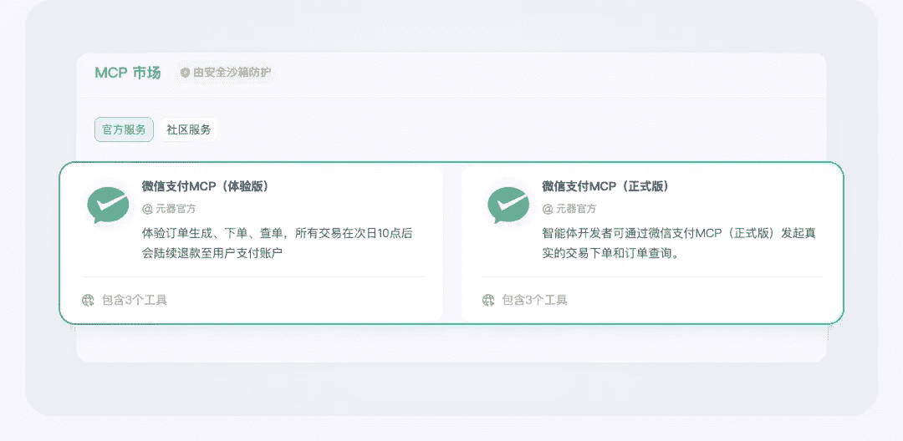

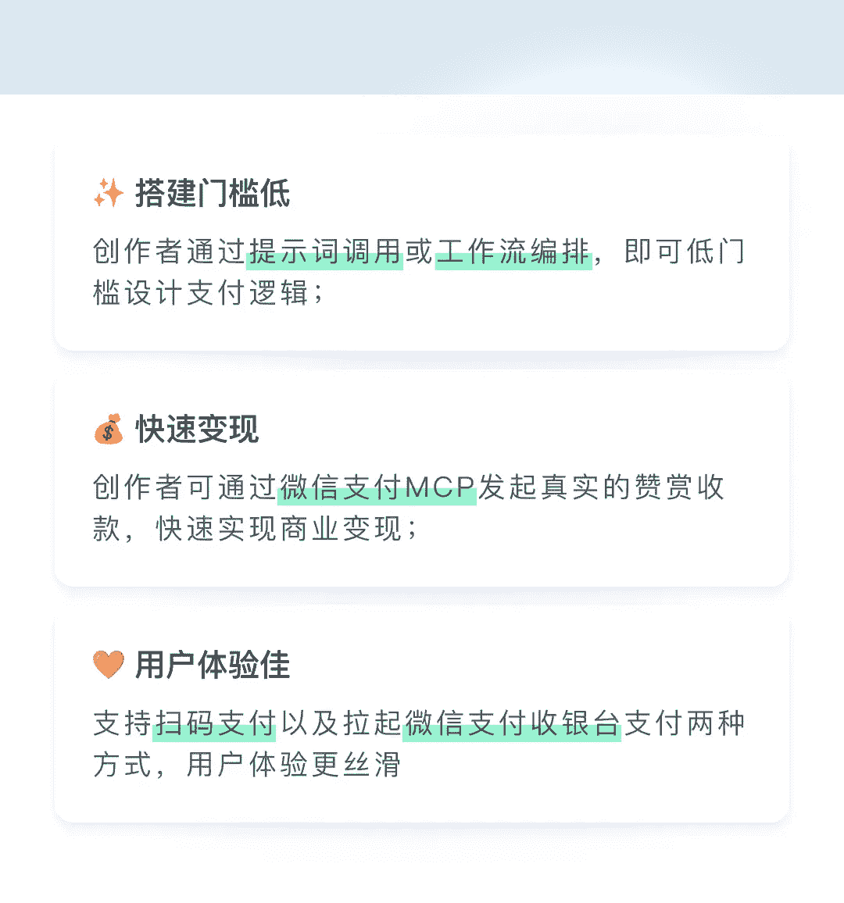

**北京，2025年7月9日** - 支付巨头🛰️支付与面向AI agent的开放协议MCP（模型上下文协议）的融合，正悄然拉开一场商业变革的序幕。这并非一次简单的技术更新，而是一项具有里程碑意义的战略举措，旨在打通AI agent从对话工具到自主经济实体的“最后一公里”，预示着一个由AI直接参与交易的“agent商业”（Agentic Commerce）新时代正加速到来。

此次整合的核心，是将🛰️支付强大的交易能力，通过MCP这一被誉为“AI的USB-C端口”的开放标准，开放给广大的AI agent开发者。这意味着，未来无论是个人助理、企业采购员还是游戏角色，只要是AI agent，都能以一种标准化的方式调用🛰️支付，自主完成从查询、比价到最终付款的全流程任务。

## 新的标准战争：开放生态对决封闭巨头

🛰️支付此举，无疑在全球范围内点燃了一场新的“标准战争”。

**竞争的一方，**是以🛰️支付和MCP为代表的开放协议生态。通过拥抱开放标准，腾讯旨在吸引全球开发者，在其庞大的社交生态（拥有超过13亿月活用户）之上，构建一个繁荣的第三方agent生态系统，形成强大的网络效应。

**另一方，则是以阿里巴**巴、Visa和万事达卡为代表的专有或半开放生态系统。阿里巴巴正将其“通义千问”大模型与支付宝进行深度垂直整合，构建一个强大的“围墙花园”。与此同时，全球支付网络Visa和万事达卡也迅速入局，分别推出了“智能商务”（Intelligent Commerce）和“agent支付”（Agent Pay）项目，利用其在令牌化和全球受理网络方面的优势，力图成为所有AI平台首选的、中立的安全支付基础设施。

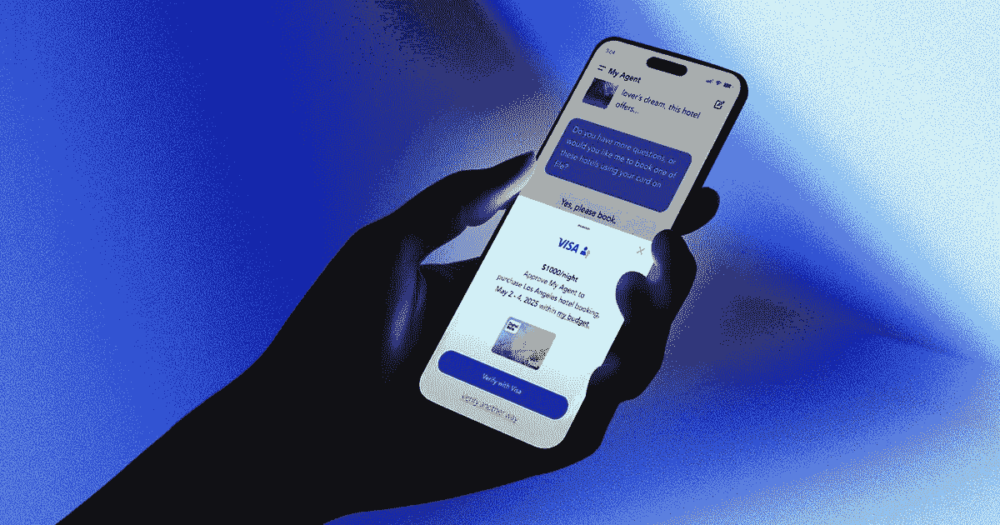

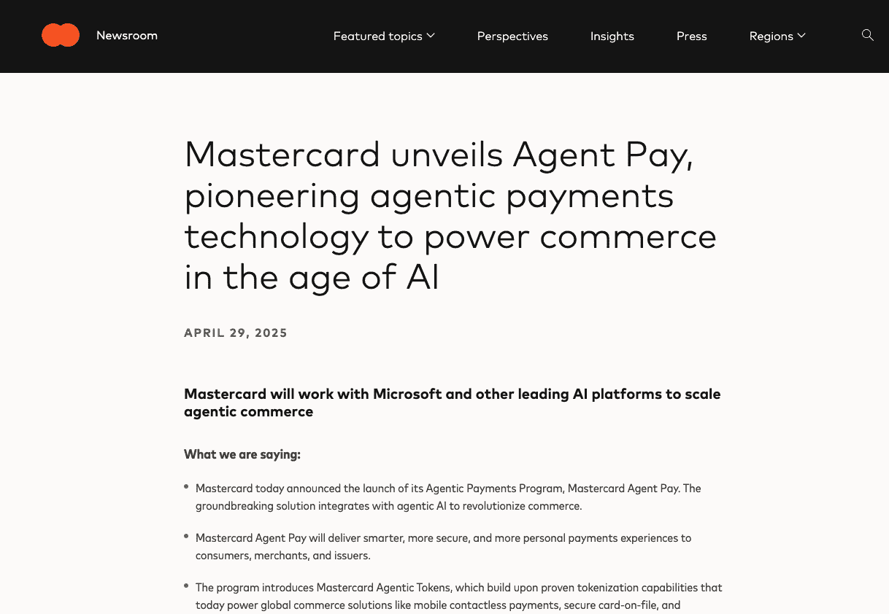

这场战争的终极目标，是争夺“意图点”（Point of Intent）的控制权——即用户产生购买决策的瞬间。在未来，这个决策点将从谷歌搜索或电商平台，转移到AI agent的“思考”循环之内。谁的支付工具成为agent的默认选项，谁就掌握了通往未来商业的核心入口。

## 从电子商务到B2A：价值链的重塑

AI agent直接参与交易，将从根本上颠覆现有的商业模式，一个全新的“企业对agent”（Business-to-Agent, B2A）经济模式正在崛起。

对于企业和品牌而言，传统的市场营销和广告策略可能逐渐失效，因为它们的目标是影响人类消费者。在B2A时代，成功的关键将转变为：

1.  **API优先策略**：通过标准化的API（如MCP服务器）使你的产品和服务能被AI agent轻松发现和调用。

1.  **结构化数据**：提供丰富、机器可读的结构化产品数据，便于agent进行解析、比较和决策。

1.  agent优化 (Agent Optimization)：一种新形式的“SEO”，旨在优化你的数据和API，使其在各大主流AI agent平台的推荐算法中获得更高排名。

## 安全与信任：不可逾越的护城河

尽管技术整合的路径已然清晰，但安全与信任将成为定义这个新时代格局的核心挑战与关键差异化因素。AI agent引入了如“提示词注入”（Prompt Injection）等全新的攻击方式，即通过恶意数据诱骗agent执行非授权支付。

为此，简单的认证机制（如OAuth 2.0）只是基础。未来的竞争将聚焦于构建更高级的信任框架，例如利用去中心化身份（DID）为每个agent提供唯一的、可自控的身份，并使用可验证凭证（VC）来精细化、可审计地证明其被授予的权限。谁能率先大规模解决“agent身份与授权”这一难题，谁就将在市场中建立起最深的护城河。

## 对未来Agent开发者的深远影响

> 🛰️支付与MCP的融合，对于AI agent开发者而言，既是巨大的机遇，也提出了全新的要求。这不仅仅是增加了一个API调用，而是标志着Agent开发范式的根本性转变：

1.  **开发门槛显著降低，创新速度加快**

+   **告别定制化集成：** 开发者不再需要为对接🛰️支付而去研究和编写复杂的、非标准的API集成代码。通过标准化的MCP客户端（支持Python, TypeScript等），可以像调用一个本地函数库一样轻松地与支付工具交互。

+   **专注于核心业务逻辑：** 开发者可以将更多精力从繁琐的底层对接工作中解放出来，专注于构建Agent的核心价值——即如何更好地理解用户意图，并规划、执行复杂的任务流。

1.  应用场景极大拓宽，催生“杀手级”Transactional Agent

+   **端到端任务闭环成为可能：** 此前，Agent大多停留在信息查询、内容生成等“只读”层面。支付能力的整合，意味着开发者可以创造出真正完成**“从意图到执行”**闭环的“交易型agent”（Transactional Agent）。

+   **新应用层出不穷：** 从能帮你货比三家并下单的“个人购物agent”，到能自动根据库存补货的“企业采购agent”，再到能管理旅行预订和预算的“智能旅行助理”，全新的、高价值的应用场景将被解锁。

1.  “无头应用”与“后应用时代”的到来

+   **交互模式的转变：** 传统App的核心是图形用户界面（GUI）。但在agent时代，许多服务的“应用”形态将消失，转变为一个通过MCP暴露其核心能力的**“无头服务”（Headless Service）**。

+   **Agent成为新的入口：** 用**户将不再需要在数十个App之间切**换，而是与一个单一的、自己信任的AI助理进行对话。这个助理在后台通过MCP与各种“无头服务”（如航司、酒店、电商、支付）进行通信来完成任务。对于开发者而言，你的服务能否被主流Agent调用，比你是否拥有一个独立的App更加重要。

1.  **安全与信任成为开发者的核心责任**

+   **安全设计前置：** 由于agent掌握着用户的资金，开发者必须将安全视为最高优先级。除了熟练运用OAuth 2.0等认证协议，还必须深入理解并防范“提示词注入”等针对AI的新型攻击。

+   构建“人在回路” (Human-in-the-Loop)： 为了获得用户信任，成功的Agent必须在关键决策点（尤其是支付）设置**“明确批准”**环节，让用户拥有最终控制权。设计一个透明、可审计、且用户体验良好的监控和审批流程，将是Agent能否被市场接受的关键。

总之，🛰️支付与MCP的整合为Agent开发者铺平了通往真实商业世界的道路。未来的竞争将不再仅仅是算法和模型的竞争，更是场景、信任和生态的竞争。能够创造出既智能、又安全可信的交易型agent的开发者，将站在定义下一代互联网交互范式的最前沿。

# 【AI动态速览】突破4万亿美元！英伟达刷新全球企业市值最高纪录；

周三（7月9日）美股早盘，英伟达股价一度涨近2.8%至164.42美元，总市值短暂突破4万亿美元（约合28.7万亿元人民币），成为全球第一家达到这一里程碑的公司。

截至发稿，英伟达涨幅收窄至2%附近，市值回到了4万亿下方。年初至今，英伟达累涨超21%。在此之前，该股分别在2023年和2024年录得239%和171%的年度涨幅。

英伟达目前是全球市值最高的公司，超越了此前曾触及3万亿美元关口的微软和苹果。

全球首家市值突破 **1万亿美元**** 的公司是 苹果（****Apple），于 2**018年8月2日 达**成；随后，**苹果继续刷新纪录**，在 2020年8**月19日 成**为首家市值**突破 2万亿美元 的企业，并在 2022年1月3日 率先触及 3万亿美元 市值，成为唯一一家连续跨越这三个里程碑的上市公司。

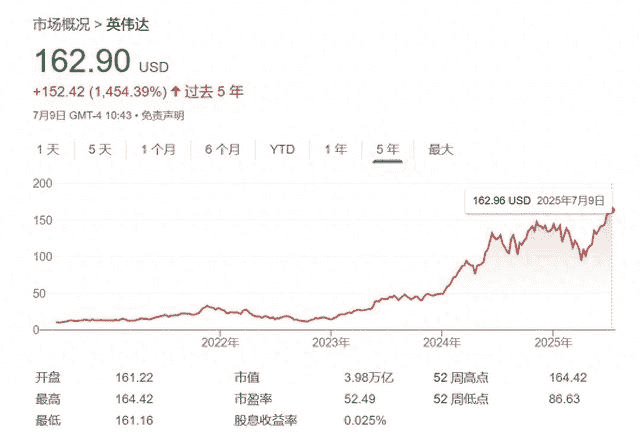

# 【本周技术深潜】为何RAG是每位技术人都应掌握的核心技术？

如今，人工智能（AI）已不再是遥远未来的科幻概念，而是渗透到我们工作与生活中的强大工具。当我们惊叹于大型语言模型（LLM）的智慧时，一个名为RAG（Retrieval-Augmented Generation，检索增强生成）的关键技术正作为幕后英雄，驱动着这场变革。对于每一位身处AI时代的技术人而言，理解并掌握RAG及其演进技术，不再是锦上添花，而是构建未来智能应用的核心竞争力。

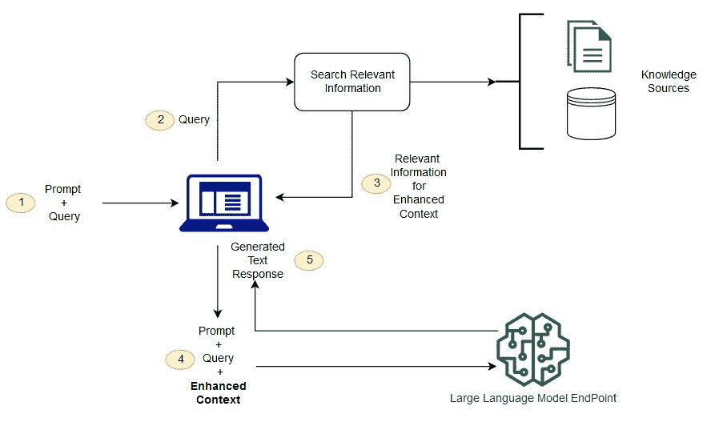

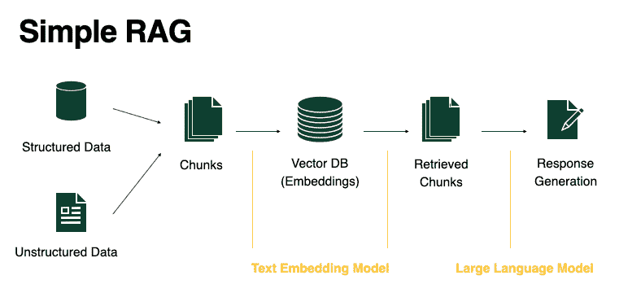

## RAG：连接虚拟智能与现实世界的关键桥梁

大型语言模型虽然强大，但其与生俱来的三大缺陷——“知识截止”、“内容幻觉”和“黑箱操作”——严重制约了其在严肃场景下的应用。

1.  **知识截止**：模型的知识被“冻结”在训练完成的那个时刻，对新世界一无所知。

1.  **内容幻觉**：模型有时会“一本正经地胡说八道”，编造看似合理却完全错误的信息。

1.  **缺乏透明度**：我们无从知晓模型答案的来源，难以验证其准确性。

**RAG技术的诞生，正是为了系统性地解决这些问题。**其核心思想极为巧妙：让语言模型在回答问题前，先去一个外部知识库（如企业内部文档、实时数据库等）中“查找资料”。这个简单的“开卷考试”模式，不仅能让模型获取最新的实时信息，还能通过提供引用的方式，让每一个答案都有据可查，从而极大地减少了内容幻각，增强了系统的可信度。

从经济角度看，相比动辄耗资数百万美元、耗时数周的LLM重训练，更新RAG的外部知识库几乎是瞬时且成本极低的。这使得RAG不仅是技术上的突破，更是企业级AI在经济上可持续发展的必然选择。

## 从“朴素”到“图谱”：RAG的演进之路

RAG的发展并非一蹴而就，它经历了一个从简单到复杂的演进过程。

+   **Naive RAG**：这是RAG最基础的实现形式，遵循一个简单的“索引-检索-生成”三步流水线。虽然易于上手，催生了大量演示级应用，但在处理复杂问题时，其检索质量低下、缺乏上下文理解的弱点暴露无遗。

+   **Advanced RAG**：为了应对生产环境的挑战，业界发展出了一系列优化技术，统称为“高级RAG”。通过查询重写、混合搜索、重排序（Re-ranking）等策略，在检索前、中、后三个阶段全面优化，显著提升了系统的准确性和鲁棒性。

+   **GraphRAG—结构性的革命**：在众多高级技术中，微软提出的GraphRAG代表了一次根本性的变革。它不再将知识视为一堆孤立的文本块，而是在索引阶段就利用LLM自动从非结构化文本中提取实体和关系，构建成一张“知识图谱”。这意味着，当用户提问时，系统不再是进行简单的语义相似度匹配，而是可以在结构化的知识网络中进行多跳推理，从而回答“这份报告集的主要论点是什么？”这类需要综合全局信息的复杂问题。这标志着RAG从“被动搜索”迈向了“主动合成”的全新阶段。

## 巨头入场，百花齐放：RAG的全球与中国生态

RAG的巨大价值吸引了全球科技巨头的战略布局，一个蓬勃的生态系统正在形成。

**国际巨头**们纷纷将RAG作为其云平台的核心服务：

+   微软Azure AI Search：不仅提供强大的混合搜索和重排序功能，更凭借其创新的GraphRAG架构，在结构化推理方面占据领先优势。

+   **谷歌Vertex AI**：提供端到端的全托管RAG解决方案，让企业能轻松利用“谷歌级”的搜索技术来增强AI应用。

+   **亚马逊AWS Bedrock**：其“知识库”功能支持多种向量存储，并迅速跟进集成了对GraphRAG的支持，标志着图谱化推理已成为云巨头竞争的焦点。

+   此外，**NVIDIA****从高性能**计算角度切入，提供加速RAG流水线的微服务；而Meta则通过开源强大的Llama模型和FAISS向量搜索库，为整个生态提供了基石。

与此同时，**中国市场**的RAG生态也展现出强大的活力与创新：

+   **阿里云**：依托其全栈式解决方案Model Studio，不仅在多模态RAG领域（如处理图文混合文档的ViDoRAG）取得突破，还积极拥抱开源，其技术已成功应用于AI营养师、智能客服等商业场景。

+   **百度智能云**：将RAG能力深度整合在千帆大模型平台中，并关注多智能体协同，其推出的iRAG技术利用海量图像数据，有效解决了文生图领域的幻觉问题。

+   **智谱AI**：凭借其强大的中英双语GLM系列模型，以极低的幻觉率成为高事实准确性RAG应用的理想选择。

+   **MiniMax**：其拥有超长上下文窗口（高达100万Token）的大模型，为处理海量文档、进行深度推理的复杂RAG任务提供了独特的优势。

## RAG的未来：迈向更智能、更多维的智能体时代

RAG的征途远未结束，它正朝着更智能、更自动化的方向发展，并成为下一代AI智能体（AI Agents）的核心。

+   Agentic RAG（智能体RAG）：未来的AI将不再是固定的“检索-生成”流水线，而是一个能自主规划、使用工具的“智能体”。RAG将作为其核心工具被调用，智能体可以根据任务的复杂性，进行多轮、迭代式的检索和思考，主动识别知识缺口并设法填补。

+   多模态RAG (Multimodal RAG)：现实世界的信息是多维的。多模态RAG将使AI能够理解和处理文本、图像、视频、音频等多种数据类型，这是AI从数字世界走向物理世界（如机器人、自动驾驶）的关键一步。

+   **自动化与自校正**：随着AutoRAG、SELF-RAG等框架的兴起，“RAG工程”将成为一门正式的工程学科。系统不仅能被自动化地评估和优化，甚至能像人类一样进行自我反思和校正，迭代地修正答案，从而变得更加鲁棒和自主。

## 拥抱RAG

从简单的问答机器人，到颠覆传统搜索的Perplexity AI，再到赋能企业知识管理的Glean，RAG的应用已无处不在。它并非解决LLM短期问题的权宜之计，而是一种持久的架构范式，是连接AI抽象世界与动态现实的坚固桥梁。

随着技术的演进，RAG也带来了新的挑战，如“PoisonedRAG”所揭示的知识库安全问题，这催生了对“AI防火墙”等新安全领域的需求。

> **为了帮助广大技术人系统**性地掌握这一前沿技术，紧跟行业发展的步伐，九天老师为大家开设了《RAG相关技术学习公开课》，你将能深入理解从基础到前沿的RAG技术栈，并学习如何将其应用于真实的企业级项目中。

> 直播预约链接：https://b23.tv/9Rce6c8

# 【代码现场】企业级智能体开发：LangGraph智能体开发与部署实战

<https://player.bilibili.com/player.html?bvid=1Kx3CzyE6Q>

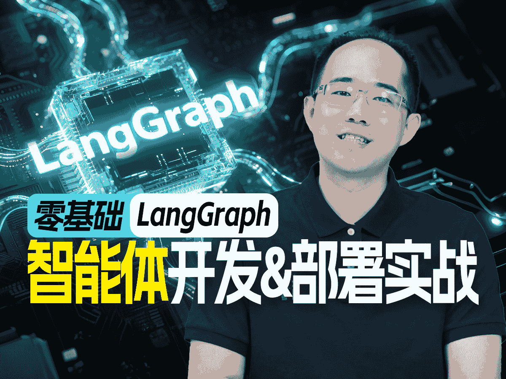

要说目前最通用的企业级Agent智能体开发框架，毫无疑问，肯定是LangGraph。

🔧支持图状工作流、可视化监控、前端对话、功能热插拔、实时追踪…

🚀从零手把手教你搭建企业级AI数据智能体，支持NL2SQL、数据分析、Python建模、自动对话、Human-in-the-loop！

本期公开课总计4小时内容，6大章节，3万字超系统讲解，外加全套案例项目脚本、数据集全部开源共享！

✅零基础友好   ✅实战主导   ✅全流程教学

✅LangChain+LangGraph一次学完！

> 如果你也在关心AI世界的风云变幻、大模型与智能体的走向、技术背后的权力博弈，记得关注我们的文档和其他账号。我们带你看懂真正重要的那1%。

---

# 点击下面链接与我们产生更多连接✨

---

九天Hector 哔哩哔哩：https://space.bilibili.com/385842994

九天Hector 抖音： https://v.douyin.com/lqASAa2Hs_0/

九天Hector 📕：https://www.xiaohongshu.com/user/profile/62321335000000001000885e

九天Hector YouTube：https://www.youtube.com/channel/UCj8tyDLSxIdivnweBnG4H9Q/

赋范大模型全栈技术社区请点👉：https://kq4b3vgg5b.feishu.cn/wiki/space/7257794425391579164