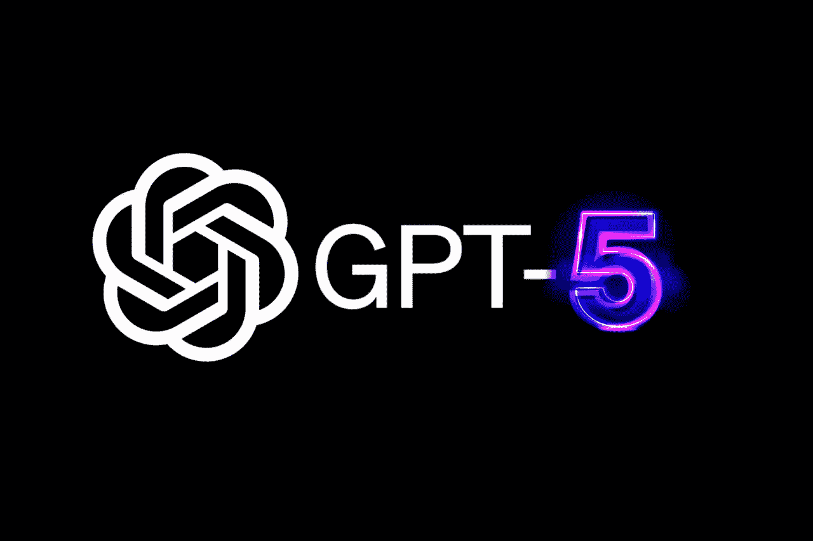
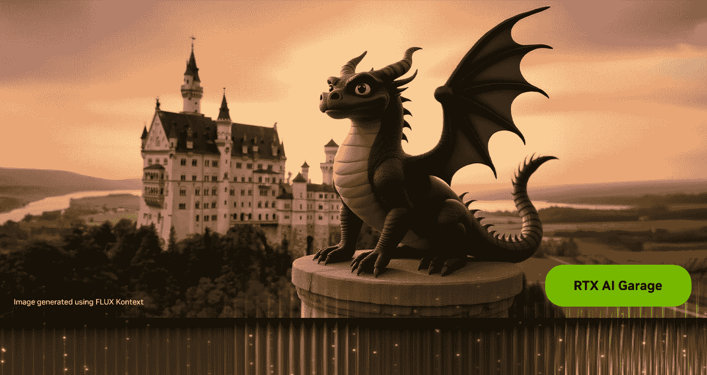
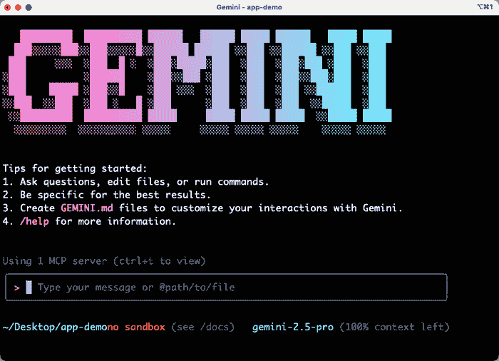
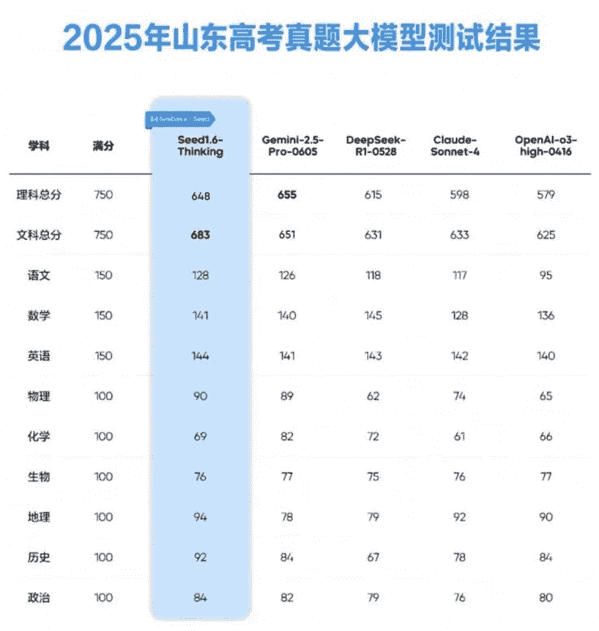
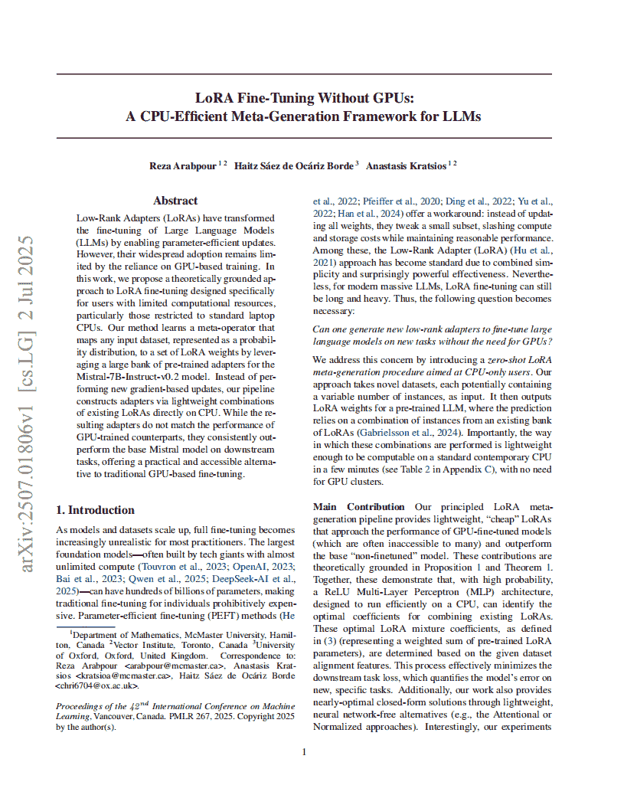
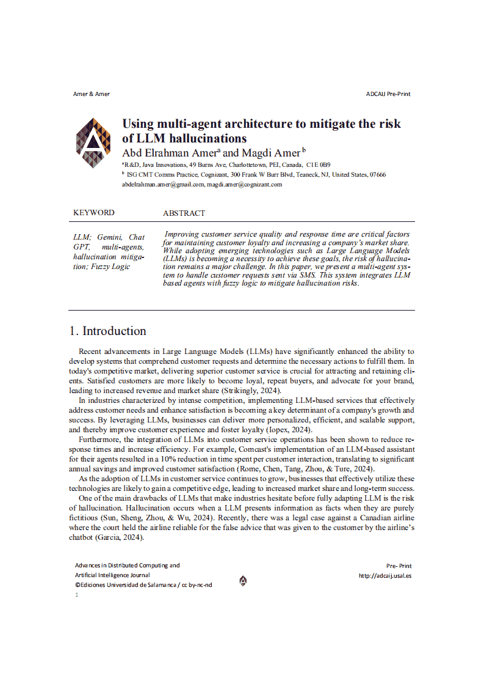

# AI大模型周周报 Vol.01 | 赋范空间

> 来源：[https://kq4b3vgg5b.feishu.cn/docx/EscxdYbdfoZBD7xmcnlc79nGn3d](https://kq4b3vgg5b.feishu.cn/docx/EscxdYbdfoZBD7xmcnlc79nGn3d)
> 首期我们深入剖析了Meta与OpenAI的人才大战，并梳理了最新的AI动态与技术论文。
> 我们创立周报，旨在为你提炼每周最核心的AI洞见。
> 本期内容已有音频播客，欢迎随时收听，并在评论区交流讨论！

## 点击下面按钮跳转【AI大模型周周报专栏】持续关注

[AI播客版本｜第一期｜Ai大模型周周报｜赋范空间 .mp3](https://internal-api-drive-stream.feishu.cn/space/api/box/stream/download/all/DsytbYk2Yo0LE6xEdGXc28AjnGc)

> 本播客由扣子空间生成

# 一周AI头条

## Meta豪掷一亿美金挖角让OpenAI全员放假一周！扎克伯格的AGI赌局有多野？

> 最近的AI圈，表面风平浪静，底下暗流汹涌。一则“小道消息”传遍硅谷：OpenAI的领导层为了应对Meta疯狂的挖角，给全体员工放了一周“减压假”。但据说高管们自己却一个没休，夜以继日地开会打电话，生怕员工们前脚在夏威夷度假，后脚就飞去扎克伯格家签offer了。

> “百万美元年薪”在这个圈子已经不算新闻，但上亿的package？这究竟是夸张的公关说辞，还是一场正在重塑整个AGI格局的疯狂赌局？今天，我们就来深扒一下这场“超级智能的赌局”。

一切始于扎克伯格的一封内部信：他不满于自家Llama模型的表现，尤其是在关键能力上落后于对手，于是决定——不玩了，摊牌了，直接整合公司所有AI力量，成立“Meta超级智能实验室”（MSL），目标直指AGI王座。

Meta的策略不是招几个工程师，而是像拆积木一样，系统性地挖走对手最关键的知识集群。

从OpenAI“顺走”的大牛们：

+ 特拉皮特·班萨尔：开创了“思维链”强化学习，是OpenAI高级推理模型（o-series）的关键人物。
+ 毕树超：GPT-4o惊艳的语音模式和o4-mini的共同创造者。
+ 纪林 & 俞嘉辉：两人都是GPT-4系列和o-series的核心贡献者。俞嘉辉更是曾领导OpenAI感知团队和Google Gemini多模态研发的大神。
+ 苏黎世三人组：卢卡斯·拜尔、亚历山大·科莱斯尼科夫、翟小华。这三位视觉专家本是Google挖去欧洲开疆拓土的，结果被OpenAI截胡，如今又被Meta整个“连锅端走”。

Meta通过精准挖走负责GPT-4o语音、o-series推理等核心功能的架构师，不仅获得了人才，更是直接瓦解了OpenAI在这些领域的迭代能力。一石二鸟，够狠。

为什么这么拼？因为扎克伯格急了。据传，他对Llama 4在代码等关键任务上的表现大失所望。

除了挖人，他还想直接买公司，据说接洽过Perplexity AI，甚至还有伊尔亚新创办的Safe Superintelligence。

他的招募“杀手锏”是有三板斧：

1. 现金（Cash）：前所未有的薪酬包，即使“一亿奖金”有夸大成分（后来有当事人辟谣是“假新闻”），但数千万美元的多年期合同已是事实，直接诉诸最现实的动机。
1. 算力（Compute）：承诺几乎无限量的GPU供应。这对那些因计算资源受限而无法施展拳脚的研究员来说，是致命的诱惑。
1. 影响力（Clout）：扎克伯格的亲自参与，意味着新成员能直达天听，在公司内部拥有巨大的话语权和优先权。

Meta的攻势，在OpenAI内部引发了地震。

首席研究官马克·陈（Mark Chen）一封泄露的内部信，情绪暴露无遗：“我感觉就像有人闯进了我们家，偷走了什么东西。”

面对挖角，OpenAI一边紧急“重新校准薪酬”，一边由CEO山姆·阿尔特曼在舆论上发动反击。他巧妙地将这场冲突定义为一场文化战争：“传教士终将战胜佣兵”（Missionaries will beat mercenaries）。

他的逻辑是：OpenAI是靠使命驱动的理想主义“传教士”，而Meta只是靠金钱堆砌的“佣兵”。这种策略会带来“深层次的文化问题”，而AGI是OpenAI的“头等大事”，对Meta而言可能只是“一时兴起”。

这是一种高明的防御。当你在金钱上无法匹敌时，就把战场转移到价值观和身份认同上。

相比之下，Google则显得沉稳老练。他们不打口水仗，而是用实际行动“加固城防”。当Meta接触其顶尖研究员科雷·卡夫克奥卢后，Google火速为他设立了一个新职位——“首席AI架构师”，直接向CEO皮查伊汇报。

一个升职加薪，给足地位，用结构性手段化解危机。这不仅留住了个人，更是向内部所有顶尖人才发出的信号：忠诚，会得到回报。

这场巨头间的战争，最无辜的受害者是初创公司和学术界。

顶尖AI人才的薪酬被推至天价，形成了事实上的“人才泡沫”。初创公司根本无力与手握千亿现金的巨头竞争，组建顶级团队的成本变得高得令人望而却步。人才正以前所未有的速度，从更多元化的初创生态和基础研究的学术界，向少数几家科技巨头高度集中。

在中国，AI领域的人才市场同样激烈，并为技术从业者提供了明确的职业机会。

当前市场人才短缺严重，供需比仅为0.5（翰德数据），这直接推高了整体薪酬水平。从具体数据看，资深AI产品经理年薪可达80万-100万元，且有超过30%的技术岗位年薪高于50万元。即便是面向优秀应届生的岗位，月薪也可达6万元，而顶尖的AI芯片总监年薪则在200-300万元之间。

高薪背后，企业对人才的技能要求也更为聚焦。相比纯技术背景，能够将AI与具体行业业务结合的“复合型人才”价值更高，其薪酬平均可高出近30%。为此，阿里巴巴、腾讯等企业在进行大规模招聘时，也尤其看重候选人解决实际业务问题的能力。

总而言之，国内AI人才市场需求明确，回报可观。对于从业者来说，关键在于提升技术与业务结合的能力，以抓住确定性强的职业发展机会。

> [2025大模型最强求职指南！整理全](https://www.bilibili.com/video/BV18JreYpE5Q/)网2万份JD，一手数据信息揭秘求职真相！

> 💼 耗时2个月，整理全网28312份大模型岗位JD，🚀为你打造的超详细《2025年大模型岗位求职指南》

> 🔥2024年第四季度大模型在招岗位数量激增400%，人才供需比不到1.4，平均薪资高达33k！2025年，大模型技术岗位将迎来爆发式增长！📈

> 指南内容包括：岗位地区分布、行业分布、学历要求及薪资分布等关键信息，还有针对不同基础的求职者推荐的求职路径哦！

## 头条评述

> Meta这场由创始人亲自下场、不计成本的人才大战，与其说是招聘，不如说是一次战略投资。它深刻地揭示了AGI竞赛的新法则，并对未来产生深远影响。

1. AGI竞赛“英超化”：资本是唯一的入场券

> 过去，一个天才、一个车库、一个颠覆性的想法，或许就能创造一个奇迹。但在AGI领域，这个时代可能要结束了。我们正在见证AI发展的“英超化”。就像顶级足球联赛一样，这成了一场只属于少数超级富豪俱乐部的游戏。Meta、Google、Microsoft 就是场上的皇马、巴萨和曼城。未来的竞争，比的不仅是技术，更是谁的支票簿更厚。对于初创公司来说，生存空间被严重挤压，想成为挑战者的难度呈指数级上升。

1. 人才市场“阶层化”：从“工程师”到“AI贵族”

> 这场战争正在催生一个全新的“AI贵族”阶层。如果你是全球排名前200的顶尖AI研究员，你的价值将是天文数字。但对于广大的普通工程师和研究者而言，与顶尖人才的薪酬差距会越拉越大。

> 这对我们从业者和求职者的启示是：“通用型人才”的价值正在被稀释，而“标签化人才”将变得极其珍贵。你不能仅仅是一个“会写代码的工程师”，你需要有自己独特的标签。

1. 技术突破的“双刃剑”：集中力量办大事 vs. 创新的“孤岛效应”

> 从积极的一面看，将全球最顶尖的大脑和最庞大的资源集中在一起，确实有可能加速通往AGI的进程，或许真的能让Llama模型脱胎换骨。

> 但风险同样巨大。Meta面临的最大挑战，已经从“如何买到人才”变成了“如何整合人才”。把一群来自不同公司文化、拿着天价薪酬的“超级明星”捏合在一起，其管理难度和文化冲突可想而知。

> 总而言之，扎克伯格的这场赌局，赌的是资本可以战胜文化，资源可以堆砌出创新。无论成败，他都已永久性地改变了游戏规则。而我们每个人，都身处在这场由巨额资本、顶尖智慧和无尽野心构成的巨大浪潮之中。

# 一周AI动态速览

## 圈内热议

> 聚焦AI圈内幕消息与人事动向，洞察行业风向。

+ [热点花边] Meta内部路线之争：AGI野心与开源现实的碰撞

+ 报道内容: Meta内部的两种声音正变得越来越清晰。CEO马克·扎克伯格雄心勃勃，新成立“Meta超智能实验室”，力求在AGI（通用人工智能）上追赶OpenAI。而图灵奖得主、首席AI科学家Yann LeCun则公开表示，当前技术距离实现“猫级智能”都还很遥远，他更倡导开放、务实的AI发展路线。

> 这一分歧不仅是技术路线之争，更关乎Meta未来的核心战略。是效仿OpenAI走向更封闭的AGI竞赛，还是坚持Llama开创的开源路线？目前Meta似乎在同时进行两条线的布局，但这种内部张力无疑将深刻影响其未来的产品形态和行业地位。

+ [小道消息] GPT-5或将带来架构创新与性能突破

+ 报道内容: 关于OpenAI下一代大模型GPT-5的传闻愈演愈烈。消息指出，GPT-5可能不仅仅是参数量的提升，更有可能带来“统一模型架构”的革新。这意味着模型能根据任务难度，在内部自动调用不同的处理模式，无缝切换文本、图像、代码等多模态能力，而无需用户手动选择。

> 此传闻若属实，将是AI交互的一大步。它将极大简化用户和开发者的使用体验，使AI变得更智能、更自主。尽管OpenAI官方未透露任何信息，训练状态也尚不明确，但“架构创新”无疑已成为社区对GPT-5的最大期待。

+ [人事变动] 前OpenAI安全主管Jan Leike加入Anthropic，重塑安全格局

+ 报道内容: 因在AI安全问题上与公司高层存在“核心分歧”而离开OpenAI的前安全主管Jan Leike，已确认加入其主要竞争对手Anthropic。

> Leike是AI安全领域的关键人物，他的离职和新去向是近期AI圈最重要的人事变动。这不仅暴露了OpenAI内部在“追求性能”与“确保安全”之间的紧张关系，也意味着Anthropic的AI安全研究力量得到巨大加强。此举或将重塑两家头部公司在AI安全竞赛中的战略格局。

---

## 产品动态

> 本周，AI应用层和底层技术均有重要发布，从视频生成、代码编辑到文生图模型，新工具的涌现正为创作者和开发者带来更高效率和全新可能。

NVIDIA联手Black Forest Labs，推出新一代文生图模型FLUX.1 Kontext

在文生图领域，由NVIDIA提供AI加速优化的新一代模型FLUX.1 Kontext正式亮相。这款由Black Forest Labs开发的开源模型，旨在成为Stable Diffusion的有力竞争者和超越者。它不仅能完成高质量的文本到图像生成，还集成了强大的图像编辑功能。其核心优势在于采用了更先进的“流匹配”（Flow Matching）架构，能够在实现比肩甚至超越Stable Diffusion 3的图像质量的同时，显著降低训练成本和推理对硬件（如VRAM）的要求，为开发者和研究者提供了更高效、更易于部署的新选择。

AI代码编辑器Cursor登陆移动端，随时随地辅助编程

对于希望随时随地进行AI辅助编程的开发者来说，一个好消息传来。广受欢迎的AI原生代码编辑器Cursor本周正式推出了其Web和移动端版本。通过渐进式网络应用（PWA）技术，开发者现在可以在手机、平板或任何带有浏览器的设备上，无缝访问Cursor强大的AI编程助手（Agents）。这意味着编写代码、调试程序和寻求AI辅助不再局限于桌面环境，极大地提升了开发的灵活性和便利性。

> 扩展阅读 [Cursor接入MCP实战流程](https://www.bilibili.com/video/BV1dCo7YdEgK/) 用Cursor零门槛搭建专属智能体应用！

谷歌发布Gemini CLI，赋能开发者终端高效交互

谷歌继续为开发者丰富其Gemini生态系统，本周发布了Gemini CLI。这是一款为开发者设计的命令行工具，它允许开发者在自己熟悉的终端（Terminal）环境中，通过简单的命令直接与强大的Gemini模型进行快速、高效的交互。无论是进行快速的功能测试、构建自动化脚本，还是进行简单的原型开发，Gemini CLI都提供了一个轻量级且强大的新途径。

> 扩展阅读 Gemini Cli 竞品：OpenAI的Codex深度评测；GitHub的Copilot深度评测

AI“考霸”诞生：Gemini 2.5 Pro高分通过中国高考

谷歌的Gemini 2.5 Pro模型本周展示了其在处理复杂人类考试中的非凡能力。在一场模拟测试中，该模型参与了国内高考，并取得了655分的优异成绩，达到了顶尖学府清华大学的录取分数线。证明了当前最前沿的AI大模型在知识整合、复杂推理和问题解决能力上已达到新的高度。

# 本周技术深潜

## 论文一：挣脱GPU枷锁，在CPU上实现高效模型微调

> 这是一篇由苏黎世联邦理工学院（ETH Zürich）的研究人员发表的前沿论文（arXiv:2507.01806），题为《无需GPU的LoRA微调：一种CPU高效的LLM元生成框架》。它旨在解决当前大模型定制化中最为棘手的核心问题：对昂贵且稀缺的GPU资源的高度依赖。

> 这篇论文提出了一种革命性的框架，不再通过传统的反向传播来“训练”模型，而是通过一种名为“元生成”（Meta-Generation）的技术，直接在CPU上“合成”出适用于特定任务的LoRA（低秩适配）权重。这从根本上改变了模型微调的游戏规则，让轻量、快速、低成本的模型定制成为可能

点击打开论文👉

> 扩展阅读：

> [最](https://www.bilibili.com/video/BV1oePLezEZD/)低0显存，独家`Unsloth`动态量化部署满血DeepSeek｜纯CPU推理、CPU+GPU混合推理、纯GPU推理方案详解｜企业级最佳部署方案

> 如何利用`Unsloth`/`ktransfomer` 技术来实现低成本部署和微调各大模型，手把手教你纯CPU推理、CPU+GPU混合推理、纯GPU推理方案详解

[2507.01806v1.pdf](https://internal-api-drive-stream.feishu.cn/space/api/box/stream/download/all/HGuRbLw1PoYIQGx7eqXcc5VPn7c)

## 核心亮点与作用

+ 元生成LoRA权重

+ 作用：告别了计算密集型的梯度下降训练过程。开发者不再需要耗费数小时在GPU上进行训练，而是在几分钟内于CPU上直接生成适配新任务的LoRA模块，将模型微调的周期从数小时缩短到几分钟。

+ 纯CPU驱动

+ 作用：彻底消除了对NVIDIA GPU等高端硬件的依赖。这意味着开发者可以在个人笔记本、标准云服务器甚至边缘设备上完成微调，极大地降低了硬件成本和准入门槛。

+ 小样本高效学习

+ 作用：整个框架仅需提供少量（例如几十个）新任务的样本，就能生成高质量的LoRA权重。这使得它非常适合需要快速响应和迭代的业务场景，为大规模个性化模型部署提供了技术基础。

## 论文二：拥有结构化大脑的图增强LLM

> 这是一篇由Java Innovations 与 Cognizant Cognizant ISG CMT Comms Practice联合发表的产研结合型工程应用论文（arXiv:2507.01446），题为《利用多智能体架构降低大语言模型幻觉风险》。它旨在解决大模型在处理专业领域问题时的一个核心缺陷：缺乏对结构化知识的深度理解和推理能力，从而导致事实错误和“幻觉”。

> 本论文提出了一种多智能体系统架构，结合模糊逻辑与LLM智能体，专用于处理来自用户短信（SMS）的指令请求。通过任务分拆、信心评估和多重验证，该系统不仅能提升处理效率，更能显著降低幻觉风险，提升服务安全性与稳定性。

点击打开论文👉

[2507.01446v1.pdf](https://internal-api-drive-stream.feishu.cn/space/api/box/stream/download/all/F72cbbE1Yot2W7xUKvscx0iXnDh)

## 核心亮点与作用

+ 亮点一：规则解析 + 模糊逻辑融合，构建高可靠性前置判断机制

+ 作用：系统首先由正则规则与模糊逻辑驱动的解析代理对短信内容进行结构化识别，包括药品指令码、续停指令等关键词，自动计算语义理解信心度（高/中/低）。该阶段无需调用LLM，即可处理大部分“明确指令型”文本，大幅降低模型调用成本与误判风险。

+ 亮点二：多模型协同验证机制，交叉抵消幻觉风险

+ 作用：当解析代理识别信心不足时，系统将调用多个LLM（如ChatGPT与Gemini），并通过互评与内容一致性校验机制，精准识别模型是否生成了“幻觉内容”。

结合模糊规则和风险评估逻辑，对不一致或存在虚构风险的内容进行降权处理、请求用户确认或直接中止处理，确保整体输出稳健可信。

+ 亮点三：多智能体协作处理，构建解耦式高弹性服务体系

+ 作用：用户短信中除药品请求外的其他内容（如情绪、投诉、问询）将由路由代理解析后，自动分发至匹配的专家代理（如药师、客服、预约调度等）。

整体架构基于共享消息池 + 动态代理注册机制，具备良好的模块解耦与并行处理能力，支持系统稳定扩展与高频高并发场景落地。

## 本周代码现场

### 🎬`LangGraph`&`LangChain`智能体开发极速入门！

想在10分钟内从零开始，亲手打造一个属于自己的AI数据分析智能体吗？

我们将使用最前沿的`LangChain`和`LangGraph`技术栈，手把手教你开发一个功能超乎想象的Data Agent。它不仅能将你的自然语言指令秒变SQL查询，自动完成复杂的数据分析和可视化，还能连接网络、持久记忆，甚至在关键时刻主动向你“求助”，实现真正的人机协同。

本教程将带你走完从后端开发、功能测试，到一键部署上线、前端集成的全链路实战流程。你将学会：

+ 🚀 极速搭建：仅用三行核心代码，借助`LangGraph`高级API快速构建智能体。

+ 💻 全栈体验：完成前后端分离的完整项目，并实现酷炫的实时状态追踪。

+ 🔧 主流技术：掌握`LangChain`、`LangGraph`、`DeepSeek V3`大模型等当下最热门的技术工具。

+ 👍 零基础友好：从环境搭建到代码编写，每一步都有清晰指引，小白也能轻松上手。

视频配套完整的项目源码、课件和软件资料，让你一看就懂，一学就会。

> 如果你也在关心AI世界的风云变幻、大模型与智能体的走向、技术背后的权力博弈，记得关注我们的文档和其他账号。我们带你看懂真正重要的那1%。

---

## 点击下面链接与我们产生更多连接✨

---

九天Hector 哔哩哔哩：https://space.bilibili.com/385842994

九天Hector 抖音： https://v.douyin.com/lqASAa2Hs_0/

九天Hector 📕：https://www.xiaohongshu.com/user/profile/62321335000000001000885e

九天Hector YouTube：https://www.youtube.com/channel/UCj8tyDLSxIdivnweBnG4H9Q/

赋范大模型全栈技术社区请点👉：https://kq4b3vgg5b.feishu.cn/wiki/space/7257794425391579164
