# 周周报 Vol.12｜OpenAI万亿级算力豪赌｜腾讯混元实现“无标签”RL｜赋范空间

> 来源：[https://kq4b3vgg5b.feishu.cn/docx/BeLCd3A8QoRrtixN7uKcF9UunNe](https://kq4b3vgg5b.feishu.cn/docx/BeLCd3A8QoRrtixN7uKcF9UunNe)

### 《AI大模型周周报》第-12-期来啦！

> **本期核心内容：**AI竞赛白热化！OpenAI 联手博通豪掷 10GW 算力，自研 ASIC 芯片，旨在构建“人类史上最大工业项目”；同时，强化学习和多模态技术迎来新发展，从底层芯片性能、前沿推理算法到开源训练框架，整个 AI 技术栈都在加速演进...

>

> 我们创立周报，旨在为你提炼每周最核心的AI洞见。

> 欢迎随时收听，并在评论区交流讨论！

---

# 点击下面按钮跳转【AI大模型周周报专栏】持续关注

#

---

# [**🟥A**](https://emojipedia.org/large-red-square)I头条 ｜OpenAI 的万亿级算力雄心与自研芯片之路

### 现象：史上最激进的“算力备军”

OpenAI 近期在芯片领域的布局堪称“人类史上最大的联合工业项目”，其目标是建立一个高达 250GW 的算力版图（相当于美国总能耗的一半）。

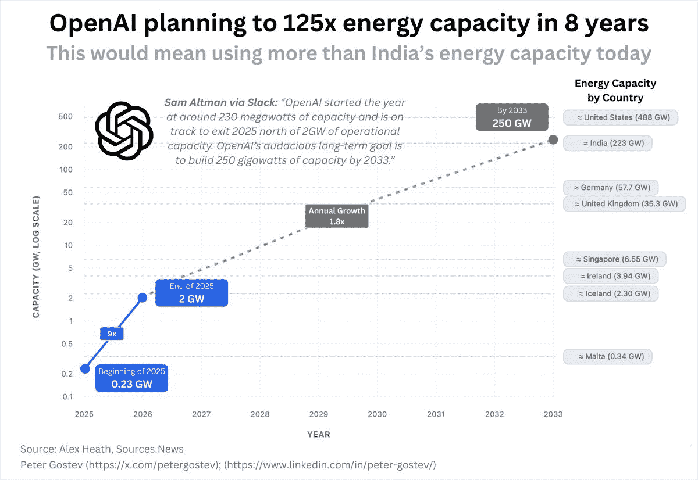

**近期重大算力交易一览：**

+   **9月10日：** 从 Oracle 获得价值 **3000亿美元** 的计算资源。

+   **9月22日：** 从 **NVIDIA** 获得 **10GW** 算力。

+   **10月6日：** 从 **AMD** 获得 **6GW** 算力。

+   **10月13日：** 宣布与 **博通 (Broadcom)** 合作，部署 **10GW** 专为 OpenAI 推理任务设计的自研 ASIC 芯片和系统。

**目前，**OpenAI 的总算力仅为 2GW，大部分用于研发。此次宣布的新增算力，特别是自研芯片的部署，是为了满足未来“环境智能体 (ambient agents)”带来的巨大推理需求。

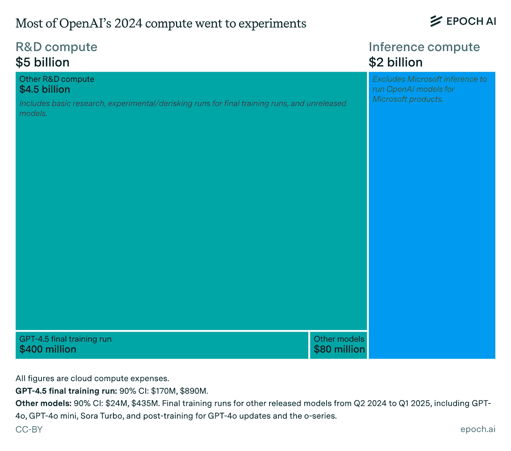

OpenAI 的 Greg Brockman 解释说，未来的 AI 将是 24/7 全天候为每个人运行的**个性化智能**体，这将需要天量的计算资源（“理想情况下每个人都拥有自己的加速器”）。他透露，自研 ASIC 项目已秘密进行 18 个月，原因是许多芯片初创公司未能采纳 OpenAI 对未来模型架构的反馈，促使他们决定亲自下场，以确保技术愿景得以实现。

此消息一出，**博通股价大涨 10%**，市值增加超过 1500 亿美元。

### 技术思考：为何必须自研？挣脱“硬件定义软件”的枷锁

OpenAI CEO Sam Altman曾多次表示，当前AI发展的最大瓶颈就是算力。但仅仅是缺算力吗？Greg Brockman的解释揭示了更深层的技术动机：“（我们给了芯片创业公司大量反馈），但老实说，他们中很多人根本不听我们的。”

1.  软硬**件协同设计 **(Co-design) 的必然： AI模型（软件）的迭代速度已经远远超过了通用GPU（硬件）的进化速度。通用GPU为了服务所有客户，必须保留大量通用功能。而OpenAI非常清楚其下一代模型（如GPT-5/6）的架构和计算特点，他们可以设计出一款“偏科天才”芯片——剔除一切不必要的功能，将所有资源都押注在模型最需要的特定计算上（如特定类型的矩阵运算或注意力机制）。这种“量体裁衣”带来的效率提升，是通用芯片无法比拟的。

1.  从**“训练”**到“推理”的成本转移： 训练一个万亿参数大模型是一笔一次性的巨额开销，但让全球数十亿人像用自来水一样，24/7全天候使用“环境智能体”，其产生的推理成本将是一个持续不断的天文数字。OpenAI的自研ASIC明确指向“推理任务”，正是为了攻克未来最大的成本中心。通过极致的优化，他们追求的是将每一次用户查询的成本降到最低，这是其未来商业模式能否成立的生命线。

### 商业思考：打造终极护城河，摆脱“英伟达税”

对于任何一家AI公司而言，NVIDIA的GPU既是助推器，也是悬在头顶的“达摩克利斯之剑”。高昂的价格、漫长的交付周期以及技术路线的单一依赖，被业界戏称为“英伟达税”。

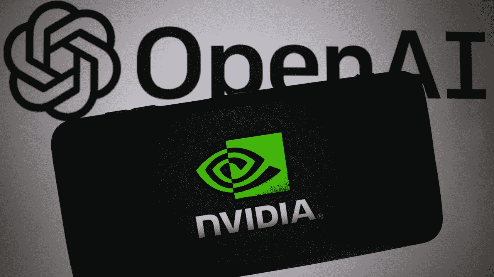

1.  **垂直整合作为风险控制：**** OpenA**I的自研芯片战略，本质上是科技史上屡试不爽的“垂直整合”。如同苹果用M系列芯片定义了Mac的体验，特斯拉自研电池和芯片控制了电动车的核心成本。OpenAI此举，是要将AI时代最昂贵的生产资料——计算芯片，牢牢掌握在自己手中。这不仅能极大降低长期成本，更能保证在关键时刻，其AGI研发的进程不会因供应链问题而“卡脖子”。

1.  **构建成本壁垒，发动降维打击：** 当OpenAI拥有了比竞争对手（如Anthropic、Google）成本更低、效率更高的推理芯片后，它就拥有了最强大的商业武器。它可以提供更强大的模型、更低廉的API价格，甚至免费向C端用户提供今天看来极为奢侈的AI功能。这将形成一道坚不可摧的成本护城河，对其他依赖通用GPU的竞争者形成“降维打击”。

### **总结：一个新计算范式的逻辑收敛**

OpenAI的自研芯片之路，远不止是“B计划”或“备胎”，它是其实现AGI使命的核心战略。这一步棋，标志着顶级AI公司已经不满足于仅仅是软件和算法的创新者，它们正试图成为定义下一个计算时代的“规则制定者”。

AGI的竞赛，其本质早已不再是单纯的算法竞赛，而是一场涵盖了能源、物理学、系统架构和经济模型的全维度博弈。OpenAI正在构建的，正是这场博弈的底层物理基础。

# [🟧A](https://emojipedia.org/large-orange-square)I动态 ｜AI“学聪明”了：强化学习迈入“逻辑为王”新范式

本周，两个看似独立的研究成果，却精准地指向了同一个目标：提升AI的深度推理能力，同时降低对模糊人类反馈的依赖。

1.  **混合强化学习 (HERO)：**研究人员提出一种新方法，将可验证的反馈（0/1判断）与稠密奖励模型分数相结合，也就是将可被机器验证的“硬事实”（例如，数学题答案对错、代码能否运行）作为**一种强奖励信号，与传统**基于人类偏好的“软品味”（例如，回答是否流畅、礼貌）奖励模型相结合。在Qwen-4B模型上的实验显示，这种方法让模型在困难推理任务上的性能飙升了11.7个百分点，效果远超单一方法。

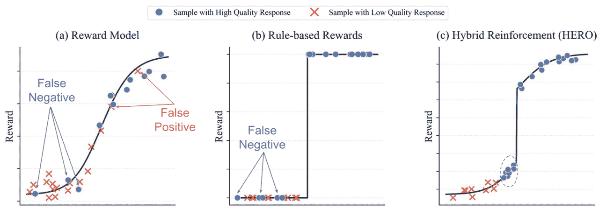

1.  **腾讯混元“无标签”RL：** 腾讯混元团队展示了一种在预训练阶段就引入强化学习的方法，在预训练阶段用 RL 驱动的“下一段预测”代替传统的下一个词元预测 (NTP)，它不再需要人类标注员告诉模型“你做得好不好”。相反，它让模型在海量文本中自己学习“什么才是逻辑连贯的下一段话”。这种“自监督”的RL方法，极大地提升了模型在MMLU、GPQA等多个核心推理基准上的表现，为在万亿级别数据上进行推理训练找到了可行的、低成本的路径。

**这些新进展的背后**，是A**I训练哲学的深刻**变革，我们可以称之为从 RLHF 1.0 到 RLHF 2.0 的演进。

+   **HERO的锚点是“可验证性”：** 无论人类感觉如何，代码能跑通就是对，数学题算对了就是对。环境（编译器、计算器）的反馈是客观的、廉价的、且可无限扩展的。这为AI的“想象力”套上了一个“事实的缰绳”。

+   **腾讯的锚点是“数据结构”：** 高质量文本中蕴含的内在逻辑和因果关系，本身就是一种强大的客观规律。让AI从数据自身的结构中学习推理，摆脱了单一标注员的偏见，实现了在更大尺度上的逻辑自洽。

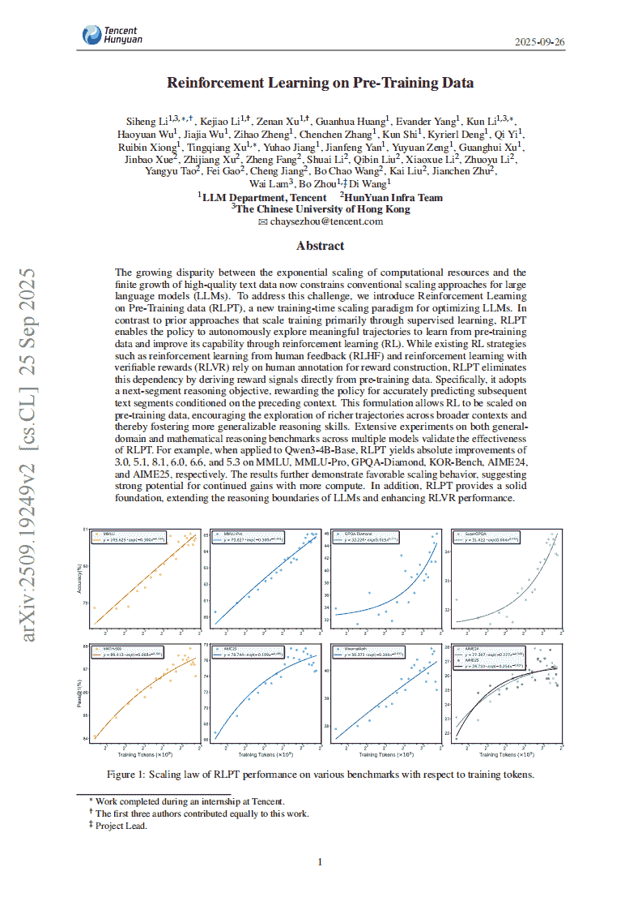

[Reinfoecement Learning on Pre-Training Data.pdf](https://internal-api-drive-stream.feishu.cn/space/api/box/stream/download/all/Tw9TbJwuEozTcnxdt9icWl4lnMe)

最终目标是实现AI训练的“闭环自洽”：AI生成推理步骤 -> 通过客观环境或逻辑规则进行自我验证 -> 根据验证结果自我修正。这才是让AI学会真正“思考”而非“模仿”的根本路径。

这场技术变革将直接决定AI在商业世界中的最终角色和价值。

1.  **解锁“高风险”专业领域：** 当前的LLM主要应用要想进入金融分析、法**律咨询、医**疗诊断、科学研究等高价值领域，“可信度”是唯一的入场券。一个逻辑严谨、有事实依据的AI，才能成为专业人士信赖的“副驾”，其商业价值将呈指数级增长。

1.  AI Agent（智能体）的基石： 未来的AI商业模式，核心是自主完成任务的AI Agent。无论是帮你预定一套复杂行程，还是管理你的投资组合，前提都是AI的每一步决策都必须基于可靠的推理。如果AI Agent会“胡说八道”，那就没人敢把重要任务交给它。因此，逻辑为王的强化学习范式，正是构筑未来万亿级Agent经济的底层基础设施。

1.  **终极ROI——“信任”的回报：** 企业愿意为AI付多少钱，取决于他们多大程度上可以信任AI的输出。通过引入逻辑和事实验证，我们正在从根本上提升AI系统的可靠性。一个永不说谎、逻辑清晰的AI，其产生的商业信任和用户粘性，将是无法估量的。这才是AI商业化下半场最坚固的护城河。

**未来的**竞**争，将不**再仅仅是模型参数大小的竞争，更是模型可靠性和推理深度的竞争。这场从“感觉良好”到“逻辑为王”的进化，将最终决定AI是成为我们高效的生产力伙伴，还是仅仅停留在“高级玩具”的阶段。

# [🟧A](https://emojipedia.org/large-orange-square)I动态 ｜多模态技术正在迈向“感官”纪元

2025年10月的最新动态显示，AI不仅在视频生成领域卷起商业化浪潮，更在音频“理解”上取得了颠覆性突破。从谷歌的Gemini 2.5到阿里巴巴的Qwen-VL，AI正在从单一的文本交互，进化为能够看懂、听懂并与物理世界深度互动的多模态智能体，一场围绕“感官”能力的商业竞赛已全面打响。

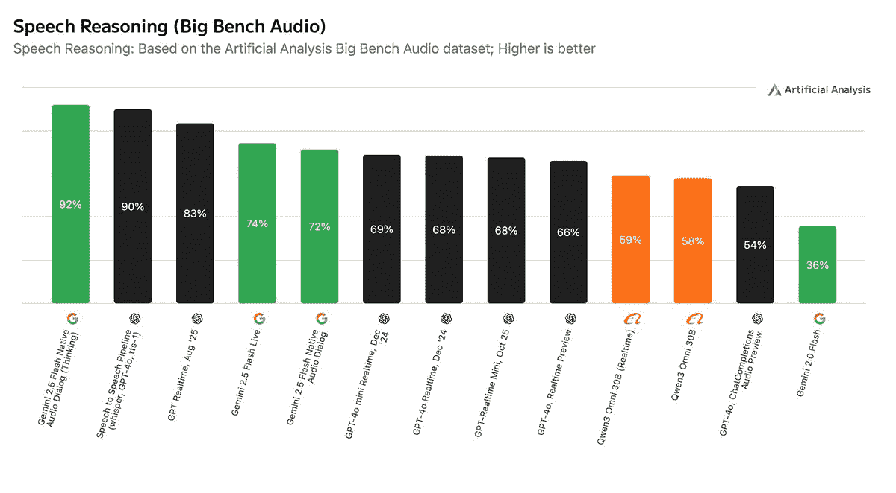

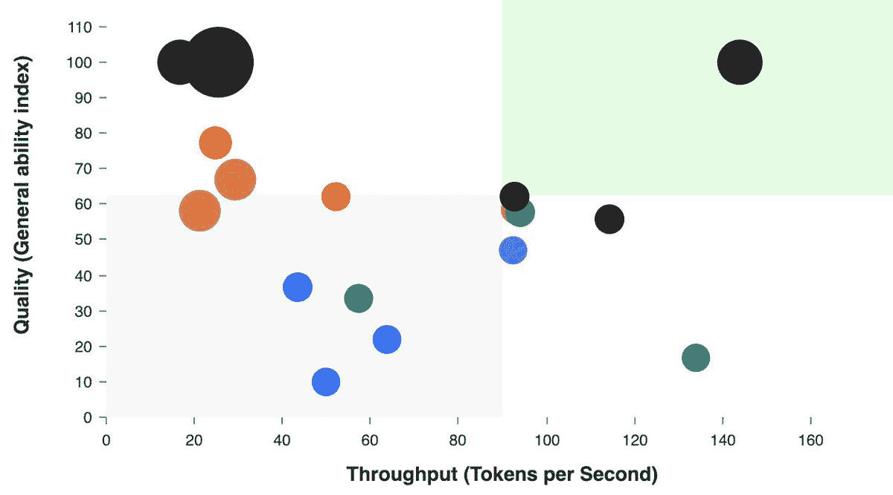

前两天，谷歌的 **Gemini 2.5 原生音频思考 (Na**tive Audio Thinking) 技术在语音推理基准测试中取得了92%的惊人高分，其表现甚至超越了“Whisper转录+GPT-4o理解”的组合工作流。

+   **技术思考：** 这标志着一个根本性的转变。过去的语音AI主要做的是“转录”，即将声音信号转化为文字，**理解的任**务交由后续的语言模型处理。而Gemini 2.5的“原生音频思考”能力是端到端的，意味着它能直接从音频波形中理解语义、情感、语调甚至背景噪音等“弦外之音”。这就像人类不仅能听清单字，还能从对方的语气中判断其是高兴、犹豫还是讽刺。这种深层次的整合理解，是通往更自然、更智能的人机交互的关键一步。

+   **商业思考：** 这项技术的商业想象空间巨大。

1.  **下一代智能助理：** 未来的语音助手将不再是机械的命令执行者，而是能理解你疲惫语气并主动建议“是否需要来点舒缓音乐？”的贴心伴侣。

1.  **企业服务革新：** 在会议分析、客服质检等场景，AI不仅能生成会议纪要，还能分析出发言者的情绪、谈判的关键节点和潜在意图，为决策提供更丰富的数据维度。

1.  **内容创作与审核：** AI可以自动为视频匹配符合情绪的背景音乐，或在内容审核中识别出通过特殊语气传播的违规信息。

**与此同时，视频**生成赛道已从**技术展示转向激烈的市场竞争。阿**里**巴巴的 Wan 2.5 和**快手的 Kling 2.5 Turbo 等模型，不仅在生成质量上达到1080p电影级水准，更给出了明确的商业定价（约每秒0.15美元）。值得注意的是，与早期版本不同，Wan 2.5 选择了闭源。

[tmp9cty62ge.mp4](https://internal-api-drive-stream.feishu.cn/space/api/box/stream/download/all/G4iLbFE5GoR9EpxC10pc4S7Tn5e)

（视频由**Wan 2.5** 生成，输入提示词为：70s broadcast news announcing that Wan 2.5 is now on Replicate, as seen through a 70s ）

+   **技术思考：** 视频生成的技术焦点已从“能否生成”变为“能否生成得又好、又长、又可控”。唇形同步、长时序稳定性、风格一致性成为了各家比拼的核心。当技术逐渐成熟，通过API提供稳定、高质量的服务，比开源模型更能满足商业客户的需求，这也促使领先玩家选择闭源以构建技术壁垒。

综合来看，多模态AI的发展正沿着两条清晰的路径飞速前进：

+   **输入端（理解）：** 追求更深层次、更接近人类“感官”的端到端理解能力，如Gemini的音频思考。

+   **输出端（生成）：** 在保证高质量的同时，加速商业化落地，通过API服务重塑内容创作产业。

未来，这两条路径必将交汇。一个能听懂微妙情绪、看懂复杂场景，并能实时生成高质量视频反馈的AI智能体，将不再是科幻。对于企业而言，现在就需要思考如何将这些新兴的“感官”能力融入自身的产品与服务中，因为这不仅是技术升级，更是一场关乎未来十年核心竞争力的商业变革。

# [🟧A](https://emojipedia.org/large-orange-square)I动态 ｜开源训练与可复现性

本周，两个标志性事件点燃了整个开源社区的热情，它**们分别解决了**A**I开发中最核**心的两个痛点：训练的神秘化和部署的中心化。

以Andrej Karpathy发布的极简训练框架nanochat为号角，配合苹果MLX等本地化工具的成熟，AI开发正从少数巨头才能参与的“黑盒炼金术”，转变为全球开发者都能上手的“开源乐高”。这不仅是技术的开放，更是一场将从根本上改写行业商业格局和创新模式的民主化浪潮。

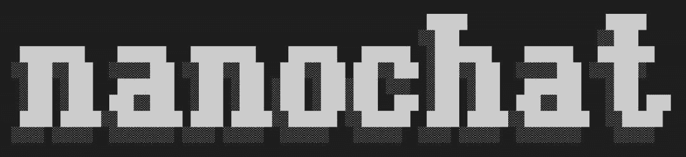

1.  Karpathy 发布 nanochat： 特斯拉前AI总监、AI界的“大神”Andrej Karpathy，发布了一个仅有约8000行代码的“类ChatGPT”完整训练流水线。它的革命性不在于性能有多强，而在于它像一本“宜家说明书”，将从数据处理、预训练到强化学习的全过程清晰地展现在世人面前。更关键的是，其训练成本极低——在8块H100上运行4小时，花费仅约100美元，就能得到一个可对话的模型。这彻底打破了“训练大模型=烧掉一座金山”的迷思。

> Karpathy说这是他写过的最疯狂的项目之一！

> 相当于每个人都可以自己拥有一个专属的ChatGPT。

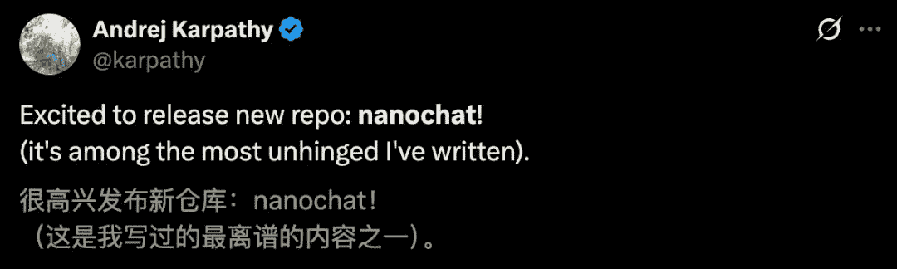

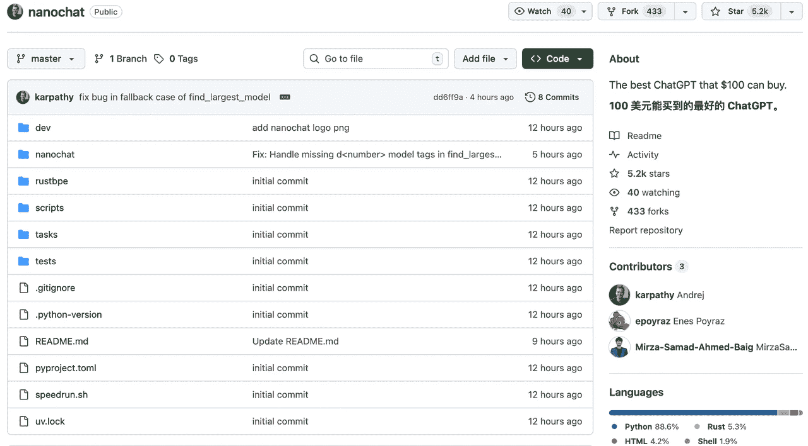

1.  **本地化 ML的成熟：** 在以Apple的MLX框架为代表，我们看到在消费级硬件**上运行和微调强大**AI模型已成现实。例如，百亿参数的Qwen3-VL模型在M系列芯片上能以80 tok/s的速度流畅运行，而一个小型模型甚至可以在2分钟内完成微调。这意味着，开发者不再需要依赖昂贵的云服务器，在自己的笔记本上就能进行高效的AI实验和应用部署，数据完全私有，成本近乎为零。

本周的开源动态，其重要性不亚于任何一款新模型的发布。它标志着AI创新的权力天平正在发生决定性的倾斜。未来，AI领域的颠覆式创新，可能不再仅仅来自于投入万亿的科技巨头，而更多地会诞生于某个大学宿舍、某个车库，或者全球开源社区的一次协同合作中。

AI的“iPhone时刻”或许不是某个超级AI的诞生，而是当成千上万的开发者都被赋予了创造AI的能力的那一刻。而现在，我们正处在那个时刻的黎明。

# [**🟩代**](https://emojipedia.org/large-green-square)**码现场 ｜VLM实现多模态复杂图像检索**问答，企业级多模态RAG引擎开发实战！

CAD图、架构图、工程图纸精准识别一网打尽！基于LangChain + Qwen3构建Agentic RAG 链路

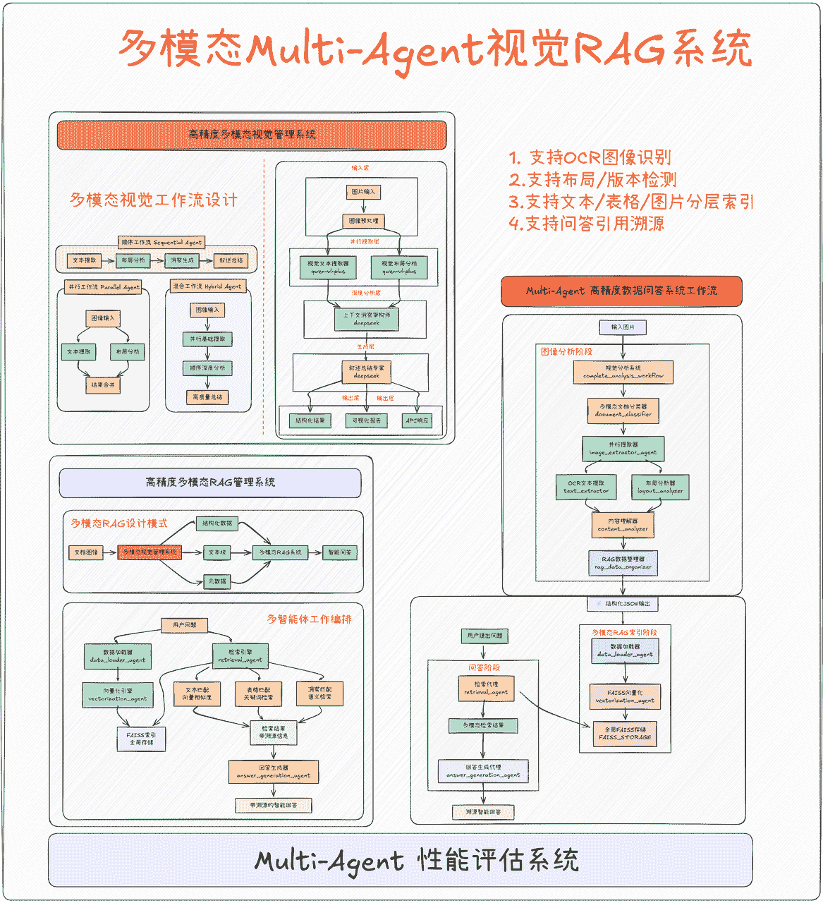

> [**目前全套**](https://brmes.xet.tech/s/3JofVE)公开课资料都已上线，大家点击👉找助教老师即可领取

本期公开课将带大家从零到一搭建一个能让大模型看懂图纸、理解结构、能检索、能回答的企业级多模态 RAG 系统！

1.  第一步，让大模型看懂图纸：首先我们会用视觉语言模型去尝试理解 CAD 图纸、架构图中那些复杂的线条、符号和尺寸，通过合理的工作流编排与精准的提示词，识别出位置信息、图片布局、动线设计，甚至推算出面积、方向，并输出完整的JSON结果

1.  第**二步，让大模型记**得住，找**的快：在这一步，我们要把刚刚的**分析结果存进向量数据库，把每张图纸都变成了一个“有记忆的知识点”。我们使用 ChromaDB，配合 Qwen Embeddings 把文本转成向量，以支持系统的检索，比如提问“找三室两厅的户型”，它会直接在数据库中找到最相似的那一份分析结果，几乎是毫秒级返回。

1.  第三**步，让大模型说得清：在提**问时，多模态RAG系统不只是回答一个数字，而是基于检索到的图纸信息，组织一段完整、可验证的回答，并支持溯源和可视化预览，我们借助目前最主流的大模型知识库问答技术 Agentic RAG 提供完整的交互式检索与推理体验。

<https://player.bilibili.com/player.html?bvid=1sCWEzuEqX>

> 如果你也在关心AI世界的风云变幻、大模型与智能体的走向、技术背后的权力博弈，记得关注我们的大模型技术社区。我们带你看懂真正重要的那1%。

---

# 💌 扫码加入社区交流群，与我们产生更多连接✨

