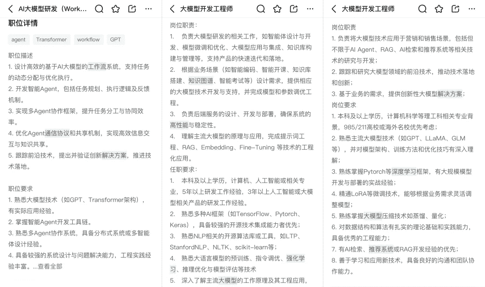

# 三本生逆袭算法岗，这份求职+学习经验请收好

> 来源：[https://kq4b3vgg5b.feishu.cn/docx/XuqedtGwxo5TYGx82fycL6WMnph](https://kq4b3vgg5b.feishu.cn/docx/XuqedtGwxo5TYGx82fycL6WMnph)

> 👾 受访者：REN，三本自学，转行大模型开发工程师

> 💻 采访&整理：运营范范

> **写在前面：**

> “本科是大家眼中不太好的学校，一个三本的独立学院”

> “考研备考三年，一直在啃老很不合适呀”

> “研二时分别拿到了Kaggle的银牌和铜牌，都是靠自学”

> “从最开始做销售的4000底薪，现在年包在25W左右”

> ……

> 本期采访到的同学确实很容易被刻板印象误伤，三本、非相关专业、连续考研三年备考，这些好像都与大众“印象”里的算法工程师经历大相径庭。

> 从“啃老”到现在推动公司大模型项目落地，非常感谢Ren同学能把自己的经历和经验分享出来，希望也能帮到你！

## ❖ **解决问题才是核心竞争力**

💻 范**范：先介绍下自己吧**

👾 hello大家好，大家可以叫我Ren。

我的本科是大家眼中不太好的学校，一个三本的独立学院，专业是通信工程。从大四的2019年一直考到2021年上岸，中间一共经历了三年。

读研期间专业是经济学院的应用统计，但是我发现还是对AI比较感兴趣，所以课余时间基本上都是在自学算法知识。工作方面，我在近期刚入职了一份大模型项目落地相关的工作，还是很满意的。

💻 范范：能发现考研对你的帮助没那么大，会认为那段压力很大的日子不值得吗？

👾 从外人看可能是有些浪费的三年，毕竟对现在的工作没有任何帮助，但对于我自己是一个蜕变的过程。

21年时候应该是压力是最大的，是我备考的第三年。无论是自己的压力还是舆论的压力叭，毕竟毕业这么久还在家啃老，一副不是很合适的样子，感觉压力已经实质化的说。

为了缓解一下压力，考完马上去找了一个工作，算是一个网络销售岗叭。庆幸的是这一年我考上了，是一个大学经济学院的应用统计。

这3年最大的改变是，让从前无忧无虑啃老的我知道了，有些事情是要努力去争的。也让我从坐不到半小时开始玩手机，到现在可以狠狠的学一天。我觉得这三年是我自己最大的财富和转折！

💻 范范：第一学历和跨专业的弱势，会为你的求职带来困扰吗？

👾 非常严重，基本上每次面试都要质疑一把第一学历，导致大多数情况下我是没有主动选择机会的。

比如读研期间去实习，公司候选人太多了，通常非急招的岗位都会等背景、能力俱佳的候选人，所以我能遇到不错的机会就要尽快上了，不会等，读研期间还有过外包的经历呢。

💻 范范：那你是如何改变这一情况的？

👾 这就是老生常谈的了，体现你**能解决什么问题，**以及体现你**解决问题的能力。**

牛马的卖点从来都不是名贵品种，而是刚好符合客户的口味咧，好心酸的一句话哈哈（开个玩笑。

面试官相比于你的背景、你实习公司的title以及你参与项目的知名度，更在意你怎么通过你自己的分析和调研解决一个很具体的问题（一面都是一线的工程师，你说的问题他们大多都经历过）。

比如能通过回收结果的一些小的数据异常分析得到一个核心的问题，然后处理了之后涨点了，比较具体的案例像是对于广告是日收入等业务指标的增长。

💻 范范：面试时更关注实际工作的经验？

**👾 其实更关注你的**业务指标，因为背后是你对问题和业务的理解，**你能解决问题，他**们自然就要你。这个能力肯定不是你掌握了最新的什么什么技术，所有的算法不是越新越好，也不是所有问题都是通过算法解决的，更加不是你有了这个技术你才能干这个岗位。

重要的是在公司的场景下：

+   可以拿到什么数据；

+   根据数据特点怎么组织实施操作，核心点和难点在哪；

+   如何低成本高效地出一个MVP（最小可实现原型）版本投放市场验证；

+   后续再怎么去迭代；

定位问题和解决问题就是核心竞争力。

## ❖ **基础才是应对技术浪潮的定海神针**

💻 范范：自学成为大模型开发工程师，诀窍是什么？

👾 最有效的还是边学边做吧，我读研期间第一份算法实习是人力外包到招行的算法岗，第二份是在MateGPT的公司深度赋智做的NLP实习。第三份实习是在oppo的广告推荐部门做的算法实习。就是在工作中遇到问题了，再找对应的课程去学习。

最开始就在各种地方看视频，只能说刚开始有用，因为到市面上的视频就实在太多了，而且每个人质量不固定。

每个视频点开之前就像开盲盒，不知道能不能纳入到自己的知识体系里，这就让学习效率很低。这里不得不夸一下赋范的老师，写的课件真的很详细。

💻 范范：你曾多次提到了知识体系，该如何理解？

👾 就是能把知识点串成一条线，最简单就是，你能对你自己学的算法知识做一个好像综述论文一样的文章，就说明你自己是有一个体系在了。每个小领域都可以是一个体系，多个小体系再组成一个大体系，就像树一样。

💻 范范：那该如何确定自己是否具备了呢？

👾 我自己喜欢的是找人讲课，只要能按体系地给一个人入门，那就说明你形成自己的体系了。

如果没人听你讲就写综述一样的文章叭，能不参考别人体系，自己把学到的东西串联成一个综述就说明你已经有体系了。

💻 范范：大模型发展飞快的现在，知识体系搭完要随时调整吗？

👾 其实不用，就比如RAG。你如果了解过搜索算法就知道，这不就是很多东西都是以前文本搜索的内容吗。

我坚信算法的基础永远是数学和代码，数学是保证我们能分析算法和算法结果，快速看懂新的算法、代码能让我们在工作中快速尝试并得出能否使用的结论。

接着是**明白算法的边界**，知道算法能做什么，不能做什么。

比如在工业控制领域，我们经常需要一些兜底方案，因为工业设备控制容错率太低，即使算法很准都好（或许经常会遇到分布漂移之类的问题不准），也要预防小概率事件的发生，这是因为算法的本质是基于概率论，使用样本关系估计总体关系。

而且就像前面说的，新的并不一定就是好的，能解决你行业或公司目前面临的技术才是最重要的。

💻 范范：以找到大模型工作为目标，学什么是能长久保持竞争力的？是算法吗？

👾 先给一些能马上用到的建议吧

如果是已经工作，自然是能解决你行业或者公司目前面临问题的技术是最重要的。

如果是学术，那就是你自己的垂直领域咯。

如果是求职，多看JD，学JD里面出现最多的东西就是最具性价比的，先进去再说。

但如果从职业生涯来看，我认为学会定义问题，并组合技能解决问题才是最重要的。

在业务场景中，最难的通常是定义问题，就是某个需求我应该把他定义成一个什么样子的数学或者算法问题，定义清晰后就可以套用已有的方法去解决。

毕竟在工作中从来都没人会把需求像课本一样写成算法问题，他都是一些具体的用户需求，我们要先定义问题再做算法选型。

---

## 💌 赋范交流社区

以上就是本次访谈的全部内容啦~

“Agentic时代同行计划”目的是希望集结大家的智慧。也许你的一句话会在未来5年、10年点亮另一个人的心，给予他继续前行的力量！

访谈不限主题、不限内容，会有专人进行访编辑并维护~

如果你也想分享自己的经验，欢迎扫描下方二维码，来社群找我们一起玩吧~

