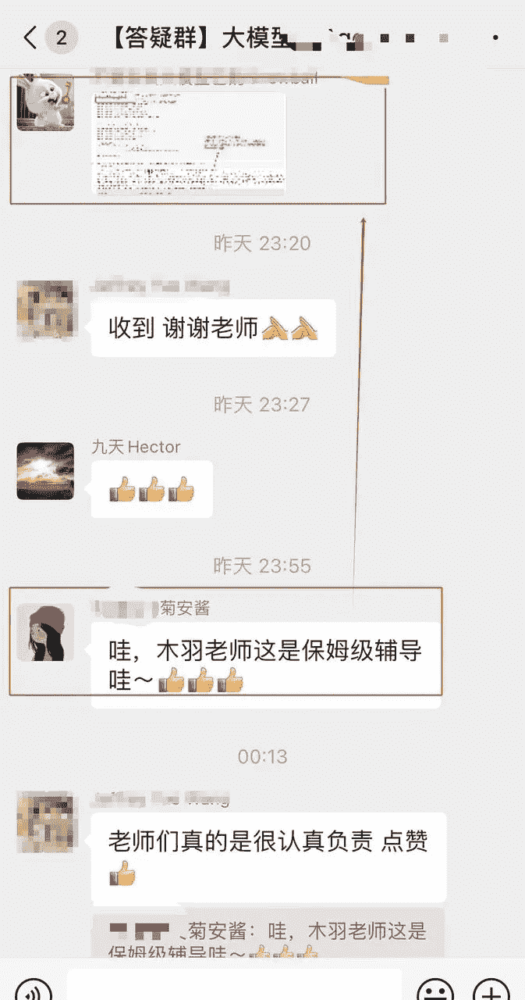
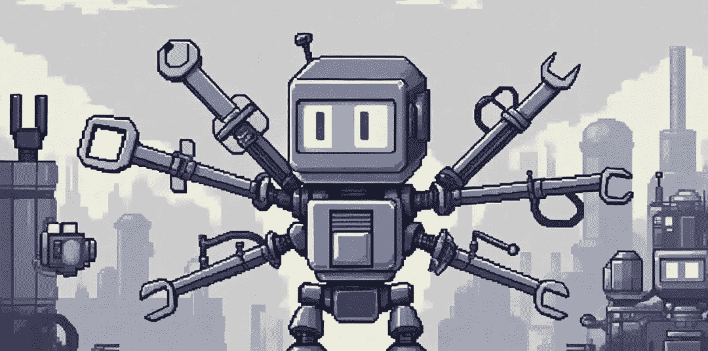

# 从“陪聊”到“生产力”：企业级大模型项目落地的核心技术要求

> 来源：[https://kq4b3vgg5b.feishu.cn/docx/W0JrdUyuqoGTHzxaFYQcYdYwnle](https://kq4b3vgg5b.feishu.cn/docx/W0JrdUyuqoGTHzxaFYQcYdYwnle)

> 🐽 受访者：小猪同学，具备丰富的企业级项目落地经验

> 💻 采访&整理：运营范范

> 写在前面：

> 入门大模型需要学到什么程度❓该如何通过大模型赚钱❓实际的企业级项目落地又是什么样的❓需要考虑哪些问题❓……

> 这些问题是所有想拥抱大模型的人都会思考的，但是很难有一个标准答案适配所有场景。

> 而很幸运的，我们本期邀请到了小猪同学，他本人一直在做前沿技术落地，并拥有丰富的大模型落地项目经验，涵盖To G，电商、金融、在线教育、中医等平台，为这些机构建立属于自己的平台。

> 这个过程里，技术人该考虑什么？需要什么样的技能？以下是他的答案。

## ❖ **明确知道自己需要什么的技术人**

💻 范范：在工作、学习、求职中是否走过什么弯路可以分享？

🐽 我没有遇到过，我很明确自己想要什么，能做什么，会做什么。

自从知道自己不是前端的料后，就时刻提醒自己只有一条后端的路要走，而且要走的精，走的深，这样自己才能“活”下去。

刚开始确实会有一切都从最开始的恐慌、茫然，还有一个人走的孤独感。就好比当初研究HBASE的时候，全国估计也就20个不到。但慢慢走着走着就遇到这条路上志同道合的人，大家一起往前走的感觉很好

💻 范范：那你是如何进入到大模型领域的？

🐽 大模型这个行业，困难嘛说难也难，说不难也不难，无非就是自己熬个夜加个班努力追赶。不过还好现在有老师带着走，能节省很多事情。

很多时候项目上遇到了问题可以在群里提问，看看老师、同学有没有思路，或者老师能直接给出思路。这样就可以做到省时省力，还能解决问题，同时自己还能学到东西。

我没想过太多该学什么、学到什么程度才能入行的问题，做就是了。

如果你要转行，转到这个行业，先清楚认定自己要走哪条路，然后可以给自己试验的时间去尝试看看自己行不行。

这条是未来的赛道，你自己应该是知道的。

所以如果你想走的长远一些，需要做的是选对自己相对适合一些的赛道，走下去就行了。

## ❖ **大模型是提效而不是替代**

💻 范**范：许多朋友在开始落地项目前，想知道该**把哪个环节作为重点，有什么标准答案吗？

🐽 这么说吧，会问这个问题的人，一般是不知道模型在项目中能做什么，或者说不知道模型要如何结合现在已有的项目。

记住一个思路是：所有的进步都是在便于人生活走向更好的方向发展，它才能活的长久，而不是向完全替代人的这个方向上去发展。

在这个前提下，AI做的应该是提效而不是完全替代。

这里举两个常见例子，第一是类似于智能客服以及数据分析，或者是发稿写文章，这类是比较固定的输出，可以用RAG+LLM即可解决。

到实际场景里，让大模型先生成差不多比较不错的文章，再加上人为稍作修改或润色即可出成品的产品，是他们很乐意接受的。也是当下热门落地的情景之一。

第二个例子是数据分析，更多的借助Agent来完成，链路合适能做出非常漂亮的成果。

💻 范范：细节部分，比如是否要用DeepsSeek？会是要重点关注的吗？

🐽 真实落地，他们真的一点都不在乎底层是否要用DeepSeek。企业要的是能让工作轻松的，而打工人要的是小部分修修改改就能有不错的成果。

很多时候是上头要求，这时候才需要。其他场景能实现就可以了。

如果不涉密并且又要效果更好的模型，我也建议使用在线模型，能省去大量调优的心思。

💻 范范：所以在线大模型和本地大模型都要熟悉

🐽 这是基本要求。

如果硬要说卡点，最常见的其实是基本功，比如python以及你阅读源码的速度与能力。这个基本上得啃一次才行，否则很难有所进展。

除此之外就是主观的付出了，现在大家都在努力拿下这块大蛋糕，所以竞争很激烈，要求项目开发的速度要很快。所以你要做好这方面的心理准备。

## ❖ **RAG+AI Agent+python3.5以上的新特性**+FastAPI+多年工作经验是必备武器

💻 范**范：现在也有很多低代码平台，可以快速**地搭建Agent，和你做的有什么区别？

🐽 本质上的区别。coze我是没接触到的，而dify我看别人用过。

第一它十分的简单，对于一些简单的流程，它能快速搭建，并满足很多大部分初体验的场景。但对于项目上真正用到大语言模型作为知识库以及指挥中心，dify来说就显得严重不足。

原因就在于它不能具备有庞大的知识库，也无法对庞大杂乱的知识库做一个整合。就更不用谈对知识库的定制问题。它都无法做。

第二由于它过于简单，也就意味着它不够灵活，也就是留给你可发展的空间就小了很多。

💻 范范：是否有具体的例子可以分享下？

🐽 简单举个例子。我有反洗钱的一整套知识库，同时也有所有人资金来往的数据，这个数据可能每家银行一季度都能产出几个T。

你要对接所有银行的数据，每家数据格式名字都不一样，这个时候，你想让dify去做就显得很吃力，甚至会崩掉。

然后你还要将数据导入到图形数据库中，之后还要建立知识图谱，再之后你的知识图谱可能会牵扯2-3个功能，调用图或者本地知识库等，最后返回的是一个关系图链以及资金流线图，以及来往的数据凭证图。

这些才是真正的工程化开发，dify是做不了的。

💻 范范：该如何理解这中间使用到的开发功能呢？

🐽 以备受关注过的Manus为例吧，他其实就是AI Agent的一整套流程。

常规的，一般是用RAG构建知识库，再用知识库作为大模型的大脑。而AI Agent在整个流程里的角色是实现者，指挥者是用户，但理解用户意图并指挥各个能力的是RAG+模型自带的能力。

💻 范范：那需要具备的知识都有哪些呢？

🐽 RAG+aigent+python3.5以上的新特性+FastAPI+你的多年工作经验，能解决大多数项目落地需要。

💻 范**范：该如何学习呢？**

🐽 跟着老师的步伐走，一定记住，老师教的都是当下最流行且能用得上的知识，别担心过时。这一点无论面试还是工作都可以自信一些。

至于新手，我的建议是什么是你最需要的，就跟什么老师学。市场需要什么人才，你要走什么路就看哪个老师的课。比如Agent、RAG就跟木羽老师学。

有可能的话，每天抽出3-4个小时进行学习及复习，别犹豫。

---

## 💌 赋范交流社区

以上就是本次访谈的全部内容啦~

“Agentic时代同行计划”目的是希望集结大家的智慧。也许你的一句话会在未来5年、10年点亮另一个人的心，给予他继续前行的力量！

访谈不限主题、不限内容，会有专人进行访编辑并维护~

如果你也想分享自己的经验，欢迎扫描下方二维码，来社群找我们一起玩吧~

