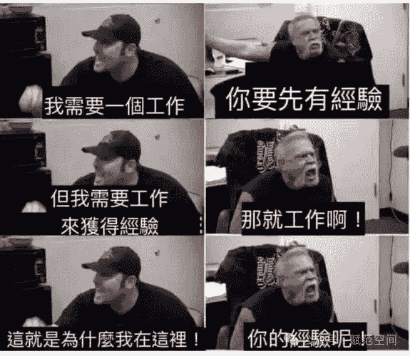

# 文科4个月转行「大模型」，月薪30K+的面试问了什么？

> 来源：[https://kq4b3vgg5b.feishu.cn/docx/PBI1d4FCpobFlLxVX30c9kCcnKh](https://kq4b3vgg5b.feishu.cn/docx/PBI1d4FCpobFlLxVX30c9kCcnKh)

> 🥷 受访者：白衣人间客，本科非相关专业（文科）毕业，现就职大模型算法岗

> 💻 采访&整理：运营范范

## ❖ 月薪30K+的面试真题

💻 范**范：最近又在跳槽吗？**

🥷 是的，最近有两家面试我觉得特别值得分享，入职薪资都在30K+，面试过程中对细节问的很深：

> **「大模型方向」**

+   **模型微调**：llamafactory如何做数据预处理、参数的设置、精度的选择、精度的选择会对损失造成什么影响、如果不用微调框架会不会写微调脚本？

+   **模型部署**：Tensorrt 与 vLLM各自的优缺点；模型推理的参数有哪些，如何起作用？

+   **召回怎么加速：**faiss、Milvus优缺点，为什么他们向量检索速度快，构建知识库的时候向量用不用做归一化、为什么？

>

> **「NLP方向」**

+   **NER：**数据的构造、都用过什么模型、有什么优缺点、训练的损失变化、优化如何做、推理后如何取到最后的结果？

+   **关系抽取：**任务如何设计的，有没有做过联合任务的设计（实体识别+关系抽取）？

+   **Trandformer：**架构细节，有没有自己用Transformer做过一些任务？

最大的感受就是，大模型处于上升期，工作机会也相对多一点，但好的岗位还需要真本事，细节一定要掌握。

## ❖ 工作没人带、网课学不会、能力不强的死循环

💻 范范：文科生走到这个地步已经很厉害啦！有什么建议可以分享吗？

🥷 我自己目前也是一塌糊涂，实在不敢说是建议，说说自己的辛酸血泪史吧哈哈。

2018年本科非科班出身（文科专业），学校也不好。刚开始是接触、学习人工智能，但只是找网上的代码跑通就行。

但是由于**功底实在不扎实只能靠网课，学不会没法提升能**力，找不到好工作，继续没人带，只能靠网课……这就无解了

💻 范范：之前已经报过其他课程为什么还学不会？

🥷 很多课程价格很贵，但讲的很浅，照着PPT过一遍理论，调包实现一下各种任务就算实战了。总结下来是：

**理论讲解千篇一律**，听课跟自己在网上看帖子差不多，讲解既不深刻也不易懂。

**代码直接找现成的进行跑通**，没有太多关于代码细节的讲解，学完后依然没有动手能力。

**老师讲课没激情**，很难坚持听下去。

很多课买了没用，我就没看过。

💻 范范：那九天老师的课为什么会不一样呢？（广告时间了哈哈

🥷 哈哈哈，我先说些直观感受吧。

第一点是能**听进去**，九天、菜菜老师讲课的时候永远都是精神非常饱满、状态非常好，两三个小时的直播课状态始终如一。听着就是舒服，不会让人疲倦。

再有是能**用的上**，无论是我现在在做的O系列模型调研和使用，还是之前Agent相关内容，课程都给了我很大帮助。

最后是**明显的提升**，通过老师不断地带读源码，让我对看源码也有了一点感觉，很多时候在接触新框架的时也能自己先通过源码进行了解学习，这是我感觉进步最大的一点；

## ❖ 多实践才是硬道理

💻 范范：如何做到了4个月完成转行？

🥷 我是24年初转入大模型赛道，个人觉得是运气好吧。因为知道自己的情况，所以一直抱着每次进步一点点的想法在前进，找到一份外包的工作就直接干了，26K也很满意。

💻 范范：从文科转行到大模型，差距还是挺大的，是怎么想的？

🥷 我认为大**模型是处在上升阶段，而且是未来趋势。**拥抱大模型应该是未来路最宽的选择之一。

至于坚持，其实挺现实的是能多赚钱哈哈~

而且做了技术就知道，只有不断学习才能跟上技术发展的速度，不被淘汰。

💻 范**范：当下认为什么比较重要呢？**

🥷 我个人的话，认为最有效的是在打好基础的前提下多时间，基础任务应该多敲代码追求熟练。

我也是去年认识到这点后，开始追求对基础的学习与练习，感觉在学习模型架构、以及模型的训练优化等方面都有帮助，今年也会持续在这个方向努力。

💻 范**范：那对新人有什么建议吗？**

🥷 实在不敢谈什么建议，非要说的话，只能说如果想要学习“深度学习/大模型”，选择赋范空间，跟着老师学，是走在正确的道路上，剩下的就要自己努力了。

---

## 💌 赋范交流社区

以上就是本次访谈的全部内容啦~

“Agentic时代同行计划”目的是希望集结大家的智慧。也许你的一句话会在未来5年、10年点亮另一个人的心，给予他继续前行的力量！

访谈不限主题、不限内容，会有专人进行访编辑并维护~

如果你也想分享自己的经验，欢迎扫描下方二维码，来社群找我们一起玩吧~

