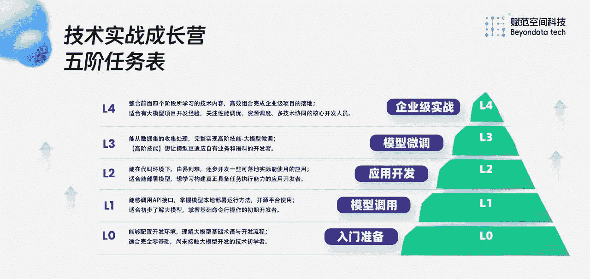
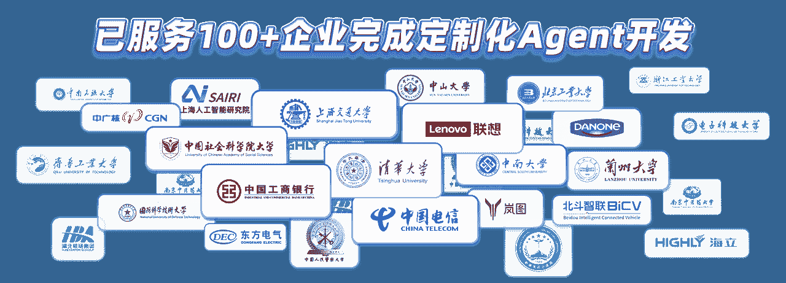

# 大模型技术社区丨赋范空间

> 来源：[https://kq4b3vgg5b.feishu.cn/docx/XDXbdYMBvo🐧isxXwrFcQVXcnKg](https://kq4b3vgg5b.feishu.cn/docx/XDXbdYMBvo🐧isxXwrFcQVXcnKg)

> Hi，这里收录了我们研发团队独家自研**的一手大**模型硬核干货学习资料，并持续更新中，建议小伙伴们收藏起来随查随用，技术能力涨涨涨🆙～

#

# 🔶 近期热门更新

```
🔥 Deep[Seek-OCR-V2快速入门](https://kq4b3vgg5b.feishu.cn/wiki/QTGmwKAOeiNvJmkCamMcVKwAnXb)实战
🔥 ClawdBot保姆[级部署指南
🔥 OpenClaw架构解析](https://kq4b3vgg5b.feishu.cn/wiki/MhIjw4jqZi83rrk4irecZgL1ncd?from=from_copylink)与AI数字员工开发指南
⭐️ DeeSeek-v3.2 + DeepAgents 应用开发实战
⭐️ 从零到一开发Agent Skills系统
🤗 保姆级DeepSeek-OCR部署与调用指南！
🤗 基于PaddleOCR-VL+DeepSeek-ocr搭建企业级多模态RAG系统
🤗 基于VLM构建多模态RAG问答系统实战
🤗 多模态PDF检索+图文并茂回复，企业级多模态RAG系统开发实战（README） 
🤗 Agentic-GraphRAG应用开发
⭐ Nano Banana Pro Agent开发实战
⭐ LangChain从入门到企业级项目实战合集
👑 Qwen3混合推理模型「对话+推理」双形态高效微调实战（上）
💎 最热门十大MCP工具快速部署与智能体开发实战
```

# **🔍快速定位，搜索查找所需资料**

# ** ****  **** **

---

✅支持关键词搜索丨项目代码一网打尽

---

# 🔶 赋范大模型技术社区使用指南

---

> 我[**猜咱们未来可能会有一**](https://kq4b3vgg5b.feishu.cn/wiki/JcHnwk8IWi95GpkzicqceqKNnhd?from=from_copylink)些更深的链接，或者会有一些机会合作点什么，为了能更高效愉悦地沟通，不妨先查阅一下这篇👉「社区使用说明文档」💓～

本社区是围绕大模型、适用于内各阶大模型学习者的专属大模型**教程，针对各类**大模型提供包括环境设置、本地部署、项目开发、高效微调等技能在内的「全流程指导」，简化大模型的使用和应用流程，让更多的想转行大模型的学习者更好地使用大模型，帮助前沿、有效的大模型更快融入到普通学习者的生活中。

> 本社区主要包含的学习内容包括：

+   热门（开源/在线）大模型部署与调用

+   大模型RAG、Agent开发技术实战

+   大模型微调实战

+   MCP技术全解

+   企业级落地项目开发实战训练

>

> 社区创办的主要目的：就是**提供国内最前沿的优质大模型学习**内容，成为大模型与学习者们的交流阶梯，实现个人学业/职业/兴趣的梦想，拥抱更恢弘而辽阔的大模型世界。


> **学习建议小Tips：**对于刚入门学习大模型的小伙伴，建议先学习环境配置、熟悉功能，然后再学习模型的部署使用，最后再学习进阶的技术。因为环境配置以及模型的部署使用只是基础，部署后对模型进行微调、RAG搭建、Agent开发等，属于是大模型的进阶。

# 🔶 社区目录

---

### 🙋知识问答功能（限免开放中）整个社区知识库可直接提问、检索和总结

### 🎉 欢迎使用赋范大模型技术社区 |  Getting started

### 1.1 开源大模型指南

+   DeepSeek-OCR（README）

+   [GPT-OSS（README）](https://kq4b3vgg5b.feishu.cn/wiki/PmgcwJwTeiKVcYkUOPXcpQptn7g?from=from_copylink)

+   [Qwen3（README）](https://kq4b3vgg5b.feishu.cn/wiki/NQjCwDk79icMgFkPJa1cVj5ynPc?from=from_copylink)

+   DeepSeek v3（README）

+   DeepSeek R1（README）

+   [Qwen3（README）](https://kq4b3vgg5b.feishu.cn/wiki/NQjCwDk79icMgFkPJa1cVj5ynPc?from=from_copylink)

+   [Llama 3（README）](https://kq4b3vgg5b.feishu.cn/wiki/H4mXwTX7di4bo2khUmxcD1slnYc?from=from_copylink)

+   ChatGLM-3（README）

+   Baichuan2（README）

### 1.2 在线大模型指南

+   GPT-5 & 5.1（README）

+   OpenAI Responses API（README）

+   OpenAI Agents API（README）

+   OpenAI Realtime API（README）

+   OpenAI Swarm（README）

+   OpenAI o1（README）

+   [GPT4o（README）](https://kq4b3vgg5b.feishu.cn/wiki/HKrpwQ1BIiSy3AkElZLcjQscnvg?from=from_copylink)

+   Claude系列（README）

+   Gemini系列（README）

+   [GLM-4（README）](https://kq4b3vgg5b.feishu.cn/wiki/OMyXw5aVQibKMLkrMgLcYVd3n1d?from=from_copylink)

### 1.3 RAG全栈技术

+   多模态RAG（包含OCR➕VLM两种方向多模态技术）

+   GraphRAG（README）

+   Agentic RAG（README）

+   [RAG（README）](https://kq4b3vgg5b.feishu.cn/wiki/TPj1wSLOYi9hxLknViccjpAnnod?from=from_copylink)

### 1.4 Agent开发范式（更多项目查看实战项目部分）

+   [LangChain 1.0](https://kq4b3vgg5b.feishu.cn/wiki/OlrewlsjjiFYSJke6enci7eZnId?from=from_copylink)

+   LangChain（README）

+   LangGraph（README）

+   [Dify（README）](https://kq4b3vgg5b.feishu.cn/wiki/DadOwgA4fia7yekCbclcZ9HCnyb?from=from_copylink)

+   Multi-Agent（README）

+   [Agent（README）](https://kq4b3vgg5b.feishu.cn/wiki/XVcTwbs2FijnszkP6lBcRPd7ntc?from=from_copylink)

+   AgentScope快速入门实战

### 1.5 微调

+   LLaMA-Factory（README）

+   [LoRA（README）](https://kq4b3vgg5b.feishu.cn/wiki/NiIPwnUJ7iyvJMkZ2WycqqMsnQb?from=from_copylink)

### 1.6 VibeCoding

+   Claude Code Agent Teams 练习

+   AI-Takeover-Toolkit

+   [AI 全栈交付-Toolkit](https://kq4b3vgg5b.feishu.cn/wiki/Ij9kwtvQJicve4kvfWGcGSovnPb)

+   [多模态 RAG 架构设计包](https://kq4b3vgg5b.feishu.cn/wiki/TfJ7wPA2OiMZahkZLr7cnztPntg)

### 2.1 热门项目实战合集

+   [LangChain 1.1 + DeepSeek-v3](https://kq4b3vgg5b.feishu.cn/wiki/IEakwQByXiZAOXkJE2icia2jnMb?from=from_copylink).2 从零搭建企业级文档审核系统 2.0

+   从0到1搭建企业级多模态RAG检索引擎丨olmOCR与MinerU

+   [借助最新模型GPT-4.1搭建一个M](https://kq4b3vgg5b.feishu.cn/wiki/WhVjwreh9iE9YFkuofNc0uudnpa)ini DeepResearch实战项目

+   DeepSeek企业级智能体MiniManus开发实战

+   CherryStudio+高德MCP打造个人出行规划助理

+   DeepSeek R1模型蒸馏入门实战

+   Agent智能客服案例实战（DeepSeek+LangGraph）

+   MateGen：新一代交互式AI智能编程助手（安装与部署文档）

+   [企业级DB-GPT安装部署指南](https://kq4b3vgg5b.feishu.cn/wiki/EXl0wICqgiiOErkAWHBcxy9wnYe?from=from_copylink)

+   [手动复现DeepSeek v3丨预训练+全](https://kq4b3vgg5b.feishu.cn/wiki/ZrkLwOqlzikogykSsmjcRXpUnLh?from=from_copylink)量指令微调+DPO强化学习微调全流程实战

+   [从零搭建开发私有智能客服系统](https://kq4b3vgg5b.feishu.cn/wiki/ZCQSwFYUfio90KkUMN5c8CFPnHM?from=from_copylink)

+   [从零训练专属大模型技术实战合集](https://kq4b3vgg5b.feishu.cn/wiki/FeivwiFfTinLpUk04BlcN8MhnTf?from=from_copylink)

+   [B站动态数据&舆情分析智能体](https://kq4b3vgg5b.feishu.cn/docx/UtsmdFQgXo3K8kxGyuscaPpDnZd?from=from_copylink)

# 🔶 技术专栏合集（持续更新中...）

---

#

+   [赋范2025大模型技术全景地图](https://kq4b3vgg5b.feishu.cn/wiki/MTuywZLzhioQhHk2yolcjgawnTg?from=from_copylink)

+   [2025年大模型求职必看指南](https://kq4b3vgg5b.feishu.cn/wiki/Y4cVwJfgpiZCMvkH13ocnGtQnMb?from=from_copylink)

+   [大模型GPU硬件配置保姆级指南](https://kq4b3vgg5b.feishu.cn/wiki/Pwu3wJ8RvidPgXkOIXBcr6y7nhe?from=from_copylink)

......

#

+   [DeepSeek-v3.2](https://kq4b3vgg5b.feishu.cn/wiki/SEZjwoh4qiBI6nkOn8acgsWrnpc)

+   [DeepSeekMath-V2](https://kq4b3vgg5b.feishu.cn/wiki/DqsJwY6MuivLXGkZjo3cXCWxnlu?from=from_copylink)

+   [DeepSeek-OCR](https://kq4b3vgg5b.feishu.cn/wiki/SEZjwoh4qiBI6nkOn8acgsWrnpc?from=from_copylink)

+   [DeepSeek V3](https://kq4b3vgg5b.feishu.cn/wiki/KVQHwzi5TiXqWEkMWdwcZv2yn3Q)

+   DeepSeek_Prover_V2

+   [DeepSeek R1](https://kq4b3vgg5b.feishu.cn/wiki/PipBwsglqiA3mjknHSNcmT20nLd?from=from_copylink)

+   [DeepSeek-V4](https://kq4b3vgg5b.feishu.cn/wiki/NBYlw4tCAiQ3tQkuhb2c0Bsfn3f)

......

##

+   [Qwen3部署与调用详解](https://kq4b3vgg5b.feishu.cn/wiki/T5NZwZyZViK61DkYUSdcznYlnfc?from=from_copylink)

+   Qwen-Agent+MCP搭建智能体

+   [Qwen3混合推理高效微调实战](https://kq4b3vgg5b.feishu.cn/wiki/CnFgwyxZLiDuvTk8SmEc9vWXnDh?from=from_copylink)

......

# 🔶 社区活动进行中

## [💪赋范大模型技术实战复现成长营](https://kq4b3vgg5b.feishu.cn/wiki/BNouw5bbyit7yWkslmWcc6F5nsf?from=from_copylink)

> 专为**大模型开发者成长**打造的长期实战训练营！



> 5阶段成长学习路径，从“0基础”到“企业业务落地”全流程覆盖，一步步构建你的技术力与问题解决能力～

## [4.2 提个需求吧](https://kq4b3vgg5b.feishu.cn/wiki/TMvpwSerXidBiGk7rh3cknZ4nVe)

> 如果你对于大模型学习还有【更多需求】，或者想【提供项目文档】，可以点击文档提交，让我们共同构建维护这个项目吧~

## [4.3 学员深度访谈丨Agentic 时代同行计划](https://kq4b3vgg5b.feishu.cn/wiki/YZvVwOAu2i96U9kEinUcFzeqnif)

> 通过深度访谈学员真实经历，记录技术转型者的学习路径、实践挑战与职业跃迁！

> 专栏开放投稿中！也许你的一句话会在未来点亮另一个人的心～

