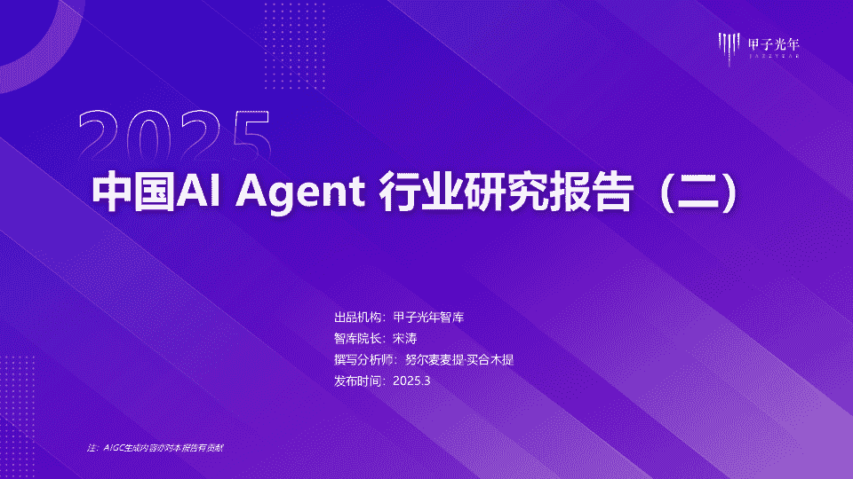
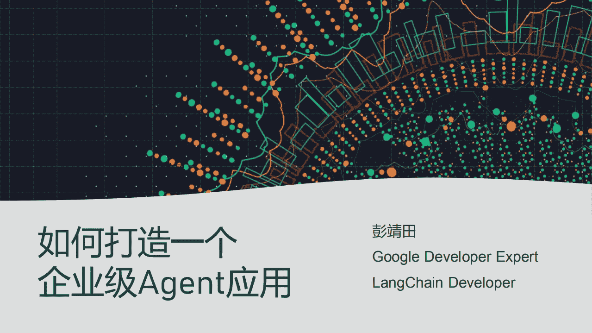
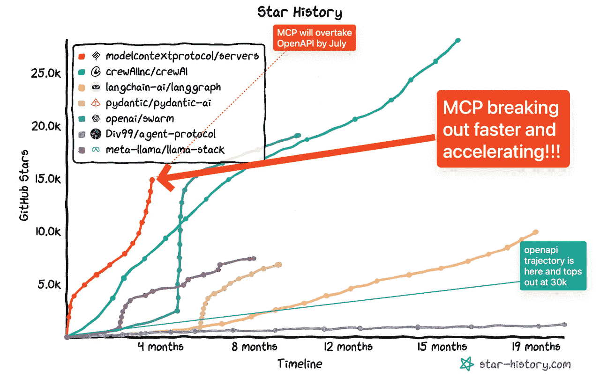
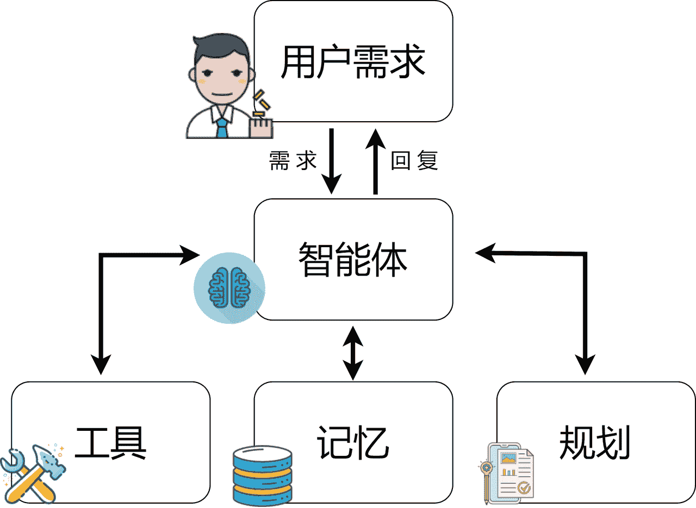
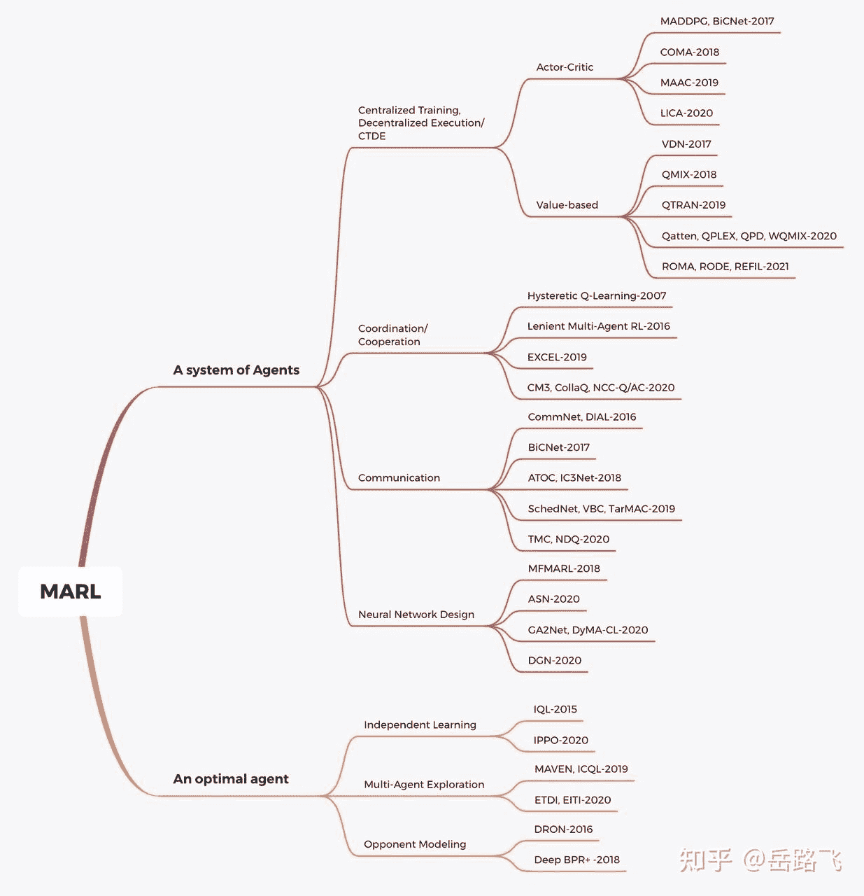
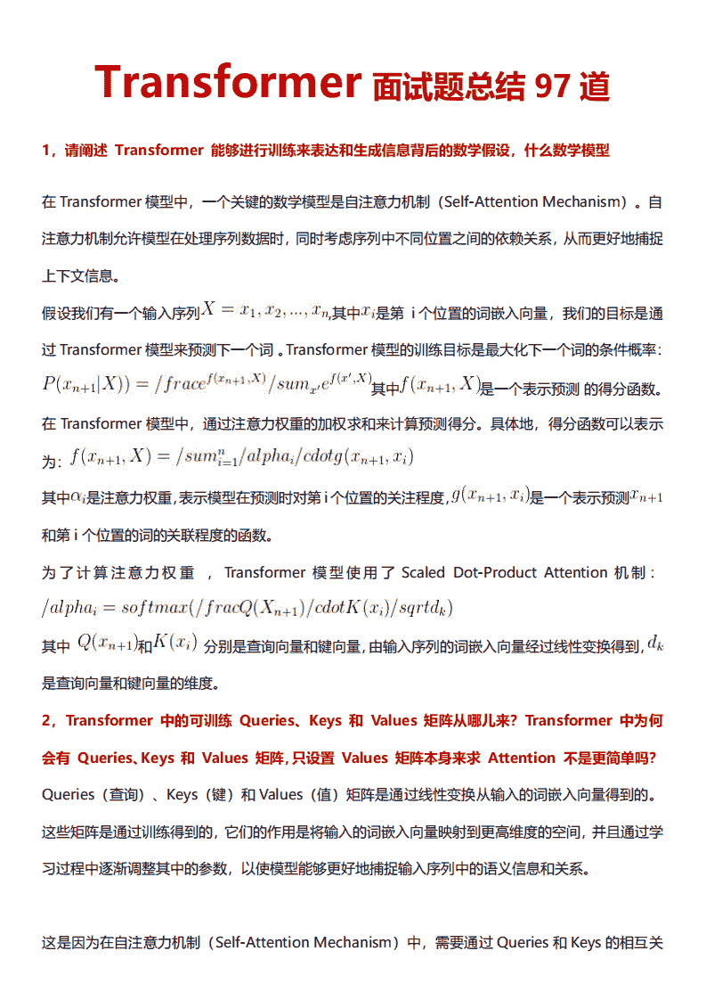
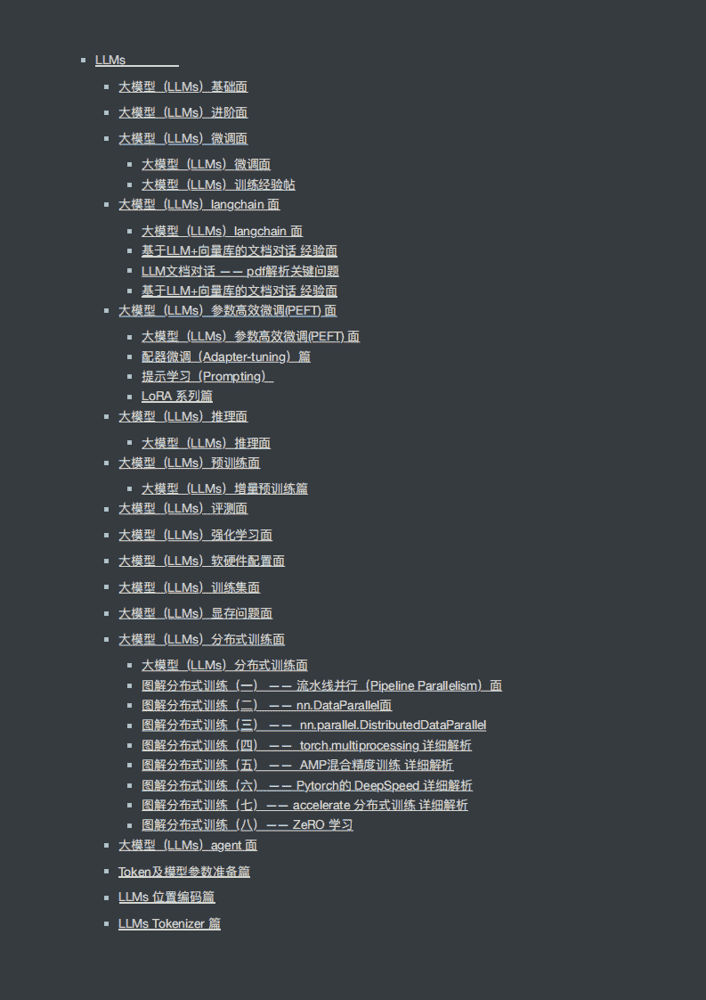
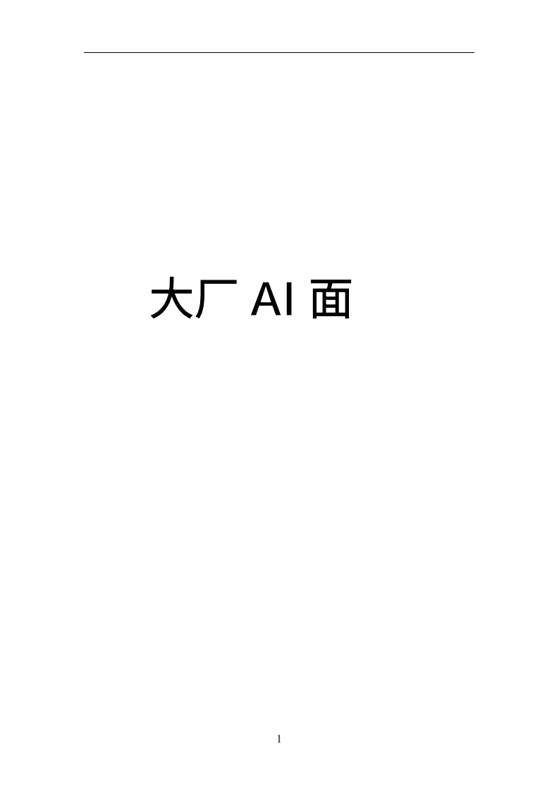
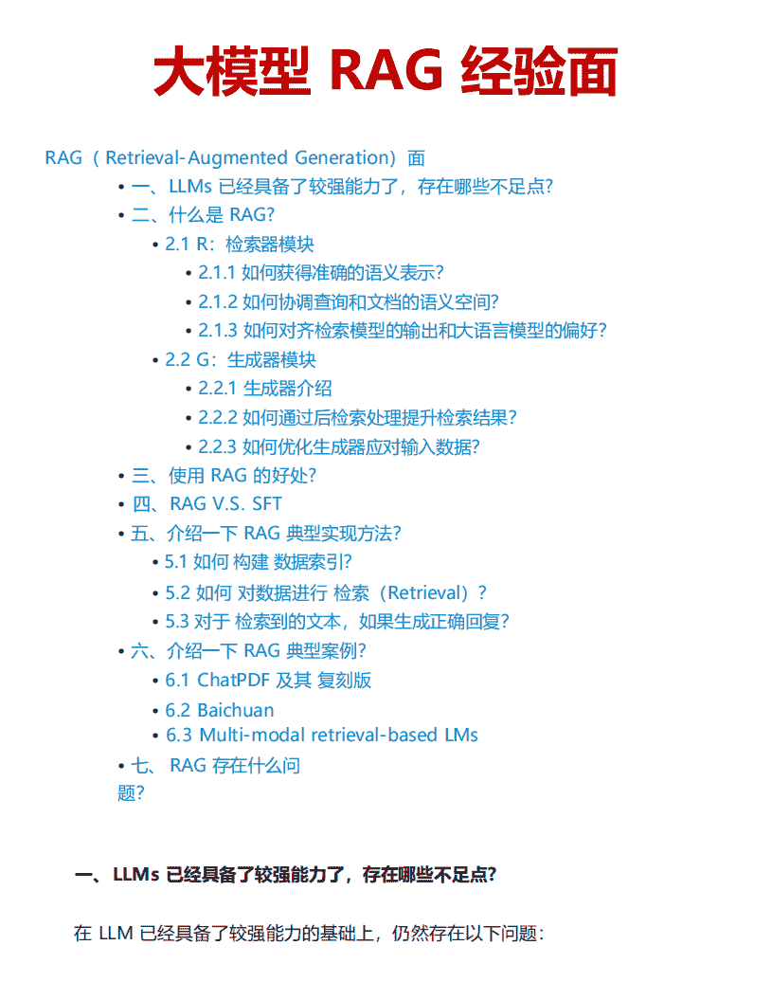
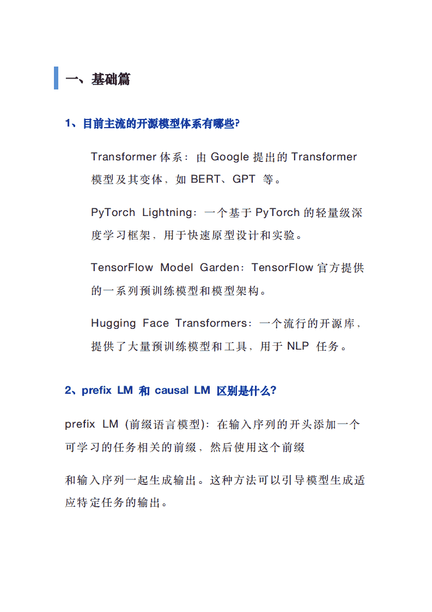

# 🚀【AI Agent 知识库】

> 来源：[https://geekbang.feishu.cn/docx/XnTfdI7J1orSghxPyTJcFNFVnub](https://geekbang.feishu.cn/docx/XnTfdI7J1orSghxPyTJcFNFVnub)

## 一、智能体（AI Agent）入门与概览

### Agent 为什么这么火？
AI Agent因自主执行与广泛实用而崛起。爆火主要原因有商业化临界点突破实现落地商用、真正能够解决实际问题、商业应用可见。

### Agent 开发涉及哪些关键技术？

### 哪些大厂也在投入做 Agent？
国内Agent大厂图谱：

- [2025年 AI Agent行业报告.pdf](https://internal-api-drive-stream.feishu.cn/space/api/box/stream/download/all/H3rPbfwBloLHgpxKor3cREyun3g)
- [Agent研发前沿技术与趋势.pdf](https://internal-api-drive-stream.feishu.cn/space/api/box/stream/download/all/YxjWb2KkroLvjHxjzRZcgRLknAh)

### 目前有哪些比较知名的 Agent 产品？
海外版：

- [如何打造一个企业级Agent应用.pdf](https://internal-api-drive-stream.feishu.cn/space/api/box/stream/download/all/O3C7bjMAHowZGAxpQNGc9rbbnJe)

### 全球 Agent 产品详细列表
开源

### 关于智能体的实践案例PPT

| 来源 | 主题 | PPT |
| --- | --- | --- |
| 2025.08 AICon深圳站 | 腾讯云 WeData Agent 的落地思考与实践 |  |
|  | 纷享销客企业级 SaaS 服务 AI Agent 平台落地实践 |  |
|  | Agent开发挑战：如何在敏捷与可靠之间做到既要、又要、还要？ |  |
|  | Trae 插件在 Agent 代码编辑的落地实践 |  |
|  | 当 AI Agent 成为营销新引擎，破解流量困局与 ROI 迷局 |  |
|  | 协同智能，多 Agent 驱动的内容创作新范式 |  |
|  | AI Native 应用的新范式，Trae在Coding Agent中的工程实践 |  |
|  | CodeArts Doer 全流程多 Agent 协同，驱动研发全流程效能跃升 |  |
|  | AI Agent + AI Profiling，构建高效智能运维双支柱 |  |
| 2025.06 AICon北京站 | Training, Inference, Agents: Beyond Apps in the AI-Native World |  |
|  | 从Copilot到Agent：AI编程的范式革新 |  |
|  | AI Agent+IoT技术方案新场景创新应用 |  |
|  | AI Agent 如何重塑有声内容的生产与分发 |  |
|  | Coding Agent 驱动研发提效：从实践到流程改进 |  |
|  | CangjieMagic：基于仓颉语言的Agent开发框架实践 |  |
|  | Multi-Agent架构驱动的Data Agent路线与工程实践 |  |
|  | 让 Agent 进化 Agent：企业自动化的新范式构想 |  |
| 2025.05 AICon北京站 | 大模型Data Agent重构金融数据价值：从智能分析到决策闭环的范式升级 |  |
|  | 从辅助编程到协同编程，AI Coding Agent 的技术演进与落地实践 |  |
|  | 打造可扩展的生态体系：从 MCP 到 Agent 集成的实践与趋势 |  |
| 2025.04 QCon北京站 | 从指令到 Agent：基于大语言模型构建智能编程助手 |  |
|  | 从原型到生产：AgentOps 加速字节 AI 应用落地实践 |  |
| 2024.12 AICon北京站 | 多Agent协同调度框架的设计与实现方法 |  |
|  | 小爱同学大模型在业务应用中的升级之路 |  |
|  | 如何利用 Agent 解决企业数据分析与洞察的经验探索 |  |
| 2024.8 AICon北京站 | 多环境下的 LLM Agent 应用与增强 |  |
|  | The Future is Here, A Deep Dive into Autonomous Agent |  |
| 2024.5 AICon北京站 | 面向开放域的大模型智能体 |  |
|  | AI Agent 在企业生产中的技术实践 |  |
|  | 利用 SLM 结合边缘设备构建 AIoT Agent |  |
|  | 零售连锁行业内智能分析 AI Agent 的应用探索 |  |

- [虎兴龙-腾讯云wedata+agent的思考与实践.pdf](https://internal-api-drive-stream.feishu.cn/space/api/box/stream/download/all/SvkkbXsnAoCmYExr5QlcnW1Zn4b)
- [AICon深圳2025-纷享销客AIAgent平台落地实践.pdf](https://internal-api-drive-stream.feishu.cn/space/api/box/stream/download/all/VCcJbH6RKooIVZxiI3Jc5mHWn7c)
- [Agent开发挑战：如何在敏捷与可靠之间做到既要、又要、还要？.pdf](https://internal-api-drive-stream.feishu.cn/space/api/box/stream/download/all/DbwEbmrQkoXXM5x4M8scJSDKn4f)
- [冯绪-TRAE+在+Agent+代码编辑的实践.pdf](https://internal-api-drive-stream.feishu.cn/space/api/box/stream/download/all/HuLHbciC3oLT3Lx6IItcVRZPnSd)
- [当AI+Agent成为营销新引擎+破解流量困局与ROI迷局-0823.pdf](https://internal-api-drive-stream.feishu.cn/space/api/box/stream/download/all/F0NVbdyMOoJiDlxP95ecJ56jnob)
- [AICon深圳2025+-+终稿+徐奕成.pdf](https://internal-api-drive-stream.feishu.cn/space/api/box/stream/download/all/MiZebYWpyouJuexb2f7c0JNenGe)
- [AI+Native应用的新范式：Trae在Coding+Agent中的工程实践.pdf](https://internal-api-drive-stream.feishu.cn/space/api/box/stream/download/all/Xg0hbJf8WoeuIuxKfPjcOMwUnld)
- [CodeArts+Doer+全流程多+Agent+协同，驱动研发全流程效能跃升.pdf](https://internal-api-drive-stream.feishu.cn/space/api/box/stream/download/all/Avi6bXWKmogevpxNuVFcPBM7n0g)
- [周絮-AI+Agent+++AI+Profiling，构建高效智能运维双支柱.pdf](https://internal-api-drive-stream.feishu.cn/space/api/box/stream/download/all/KDo2b7YiaofTlyxH4BWc6csHnxU)
- [03+AICon2025_MarkCollier+final.pdf](https://internal-api-drive-stream.feishu.cn/space/api/box/stream/download/all/O97WbGqdVoZWFux58xac8mujnWd)
- [AICon北京2025-叔同-脱敏版.pdf](https://internal-api-drive-stream.feishu.cn/space/api/box/stream/download/all/VnWJbxZnlooUNTx4Dhvc0U9QnNE)
- [吴方方-AI+Agent+IoT技术方案新场景创新应用.pdf](https://internal-api-drive-stream.feishu.cn/space/api/box/stream/download/all/IUnCbhjHKogGfex6gRMc037Lnxd)
- [徐文健-AI+Agent+如何重塑有声内容的生产与分发.pdf](https://internal-api-drive-stream.feishu.cn/space/api/box/stream/download/all/BB1EbogdPoHhuYxGFIDc9SU4nbT)
- [杨方伟-Coding+Agent+驱动研发提效：从实践到流程改进.pdf](https://internal-api-drive-stream.feishu.cn/space/api/box/stream/download/all/VwYhbPFwSo5VdaxX3dVcoC6knWh)
- [董鑫-CangjieMagic：基于仓颉语言的Agent开发框架实践.pdf](https://internal-api-drive-stream.feishu.cn/space/api/box/stream/download/all/SUv5bAplTo31mUxBkuVc5ffGnUb)
- [李飞-Multi-Agent架构驱动的Data+Agent路线与工程实践.pdf](https://internal-api-drive-stream.feishu.cn/space/api/box/stream/download/all/MvbEbYLO1o22NKxFlvXcuEGcnhe)
- [0627-AICon北京2025-让+Agent+进化+Agent+企业自动化的新范式构想.pdf](https://internal-api-drive-stream.feishu.cn/space/api/box/stream/download/all/VUbGblwfJo52roxVyeBcYRXtnuj)
- [AICon_数势科技_岑润哲.pdf](https://internal-api-drive-stream.feishu.cn/space/api/box/stream/download/all/NkOtbsieDoODo0xVFb7cQ793nMb)
- [从辅助编程到协同编程-张玉明.pdf](https://internal-api-drive-stream.feishu.cn/space/api/box/stream/download/all/Lst4bo4iTovQVuxJn0LcppJOn4e)
- [AICon上海站-陈仲寅+3.pdf](https://internal-api-drive-stream.feishu.cn/space/api/box/stream/download/all/Qbj2bwsCaoaPkYxuSrucfmFAnTf)
- [从指令到+Agent：基于大语言模型构建智能编程助手.pdf](https://internal-api-drive-stream.feishu.cn/space/api/box/stream/download/all/HAfeb2vBEoDQmSxnDGycbAGgnIc)
- [杨晨-从原型到生产-AgentOps+加速字节+AI+应用落地实践（0410）.pdf](https://internal-api-drive-stream.feishu.cn/space/api/box/stream/download/all/OcEVbB3jgoY4UKxERrhciUR2nCc)
- [邹盼湘-多智能体协同调度.pdf](https://internal-api-drive-stream.feishu.cn/space/api/box/stream/download/all/Xv9DbIhyBoQ9vvxIocpcefnInEd)
- [杞坚玮-Agent技术在小爱同学中的应用++.pdf](https://internal-api-drive-stream.feishu.cn/space/api/box/stream/download/all/VFwab5MuIoEB9WxMJ3Ec8Lr6n2c)
- [李飞-+如何利用+Agent+解决企业数据分析与洞察的经验探索.pdf](https://internal-api-drive-stream.feishu.cn/space/api/box/stream/download/all/NklGbHJTyoA0yDx1SYVcDeLHnvh)
- [多环境下的+LLM+Agent+应用与增强.pdf](https://internal-api-drive-stream.feishu.cn/space/api/box/stream/download/all/UCUFbcByeoEREnxk1rUc6KkdnUg)
- [The+Future+is+Here,+A+Deep+Dive+into+Autonomous+Agent.pdf](https://internal-api-drive-stream.feishu.cn/space/api/box/stream/download/all/MrS9bpX3FoiPmmxq9Q3cjYjAnYc)
- [面向开放域的大模型智能体-李鹏.v2--优化.pdf](https://internal-api-drive-stream.feishu.cn/space/api/box/stream/download/all/Exeub81mRooJXgxbmIMcqXd8nrb)
- [AI+Agent+在企业生产中的技术实践-陈星亮.pdf](https://internal-api-drive-stream.feishu.cn/space/api/box/stream/download/all/XRAtb3QYfovUBhxasvbcmFHAnFb)
- [利用+SLM+结合边缘设备构建+AIoT+Agent-卢建晖.pdf](https://internal-api-drive-stream.feishu.cn/space/api/box/stream/download/all/LFDebR0Z2oOl6Zxi7njcJfmbn2b)
- [零售连锁行业内智能分析+AI+Agent+的应用探索-岑润哲.pdf](https://internal-api-drive-stream.feishu.cn/space/api/box/stream/download/all/L76KbVCfUoAJV5x5C1pcBwGmnPw)

## 二、智能体（AI Agent）核心技术栈：从MCP开始聊起

| 🌈系统性学习推荐：[《`LangChain` 实战课》、](https://time.geekbang.org/column/intro/100617601?utm_campaign=geektime_search&amp;utm_content=geektime_search&amp;utm_medium=geektime_search&amp;utm_source=geektime_search&amp;utm_term=geektime_search) [`AI Agent` 入门实战](https://time.geekbang.org/course/intro/100801301?utm_campaign=geektime_search&amp;utm_content=geektime_search&amp;utm_medium=geektime_search&amp;utm_source=geektime_search&amp;utm_term=geektime_search) 《零基础开发 Agent 智能体》、《LLM 自主智能体应用实战课》、《如何高效使用 Coze 辅助自动办公化》 |  |  |

| --- | --- | --- |

| `MCP`：AI Agent 圈的“万能插头” | + `MCP` （Model Context Protocol）：模型上下文协议，这是由 Claude 的母公司 Anthropic 推出的一项开放标准协议。简单理解，`MCP` 相当于大模型领域的“`HTTP` 协议”，其并不绑定任何大模型，这意味着用户可以在支持 `MCP` 的工具中，用任何大模型调用 `MCP` 服务。 |  |

| 大语言模型（LLM） | + 基座模型：Qwen2.5-Max、DeepSeek V3、GPT-4/4o、Claude 3、Llama 3、Mistral等。 |  |

## 二、智能体技术体系与工具链

| 记忆与知识管理 | 短期记忆：上下文窗口优化（如滑动窗口、`Token`压缩）。 | 🌟《[智能体的记忆管理系统概述》](https://cloud.tencent.com/developer/article/2505920) |

| 开发框架与工具链 | 单/多智能体：`Dify`、`LangChain`、`LlamaIndex`、`Haystack`、`AutoGen`（微软）、`CrewAI`、`MetaGPT`等。 | ❕❕❕ 来自魔搭社区的动手实操指南：[《Agent教程》](https://modelscope.cn/brand/view/agent) |

| 评估与调试 | 评估指标：准确性、延迟、成本、对齐度。 | 🌟《基于大模型的Agent进行测试评估的3种方案》 |

| 多智能体协作技术 | 协调框架：`MARL`（多智能体强化学习）、基于规则的协商（`Contract Net Protocol`）。 |  |

- 向量数据库：`Pinecone`、`Milvus`、`FAISS`。
- 知识图谱：`Neo4j`、`Apache Jena`。
- 检索增强生成（`RAG`）：`LangChain Retriever`、`LlamaIndex`。

# 三、智能体（AI Agent）开发实践汇总

## 1、智能体开发流程

### 需求分析与场景定义
- 明确目标：自动化效率、决策优化、用户体验提升等111
- 场景分类：对话式助手、自动化流程、复杂决策支持等

### 架构设计
- 分层架构示例：感知层 → 认知层（知识库/模型） → 行动层
- 技术选型：规则引擎 vs 机器学习模型 vs 混合驱动

### 开发阶段
- 数据准备：结构化/非结构化数据整合、仿真环境搭建
- 模块开发：意图识别、上下文管理、动作执行器

### 测试与优化
- 功能测试：覆盖率测试、异常输入处理
- 性能测试：响应延迟、并发处理能力
- 持续优化：A/B测试、用户反馈闭环

### 部署与维护
- 部署模式：云原生、边缘设备、混合部署
- 监控体系：健康度指标（如意图识别准确率、任务完成率）

## 2、关键技术栈与工具

### 开发框架
- 开源工具：`LangChain`、`AutoGPT`、`Rasa`、`Dialogflow`
- 企业级平台：微软`Bot Framework`、`AWS Lex`、百度`UNIT`

### 核心算法
- NLP技术：意图识别（`BERT`/`LLM`）、实体抽取
- 决策模型：强化学习（`RL`）、蒙特卡洛树搜索（`MCTS`）
- 知识图谱：动态知识更新与推理

### 辅助工具
- 仿真环境：`Gazebo`（机器人）、`AirSim`（无人机）
- 调试工具：日志分析、轨迹回放（`Action Trace`）

## 3、资源附录

### 好文推荐
- 2024中国AI Agent最佳实践案例TOP20
- [25个AI Agent应用案例，看懂Agent](https://www.thepaper.cn/newsDetail_forward_30872854)ic AI如何助力企业营收增长与业务变革
- AI Agent落地实践：21个头部企业案例研究
- 三大行业案例：AI大模型+Agent实践全景
- RAG+Agent在实际业务落地案例分享+项目推荐
- `DeepSeek`+`Coze`：8分钟教你玩转AI智能体
- 从0到1开发一个商用 Agent（智能体）
- [最新文心智能体(Agent)免费教程：文心智能体](https://mp.weixin.qq.com/s/jt7GbEfqoos5MbKPlLvj3A)平台基础篇，从零到一，打造个性化AI助手
- 2025 AI Agent （多智能体）平台设计和技术实现指南
- 智能体| 如何构建有效的智能体？来自Anthropic的最佳实践
- `LLaMA 3`多智能体实战：如何构建一个多智能体系统？
- 如何设计`Autonomous Agent`应用？
- [GitHub Trending上的"AI泡](https://zhuanlan.zhihu.com/p/1943357561794455035)沫"：我们真的在创新，还是在玩概念游戏？
- 如何构建你的第一个 AI Agent
- Skywork技术论坛一手分享：Agent与多模态的落地真相
- `M3-Agent`：为 AI 智能体构建「长期记忆」
- 让Agent记住你：`Memory OS for AI agent`
- 2025年 Agent 开发框架选型&实战笔记
- [`LLM 代理的可视化指南`](https://mp.weixin.qq.com/s/Wx3f7bPDVMZwmxUEHLrt-g)

### 视频推荐
多维表格（`FebcbZi6SaZIcKsO5aLcq7e6nPc_tblx7BQiNbAfh9P4`）

# 四、共建内容

> 本篇章内容来自知识库共建者整理，如果你认可我们的理念，觉得知识库对你的学习之路有帮助，并且也想沉淀某一AI方向的知识，那么非常欢迎你参与共建，一起来尝试有意思的事情~
>
> 你可以相对深入地参与，主理某一模块/子模块，成为共建的一员
>
> 联系我们（VX）： YFFDVX

# 五、智能体（AI Agent）行业应用深度解析

## 软件行业

AI Agent技术正成为软件行业发展的重要驱动力。传统软件厂商通过与科技巨头合作或自主研发，积极拥抱AI Agent技术，以提升产品智能化水平，拓展业务边界，实现商业模式创新。

在B端场景下，AI Agent将对SaaS应用进行全面重构，与传统知识库结构化管理模式相比，AI Agent的向量数据库能自动学习和理解文档，实现更加高效的知识管理；

在C端场景下，AI Agent作为生成式AI的商业化应用，可以广泛应用于电商、教育、旅游、酒店以及客服等行业，带来传统行业的升级转型。

### 案例：

1.  `Tabnine`：一款基于`GPT`架构的智能代码补全工具。`Tabnine`采用了自监督学习范式，在海量开源代码库上训练`LanguageModel`，从而可以根据上下文语境实现全类型、全场景的代码补全，覆盖变量名、函数名、代码行等。目前已支持主流的20多种语言，可以集成到各种流行IDE中。

1.  印度尼西亚超级应用`Gojek`推出了印尼语AI语音助手`Dira by GoTo AI`，可让客户使用语音命令来完成账单支付和汇款等任务。

1.  软件公司`BMC`将`Google Vertex AI`平台和`Llama 3.1`的功能引入其`BMC Helix`平台，提高了对话式AI和`AIOps`建议的准确性。基于`Gemini`、`Claude`、`Llama`、`Large 2`模型，AI初创`Quora`开发了AI聊天机器人`Poe`，并将其托管在`Google`的AI基础架构上。

### 推荐阅读：

1.  AI Coding 最全图谱：Agent 将如何颠覆软件

## 媒体、营销和游戏

### 案例：

1.  华纳兄弟探索频道使用`Google Vertex AI`平台构建了一款AI字幕工具，总体成本降低了50%，并且在不使用机器学习的情况下将手动为文件添加字幕所需的时间缩短了80%。

1.  `ColdIQ`等公司使用AI通过吸引网站访问者和个性化电子邮件外联来优化销售线索，在19个月内将收入从0美元快速增长到200万美元。此外，`Jazon by Lyzr`作为AI驱动的销售Agent，可自动进行潜在客户识别和跟进，使销售团队能够专注于成交而非管理任务。

### 推荐阅读：

1.  [独家｜朱啸虎和锦秋联手押注：00后如](https://mp.weixin.qq.com/s/lJ34y_BOE9HIV6N78jvcoQ)何用AI Agent撬动万亿级营销市场？

## 医疗领域

AI Agent 在医疗行业的应用正逐步改变传统医疗模式，通过多模态融合技术实现前所未有的诊断精确度。这种设计模式整合了文本、医学影像和各类传感器数据，为临床决策提供全方位支持。并且在优化资源配置、个性化医疗、远程服务、药物研发等领域展现出显著潜力。以下是基于当前技术进展与行业实践的核心应用场景、挑战及未来趋势的分析：

## 一、核心应用场景

### 1. 辅助诊断与疾病预测

- **影像分析与病理识别**：AI Agent通过深度学习技术分析医学影像（如CT、MRI），快速定位病灶并辅助医生诊断，例如在肿瘤检测中准确率已接近专业医师水平。
- **疾病预测模型**：结合患者历史数据和实时监测信息，AI Agent可预测慢性病（如糖尿病、心血管疾病）的发展风险，提供早期干预建议。

### 2. 个性化医疗与健康管理

- **虚拟健康助手**：AI Agent为患者提供24/7健康咨询，例如根据症状推荐用药、提醒服药时间，或定制饮食与运动计划（如`Teladoc Health`的远程服务）。
- **基因与治疗方案匹配**：通过分析基因组数据，AI Agent帮助医生制定个性化癌症治疗方案，减少试错成本。

### 3. 药物研发与医学研究

- **加速药物发现**：AI Agent利用生成模型模拟分子结构，缩短新药研发周期。例如，部分企业通过AI筛选潜在化合物，效率提升数十倍。
- **合成数据应用**：生成合成医疗数据以补充真实数据不足，减少研究中的伦理和隐私风险，同时降低数据偏差。

### 4. 医院管理与流程优化

- **自动化行政任务**：AI Agent处理电子病历录入、排班调度、耗材管理等事务，释放医护人员时间。
- **供应链与资源分配**：实时监控药品库存、设备使用情况，优化采购与调配流程，避免资源浪费。

### 5. 远程医疗与普惠服务

- **远程问诊与监测**：AI Agent结合可穿戴设备，实时监测患者生命体征（如心率、血糖），为偏远地区提供高质量医疗服务。
- **多语言支持**：通过自然语言处理技术，AI Agent为不同语言背景的患者提供无障碍医疗咨询。

## 二、未来趋势

1.  **多模态与情感智能**：AI Agent将融合语音、视觉和生物信号（如脑电波），结合情感计算技术，提供更具同理心的医疗服务。
1.  **联邦学习与隐私保护**：通过分布式学习框架，实现跨机构数据共享的同时保护患者隐私。
1.  **AI与医疗硬件的深度融合**：智能手术机器人、可穿戴设备的普及将推动AI Agent在手术导航、术后康复等场景的落地。
1.  **伦理与法规完善**：建立AI医疗的透明度标准（如可解释性算法）和监管框架，确保技术应用的公平性与安全性。

### 案例：

1.  通过`Google Vertex AI`平台，专注于护理自闭症患者的`Genial Care`优化了对非典型自闭症患者的治疗记录效率，使护理人员能够全面监控患者治疗情况。

1.  `Bennie Health`则创建了员工健康福利管理系统，AI提供见解并简化数据管理，目前其平台已包含35项职业发展活动。

1.  基于`ResNet-50`的深度学习模型负责影像识别，该模型经过超过10万张胸部CT图像的训练，能够识别包括肺结节、肺气肿和间质性肺病在内的17种常见病变，准确率达到92.7%；

1.  `BioBERT`模型则专门针对医学语料进行了预训练，能够生成符合放射科医师语言习惯的结构化报告，大幅减少了报告编写时间；

1.  系统通过`FHIR`标准接口与医院现有信息系统无缝对接，实现电子病历的实时同步，确保诊断信息在医疗工作流中的流畅传递。

### 推荐阅读：

1.  [`Manus`横空出世！AI医疗加速进](https://mp.weixin.qq.com/s/BbTR63ykQW55e7GxrpZ4vg)入Agent时代，超30家企业深度布局！

1.  [`BigData2024 | Multi-Agent大模型赋能医疗创新：AI助手Surgery Copilot显著提升手术认知能力`](https://mp.weixin.qq.com/s/MRuboXNW7xgn7u5sJiHGQg)

1.  [`AI Agent与大语言模型在医院的应用探索 | 医](https://mp.weixin.qq.com/s/4L2YVRiV6HyRa_srtrY6-A)见纷享 Journal Club 第一期`

1.  [`中国电信集团公司—北京协和医院智慧医疗新突破：量子+AI双擎驱动，赋能“Med Agent”医学综合智能体`](https://mp.weixin.qq.com/s/EeoenhaNfbJKn2snQ1AVeA)

1.  [`斯坦福&哈佛医学院 - MMedAgent`](https://mp.weixin.qq.com/s/gzNO1EUYScQdOvuoK7gOIA)，一个用于医疗领域的多模态医疗AI智能体

## 教育领域

AI Agent 在教育行业的应用正逐步改变传统教学模式，提升学习效率，并为个性化教育、资源分配和教学管理提供创新解决方案。以下是其核心应用场景、潜在挑战及未来趋势的分析：

## 一、核心应用场景

### 1. 个性化学习支持

- **自适应学习系统**：AI Agent 通过分析学生的答题记录、学习速度、知识盲点等数据，动态调整学习路径和内容难度（如`Knewton`、`ALEKS`平台）。
- **智能辅导助手**：虚拟助教（如`IBM Watson Tutor`）提供24/7答疑、解题思路引导，甚至模拟教师对话（如`ChatGPT`在教育中的应用）。
- **学习行为分析**：通过眼动追踪、交互日志等数据，识别学生注意力分布，优化学习计划。

### 2. 教育资源优化

- **自动化内容生成**：AI生成习题、教案、教学视频脚本（如`Canva Magic Design`），甚至创建虚拟实验场景（如`Labster`的虚拟实验室）。
- **智能资源推荐**：根据学生水平和兴趣推荐学习资料（如`YouTube Kids`的个性化内容推送）。
- **语言学习工具**：实时语音纠音（如`ELSA Speak`）、多语言翻译（如`DeepL`）、对话模拟（如`Duolingo`的AI角色互动）。

### 3. 教学管理与效率提升

- **自动化评估与反馈**：AI批改作文（如`Grammarly`）、编程作业（如`GitHub Copilot`）或数学题，提供即时反馈。
- **学情分析看板**：聚合班级整体学习数据，帮助教师识别共性薄弱点。
- **智能排课与考勤**：优化课程安排、监控学生出勤（如人脸识别签到）。

### 4. 特殊教育与包容性

- **特殊需求支持**：为自闭症儿童提供社交训练AI（如`Milo`机器人），或为视障学生开发语音交互学习工具。
- **教育公平化**：通过低成本AI设备向偏远地区提供优质教育资源（如印度`Byju's`的普及化课程）。

### 5. 职业教育与终身学习

- **技能实训模拟**：AI驱动的虚拟工作场景（如医疗手术模拟器`Touch Surgery`）。
- **职业路径规划**：分析就业市场趋势，推荐学习方向（如`LinkedIn Learning`的AI建议）。

## 二、未来趋势

1.  **多模态交互**：结合语音、手势、AR/VR（如`Meta Quest`教育应用）打造沉浸式学习。
1.  **情感计算**：AI识别学生情绪（如`Facial Emotion Recognition`），动态调整教学策略。
1.  **元宇宙教育**：虚拟教室（如`Engage VR`）支持全球学生协作学习。
1.  **人机协同教学**：AI处理重复性任务，教师专注创造性教学（如课程设计）。
1.  **伦理与法规完善**：建立AI教育产品的透明度标准（如可解释性算法）和监管框架。

## 三、总结

> `AI Agent` 在教育领域的核心价值在于规模化实现个性化，但其落地需平衡技术与人文需求。未来的教育生态可能是“AI+教师+学生”的协同模式，其中AI承担数据驱动的基础工作，教师则发挥人类独有的创造力与情感联结能力。技术开发者需与教育者密切合作，确保AI工具真正服务于“以学生为中心”的教育本质。

### 案例：

1.  在2023年，全球最大的免费教育的非营利组织可汗学院（`Khan Academy`）推出了基于`GPT4`的AI机器人`Khanmigo`，对学生能提供一对一私人导师服务，对老师也能成为超级助教，目前已有超过65000名用户。

1.  2024 年 7 月世界人工智能大会上，猿力科技展示了其自研大模型与支撑的教育产品“全家桶”，包括飞象星球、猿编程、小猿学练机、海豚AI学等国内教育服务产品，以及旗下两款AI教育出海产品`CheckMath`、`LeapMath`。

1.  2024 年 10 月豆神教育宣布与智谱华章成立合资公司，专注于AI教育产品的技术研发及销售。推出自主研发的端模一体教育产品——“豆神AI”。据悉，自豆神AI与智谱联合的多模态新版发布以来，豆神AI App新增用户数量再创新高，短短半月左右时间，豆神AI App下载量即激增5倍，达到15万。

1.  2025 年发布的 `manus`，因为其多模态，在教育方面，也发挥了极大作用，特别是对于一些抽象或复杂的知识（如科学实验、历史事件、数学公式），多模态技术可以通过图像、图表、视频等形式进行多维度呈现，可以帮助学习者更好地理解。比如：

1.  物理教师要讲动量定理的相关知识，`Manus`可以帮助中学教师制作了视频演示材料，解释动量定理，这将有助于减轻老师备课负担。

1.  历史老师在讲解莱克星顿战役时，可以利用`Manus` 制作的可视化地图，以增进学生的理解。

1.  对计算机相关的课程来说更为简单了，比如计算机老师要教授 `Transformer` 相关知识，可以利用`Manus` 能设计出交互式网页来解释 `Transformer` 架构。

1.  用户可以上传课堂录音，让 `Manus` 为创建视觉丰富且详细的课堂笔记。

# AI 大模型应用与学习资源汇编

## 教育领域AI应用工具

1. Jagoda.ai 是一个AI驱动的在线辅导工具，为多学科提供个性化帮助。学生可通过上传照片或输入问题解决作业，获得分步解决方案和多语言支持，适应不同学习风格。

1. Cogniti.ai是悉尼大学开发的早期试点项目，创建生成式AI支持的Agent。教师可构建自定义聊天机器人Agent，提供特定说明和资源，以自然流畅的方式帮助学生学习。

1. Flint 是一个为学校打造的一体化AI平台，旨在为每个学生提供个性化学习体验。帮助教师定制教学内容，满足不同学生的学习需求，提供个性化学习、问题解决练习、AI辅导和自动生成反馈等功能。

1. Heights平台是一个AI驱动的课程创建软件，帮助用户创建和销售在线课程和数字产品。提供创建无限课程、定制品牌、AI启动业务、游戏化工具和社区建立等功能，还推出AI教练功能，帮助创作者运营课程和社区业务。

## 推荐阅读

1. 用大模型+Agent，把智慧教育翻新一遍｜甲子光年

1. 国外AI赋能教育的35个应用场景

## 工业制造

具体使用场景：工业互联网、智能工厂、数字孪生技术应用

工业制造领域的AI应用正以其卓越的实时性能和可靠性引领智能制造革命。

为满足现代工厂的苛刻需求，工程师们开发了高效的边缘计算部署方案，特别适用于设备预测性维护场景。该方案采用Rust语言实现核心逻辑，确保内存安全的同时提供接近C语言的性能表现。系统通过分布式传感器网络实现毫秒级数据采集，覆盖温度、振动、声音和电流等多维参数，随后将数据输入经过量化优化的ONNX格式模型进行异常检测推理。当系统检测到潜在故障征兆时，会立即触发维护API，实现对设备的智能干预。整个过程的端到端响应时间控制在50毫秒以内，同时系统架构支持产线级并发处理能力，可同时监控1000多台设备的运行状态。

在某汽车零部件制造商的生产线上，该系统部署一年后，设备意外停机时间减少了43%，维护成本降低了28%，产品质量一次合格率提升了7.5%，充分展现了AI在工业场景中的实际价值。

## 金融

具体使用场景：数字化支付、区块链、智能风控加速渗透

### 案例

1. 使用Gemini模型和Google Vertex AI平台，小额贷款平台Fundwell利用能够更好地分析客户财务状况，为企业匹配理想的融资解决方案。

1. 丰业银行和ING银行都为银行客户创建了AI聊天机器人，应对客户查询的问题，优化客户自助办理的体验。

## 科技

### 案例

1. 软件公司BMC将Google Vertex AI平台和Llama 3.1的功能引入其BMC Helix平台，提高了对话式AI和AIOps建议的准确性。基于Gemini、Claude、Llama、Large 2模型，AI初创Quora开发了AI聊天机器人Poe，并将其托管在Google的AI基础架构上。

1. 印度尼西亚超级应用Gojek推出了印尼语AI语音助手Dira by GoTo AI，可让客户使用语音命令来完成账单支付和汇款等任务。

## 六、AI 大模型面试题

以下是为AI Agent开发工程师精心整理的高频面试题及参考答案，涵盖基础理论、算法设计、系统架构、工程实践与前沿技术，另外也有其他大模型方向的面试题供你查看。

[Agent-架构设计&工程化.pdf](https://internal-api-drive-stream.feishu.cn/space/api/box/stream/download/all/P6E7bWU6kogI6Axq5cbcq7X6nYS)

[Agent-前沿技术与开放问题.pdf](https://internal-api-drive-stream.feishu.cn/space/api/box/stream/download/all/OYePbEPzAoimSwxw31Ic5UJonqd)

[大模型进阶面试题.pdf](https://internal-api-drive-stream.feishu.cn/space/api/box/stream/download/all/YUWlbynlyoFpLzxmJC1cp0hFnUb)

[Agent-基础理论与算法.pdf](https://internal-api-drive-stream.feishu.cn/space/api/box/stream/download/all/ERP3bphwzoCAqUx9VwAcyMLYnRh)

[Transformer面试题总结97道.pdf](https://internal-api-drive-stream.feishu.cn/space/api/box/stream/download/all/VXpebKj1aoq85hxWp8wc3LVrnee)

[LLMs大模型面试问题和答案（97）.pdf](https://internal-api-drive-stream.feishu.cn/space/api/box/stream/download/all/OMbjbYiW9oL8GZx6J7KcG1Mln4g)

[AI大模型面试题(102).pdf](https://internal-api-drive-stream.feishu.cn/space/api/box/stream/download/all/XhYtbmxxzokkrmxjn4ccWrlnn3e)

[最新大厂AI面试题.pdf](https://internal-api-drive-stream.feishu.cn/space/api/box/stream/download/all/WmDfbZBB1oWiKLxUgOlcZaU1nsh)

[大模型 RAG 经验面.pdf](https://internal-api-drive-stream.feishu.cn/space/api/box/stream/download/all/Ij02bbkiLoEjKCxtfI2cK7kbn6g)

[大模型面试题.pdf](https://internal-api-drive-stream.feishu.cn/space/api/box/stream/download/all/DFzdbxO5Uo9iG7xdVUgcVBqen0d)

## 七、AI 大模型学习推荐

### 体系课推荐

#### 体系课特点

体系化提升，理论结合案例实操，自主学习+学习服务，专注程序员进阶及职业提升

#### 推荐课程

##### 《企业级 Agents 开发实战营》

彭靖田 谷歌技术专家

课程亮点

- 前沿落地: 基于 `GPT-4`、`LLaMA 3`、`GLM-4` 端到端研发 Agents
- 技术全面: 覆盖爬虫、数据整理、提示工程、Agents 开发、部署和容器化等技术
- 贯通产研: 一站式掌握市场分析、产品设计、技术选型、研发测试和部署全流程
- 生产实战: `Ollama`、`LangChain`、`LangGraph`、`LCEL` 等最新版工具实践

##### [**《RAG 训练营》**](https://u.geekbang.org/subject/airag/1009927)

黄佳 新加坡科研局资深研发工程师

课程亮点

- 深入 RAG 工程核心技术：数据导入、文本分块、嵌入、向量存储与索引、复杂检索、检索评估等
- 覆盖 RAG 主流应用场景：合规检索、问答系统、金融/医疗词汇标准化系统、知识图谱
- 从原理到实战：主流场景企业级 RAG 系统开发与重构
- 紧跟热点：`DeepSeek` + `Cursor` 智能编程协同开发，多种主流模型对比使用

##### 《AI 大模型应用开发 · 实战营》

彭靖田 谷歌技术专家

课程亮点

- 一站式掌握硬件、理论、`LangChain` 开发框架和项目实战技能
- 从设计到部署，深度实践大模型应用开发落地全流程
- 智谱 AI 技术专家从理论到实践，全面解析国产 GLM 大模型技术
- `Assistants API`、`GPT Builder`、`GPTs`、`OpenAl` 多模态、`LCEL`、`LangSmith` 深度解析与实战

##### [**《AI 大模型微调训练营》**](https://u.geekbang.org/subject/finetuning)

彭靖田 谷歌技术专家

课程亮点

- 理论与实践相结合,深入掌握大模型微调 (Fine-tuning)技术
- 大模型微调技术揭秘: Adapter Tuning, Prompt Tuning, Prefhx Tuning,P-Tuning, LoRA, AdaLoRA, QLoRA
- 熟练掌握 `Hugging Face Transformers` & `PEFT`,`Microsoft Deepspeed` 等微调工具库
- 基于国产硬件 (华为异腾 910) 和大模型 (ChatGLM-6B) 进行微调技术实践

### 专栏课推荐

#### 专栏课特点

轻量级，快速学会并上手一门 AI 技术

#### 推荐课程

##### 《Cursor 快速入门与实战》

郭旭 前游戏公司技术总监

`Cursor` 是一款超聪明的编程神器！它基于强大的AI技术，能帮你自动写代码、智能补全甚至改错，让程序员开发效率翻倍。就算你是完全不懂编程的小白，只要用“说人话”描述需求，它也能帮你把创意变成真实的小程序或产品原型！

##### 《LLM 自主智能体应用实战课》

李锟 前阿里巴巴高级技术专家

多智能体协作，8 周打造 Autonomous Agent

##### [**《程序员的 AI 开发第一课》**](http://gk.link/a/12vTM)

郑晔 开源项目 `Moco` 作者

不是专业的 AI 程序员，如何看懂深奥的 AI 算法论文，跟上时代步伐呢？郑晔老师带你从普通开发的视角快速熟悉大模型，这样未来遇到 AI 相关的需求时能迅速上手。

##### [**《AI 大模型之美》**](http://gk.link/a/12vTG)

徐文浩 bothub创始人

无论你是产品经理还是工程师，乃至于 IT 行业之外的业务人员，都值得学一学看一看这门课。了解如何通过实践，去高效利用新一代 AI 强大的能力，解决真实场景下的问题。

##### [**《AI 大模型系统实战》**](http://gk.link/a/12vTH)

Tyler 前亚马逊应用科学家

带你掌握生产级 AI 系统研发能力

##### [**《AI 大模型实战高手课》**](http://gk.link/a/12vTI)

独行 前阿里巴巴高级技术专家

独行老师带你从 0 构建大模型，引领企业布局 AI，让你模型预训练、微调、测评等一站式搞定。

##### 《AI 大模型项目落地实战》

蓝金伟 前新浪网技术专家

蓝金伟老师的课程将大模型 AI 的理论与实践相结合，通过完整项目讲解从 0 到 1 带你落地 4 大 AI 项目，让开发者也能拥有 AI 项目的商业化感知力。
