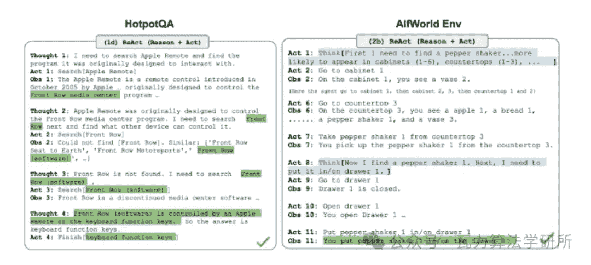
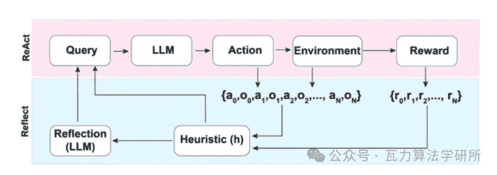

# 大模型Agent介绍（二）

> 来源：[https://geekbang.feishu.cn/docx/Ve9Bd8lOPomVtdx9ASicV6Rin4d](https://geekbang.feishu.cn/docx/Ve9Bd8lOPomVtdx9ASicV6Rin4d)

> 🔗 原文链接： h[ttps://mp.weixin.q](https://mp.weixin.qq.com/s/wcsibZc6ximEBg5gj9jmhA)q.com/s/wcsibZc6...

> ⏰ 剪存时间：2024-05-31 16:05:52 (UTC+8)

> ✂️ 本文档由 [飞书剪存 ](https://www.feishu.cn/hc/zh-CN/articles/606278856233?from=in_ccm_clip_doc)一键生成

> 👨🏻 作者：喜欢卷卷的瓦力

> 📃 作者介绍：985海归硕士、计算机专业，前AI大厂研究院高级算法研究员，前国企研究院算法专家，现外企top10上市集团人工智能研究员，算法研究与开发经历6年，深度参与头部大模型产品研发上线，在大模型/语音识别/视觉等领域有丰富的项目经验

> ⏰ 收录时间：2024-05-23 11:28:42

> 🔗 原文链接：h[ttps://mp.weixin.q](https://mp.weixin.qq.com/s/zU-mmn91UhS0x8NoX2757g)q.com/s/zU-mmn91...

关注作者👸号，获取更多AI知识

本篇继续总结了大模型面经中关于Agent部分相关的知识和内容。

LLM（大型语言模型） Agent 是一种能产出不单是简单文本的 AI 系统，使用 LLM 的能力，作为其计算引擎，让自己能够对话、任务执行、推理，实现一定程度的自主行动。 可以说，在这个大模型 AI 时代下，大模型应用 or AI Power + 的应用就是大模型 Agent，等同于移动互联时代的 APP。

本篇将继承上一篇的内容，继续讲解大模型面经中关于Agent部分相关的知识和内容。

下面是一个快捷目录：

1. LLM Agent中的模型自我反省定义

2.LLM Agent中的模型自我反省的方法

3.模型反省使用的框架之一：Reflexion

# LLM Agent中的模型自我反省定义

LLM Agent 中模型自我反省通常指的是模型对自身输出或行为的评估和调整过程。它是在上篇文章中介绍的拆解子任务的下一步，这种自我反省可能包括以下几个方面：

+   **性能评估： **模型可能会定期评估自己在特定任务上的性能，比如语言生成、文本分类或对话系统。这种评估通常包括指标如准确率、流畅度、多样性等。

+   **错误分析： **模型会分析自己产生的错误，包括误解输入、生成不通顺的文本、输出不符合语境等。通过识别错误的模式和原因，模型可以尝试纠正这些错误。

+   **领域适应： **如果模型在特定领域的表现不佳，它可能会尝试调整自身以适应该领域。这可能涉及到领域特定的数据增强、微调或其他方法。

+

+   **用户反馈处理： **如果模型接收到用户反馈，它可能会利用这些反馈来改进自身。这可能包括对用户请求的理解、对用户偏好的识别等。

# LLM Agent中的模型自我反省的方法

1.  ReAct（Reson+Act）： 它通过将动作空间扩展到特定任务的离散动作和语言空间的组合，将推理（Reasoning）和行动（Action）整合到LLM内部。

1.

1.  **推理（Reasoning）： **使LLM能够与环境交互（例如，使用Wikipedia Search的 API）；

1.

1.  **行动（Action）： **利用提示词来引导LLM生成完整的推理过程，以自然语言的形式呈现。

进一步的，ReAct提示词模板包含了提供LLM思考的明确步骤，其大致格式为：

+   Thought:

+   Action:

+   Observation:

上图为知识密集型任务（如HotpotQA、FEVER）和决策型任务（如AlfWorld Env、WebShop）的推理轨迹示例。 在知识密集型任务和决策任务的两个实验中，ReAct的表现比去掉Thought的单一Act方式更加优异。

# 模型反省使用的框架之一：Reflexion

上图为Reflexion的架构示意图。可以看到：

+   Reflexion 框架：旨在赋予智能体动态记忆和自我反思的能力，从而提升其推理能力。在 Reflexion 中，采用标准的强化学习设置，其中奖励模型提供简单的二进制奖励，而行动空间则沿用了 ReAct 的设置，即在特定任务的行动空间中加入语言元素，以实现复杂的推理步骤。在每一次行动后，智能体会计算一个启发式函数 ，并根据自我反思的结果来决定是否重置环境以开始新的循环。

+   自我反思过程通过为LLM创建一个两步示例，每个示例都包含一对（失败的路径、计划中指导进一步变化的理想反思）。然后，这些反思将被添加到Agent的工作记忆中，作为查询LLM上下文的一部分，最多三个。