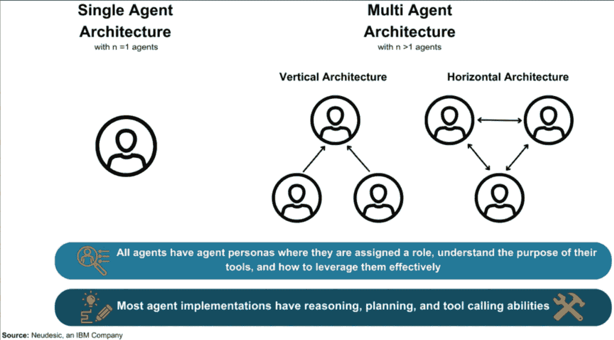
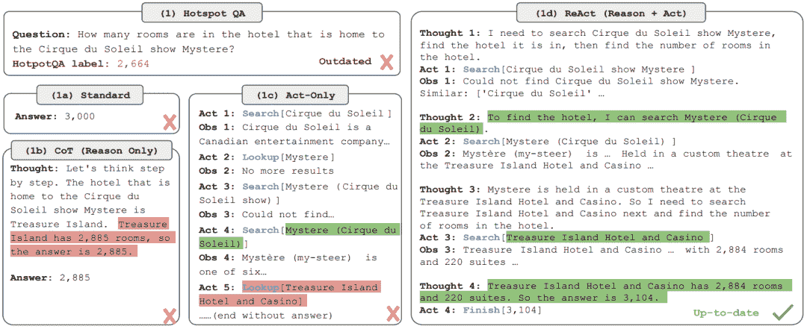
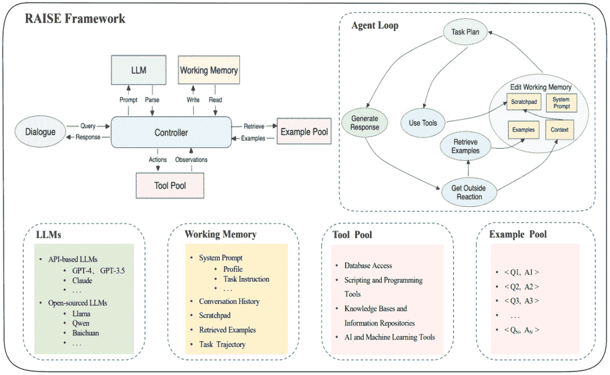
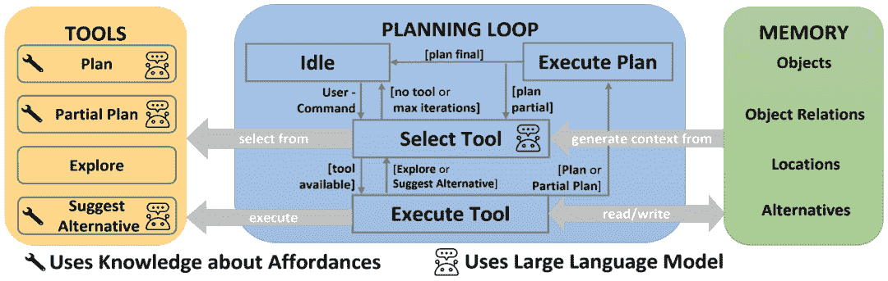
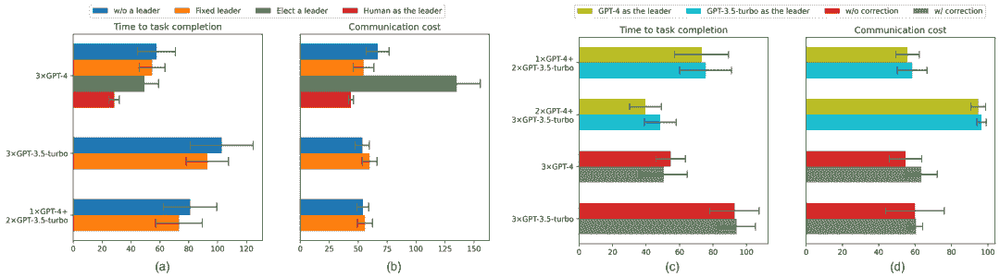
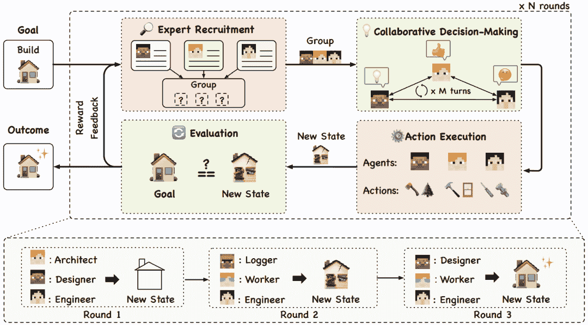

# 新兴人工智能Agent架构的综述：推理、规划和工具调用

> 来源：[https://geekbang.feishu.cn/docx/RNwddLggZofluvxDm4EcWV2cnFc](https://geekbang.feishu.cn/docx/RNwddLggZofluvxDm4EcWV2cnFc)

> 👨 作者：PaperAgent

> 📃 作者介绍：近10年NLP工作经验，在大模型RAG、Agent、知识图谱等方面有一些实践经验，欢迎交流~

> ⏰ 收录时间：2024-06-05 11:09:14 (UTC+8)

> 🔗 原文链接：   h[ttps://mp.weixin.q](https://mp.weixin.qq.com/s?__biz=Mzk0MTYzMzMxMA==&mid=2247485837&idx=1&sn=8ab2987ec36da0881bd722be8b7e6503&chksm=c2ce33fcf5b9baea6f9c6efbf5cdc1d35f6369e1f9d1312235aa2f1f4bfa952d83aaeb0afb87#rd)q.com/s?__biz=Mz...


欢迎关注公众号👆

自ChatGPT推出以来，许多第一波生成性AI应用已成为使用检索增强生成（RAG）模式在文档语料库上进**行聊天的变种。虽然有很**多**工作在**使R**AG系**统更**加健壮**，但**不同的团队开始**构建下一代AI应用的外观，集中在**一个共同的主题上： 智****能体（Agen****t） 。与用户**在开放式文本字段中输入并无需额外输入即可获得结果的大型语言模型的零次提示不同，智能体允许更复杂的交互和编排。特别是，智能体系统具有 规划 、 循环 、 反思 和 其他控制结构 的概念，这些结构充分利用了模型固有的推理能力来端到端完成任务。结合使用 工具、插件和函数调用 的能力，智能体被赋予了执行更通用工作的能力。 当问题定义明确且不需要来自其他 智能体 角色或用户的反馈时， 单 智能 体 架构表现出色；而当需要协作和多条不同的执行路径时， 多 智能 体 架构更倾向于蓬勃发展 。

**智能体（Agent）分类 **

AI智能体被定义为能够规划和采取行动以在多轮迭代中执行目标的语言模型驱动实体。 智 能 体 架构可以由单个 智 能 体 或多个协同工作解决问题的 智能体 组成。

图1：单 智能体 和多 智能体 架构及其底层特性和能力的可视化展示。



1.  **AI智能体定义 **：AI智能体被描述为能够规划和采取行动以在多轮迭代中执行目标的语言模型驱动实体。

1.  单 智 能体 与多 智 能体 架构 ：AI 智 能体 架构可以由单个 智 能体 构成，也可以由多个协同工作的 智 能体 构成，以解决特定的问题。

1.  **智能体 **角色（Agent Pers**ona）** ：每个 智 能体 被赋予一个角色或个性，这包括特定于该 智能体  的任何指令。角色还涉及 智能体  可以利用的工具的描述。

1.  **工具（Tools） **：在AI 智 能体 的上下文中，**工具指的**是模型可以调用的任何功能，允许 智能体  与外部数据源交互。

1.  **单 智能体  架构 **：由一个语言模型驱动，独立完成所有的推理、规划和工具执行。单 智 能体 模式没有来自其他AI 智 能体 的反馈机制，但可能包括人类提供反馈的选项。

1.  **多 智能体  架构 **：涉及两个或更多的 智 能体 ，它们可以利用相同的语言模型或不同的语言模型集合。每个 智 能体 通常有自己独特的角色。

1.  **垂直与水平架构 **：多 智 能体 架构被进一步细分为垂直和水平两种类型。垂直架构中有一个 智 能体 作为领导者，而水平架构中所有 智 能体 平等参与，共享信息和任务。

1.  **智能体 的三个组成部分 **：根据文中的定义， **智能体 **** 由“大**脑、感知和行动”三个基本部分组成，以满足 智能体  理解、推理和对其周围环境采取行动的最小需求。

单智能体（Single Agent ）架构

单智能体 架构由一个语言模型驱动，独立执行所有的推理、规划和工具执行。 成功的单智能体目标执行依赖于适当的规划和自我修正能力。 单智能体在执行直接功能调用且不需要其他智能体反馈的任务时特别有用。

**单智能体方法示例： **

**ReAct **：智能体首先写下关于给定任务的思考，然后根据这些思考执行动作，并观察输出，这个循环可以一直重复，直到任务完成。

图2：ReAct方法与其他方法比较的一个示例



**RAISE **：在ReAct方法的基础上增加了一个模仿人类短期和长期记忆的记忆机制，使用草稿本进行短期存储，使用类似先前案例的数据集进行长期存储。

图3：展示了RAISE方法的图表



**Reflexion **：使用语言反馈进行自我反思的单智能体模式，通过使用成功状态、当前轨迹和持久记忆等指标，利用大型语言模型（LLM）评估器为智能体提供具体和相关的反馈。

**AutoGPT + P **：针对以自然语言指挥机器人的智能体推理限制的方法，结合了对象检测和对象功能映射（OAM）以及由LLM驱动的规划系统。

图4：AutoGPT+P方法的图解



**LATS **：使用树进行规划、行动和推理的单智能体方法，通过树搜索算法选择行动，并在执行行动后使用环境反馈和语言模型反馈进行自我反思。

尽管单智能体架构在某些方面取得了进展，但它们在理解复杂逻辑、避免幻觉（hallucination）以及在需要多样性、探索和推理的任务上提高性能方面仍存在挑战。

多智能体（Multi Agent）架构

涉及两个或更多智能体，每个 智 能体 可以使用相同的语言模型或不同的语言模型集合。 多智能体架构通过智能体之间的沟通和协作计划执行来促进目标的实现。 这些架构通常涉及动态团队构建，以及在规划、执行和评估阶段对团队成员的智能分工。

多智能体架构分为两大类： **垂直架构 **和 **水平架构 **。垂直架构中有一个主导智能体，而水平架构中所有智能体地位平等，共同参与任务讨论。

**多智能体架构示例： **

**E**mbodied LLM Agents Learn to Cooperate in Organized Teams ：研究了领导智能体对团队整体效能的影响，发现有组织的领导智能体团队完成任务的速度比无领导的团队快。

图5：有指定领导者的智能体团队实现了更优越的表现



DyLAN (Dynamic LLM-Agent Network) ：创建了一个专注于复杂任务如推理和代码生成的动态智能体结构，通过动态评估和排名智能体的贡献来优化团队。

**AgentVerse **：通过为任务执行定义严格的阶段（招募、协作决策制定、独立行动执行和评估），帮助指导智能体更有效地推理、讨论和执行。

图6：AgentVerse方法的图解



**MetaGPT **：通过要求智能体生成结构化输出（如文档和图表）而不是分享非结构化的聊天信息，解决了智能体之间无效聊天的问题。

尽管AI智能体技术前景广阔，但仍存在一些挑战，包括建立全面的基准测试、确保现实世界的应用性，以及减轻语言模型的有害偏见。此外，从静态语言模型向更动态、自主的智能体发展的转变，旨在为使用现有或开发定制智能体架构的研究提供全面的理解和指导。

+

+

```
THE LANDSCAPE OF EMERGING AI AGENT ARCHITECTURES FOR REASONING, PLANNING, AND TOOL CALLING: A SURVEYhttps://arxiv.org/pdf/2404.11584.pdf
```