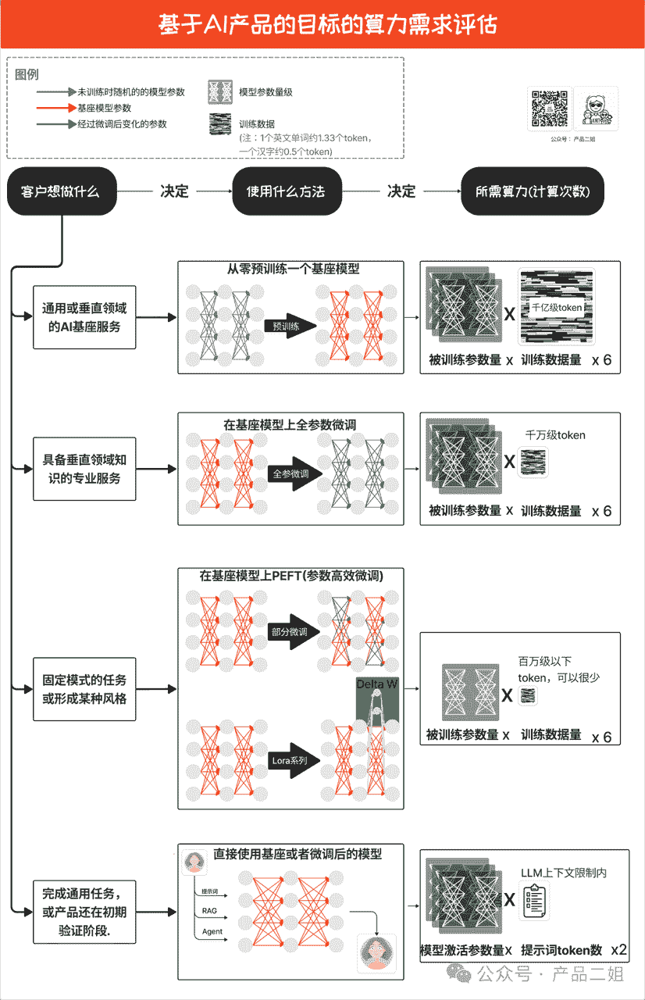
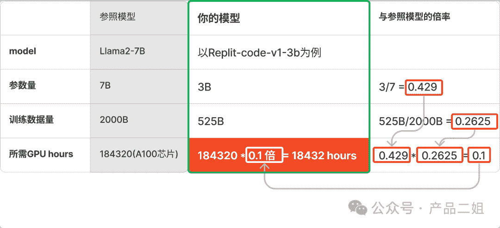
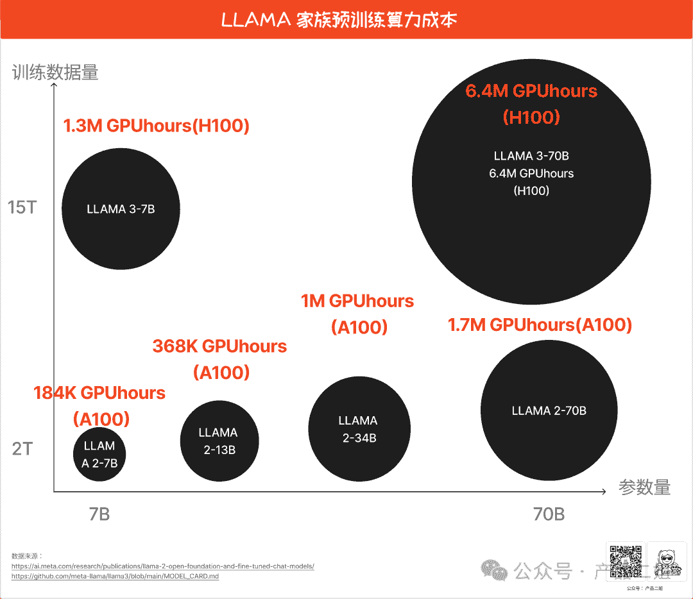
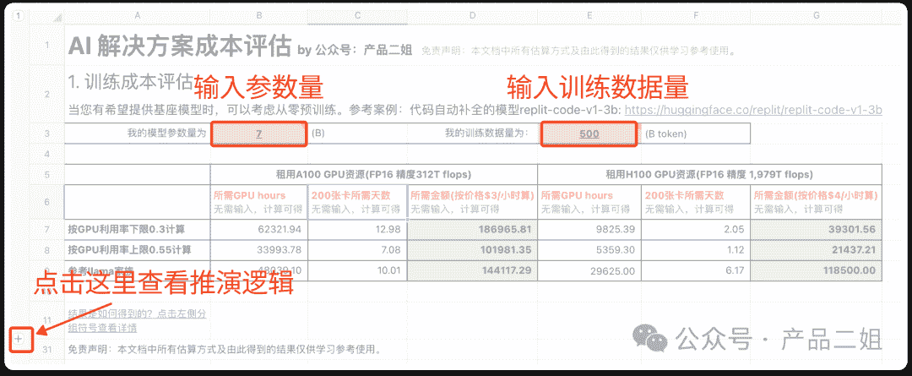
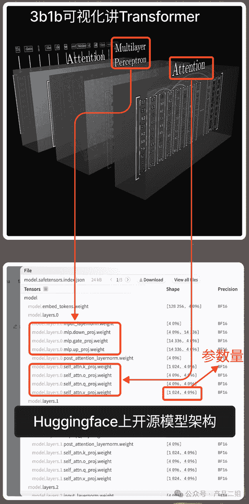
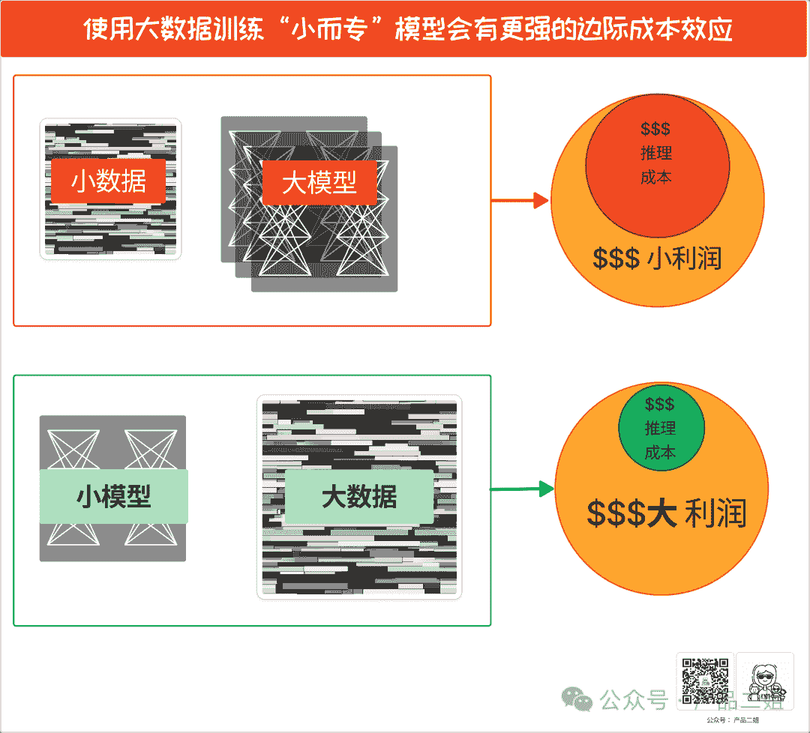
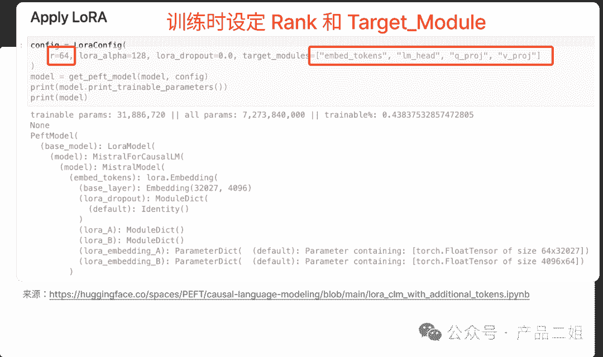
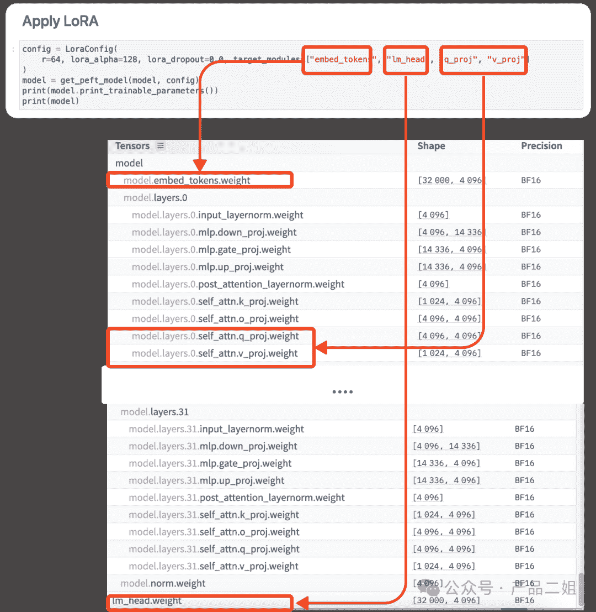
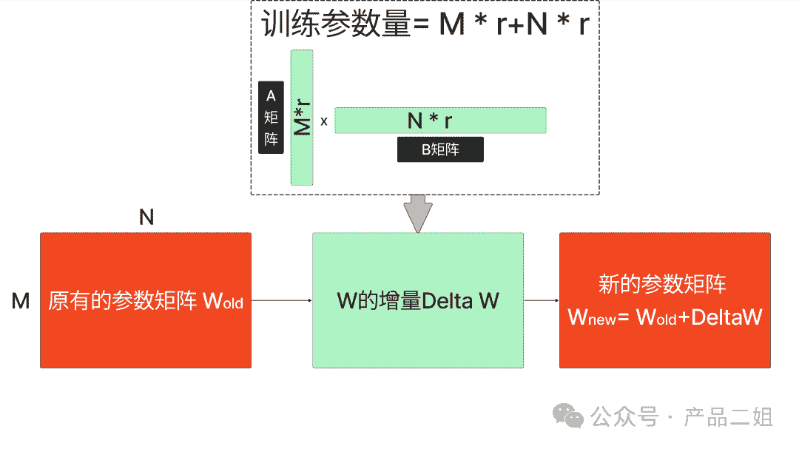
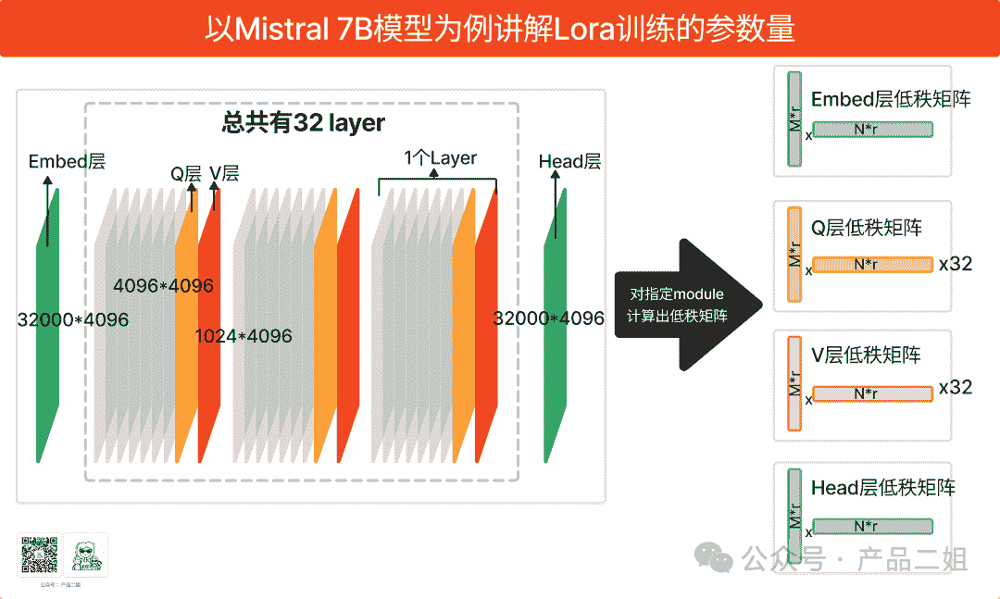

# 当老板问起落地AI解决方案要多少钱，你该如何回答

> 来源：[https://geekbang.feishu.cn/docx/DCz5dVyeToYkmGxao75czlNQn3A](https://geekbang.feishu.cn/docx/DCz5dVyeToYkmGxao75czlNQn3A)

> 👩 作者：产品二姐

> 📃 作者介绍：AI产品经理，AGI应用创业探索中，坚持用原创记录AI应用开发的科技博主，10+大厂、外企产品经理经验。

> ⏰ 收录时间：2024-05-29 20:38:29 (UTC+8)

> 🔗 原文链接： h[ttps://mp.weixin.q](https://mp.weixin.qq.com/s?__biz=MzUyODY0MTQ4OA==&mid=2247484897&idx=1&sn=fe2688efc616deac2f07c25501157b3a&chksm=fa6c795ecd1bf048034a5dab7229a9ac0960f7240ec4500dca5c8991ee6e19bda870b3fd75d8&token=1686081273&lang=zh_CN#rd)q.com/s?__biz=Mz...


欢迎关注👸号👆

## 引言

我有很多次被问到：要落地一个 AI 解决方案，需要花多少钱。

在阅读将近百篇文章后，试着尽我所能和大家讲清楚，并初步总结了一个带公式的飞书表格来计算(👸号回复“成本”)，但其中仍然有值得进一步探究的地方，留待以后探讨。文章较长，建议收藏。

首先申明这里仅仅讨论算力成本，AI 应用落地的成本很大部分还包括人力资源、数据准备，但这二者不在今天的讨论范围内。

如果把这个问题用一个函数来解的话，我们从客户那里得到入参仅仅是：

**入参 1：AI 产品的目标。**即客户想做什么事情，这决定了通过什么方式来解决问题，不同的方式有不同成本计算定律。

入参 2：客户对安全、隐私方面的诉求。这决定了模型部署方式：私有化本地部署，或是云上部署。前者是一次性投入，后者是持续投入，也决定了不同的成本计算方法。

这两个入参相互独立，呈正交关系。我会在不同 AI 产品目标中，再分别针对私有化部署和云上部署进行计算。

## 基于 AI 产品的目标来做的算力需求评估

计算成本的前提是计算出 算力需求，即 需要多少次运算，就可以依据以下公式算出需要使用`GPU`、多长时间做完训练，我们用`GPUhours`来表示 (参考 做大模型AI应用一定要了解的成本计算公式 ) 。

```
GPUhours=所需计算次数/(GPU 芯片每秒计算次数 * 3600 秒 * GPU 利用率)
```

我用一个图表达 AI 产品目标对算力需求的影响， 本文基本是围绕这张图来展开的，推荐大家仔细看 。

这张图第二列是实现方法，其实就是各种方法对神经网络的参数的改变程度，我用不同颜色的直线来表示这种变化（灰色代表未训练的模型参数，红色代表基座模型的参数，绿色代表经过微调后的参数）。

在第三列的所需算力，是对应方法需要的计算次数，这大体上与被训练的模型参数量和训练参数量成正比，我用图形大小来直观的代表规模大小。



在展开细节之前，我们先将上图概述出以下四个要点：

1. 从算力上讲： 在模型训练(对模型参数产生改变)中，不管是预训练还是微调，所需的算力都是：

`被训练的模型参数量 * 训练数据量 * 6`

这里乘以 6 是因为：在一次训练迭代中，包含前向传递和后向传递，前向传递对于每个 `token` 需要进行 2 次计算（一次加法，一次乘法），后向传递的计算量是前向传递的 2 倍，所以一次迭代总共是 6 次运算 (参考《分析 transformer 模型的参数量、计算量、中间激活、KV cache》，《浅谈后向传递的计算量大约是前向传递的两倍》)。

这再次告诉我们算力（计算次数），算法（模型大小）和数据（训练数据量）之间的密切关系。

2. 从 算法( 参数量)上来说： 预训练和全参微调，被训练的模型参数量和模型架构固有的参数量一致(图中的前两种情况)，`PEFT`-参数高效微调（图中第三种情况）的参数量和训练方法有关，后面会有详细讲解。

3. 从训练数据上来说： 预训练、全参微调和 `PEFT` 依次有数量级上的下降。

4. 最后一种情况，大多数情况下我们会直接使用模型厂商的服务，但如果用户希望私有化部署模型，则客户还需要承担日常的推理成本。所以这里并没有直接给出价格，而是仍然通过所需算力来表示，以方便私有化部署的读者参考。

最后，上图仅仅展示的是如何得出所需计算次数，是计算最终花多少钱的前提。在后文中，我们会按照两种情况给出具体金额的计算方法：

+ 如果是租用资源，可以根据计算次数推算出所需时长，乘以租用价格；

+ 如果是自己购买资源，首先需要计算模型的显存下限要求，在满足下限要求的情况下，计算出时间成本。或首先指定时间成本，再推算出所需硬件数量，然后根据市场价推算出购买硬件的成本。

接下来我们对每种情况做细致解读，其中也穿插了部分与大模型原理相关的知识，相信会对你有新的启发。

## 客户说：“我想提供通用或垂直领域 AI 基座服务”

你可能会**略过这一部分，因为目前来说由于成本高昂这不是大多数的人选择，但最近看到越来越多的训练成本较低的小模型在垂直领域表现越来越好。比如专注于 `Code Completion` 的小模型 `replit-code-v1-3b`，使用了 525B 代码数据训练，已经在自己产品中被较好地使用。按照现有的 `A100` 租用价格计算，`replit-code-v1-3b` 大约五万美元可完成一次训练 （马上会有推导）。这就让我不由地畅想未来会有各种垂直小模型，未来有可能你们也会拥有自己的小模型。因为算力成本还会下降，训练能力还会增强，数据会被进一步优质化、精简化。

### 快速估算：相对计算法

我们有个超级简单的方法来估算预训练成本：既然预训练所需计算次数与参数和数据量成正比，我们可以这两个数值与一个基准模型 `llama2`，或者 `llama3` 来对比，进行等比例推导就可以轻松获得。

比如下图中，参考 `llama2-7B` 的参数量，训练数据量，等比例倍率乘以 `llama2-8B` 消耗的 `GPU hours`，就可以得出训练 `replit-code-v1-3b` 所需 `GPU hours`。



在这里我列出重要的参照模型 `llama` 家族，并且也只有 `llama` 家族同时公布了参数量级、训练数据量级和所需 `GPU hours`，在做成本评估时，选取与你模型参数最接近 `llama` 版本作为基线标准。



但在后续的计算中发现使用`llama3` 作为基准模型计算的偏差较大，虽然`llama3` 使用了`H100`训练，但从`GPUhours`上看，`H100`超高速的计算能力和使用`A100`训练`llama2`的优势并无体现。

以上是基于某个基准模型的计算方法，我称为 相对计算法 。接下来我们再基于原理来算一下，一方面可以加深对 `LLM` 原理的理解，另一方面和上述的相对计算法对比，二者相互验证。

这两种方法我已经总结为飞书表格公式，👸号回复“成本” 即可获得飞书链接，需要您复制副本后在红框里输入参数量和训练数据量即可获得参考成本，点击左侧小+号展开即可获得详细推理公式，表格还会持续完善。



### 基于原理计算成本：绝对计算法

前面提到：

```
GPUhours=所需计算次数/(GPU 芯片每秒计算次数 * 3600 秒* GPU 利用率)
=被训练参数量*训练数据量*6/(GPU 芯片每秒计算次数*3600 秒*GPU利用率）
```

我就就来看看这两个变量： `被训练参数量`、`训练数据量` 。

1）被训练的参数量

预训练需要训练模型的全部参数，由模型架构本身决定的。我们一般从模型的名称中就可以得到，比如 `llama3-8B` 就是 80 亿参数。更直观一点，下图上部分是`3B1B` 的 `transformer`架构可视化 ，下面部分是 `huggingface` 上对 `Llama 3-8B` 模型参数的拆解，右侧数字对应这一层神经网络的参数矩阵的规模。比如`[1024,4096]`代表这一层有1024*4096个参数。



在估算预训练成本时，我们不需要知道模型每一层有多少参数，但对于稍后的参数高效微调，就需要知道模型的层级架构，比如 `Lora` 微调大多是在微调 `Attention` 这一层的参数。

2）关于预训练数据量的讨论

从零开始预训练模型的数据量最好有 200B 以上 `Token`(约 4000 亿汉字或 1500 亿英文单词)。但一般来说要比这个还要高，并且会越来越高，这源于一段大家对数据 `scaling law` 的认知变化：

> 在 2022 年初有一篇论文提出 `Chinchilla` 缩放定律，观点是当训练数据量是模型参数量的 15-25 倍，会取得比较好的收益。

> 在 2023 年 7 月初，有博客发表文章说 `Chinchilla` 缩放定律已死，认为只要数据量足够大，小模型也能被训练得很好。

> 紧接着在 2023 年 7 月中旬，`llama2` 发布，其中 7B 版本的小模型训练数据有 2T，是参数量的 285 倍。

> 后来在 2024 年 4 月 15 日，就有文章去复现 `Chinchila` 缩放定律时，发现原作者有一个地方算错了，按照新的理论:小模型经过大数据量的训练，也可以达到比较好的效果。

> 三天后，`llama3` 发布，其中 8B 版本的小模型训练数据为 15T，是参数量的 1875 倍。`Chinchilla` 缩放定律已经被打破。

当然预训练数据量大，意味着预训练成本也会变高，但模型越小，推理成本会变低，即用户的使用成本会变低。这时就会出现资本喜欢看到的 边际效应 ：使用大数据量预训练一个小模型，初期投入会大，但用户使用的成本变低。那么假设 `token` 价格不变，由于成本变低，利润就会变高。



可见将来数据仍然会越来越成为稀缺资源：掌握了优质数据，训练出来的小模型质量会越好。如果模型训练成本降低，模型的价值将更多地转嫁给数据，而非 `token` 数。比如未来我们可能会出现某个专业领域极强极强的模型，用户并不是通过使用 `token` 来计费，而是为模型能力去付费，而这种能力正是优质的专业数据赋予的。

定义好计算 算力 的两个关键因素，接下来据此计算成本。

3）用绝对计算法计算成本

仍然以 `Replit-code-v1-3b` 为例，假设使用 `A100` 训练，`A100-80G` 的计算能力是 312T `FLOS`(每秒可进行 312T 次`FP16`浮点计算)，那么：

```
GPU hours = (模型参数量*训练数据量 *6)/(312T * 3600 (0.3~0.55))
= 26706~14567 GPU hours
```

其中

+ 模型参数量 = 3B

+ 训练数据量为 525B

+ 3600 是一个小时换算得出的秒数

+ 0.3~0.55 是 `GPU` 有效利用率的范围

而用方法 A 计算得出的 18432 也在这个范围( 26706~14567 )中间，也证明了两种方法的一致性。

得到训练所需 `GPU hours` 后，就可以按照相应的价格来换算成钱了。

### 租用这么多算力需要多少钱

如果是租用 `A100` 芯片，成本会包含两部分：预训练成本和云端部署成本。

我用一个比喻来说明预训练成本和云端部署成本的关系：如果把大模型的能力比作电力，预训练相当于制造一个发电机，部署相当于在某个地方建设一个发电机厂房用来发电。

1） 训练成本

参考目前的 `A100` 租用成本不到$3.00/小时， 那么训练一个 `Replit-code-v1-3b`，大概需要：

`18432 * $3.00/hour = $55296`

这个数值是不是对某些公司还可以接受？当然这里我们没有考虑前期的尝试和踩坑成本，因为长期来看，这些成本会被边际化。

2）云端部署成本：

云端部署是持续的投入。所需的 `GPU` 资源主要用来加载模型的参数（放置发电机），我们一般会加上 20%的冗余。对于 `FP16` 精度的参数，所需显存就是为：

`推理所需显存(GB)= 2*模型参数量* 1.2`

还是以刚刚 3B 参数 `replit-code-v1-3b` 举例，所需 `GPU` 的内存至少为：`2*3 *1.2 = 7.2GB`。

这里我们可以考虑更划算的芯片，比如英伟达专门擅长推理的 `L40s-48G`，它的价格$1.34 /小时，每月为 `1.34*24小时*30 天 = $964/月`。

价格参考：`https://www.runpod.io/gpu-instance/pricing` (`https://www.runpod.io/gpu-instance/pricing`)

综上，在云端用 525B 数据训练一个 3B 小模型，并部署使用的成本为：

`预训练云上部署成本 = $ 55296 + $964 * 月数`

以上方法的公式已 总结为飞书表格公式，👸号回复“成本” 即可获得飞书链接，需要您复制副本后输入参数量和训练数据量即可获得参考成本，未来会持续完善。

### 私有化部署需要多少钱

那么如果你不想租，而是自采 `A100` 芯片，或者说是私有化部署，假定要在一个月时间训练完，你需要的 `A100` 芯片数量是：

`18432/24 小时/30 天 = 18， 总计成本约 360,000 美元。`

当然如果你对时间不敏感，比如可以容忍20倍时间训练完，是不是购买的 `A100` 芯片数量可以下降到 1/20 呢。答案是否定的，因为预训练阶段对 `GPU` 的显存有最低下限要求：

`预训练对 GPU 显存的最低要求 = 参数量(B)*18 byte+activation 所需内存`

(参考《Transformer Math 101》)

当 `batch_size=1`(每次训练仅输入一条数据)时，我们可以忽略 `activation` 的影响，直接用参数量(B) * 18 来计算。所以如果训练 `replit-code-v1-3b`，，至少需要 `18*3 = 54GB` 内存，1 张 `A100-80G` 够了，但你可能需要训练 540 天。如果训练 `llama3-8B`，至少要 `8*18 = 144GB` 内存，对应2 张 `A100-80G`。

### 总结

以上就是预训练的成本估算，核心想表达两个观点：

1. 尽管对于大多数公司仍然有很高门槛，但是预训练成本并没有想象中高，租用 `GPU` 资源 5 万美元左右可以训练一个垂直领域 3B 小模型，每月的持续费用大概是$964。

1. 如果你有足够优质、足够多的数据，单纯的通过预训练一个垂直领域极强的小模型可以有”边际成本“效应，让数据实现商业变现。

不过还是要强调一下，这里的成本仅仅是算力成本，人力成本、数据成本在基座模型的训练中也会占据很大比例。上述原理理解后，接下来其他场景的讲述会简单很多。

## 客户说：“我想有具备一定场景能力和领域知识的模型”

如果拿教育方式来比喻，基座模型是本科阶段的培养，具备一定场景能力或领域知识类似于研究生培养和企业培训。比如:

+ `OpenAI` 为了让基座模型更擅长对话，会对基座模型进行对话类指令微调后，然后才给 `ChatGPT` 使用。

+ 医疗相关的对话机器人，会对模型进行全参数微调，使 ta 获得领域知识。

这类需求要对基座模型进行全参微调，对于这类训练来说，决定算力需求的的两个因素以及计算成本是这样的：

1）被训练的参数量就是模型本身的参数量。

2）训练数据量方面，大约是千万、百万 `token`。比如：`Llama-3-8B-Instruct` 使用的微调数据包括“publicly available instruction datasets, as well as over 10M human-annotated examples” ，数量在千万级别。又比如在国家矿山安全监察局在去年 6 月发布的《智能化矿山数据融合共享 AI 大规模预训练模型技术要求》 中要求垂直领域模型的训练数据量在千万 `token` 以上。

3）计算算力成本。从理论上来说，计算方法和预训练方法一致， 由于训练数据量比预训练下降了三个数量级，在成本上也有数量级的下降， 大约是预训练成本的千分之一 (更多信息参考《Instruction Tuning for Large Language Models: A Survey》) 。

所以对于全参微调的成本估算，核心有两个观点：

1. 由于训练数据量有数量级的下降，全参微调的成本与预训练期间相比有数量级的下降。

1. 如果自采硬件进行全参微调，对硬件的瓶颈仍然是 `GPU` 显存而不是 `GPU` 的计算次数，姑且可以抛开训练数据，仅考虑模型大小进行估算，大体上是参数量*`18 byte`。

接下来看看比全参微调更轻的参数高效微调。

## 客户说：“我想让模型完成指定任务”

当客户要完成具有固定模式的任务时，可以采用 `PEFT` 参数高效微调，比如：

+ 训练某个角色使其学会相应的说话风格。

+ 根据用户诉求写出对应的 `SQL` 语句。

+ 为专门负责 `planner` 的 `agent` 进行指令微调，增强 `agent` 在专业领域的规划能力。（参考《Instruction Tuning for Large Language Models: A Survey》）

而 `PEFT` 之所以被称为参数高效微调，其含义就是微调只改变基座模型的部分参数，最常见的 `PEFT` 方法是 `Lora`，且在多种实验效果中，`Lora` 以性价比高著称。我们就以 `Lora` 为例，看看如何计算 `lora` 成本，依然从参数量、训练数据量开始。

### Lora 中被训练的参数量。

`Lora` 训练的参数量由两个因素决定：`target_module` 和 `Rank`，这两个值都是在训练时人为设定的。




## 1) target_module

在 `target_module` 就是指定训练哪一层的参数，结合前文的模型架构图，我们可以清晰的看到每一个 `module` 里含有多少参数。结合接下来的 `Rank` 值就可以得到需要训练多少参数。



但到底在需求下训练哪个 `target_module`，尚不清楚，有知道的同学欢迎告知。

## 2) Rank

即某个权重矩阵的 `Rank`，中文翻译为秩，秩是线性代数里的概念，直观理解是矩阵中可以抽取、压缩出来的特征数量。而大模型对信息做的向量化操作是在超高维空间 （比如 openAI 的 `text-embedding-3-large` embedding 模型高达 3072，即一个单词有 3072 个维度来定义) ，可以想象这种高维空间的矩阵应该有很多冗余信息，就可以被压缩为一个低秩矩阵进行计算，从而既保留了特征，又降低了计算量。在训练中，`Rank` 也是可以被指定的，`Rank` 越小，意味着原矩阵被压缩的越厉害，相应的细节丢失的也越多。

Lora 训练的原理是锁定基座模型的参数 `W` 不变，训练得到一个 `W` 的增量值 `DeltaW`，相当于在原有参数的基础上盖了一层薄薄的“帽子”。

`DeltaW` 在高维空间有很多冗余信息，因此在计算时通过两个低维矩阵 `A`，`B` 的点积来表达，其中矩阵 `A` 的大小是 `r*X`， 保留了矩阵的列特征，矩阵 `B` 的大小是 `Y*r`，保留了矩阵的行特征。最后 `A` 和 `B` 相乘就得到了 `DeltaW`,将 `DeltaW` 叠加到原有的模型参数 `W` 上，就形成了新的模型。这样我们只需要训练得到 `A`，`B` 两个矩阵参数(远远小于 `DeltaW` 大小)，就可以对 `W` 进行训练了。



接下来根据上述两个参数计算 Lora 中被训练的参数量。

## 3) 计算 Lora 中被训练的参数量

以Huggingface 上训练 Mistral 7B一个案例来讲解( https://huggingface.co/spaces/PEFT/causal-language-modeling/blob/main/lora_clm_with_additional_tokens.ipynb) ：

### Target Module：
这里指定的 `target_module` 是`"embed_tokens"`, `"lm_head"`, `"q_proj"`, `"v_proj"`，这几层对应的参数矩阵大小分别是：`32000*4096`， `32000*4096`，`4096*4096`，`1024*4096`

### Rank：
这里指定的 `rank=64`，那么这四个 `target_module` 对应的低秩矩阵 `A`、`B` 大小分别是：

+   Embed 层低秩矩阵`A`、`B`大小：`32000*64`， `64*4096`

+   `lm_head`层低秩矩阵`A`、`B`大小：`32000*64`， `64*4096`

+   Attention layer 的 `Q` 层低秩矩阵`A`、`B`大小：`4096*64`, `4096*64`, 总共有 32 个 `layer`

+   Attention layer 的 `V` 层低秩矩阵`A`、`B`大小：`1024*64`, `4096*64`, 总共有 32 个 `layer`

所以，这次 lora 微调总共需要的训练参数是就是把上述四项加起来：是 31,886,720， 而原始的 Mistral 7B 参数量是 7,273,849,000， 是原有参数量的 0.44%。计算过程我用一张图来说明。



抛开低成本因素，lora 的另一大特点是可插拔，Lora 训练得到的 `DeltaW` 可以理解为在模型之上的适配器，可以很容易的被 merge，叠加或者移除。

## 5.2 Lora 中的训练数据量

Lora 是用于完成特定任务的，因此 Lora 的训练数据必须是具有某个 pattern 的数据对，数据重在 pattern 统一，而非量大。比如 SQL 撰写模型，专门用来做情感判断等等，一般的数据量可以是几千对有标记的数据，大约百万、十万、几万级别的数据量都可以。

## 5.3 算力成本

参考之前的成本计算公式，PEFT 在参数量和训练数据量都有数量级的下降，算力成本低至几美元，几十美元。 如果是租用 `GPU` 资源来计算，依然利用以下公式可得：

`GPU hours = (模型参数量 * 训练数据量 * 6) / (GPU 芯片每秒计算次数 * 3600 秒 * GPU 有效利用率)`

如果自己买硬件，由于原有模型参数是被冻结，我们只需要加载和激活基座模型的参数，相对全参数训练的内存诉求，少了梯度值和优化器的存储需求，且低秩矩阵中的参数数量相比基座模型要小很多（甚至对内存的诉求可以忽略），Lora 微调对 `GPU` 显存降低至全参数微调的 1/3，这是一个经验值。

因此，lora 训练可以在一张消费级别的显卡比如 4090-24GB 上训练 7B 的模型 ( 参考案例：

https://github.com/huggingface/peft?tab=readme-ov-file)

## 6 客户说：“我想 完成通用任务 ” / “ 产品还在初期验证阶段 ”

这种情况下的成本估算比较最简单，如果是直接使用厂商大模型，只需要拿日常的token使用量*厂商的token单价即可获得，况且最近国内模型厂商已经打起了价格战，免费使用的token你都可以不用计算成本了。

📕博主“风隐”有总结最新的价目表，大家可以参考，不过这价格变来变去的，可能回头我搞个网站实时抓比较合适。如果大家需要，动手点个赞来激励一下本二姐吧。

## 7 总结

在写本文的过程中，我和众多大佬探讨过大模型应用的成本规划问题，总体来说，目前还没有非常成熟的指导方针，我也不敢说这篇文章中就没有纰漏，但让知识流动起来能让我们对它的正确性有更好的判断，欢迎大家批评指正。未来的修正和完善会在飞书表格里持续更新，关注👸号并回复“成本”可以收获链接，大家需要复制副本后方可编辑。

---

参考文章：

1.  《Chinchilla缩放定律》：https://arxiv.org/abs/2203.15556

1.  《Chinchilla’s death》https://espadrine.github.io/blog/posts/chinchilla-s-death.html

1.  《Revised Chinchilla scaling laws – LLM compute and token requirements》https://www.educatingsilicon.com/2024/04/29/revised-chinchilla-scaling-laws-impact-on-llm-compute-and-token-requirements/

1.  《Chinchilla Scaling: A replication attempt》https://arxiv.org/abs/2404.10102

1.  《分析transformer模型的参数量、计算量、中间激活、KV cache》https://zhuanlan.zhihu.com/p/624740065

1.  《浅谈后向传递的计算量大约是前向传递的两倍》https://zhuanlan.zhihu.com/p/675517271

1.  《Transformer Math 101》https://blog.eleuther.ai/transformer-math/

1.  《Huggingface model: Replit-code-v1-3b》https://huggingface.co/replit/replit-code-v1-3b

1.  《Instruction Tuning: EMNLP 2023 Overview Part 1》https://krayush.medium.com/instruction-tuning-emnlp-2023-overview-part-1-dd332345b650

1.  《Instruction Tuning for Large Language Models: A Survey》https://arxiv.org/pdf/2308.10792

1.  《Anatomy of Model's Memory》https://huggingface.co/docs/transformers/v4.20.1/en/perf_train_gpu_one#anatomy-of-models-memory

1.  《Model Memory Calculator》：https://huggingface.co/spaces/hf-accelerate/model-memory-usage

1.  《structure of mistral 7B》:https://huggingface.co/mistralai/Mistral-7B-v0.1?show_file_info=model.safetensors.index.json

1.  《mistral 7b PEFT》：https://huggingface.co/spaces/PEFT/causal-language-modeling/blob/main/lora_clm_with_additional_tokens.ipynb

1.  《 PEFT案例》

1.  https://github.com/huggingface/peft?tab=readme-ov-file

1.  《PEFT方法》https://github.com/ray-project/ray/tree/master/doc/source/templates/04_finetuning_llms_with_deepspeed

1.  《Efficient Training on a Single GPU》

1.  https://huggingface.co/docs/transformers/v4.20.1/en/perf_train_gpu_one

1.  《LoRA》https://huggingface.co/docs/peft/main/en/conceptual_guides/lora#common-lora-parameters-in-peft

1.  《lora-intuitive understanding》https://www.quora.com/What-are-intuitive-explanations-of-low-rank-and-locally-low-rank-matrices

1.  《Fine tune Mistral 7B with the RTX 4090 and serve it with Nx》 https://toranbillups.com/blog/archive/2023/10/21/fine-tune-mistral-and-serve-with-nx/

1.  《litgpt》https://github.com/Lightning-AI/litgpt?tab=readme-ov-file

1.  《Fine-Tuning LLMs: LoRA or Full-Parameter? An in-depth Analysis with Llama 2》

1.  https://www.anyscale.com/blog/fine-tuning-llms-lora-or-full-parameter-an-in-depth-analysis-with-llama-2

1.  《Full parameters Fintune Mistral 7b v0.2 instructs on 96 Gb GPUs with accelrate and FSDP》 https://medium.com/@mustafaazzurri/full-parameters-fintune-mistral-7b-v0-2-instructs-on-96-gb-gpus-with-accelrate-and-fsdp-b7aa78553d39

1.   《 Instruction Tuning: EMNLP 2023 Overview Part 1》

1.  https://krayush.medium.com/instruction-tuning-emnlp-2023-overview-part-1-dd332345b650

1.  《What’s batch size in LLM training or fine-tuning?》:https://blog.gopenai.com/cuda-out-of-memory-try-reduce-batch-size-a5708274da3a

1.  《Revised Chinchilla scaling laws – LLM compute and token requirements》https://www.educatingsilicon.com/2024/04/29/revised-chinchilla-scaling-laws-impact-on-llm-compute-and-token-requirements/

1.  《智能化矿山数据融合共享AI 大规模预训练模型技术要求》https://www.chinamine-safety.gov.cn/xw/zt/2018zt/mkjqryfyy/gzdt_01/202307/W020230704685338166254.pdf

1.  《What’s batch size in LLM training or fine-tuning?》https://blog.gopenai.com/cuda-out-of-memory-try-reduce-batch-size-a5708274da3a
